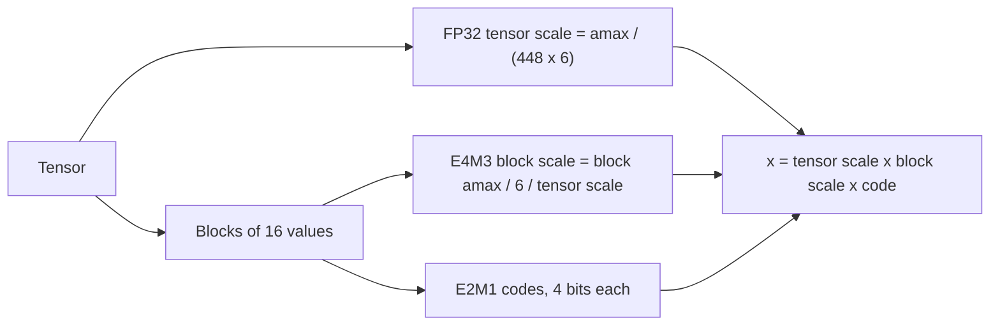

# FP8, MXFP4 and NVFP4

## Introduction

Integer quantization spaces its levels evenly, so it needs a carefully chosen scale for every small group of numbers. **Low-bit floating-point formats** take a different approach. They keep a tiny exponent, so their levels are dense near zero and sparse further out, which suits the bell-shaped distributions of weights and activations. Since NVIDIA's Hopper generation (2022), GPUs have had tensor cores that multiply 8-bit floats directly. Blackwell (2024) added 4-bit floats with hardware block scaling. These formats now show up everywhere:

- **FP8** checkpoints such as `Qwen/Qwen3-8B-FP8` and the native weights of DeepSeek-V3, which was also trained in FP8;
- **MXFP4**, the format of the expert weights in OpenAI's gpt-oss models, which is what lets gpt-oss-120b fit on a single 80 GB GPU;
- **NVFP4**, NVIDIA's 4-bit format for Blackwell, used for inference checkpoints and, in research, for pretraining.

By the end of this page you will be able to decode any FP8 or FP4 bit pattern by hand, explain why E4M3 and E5M2 exist side by side, describe how the MX and NVFP4 block formats attach scales, implement both in PyTorch, and read the `quantization_config` of an FP8 or FP4 checkpoint.

## Floating Point in Very Few Bits

A floating-point number with $E$ exponent bits, $M$ mantissa bits and exponent bias $b$ represents:

$$
x = (-1)^{\mathrm{sign}} \times \left(1 + \frac{m}{2^{M}}\right) \times 2^{\,e - b} \quad \text{for } e \ge 1
$$

$$
x = (-1)^{\mathrm{sign}} \times \frac{m}{2^{M}} \times 2^{\,1 - b} \quad \text{for } e = 0 \text{ (subnormal)}
$$

Here $e$ is the stored exponent field read as an unsigned integer and $m$ the mantissa field. Normal numbers have an implicit leading 1. Subnormals, with $e = 0$, give up that leading 1 so that values can fade gradually towards zero instead of jumping to it.

The key property: within each power-of-two interval $[2^k, 2^{k+1})$ there are exactly $2^M$ evenly spaced values. The **relative** spacing stays the same at every magnitude, about $2^{-M}$, instead of the fixed **absolute** spacing of an integer format. More exponent bits widen the range, and more mantissa bits refine each interval.

### E4M3 and E5M2

The two FP8 formats were proposed jointly by NVIDIA, Arm and Intel in "FP8 Formats for Deep Learning" (Micikevicius et al., 2022) and later standardized by the Open Compute Project (OCP):

| Property | E4M3 | E5M2 |
| --- | --- | --- |
| Exponent / mantissa bits | 4 / 3 | 5 / 2 |
| Exponent bias | 7 | 15 |
| Values per power of two | 8 | 4 |
| Largest finite value | 448 | 57344 |
| Smallest normal value | $2^{-6} \approx 0.0156$ | $2^{-14} \approx 6.1 \times 10^{-5}$ |
| Smallest subnormal | $2^{-9} \approx 0.00195$ | $2^{-16} \approx 1.5 \times 10^{-5}$ |
| Infinities | none | yes, IEEE style |
| NaN encodings | only S.1111.111 | IEEE style |
| PyTorch dtype | `torch.float8_e4m3fn` | `torch.float8_e5m2` |

E5M2 follows the IEEE 754 rules, so it is effectively FP16 with the bottom 8 bits cut off. E4M3 breaks the rules to gain range. It has no infinities, and only the all-ones pattern is NaN, so the codes with exponent 1111 are mostly ordinary numbers. That raises its maximum from 240 to 448. The "fn" in `float8_e4m3fn` stands for "finite" and "NaN only". AMD's MI300 GPUs use a variant, `float8_e4m3fnuz`, with a bias of 8 and a single NaN at negative zero, so checkpoints sometimes need converting between the two.

The usual division of labour, from the 2022 paper: **E4M3** for weights and activations in the forward pass, where precision matters, and **E5M2** for gradients in the backward pass, where values span a wider range. DeepSeek-V3 later showed that with fine-grained scaling, E4M3 can be used for everything.

### FP4: E2M1

The 4-bit float used by both MXFP4 and NVFP4 is **E2M1**: 1 sign bit, 2 exponent bits (bias 1) and 1 mantissa bit. It has no infinities or NaN. Its 16 codes give only 15 distinct values, because +0 and −0 are the same number:

$$
\pm\{0,\ 0.5,\ 1,\ 1.5,\ 2,\ 3,\ 4,\ 6\}
$$

Compare INT4, whose levels $-7, \dots, 7$ are evenly spaced. FP4 spends its codes near zero, where most of a bell-shaped distribution lies, and accepts coarse steps (4 to 6) out in the tails.

The script below decodes every bit pattern with the formula above, checks the E4M3 decoder against PyTorch's built-in dtype for all 256 codes, and shows how the two FP8 formats round the same numbers:

```python
import torch

def decode_minifloat(bits, exp_bits, man_bits, bias):
    """Decode an unsigned bit pattern of a sign-exponent-mantissa float (no special values)."""
    sign = -1.0 if bits >> (exp_bits + man_bits) else 1.0
    e = (bits >> man_bits) & ((1 << exp_bits) - 1)
    m = bits & ((1 << man_bits) - 1)
    if e == 0:                                                     # subnormal: no implicit leading 1
        return sign * (m / 2**man_bits) * 2.0 ** (1 - bias)
    return sign * (1 + m / 2**man_bits) * 2.0 ** (e - bias)

# E2M1 (FP4): 1 sign, 2 exponent, 1 mantissa bit, bias 1
fp4 = sorted({decode_minifloat(b, 2, 1, 1) for b in range(16)})
print("E2M1 values:", fp4)

# E4M3: bias 7. Check against PyTorch's float8_e4m3fn for every one of the 256 bit patterns
codes = torch.arange(256, dtype=torch.uint8)
torch_vals = codes.view(torch.float8_e4m3fn).float()
mine = torch.tensor([decode_minifloat(b, 4, 3, 7) for b in range(256)])
finite = ~torch.isnan(torch_vals)
print("E4M3 NaN codes:", codes[~finite].tolist())
print("E4M3 matches torch on finite codes:", torch.equal(mine[finite], torch_vals[finite]))
pos = torch_vals[finite & (torch_vals > 0)]
print("E4M3 smallest subnormal", pos.min().item(), "smallest normal", 2.0 ** -6, "max", pos.max().item())
print("E5M2 max", torch.finfo(torch.float8_e5m2).max, "smallest normal", torch.finfo(torch.float8_e5m2).tiny)

# Relative spacing: E4M3 has 8 values per power of two, E5M2 only 4
for x in (1.0, 3.3, 100.0):
    t = torch.tensor([x])
    print(f"x={x:6}: e4m3 -> {t.to(torch.float8_e4m3fn).float().item():8.4f}   "
          f"e5m2 -> {t.to(torch.float8_e5m2).float().item():8.4f}")
```

```text
E2M1 values: [-6.0, -4.0, -3.0, -2.0, -1.5, -1.0, -0.5, 0.0, 0.5, 1.0, 1.5, 2.0, 3.0, 4.0, 6.0]
E4M3 NaN codes: [127, 255]
E4M3 matches torch on finite codes: True
E4M3 smallest subnormal 0.001953125 smallest normal 0.015625 max 448.0
E5M2 max 57344.0 smallest normal 6.103515625e-05
x=   1.0: e4m3 -> 1.0000   e5m2 -> 1.0000
x=   3.3: e4m3 -> 3.2500   e5m2 -> 3.5000
x= 100.0: e4m3 -> 96.0000   e5m2 -> 96.0000
```

Check one by hand. Code 126 is `0 1111 110` in binary: sign 0, exponent field 15, mantissa 6. That gives $(1 + 6/8) \times 2^{15-7} = 1.75 \times 256 = 448$, the E4M3 maximum. Code 127, `0 1111 111`, is the NaN. Between 2 and 4, E4M3 has steps of 0.25, so 3.3 rounds to 3.25. E5M2 has steps of 0.5 there and rounds 3.3 to 3.5.

## Scaling FP8: Per-Tensor and Block-Wise

FP8 has a wider dynamic range than INT8, but a range of 448 is still nowhere near enough to hold raw values that may be tiny (weights around 0.02, most of which fall in E4M3's coarse subnormal region) or huge (activation outliers in the hundreds or thousands). So FP8 is used with a scale, just like integers:

$$
x_{\text{fp8}} = \mathrm{cast}_{\text{E4M3}}\!\left(\frac{x}{s}\right), \qquad s = \frac{\max \lvert x \rvert}{448}
$$

The scale granularity options are the familiar ones:

- **Per-tensor**, with **delayed scaling**: the scale comes from a running history of past maximum values, so a single fused kernel can quantize as it goes. NVIDIA's Transformer Engine introduced this recipe for Hopper training.
- **Per-channel weights and per-token dynamic activations**, the `FP8_DYNAMIC` scheme in llm-compressor. This is a common choice for FP8 inference.
- **Block-wise**, as in DeepSeek-V3 (2024): one scale per 1×128 tile of activations (per token, per 128 channels) and one per 128×128 block of weights, computed online from the current values. Because each tile has its own scale, an outlier only damages its own tile. DeepSeek also moved partial sums to FP32 every 128 elements of the reduction, because Hopper's FP8 tensor cores accumulate with limited precision. With this recipe the FP8 model's training loss stayed within 0.25% of a BF16 baseline. The embedding, the output head, MoE gating, normalization and attention stayed in higher precision.

That block layout is exactly what DeepSeek-V3's and Qwen3's FP8 checkpoints declare in `config.json`:

```json
{
  "quantization_config": {
    "activation_scheme": "dynamic",
    "fmt": "e4m3",
    "quant_method": "fp8",
    "weight_block_size": [128, 128]
  }
}
```

The effect of block scaling on an outlier is easy to show. The script quantizes a weight matrix to FP8 directly, with a per-tensor scale, and with 128×128 block scales, then plants one huge outlier and measures the error on all the other weights:

```python
import torch

torch.manual_seed(0)
E4M3_MAX = torch.finfo(torch.float8_e4m3fn).max                      # 448.0

def fp8_per_tensor(w):
    scale = w.abs().max() / E4M3_MAX                                 # one FP32 scale for the tensor
    return (w / scale).to(torch.float8_e4m3fn).float() * scale

def fp8_block(w, b=128):
    """DeepSeek-V3 style: one scale per 128 x 128 weight tile."""
    out_f, in_f = w.shape
    t = w.reshape(out_f // b, b, in_f // b, b)                       # (tiles_r, 128, tiles_c, 128)
    scale = t.abs().amax(dim=(1, 3), keepdim=True) / E4M3_MAX
    return ((t / scale).to(torch.float8_e4m3fn).float() * scale).reshape(out_f, in_f)

def rel_err(wq, w, mask=None):
    mask = torch.ones_like(w, dtype=torch.bool) if mask is None else mask
    return ((wq - w)[mask].norm() / w[mask].norm()).item()

w = torch.randn(1024, 1024) * 0.02                                   # typical weight scale
print("no scaling (direct cast)", f"{rel_err(w.to(torch.float8_e4m3fn).float(), w):.4f}")
print("per-tensor scale        ", f"{rel_err(fp8_per_tensor(w), w):.4f}")
w[3, 7] = 2000.0                                                     # one huge outlier
rest = torch.ones_like(w, dtype=torch.bool)
rest[3, 7] = False                                                   # measure error on all other weights
print("outlier, per-tensor     ", f"{rel_err(fp8_per_tensor(w), w, rest):.4f}")
print("outlier, 128x128 tiles  ", f"{rel_err(fp8_block(w), w, rest):.4f}")
```

```text
no scaling (direct cast) 0.0330
per-tensor scale         0.0264
outlier, per-tensor      0.1259
outlier, 128x128 tiles   0.0306
```

Without a scale, weights of size 0.02 sit in E4M3's subnormal range and lose precision. A per-tensor scale fixes that (2.6% error, about what 3 mantissa bits allow: the worst-case relative rounding error is $2^{-4}$, about 6%, and the average is lower). One outlier pushes every other weight back down into the subnormals, and the error rises to 12.6%. With block scales, only the 16,384 weights in the outlier's tile suffer, so the error barely moves.

## Microscaling: The MX Formats

At 4 bits, a scale per 128×128 block is far too coarse. The **Microscaling (MX)** formats, described by Rouhani et al. (2023) and published by the Open Compute Project as the MX v1.0 specification in 2023 with backing from AMD, Arm, Intel, Meta, Microsoft, NVIDIA and Qualcomm, build the scale into the format itself:

- a **block** of $k = 32$ consecutive elements;
- one shared scale per block in **E8M0**: 8 exponent bits and no mantissa, so the scale is always a power of two, $2^{-127}$ to $2^{127}$, with one code reserved for NaN;
- elements in a narrow format: FP8 (MXFP8), FP6 (MXFP6), FP4 E2M1 (**MXFP4**) or INT8 (MXINT8).

A block decodes as $x_i = 2^{\,e_{\text{shared}}} \cdot p_i$. MXFP4 therefore costs $4 + 8/32 = 4.25$ bits per element. A power-of-two scale is cheap in hardware, because multiplying by it only adds to the exponent.

The specification chooses the shared exponent from the block's largest magnitude:

$$
e_{\text{shared}} = \left\lfloor \log_2 \max_i \lvert x_i \rvert \right\rfloor - e_{\max}^{\text{elem}}
$$

where $e_{\max}^{\text{elem}}$ is the exponent of the largest normal number of the element format. For E2M1 that is 2, since $6 = 1.5 \times 2^2$. This maps the block's largest value to somewhere in $[4, 8)$ after scaling. Anything that lands between 6 and 8 saturates to 6, so the largest values of a block can be clipped. Some implementations round the exponent up instead, trading clipping for coarser steps.

### MXFP4 in gpt-oss

OpenAI's gpt-oss models (2025) ship their mixture-of-experts weights in MXFP4. The model card explains why: the expert weights make up over 90% of the parameters, so quantizing them alone brings gpt-oss-120b (116.8 billion total parameters) to a 60.8 GiB checkpoint, small enough for one 80 GB H100 or MI300X, and gpt-oss-20b to 12.8 GiB, which runs within 16 GB of memory. The `config.json` lists what is left in BF16:

```json
{
  "quantization_config": {
    "quant_method": "mxfp4",
    "modules_to_not_convert": [
      "model.layers.*.self_attn",
      "model.layers.*.mlp.router",
      "model.embed_tokens",
      "lm_head"
    ]
  }
}
```

This is the common pattern for low-bit checkpoints: the large, robust weights (here the MoE experts) go to 4 bits, while the small, sensitive parts (attention, router, embeddings and output head) stay at 16 bits. llama.cpp has a matching `MXFP4_MOE` type that stores experts in MXFP4 and everything else in `Q8_0`.

## NVFP4: Smaller Blocks and a Finer Scale

NVFP4, introduced with Blackwell, keeps the E2M1 elements but changes the scaling in three ways:

1. **Blocks of 16** instead of 32, so each scale covers a narrower slice of values.
2. **E4M3 block scales** instead of E8M0. The scale can be any FP8 value, not just a power of two, so the block maximum can land exactly on 6, with no clipping and no wasted range.
3. **A second, per-tensor FP32 scale**, because an E4M3 scale covers fewer than 18 powers of two. The tensor scale first maps the whole tensor into the range that FP8 times FP4 can represent, and the block scales then fit each block within that range.

The decode is $x_i = s_{\text{tensor}} \cdot s_{\text{block}} \cdot p_i$, at $4 + 8/16 = 4.5$ bits per element plus a negligible 32 bits per tensor.



The script below implements MXFP4 and NVFP4 as described, and compares them with INT4 using an FP16 scale per block. It tests two kinds of data: Gaussian values, and heavy-tailed Student-t values (3 degrees of freedom), which resemble real weights and activations more closely.

```python
import torch

torch.manual_seed(0)
FP4_GRID = torch.tensor([0.0, 0.5, 1.0, 1.5, 2.0, 3.0, 4.0, 6.0])   # E2M1 magnitudes

def round_to_fp4(x):
    """Round to the nearest E2M1 value (saturating at +-6)."""
    mag = x.abs().clamp(max=6.0)
    idx = (mag.unsqueeze(-1) - FP4_GRID).abs().argmin(dim=-1)       # nearest grid point
    return torch.sign(x) * FP4_GRID[idx]

def mxfp4(w, block=32):
    """OCP MX: 32 elements share one power-of-two (E8M0) scale."""
    wb = w.reshape(-1, block)                                        # (n_blocks, 32)
    amax = wb.abs().amax(dim=1, keepdim=True).clamp(min=2**-126)
    shared_exp = torch.floor(torch.log2(amax)) - 2                   # 2 = exponent of the largest E2M1 value (6 = 1.5 * 2^2)
    scale = 2.0 ** shared_exp
    return (round_to_fp4(wb / scale) * scale).reshape_as(w)

def nvfp4(w, block=16):
    """NVFP4: 16 elements share an E4M3 scale, plus one FP32 scale per tensor."""
    wb = w.reshape(-1, block)                                        # (n_blocks, 16)
    tensor_scale = w.abs().max() / (448.0 * 6.0)                     # maps the tensor into FP8 x FP4 range
    block_scale = (wb.abs().amax(dim=1, keepdim=True) / 6.0 / tensor_scale)
    block_scale = block_scale.to(torch.float8_e4m3fn).float()        # the block scale itself is stored in E4M3
    scale = (block_scale * tensor_scale).clamp(min=1e-12)
    return (round_to_fp4(wb / scale) * scale).reshape_as(w)

def int4(w, block):
    """Symmetric INT4 with one FP16 scale per block."""
    wb = w.reshape(-1, block)
    scale = (wb.abs().amax(dim=1, keepdim=True) / 7).half().float()
    return (torch.clamp(torch.round(wb / scale), -7, 7) * scale).reshape_as(w)

def rel_err(wq, w):
    return ((wq - w).norm() / w.norm()).item()

tensors = {
    "gaussian": torch.randn(1024, 1024),
    "student-t (df=3)": torch.distributions.StudentT(3.0).sample((1024, 1024)),
}
print(f"{'format':<22}{'bits/weight':>12}" + "".join(f"{k:>20}" for k in tensors))
for name, fn, bpw in [("INT4, block 32", lambda w: int4(w, 32), 4 + 16 / 32),
                      ("INT4, block 16", lambda w: int4(w, 16), 4 + 16 / 16),
                      ("MXFP4 (E8M0 / 32)", mxfp4, 4 + 8 / 32),
                      ("NVFP4 (E4M3 / 16)", nvfp4, 4 + 8 / 16)]:
    print(f"{name:<22}{bpw:>12.2f}" + "".join(f"{rel_err(fn(w), w):>20.4f}" for w in tensors.values()))
```

```text
format                 bits/weight            gaussian    student-t (df=3)
INT4, block 32                4.50              0.0971              0.1295
INT4, block 16                5.00              0.0852              0.1010
MXFP4 (E8M0 / 32)             4.25              0.1149              0.1345
NVFP4 (E4M3 / 16)             4.50              0.0952              0.0815
```

On Gaussian data, NVFP4 is about as accurate as INT4 with the same bit budget, and MXFP4 is a little worse, because it has fewer bits and its power-of-two scale with clipping is cruder. On heavy-tailed data, NVFP4 is clearly the best of the four, even better than INT4 with 5 bits per weight. Small blocks contain each outlier, and the float grid keeps fine steps near zero for the many small values that share a block with a large one. This matches the reasoning in NVIDIA's NVFP4 pretraining paper (2025), which credits the 16-element blocks and the finer E4M3 scale for NVFP4's advantage over MXFP4.

## Hardware Support and When to Use Which

Formats only speed things up when the tensor cores can consume them directly. On other hardware they still save memory, because kernels can dequantize them to BF16 on the fly, but the arithmetic runs at BF16 speed.

| Hardware | INT8 tensor cores | FP8 E4M3/E5M2 | MXFP4 / NVFP4 in tensor cores |
| --- | --- | --- | --- |
| NVIDIA Ampere (A100, RTX 30) | yes | no | no |
| NVIDIA Ada (L40S, RTX 40) and Hopper (H100, H200) | yes | yes | no, weight-only dequantization |
| NVIDIA Blackwell (B200, GB200, RTX 50) | yes | yes, plus MXFP8 | yes |
| AMD Instinct MI300 | yes | yes, in the `fnuz` variants | no |

A practical guide:

- **FP8 (W8A8)** is the default high-throughput format on Hopper and newer. It is close to lossless for most models, needs little or no calibration, and speeds up both prefill and large-batch decoding. Use block or per-channel scales.
- **MXFP4** suits weight storage when you need an open, vendor-neutral 4-bit format, as gpt-oss shows. Its power-of-two scales are cheap but cost some accuracy.
- **NVFP4** is the most accurate 4-bit float of the three and the natural choice for W4A4 inference on Blackwell. NVIDIA has also shown it can be used for pretraining: a 12-billion-parameter model trained on 10 trillion tokens matched an FP8 baseline, using random Hadamard transforms, stochastic rounding of gradients and a few layers kept in BF16.

To produce these checkpoints, llm-compressor has schemes named `FP8_DYNAMIC`, `FP8_BLOCK`, `MXFP4`, `NVFP4` and `NVFP4A16` (the last is weight-only). NVIDIA's ModelOpt produces NVFP4 checkpoints for TensorRT-LLM and vLLM. In Hugging Face Transformers, FP8 block checkpoints load through the `FineGrainedFP8Config` path and gpt-oss through `Mxfp4Config`, picked up automatically from `config.json`. For the training side of FP8, see [Mixed Precision Training](../6-llm-pretraining/4-llm-mixed-precision.mdx).

:::note
"FP4" on a model card is ambiguous. Check whether it means MXFP4 (blocks of 32, power-of-two scales) or NVFP4 (blocks of 16, E4M3 scales plus a tensor scale), and whether activations are quantized too (W4A4) or only weights (W4A16). The bits per weight, the hardware requirements and the accuracy all differ.
:::

## Common Mistakes

- **Casting to FP8 without a scale.** Small weights fall into the subnormal range and lose precision, and activations above 448 saturate (or turn into NaN, depending on the cast). Always scale by the maximum absolute value first.
- **Using E5M2 for forward-pass weights.** It has half the mantissa resolution of E4M3. Keep E5M2 for gradients, if you use it at all.
- **Mixing up `e4m3fn` and `e4m3fnuz`.** The bias and the special values differ, so reinterpreting one as the other gives wrong numbers. Convert explicitly.
- **Using one scale per tensor at 4 bits.** FP4 has only 15 values. Without block scales of 16 or 32 elements it is unusable.
- **Expecting FP4 speed-ups on Hopper or older GPUs.** Without FP4 tensor cores, FP4 weights are dequantized to BF16 and only memory is saved.
- **Quantizing the router, embeddings and output head.** Follow the checkpoint conventions and keep these in 16 bits. They are small and sensitive.

## Summary

- A float with $M$ mantissa bits has $2^M$ values per power of two, so its relative precision is constant. E4M3 (max 448) trades range for precision, E5M2 (max 57344) the reverse.
- E4M3 gains range by dropping infinities and keeping a single NaN pattern. FP4 E2M1 represents only $\pm\{0, 0.5, 1, 1.5, 2, 3, 4, 6\}$.
- FP8 still needs scales: per-tensor with delayed scaling, per-channel and per-token, or DeepSeek-V3's 1×128 activation tiles and 128×128 weight blocks.
- MXFP4 attaches one power-of-two E8M0 scale to every 32 values (4.25 bits per value). gpt-oss stores its MoE experts this way.
- NVFP4 uses blocks of 16 with an E4M3 scale plus an FP32 tensor scale (4.5 bits per value), and handles heavy-tailed data noticeably better.
- Speed-ups need native tensor-core support: FP8 on Ada, Hopper and newer, FP4 on Blackwell. Elsewhere these formats only save memory.

## Further Reading

- [FP8 Formats for Deep Learning (Micikevicius et al., 2022)](https://arxiv.org/abs/2209.05433): the E4M3 and E5M2 definitions and FP8 training and inference results.
- [Microscaling Data Formats for Deep Learning (Rouhani et al., 2023)](https://arxiv.org/abs/2310.10537): the MX formats, evaluated for inference and training.
- [OCP Microscaling Formats (MX) v1.0 Specification](https://www.opencompute.org/documents/ocp-microscaling-formats-mx-v1-0-spec-final-pdf): the normative definition of the block structure, E8M0 and the shared-exponent rule.
- [Introducing NVFP4 for Efficient and Accurate Low-Precision Inference (NVIDIA)](https://developer.nvidia.com/blog/introducing-nvfp4-for-efficient-and-accurate-low-precision-inference/): NVFP4's two-level scaling and how it compares with MXFP4.
- [Pretraining Large Language Models with NVFP4 (NVIDIA, 2025)](https://arxiv.org/abs/2509.25149): a 12B model trained on 10T tokens in 4-bit precision.
- [DeepSeek-V3 Technical Report (DeepSeek-AI, 2024)](https://arxiv.org/abs/2412.19437): fine-grained FP8 training with tile and block scales.
- [gpt-oss-120b and gpt-oss-20b Model Card (OpenAI, 2025)](https://arxiv.org/abs/2508.10925): the MXFP4 expert weights and their memory footprint.
- [NVIDIA Transformer Engine](https://github.com/NVIDIA/TransformerEngine): FP8 and FP4 training recipes and kernels for Hopper and Blackwell.
