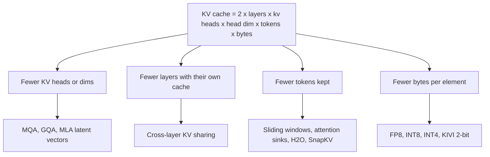

# KV Cache Compression and Quantization

## Introduction

Quantizing the weights makes a model smaller, but it does nothing for the other big consumer of memory during inference: the **KV cache**. For every token in the context, every layer stores a key vector and a value vector for each KV head, so that later tokens can attend to it without recomputing it (see [The KV Cache](../10-llm-inference/2-llm-kv-cache.mdx)). The cache grows linearly with context length and with batch size. In long-context or high-throughput serving it is often larger than the model itself.

This page covers the ways to make it smaller. By the end you will be able to:

- compute the KV cache size of a real model and see when it dominates memory;
- place the main techniques in a map: fewer heads, fewer layers, fewer tokens, fewer bits;
- explain why keys and values need different quantization axes, the core idea of KIVI;
- measure the attention error of FP8, INT4 and INT2 cache quantization on a real model;
- explain attention sinks and heavy-hitter eviction, and compare them in an experiment;
- turn on a quantized cache in Hugging Face Transformers, vLLM, llama.cpp and Ollama.

## How Big Is the Cache?

For a model with $L$ layers, $n_{kv}$ key-value heads of dimension $d_h$, a context of $T$ tokens, a batch of $B$ sequences and $p$ bytes per element:

$$
\text{KV bytes} = 2 \cdot L \cdot n_{kv} \cdot d_h \cdot T \cdot B \cdot p
$$

The factor 2 counts keys and values. For Llama 3.1 8B, with $L = 32$, $n_{kv} = 8$ and $d_h = 128$ from its `config.json`, in BF16 ($p = 2$):

$$
2 \times 32 \times 8 \times 128 \times 2 = 131{,}072 \text{ bytes} = 128 \text{ KiB per token}
$$

| Scenario | Tokens in cache | KV cache in BF16 | KV cache in FP8 | KV cache in INT4 (plus scales) |
| --- | --- | --- | --- | --- |
| One chat, 8K context | 8,192 | 1 GiB | 0.5 GiB | about 0.28 GiB |
| One document, 128K context | 131,072 | 16 GiB | 8 GiB | about 4.5 GiB |
| 32 users, 8K each | 262,144 | 32 GiB | 16 GiB | about 9 GiB |

The weights of the same model are 16 GB in BF16. So at full context, or with a few dozen concurrent users, the cache is as large as the model or larger. Every byte saved in the cache becomes room for more users or longer contexts, and because decoding reads the whole cache for each new token, a smaller cache is also faster.

## A Map of the Techniques

Each factor in the formula can be attacked:



- **Fewer heads or dimensions** is an architecture decision made before training. Grouped-query attention, which Llama 3.1 8B uses with 32 query heads sharing 8 KV heads, already cuts the cache by 4 times compared with full multi-head attention. DeepSeek's multi-head latent attention caches one compressed latent vector per token instead of full keys and values. See [MQA and GQA](../2-llm-attention/5-llm-mqa-gqa.mdx) and [MLA](../2-llm-attention/6-llm-mla.mdx).
- **Fewer layers with their own cache**: later layers reuse the keys and values of earlier ones. Apple's 2025 on-device foundation model, for example, splits its layers into two blocks, and the second block has no key or value projections of its own. It reuses the first block's cache, which saves 37.5% of the cache memory.
- **Fewer tokens**: keep only part of the context. Sliding-window layers, as in Mistral 7B and Gemma 3, are an architectural form of this (see [Sliding Window, Sparse and Linear Attention](../5-llm-flash-attention/5-llm-sparse-and-linear-attention.mdx)). Eviction policies such as H2O and SnapKV apply it to any trained model, and are covered below.
- **Fewer bytes**: quantize the cache. This works with any model, combines with all the other techniques, and is supported by every major inference engine, so it is the first thing to try.

The rest of this page covers the last two, which can be applied to a model you already have.

## Quantizing the Cache: Why Keys and Values Differ

The cache is a sequence of activations, so the tools from [Quantization Basics](./0-llm-quantization-basics.mdx) apply, with one twist: the cache is written one token at a time. The natural granularity is therefore **per token**: when a token's key arrives, compute one scale (or one per group of channels) and store the quantized vector. This is what most engines do for FP8 and INT8.

At 4 bits and below, the KIVI paper (Liu et al., 2024) found that this works for values but not for keys. The reason is the shape of the data:

- **Keys** have a few **outlier channels**: fixed dimensions whose magnitude is much larger than the rest, for every token. Quantizing per token puts those large channels and the small ones under the same scale, and the small ones round to almost nothing. Quantizing **per channel**, with one scale per dimension computed across a group of tokens, gives each channel its own range.
- **Values** have no consistent outlier channels, but the attention output is a weighted average of value rows, so errors in one token's value should be kept local to that token. **Per-token** quantization fits.

Per-channel keys create a practical problem: the statistics for a channel need a group of tokens, but tokens arrive one at a time. KIVI solves it with a **residual buffer**. The most recent $R$ tokens (for example 32 or 128) stay in full precision. When the buffer fills up, those $R$ keys are quantized together per channel and moved to the compressed cache. This also keeps the most recent tokens, which attention usually weighs heavily, in exact form. KIVI reported 2-bit keys and values with little quality loss on Llama and Mistral models, cutting peak memory by 2.6 times.

KVQuant (Hooper et al., 2024) added further refinements: quantize keys **before** RoPE is applied (the rotation mixes channel pairs and blurs the outlier structure, so the rotation is reapplied after dequantization), use non-uniform levels fitted to each layer, and store a small fraction of outliers separately in full precision. With these it ran LLaMA-7B with contexts of up to 10 million tokens on eight GPUs.

Errors in keys and values also have different effects. A key error $\delta k$ changes an attention logit by $q^\top \delta k / \sqrt{d_h}$, and that change is then exponentiated by the softmax, so a systematic key error can shift attention to the wrong token. A value error only passes through a weighted average, so it is diluted. Keys usually deserve more bits than values.

### An Experiment on Real Keys and Values

The script captures the queries, keys and values (after RoPE, exactly as they would be cached) from layer 15 of SmolLM2-135M on a 301-token text. It recomputes the attention output with the cache quantized in different ways and measures the relative error against the exact output. The quantizer is asymmetric min-max, as KIVI uses.

```python
import torch
import torch.nn.functional as F
from transformers import AutoModelForCausalLM, AutoTokenizer
from transformers.models.llama.modeling_llama import apply_rotary_pos_emb

torch.manual_seed(0)
NAME = "HuggingFaceTB/SmolLM2-135M"
tok = AutoTokenizer.from_pretrained(NAME)
model = AutoModelForCausalLM.from_pretrained(NAME, dtype=torch.float32).eval()
text = ("Quantization stores numbers with fewer bits. The key-value cache grows with every token, "
        "so long conversations and large batches can need more memory for the cache than for the "
        "weights themselves. Compressing it is one of the main levers for cheaper serving. ") * 6
ids = tok(text, return_tensors="pt").input_ids                     # (1, T)

attn = model.model.layers[15].self_attn
grab = {}
def pre_hook(mod, args, kwargs):
    grab["h"] = kwargs["hidden_states"]                            # (1, T, 576) normalized input
    grab["pe"] = kwargs["position_embeddings"]                     # (cos, sin)
h = attn.register_forward_pre_hook(pre_hook, with_kwargs=True)
with torch.no_grad():
    model(ids)
h.remove()

cfg = model.config
hd, nq, nkv = cfg.hidden_size // cfg.num_attention_heads, cfg.num_attention_heads, cfg.num_key_value_heads
x, (cos, sin) = grab["h"], grab["pe"]
T = x.shape[1]
with torch.no_grad():
    q = attn.q_proj(x).view(1, T, nq, hd).transpose(1, 2)          # (1, 9, T, 64)
    k = attn.k_proj(x).view(1, T, nkv, hd).transpose(1, 2)         # (1, 3, T, 64)
    v = attn.v_proj(x).view(1, T, nkv, hd).transpose(1, 2)         # (1, 3, T, 64)
    q, k = apply_rotary_pos_emb(q, k, cos, sin)                    # keys are cached after RoPE

def attend(k_, v_):
    rep = nq // nkv                                                # GQA: each KV head serves 3 query heads
    return F.scaled_dot_product_attention(q, k_.repeat_interleave(rep, 1),
                                          v_.repeat_interleave(rep, 1), is_causal=True)

ref = attend(k, v)
kc = k.abs().amax(dim=(0, 2))                                      # (3, 64) max |key| per head and channel
print(f"T={T} tokens, key |max| per channel (head 0): median {kc[0].median():.2f}, max {kc[0].max():.2f}")
vc = v.abs().amax(dim=(0, 2))
print(f"value |max| per channel (head 0): median {vc[0].median():.2f}, max {vc[0].max():.2f}")

def quant(t, bits, dim, group=None):
    """Asymmetric min/max quantization; statistics are taken along `dim`."""
    if group is not None:                                          # split tokens into groups of `group`
        B, H, L, D = t.shape
        t = t[:, :, : L - L % group].reshape(B, H, -1, group, D)
        dim = 3
    lo, hi = t.amin(dim, keepdim=True), t.amax(dim, keepdim=True)
    s = (hi - lo).clamp(min=1e-8) / (2**bits - 1)
    out = torch.round((t - lo) / s).clamp(0, 2**bits - 1) * s + lo
    return out.reshape(out.shape[0], out.shape[1], -1, out.shape[-1])

L = T - T % 32                                                     # use a multiple of the group size
q, k, v, ref = q[:, :, :L], k[:, :, :L], v[:, :, :L], ref[:, :, :L]
def err(k_, v_):
    return ((attend(k_, v_) - ref).norm() / ref.norm()).item()

fp8 = lambda t: (t / (t.abs().max() / 448)).to(torch.float8_e4m3fn).float() * (t.abs().max() / 448)
print(f"\n{'scheme':<52}{'rel. error of attention output':>32}")
print(f"{'FP8 E4M3, per-tensor scale':<52}{err(fp8(k), fp8(v)):>32.4f}")
for bits in (4, 2):
    per_tok = err(quant(k, bits, dim=-1), quant(v, bits, dim=-1))
    kivi = err(quant(k, bits, dim=2, group=32), quant(v, bits, dim=-1))
    print(f"{f'INT{bits} keys per-token, values per-token':<52}{per_tok:>32.4f}")
    print(f"{f'INT{bits} keys per-channel (32 tok), values per-token':<52}{kivi:>32.4f}")
```

```text
T=301 tokens, key |max| per channel (head 0): median 3.01, max 16.13
value |max| per channel (head 0): median 1.50, max 2.75

scheme                                                rel. error of attention output
FP8 E4M3, per-tensor scale                                                    0.0484
INT4 keys per-token, values per-token                                         0.1976
INT4 keys per-channel (32 tok), values per-token                              0.0928
INT2 keys per-token, values per-token                                         1.1548
INT2 keys per-channel (32 tok), values per-token                              0.4930
```

The first two lines show the asymmetry KIVI describes. The largest key channel is five times the median channel, while value channels differ by less than a factor of two. As a result:

- Switching keys from per-token to **per-channel** quantization halves the INT4 error (0.198 to 0.093), at the same number of bits.
- At **INT2**, per-token keys break the layer completely: an error above 1.0 means the output is no better than noise. Per-channel keys still keep the error under 0.5, and KIVI's full recipe (with a residual buffer and finer groups) does better still.
- **FP8** with a single scale is the most accurate of these and needs no special handling, which is why it is the default quantized cache in serving engines.

These are errors for one layer of a small model. Larger models usually tolerate cache quantization better, but the ranking of the schemes holds.

## Keeping Fewer Tokens: Sinks and Heavy Hitters

The second approach is to **evict** tokens from the cache. The obvious policy, keeping only the most recent $W$ tokens (a sliding window applied to a model not trained for one), fails badly. Xiao et al. explained why in StreamingLLM (2023). Models put a large amount of attention on the **first few tokens**, whatever those tokens contain, because softmax weights must sum to 1 and the model needs somewhere to put attention when nothing is relevant. These **attention sinks** act as a no-op. Evict them and the attention distribution of every later token is distorted. StreamingLLM keeps the first 4 tokens plus a recent window, which let models trained on a few thousand tokens stream millions of tokens with stable perplexity. It does not let the model remember what was evicted, though.

**H2O** (heavy-hitter oracle, Zhang et al., 2023) keeps the tokens that have received the most attention so far, the "heavy hitters", plus a recent window. The paper found that a small fraction of tokens receives most of the attention and that these are important to keep. **SnapKV** (Li et al., 2024) compresses only the prompt: it looks at the attention from a window of queries at the end of the prompt, which tends to predict what generation will need, and keeps the most-attended positions separately for each head.

The script below uses the same layer to compare the three policies at fixed budgets. The prompt repeats three short facts and ends with a question, and the error is measured on the last query, which is the one that predicts the answer. The heavy-hitter scores are the total attention each key received from all earlier queries during prefill.

```python
import torch
import torch.nn.functional as F
from transformers import AutoModelForCausalLM, AutoTokenizer
from transformers.models.llama.modeling_llama import apply_rotary_pos_emb

torch.manual_seed(0)
NAME = "HuggingFaceTB/SmolLM2-135M"
tok = AutoTokenizer.from_pretrained(NAME)
model = AutoModelForCausalLM.from_pretrained(NAME, dtype=torch.float32).eval()
text = ("Alice lives in Lisbon and works as a marine biologist. Bob lives in Oslo and repairs bicycles. "
        "Carol lives in Nairobi and teaches chemistry. ") * 8 + "Question: where does Carol live? Answer:"
ids = tok(text, return_tensors="pt").input_ids                     # (1, T)

attn = model.model.layers[15].self_attn
grab = {}
h = attn.register_forward_pre_hook(
    lambda mod, args, kwargs: grab.update(h=kwargs["hidden_states"], pe=kwargs["position_embeddings"]),
    with_kwargs=True)
with torch.no_grad():
    model(ids)
h.remove()

cfg = model.config
hd, nq, nkv = cfg.hidden_size // cfg.num_attention_heads, cfg.num_attention_heads, cfg.num_key_value_heads
x, (cos, sin) = grab["h"], grab["pe"]
T = x.shape[1]
with torch.no_grad():
    q = attn.q_proj(x).view(1, T, nq, hd).transpose(1, 2)          # (1, 9, T, 64)
    k = attn.k_proj(x).view(1, T, nkv, hd).transpose(1, 2)         # (1, 3, T, 64)
    v = attn.v_proj(x).view(1, T, nkv, hd).transpose(1, 2)
    q, k = apply_rotary_pos_emb(q, k, cos, sin)
k, v = k.repeat_interleave(nq // nkv, 1), v.repeat_interleave(nq // nkv, 1)   # (1, 9, T, 64)

q_last = q[:, :, -1:]                                              # the query that predicts the answer
full = F.scaled_dot_product_attention(q_last, k, v)                # (1, 9, 1, 64), all T keys visible

# H2O-style scores: attention each key has received from all earlier queries (prefill)
probs = F.scaled_dot_product_attention(q, k, torch.eye(T).expand(1, nq, T, T), is_causal=True)
received = probs.sum(dim=2)                                        # (1, 9, T) per head

def keep_and_attend(idx):                                          # idx: (1, 9, budget) kept positions
    g = idx.unsqueeze(-1).expand(-1, -1, -1, hd)
    return F.scaled_dot_product_attention(q_last, k.gather(2, g), v.gather(2, g))

def err(out):
    return ((out - full).norm() / full.norm()).item()

print(f"T = {T} cached tokens")
for frac in (0.5, 0.25, 0.1):
    B = int(T * frac)
    recent = torch.arange(T - B, T).expand(1, nq, B)
    sinks = torch.cat([torch.arange(4), torch.arange(T - B + 4, T)]).expand(1, nq, B)
    heavy = torch.cat([received[..., : T - 16].topk(B - 16, dim=-1).indices,
                       torch.arange(T - 16, T).expand(1, nq, 16)], dim=-1)   # heavy hitters + 16 recent
    print(f"keep {frac:4.0%} ({B:3d} tokens): recent window {err(keep_and_attend(recent)):.3f} | "
          f"4 sinks + recent {err(keep_and_attend(sinks)):.3f} | heavy hitters + recent {err(keep_and_attend(heavy)):.3f}")
```

```text
T = 225 cached tokens
keep  50% (112 tokens): recent window 0.862 | 4 sinks + recent 0.115 | heavy hitters + recent 0.044
keep  25% ( 56 tokens): recent window 0.925 | 4 sinks + recent 0.161 | heavy hitters + recent 0.094
keep  10% ( 22 tokens): recent window 0.983 | 4 sinks + recent 0.191 | heavy hitters + recent 0.180
```

Passing the identity matrix as the "values" is a trick: the output of `scaled_dot_product_attention` is then the attention probability matrix itself.

The results reproduce both papers in miniature. A plain recent window loses most of the output even when it keeps half the tokens (error 0.86), because it drops the sink. Just adding back the first 4 tokens cuts the error by about 7 times. Heavy hitters do better still, because the sink tokens are always among the most attended and the policy also keeps the facts the model has been looking at. At a 10% budget, the sink and heavy-hitter policies converge: with only 22 slots, the sinks and the recent tokens fill almost all of them.

Eviction has a cost that quantization does not: an evicted token is gone. If a later question needs a detail from it, the model cannot recover it. Quantization keeps every token, only less precisely. In practice, engines ship cache quantization broadly, and eviction mostly appears as research code or opt-in options for very long contexts.

## Using a Quantized Cache in Practice

**Hugging Face Transformers** has a `QuantizedCache` with three backends: `quanto` (INT2 and INT4, the default), `hqq` (INT1 to INT8) and `fp8` (E4M3 per-tensor, no extra dependency). You pick it with `cache_implementation="quantized"`:

```python
import torch
from transformers import AutoModelForCausalLM, AutoTokenizer

torch.manual_seed(0)
NAME = "HuggingFaceTB/SmolLM2-135M"
tok = AutoTokenizer.from_pretrained(NAME)
model = AutoModelForCausalLM.from_pretrained(NAME, dtype=torch.float32).eval()
inputs = tok("The three primary colors are", return_tensors="pt")

for label, kw in [("default dynamic cache", {}),
                  ("fp8 quantized cache", dict(cache_implementation="quantized",
                                               cache_config={"backend": "fp8"}))]:
    out = model.generate(**inputs, do_sample=False, max_new_tokens=20, **kw)
    print(f"{label:<24}", repr(tok.decode(out[0, inputs.input_ids.shape[1]:])))
```

```text
default dynamic cache    ' red, yellow, and blue.\n\nThe color wheel is a tool that helps us to understand'
fp8 quantized cache      ' red, yellow, and blue.\n\nThe color wheel is a tool that helps us to understand'
```

With the `quanto` and `hqq` backends, `cache_config` also takes `nbits`, `axis_key`, `axis_value`, `q_group_size` and `residual_length`. The last one is the KIVI-style full-precision buffer of recent tokens. Note that the Transformers implementation saves memory but dequantizes on every step, so it is slower than the default cache for short contexts.

**vLLM** stores the cache in FP8 with one flag:

```bash
vllm serve meta-llama/Llama-3.1-8B-Instruct --kv-cache-dtype fp8
```

Without calibration, vLLM uses a scale of 1.0, which works because keys and values are usually well inside E4M3's range. For better accuracy, llm-compressor can calibrate per-tensor or per-head `k_scale` and `v_scale` values on a dataset and store them in the checkpoint. The halved cache roughly doubles how many tokens fit in the paged cache pool (see [PagedAttention](../10-llm-inference/3-llm-paged-attention.mdx)), which translates directly into larger batches.

**llama.cpp** and **Ollama** support block-quantized caches using the GGUF types:

```bash
# llama.cpp: 8-bit keys and values
./build/bin/llama-server -m model-Q4_K_M.gguf -c 32768 -fa on -ctk q8_0 -ctv q8_0

# Ollama: set for the whole server
OLLAMA_FLASH_ATTENTION=1 OLLAMA_KV_CACHE_TYPE=q8_0 ollama serve
```

A quantized V cache in llama.cpp requires Flash Attention (`-fa`), because the fused attention kernel is what dequantizes the cache blocks. `q8_0` halves the cache with almost no quality change. `q4_0` quarters it, but the Ollama documentation warns that the loss can become noticeable at long contexts, especially for models with a high GQA ratio. That warning makes sense: when many query heads share one KV head, each cached value is read by more heads, so its error matters more.

:::tip
Start with an FP8 or `q8_0` cache. It is nearly free in quality and halves cache memory. Go to 4 bits or below only if memory is the binding constraint, keep keys at a higher precision than values if your engine allows it, and test on your longest real inputs, since errors accumulate with context length.
:::

## Common Mistakes

- **Budgeting memory for the weights only.** At long context or large batch, the cache is the bigger term. Compute it with the formula before choosing hardware.
- **Quantizing keys per token at 4 bits or below.** Key outlier channels make per-token scales inaccurate. Use per-channel keys (KIVI) or stay at 8 bits.
- **Evicting the first tokens.** Dropping attention sinks breaks the model. Any window or eviction policy must keep them.
- **Assuming eviction is lossless.** Evicted tokens cannot be recalled later. Retrieval-style questions about early parts of a long document suffer most.
- **Judging cache quantization on short prompts.** Errors grow with context length, so test at the context length you will actually serve.
- **Counting the cache savings twice.** GQA and MLA already shrink the cache. Quantization multiplies on top of them, so an MLA model's cache is already small and the absolute savings from quantizing it are smaller.

## Summary

- KV cache size is $2 \cdot L \cdot n_{kv} \cdot d_h \cdot T \cdot B \cdot p$ bytes: 128 KiB per token for Llama 3.1 8B in BF16, or 16 GiB at a 128K context.
- The cache can be shrunk with fewer KV heads (GQA, MLA), cross-layer sharing, fewer tokens (windows, sinks, eviction) or fewer bits (quantization). Only the last two apply to an existing model.
- Keys have consistent outlier channels and should be quantized per channel. Values should be quantized per token. KIVI combines this with a full-precision buffer of recent tokens and reaches 2 bits.
- On SmolLM2, per-channel keys halved the INT4 attention error compared with per-token keys, and FP8 with one scale was the most accurate scheme tested.
- Attention sinks, the first few tokens, absorb a large share of attention. Windows must keep them, and heavy-hitter policies keep them automatically.
- In practice: `cache_implementation="quantized"` in Transformers, `--kv-cache-dtype fp8` in vLLM, `-ctk`/`-ctv` with `-fa` in llama.cpp and `OLLAMA_KV_CACHE_TYPE` in Ollama.

## Further Reading

- [KIVI: A Tuning-Free Asymmetric 2bit Quantization for KV Cache (Liu et al., 2024)](https://arxiv.org/abs/2402.02750): per-channel keys, per-token values and the residual buffer.
- [KVQuant: Towards 10 Million Context Length LLM Inference with KV Cache Quantization (Hooper et al., 2024)](https://arxiv.org/abs/2401.18079): pre-RoPE keys, non-uniform levels and sparse outliers.
- [Efficient Streaming Language Models with Attention Sinks (Xiao et al., 2023)](https://arxiv.org/abs/2309.17453): StreamingLLM and the discovery of attention sinks.
- [H2O: Heavy-Hitter Oracle for Efficient Generative Inference of Large Language Models (Zhang et al., 2023)](https://arxiv.org/abs/2306.14048): eviction based on accumulated attention.
- [SnapKV: LLM Knows What You are Looking for Before Generation (Li et al., 2024)](https://arxiv.org/abs/2404.14469): per-head prompt compression from an observation window.
- [Hugging Face Transformers: cache strategies](https://huggingface.co/docs/transformers/main/en/kv_cache): `QuantizedCache`, offloading and the other cache classes.
- [vLLM: quantized KV cache](https://docs.vllm.ai/en/latest/features/quantization/quantized_kvcache/): FP8 cache options and scale calibration with llm-compressor.
