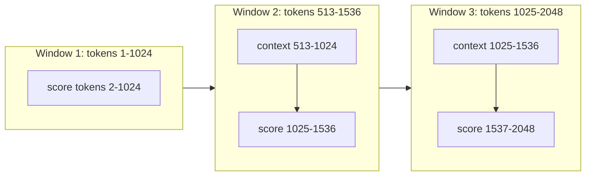

# Perplexity and Intrinsic Metrics

## Introduction

Before a language model answers a single benchmark question, it already has a score: how well it predicts text it has not seen. That score is **perplexity**. It is the number you watch during pretraining, the number quantization papers report to show their 4-bit model "lost almost nothing", and the number data teams use to filter web pages.

Perplexity is called an *intrinsic* metric because it measures the model at the thing it was trained to do, next-token prediction, rather than at a downstream task. It is cheap, deterministic and needs no labels. It is also easy to compute wrongly and easy to over-interpret. Two models with different tokenizers cannot be compared by perplexity at all, and a chat model with a worse perplexity can be the far more useful assistant.

By the end of this page you will be able to:

- derive perplexity from the cross-entropy loss and read it as an "effective number of choices";
- convert between nats, bits, bits per token and bits per byte, so that models with different tokenizers can be compared;
- compute perplexity with a strided sliding window for a fixed-context model, and verify it against the Hugging Face loss;
- explain what perplexity does and does not predict, and which related metrics (per-position loss, KL divergence to a reference model) answer questions perplexity cannot.

This page builds on [Language Modeling and Next-Token Prediction](../0-llm-fundamentals/1-llm-language-modeling.mdx), where the chain rule and cross-entropy were introduced.

## From Cross-Entropy to Perplexity

A causal language model factorizes the probability of a token sequence $x_1, \dots, x_N$ with the chain rule:

$$
p_\theta(x_1, \dots, x_N) = \prod_{t=1}^{N} p_\theta(x_t \mid x_{\lt t})
$$

The training loss is the average negative log-likelihood per token, which is the cross-entropy between the data and the model:

$$
\mathcal{L} = -\frac{1}{N} \sum_{t=1}^{N} \log p_\theta(x_t \mid x_{\lt t})
$$

Perplexity is the exponential of that average:

$$
\mathrm{PPL} = \exp(\mathcal{L}) = \left( \prod_{t=1}^{N} p_\theta(x_t \mid x_{\lt t}) \right)^{-1/N}
$$

The second form is the inverse **geometric mean** of the per-token probabilities. That gives the standard intuition. If a model assigned probability $1/k$ to every correct token, its perplexity would be exactly $k$: on average, it is as uncertain as if it were choosing uniformly among $k$ tokens. A model that knows nothing and spreads probability uniformly over a vocabulary of size $V$ has $\mathcal{L} = \log V$ and $\mathrm{PPL} = V$. For GPT-2 ($V = 50{,}257$) that is the ceiling; a perfect model has $\mathrm{PPL} = 1$.

A hand-sized example. Suppose a model predicts four tokens with probabilities 0.5, 0.25, 0.5 and 0.125. The log-probabilities in nats are $-0.693, -1.386, -0.693, -2.079$, so $\mathcal{L} = 4.852/4 = 1.213$ and $\mathrm{PPL} = e^{1.213} = 3.36$. Equivalently, the geometric mean of the probabilities is $(0.5 \cdot 0.25 \cdot 0.5 \cdot 0.125)^{1/4} = 0.0078125^{1/4} = 0.297$, and $1/0.297 = 3.36$.

Note what the geometric mean does. One token predicted with probability 0.001 contributes $-\log 0.001 = 6.9$ nats, as much as ten tokens predicted with probability 0.5. Perplexity is dominated by the tokens the model finds most surprising: rare names, numbers, the first word of a new topic.

## Checking the Definition Against the Library

Hugging Face causal LM classes return exactly $\mathcal{L}$ when you pass `labels=input_ids`. They shift internally: the logits at position $t$ are scored against the token at $t+1$, so a sequence of $T$ tokens yields $T-1$ predictions (the first token is never predicted, because nothing comes before it). Let us compute the same number by hand:

```python
import math, torch
from transformers import AutoModelForCausalLM, AutoTokenizer

torch.manual_seed(0)
tok = AutoTokenizer.from_pretrained("openai-community/gpt2")
model = AutoModelForCausalLM.from_pretrained("openai-community/gpt2").eval()

text = "The cat sat on the mat. The dog slept on the rug."
ids = tok(text, return_tensors="pt").input_ids               # (1, T)
with torch.no_grad():
    out = model(ids, labels=ids)                             # HF shifts labels internally
    logits = out.logits                                      # (1, T, vocab)

logp = torch.log_softmax(logits[0, :-1], dim=-1)             # predictions for tokens 1..T-1
nll = -logp[torch.arange(ids.size(1) - 1), ids[0, 1:]]       # (T-1,)
for t, v in zip(ids[0, 1:], nll):
    print(f"{tok.decode(t)!r:10s} -log p = {v:5.2f}   p = {math.exp(-v):.3f}")
print(f"manual mean NLL {nll.mean():.4f}  HF loss {out.loss:.4f}  PPL {math.exp(nll.mean()):.2f}")
```

```text
' cat'     -log p =  9.20   p = 0.000
' sat'     -log p =  7.26   p = 0.001
' on'      -log p =  1.50   p = 0.224
' the'     -log p =  0.79   p = 0.454
' mat'     -log p =  5.51   p = 0.004
'.'        -log p =  2.76   p = 0.063
' The'     -log p =  2.48   p = 0.084
' dog'     -log p =  3.58   p = 0.028
' slept'   -log p =  6.66   p = 0.001
' on'      -log p =  1.11   p = 0.330
' the'     -log p =  0.34   p = 0.714
' rug'     -log p =  4.34   p = 0.013
'.'        -log p =  0.42   p = 0.658
```

```text
manual mean NLL 3.5343  HF loss 3.5343  PPL 34.27
```

The two agree to four decimals. The per-token view is more informative than the average: the content words " cat", " sat" and " slept" carry most of the loss, while " the" after " on" and the final "." are nearly free. Notice also the second sentence: " on the" is cheaper the second time (1.11 and 0.34 versus 1.50 and 0.79), because the model has just seen the pattern. That is in-context learning at its simplest, and its mechanism, the induction head, is dissected in [Mechanistic Interpretability](./4-llm-interpretability.mdx).

## Units: Nats, Bits and Bits per Byte

PyTorch's `log_softmax` uses the natural logarithm, so the loss is in **nats**. Dividing by $\ln 2$ converts to **bits**. Perplexity itself is unit-free: $e^{\mathcal{L}_{\mathrm{nats}}} = 2^{\mathcal{L}_{\mathrm{bits}}}$.

The real problem is the denominator. Perplexity is *per token*, and tokens differ between models. A tokenizer with a larger vocabulary packs more text into each token, so each prediction is harder and per-token perplexity goes up, even if the model compresses the text equally well. Comparing GPT-2 (50k vocabulary) with Llama 3 (128k vocabulary) by token perplexity is meaningless.

The fix is to normalize by something every model shares: the raw text. **Bits per byte** (BPB) divides the total negative log-likelihood of a document, in bits, by its length in UTF-8 bytes:

$$
\mathrm{BPB} = \frac{N_{\mathrm{tokens}}}{N_{\mathrm{bytes}}} \cdot \frac{\mathcal{L}_{\mathrm{nats\ per\ token}}}{\ln 2}
$$

The first factor is the tokenizer's compression ratio (tokens per byte); the second is the loss in bits per token. Because the total log-likelihood of the document does not depend on how you count, BPB is comparable across tokenizers. It is also directly a compression rate: a model with BPB of 0.8 could, with arithmetic coding, compress the text to 0.8 bits per byte, a tenth of its original 8 bits. The Pile paper (Gao et al., 2020) and many later papers report BPB for exactly this reason; character-level work uses the analogous bits per character (BPC).

We will compute BPB for GPT-2 below, once we have a correct perplexity.

## Fixed Context Windows and the Sliding Window

A model with a maximum context of $k$ tokens (1,024 for GPT-2) cannot condition on the full prefix $x_{\lt t}$ once $t$ exceeds $k$. Long evaluation corpora (WikiText-2's test set is about 287k GPT-2 tokens) must be cut into pieces. The obvious way is to cut into disjoint chunks of $k$ tokens and score each chunk independently.

That is a bad approximation. At the start of each chunk the model has no context at all, so the first tokens of every chunk are predicted almost blind. On average a token in a disjoint chunk sees only about $k/2$ tokens of context.

The better method is a **sliding window** with a stride $s \lt k$. Each forward pass covers $k$ tokens, but only the last $s$ of them (the ones not already scored by the previous window) contribute to the loss. The earlier $k - s$ tokens serve as context only.



With stride $s$, every scored token (after the first window) has at least $k - s$ tokens of context. Stride $s = k$ recovers disjoint chunks; stride 1 gives every token the full $k-1$ context at the cost of one forward pass per token. A stride of $k/2$ is the usual compromise: twice the compute of disjoint chunks, and every token sees at least 512 tokens.

The implementation below scores each token exactly once. It computes the log-probabilities itself instead of relying on `labels=-100` masking, which makes the bookkeeping explicit:

```python
import math, time, torch
from datasets import load_dataset
from transformers import AutoModelForCausalLM, AutoTokenizer

torch.manual_seed(0)
model_id = "openai-community/gpt2"          # 124M parameters, 1024-token context
tok = AutoTokenizer.from_pretrained(model_id)
model = AutoModelForCausalLM.from_pretrained(model_id).eval()

test = load_dataset("Salesforce/wikitext", "wikitext-2-raw-v1", split="test")
ids = tok("\n\n".join(test["text"]), return_tensors="pt").input_ids   # (1, N)
N = ids.size(1)
print("tokens:", N, "bytes:", len("\n\n".join(test["text"]).encode("utf-8")))

def sliding_ppl(ids, max_len=1024, stride=512):
    nll_sum, n_scored, prev_end = 0.0, 0, 0
    for begin in range(0, ids.size(1), stride):
        end = min(begin + max_len, ids.size(1))
        trg_len = end - prev_end                  # new tokens scored in this window
        x = ids[:, begin:end]                     # (1, window)
        with torch.no_grad():
            logits = model(x).logits              # (1, window, vocab)
        logp = torch.log_softmax(logits[:, :-1].float(), dim=-1)
        tgt = x[:, 1:]                            # shift: position t predicts t+1
        tok_logp = logp.gather(-1, tgt.unsqueeze(-1)).squeeze(-1)   # (1, window-1)
        tok_logp = tok_logp[:, -trg_len:] if begin > 0 else tok_logp  # only new targets
        nll_sum += -tok_logp.sum().item()
        n_scored += tok_logp.numel()
        prev_end = end
        if end == ids.size(1):
            break
    return nll_sum, n_scored

for stride in (1024, 512, 256):
    t0 = time.time()
    nll, n = sliding_ppl(ids, stride=stride)
    print(f"stride={stride:4d}  scored={n}  nll/token={nll/n:.4f}  ppl={math.exp(nll/n):.2f}  time={time.time()-t0:.0f}s")
```

```text
tokens: 287644 bytes: 1296370
stride=1024  scored=287363  nll/token=3.3992  ppl=29.94  time=4988s
stride= 512  scored=287643  nll/token=3.2257  ppl=25.17  time=3233s
stride= 256  scored=287643  nll/token=3.2014  ppl=24.57  time=1741s
```

(The times are from a heavily shared CPU; on an idle laptop expect minutes, on a GPU seconds.)

Three things to check in this output. First, `scored` is 287,643 (every token after the very first) for strides 512 and 256. With stride 1024 it is 280 lower, because in disjoint windows the first token of each of the 281 windows has no context inside its window and cannot be scored. Second, perplexity falls as the stride shrinks, because tokens get more context. Third, the gain flattens: going from 1024 to 512 lowers perplexity from 29.94 to 25.17, while going from 512 to 256 doubles the compute again for only 25.17 to 24.57. Our disjoint-window 29.94 is close to the 29.41 that the GPT-2 paper reported for this 124M model. The Hugging Face perplexity guide runs the same experiment with the larger `gpt2-large` and reports 19.44 with no overlap and 16.44 with stride 512; the GPT-2 paper reported 19.93 for that 774M model, using its own de-tokenized version of the text, so exact values depend on preprocessing.

:::warning
The perplexity you get depends on details that papers often omit: the stride, whether documents are joined with `"\n\n"` or evaluated separately, whether a BOS token is prepended, and which version of the dataset (raw or tokenized WikiText) you use. Only compare numbers you computed with the same script.
:::

Now the bits-per-byte conversion. With stride 512, plug the printed token count, byte count and NLL per token into the formula:

$$
\mathrm{BPB} = \frac{287{,}644}{1{,}296{,}370} \cdot \frac{3.2257}{\ln 2} = 0.2219 \times 4.654 = 1.03
$$

GPT-2 uses about 0.22 tokens per byte (roughly 4.5 bytes of English per token) and spends 4.65 bits per token, so it needs about 1.03 bits per byte of WikiText. A model with a different tokenizer can now be compared on the same text: if it reaches 0.95 bits per byte, it is the better predictor, whatever its per-token perplexity says.

## Loss Depends on Position

The sliding window works because loss falls with context length. We can measure that directly: run disjoint 1,024-token windows and average the loss at each position across windows.

```python
import torch
from datasets import load_dataset
from transformers import AutoModelForCausalLM, AutoTokenizer

torch.manual_seed(0)
tok = AutoTokenizer.from_pretrained("openai-community/gpt2")
model = AutoModelForCausalLM.from_pretrained("openai-community/gpt2").eval()
text = "\n\n".join(load_dataset("Salesforce/wikitext", "wikitext-2-raw-v1", split="test")["text"])
ids = tok(text, return_tensors="pt").input_ids[0]

W, n_windows = 1024, 40
losses = []
with torch.no_grad():
    for w in range(n_windows):
        x = ids[w * W:(w + 1) * W][None]                     # (1, 1024), disjoint windows
        logp = torch.log_softmax(model(x).logits[0, :-1], -1)
        losses.append(-logp[torch.arange(W - 1), x[0, 1:]])  # (1023,)
L = torch.stack(losses)                                      # (40, 1023)
for lo, hi in [(0, 16), (16, 64), (64, 256), (256, 512), (512, 1023)]:
    v = L[:, lo:hi].mean()
    print(f"positions {lo + 1:4d}-{hi:4d}: mean NLL {v:.3f}  ->  PPL {v.exp():6.1f}")
```

```text
positions    1-  16: mean NLL 5.540  ->  PPL  254.6
positions   17-  64: mean NLL 4.238  ->  PPL   69.3
positions   65- 256: mean NLL 3.617  ->  PPL   37.2
positions  257- 512: mean NLL 3.414  ->  PPL   30.4
positions  513-1023: mean NLL 3.255  ->  PPL   25.9
```

The first 16 predictions of a window have a perplexity near 255; with 513 or more tokens of context it is about 26, ten times lower. Most of the gain comes in the first few hundred tokens, and the curve is still falling slowly at the end of the window. This is exactly why disjoint chunks overstate perplexity: every chunk pays the expensive start-up cost again. This per-position curve is the standard diagnostic for long-context models: a model that truly uses 128k tokens keeps lowering its loss deep into the window, while one whose positional encoding breaks down shows loss rising past its training length. The [RoPE context-extension page](../4-llm-positional-encoding/6-llm-context-extension.mdx) uses exactly this measurement, and [Long Context in Practice](../4-llm-positional-encoding/7-llm-long-context-evaluation.mdx) explains why low perplexity at long range is necessary but not sufficient for long-context ability.

## What Perplexity Tells You, and What It Does Not

Perplexity is the right tool for some questions and the wrong tool for others.

**Good uses:**

- **Tracking pretraining.** Validation loss on held-out data from the training distribution is the primary signal during pretraining, and the quantity scaling laws predict (see [Scaling Laws](../6-llm-pretraining/2-llm-scaling-laws.mdx)).
- **Comparing variants of one model.** The same tokenizer and the same evaluation text make perplexity a sensitive check for quantization, pruning or a code change in the inference engine. A 4-bit model whose WikiText perplexity rises from 6.1 to 6.2 has lost little next-token skill; one that rises to 9 is broken.
- **Data filtering.** Pretraining pipelines score documents with a small reference model and drop the ones with extreme perplexity (gibberish scores very high; boilerplate repeated thousands of times scores very low). CCNet (Wenzek et al., 2019) used the perplexity of a KenLM model trained on Wikipedia for this.
- **Membership signals.** Text the model trained on often has unusually low perplexity. That is the basis of contamination detectors such as Min-K% Prob, covered in [Benchmark Contamination](./5-llm-contamination.mdx).

**Bad uses:**

- **Across tokenizers.** Use bits per byte instead.
- **Across domains.** The same model can have a low perplexity on boilerplate-heavy code and a much higher one on poetry or news about recent events. A lower number on one corpus says nothing about another.
- **Chat and reasoning models on raw text.** Instruction tuning and RLHF deliberately move the model away from "average web text" toward helpful assistant replies. Their perplexity on WikiText often gets worse while their usefulness improves dramatically. Perplexity measures fit to a distribution, not quality of answers.
- **Predicting downstream accuracy across model families.** Within one family trained on the same data, lower loss usually means better benchmarks. Across families, data mixtures differ and the correlation is weak.

### KL Divergence: A Sharper Tool for Model Variants

When you compare a quantized model $q$ to its original $p$, perplexity averages away a lot of information. Two models can have the same perplexity while disagreeing on which tokens are likely. A stricter metric is the average Kullback-Leibler divergence between their next-token distributions:

$$
\overline{D}_{\mathrm{KL}} = \frac{1}{N} \sum_{t=1}^{N} \sum_{v \in \mathcal{V}} p(v \mid x_{\lt t}) \log \frac{p(v \mid x_{\lt t})}{q(v \mid x_{\lt t})}
$$

It is zero only if the two distributions match at every position. It catches changes in the whole distribution, not just in the probability of the observed token, so it is more sensitive than a perplexity difference. llama.cpp's `llama-perplexity` tool implements it: run once on the full-precision model with `--kl-divergence-base file.kld` to save its logits, then run the quantized model with the same file plus `--kl-divergence`. The [GGUF page](../11-llm-quantization/2-llm-gguf-and-llama-cpp.mdx) uses it to compare k-quants.

## Worked Experiment: A Perplexity Report for a Model Change

Suppose you changed the attention implementation in your inference engine and want to confirm the model's outputs did not change. A short report has four lines, each answering one question:

1. **Same tokenizer, same text, same script.** Fix WikiText-2 test, stride 512, `"\n\n"` joining. Record the token count; if it differs between runs, the tokenizer or text changed and nothing else is comparable.
2. **Perplexity before and after.** For a pure refactor, the numbers should match to the second decimal in FP32. In BF16, differences in the third significant digit are normal because reduction order changes rounding.
3. **Mean KL to the reference.** Compute $\overline{D}_{\mathrm{KL}}$ between the old and new logits on the same windows. For a numerics-only change it should be tiny (well below 0.001 nats); a value of 0.05 means outputs really differ.
4. **Top-1 agreement.** The fraction of positions where the argmax token is the same. Greedy generation diverges at the first disagreement, so this predicts how often users will see different text.

This takes minutes on one GPU and catches most silent regressions, such as a wrong mask, an off-by-one in RoPE positions or a broken KV cache, before anyone runs a benchmark.

## Common Mistakes

- Comparing perplexities of models with different tokenizers. Convert to bits per byte, computed on the same raw text.
- Evaluating long texts in disjoint chunks and calling it "the" perplexity; use a sliding window and report the stride.
- Double-counting overlapped tokens in a sliding window, or forgetting that the model's internal label shift drops one token per window.
- Averaging per-window perplexities instead of summing log-likelihoods and dividing by the total token count once.
- Evaluating a chat model on raw web text and concluding it is worse than its base model.
- Treating a small perplexity change as harmless without checking KL divergence or top-1 agreement.
- Running in FP16 or BF16 and computing `log_softmax` in that precision; cast logits to FP32 first.

## Summary

- Perplexity is the exponential of the average per-token negative log-likelihood, the inverse geometric mean of the probabilities of the correct tokens; a uniform model over $V$ tokens has perplexity $V$.
- Hugging Face's `labels=` loss is exactly this average, with labels shifted by one position.
- Per-token perplexity depends on the tokenizer; bits per byte normalizes by raw text and is comparable across models.
- For fixed-context models use a strided sliding window; smaller strides give more context and lower, more faithful perplexity at higher cost.
- Loss falls with position in the context; per-position loss curves diagnose long-context behaviour.
- Perplexity is excellent for tracking training and comparing variants of one model, poor for comparing families, domains or chat models; KL divergence to a reference is a sharper check for quantization and engine changes.

## Further Reading

- [Perplexity of fixed-length models (Hugging Face Transformers docs)](https://huggingface.co/docs/transformers/perplexity) - the sliding-window recipe with GPT-2 large.
- [Language Models are Unsupervised Multitask Learners (Radford et al., 2019)](https://cdn.openai.com/better-language-models/language_models_are_unsupervised_multitask_learners.pdf) - the GPT-2 paper with its WikiText perplexities.
- [Pointer Sentinel Mixture Models (Merity et al., 2016)](https://arxiv.org/abs/1609.07843) - introduces the WikiText datasets.
- [The Pile: An 800GB Dataset of Diverse Text for Language Modeling (Gao et al., 2020)](https://arxiv.org/abs/2101.00027) - reports bits per byte to compare across tokenizers.
- [CCNet: Extracting High Quality Monolingual Datasets from Web Crawl Data (Wenzek et al., 2019)](https://arxiv.org/abs/1911.00359) - perplexity-based data filtering.
- [llama.cpp perplexity tool README](https://github.com/ggml-org/llama.cpp/tree/master/tools/perplexity) - perplexity and KL divergence for quantized models.
