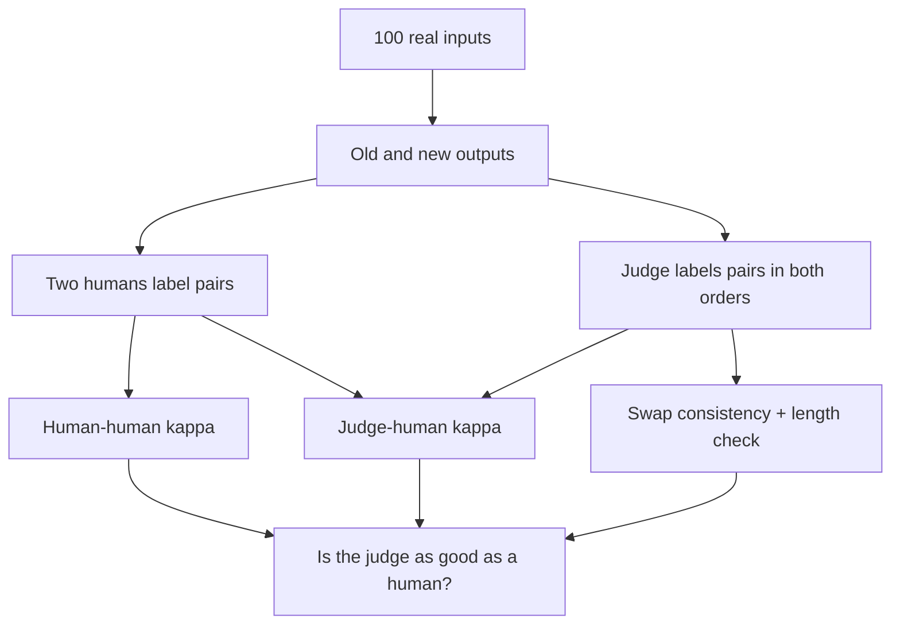

# LLM-as-a-Judge and Human Evaluation

## Introduction

"Write a polite reply to this angry customer." "Explain the difference between TCP and UDP to a new hire." "Summarize this contract." These are the tasks people actually give LLMs, and none of them has a single correct answer. There is no `#### 72` to match and no unit test to run. Two good answers can share almost no words, and a fluent answer can be quietly wrong.

For such tasks the gold standard has always been human judgment: show people the answers and ask which is better. Human evaluation is slow and expensive, though, and humans disagree with each other. Since 2023 the field has largely replaced or supplemented it with **LLM-as-a-judge**: a strong model reads the question and the answers and outputs a score or a preference. Judges power leaderboards like MT-Bench and AlpacaEval, regression tests in production, and the reward models of RLHF.

A judge is a measuring instrument, and like any instrument it has biases. It prefers answers in a particular position, longer answers, and answers that sound like itself. This page teaches you to build and trust such instruments. You will learn to:

- design human evaluations and measure agreement with Cohen's kappa;
- turn pairwise preferences into ratings with the Bradley-Terry model, the method behind Chatbot Arena;
- write a pairwise judge with a local model and measure its position bias for real;
- correct for length bias and self-preference, and validate a judge against human labels before relying on it.

If you need the basics of calling an LLM API and writing prompts, see the [AI Agents tutorial](/docs/ai/agents); this page assumes you can send a prompt and read a reply.

## Why Reference Metrics Fail on Open-Ended Text

The first automatic metrics for generated text came from machine translation and summarization: BLEU (Papineni et al., 2002) counts n-gram overlap with reference translations, ROUGE (Lin, 2004) counts overlap with reference summaries. They are cheap and reproducible, and they work tolerably when outputs are short and references cover the space of good answers.

For assistant-style answers they break. A reference answer to "explain TCP versus UDP" is one of thousands of good explanations. A correct answer phrased differently scores low; a wrong answer that copies the reference's vocabulary scores high. Embedding similarity (BERTScore, cosine of sentence embeddings) is more forgiving of paraphrase but still measures similarity to a reference, not quality.

So we need a grader that understands the task. The options are humans, a model, or both. The rest of this page treats both as noisy raters and asks the same questions of each: how consistent are they, what are they biased toward, and how do we combine their votes?

## Human Evaluation and Inter-Annotator Agreement

A useful human evaluation has four ingredients:

1. **A rubric.** "Which is better?" invites each rater to invent a private standard. A rubric lists criteria in priority order: factual correctness, then whether the user's request was fulfilled, then clarity, then tone. Give examples of each score level.
2. **Pairwise comparison over absolute scores.** People are much more consistent at saying "A is better than B" than at assigning "7 out of 10". Pairwise data also maps directly onto the rating models below.
3. **Blinding and randomized order.** Raters must not know which system produced which answer, and the left/right position must be randomized per item.
4. **Overlap.** Have at least a subset of items labelled by two or more raters, so you can measure agreement.

Raw agreement (the fraction of items where two raters give the same label) overstates reliability, because some agreement happens by chance. If both raters say "A" 70% of the time, they agree on at least $0.7^2 = 49\%$ of items even if they label at random. **Cohen's kappa** (Cohen, 1960) corrects for this:

$$
\kappa = \frac{p_o - p_e}{1 - p_e}, \qquad p_e = \sum_{\ell} p_1(\ell)\, p_2(\ell)
$$

$p_o$ is the observed agreement and $p_e$ the agreement expected if the two raters labelled independently with their own label frequencies $p_1(\ell)$ and $p_2(\ell)$. $\kappa = 1$ is perfect agreement, $\kappa = 0$ is chance level. As a rough convention, values above 0.6 are considered substantial.

```python
import numpy as np

def cohen_kappa(a, b, labels):
    a, b = np.asarray(a), np.asarray(b)
    p_o = (a == b).mean()                                       # observed agreement
    p_e = sum((a == l).mean() * (b == l).mean() for l in labels) # agreement by chance
    return (p_o - p_e) / (1 - p_e), p_o, p_e

# 12 pairwise comparisons, labels: which answer is better
human = ["A", "A", "B", "A", "tie", "B", "A", "A", "B", "A", "A", "B"]
judge = ["A", "A", "B", "A", "A",   "A", "A", "A", "B", "A", "A", "B"]
k, po, pe = cohen_kappa(human, judge, ["A", "B", "tie"])
print(f"raw agreement {po:.2f}, chance agreement {pe:.2f}, kappa {k:.2f}")
```

```text
raw agreement 0.83, chance agreement 0.52, kappa 0.65
```

Check it by hand. The human said A on 7 items, B on 4, tie on 1; the judge said A on 9 and B on 3. So $p_e = \frac{7}{12}\cdot\frac{9}{12} + \frac{4}{12}\cdot\frac{3}{12} = \frac{75}{144} = 0.521$. They agree on 10 of 12 items, $p_o = 0.833$, and $\kappa = (0.833 - 0.521)/(1 - 0.521) = 0.65$. The 83% raw agreement sounds high; the kappa says about two thirds of the way from chance to perfect.

The ceiling for any automatic judge is **human-human agreement**. If two careful humans agree only 66% of the time on a task, a judge that agrees with humans 66% of the time is as good as another human. This was the key measurement in Zheng et al. (2023), "Judging LLM-as-a-Judge with MT-Bench and Chatbot Arena": on their data, GPT-4 as a judge agreed with human experts over 80% of the time on non-tie votes, the same level at which the human experts agreed with each other.

## From Pairwise Votes to Ratings: Bradley-Terry

Pairwise votes need an aggregation rule. Chatbot Arena (Chiang et al., 2024) collects them at scale: a user asks a question, two anonymous models answer, the user votes. Hundreds of thousands to millions of such votes are turned into a leaderboard with the **Bradley-Terry model** (Bradley and Terry, 1952).

Bradley-Terry assigns each model $m$ a strength $s_m$ and assumes

$$
P(\text{model } i \text{ beats model } j) = \sigma(s_i - s_j) = \frac{1}{1 + e^{-(s_i - s_j)}}
$$

Only differences matter, so we can fix the mean strength at zero. Given observed battles $(i_n, j_n, y_n)$ with $y_n = 1$ if $i_n$ won, the maximum-likelihood strengths minimize the binary cross-entropy

$$
-\sum_n \Big[ y_n \log \sigma(s_{i_n} - s_{j_n}) + (1 - y_n) \log\big(1 - \sigma(s_{i_n} - s_{j_n})\big) \Big]
$$

That is logistic regression with one feature per model (+1 for the first model in the battle, -1 for the second). Leaderboards display the strengths on the Elo scale, $R = 1000 + \frac{400}{\ln 10} s$, so that a 400-point gap means 10-to-1 odds. The same sigmoid is the reward-model loss in RLHF, derived in [RLHF: Reward Models and PPO](../8-llm-post-training/2-llm-rlhf.mdx).

```python
import torch

torch.manual_seed(0)
models = ["model-A", "model-B", "model-C", "model-D"]
true_strength = torch.tensor([1.0, 0.5, 0.0, -1.0])         # hidden "skill" in logits

# simulate 4000 crowd battles: random pair, winner drawn from the Bradley-Terry model
i = torch.randint(0, 4, (4000,))
j = (i + torch.randint(1, 4, (4000,))) % 4                    # j != i
p_i_wins = torch.sigmoid(true_strength[i] - true_strength[j])
y = (torch.rand(4000) < p_i_wins).float()                     # 1 if i won

# fit: maximise sum log sigmoid(s_i - s_j) over observed outcomes (logistic regression)
s = torch.zeros(4, requires_grad=True)
opt = torch.optim.LBFGS([s], max_iter=100)
def closure():
    opt.zero_grad()
    logits = s[i] - s[j]
    loss = torch.nn.functional.binary_cross_entropy_with_logits(logits, y)
    loss = loss + 1e-4 * s.pow(2).sum()                        # tiny ridge pins the scale
    loss.backward()
    return loss
opt.step(closure)

s = s.detach() - s.detach().mean()
elo = 1000 + 400 / torch.log(torch.tensor(10.0)) * s          # Arena-style display scale
for name, st, sc, e in zip(models, true_strength - true_strength.mean(), s, elo):
    print(f"{name}: true {st:+.2f}  fitted {sc:+.2f}  rating {e:.0f}")
p = torch.sigmoid(s[0] - s[1])
print(f"predicted P(A beats B) = {p:.3f}")
```

```text
model-A: true +0.88  fitted +0.85  rating 1148
model-B: true +0.38  fitted +0.36  rating 1063
model-C: true -0.12  fitted -0.08  rating 987
model-D: true -1.12  fitted -1.14  rating 802
predicted P(A beats B) = 0.621
```

With 4,000 votes the fitted strengths are within a few hundredths of the truth. An 85-point rating gap (1148 versus 1063) corresponds to only a 62% win rate. Keep that in mind when reading the Arena leaderboard: neighbouring models a few points apart are nearly coin flips, which is why the leaderboard shows bootstrap confidence intervals and assigns shared ranks.

Bradley-Terry fits whatever drives votes, including style. Users tend to prefer longer, more formatted answers, so in 2024 the Arena team added **style control**: extra regression features for answer length and markdown elements, so that a model's strength is estimated with style held fixed. Arena scores have other known weaknesses, documented in "The Leaderboard Illusion" (Singh et al., 2025): some providers privately tested many variants before release and published only the best, and a few providers received a large share of the battle data. Chatbot Arena began at LMSYS, was run as LMArena, and in 2026 rebranded as Arena at arena.ai.

## LLM-as-a-Judge: Formats and Prompts

Zheng et al. described three judge formats that are still the standard:

| Format | Judge sees | Output | Good for |
|---|---|---|---|
| Pairwise comparison | Question, answer A, answer B | A, B or tie | Comparing two systems; matches human preference data |
| Single-answer grading | Question, one answer, rubric | Score, e.g. 1 to 10 | Tracking one system over time; cheap, one call per answer |
| Reference-guided grading | Question, answer, reference answer | Score or correct/incorrect | Math, facts and anything with a known answer |

MT-Bench, from the same paper, is 80 multi-turn questions in 8 categories graded by GPT-4 with single-answer scores. AlpacaEval (Dubois et al.) reports the win rate of a model against a fixed baseline under a pairwise judge. G-Eval (Liu et al., 2023) asks the judge to write evaluation steps first and then weights each possible score by the judge's probability for that score token, giving a continuous score rather than an integer. Open-weight judges trained specifically for evaluation, such as Prometheus (Kim et al., 2023), make the judge reproducible and avoid sending data to an API.

A good judge prompt does four things: states the criteria and their priority, tells the judge to ignore length and order, asks for reasoning **before** the verdict when the judge is strong enough to benefit from it, and fixes the output format so it can be parsed. Let us build a minimal pairwise judge with a small open model. Instead of parsing generated text, we read the judge's probability for the tokens "A" and "B" at the first output position, which gives a confidence for free.

```python
import torch
from transformers import AutoModelForCausalLM, AutoTokenizer

torch.manual_seed(0)
judge_id = "Qwen/Qwen2.5-1.5B-Instruct"          # small enough for a CPU demo
tok = AutoTokenizer.from_pretrained(judge_id)
judge = AutoModelForCausalLM.from_pretrained(judge_id, dtype=torch.float32).eval()

TEMPLATE = """You are an impartial judge. Compare two answers to the user's question.
Judge correctness first, then helpfulness. Ignore answer length and the order the answers appear in.

[Question]
{q}

[Answer A]
{a}

[Answer B]
{b}

Which answer is better? Reply with a single letter: A or B."""

def p_first_better(q, a, b):
    """Probability mass the judge puts on 'A' versus 'B' as its first output token."""
    msgs = [{"role": "user", "content": TEMPLATE.format(q=q, a=a, b=b)}]
    ids = tok.apply_chat_template(msgs, add_generation_prompt=True, return_tensors="pt", return_dict=True)
    with torch.no_grad():
        logits = judge(**ids).logits[0, -1]                       # (vocab,)
    ia, ib = tok.convert_tokens_to_ids("A"), tok.convert_tokens_to_ids("B")
    return torch.softmax(logits[[ia, ib]], -1)[0].item()

# (question, good answer, flawed answer)
pairs = [
    ("What is 17 * 6?", "17 * 6 = 102.", "17 * 6 = 112."),
    ("What is the boiling point of water at sea level in Celsius?", "100 degrees Celsius.", "90 degrees Celsius."),
    ("Who wrote 'Pride and Prejudice'?", "Jane Austen.", "Charlotte Bronte."),
    ("What is the capital of Australia?", "Canberra.", "Sydney, which is the largest and most famous city in Australia and home to the Opera House."),
    ("How many sides does a hexagon have?", "Six.", "Eight sides, because hexa means eight."),
    ("What does HTTP status 404 mean?", "The server could not find the requested resource.", "The server is overloaded and refused the request."),
    ("Is 91 a prime number?", "No, 91 = 7 * 13.", "Yes, 91 is prime because it is odd."),
    ("What gas do plants absorb for photosynthesis?", "Carbon dioxide.", "Oxygen, which they turn into carbon dioxide."),
]

correct_good_first = correct_good_second = consistent = debiased = 0
for q, good, bad in pairs:
    p1 = p_first_better(q, good, bad)        # good answer shown as A
    p2 = p_first_better(q, bad, good)        # good answer shown as B
    v1, v2 = ("A" if p1 > 0.5 else "B"), ("A" if p2 > 0.5 else "B")
    correct_good_first += v1 == "A"
    correct_good_second += v2 == "B"
    consistent += (v1 == "A") == (v2 == "B")
    p_good = (p1 + (1 - p2)) / 2             # average over both orders
    debiased += p_good > 0.5
    print(f"P(A) good-first={p1:.2f} good-second={p2:.2f}  verdicts {v1}/{v2}  {q[:40]}")
n = len(pairs)
print(f"correct when good answer is A: {correct_good_first}/{n}")
print(f"correct when good answer is B: {correct_good_second}/{n}")
print(f"order-consistent verdicts:     {consistent}/{n}")
print(f"correct after averaging orders: {debiased}/{n}")
```

```text
P(A) good-first=0.31 good-second=0.25  verdicts B/B  What is 17 * 6?
P(A) good-first=0.13 good-second=0.05  verdicts B/B  What is the boiling point of water at se
P(A) good-first=0.12 good-second=0.01  verdicts B/B  Who wrote 'Pride and Prejudice'?
P(A) good-first=0.35 good-second=0.07  verdicts B/B  What is the capital of Australia?
P(A) good-first=0.13 good-second=0.01  verdicts B/B  How many sides does a hexagon have?
P(A) good-first=0.54 good-second=0.04  verdicts A/B  What does HTTP status 404 mean?
P(A) good-first=0.15 good-second=0.12  verdicts B/B  Is 91 a prime number?
P(A) good-first=0.27 good-second=0.02  verdicts B/B  What gas do plants absorb for photosynth
correct when good answer is A: 1/8
correct when good answer is B: 8/8
order-consistent verdicts:     1/8
correct after averaging orders: 8/8
```

This 1.5B judge is a caricature of position bias. Shown in one order it looks perfect (8 of 8 correct when the good answer comes second); shown in the other it looks hopeless (1 of 8). It picked "B" in 15 of 16 calls. Yet the content signal is there: in every row, the probability of "A" is higher when the good answer is in slot A than when it is in slot B. The bias is a large constant offset on top of a real but small preference. Averaging the two orders, $p_{\mathrm{good}} = \tfrac12\big(p_1 + (1 - p_2)\big)$, cancels the offset, and all 8 verdicts come out right. Strong judges have much smaller offsets, but the same cure applies to them.


## Judge Biases and How to Correct Them

Zheng et al. named the three biases that every later study has confirmed. Each has a standard mitigation.

### Position Bias

The judge favours one position regardless of content. Which one depends on the judge and the prompt: Zheng et al. found several API judges leaning toward the first answer, and the small judge above leans hard toward the second. The fix is cheap: **evaluate every pair in both orders**. If the two verdicts agree, keep them; if they disagree, record a tie (or average the two probabilities, as our probability-based judge allows). This doubles the cost and removes the first-order effect. The consistency rate (the fraction of pairs whose verdict survives the swap) is itself the best single health check of a judge. In Zheng et al.'s measurements, even GPT-4 was consistent on only about two thirds of swapped MT-Bench pairs under the default prompt, and weaker judges much less.

A quick way to compute it from logged verdicts:

```python
# position-swap consistency: the judge sees (x, y) and then (y, x)
first  = ["A", "A", "B", "A", "A", "A", "B", "A"]   # verdict with order (answer1, answer2)
second = ["B", "A", "A", "B", "A", "B", "A", "A"]   # verdict with order swapped
swap = {"A": "B", "B": "A", "tie": "tie"}
consistent = [f == swap[s] for f, s in zip(first, second)]
print(f"consistent under swap: {sum(consistent)}/{len(consistent)}")
favours_first = sum(f == "A" and s == "A" for f, s in zip(first, second))
print(f"both verdicts picked whichever answer came first: {favours_first}")
```

```text
consistent under swap: 5/8
both verdicts picked whichever answer came first: 3
```

Every inconsistent pair here is one where the judge said "A" both times, which is the signature of first-position bias rather than random noise.

### Verbosity (Length) Bias

Judges, like people, tend to rate longer answers higher, even when the extra length adds nothing. This is the bias that matters most in practice, because it is easy to exploit: a model can climb a judge-based leaderboard by writing longer.

**Length-controlled AlpacaEval** (Dubois et al., 2024) fixes it with regression. In simplified form, it fits the judge's preferences with a logistic model that has a term for each model's quality and a term for the length difference between the two answers:

$$
\mathrm{logit}\, P(m \succ b \mid x) = (\theta_m - \theta_b) + \phi\, \tanh\!\left(\frac{\mathrm{len}_m(x) - \mathrm{len}_b(x)}{\sigma}\right) + \dots
$$

Here $m$ is the evaluated model, $b$ the baseline, $x$ the instruction, and $\sigma$ a scale for length differences; the full model also includes an instruction-difficulty term. After fitting, the length term is set to zero and the win rate is recomputed: "how often would $m$ win if both answers had the same length?" The authors report that this raised AlpacaEval's Spearman correlation with Chatbot Arena from 0.94 to 0.98 and made the metric much harder to game by verbosity. You can apply the same idea to your own judge logs.

Prompt-level mitigations help too: tell the judge that length is not a criterion, provide a reference answer, and score against a rubric whose items are about content.

### Self-Preference

Judges tend to prefer answers written by themselves or by models from the same family, plausibly because those answers have low perplexity under the judge. Zheng et al. observed this for GPT-4 and Claude; later work has measured it more systematically. Mitigations: use a judge from a different family than the models being compared, or use a panel of judges from several families and average their verdicts.

### Limited Ability

A judge cannot reliably grade what it cannot solve. Zheng et al. showed GPT-4 misjudging math answers it could have solved itself, being misled by a confident wrong answer. **Reference-guided** grading fixes much of this: have the judge (or a stronger model, or a human) solve the problem first, then compare. For anything verifiable, prefer a program over a judge: run the code, check the number, validate the JSON.

## Worked Scenario: Validating a Judge Before You Trust It

You want a judge to decide whether a new prompt for your summarization feature is better than the old one. Before using its verdicts, validate it:

1. **Label a calibration set yourself.** Take 100 real inputs, generate an old and a new summary for each, and have two people label each pair (better, worse, tie) with the rubric. Compute human-human kappa. If it is below about 0.4, your rubric is ambiguous; fix it before involving a model.
2. **Run the judge on the same 100 pairs in both orders.** Compute swap consistency and judge-human kappa (using the swap-reconciled verdicts).
3. **Check length sensitivity.** Correlate the judge's preference with the length difference of the two summaries. If the judge picks the longer summary 80% of the time while humans pick it 55% of the time, you have a length problem. Fix the prompt or apply length control.
4. **Decide.** If judge-human kappa is close to human-human kappa and swap consistency is above roughly 0.8, the judge can replace a human for this task. Re-check on a fresh sample whenever you change the judge model, the rubric or the product.
5. **Report with error bars.** A win rate of 56% on 100 pairs has a 95% interval of about plus or minus 10 points. For a decision between two prompts, aim for several hundred pairs and use the paired bootstrap from [the benchmarks page](./0-llm-evaluation-overview.mdx).

This procedure takes a day and turns "the judge says it is better" into a statement you can defend.



## Common Mistakes

- Running a pairwise judge in one order only; position bias silently decides close cases.
- Reporting raw agreement with humans instead of kappa, which hides chance agreement.
- Using a judge from the same family as one of the compared models.
- Letting length drive the verdict; check the correlation between preference and length difference.
- Asking a judge to grade math or code it cannot solve, instead of using a reference answer or execution.
- Reading small Arena rating gaps as meaningful; an 85-point gap is only a 62% win rate, and neighbours often overlap within confidence intervals.
- Never re-validating the judge after changing the judge model, its prompt or the product's domain.
- Parsing free-form judge text with a fragile regular expression; fix the output format or read token probabilities.

## Summary

- Open-ended answers have no single reference, so overlap metrics like BLEU and ROUGE fail; graders must understand the task.
- Human evaluation needs a rubric, pairwise comparisons, blinding and overlap; measure reliability with Cohen's kappa, not raw agreement.
- The Bradley-Terry model turns pairwise votes into strengths via logistic regression; Chatbot Arena displays them on an Elo scale.
- LLM judges come in pairwise, single-answer and reference-guided formats; strong judges can match human-human agreement on some tasks.
- Judges have position, length and self-preference biases and limited ability on hard problems; swap orders, control for length, use other-family judges and reference answers.
- Validate a judge against your own labels before relying on it, and report its verdicts with confidence intervals.

## Further Reading

- [Judging LLM-as-a-Judge with MT-Bench and Chatbot Arena (Zheng et al., 2023)](https://arxiv.org/abs/2306.05685) - judge formats, biases and agreement with humans.
- [Chatbot Arena: An Open Platform for Evaluating LLMs by Human Preference (Chiang et al., 2024)](https://arxiv.org/abs/2403.04132) - crowdsourced pairwise evaluation and Bradley-Terry ratings.
- [Length-Controlled AlpacaEval (Dubois et al., 2024)](https://arxiv.org/abs/2404.04475) - regression-based removal of length bias.
- [G-Eval: NLG Evaluation using GPT-4 with Better Human Alignment (Liu et al., 2023)](https://arxiv.org/abs/2303.16634) - chain-of-thought judging with probability-weighted scores.
- [Prometheus: Inducing Fine-grained Evaluation Capability in Language Models (Kim et al., 2023)](https://arxiv.org/abs/2310.08491) - an open-weight evaluator model.
- [The Leaderboard Illusion (Singh et al., 2025)](https://arxiv.org/abs/2504.20879) - how private testing and data access distort Arena rankings.
- [AlpacaEval on GitHub](https://github.com/tatsu-lab/alpaca_eval) - the automatic evaluator and its length-controlled leaderboard.
