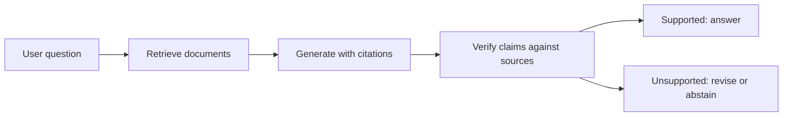

# Hallucination: Causes and Mitigations

## Introduction

Ask a model for the birthday of a moderately obscure scientist and it may answer instantly, fluently and wrongly. Ask it for sources and it may invent a paper with a plausible title, real-sounding authors and a DOI that leads nowhere. This behaviour is called **hallucination**: generated content that is false or unsupported but presented as if it were true.

Hallucination is the single biggest obstacle to using LLMs where correctness matters: medicine, law, finance, customer support, code that touches production. It is also widely misunderstood. It is not a rare bug that the next model version will remove, and it is not the model "lying". It follows from how models are trained and, as recent work argues, from how we grade them.

This page explains hallucination at the level you need to reason about it and engineer around it. You will learn:

- the main types of hallucination and why the distinction matters for mitigation;
- the statistical argument (Kalai et al., 2025) that pretraining alone produces errors on rarely seen facts, and why binary grading rewards guessing;
- what calibration is, how to measure it, and how post-training affects it;
- detection methods based on self-consistency and semantic entropy, with a runnable demo;
- mitigations that work in practice: retrieval, abstention, verification and evaluation that rewards saying "I don't know".

## What Counts as a Hallucination

The survey by Ji et al. (2023) separates two cases that call for different tools:

- **Intrinsic hallucination** contradicts the source the model was given. A summary says the meeting was on Tuesday when the transcript says Thursday. This is a *faithfulness* failure, and you can check it against the input.
- **Extrinsic hallucination** adds content that the source neither supports nor contradicts. In open-domain question answering, where there is no source document, any false factual claim falls here. This is a *factuality* failure, and checking it needs outside knowledge.

A third useful word is **confabulation**, used by Farquhar et al. (2024) for the subset of hallucinations where the model's answer is arbitrary: ask again and you get a different wrong answer. Confabulations are the easiest to detect, because the model is inconsistent with itself. The hardest case is the opposite: a model that has learned a false fact and repeats it every time, such as a common misconception it absorbed from the web. TruthfulQA (Lin et al., 2021), 817 questions across 38 categories built around misconceptions, targets exactly this; its authors found that the largest models they tested were generally the *least* truthful, because they imitated human falsehoods more faithfully.

| Type | Example | How to detect | How to reduce |
|---|---|---|---|
| Intrinsic (unfaithful to input) | Summary changes a date | Compare claims to the source (NLI model, judge) | Grounding prompts, citations, constrained extraction |
| Extrinsic, confabulated | Different invented birthday each time | Sampling consistency, semantic entropy | Abstention, retrieval |
| Extrinsic, systematic | Repeats a popular misconception | Fact-checking against a trusted source | Better data, retrieval, targeted training |
| Fabricated references | Non-existent paper or URL | Resolve the citation | Retrieval with real documents, tool use |

## Why Models Hallucinate: The Statistics of Pretraining

Kalai, Nachum, Vempala and Zhang ("Why Language Models Hallucinate", 2025) give a clean argument for why even a perfectly trained base model must make errors on some facts.

Their first step is a reduction. Generating a valid answer is at least as hard as *recognizing* whether a candidate answer is valid. They define an "Is-It-Valid" (IIV) binary classification problem: given a string, decide whether it is valid or an error. They show that any language model can be turned into an IIV classifier (by thresholding its probability), and that its generative error rate is tied to that classifier's misclassification rate. Informally:

$$
\mathrm{err}_{\mathrm{generation}} \gtrsim 2 \cdot \mathrm{err}_{\mathrm{IIV}}
$$

up to correction terms that depend on how many valid versus invalid answers exist for each prompt and on how well calibrated the model is. So whatever makes classification hard, such as facts with no learnable pattern, also produces generation errors.

The second step quantifies "no learnable pattern" with the **singleton rate**. Consider arbitrary facts like birthdays. There is no rule that predicts a person's birthday from their name; the only way to know it is to have seen it. Borrowing the Good-Turing estimate of "missing mass" from statistics, Kalai et al. define the singleton rate $\mathrm{sr}$ as the fraction of training prompts whose fact appears exactly once in the training data. Their theorem says a calibrated base model has an error rate on such facts of roughly at least $\mathrm{sr}$, minus small terms. The intuition: facts seen once are, statistically, a good proxy for facts seen zero times; the model cannot distinguish "I saw this once" from "I never saw this" reliably, so it must spread probability over plausible guesses for that whole tail.

A concrete reading, the paper's own example: if 20% of the birthday facts in the training data appear exactly once, expect a base model to hallucinate on at least about 20% of birthday questions. Facts mentioned thousands of times (the birthday of Einstein) are safe; the long tail of people mentioned once in an obituary is not.

This also explains what scaling does and does not fix. A bigger model trained on more data reduces errors on facts with patterns and on facts it has seen many times. It cannot fix facts that are simply rare in the data.

## Why Models Hallucinate: Grading Rewards Guessing

The pretraining argument explains why errors exist. It does not explain why post-trained assistants answer confidently instead of saying "I'm not sure". Kalai et al.'s second argument is about evaluation.

Almost every popular benchmark uses **binary grading**: 1 point for a correct answer, 0 for a wrong answer, and 0 for "I don't know". Under that rule, abstaining is never better than guessing. If the model's probability of being right is $p \gt 0$, guessing has expected score $p$ and abstaining has expected score 0. A model optimized, directly or through the choices of the people training it, to top such leaderboards learns to always guess. The authors checked a list of widely used benchmarks and found that nearly all of them give no credit for abstaining.

Their proposed fix is to make the incentive explicit with a **confidence target** $t$: tell the model (and the grader) that a correct answer earns 1, "I don't know" earns 0, and a wrong answer costs $t/(1-t)$ points. Then the expected score of answering with probability $p$ of being right is

$$
\mathbb{E}[\mathrm{score}] = p \cdot 1 - (1 - p) \cdot \frac{t}{1-t}
$$

which is positive exactly when $p(1 - t) \gt (1 - p)\,t$, that is when $p \gt t$. A model that answers only when its confidence exceeds $t$ maximizes its score. With $t = 0.5$ a wrong answer costs 1 point; with $t = 0.9$ it costs 9.

Let us simulate a model that is perfectly calibrated (when it says 70%, it is right 70% of the time) and compare strategies under both grading rules:

```python
import numpy as np

rng = np.random.default_rng(0)
n = 1000
conf = rng.beta(2, 1.2, size=n)                 # the model's stated confidence per question
correct = rng.random(n) < conf                  # a perfectly calibrated model, by construction

def score(threshold, penalty):
    answer = conf > threshold                   # abstain ("I don't know") below threshold
    right = (answer & correct).sum()
    wrong = (answer & ~correct).sum()
    return right - penalty * wrong, answer.mean(), wrong / max(answer.sum(), 1)

print("binary grading (wrong answers cost 0):")
for t in (0.0, 0.5, 0.75, 0.9):
    s, cov, err = score(t, penalty=0)
    print(f"  answer if conf>{t:.2f}: score {s:6.0f}  answered {cov:.0%}  error rate {err:.0%}")

t = 0.75
pen = t / (1 - t)
print(f"confidence-target grading, t={t}, wrong answers cost {pen:.0f}:")
for thr in (0.0, 0.5, 0.75, 0.9):
    s, cov, err = score(thr, penalty=pen)
    print(f"  answer if conf>{thr:.2f}: score {s:6.0f}  answered {cov:.0%}  error rate {err:.0%}")
```

```text
binary grading (wrong answers cost 0):
  answer if conf>0.00: score    606  answered 100%  error rate 39%
  answer if conf>0.50: score    499  answered 68%  error rate 27%
  answer if conf>0.75: score    300  answered 35%  error rate 15%
  answer if conf>0.90: score    124  answered 13%  error rate 6%
confidence-target grading, t=0.75, wrong answers cost 3:
  answer if conf>0.00: score   -576  answered 100%  error rate 39%
  answer if conf>0.50: score    -56  answered 68%  error rate 27%
  answer if conf>0.75: score    141  answered 35%  error rate 15%
  answer if conf>0.90: score    100  answered 13%  error rate 6%
```

Under binary grading the "always answer" strategy wins with a 39% error rate: the leaderboard rewards the most hallucination-prone policy. Under the confidence target, the best strategy is to answer exactly when confidence exceeds 0.75, as the algebra predicted, and its error rate is 15%. Same model, same knowledge; only the grading changed. SimpleQA (Wei et al., 2024), a set of 4,326 short fact-seeking questions, takes a step in this direction by grading each answer as correct, incorrect or not attempted, so that abstention is visible instead of being merged with errors.

## Other Causes in the Training Pipeline

Two more mechanisms are well documented.

**Fine-tuning on facts the model does not know.** Gekhman et al. (2024) fine-tuned models on closed-book question answering where they controlled how many training answers were "unknown" to the base model. The unknown examples were learned much more slowly than known ones, and once the model did fit them, its tendency to hallucinate on held-out questions increased roughly linearly with how many it had absorbed. The interpretation: supervised fine-tuning on new facts teaches the model to produce confident answers it has no basis for. Practical consequences: filter fine-tuning data for facts the base model cannot verify, or stop early. See [Preparing Fine-Tuning Data](../9-llm-fine-tuning/4-llm-fine-tuning-data.mdx).

**Decoding.** Sampling at high temperature, or with a large top-p, gives probability mass to low-likelihood continuations, including wrong ones. Once a wrong token is emitted, the model conditions on it and continues consistently with the error; there is no "undo" in autoregressive generation. Lower temperatures help for factual queries, at some cost in diversity. See [Decoding Strategies](../10-llm-inference/1-llm-decoding-strategies.mdx).

## Calibration: Do Models Know What They Know?

Abstention only works if the model's confidence is meaningful. A model is **calibrated** if, among all answers it gives with confidence 0.8, about 80% are correct. The standard summary is the **expected calibration error**. Split predictions into $M$ bins by confidence; in bin $B_m$, compare accuracy and mean confidence; weight by bin size:

$$
\mathrm{ECE} = \sum_{m=1}^{M} \frac{\lvert B_m \rvert}{n} \left\lvert \mathrm{acc}(B_m) - \mathrm{conf}(B_m) \right\rvert
$$

```python
import numpy as np

rng = np.random.default_rng(0)
n = 1000
conf = rng.beta(2, 1.2, size=n)                 # same simulated model as above
correct = rng.random(n) < conf

def ece(confidence, correct, n_bins=10):
    """Expected calibration error with equal-width bins."""
    bins = np.clip((confidence * n_bins).astype(int), 0, n_bins - 1)
    total = 0.0
    for b in range(n_bins):
        m = bins == b
        if m.any():                              # |accuracy - mean confidence|, weighted by bin size
            total += m.mean() * abs(correct[m].mean() - confidence[m].mean())
    return total

print(f"ECE of the calibrated model: {ece(conf, correct):.3f}")
over = np.clip(conf + 0.2, 0, 1)                # same answers, confidence inflated by 0.2
print(f"ECE after inflating confidence by 0.2: {ece(over, correct):.3f}")
```

```text
ECE of the calibrated model: 0.033
ECE after inflating confidence by 0.2: 0.190
```

Even a perfectly calibrated model shows a small ECE (0.033) from finite-sample noise; inflating confidence by 0.2 shows up clearly. Where does an LLM's confidence come from? Options include the probability of the answer tokens, the probability of "True" when asked whether its own answer is correct, the agreement rate among several samples, or a verbal statement ("I'm 70% sure").

What is known empirically: Kadavath et al. (2022), "Language Models (Mostly) Know What They Know", found that large pretrained models are well calibrated on multiple-choice questions when the options are presented in a suitable format, and can be trained to predict whether they know the answer to a question. The GPT-4 technical report (OpenAI, 2023) showed the pretrained GPT-4 was well calibrated on a subset of MMLU and that post-training reduced its calibration. Post-training optimizes for answers people like, and confident answers are liked. Verbalized confidence from chat models tends to be overconfident unless specifically trained.

## Detecting Hallucinations at Inference Time

If you cannot trust the model's stated confidence, you can measure its consistency. The idea behind **SelfCheckGPT** (Manakul et al., 2023) is simple: if the model knows a fact, multiple samples will agree on it; if it is guessing, samples will diverge. Sample several answers and check whether the main answer's claims are supported by the others.

**Semantic entropy** (Farquhar et al., 2024, Nature) makes this precise. Naive entropy over sampled strings is misleading: "Paris", "paris" and "It's Paris." are three different strings with one meaning. So first cluster samples by meaning, then compute entropy over clusters. If $C$ is the set of meaning clusters and $p(c \mid x)$ the probability of cluster $c$ (estimated as the fraction of samples in it, or by summing sequence probabilities):

$$
\mathrm{SE}(x) = -\sum_{c \in C} p(c \mid x) \log p(c \mid x)
$$

Low semantic entropy means the model consistently says the same thing; high semantic entropy flags a likely confabulation. In the paper, two answers belong to the same cluster if each entails the other according to a natural language inference model or an LLM. For short answers, string normalization is a crude but serviceable stand-in, which is what the demo below uses with a small instruction model:

```python
import math, re, torch
from collections import Counter
from transformers import AutoModelForCausalLM, AutoTokenizer

torch.manual_seed(0)
model_id = "Qwen/Qwen2.5-0.5B-Instruct"
tok = AutoTokenizer.from_pretrained(model_id)
model = AutoModelForCausalLM.from_pretrained(model_id, dtype=torch.float32).eval()

def sample_answers(question, n=10):
    msgs = [{"role": "user", "content": question + " Answer with just the name, no explanation."}]
    enc = tok.apply_chat_template(msgs, add_generation_prompt=True, return_tensors="pt", return_dict=True)
    out = model.generate(**enc, do_sample=True, temperature=1.0, top_p=1.0,
                         max_new_tokens=12, num_return_sequences=n, pad_token_id=tok.eos_token_id)
    gen = out[:, enc["input_ids"].shape[1]:]                     # (n, new_tokens)
    return [tok.decode(g, skip_special_tokens=True) for g in gen]

def meaning(ans):
    """Crude equivalence: lower-case, drop punctuation and leading 'the'.
    The paper uses an entailment model in both directions instead."""
    a = re.sub(r"[^a-z0-9 ]", "", ans.lower()).strip()
    return re.sub(r"^the ", "", a).split(" city")[0]

def semantic_entropy(answers):
    counts = Counter(meaning(a) for a in answers)
    probs = [c / len(answers) for c in counts.values()]
    return abs(sum(p * math.log(p) for p in probs)), counts   # abs() avoids printing -0.00

questions = [
    ("What is the capital of France?", "paris"),
    ("What is the capital of Japan?", "tokyo"),
    ("Who wrote the novel 1984?", "orwell"),
    ("What is the capital of Burkina Faso?", "ouagadougou"),
    ("Who was the first person to reach the South Pole?", "amundsen"),
    ("Who won the 1987 Tour de France?", "roche"),
]
for q, gold in questions:
    answers = sample_answers(q)
    h, counts = semantic_entropy(answers)
    top = counts.most_common(1)[0][0]
    ok = gold in top
    print(f"SE={h:.2f}  majority={top!r:28s} correct={ok}  clusters={len(counts)}  | {q}")
```

```text
SE=0.00  majority='paris'                      correct=True  clusters=1  | What is the capital of France?
SE=0.50  majority='tokyo'                      correct=True  clusters=2  | What is the capital of Japan?
SE=1.50  majority='george orwell'              correct=True  clusters=6  | Who wrote the novel 1984?
SE=1.83  majority='bangui'                     correct=False  clusters=7  | What is the capital of Burkina Faso?
SE=1.23  majority='roald amundsen'             correct=True  clusters=5  | Who was the first person to reach the South Pole?
SE=2.30  majority='gillesvan hage'             correct=False  clusters=10  | Who won the 1987 Tour de France?
```

The pattern is what the method predicts. The model is certain about Paris (all 10 samples agree, entropy 0) and nearly certain about Tokyo. The two wrong answers have the highest entropies: for Burkina Faso, the plurality answer is "Bangui", the capital of a different country, and it is spread over 7 clusters; for the 1987 Tour de France (won by Stephen Roche), all 10 samples differ, the maximum possible entropy $\ln 10 = 2.30$. A threshold around 1.6 would flag both errors and keep all four correct answers. The 1984 row shows the weakness of our crude clustering: the majority answer is right, yet the samples fall into 6 string clusters, because variants such as "Orwell", "George Orwell" and answers with extra words are not recognized as the same meaning. That inflates the entropy of a correct answer to 1.50. An entailment-based equivalence check, as in the paper, would merge them.

Semantic entropy costs several samples per question (5 to 10 in the paper), so it is used for high-stakes answers or offline audits rather than every chat turn. And it misses systematic errors: a model that always gives the same wrong answer has zero semantic entropy.

For long-form text, the unit of checking must be smaller than the answer. **FActScore** (Min et al., 2023) splits a generated biography into atomic facts ("X was born in 1950", "X studied at Y") and checks each one against a knowledge source, reporting the fraction supported. The same decomposition underlies most production fact-checking pipelines.

## Mitigations That Work

No single technique eliminates hallucination. In practice teams stack several:



1. **Retrieval-augmented generation (RAG).** Put the relevant facts in the context and instruct the model to answer only from them, citing passages. This turns extrinsic hallucination into a (much easier) faithfulness problem. It does not make the model faithful automatically; you still need to check citations. Building RAG pipelines is covered in the [AI Agents tutorial](/docs/ai/agents).
2. **Allow and reward abstention.** Say in the system prompt that "I don't know" is acceptable, and grade your own evaluations with a confidence target or with correct / incorrect / not-attempted, as above. Training with such rewards (for example in [reinforcement learning with verifiable rewards](../8-llm-post-training/4-llm-reasoning-rl.mdx)) teaches abstention directly.
3. **Verification passes.** Chain-of-Verification (Dhuliawala et al., 2023) has the model draft an answer, write verification questions about its own claims, answer them independently, and revise. Independent answering matters: if the model sees its draft while verifying, it tends to confirm it.
4. **Tools for what models are bad at.** Arithmetic, dates, current events, lookups of identifiers and citations should go to a calculator, a search API or a database, not to the model's parameters.
5. **Data hygiene in fine-tuning.** Avoid training the model to assert facts it did not know before (Gekhman et al.), and include examples where the correct response is to abstain or ask for clarification.
6. **Decoding settings.** Use low temperature for factual and extraction tasks.

:::tip
Measure before and after every mitigation with the same question set and a three-way grade (correct, incorrect, abstained). A mitigation that cuts errors by making the model refuse everything is easy to build and useless to ship; the three-way grade shows both numbers.
:::

## Worked Scenario: Measuring a Support Bot's Hallucination Rate

Your company's documentation assistant answers questions about your product. You want a hallucination rate you can track.

1. **Build 200 questions with known answers** from the documentation, plus 50 questions whose answer is *not* in the documentation (features you do not have, made-up error codes). The second group measures whether the bot admits ignorance.
2. **Grade three ways.** For each answer: correct, incorrect, or abstained. Use a judge model with the reference answer (reference-guided grading, see [LLM-as-a-Judge](./2-llm-llm-as-judge.mdx)) and hand-check 50 of its grades.
3. **Report the two groups separately.** On answerable questions: accuracy, error rate and abstention rate. On unanswerable questions: the fraction where the bot invented an answer. A typical first measurement shows a respectable accuracy on the first group and an alarming invention rate on the second.
4. **Apply mitigations one at a time**: retrieval with "answer only from the passages", then an explicit abstention instruction, then a verification pass. Re-run after each, compare with paired bootstrap intervals, and keep only the changes that lower errors without sending abstention through the roof.

The result is two numbers you can put on a dashboard, "wrong answers per 100 answerable questions" and "invented answers per 100 unanswerable questions", instead of a vague sense that the bot "sometimes makes things up".

## Common Mistakes

- Treating hallucination as a bug that a bigger model will remove; rare facts stay hard at any scale.
- Grading with accuracy alone, which rewards guessing and hides the effect of abstention.
- Assuming a chat model's verbal confidence ("I'm certain") is calibrated.
- Using exact-string entropy instead of meaning-level clusters, or assuming consistent answers are correct.
- Adding RAG and assuming the problem is solved without checking that answers are actually supported by the retrieved passages.
- Fine-tuning on new facts the base model has never seen and expecting reliable recall.
- Evaluating only answerable questions, so the rate of invented answers is never measured.

## Summary

- Hallucinations are false or unsupported claims; intrinsic ones contradict the input, extrinsic ones add unsupported content, and confabulations are arbitrary answers that change between samples.
- Generation errors are tied to the difficulty of classifying valid answers; for arbitrary facts, a base model's error rate is at least roughly the fraction of facts seen only once in training.
- Binary grading makes guessing optimal; a confidence target with penalty $t/(1-t)$ makes answering optimal only when confidence exceeds $t$.
- Calibration can be measured with ECE; pretrained models can be reasonably calibrated and post-training often reduces calibration.
- Self-consistency and semantic entropy detect confabulations, and atomic-fact checking handles long-form text; neither catches consistent errors.
- Retrieval, abstention, verification, tools, careful fine-tuning data and low temperature reduce hallucination; measure each with a three-way grade.

## Further Reading

- [Why Language Models Hallucinate (Kalai et al., 2025)](https://arxiv.org/abs/2509.04664) - the IIV reduction, the singleton rate and the grading argument.
- [Survey of Hallucination in Natural Language Generation (Ji et al., 2023)](https://arxiv.org/abs/2202.03629) - taxonomy of intrinsic and extrinsic hallucination.
- [Detecting hallucinations in large language models using semantic entropy (Farquhar et al., 2024)](https://www.nature.com/articles/s41586-024-07421-0) - meaning-level uncertainty for confabulation detection.
- [SelfCheckGPT (Manakul et al., 2023)](https://arxiv.org/abs/2303.08896) - zero-resource detection by sampling consistency.
- [TruthfulQA: Measuring How Models Mimic Human Falsehoods (Lin et al., 2021)](https://arxiv.org/abs/2109.07958) - misconception-driven questions.
- [Language Models (Mostly) Know What They Know (Kadavath et al., 2022)](https://arxiv.org/abs/2207.05221) - calibration and self-evaluation in large models.
- [Does Fine-Tuning LLMs on New Knowledge Encourage Hallucinations? (Gekhman et al., 2024)](https://arxiv.org/abs/2405.05904) - how unknown facts in fine-tuning data hurt.
- [FActScore (Min et al., 2023)](https://arxiv.org/abs/2305.14251) - atomic-fact precision for long-form generation.
- [Measuring short-form factuality in large language models (Wei et al., 2024)](https://arxiv.org/abs/2411.04368) - SimpleQA with correct, incorrect and not-attempted grading.
- [Chain-of-Verification Reduces Hallucination in Large Language Models (Dhuliawala et al., 2023)](https://arxiv.org/abs/2309.11495) - draft, verify independently, revise.
