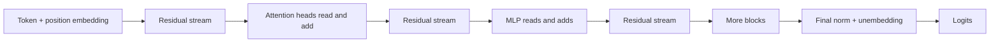
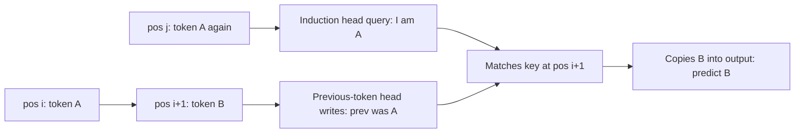

# Mechanistic Interpretability: Induction Heads, Circuits and Sparse Autoencoders

## Introduction

Benchmarks tell you *what* a model does. Interpretability asks *how*. Given a trained transformer, can we find the specific attention heads, MLP neurons and directions in activation space that implement a behaviour, such as copying a name, completing a repeated pattern or recalling that the Eiffel Tower is in Paris?

**Mechanistic interpretability** tries to reverse-engineer a network into human-understandable algorithms, the way you might decompile a binary. It matters for more than curiosity. If we can find the mechanism behind a behaviour, we can check whether a model is solving a task the way we think, detect when it relies on a shortcut, and in some cases edit or steer it. Several labs treat it as a core part of AI safety research.

This page is hands-on. Everything runs on GPT-2 small (124M parameters) on a CPU. You will:

- learn the residual-stream view of a transformer that makes mechanistic analysis possible;
- read intermediate predictions with the **logit lens**;
- find GPT-2's **induction heads** with an attention-pattern score and prove they matter by ablating them;
- localize where a name is stored with **activation patching**;
- understand **superposition** and train a small **sparse autoencoder** that extracts interpretable features;
- see where the field is (attribution graphs on production models) and where its methods still fall short.

It assumes you know the decoder block from [Inside a Decoder Block](../3-llm-transformer/2-llm-transformer-block.mdx) and multi-head attention from [Multi-Head Attention](../2-llm-attention/4-llm-multi-head-attention.mdx).

## The Residual Stream View

Elhage et al. (2021), "A Mathematical Framework for Transformer Circuits", proposed a way of reading a transformer that most interpretability work now uses. Write the hidden state at layer $\ell$ as $x_\ell \in \mathbb{R}^{d}$ for one token position. A pre-norm decoder block does

$$
x_{\ell}' = x_\ell + \sum_{h=1}^{H} \mathrm{head}_{\ell,h}(x_\ell), \qquad x_{\ell+1} = x_\ell' + \mathrm{MLP}_\ell(x_\ell')
$$

and the output logits are $W_U\, \mathrm{LN}(x_L)$, where $W_U$ is the unembedding matrix. Nothing ever overwrites $x$: every component *reads* from the running sum and *adds* its output back. So the final state is a sum of contributions:

$$
x_L = x_0 + \sum_{\ell, h} \mathrm{head}_{\ell,h}(\cdot) + \sum_{\ell} \mathrm{MLP}_\ell(\cdot)
$$

The authors call $x$ the **residual stream** and think of it as a shared communication channel, a bus with $d$ lanes (768 for GPT-2 small). Components communicate by writing to subspaces that later components read. Three consequences follow:

- **Direct effects are linear.** Ignoring the final normalization (or freezing its scale), each component's direct contribution to the logits is $W_U$ times its output. You can ask "how much did head 9.6 push up the logit of ' Paris'?"
- **Each head factors into two circuits.** For one head, the attention score between a query token with state $x_i$ and a key token with state $x_j$ is $x_i^\top W_Q^\top W_K x_j$; the matrix $W_Q^\top W_K$ (size $d \times d$, rank at most $d_{\mathrm{head}}$) is the **QK circuit**, deciding *where to look*. What gets moved is $W_O W_V x_j$; the matrix $W_O W_V$ is the **OV circuit**, deciding *what to write*. The two can be analysed separately.
- **Heads compose.** A later head's query, key or value can read what an earlier head wrote. This **composition** (Q-, K- or V-composition) is how multi-step algorithms are built, as induction heads show below.



## The Logit Lens

If every layer adds to the same stream that the unembedding finally reads, we can apply the unembedding *early* and see what the model "would predict" if it stopped at layer $\ell$. This is the **logit lens**, introduced in a 2020 blog post by the pseudonymous author nostalgebraist:

$$
\mathrm{logits}_\ell = W_U\, \mathrm{LN}_{\mathrm{final}}(x_\ell)
$$

```python
import torch
from transformers import AutoModelForCausalLM, AutoTokenizer

torch.manual_seed(0)
tok = AutoTokenizer.from_pretrained("openai-community/gpt2")
model = AutoModelForCausalLM.from_pretrained("openai-community/gpt2").eval()

prompt = "The Eiffel Tower is located in the city of"
ids = tok(prompt, return_tensors="pt").input_ids             # (1, T)
with torch.no_grad():
    out = model(ids, output_hidden_states=True)
# hidden_states: tuple of n_layer+1 tensors, each (1, T, d_model); [0] = embeddings
for layer, h in enumerate(out.hidden_states):
    if layer == len(out.hidden_states) - 1:
        logits = model.lm_head(h[:, -1])                       # last entry already has ln_f applied
    else:
        logits = model.lm_head(model.transformer.ln_f(h[:, -1]))   # (1, vocab)
    p = torch.softmax(logits, -1)
    top_p, top_i = p.topk(3)
    words = ", ".join(f"{tok.decode(i)!r} {v:.2f}" for v, i in zip(top_p[0], top_i[0]))
    print(f"layer {layer:2d}: {words}")
```

```text
layer  0: ' destro' 0.67, ' mathemat' 0.24, ' challeng' 0.07
layer  1: ' the' 0.71, ' course' 0.05, ' a' 0.03
layer  2: ' the' 0.82, ' course' 0.06, ' a' 0.02
layer  3: ' the' 0.71, ' course' 0.12, ' a' 0.02
layer  4: ' the' 0.66, ' course' 0.06, ' a' 0.01
layer  5: ' the' 0.32, ' La' 0.05, ' course' 0.05
layer  6: ' England' 0.06, ' the' 0.05, ' La' 0.04
layer  7: ' East' 0.06, ' La' 0.05, ' Georgia' 0.05
layer  8: ' Ing' 0.23, ' San' 0.06, ' Rome' 0.05
layer  9: ' Rome' 0.17, ' San' 0.08, ' La' 0.06
layer 10: ' London' 0.25, ' Paris' 0.19, ' Amsterdam' 0.18
layer 11: ' Paris' 0.16, ' London' 0.14, ' Amsterdam' 0.13
layer 12: ' Paris' 0.06, ' London' 0.05, ' Amsterdam' 0.03
```

The story reads well. The embedding layer (row 0) predicts junk: it only knows the current token "of". Layers 1 to 5 predict " the", the generic continuation of "the city of". From layer 6 the prediction becomes "some place name"; by layer 10 European capitals dominate, and from layer 11 " Paris" leads. GPT-2 small is weak, so even its final answer is uncertain.

The logit lens is a heuristic, not a measurement. Early layers may store information in directions the final unembedding does not read, which makes the lens look worse than the model's knowledge. The **tuned lens** (Belrose et al., 2023) fixes part of this by training a small affine probe per layer to map $x_\ell$ to the final-layer distribution.

## Induction Heads

Some behaviours have been explained end to end. The best-known is the **induction head** (Elhage et al., 2021; Olsson et al., 2022, "In-context Learning and Induction Heads"). It implements a simple rule: if the current token is $A$, and earlier in the context $A$ was followed by $B$, predict $B$. In pattern form, `[A][B] ... [A] -> [B]`.

It takes two heads in different layers, connected by K-composition:

1. A **previous-token head** in an earlier layer attends from each position to the position before it and writes "the previous token was $A$" into the residual stream at the position of $B$.
2. The **induction head** in a later layer, sitting at the second $A$, uses its query ("I am $A$") against keys that contain the information written by step 1 ("my previous token was $A$"). It therefore attends to $B$, the token *after* the earlier $A$, and its OV circuit copies $B$'s identity to the output.



Olsson et al. found that induction heads form abruptly early in training, at the same time as a visible bump in the loss curve and a sharp jump in in-context learning (loss on later tokens of a context dropping relative to earlier ones). They presented several lines of evidence that induction heads are a major mechanism of in-context learning; the evidence is causal in small attention-only models and correlational in large ones.

### Finding Them in GPT-2

The cleanest test input is a sequence of random tokens repeated twice. The first copy is unpredictable. The second copy is perfectly predictable, *but only by looking back*. For a repeated sequence of length $T$, a perfect induction head at position $q$ in the second copy attends to position $q - T + 1$: the token right after the earlier occurrence of the current token. Define a head's **induction score** as its average attention weight on exactly that position.

```python
import torch
from transformers import AutoModelForCausalLM

torch.manual_seed(0)
model = AutoModelForCausalLM.from_pretrained(
    "openai-community/gpt2", attn_implementation="eager"   # eager returns attention weights
).eval()
cfg = model.config
n_layers, n_heads = cfg.n_layer, cfg.n_head               # 12, 12
head_dim = cfg.n_embd // n_heads                           # 64

B, T = 8, 50
rand = torch.randint(1000, 20000, (B, T))                  # random "ordinary" tokens
bos = torch.full((B, 1), 50256)                            # <|endoftext|>
x = torch.cat([bos, rand, rand], dim=1)                    # (B, 1 + 2T)

with torch.no_grad():
    out = model(x, output_attentions=True)

# per-token loss: first copy (unpredictable) vs second copy (copyable)
logp = torch.log_softmax(out.logits[:, :-1], -1)           # (B, 2T, vocab)
nll = -logp.gather(-1, x[:, 1:, None]).squeeze(-1)         # (B, 2T)
print(f"loss on first copy : {nll[:, :T].mean():.2f} nats")
print(f"loss on second copy: {nll[:, T+1:].mean():.2f} nats")

# induction score: attention from query position q (second copy) to key q - T + 1
scores = torch.zeros(n_layers, n_heads)
q_pos = torch.arange(T + 1, 2 * T + 1)                     # positions of second copy
k_pos = q_pos - T + 1                                      # token AFTER the earlier match
for layer, att in enumerate(out.attentions):               # att: (B, heads, seq, seq)
    scores[layer] = att[:, :, q_pos, k_pos].mean(dim=(0, 2))

top = torch.topk(scores.flatten(), 6)
print("top induction heads (layer.head: score)")
for v, i in zip(top.values, top.indices):
    print(f"  {i // n_heads}.{i % n_heads}: {v:.2f}")

# causal check: zero-ablate the top heads and re-measure loss on the second copy
def ablate(heads):
    hooks = []
    for layer in range(n_layers):
        hs = [h for (l, h) in heads if l == layer]
        if not hs:
            continue
        def pre_hook(mod, args, hs=hs):
            z = args[0].clone()                            # (B, seq, n_heads*head_dim)
            for h in hs:
                z[..., h * head_dim:(h + 1) * head_dim] = 0
            return (z,)
        hooks.append(model.transformer.h[layer].attn.c_proj.register_forward_pre_hook(pre_hook))
    return hooks

top_heads = [(int(i // n_heads), int(i % n_heads)) for i in top.indices]
others = [i for i in torch.randperm(n_layers * n_heads).tolist() if (i // n_heads, i % n_heads) not in top_heads]
rand_heads = [(i // n_heads, i % n_heads) for i in others[:6]]
print("random heads:", rand_heads)
for name, heads in [("top-6 induction", top_heads), ("6 random", rand_heads)]:
    hooks = ablate(heads)
    with torch.no_grad():
        lg = model(x).logits
    for hk in hooks:
        hk.remove()
    lp = torch.log_softmax(lg[:, :-1], -1)
    n2 = -lp.gather(-1, x[:, 1:, None]).squeeze(-1)[:, T+1:].mean()
    print(f"ablate {name:16s} heads -> second-copy loss {n2:.2f} nats")
```

```text
loss on first copy : 12.36 nats
loss on second copy: 0.18 nats
top induction heads (layer.head: score)
  5.5: 0.94
  6.9: 0.92
  7.10: 0.92
  5.1: 0.91
  7.2: 0.84
  10.1: 0.54
random heads: [(3, 2), (7, 7), (2, 0), (8, 11), (5, 11), (0, 8)]
ablate top-6 induction  heads -> second-copy loss 5.72 nats
ablate 6 random         heads -> second-copy loss 0.27 nats
```

Read the numbers carefully:

- **The behaviour.** On random tokens GPT-2's loss is 12.36 nats, worse than uniform guessing over the vocabulary ($\ln 50257 = 10.8$) because the model confidently expects ordinary text. On the second copy it drops to 0.18 nats, meaning it predicts the repeated token with probability around $e^{-0.18} = 0.84$. It learned the pattern from one example in context.
- **The heads.** Five heads in layers 5 to 7 put more than 84% of their attention exactly on the "next token after the earlier match". Heads 5.1, 5.5, 6.9, 7.2 and 7.10 are the induction heads repeatedly reported for GPT-2 small in the interpretability literature. They sit in the middle of the network, which fits the two-step mechanism: previous-token heads must come first.
- **The causal test.** Zeroing the outputs of those six heads (out of 144) raises the second-copy loss from 0.18 to 5.72 nats, destroying most of the copying ability. Zeroing six random heads barely matters (0.27). The attention pattern was not just correlated with the behaviour; the heads are necessary for it.

The ablation hooks the input of `c_proj`, the output projection, where the 12 heads' outputs sit side by side as 64-dimensional slices. Zero ablation is the crudest intervention; mean ablation (replacing the output with its average over a dataset) is gentler and usually preferred in papers, because zero can push the stream off-distribution.

## Circuits and Activation Patching

Ablation asks "does the model need this component?". **Activation patching** asks a sharper question: "where is the information that distinguishes two inputs?" Run the model on a *clean* prompt and a *corrupted* prompt that differs in one detail. Then rerun the corrupted prompt, but overwrite one activation (one layer, one position) with its value from the clean run. If the output flips back toward the clean answer, that activation carries the relevant information. Meng et al. (2022) used this idea, which they called causal tracing, to locate factual recall in mid-layer MLPs of GPT-style models, before editing facts with ROME.

Measure the effect with a **logit difference** $\Delta = \mathrm{logit}(\text{correct}) - \mathrm{logit}(\text{wrong})$ and normalize:

$$
\mathrm{restored} = \frac{\Delta_{\mathrm{patched}} - \Delta_{\mathrm{corrupt}}}{\Delta_{\mathrm{clean}} - \Delta_{\mathrm{corrupt}}}
$$

so 0 means no effect and 1 means full restoration. We use the **indirect object identification** (IOI) task: in "When Mary and John went to the store, John gave a drink to", the answer is " Mary", the name that was not repeated. Wang et al. (2022), "Interpretability in the Wild", reverse-engineered the GPT-2 small circuit for this task: 26 heads in 7 functional classes in the original version of the paper, including "duplicate token" heads that notice John appears twice, "S-inhibition" heads and "name mover" heads that copy the remaining name to the output.

The corrupted prompt swaps the second name, so the answer flips to " John". We patch the residual stream entering each layer at two positions: the second-name token and the final token.

```python
import torch
from transformers import AutoModelForCausalLM, AutoTokenizer

torch.manual_seed(0)
tok = AutoTokenizer.from_pretrained("openai-community/gpt2")
model = AutoModelForCausalLM.from_pretrained("openai-community/gpt2").eval()

clean   = "When Mary and John went to the store, John gave a drink to"
corrupt = "When Mary and John went to the store, Mary gave a drink to"
c_ids, x_ids = tok(clean, return_tensors="pt").input_ids, tok(corrupt, return_tensors="pt").input_ids
assert c_ids.shape == x_ids.shape                          # same length, so positions line up
mary, john = tok(" Mary").input_ids[0], tok(" John").input_ids[0]

def logit_diff(logits):                                    # > 0 means the model prefers " Mary"
    return (logits[0, -1, mary] - logits[0, -1, john]).item()

with torch.no_grad():
    clean_out = model(c_ids, output_hidden_states=True)
    base_clean = logit_diff(clean_out.logits)
    base_corrupt = logit_diff(model(x_ids).logits)
print(f"clean logit diff {base_clean:+.2f}, corrupted {base_corrupt:+.2f}")

# patch the clean residual stream into the corrupted run, one (layer, position) at a time
S = c_ids.size(1)
names_pos = {"S2 (second name)": 9, "final token": S - 1}   # token 9 is the repeated name
for label, pos in names_pos.items():
    row = []
    for layer in range(model.config.n_layer):
        clean_h = clean_out.hidden_states[layer][0, pos]   # input to block `layer`, (768,)
        def pre_hook(mod, args, kwargs, h=clean_h):
            x = args[0].clone()
            x[0, pos] = h
            return (x,) + args[1:], kwargs
        hk = model.transformer.h[layer].register_forward_pre_hook(pre_hook, with_kwargs=True)
        with torch.no_grad():
            d = logit_diff(model(x_ids).logits)
        hk.remove()
        row.append((d - base_corrupt) / (base_clean - base_corrupt))  # 1.0 = fully restored
    print(f"{label:18s}", " ".join(f"{r:4.2f}" for r in row))
print("tokens:", [tok.decode(t) for t in c_ids[0]])
```

```text
clean logit diff +2.01, corrupted -1.79
S2 (second name)   1.00 1.00 1.01 1.00 0.98 0.91 0.91 0.84 0.54 0.11 0.05 0.03
final token        0.00 0.00 0.00 0.00 0.00 -0.00 0.00 0.04 0.39 0.99 1.02 1.00
tokens: ['When', ' Mary', ' and', ' John', ' went', ' to', ' the', ' store', ',', ' John', ' gave', ' a', ' drink', ' to']
```

Each row has one entry per layer, 0 to 11. The model prefers the right name in both runs (logit difference +2.01 for " Mary" on the clean prompt, -1.79, that is a preference for " John", on the corrupted one). The table shows *where* the deciding information lives as it flows through the network:

- At the **second-name position** (token 9, the repeated " John"), patching any of layers 0 to 7 fully or almost fully restores the clean answer. Early on, the only thing that differs between the runs is which name sits there, so the information is all at that position.
- From layer 8 on, that position matters less and less (0.54 at layer 8, 0.11 at layer 9, near zero after), while patching the **final token** goes from no effect to full restoration between layers 7 and 9.

So between layers 7 and 9, attention heads read "which name was repeated" from the S2 position and write it into the final position. That matches the IOI circuit: S-inhibition heads in layers 7 and 8 move this information, and name-mover heads in layers 9 and 10 use it to copy the right name. Patching cannot tell us *which* heads do the moving; patching individual head outputs (and, for full rigour, path patching) does, which is how Wang et al. built their circuit.

## Superposition: Why Neurons Are Hard to Read

Induction heads were found by looking at attention patterns. Most of a model's knowledge, though, lives in MLP activations and residual-stream directions, and these resist inspection. Look at a single MLP neuron in GPT-2 and you typically find it firing on a mix of unrelated things: Python keywords, French text and a particular punctuation pattern. Such neurons are **polysemantic**.

"Toy Models of Superposition" (Elhage et al., 2022) offered an explanation. A model wants to represent far more features (concepts) than it has dimensions. If features are **sparse**, meaning each is active on only a small fraction of inputs, the model can store $m \gg d$ features as nearly orthogonal directions in $\mathbb{R}^d$ and tolerate a little interference when two happen to be active together. High-dimensional geometry makes this cheap: you can fit exponentially many nearly orthogonal vectors in $d$ dimensions. The cost is that features no longer line up with individual neurons; each neuron participates in many features. The authors demonstrated this in small ReLU networks, which switched to superposed representations as features became sparser.

If that picture is right, the job is to recover the feature directions from activations. That is a classic **dictionary learning** problem.

## Sparse Autoencoders

A **sparse autoencoder** (SAE) learns an overcomplete dictionary: it encodes an activation $x \in \mathbb{R}^d$ into $m \gg d$ non-negative feature activations $f$, of which only a few are non-zero, and reconstructs $x$ as a weighted sum of $m$ learned directions:

$$
f = \mathrm{ReLU}\big(W_{\mathrm{enc}}(x - b_{\mathrm{dec}}) + b_{\mathrm{enc}}\big), \qquad \hat{x} = W_{\mathrm{dec}} f + b_{\mathrm{dec}}
$$

$W_{\mathrm{enc}}$ is $m \times d$, $W_{\mathrm{dec}}$ is $d \times m$, and each column of $W_{\mathrm{dec}}$ is one feature's direction. The classic loss trades reconstruction against sparsity with an L1 penalty:

$$
\mathcal{L} = \lVert x - \hat{x} \rVert_2^2 + \lambda \lVert f \rVert_1
$$

Anthropic's "Towards Monosemanticity" (Bricken et al., 2023) trained such SAEs on the MLP layer of a one-layer transformer and found features far more interpretable than neurons: features for DNA sequences, Arabic script, base64 strings. "Scaling Monosemanticity" (Templeton et al., 2024) scaled the method to the middle-layer residual stream of Claude 3 Sonnet with dictionaries of roughly 1, 4 and 34 million features. It found multilingual and multimodal features for concepts, including safety-relevant ones such as deception and sycophancy, and showed that clamping a feature steers behaviour: amplifying a Golden Gate Bridge feature produced a model that brought the bridge into every answer, briefly offered publicly as "Golden Gate Claude".

The L1 penalty has a known flaw: it shrinks all active features toward zero, not just the unnecessary ones. Two popular fixes:

- **TopK SAEs** (Gao et al., 2024, OpenAI) drop the penalty and keep only the $k$ largest pre-activations per input. Sparsity is set exactly by $k$, and the authors report a better reconstruction-sparsity trade-off; they trained a 16-million-latent SAE on GPT-4 activations.
- **JumpReLU SAEs** (Rajamanoharan et al., 2024, Google DeepMind) use a learned threshold per feature. Gemma Scope (Lieberum et al., 2024) released JumpReLU SAEs for every layer of Gemma 2 2B and 9B.

Here is a TopK SAE trained on GPT-2's layer-6 residual stream from about 100k tokens of WikiText-103. It takes a few minutes on a CPU.

```python
import torch, torch.nn as nn, torch.nn.functional as F
from datasets import load_dataset
from transformers import AutoModelForCausalLM, AutoTokenizer

torch.manual_seed(0)
tok = AutoTokenizer.from_pretrained("openai-community/gpt2")
model = AutoModelForCausalLM.from_pretrained("openai-community/gpt2").eval()
LAYER = 6                                                    # residual stream after block 6

# 1. collect activations from ~100k tokens of WikiText-103 train text
text = "\n\n".join(load_dataset("Salesforce/wikitext", "wikitext-103-raw-v1", split="train[:20000]")["text"])
ids = tok(text, return_tensors="pt").input_ids[0, :102400]
acts, toks = [], []
with torch.no_grad():
    for chunk in ids.view(-1, 256):                          # 400 chunks of 256 tokens
        hs = model(chunk[None], output_hidden_states=True).hidden_states[LAYER][0]  # (256, 768)
        acts.append(hs[1:]); toks.append(chunk[1:])          # drop position 0 (huge norm outlier)
acts, toks = torch.cat(acts), torch.cat(toks)                # (N, 768), (N,)
print("activations:", tuple(acts.shape))

class TopKSAE(nn.Module):
    def __init__(self, d_model, n_latents, k):
        super().__init__()
        self.k = k
        self.b_pre = nn.Parameter(torch.zeros(d_model))
        self.enc = nn.Linear(d_model, n_latents)
        self.dec = nn.Linear(n_latents, d_model, bias=False)
        self.dec.weight.data = self.enc.weight.data.T.clone()   # tied init, as in Gao et al.
    def encode(self, x):                                     # x: (batch, d_model)
        pre = self.enc(x - self.b_pre)                       # (batch, n_latents)
        v, i = pre.topk(self.k, dim=-1)                      # keep the k largest
        return torch.zeros_like(pre).scatter(-1, i, F.relu(v))
    def forward(self, x):
        z = self.encode(x)
        return self.dec(z) + self.b_pre, z                   # x_hat: (batch, d_model)

mean, scale = acts.mean(0), acts.norm(dim=-1).mean()
X = (acts - mean) / scale                                    # centred, unit average norm
sae = TopKSAE(768, 4096, k=32)
opt = torch.optim.Adam(sae.parameters(), lr=1e-3)
for step in range(3001):
    xb = X[torch.randint(0, len(X), (1024,))]
    x_hat, z = sae(xb)
    loss = F.mse_loss(x_hat, xb)
    opt.zero_grad(); loss.backward(); opt.step()
    with torch.no_grad():                                    # keep decoder columns unit norm
        sae.dec.weight.data /= sae.dec.weight.data.norm(dim=0, keepdim=True)
    if step % 1000 == 0:
        print(f"step {step:4d}  mse {loss.item():.4f}")

with torch.no_grad():
    x_hat, z = sae(X)
    fve = 1 - (X - x_hat).pow(2).sum() / (X - X.mean(0)).pow(2).sum()
    fired = (z > 0).any(0)
print(f"fraction of variance explained: {fve:.3f}")
print(f"latents that ever fired: {int(fired.sum())} / 4096, mean active per token: {(z > 0).sum(1).float().mean():.1f}")

# 2. show the tokens that most strongly activate a few latents
freq = (z > 0).float().mean(0)
for j in torch.where((freq > 0.001) & (freq < 0.01))[0][:6].tolist():
    top = z[:, j].topk(8).indices
    print(f"latent {j:4d} (fires on {freq[j]*100:.2f}% of tokens):",
          " ".join(repr(tok.decode(toks[t])) for t in top))
```

```text
activations: (102000, 768)
step    0  mse 0.0006
step 1000  mse 0.0002
step 2000  mse 0.0001
step 3000  mse 0.0001
fraction of variance explained: 0.833
latents that ever fired: 3476 / 4096, mean active per token: 32.0
latent    2 (fires on 0.54% of tokens): ' pound' ' pound' ' cm' ' pound' ' pound' ' pound' ' pound' ' inch'
latent    5 (fires on 0.22% of tokens): 'ing' 'ing' ' Sen' 'ing' ' Sen' 'ing' ' Sen' ' Sen'
latent    6 (fires on 0.78% of tokens): ' That' ' That' ' That' ' That' ' That' ' That' ' that' ' That'
latent    7 (fires on 0.77% of tokens): ' following' ' of' ' after' ' year' ' following' ' after' ' year' ' after'
latent   11 (fires on 0.25% of tokens): ' No' ' No' ' No' ' No' ' 92' ' ,' ' ,' ' 90'
latent   12 (fires on 0.62% of tokens): 'her' 'her' 'her' 'her' 'her' 'her' 'her' 'her'
```

(The MSE values look tiny because `mse_loss` averages over all 768 dimensions of vectors whose average norm is 1; fraction of variance explained is the number to read.) With only 32 of 4,096 latents active per token, the SAE reconstructs 83% of the variance of the layer-6 residual stream; 620 latents never fired, a typical dead-latent problem that longer training and auxiliary losses address. The latents we printed (the first six with a firing rate between 0.1% and 1%, not hand-picked) are already readable: units of measurement (latent 2: " pound", " cm", " inch"), the word "That" (6), time-relation words like "following", "after" and "year" (7), the token "her" (12). Latent 5 mixes "ing" with " Sen" and latent 11 mixes " No" with numbers, so not every feature is clean. A production SAE, trained on billions rather than 100,000 tokens with a much larger dictionary, has far more and cleaner features.

Three implementation details matter. We drop position 0 because GPT-2's first-token residual has a norm many times larger than other positions and would dominate the loss. We normalize activations so the learning rate does not depend on the layer's scale. And we renormalize decoder columns after each step so feature activations, not decoder norms, carry the magnitude.

How do you judge an SAE? Reconstruction (fraction of variance explained, or better, the increase in the language model's loss when the SAE's reconstruction is spliced back in), sparsity (active features per token), dead features (never firing) and interpretability (do the top activations share a meaning?). Interpretability is usually judged by humans or by an LLM asked to explain a feature from its top examples and then predict its activations on new text.

## From Features to Circuits, and the Limits

Features say *what* is represented; circuits say *how* it is computed. Anthropic's 2025 work on **attribution graphs** combines them. "Circuit Tracing: Revealing Computational Graphs in Language Models" (Ameisen et al., 2025) replaces each MLP with a **cross-layer transcoder**, a sparse dictionary trained to reproduce the MLP outputs from its inputs, and then traces how features at one layer cause features at later layers for a specific prompt. The companion paper "On the Biology of a Large Language Model" (Lindsey et al., 2025) applied it to Claude 3.5 Haiku and reported, among other cases, intermediate "Texas" features on the way from "the capital of the state containing Dallas" to "Austin", and evidence that the model chooses rhyme words before writing a line of poetry.

The methods are powerful and still incomplete. Honest caveats, many stated by the authors themselves:

- **Reconstruction error.** SAEs and transcoders explain most, not all, of the activation variance; the residual "dark matter" can carry important computation.
- **Features are not unique.** Different dictionary sizes split or merge concepts differently ("feature splitting"), so "the" deception feature depends on choices made in training.
- **Interpretability illusions.** A feature whose top activations all look like one concept can fire on unrelated inputs at lower strength; patching results depend on the corruption you choose.
- **Coverage.** Attribution graphs give satisfying explanations for only a fraction of the prompts tried, and attention computation is only partly captured.
- **Scale and cost.** Training dictionaries on frontier models takes significant compute, and the explanations are per prompt.

Tools to go further: **TransformerLens** (hooked transformer implementations designed for this kind of work), **nnsight** (intervention on arbitrary PyTorch models, including remotely hosted large ones), **SAELens** (training and loading SAEs), **Gemma Scope** weights, and **Neuronpedia** (a browser for published SAE features).

## Common Mistakes

- Reading an attention pattern as an explanation without a causal test; a head can attend to a token and contribute nothing.
- Zero-ablating and concluding a component "does X" when the drop comes from pushing activations off-distribution; compare with mean ablation.
- Trusting the logit lens in early layers, where the final unembedding may not read the relevant directions.
- Patching with a corrupted prompt that changes the token count, so positions no longer align.
- Interpreting single neurons in a superposed model and calling them "the X neuron".
- Judging an SAE by reconstruction MSE only, without checking the language-model loss with the SAE spliced in, dead features and the interpretability of features.
- Forgetting that GPT-2's first position has an outlier norm that dominates activation statistics.

## Summary

- The residual stream view treats a transformer as components that read from and add to a shared vector; each head factors into a QK circuit (where to look) and an OV circuit (what to write).
- The logit lens projects intermediate residuals through the unembedding to show how a prediction forms across layers; the tuned lens adds trained probes.
- Induction heads implement `[A][B] ... [A] -> [B]` with a previous-token head and K-composition; in GPT-2 small, heads 5.1, 5.5, 6.9, 7.2 and 7.10 score above 0.84, and ablating them raises loss on repeated text from 0.18 to 5.72 nats.
- Activation patching localizes the information that distinguishes two prompts by restoring one activation at a time and measuring the normalized logit difference.
- Superposition lets models store more sparse features than dimensions, which makes neurons polysemantic; sparse autoencoders (L1, TopK, JumpReLU) recover more interpretable feature directions.
- Attribution graphs connect features into prompt-specific circuits on production models; reconstruction error, non-unique features and limited coverage are the main open problems.

## Further Reading

- [A Mathematical Framework for Transformer Circuits (Elhage et al., 2021)](https://transformer-circuits.pub/2021/framework/index.html) - the residual stream, QK and OV circuits, composition.
- [In-context Learning and Induction Heads (Olsson et al., 2022)](https://arxiv.org/abs/2209.11895) - induction heads and the in-context learning phase change.
- [Interpreting GPT: the logit lens (nostalgebraist, 2020)](https://www.lesswrong.com/posts/AcKRB8wDpdaN6v6ru/interpreting-gpt-the-logit-lens) - the original logit lens post.
- [Eliciting Latent Predictions from Transformers with the Tuned Lens (Belrose et al., 2023)](https://arxiv.org/abs/2303.08112) - trained per-layer probes.
- [Interpretability in the Wild: a Circuit for Indirect Object Identification in GPT-2 small (Wang et al., 2022)](https://arxiv.org/abs/2211.00593) - a full circuit found with path patching.
- [Locating and Editing Factual Associations in GPT (Meng et al., 2022)](https://arxiv.org/abs/2202.05262) - causal tracing and ROME.
- [Toy Models of Superposition (Elhage et al., 2022)](https://transformer-circuits.pub/2022/toy_model/index.html) - why features do not align with neurons.
- [Towards Monosemanticity (Bricken et al., 2023)](https://transformer-circuits.pub/2023/monosemantic-features/index.html) - sparse autoencoders on a one-layer transformer.
- [Scaling Monosemanticity (Templeton et al., 2024)](https://transformer-circuits.pub/2024/scaling-monosemanticity/index.html) - SAEs with millions of features on Claude 3 Sonnet.
- [Scaling and evaluating sparse autoencoders (Gao et al., 2024)](https://arxiv.org/abs/2406.04093) - TopK SAEs up to 16 million latents.
- [Gemma Scope (Lieberum et al., 2024)](https://arxiv.org/abs/2408.05147) - open JumpReLU SAEs for Gemma 2.
- [Circuit Tracing: Revealing Computational Graphs in Language Models (Ameisen et al., 2025)](https://transformer-circuits.pub/2025/attribution-graphs/methods.html) - cross-layer transcoders and attribution graphs.
- [TransformerLens](https://github.com/TransformerLensOrg/TransformerLens) - a library for mechanistic interpretability of GPT-style models.
