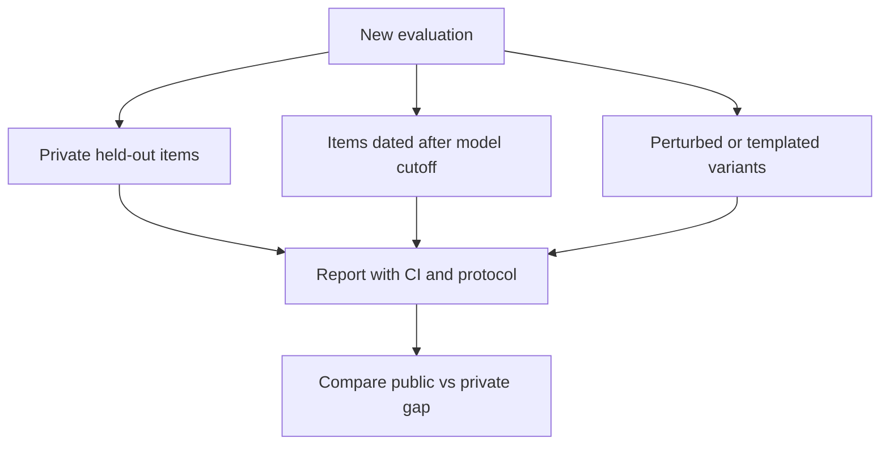

# Benchmark Contamination and Honest Evaluation

## Introduction

Imagine a student who found last year's exam with the answers, memorized it, and then aced this year's exam because half the questions were reused. Their grade says nothing about whether they understand the subject. Language models face the same problem at internet scale. Pretraining corpora contain trillions of tokens scraped from the web, and popular benchmarks are on the web: in GitHub repositories, in papers, in blog posts that discuss "the hardest MMLU questions", in forum threads where people paste GSM8K problems. When test items end up in training data, a benchmark measures recall, not ability. This is **benchmark contamination**.

Contamination is rarely deliberate, which makes it harder to deal with. A lab that never trained on a test set on purpose can still have thousands of its items in a web crawl. Synthetic data generated by a contaminated model can carry the test set into a new model that never saw it directly. And the most common form of over-optimistic evaluation is not data leakage at all: it is choosing prompts, checkpoints or decoding settings by looking at test-set scores.

On this page you will learn to:

- distinguish the forms contamination takes and estimate how much it can inflate a score;
- detect overlap when you have the training data, using n-gram matching, and understand why paraphrases slip through;
- detect contamination without training data access, with Min-K% Prob, the exchangeability permutation test and guided completion, all demonstrated on GPT-2;
- design evaluations that resist contamination and report results honestly.

It builds on [Evaluating LLMs: Benchmarks and Their Limits](./0-llm-evaluation-overview.mdx) and [Perplexity](./1-llm-perplexity.mdx).

## Forms of Contamination

Contamination is a spectrum, from exact copies to subtle overfitting:

| Form | What happens | Example | Detectable by n-grams? |
|---|---|---|---|
| Verbatim test items | The question, often with its answer, appears in training text | A GitHub repo containing the benchmark's JSON file | Yes |
| Near duplicates | Same item with formatting changes, different whitespace or option order | A quiz website reformatting MMLU questions | Mostly |
| Paraphrases and translations | Same problem in new words or another language | A forum user rewording a GSM8K problem | No |
| Synthetic leakage | A model that saw the test set generates training data that mirrors it | Distillation data from a contaminated teacher | No |
| Answer-format overfit | Training heavily on the benchmark's train split or close imitations | Thousands of GSM8K-style problems in the fine-tuning mix | Not applicable |
| Test-set tuning | Model, prompt or checkpoint chosen by test score | Trying 30 prompts and reporting the best | Not applicable |

The last two are not "contamination" in the strict sense, because no test item was trained on. They still inflate scores, and they are entirely within the evaluator's control.

How much does contamination matter? A simple model helps. Suppose a fraction $c$ of test items is memorized and answered correctly with probability close to 1, and the model's true accuracy on unseen items is $a$. The observed score is

$$
\hat{a} = c \cdot 1 + (1 - c) \cdot a
$$

With $a = 0.60$ and $c = 0.10$, $\hat{a} = 0.10 + 0.54 = 0.64$: four points of inflation from 10% contamination. With $c = 0.30$ it is $0.30 + 0.42 = 0.72$. The inflation is $c(1 - a)$, largest for hard benchmarks where the true accuracy is low. That is why contamination worries people most for new, hard benchmarks.

Empirical evidence confirms the effect exists and varies by model family. Zhang et al. (2024) wrote **GSM1k**, a set of new grade-school math problems matched to GSM8K in style and difficulty, and kept it private. Several model families scored noticeably lower on GSM1k than on GSM8K (up to 8 points in the peer-reviewed version, up to 13 in a later revision), while frontier models showed little gap. They also found a positive correlation between a model's probability of generating GSM8K examples and its GSM8K-minus-GSM1k gap, which points to memorization. Mirzadeh et al. (2024), **GSM-Symbolic**, generated GSM8K variants from templates by changing names and numbers; accuracy dropped when only the numbers changed, and adding one irrelevant but plausible clause caused large drops across models.

## Detection with Training Data: N-gram Overlap

If you control the training corpus, check it directly. The standard method is **n-gram overlap**: normalize text (lowercase, strip punctuation), break each test item into overlapping sequences of $n$ words, and flag the item if any of them appears in the training data. GPT-3 (Brown et al., 2020) used 13-grams for this, removed overlaps from training, and reported benchmark results on "clean" subsets alongside full results. Thirteen words is long enough that matches are rarely accidental and short enough to catch partial copies.

```python
import re

def ngrams(text, n):
    words = re.findall(r"[a-z0-9]+", text.lower())       # normalise: lower-case, strip punctuation
    return {tuple(words[i:i + n]) for i in range(len(words) - n + 1)}

def contaminated(test_item, corpus_ngrams, n=13):
    """GPT-3 style check: does any n-gram of the test item occur in the training corpus?"""
    hits = ngrams(test_item, n) & corpus_ngrams
    return len(hits) > 0, len(hits)

corpus = """Forum post: here is the answer to the train problem. A train leaves the station at 3 pm
traveling at 60 miles per hour and a second train leaves at 4 pm traveling at 80 miles per hour,
when does the second train catch the first? Answer: at 7 pm. Hope this helps!"""
corpus_ngrams = ngrams(corpus, 13)

tests = [
    "A train leaves the station at 3 pm traveling at 60 miles per hour and a second train leaves at "
    "4 pm traveling at 80 miles per hour. When does the second train catch the first?",
    "A bus departs at 3 pm going 60 km per hour; a car follows at 4 pm going 80 km per hour. "
    "At what time does the car reach the bus?",
]
for t in tests:
    flag, k = contaminated(t, corpus_ngrams)
    print(f"contaminated={flag}  shared 13-grams={k}  | {t[:50]}...")
```

```text
contaminated=True  shared 13-grams=24  | A train leaves the station at 3 pm traveling at 60...
contaminated=False  shared 13-grams=0  | A bus departs at 3 pm going 60 km per hour; a car ...
```

The verbatim copy is caught. The paraphrase, the same problem with the same answer, shares no 13-gram and passes as clean. At web scale you would store the n-grams of the test sets (millions of entries, not trillions) in a hash set or Bloom filter and stream the training corpus past it.

Yang et al. (2023), "Rethinking Benchmark and Contamination for Language Models with Rephrased Samples", showed how serious the paraphrase gap is. Training a 13B model on rephrased test samples that passed n-gram decontamination let it reach GPT-4-level scores on MMLU, GSM8K and HumanEval. Their LLM Decontaminator first finds the most similar training items to each test item by embedding similarity, then asks a strong LLM whether each pair is the same problem. Applied to public datasets, it found substantial overlap that n-gram checks had missed, for example 8 to 18% of HumanEval in some pretraining code corpora. The practical recipe is a two-stage filter: cheap n-gram and embedding retrieval over everything, then an expensive LLM or human check on the top candidates.

## Detection Without Training Data

Most of the time you evaluate a model whose training data you cannot see. Several methods work from the model alone.

### Min-K% Prob

A model assigns unusually high probability to text it was trained on. Raw perplexity is a weak signal, though, because some unseen text is simply easy (common phrases, boilerplate). Shi et al. (2023), "Detecting Pretraining Data from Large Language Models", observed that unseen text tends to contain a few *outlier* tokens with very low probability, while memorized text does not. Their **Min-K% Prob** score averages the log-probabilities of only the $k\%$ least likely tokens:

$$
\mathrm{MinK}(x) = \frac{1}{\lvert S_k \rvert} \sum_{x_t \in S_k} \log p_\theta(x_t \mid x_{\lt t})
$$

where $S_k$ is the set of the $k\%$ tokens of $x$ with the lowest log-probability. A score close to zero (high) suggests the text was in training data. The authors built the WikiMIA benchmark, Wikipedia text from before and after a model's training cutoff, to evaluate such detectors.

GPT-2 was trained on WebText (2019), which certainly included the MIT license and the US Constitution. Compare them with rewordings that say the same thing:

```python
import torch
from transformers import AutoModelForCausalLM, AutoTokenizer

torch.manual_seed(0)
tok = AutoTokenizer.from_pretrained("openai-community/gpt2")
model = AutoModelForCausalLM.from_pretrained("openai-community/gpt2").eval()

def token_logprobs(text):
    ids = tok(text, return_tensors="pt").input_ids                    # (1, T)
    with torch.no_grad():
        logp = torch.log_softmax(model(ids).logits[0, :-1], -1)       # (T-1, vocab)
    return logp[torch.arange(ids.size(1) - 1), ids[0, 1:]]            # (T-1,)

def min_k_prob(text, k=0.2):
    """Mean log-prob of the k fraction least likely tokens (Shi et al., 2023)."""
    lp = token_logprobs(text)
    n = max(1, int(len(lp) * k))
    return lp.sort().values[:n].mean().item(), lp.mean().item()

texts = {
    "MIT license (seen)": "Permission is hereby granted, free of charge, to any person obtaining a copy "
        "of this software and associated documentation files (the \"Software\"), to deal in the Software "
        "without restriction, including without limitation the rights to use, copy, modify, merge",
    "MIT license reworded": "Anyone who gets a copy of this program and the documents that come with it "
        "may use it at no cost and without limits, which includes the freedom to use, copy, change, combine",
    "US constitution (seen)": "We the People of the United States, in Order to form a more perfect Union, "
        "establish Justice, insure domestic Tranquility, provide for the common defence, promote the "
        "general Welfare, and secure the Blessings of Liberty",
    "constitution reworded": "We, the citizens of the United States, wanting a stronger union, fair courts, "
        "peace at home, a shared defence, the common good, and lasting freedom",
}
for name, t in texts.items():
    mk, mean = min_k_prob(t)
    print(f"{name:24s} mean log-prob {mean:6.2f}   Min-20% log-prob {mk:6.2f}")

# permutation idea (Oren et al., 2023): does the canonical order look special?
items = ["Mercury", "Venus", "Earth", "Mars", "Jupiter", "Saturn", "Uranus", "Neptune"]
def seq_logprob(order):
    return token_logprobs("The planets: " + ", ".join(order) + ".").sum().item()
canon = seq_logprob(items)
g = torch.Generator().manual_seed(0)
shuffled = [seq_logprob([items[i] for i in torch.randperm(8, generator=g)]) for _ in range(99)]
rank = sum(s >= canon for s in shuffled)
print(f"canonical order log-prob {canon:.1f}; best of 99 shuffles {max(shuffled):.1f}")
print(f"permutation p-value = {(rank + 1) / 100:.2f}")
```

```text
MIT license (seen)       mean log-prob  -0.27   Min-20% log-prob  -1.41
MIT license reworded     mean log-prob  -3.22   Min-20% log-prob  -6.29
US constitution (seen)   mean log-prob  -1.53   Min-20% log-prob  -4.34
constitution reworded    mean log-prob  -3.62   Min-20% log-prob  -8.73
canonical order log-prob -34.5; best of 99 shuffles -40.2
permutation p-value = 0.01
```

The MIT license, which appears verbatim in countless GitHub repositories and web pages, has a mean log-probability of -0.27 per token: GPT-2 predicts it almost word for word. Its rewording, with the same meaning, sits at -3.22. The Min-20% score separates them even more sharply (-1.41 versus -6.29), because the reworded text contains several tokens the model found really surprising, and the memorized text has almost none. The Constitution shows the same pattern with a smaller margin; it is famous, but less often copied verbatim than a license header.

The second experiment is the permutation test in miniature. The canonical planet order scores -34.5, and not one of 99 random shuffles comes within 5.7 nats of it, so the p-value is the smallest possible with 99 permutations, $1/100 = 0.01$.

In practice you never have a single text with a known label. You compute the score for every item of a benchmark and compare its distribution with the same score on items known to be unseen (for example, items written after the model's training cutoff). A shift toward higher scores on the benchmark is evidence of contamination. Membership inference of this kind is noisy for individual items; treat it as evidence about a dataset, not proof about one question.

### The Exchangeability Permutation Test

Oren et al. (2023), "Proving Test Set Contamination in Black Box Language Models", found a test with a guaranteed false-positive rate. Most benchmarks are **exchangeable**: the order of items in the file carries no meaning, so if the model never saw the file, the canonical order should be no more likely than any shuffled order. If the model *did* see the file, it memorized the canonical order too, and will assign it a higher log-probability than nearly every permutation.

The test: compute the log-probability of the benchmark concatenated in its canonical order; compute it for many random permutations; the p-value is the fraction of permutations scoring at least as high (with the +1 correction). Under the null hypothesis of no contamination, the canonical order's rank is uniform, so the p-value is valid with no assumptions about the model. The authors report it is sensitive enough to detect contamination in models as small as 1.4 billion parameters on small test sets, and use sharding to scale it to long benchmarks.

The planet example in the code above is a miniature: "Mercury, Venus, Earth, ..." is the canonical order that appears on countless web pages, and the model strongly prefers it to every shuffle. On a real benchmark the "items" are whole questions, and a low p-value means the model has seen the benchmark file, or at least long stretches of it in order.

### Guided Completion and Canaries

Two simpler techniques round out the toolbox:

- **Guided completion.** Golchin and Surdeanu (2023), "Time Travel in LLMs", prompt the model with the dataset name, the split and the first part of a test instance, and ask it to complete the instance. They compare the overlap of these completions with a baseline prompt that omits the dataset name. If naming the dataset makes the model reproduce test instances much more exactly, the split was likely seen. It works with API-only models.
- **Canary strings.** BIG-bench embeds a unique GUID in its task files with a request that the files never appear in training corpora. Training pipelines can filter documents containing the canary, and a model that can reproduce the canary string has almost certainly trained on files containing it. Canaries only help if benchmark authors include them and data teams filter on them.

## Designing Evaluations That Resist Contamination

Detection is a patch. Better evaluation design avoids the problem:



- **Keep a private test set.** GSM1k, Scale AI's private leaderboards and most internal company evaluations rely on items that have never been published. The cost is that outsiders must trust the maintainer.
- **Use time.** LiveCodeBench (Jain et al., 2024) collects new problems from LeetCode, AtCoder and Codeforces and tags each with its release date, so a model can be evaluated only on problems released after its training cutoff. LiveBench (White et al., 2024) refreshes its questions regularly from recent sources and scores them against objective ground truth. A model that does much better on old problems than on new ones of the same difficulty is suspect.
- **Perturb.** Regenerate items from templates with new names and numbers (GSM-Symbolic), reorder options, or translate. Real ability is robust to surface changes; memorization is not.
- **Decontaminate your own training data** against every benchmark you plan to report, with n-grams plus an embedding-and-LLM second stage, and publish what you removed.
- **Separate development from test.** Choose prompts, checkpoints and hyperparameters on a development split; touch the test split once. Every time you look at test scores and change something, the test set becomes a little more like a training set.
- **Report the protocol.** State the prompt template, few-shot examples, decoding settings, number of samples, the exact dataset version and the decontamination procedure, with confidence intervals. "We report the best of 5 prompts" is honest; quietly doing it is not.

:::warning
Selecting the best of many runs on the test set inflates scores even with zero leaked data. With 20 prompt variants on a 200-item benchmark, the best variant can beat the average by a few points purely by chance, because each variant's score carries sampling noise of several points. Select on a development split.
:::

## Worked Scenario: Auditing a Fine-Tuning Dataset

You assembled 50,000 instruction examples from public sources to fine-tune a model, and you plan to report GSM8K, MATH and HumanEval. Before training, audit the data:

1. **Exact and n-gram pass.** Build the set of 13-grams of all test items in the three benchmarks (after normalization). Stream the 50,000 examples and flag every example sharing any 13-gram. For code, normalize identifiers or use a token-level n-gram on the code itself, since variable renaming defeats word n-grams.
2. **Semantic pass.** Embed every test item and every training example with a sentence-embedding model; for each test item, retrieve the 5 nearest training examples. This catches paraphrases.
3. **Judge pass.** For the retrieved pairs above a similarity threshold, ask a strong model "Are these the same problem, possibly reworded, with the same answer?", and hand-check a sample of its verdicts.
4. **Remove and record.** Drop flagged examples, and save the list with the reason for each removal.
5. **After training, test anyway.** Run Min-K% Prob on benchmark items versus fresh items of the same type, and compare accuracy on the public test set with accuracy on a small set of new problems you wrote yourself. A large gap means something leaked that the audit missed, or the model overfit the format.

This takes a few hours and gives you a defensible statement in your report: what you checked, what you removed and how the model performs on items it cannot have seen.

## Common Mistakes

- Assuming a model is clean because the lab never trained on the test set on purpose; web crawls and synthetic data leak benchmarks unintentionally.
- Relying on exact or n-gram matching only; paraphrases and translations pass straight through.
- Treating Min-K% Prob or perplexity as proof for a single item, rather than as a distribution-level signal compared against known-unseen data.
- Comparing a model's score on an old benchmark with its score on a new one of different difficulty and calling the gap "contamination".
- Tuning prompts, checkpoints or decoding on the test set and reporting the best result as if it were a single run.
- Publishing a new benchmark without a canary string or a private held-out portion, which guarantees it will leak.
- Reporting a contaminated benchmark without a clean-subset result or a caveat.

## Summary

- Contamination ranges from verbatim test items in training data to paraphrases, synthetic leakage, format overfitting and test-set tuning; it inflates scores by about $c(1-a)$.
- Private replications (GSM1k) and perturbations (GSM-Symbolic) show real gaps for some model families between public benchmarks and fresh equivalents.
- With training data access, 13-gram overlap catches copies; paraphrases need embedding retrieval plus an LLM or human check.
- Without data access, Min-K% Prob, the exchangeability permutation test, guided completion and canary strings provide evidence of contamination.
- Honest evaluation uses private or post-cutoff items, perturbations, decontaminated training data, strict development/test separation and fully reported protocols with confidence intervals.

## Further Reading

- [Language Models are Few-Shot Learners (Brown et al., 2020)](https://arxiv.org/abs/2005.14165) - GPT-3, with its 13-gram contamination analysis and clean subsets.
- [Detecting Pretraining Data from Large Language Models (Shi et al., 2023)](https://arxiv.org/abs/2310.16789) - Min-K% Prob and the WikiMIA benchmark.
- [Proving Test Set Contamination in Black Box Language Models (Oren et al., 2023)](https://arxiv.org/abs/2310.17623) - the exchangeability permutation test.
- [Time Travel in LLMs: Tracing Data Contamination in Large Language Models (Golchin and Surdeanu, 2023)](https://arxiv.org/abs/2308.08493) - guided completion for contamination detection.
- [Rethinking Benchmark and Contamination for Language Models with Rephrased Samples (Yang et al., 2023)](https://arxiv.org/abs/2311.04850) - why n-gram decontamination fails, and the LLM Decontaminator.
- [A Careful Examination of Large Language Model Performance on Grade School Arithmetic (Zhang et al., 2024)](https://arxiv.org/abs/2405.00332) - GSM1k, a private replication of GSM8K.
- [GSM-Symbolic (Mirzadeh et al., 2024)](https://arxiv.org/abs/2410.05229) - templated GSM8K variants that reveal fragility.
- [LiveCodeBench (Jain et al., 2024)](https://arxiv.org/abs/2403.07974) - date-tagged coding problems for contamination-free evaluation.
- [LiveBench (White et al., 2024)](https://arxiv.org/abs/2406.19314) - a regularly refreshed benchmark with objective scoring.
- [BIG-bench repository](https://github.com/google/BIG-bench) - the benchmark that popularized canary strings.
