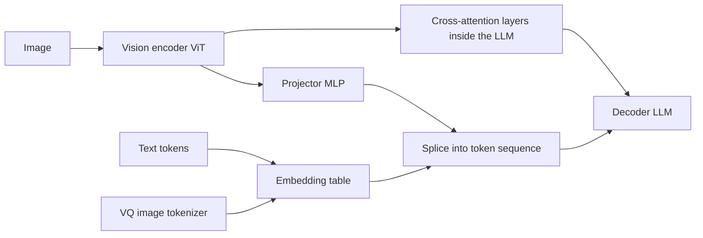

# Multimodal LLMs: Vision Encoders and Image Tokens

## Introduction

A text LLM only ever sees a sequence of vectors. It does not know that those vectors came from a tokenizer and an embedding table. That simple fact is the whole trick behind most vision-language models (VLMs): if you can turn an image into a short sequence of vectors that live in the same space as word embeddings, the decoder can attend to them like any other token.

Almost every open multimodal model today, from LLaVA to Qwen2.5-VL, Gemma 3 and SmolVLM, follows that recipe. The design questions are all about the details. Which vision encoder? How do you connect it to the language model? How many tokens does one image cost, and how does the model know where each patch was in 2D?

By the end of this page you will be able to:

- Explain how a Vision Transformer turns an image into patch embeddings, and implement patchification in PyTorch.
- Describe how CLIP and SigLIP train vision encoders with contrastive losses, and why that makes them good front ends for LLMs.
- Compare the three ways to connect vision to language: projector plus token splicing (LLaVA), cross-attention (Flamingo, Llama 3.2 Vision) and early fusion with discrete image tokens (Chameleon).
- Compute the image token count of a real model from its config.json and preprocessor settings.
- Explain Qwen2-VL's multimodal RoPE and why a 1D position index is not enough for images.

The page assumes you know the decoder block from [Inside a Decoder Block](../3-llm-transformer/2-llm-transformer-block.mdx) and RoPE from [Rotary Position Embedding (RoPE) Explained](../4-llm-positional-encoding/3-llm-rope.mdx).

## From Pixels to Patch Tokens: The Vision Transformer

Dosovitskiy et al. showed in "An Image is Worth 16x16 Words" (2020) that a plain Transformer encoder can classify images if you cut the image into fixed-size square patches and treat each patch as a token. That model, the Vision Transformer (ViT), is the starting point of nearly every vision encoder used in VLMs.

Take an image of height $H$, width $W$ and $C$ channels and a patch size $P$. The image is split into

$$
N = \frac{H}{P} \cdot \frac{W}{P}
$$

non-overlapping patches. Each patch is flattened to a vector of length $P^2 C$ and multiplied by a learned matrix $E \in \mathbb{R}^{P^2 C \times d}$ to produce a $d$-dimensional token. A learned position embedding is added, and the tokens go through a stack of ordinary encoder blocks with bidirectional attention, because there is no "future" in an image.

For LLaVA-1.5, whose vision tower is CLIP ViT-L/14 at 336 pixels, the numbers from its config.json are $H = W = 336$, $P = 14$, $d = 1024$, 24 layers and 16 heads:

$$
N = \frac{336}{14} \cdot \frac{336}{14} = 24 \cdot 24 = 576
$$

So every image becomes 576 vectors of width 1024. "Flatten and multiply" is exactly a convolution whose kernel size and stride both equal $P$, which is how every implementation writes it:

```python
import torch
import torch.nn as nn

torch.manual_seed(0)

# A 336x336 RGB image, the input size of LLaVA-1.5's CLIP ViT-L/14-336 encoder
image = torch.randn(1, 3, 336, 336)            # (batch, channels, height, width)

patch_size, d_vision = 14, 1024
# A conv with kernel = stride = patch size is exactly "cut into patches + one linear layer"
patch_embed = nn.Conv2d(3, d_vision, kernel_size=patch_size, stride=patch_size)

x = patch_embed(image)                         # (1, 1024, 24, 24)
print("after conv:", tuple(x.shape))
x = x.flatten(2).transpose(1, 2)               # (1, 576, 1024): one row per patch
print("patch tokens:", tuple(x.shape))

# The same thing written as an explicit reshape + matmul
p = image.unfold(2, patch_size, patch_size).unfold(3, patch_size, patch_size)
# p: (1, 3, 24, 24, 14, 14) -> (1, 576, 3*14*14)
p = p.permute(0, 2, 3, 1, 4, 5).reshape(1, 24 * 24, 3 * patch_size * patch_size)
W = patch_embed.weight.reshape(d_vision, -1)   # (1024, 588)
manual = p @ W.T + patch_embed.bias            # (1, 576, 1024)
print("max difference:", (manual - x).abs().max().item())
```

```text
after conv: (1, 1024, 24, 24)
patch tokens: (1, 576, 1024)
max difference: 3.337860107421875e-06
```

The difference is floating-point noise: the convolution and the explicit matmul are the same operation. Keep the number 576 in mind. Because attention cost grows with the square of the sequence length (see [The Quadratic Cost of Attention](../2-llm-attention/7-llm-attention-complexity.mdx)), the number of image tokens is the single most important cost knob in a VLM.

## Training the Encoder: CLIP and SigLIP

A ViT trained to classify ImageNet learns features that are good for 1,000 classes. An LLM needs features that line up with language. CLIP (Radford et al., "Learning Transferable Visual Models From Natural Language Supervision", 2021) provided that by training an image encoder and a text encoder together on about 400 million image-caption pairs scraped from the web.

The training signal is contrastive. In a batch of $B$ pairs, compute normalized image embeddings $u_i$ and text embeddings $v_j$, and the similarity matrix $S_{ij} = u_i^\top v_j$. The correct caption for image $i$ is on the diagonal. CLIP applies a softmax cross-entropy along each row (pick the right caption for each image) and each column (pick the right image for each caption), with a learned temperature $\tau$:

$$
\mathcal{L}_\mathrm{CLIP} = -\frac{1}{2B}\sum_{i=1}^{B}\left[\log\frac{e^{S_{ii}/\tau}}{\sum_{j} e^{S_{ij}/\tau}} + \log\frac{e^{S_{ii}/\tau}}{\sum_{j} e^{S_{ji}/\tau}}\right]
$$

SigLIP (Zhai et al., "Sigmoid Loss for Language Image Pre-Training", 2023) replaced the softmax with an independent binary decision for every pair. Let $z_{ij} = 1$ if $i = j$ and $-1$ otherwise, and let $t$ and $b$ be a learned scale and bias:

$$
\mathcal{L}_\mathrm{SigLIP} = -\frac{1}{B}\sum_{i=1}^{B}\sum_{j=1}^{B}\log\sigma\!\left(z_{ij}\,(t\,S_{ij} + b)\right)
$$

The practical win is that no term needs a normalization over the whole batch, so the loss is cheaper to shard across many devices and works well at small and very large batch sizes alike. SigLIP encoders (and their successor SigLIP 2) are now the most common vision towers in open VLMs: Gemma 3, SmolVLM and the PaliGemma family use them, and the Qwen3-VL vision tower has the same width and depth as a SigLIP-so400m encoder (hidden size 1152, 27 layers in its config.json).

```python
import torch
import torch.nn.functional as F

torch.manual_seed(0)
batch, d = 4, 8
img = F.normalize(torch.randn(batch, d), dim=-1)          # (4, 8) image embeddings
txt = F.normalize(img + 0.3 * torch.randn(batch, d), dim=-1)  # matching captions, a bit noisy

logits = img @ txt.T                                     # (4, 4) cosine similarities
print(logits.round(decimals=2))

# CLIP: softmax cross-entropy in both directions, the diagonal is the right answer
tau = 0.07
labels = torch.arange(batch)
clip_loss = (F.cross_entropy(logits / tau, labels) + F.cross_entropy(logits.T / tau, labels)) / 2

# SigLIP: every (image, text) pair is an independent binary question "do these match?"
t, b = 10.0, -10.0                                       # learnable scale and bias in the paper
z = 2 * torch.eye(batch) - 1                             # +1 on the diagonal, -1 elsewhere
siglip_loss = -F.logsigmoid(z * (t * logits + b)).sum() / batch

print(f"CLIP loss   {clip_loss.item():.4f}")
print(f"SigLIP loss {siglip_loss.item():.4f}")
```

```text
tensor([[ 0.9400,  0.5700, -0.1600,  0.0500],
        [ 0.3500,  0.7400, -0.1500,  0.5600],
        [-0.0200, -0.4700,  0.8800, -0.1200],
        [ 0.5000,  0.8100, -0.4700,  0.4700]])
CLIP loss   1.0058
SigLIP loss 2.6737
```

The diagonal is the largest entry in every row except the last, where the fourth image is closer to the second caption (0.81) than to its own (0.47). Both losses punish that, which is how training pushes matching pairs together.

:::note
VLMs usually take patch features from the second-to-last layer of the vision encoder, not the final pooled embedding. LLaVA-1.5's config.json says so directly: `"vision_feature_layer": -2`. The last layer is specialized for the contrastive objective; the one before it keeps more spatial detail per patch.
:::

## Connecting Vision to Language: Three Designs

Once you have patch features, there are three main ways to feed them to a language model.



### Projector and Token Splicing

LLaVA (Liu et al., "Visual Instruction Tuning", 2023) used a single linear layer to map CLIP patch features into the embedding space of a Vicuna LLM. LLaVA-1.5 ("Improved Baselines with Visual Instruction Tuning", 2023) upgraded it to a two-layer MLP with a GELU, which is the `"projector_hidden_act": "gelu"` in its config.json. The tokenizer reserves a placeholder id (32000 in LLaVA-1.5) for `<image>`. The processor repeats the placeholder once per image token, and the model overwrites those embedding rows with projected image features before the first decoder layer.

Training happens in two stages. First, freeze both the vision encoder and the LLM and train only the projector on image-caption pairs, so the projector learns to "speak" the LLM's embedding language. Then unfreeze the LLM (and in many recipes the vision encoder) and fine-tune on visual instruction data such as question-answer conversations about images.

Here is the splice in miniature, with toy sizes. It is the same `masked_scatter` that Hugging Face's `LlavaForConditionalGeneration` uses:

```python
import torch
import torch.nn as nn
import torch.nn.functional as F

torch.manual_seed(0)

# Toy sizes: 32x32 images, patch 8 -> 16 patches; vision width 48; LLM width 64
IMG, PATCH, D_VIS, D_LLM, VOCAB = 32, 8, 48, 64, 100
IMAGE_TOKEN_ID = 99          # placeholder id reserved in the tokenizer, like <image>
N_PATCHES = (IMG // PATCH) ** 2

class TinyViT(nn.Module):
    def __init__(self):
        super().__init__()
        self.patch = nn.Conv2d(3, D_VIS, PATCH, PATCH)
        self.pos = nn.Parameter(torch.zeros(1, N_PATCHES, D_VIS))
        self.block = nn.TransformerEncoderLayer(D_VIS, nhead=4, dim_feedforward=96, batch_first=True)

    def forward(self, images):                         # (B, 3, 32, 32)
        x = self.patch(images).flatten(2).transpose(1, 2) + self.pos   # (B, 16, 48)
        return self.block(x)                           # bidirectional attention over patches

class Projector(nn.Module):                            # LLaVA-1.5's two-layer MLP with GELU
    def __init__(self):
        super().__init__()
        self.fc1, self.fc2 = nn.Linear(D_VIS, D_LLM), nn.Linear(D_LLM, D_LLM)

    def forward(self, x):
        return self.fc2(F.gelu(self.fc1(x)))           # (B, 16, 64)

vit, proj = TinyViT(), Projector()
embed = nn.Embedding(VOCAB, D_LLM)                     # the LLM's token embedding table

# Prompt "USER: <image> what is this? ASSISTANT: a cat" -> the processor expands <image> to 16 copies
prompt = [1, 5, 6] + [IMAGE_TOKEN_ID] * N_PATCHES + [7, 8, 9, 10]
answer = [20, 21, 2]
input_ids = torch.tensor([prompt + answer])            # (1, 26)

images = torch.randn(1, 3, IMG, IMG)
img_feats = proj(vit(images))                          # (1, 16, 64)

tok_emb = embed(input_ids.clamp(max=VOCAB - 2))        # (1, 26, 64); placeholder rows are overwritten next
mask = input_ids == IMAGE_TOKEN_ID                     # (1, 26) True at the 16 image slots
inputs_embeds = tok_emb.masked_scatter(mask.unsqueeze(-1), img_feats.to(tok_emb.dtype))
print("inputs_embeds:", tuple(inputs_embeds.shape))
print("image slots:", mask.sum().item(), "rows replaced:",
      torch.allclose(inputs_embeds[mask], img_feats.reshape(-1, D_LLM)))

# Labels: only the answer is trained; prompt text and image positions are ignored (-100)
labels = input_ids.clone()
labels[:, : len(prompt)] = -100
print("labels:", labels.tolist()[0])
```

```text
inputs_embeds: (1, 26, 64)
image slots: 16 rows replaced: True
labels: [-100, -100, -100, -100, -100, -100, -100, -100, -100, -100, -100, -100, -100, -100, -100, -100, -100, -100, -100, -100, -100, -100, -100, 20, 21, 2]
```

Notice the label mask. The model never gets a loss on image positions, because there is no "next image token" to predict, and normally no loss on the prompt either (see [Supervised Fine-Tuning and Chat Templates](../8-llm-post-training/1-llm-supervised-fine-tuning.mdx)).

This design is popular because it changes nothing inside the LLM. You can start from any strong text checkpoint, serve it with the same engine, and reuse the KV cache logic. The cost is sequence length: every image token occupies a slot in every layer's attention and KV cache.

### Cross-Attention Adapters

Flamingo (Alayrac et al., 2022) took the opposite route. It kept the language model frozen and inserted new gated cross-attention layers between its blocks. Text tokens attend to image features as keys and values, but image features never enter the token sequence. A tanh gate initialized at zero means the new layers start as an identity, so the frozen LLM's behavior is untouched at step zero. A "Perceiver Resampler" compressed each image to 64 visual tokens before cross-attention.

Llama 3.2 Vision (Meta, 2024) uses the same idea. Its 11B config.json lists 40 text layers with `"cross_attention_layers": [3, 8, 13, 18, 23, 28, 33, 38]`: eight cross-attention layers interleaved with the 32 self-attention layers of the Llama 3.1 8B text model. The vision side takes up to four 560x560 tiles (`"max_num_tiles": 4`, patch 14).

Cross-attention keeps the text context short and lets you leave the text weights untouched, so text-only quality is preserved exactly. The price is architectural: the model is no longer a plain decoder, serving engines need special support, and image features cannot take part in the decoder's own self-attention.

### Early Fusion with Discrete Image Tokens

Chameleon (Meta, 2024) trains one Transformer from scratch on interleaved text and image tokens. Images are turned into discrete codes by a vector-quantized (VQ) tokenizer; the paper encodes a 512x512 image into 1,024 tokens from a codebook of 8,192 entries. Those codes are simply extra entries in the vocabulary, so the same model can also generate images by sampling image tokens. The difficulty is training stability and the information lost in quantization, which hurts fine detail such as text in documents. Most open understanding-focused VLMs therefore still use continuous features and a projector.

| Design | Example models | Where image features enter | Main strength | Main cost |
| --- | --- | --- | --- | --- |
| Projector and splicing | LLaVA, Qwen2.5-VL, Gemma 3, SmolVLM | As tokens in the decoder sequence | Simple, any text LLM, standard serving | Long sequences, large KV cache |
| Cross-attention | Flamingo, Llama 3.2 Vision | Separate cross-attention layers | Short text context, frozen text weights | Custom architecture |
| Early fusion, discrete | Chameleon | VQ codes in the vocabulary | Can generate images too | Quantization loss, hard to train |

## How Many Tokens Is One Image?

The token budget decides latency, memory and how much detail the model can see. Real models make very different choices.

**Fixed resolution.** LLaVA-1.5 resizes every image to 336x336 and always spends 576 tokens. Gemma 3 uses a SigLIP encoder at 896x896 with patch 14, giving $64 \times 64 = 4096$ patches, then averages each 4x4 block of patches into one, for a fixed 256 tokens per image (`"mm_tokens_per_image": 256` in its config.json). Its "Pan and Scan" option crops large or oddly shaped images into several 896x896 views at inference time when detail matters.

**Tiling.** SmolVLM (and the Idefics3 processor it uses) resizes the longest side to 2048 pixels, cuts the result into 512x512 tiles and adds one downscaled global view. Each 512x512 tile has $32 \times 32 = 1024$ patches of size 16, and a "pixel shuffle" with factor 4 moves 4x4 neighbouring patches into the channel dimension, leaving 64 tokens per tile (`"image_seq_len": 64`).

**Native dynamic resolution.** Qwen2-VL (Wang et al., 2024) and Qwen2.5-VL keep the image's aspect ratio. The image is resized so both sides are multiples of 28 (patch 14 times a 2x2 merge), the ViT runs on all patches, and an MLP merges each 2x2 group of neighbouring patch features into one LLM token. The token count is

$$
N_\mathrm{tokens} = \frac{\bar H}{14} \cdot \frac{\bar W}{14} \cdot \frac{1}{4} = \frac{\bar H \, \bar W}{28^2}
$$

where $\bar H$ and $\bar W$ are the resized height and width, clamped so the pixel count stays between `min_pixels` and `max_pixels` in preprocessor_config.json (3,136 and 12,845,056 by default, that is 4 to 16,384 tokens). To process long or high-resolution inputs efficiently, Qwen2.5-VL's vision tower uses windowed attention in most layers and full attention only in layers 7, 15, 23 and 31 (`"fullatt_block_indexes"`).

This script reproduces the three policies:

```python
import math

def llava15(h, w):
    # every image is resized/padded to 336x336, patch 14, no merging
    return (336 // 14) ** 2

def gemma3(h, w):
    # 896x896 SigLIP, 64x64 = 4096 patches, 4x4 average pooling -> 256
    return (896 // 14) ** 2 // 16

def qwen25vl(h, w, patch=14, merge=2, min_pixels=56 * 56, max_pixels=12845056):
    # defaults from preprocessor_config.json: min_pixels 3136, max_pixels 12845056
    # resize so both sides are multiples of patch*merge = 28 and the area stays in range
    f = patch * merge
    h_bar, w_bar = round(h / f) * f, round(w / f) * f
    if h_bar * w_bar > max_pixels:
        beta = math.sqrt(h * w / max_pixels)
        h_bar, w_bar = math.floor(h / beta / f) * f, math.floor(w / beta / f) * f
    elif h_bar * w_bar < min_pixels:
        beta = math.sqrt(min_pixels / (h * w))
        h_bar, w_bar = math.ceil(h * beta / f) * f, math.ceil(w * beta / f) * f
    return (h_bar // patch) * (w_bar // patch) // (merge * merge)

print(" image       LLaVA-1.5  Gemma 3  Qwen2.5-VL  Qwen2.5-VL capped")
for h, w in [(336, 336), (448, 448), (720, 1280), (1080, 1920), (2480, 3508)]:
    capped = qwen25vl(h, w, max_pixels=1280 * 28 * 28)
    print(f"{h:>5}x{w:<5} {llava15(h, w):>9} {gemma3(h, w):>8} {qwen25vl(h, w):>11} {capped:>18}")
```

```text
 image       LLaVA-1.5  Gemma 3  Qwen2.5-VL  Qwen2.5-VL capped
  336x336         576      256         144                144
  448x448         576      256         256                256
  720x1280        576      256        1196               1196
 1080x1920        576      256        2691               1222
 2480x3508        576      256       11125               1260
```

The last row is an A4 page scanned at 300 dpi. A fixed-resolution model squeezes it into 576 or 256 tokens and cannot read small print. Qwen2.5-VL spends 11,125 tokens at the default limit, which is why its model card suggests capping `max_pixels` at `1280*28*28` when cost matters. Video multiplies everything again: Qwen2.5-VL also merges two consecutive frames per patch (`"temporal_patch_size": 2`).

:::tip
When a VLM answers badly about small text, check the token budget before blaming the model. Raising `max_pixels` (Qwen) or enabling Pan and Scan (Gemma 3) often fixes OCR failures, at the price of a longer prefill.
:::

## Where Is Each Patch? Multimodal RoPE

Token splicing flattens a 2D grid of patches into a 1D sequence. With ordinary RoPE, the patch directly below another one ends up a whole row away in position, while the next patch to the right is one step away. The model can still learn the layout, but its position signal no longer matches the geometry.

Qwen2-VL introduced Multimodal RoPE (M-RoPE). Each token gets three position ids instead of one: temporal $t$, height $h$ and width $w$. The rotary frequency pairs of each attention head are split into three groups, and each group is rotated by one of the three ids. In Qwen2.5-VL-7B, `"mrope_section": [16, 24, 24]` splits the 64 frequency pairs of a 128-dimensional head into 16 temporal, 24 height and 24 width pairs.

- A text token has $t = h = w = p$, so M-RoPE reduces to ordinary 1D RoPE on text.
- The patches of one image share the same $t$ and take $h$ and $w$ from their row and column in the merged grid.
- The text that follows an image continues from one plus the largest id used by the image.

For a prompt of 3 text tokens followed by a 2x3 grid of image tokens and then more text, the ids are:

| Token | t | h | w |
| --- | --- | --- | --- |
| text 0, 1, 2 | 0, 1, 2 | 0, 1, 2 | 0, 1, 2 |
| image row 0 | 3, 3, 3 | 3, 3, 3 | 3, 4, 5 |
| image row 1 | 3, 3, 3 | 4, 4, 4 | 3, 4, 5 |
| next text | 6 | 6 | 6 |

Because RoPE scores depend only on position differences (see [Rotary Position Embedding (RoPE) Explained](../4-llm-positional-encoding/3-llm-rope.mdx)), the two patches in the same column now differ only in $h$, which is the geometry we wanted. A side effect is that a large image consumes few position ids, since its ids grow with the grid side, not the token count. Qwen3-VL switched to an interleaved layout (`"mrope_interleaved": true`, sections `[24, 20, 20]`) so that each axis gets a mix of high and low frequencies instead of one contiguous block, and its config also shows "DeepStack" (`"deepstack_visual_indexes": [8, 16, 24]`), which feeds features from intermediate vision layers into the LLM instead of only the last one.

Gemma 3 takes a different route: it keeps 1D RoPE but lets the 256 tokens of one image attend to each other bidirectionally, while text stays causal.

## Running a Small VLM on a CPU

To see these pieces in a real model, load SmolVLM-256M (a SigLIP-based encoder with a 135M-parameter language model) with Hugging Face `transformers` v5. It is about 500 MB to download and runs on a laptop CPU. The image is drawn in code, so nothing else is needed.

```bash
pip install "transformers>=5" torch torchvision pillow
```

```python
import torch
from PIL import Image, ImageDraw
from transformers import AutoProcessor, AutoModelForImageTextToText

torch.manual_seed(0)
model_id = "HuggingFaceTB/SmolVLM-256M-Instruct"
processor = AutoProcessor.from_pretrained(model_id)
model = AutoModelForImageTextToText.from_pretrained(model_id, dtype=torch.float32)

# Draw a test image so the example needs no download besides the model
img = Image.new("RGB", (512, 512), "white")
ImageDraw.Draw(img).ellipse((128, 128, 384, 384), fill="red")

messages = [{"role": "user", "content": [
    {"type": "image"},
    {"type": "text", "text": "What shape and color is in this image?"}]}]
prompt = processor.apply_chat_template(messages, add_generation_prompt=True)
inputs = processor(text=prompt, images=[img], return_tensors="pt")

n_img = (inputs["input_ids"] == model.config.image_token_id).sum().item()
print("prompt length:", inputs["input_ids"].shape[1], "of which image tokens:", n_img)
print("pixel_values:", tuple(inputs["pixel_values"].shape))

out = model.generate(**inputs, max_new_tokens=20, do_sample=False)
print(processor.decode(out[0, inputs["input_ids"].shape[1]:], skip_special_tokens=True))
```

```text
prompt length: 1144 of which image tokens: 1088
pixel_values: (1, 17, 3, 512, 512)
 The image depicts a red circle. The circle is a solid red color, and it is positioned in
```

Read the shapes against the tiling rule above. The 512x512 picture was upscaled so its longest side is 2048, cut into a 4x4 grid of 512x512 tiles, and a global view was added: 17 tiles. At 64 tokens per tile that is $17 \times 64 = 1088$ image tokens, against 56 text tokens. The image is 95 percent of the prompt. That ratio is typical, and it is why prefill time and KV cache memory, not the language model's size, usually dominate multimodal serving costs.

Set `processor.image_processor.do_image_splitting = False` before calling the processor and rerun. The prompt drops to 84 tokens, of which 64 are the single global view (`pixel_values` becomes `(1, 1, 3, 512, 512)`). The circle is still recognized, prefill is about 13 times shorter, and the model loses the ability to read fine detail in larger images.

## Common Mistakes

- Counting only text tokens when estimating context use or cost. Images routinely add hundreds to thousands of tokens each, and video adds that per frame pair.
- Forgetting to mask image positions (and the prompt) with `-100` in the labels, which trains the model to predict placeholder ids.
- Building the prompt by hand instead of with the processor's chat template. The number of placeholder tokens must match the number of image features exactly, or the splice fails or silently misaligns.
- Assuming every VLM sees images at full resolution. Fixed-resolution models downscale, so tiny text may simply not be visible to the model.
- Feeding the final pooled CLIP embedding instead of per-patch features from the layer the model was trained with (`vision_feature_layer`).
- Applying 1D position ids to a model that expects M-RoPE when writing a custom inference loop; text-only tests will still pass, image answers will degrade.
- Unfreezing the vision encoder with the LLM's learning rate during fine-tuning; most recipes use a much smaller rate or keep it frozen.

## Summary

- A ViT cuts an image into $P \times P$ patches and embeds each with one linear map, implemented as a strided convolution; CLIP ViT-L/14 at 336 pixels gives 576 patch tokens.
- CLIP and SigLIP train vision encoders contrastively against captions; SigLIP's per-pair sigmoid loss is the common choice in current open VLMs.
- The dominant connection is a small MLP projector whose outputs replace placeholder token embeddings in the decoder sequence (LLaVA style). Cross-attention adapters (Flamingo, Llama 3.2 Vision) and early fusion with VQ tokens (Chameleon) are the alternatives.
- Image token budgets range from a fixed 256 (Gemma 3) or 576 (LLaVA-1.5) to thousands with dynamic resolution (Qwen2.5-VL) or tiling (SmolVLM); they dominate prefill and KV cache cost.
- M-RoPE gives each token temporal, height and width position ids so that rotary attention scores reflect 2D (and video) geometry, and it reduces to ordinary RoPE on text.

## Further Reading

- [An Image is Worth 16x16 Words (Dosovitskiy et al., 2020)](https://arxiv.org/abs/2010.11929): the Vision Transformer.
- [Learning Transferable Visual Models From Natural Language Supervision (Radford et al., 2021)](https://arxiv.org/abs/2103.00020): CLIP and its contrastive objective.
- [Sigmoid Loss for Language Image Pre-Training (Zhai et al., 2023)](https://arxiv.org/abs/2303.15343): SigLIP.
- [Flamingo: a Visual Language Model for Few-Shot Learning (Alayrac et al., 2022)](https://arxiv.org/abs/2204.14198): gated cross-attention and the Perceiver Resampler.
- [Visual Instruction Tuning (Liu et al., 2023)](https://arxiv.org/abs/2304.08485): LLaVA and the projector recipe.
- [Improved Baselines with Visual Instruction Tuning (Liu et al., 2023)](https://arxiv.org/abs/2310.03744): LLaVA-1.5 and the MLP projector.
- [Chameleon: Mixed-Modal Early-Fusion Foundation Models (Chameleon Team, 2024)](https://arxiv.org/abs/2405.09818): discrete image tokens in one model.
- [Qwen2-VL (Wang et al., 2024)](https://arxiv.org/abs/2409.12191): naive dynamic resolution and M-RoPE.
- [Gemma 3 Technical Report (Gemma Team, 2025)](https://arxiv.org/abs/2503.19786): SigLIP encoder, 256 image tokens and Pan and Scan.
- [Hugging Face: Image-text-to-text task guide](https://huggingface.co/docs/transformers/tasks/image_text_to_text): loading and prompting VLMs with `transformers`.
- [LLaVA-1.5 config.json on Hugging Face](https://huggingface.co/llava-hf/llava-1.5-7b-hf/blob/main/config.json): the numbers used on this page.
