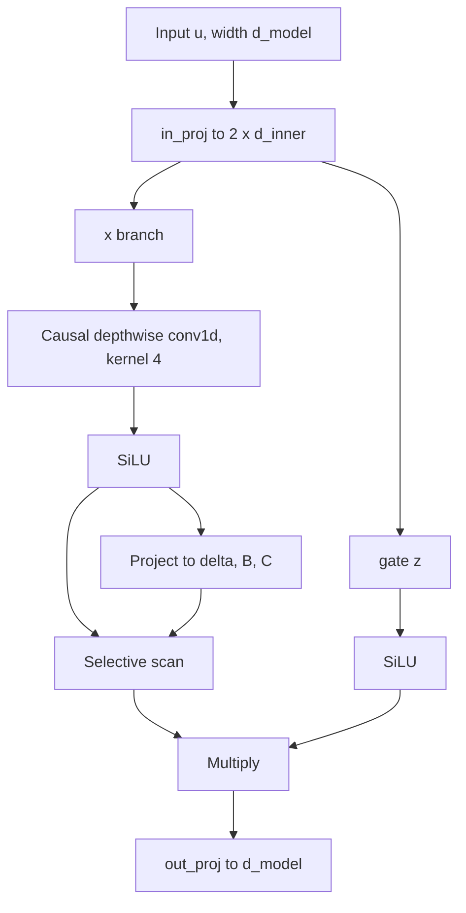

# State Space Models and Mamba

## Introduction

A Transformer remembers everything. Each generated token reads the keys and values of every earlier token, so the KV cache grows linearly with the context and attention cost grows quadratically (see [The KV Cache](../10-llm-inference/2-llm-kv-cache.mdx) and [The Quadratic Cost of Attention](../2-llm-attention/7-llm-attention-complexity.mdx)). A recurrent network does the opposite: it squeezes the whole past into a fixed-size state and pays the same cost for token one million as for token ten.

Classic RNNs and LSTMs lost to Transformers for two reasons: they could not be trained in parallel over the sequence, and their small state forgot things. State space models (SSMs) are a family of recurrent layers that fix the first problem completely and the second one partly. Mamba (Gu and Dao, 2023) made them competitive with Transformers at language modeling by letting the recurrence depend on the input, and Mamba-2 (Dao and Gu, 2024) showed that this kind of SSM is a close cousin of linear attention.

By the end of this page you will be able to:

- Write the continuous-time SSM, discretize it with zero-order hold and compute it both as a recurrence and as a convolution.
- Explain why a time-invariant SSM (S4) cannot do content-based selection, and how Mamba's input-dependent $\Delta$, $B$ and $C$ fix that.
- Implement a reference Mamba block and selective scan in PyTorch and read a Mamba config.json.
- Describe Mamba-2's state space duality and why it runs faster on GPUs.
- Compare SSM inference memory with a Transformer's KV cache and say where SSMs are still weaker.

## The Continuous State Space Model

The model comes from control theory. A one-dimensional input signal $x(t)$ drives a hidden state $h(t) \in \mathbb{R}^N$, and the output $y(t)$ reads the state:

$$
h'(t) = A\,h(t) + B\,x(t), \qquad y(t) = C\,h(t) + D\,x(t)
$$

Here $A \in \mathbb{R}^{N \times N}$ controls how the state evolves on its own, $B \in \mathbb{R}^{N \times 1}$ writes the input into the state, $C \in \mathbb{R}^{1 \times N}$ reads it out and $D$ is a skip connection. $N$ is the state size (`state_size` or `d_state` in configs). For a model with $d$ channels, deep learning SSMs run one such system per channel, independently.

If $A$ is diagonal with negative entries $a_n$, each state dimension is a leaky integrator: it adds up the input and forgets it at rate $\lvert a_n \rvert$. Small $\lvert a_n \rvert$ means long memory; large means short memory. A bank of such dimensions with different rates is a multi-timescale summary of the past.

### Discretization

Tokens arrive at discrete steps, so we need a discrete update. Assume the input is constant over a step of length $\Delta$ (a "zero-order hold"). Solving the linear ODE over that interval gives

$$
\bar A = \exp(\Delta A), \qquad \bar B = (\Delta A)^{-1}\left(\exp(\Delta A) - I\right)\Delta B
$$

and the recurrence

$$
h_t = \bar A\, h_{t-1} + \bar B\, x_t, \qquad y_t = C\, h_t + D\, x_t
$$

For diagonal $A$ everything is elementwise: $\bar a_n = e^{\Delta a_n}$ and $\bar b_n = (e^{\Delta a_n} - 1) b_n / a_n$. The step size $\Delta$ is a learned parameter, and it matters a lot: a small $\Delta$ makes $\bar a_n$ close to 1 (keep the state, barely look at the input); a large $\Delta$ makes $\bar a_n$ close to 0 (forget the state, focus on the current input).

### Two Ways to Compute the Same Thing

When $\bar A$, $\bar B$ and $C$ do not depend on time, unroll the recurrence from $h_{-1} = 0$:

$$
y_t = \sum_{k=0}^{t} C \bar A^{k} \bar B \, x_{t-k} = (K * x)_t, \qquad K_k = C \bar A^{k} \bar B
$$

The SSM is a causal convolution with a kernel $K$ as long as the sequence. That gives the best of both worlds: during training, compute the whole output at once as a convolution (with FFTs, in $O(L \log L)$); during generation, run the recurrence with constant memory per step.

Here is a check with $N = 4$, $\Delta = 0.5$ and $A = \mathrm{diag}(-0.5, -1, -2, -4)$:

```python
import torch

torch.manual_seed(0)
d_state, L = 4, 6
A = -torch.tensor([0.5, 1.0, 2.0, 4.0])        # diagonal of A, negative real => stable, decaying memory
B = torch.ones(d_state)                          # (d_state,)
C = torch.tensor([1.0, -1.0, 0.5, 0.25])        # (d_state,)
delta = 0.5                                       # step size

# Zero-order hold discretization of h'(t) = A h(t) + B x(t), elementwise because A is diagonal
A_bar = torch.exp(delta * A)                      # (d_state,)
B_bar = (A_bar - 1) / A * B                       # (d_state,)

x = torch.randn(L)                                # one input channel, L time steps

# 1) recurrent view: O(L) steps, O(d_state) memory
h = torch.zeros(d_state)
y_rec = []
for t in range(L):
    h = A_bar * h + B_bar * x[t]
    y_rec.append((C * h).sum())
y_rec = torch.stack(y_rec)

# 2) convolutional view: kernel K_k = C . (A_bar^k * B_bar), then a causal convolution
k = torch.arange(L)
K = (C * A_bar ** k[:, None] * B_bar).sum(-1)     # (L,)
y_conv = torch.stack([(K[: t + 1].flip(0) * x[: t + 1]).sum() for t in range(L)])

print("A_bar:", A_bar.numpy().round(4))
print("kernel K:", K.numpy().round(4))
print("recurrent :", y_rec.numpy().round(4))
print("convolution:", y_conv.numpy().round(4))
print("max diff:", (y_rec - y_conv).abs().max().item())
```

```text
A_bar: [0.7788 0.6065 0.3679 0.1353]
kernel K: [0.261  0.1713 0.146  0.1292 0.1124 0.0955]
recurrent : [ 0.4022  0.1874 -0.394  -0.0687 -0.3684 -0.6351]
convolution: [ 0.4022  0.1874 -0.394  -0.0687 -0.3684 -0.6351]
max diff: 1.1920928955078125e-07
```

You can verify the first kernel value by hand. For the first state dimension, $\bar a_1 = e^{-0.25} = 0.7788$ and $\bar b_1 = (0.7788 - 1)/(-0.5) = 0.4424$. The other three give $\bar b = 0.3935, 0.3161, 0.2162$. Then $K_0 = C \bar B = 0.4424 - 0.3935 + 0.5 \cdot 0.3161 + 0.25 \cdot 0.2162 = 0.2610$, matching the printout.

### S4 and the Long-Range Arena

Gu, Goel and Ré's S4 ("Efficiently Modeling Long Sequences with Structured State Spaces", 2021) made this practical for deep learning. It initialized $A$ from HiPPO theory (Gu et al., 2020), a matrix designed so that the state optimally compresses the history of the input onto a basis of polynomials, and found a structured form that makes the long convolution kernel cheap to compute. S4 was the first model to solve the hardest Path-X task of the Long Range Arena benchmark, with sequences of 16,384 steps. Later work (S4D, DSS) showed that a plain diagonal $A$ with a good initialization works about as well, and that is what Mamba uses.

## Why Time-Invariance Is Not Enough

S4 is linear time-invariant (LTI): the same $\bar A$, $\bar B$, $C$ apply at every step. That is what makes the convolution trick possible, and it is also its weakness for language.

Consider "selective copying": a few data tokens are scattered at random positions among filler tokens, and the model must output them in order at the end. An LTI system has to write every token into its state the same way, filler included, because it cannot decide at step $t$ that this token is worth remembering and that one is not. The convolution kernel is a fixed function of distance, but the distance to each data token changes from example to example. The same problem appears with induction heads and associative recall ("the value that came after key K"), which attention solves easily by comparing contents (see [Mechanistic Interpretability](../12-llm-evaluation/4-llm-interpretability.mdx)).

Language needs content-dependent memory: remember the name, skip the "um", reset at a document boundary.

## Mamba: Selective State Spaces

Mamba ("Mamba: Linear-Time Sequence Modeling with Selective State Spaces", Gu and Dao, 2023) makes three of the SSM parameters functions of the current token $x_t$:

$$
\Delta_t = \mathrm{softplus}(W_\Delta\, x_t + b_\Delta), \qquad B_t = W_B\, x_t, \qquad C_t = W_C\, x_t
$$

and keeps $A$ as a learned, input-independent diagonal matrix per channel (stored as `A_log` with $A = -\exp(A_{\log})$ so it stays negative). The recurrence becomes

$$
h_t = \exp(\Delta_t A)\, h_{t-1} + \Delta_t B_t\, x_t, \qquad y_t = C_t\, h_t + D\, x_t
$$

where Mamba uses the simpler Euler form $\Delta_t B_t$ for $\bar B$ in place of the exact zero-order hold expression. Now the model can choose per token:

- A large $\Delta_t$ resets the state and stores the current token: "this matters, remember it".
- A small $\Delta_t$ keeps the state and ignores the token: "filler, skip".
- $B_t$ chooses which state dimensions to write into, $C_t$ which ones to read.

The analogy is a notepad. S4 writes a little of everything on the pad at a fixed rate. Mamba decides, per word, whether to erase, what to write and where to look.

The price is that the system is no longer time-invariant, so there is no fixed convolution kernel and no FFT. Mamba's second contribution is a hardware-aware parallel scan. A recurrence of the form $h_t = a_t h_{t-1} + b_t$ is associative, so it can be computed with a parallel prefix scan in $O(\log L)$ depth. The CUDA kernel loads $\Delta$, $A$, $B$, $C$ from HBM into SRAM, discretizes and scans there, and writes only $y$ back, never materializing the expanded $(L, d, N)$ state in HBM. In the backward pass it recomputes the states instead of storing them, the same trick FlashAttention uses (see [FlashAttention Explained](../5-llm-flash-attention/2-llm-flash-attention.mdx)).

### The Mamba Block

Mamba does not alternate attention and MLP blocks. One Mamba block replaces both and is stacked homogeneously.



The short causal convolution mixes each token with its three predecessors before the scan, which gives the SSM a little local context to compute $\Delta$, $B$ and $C$ from. The gated output mirrors a GLU MLP. A reference implementation, correct but slow because the scan is a Python loop:

```python
import torch
import torch.nn as nn
import torch.nn.functional as F

def selective_scan(x, delta, A, B, C, D):
    """Reference (slow) Mamba-1 scan.
    x, delta: (batch, L, d_inner)   A: (d_inner, d_state)
    B, C:     (batch, L, d_state)   D: (d_inner,)
    """
    b, L, d = x.shape
    dA = torch.exp(delta.unsqueeze(-1) * A)                      # (b, L, d, n)  A_bar per token
    dBx = delta.unsqueeze(-1) * B.unsqueeze(2) * x.unsqueeze(-1)  # (b, L, d, n)  B_bar x, Euler form
    h = x.new_zeros(b, d, A.shape[1])                             # (b, d, n) the whole "memory"
    ys = []
    for t in range(L):
        h = dA[:, t] * h + dBx[:, t]                              # (b, d, n)
        ys.append((h * C[:, t].unsqueeze(1)).sum(-1))             # (b, d)
    return torch.stack(ys, dim=1) + x * D                         # (b, L, d)

class MambaBlock(nn.Module):
    def __init__(self, d_model, d_state=16, expand=2, d_conv=4, selective=True):
        super().__init__()
        d_inner = expand * d_model
        self.selective, self.d_state = selective, d_state
        self.dt_rank = -(-d_model // 16)                          # ceil(d_model / 16), as in Mamba
        self.in_proj = nn.Linear(d_model, 2 * d_inner, bias=False)  # -> x branch and gate z
        self.conv = nn.Conv1d(d_inner, d_inner, d_conv, groups=d_inner, padding=d_conv - 1)
        if selective:   # delta, B, C are computed from the token itself
            self.x_proj = nn.Linear(d_inner, self.dt_rank + 2 * d_state, bias=False)
            self.dt_proj = nn.Linear(self.dt_rank, d_inner)
        else:           # LTI: the same delta, B, C for every token (S4-style)
            self.dt = nn.Parameter(torch.zeros(d_inner))
            self.B = nn.Parameter(torch.randn(d_state) * 0.1)
            self.C = nn.Parameter(torch.randn(d_state) * 0.1)
        A = torch.arange(1, d_state + 1).float().repeat(d_inner, 1)  # S4D-real init: A_n = -(n)
        self.A_log = nn.Parameter(torch.log(A))
        self.D = nn.Parameter(torch.ones(d_inner))
        self.out_proj = nn.Linear(d_inner, d_model, bias=False)

    def forward(self, u):                                         # u: (b, L, d_model)
        L = u.shape[1]
        x, z = self.in_proj(u).chunk(2, dim=-1)                   # (b, L, d_inner) each
        x = F.silu(self.conv(x.transpose(1, 2))[..., :L].transpose(1, 2))  # causal depthwise conv
        A = -torch.exp(self.A_log)                                # (d_inner, d_state), always negative
        if self.selective:
            dt, B, C = self.x_proj(x).split([self.dt_rank, self.d_state, self.d_state], dim=-1)
            delta = F.softplus(self.dt_proj(dt))                  # (b, L, d_inner), positive
        else:
            delta = F.softplus(self.dt).expand_as(x)
            B = self.B.expand(x.shape[0], L, -1)
            C = self.C.expand(x.shape[0], L, -1)
        y = selective_scan(x, delta, A, B, C, self.D)
        return self.out_proj(y * F.silu(z))                       # gated output

if __name__ == "__main__":
    torch.manual_seed(0)
    blk = MambaBlock(d_model=32)
    u = torch.randn(2, 10, 32)
    print("output:", tuple(blk(u).shape), "dt_rank:", blk.dt_rank)
    print("params:", sum(p.numel() for p in blk.parameters()))
```

```text
output: (2, 10, 32) dt_rank: 2
params: 9920
```

Save it as `mamba_ref.py`; the experiment below imports it. The `selective=False` switch turns the same block into an LTI SSM, so the only difference between the two is whether $\Delta$, $B$, $C$ look at the token.

### Reading a Mamba config.json

Here are the relevant fields of `state-spaces/mamba-2.8b-hf`:

```json
{
  "hidden_size": 2560,
  "intermediate_size": 5120,
  "expand": 2,
  "state_size": 16,
  "conv_kernel": 4,
  "time_step_rank": 160,
  "num_hidden_layers": 64,
  "vocab_size": 50280
}
```

Map them to the code: `hidden_size` is `d_model`; `intermediate_size` is `d_inner = expand * d_model`; `state_size` is $N$; `conv_kernel` is the short convolution; `time_step_rank` is the low-rank bottleneck for $\Delta$, $\lceil 2560 / 16 \rceil = 160$. There are 64 identical Mamba blocks and no attention or MLP layers. Two Mamba blocks have about the parameter count of one Transformer layer (attention plus MLP), which is why a 2.8B Mamba has 64 layers where a Transformer of that size has around 32.

The Mamba paper reported that Mamba-3B outperformed Transformers of the same size and matched Transformers twice its size on language modeling evaluations, with about 5 times higher generation throughput than a Transformer of similar size. Those results are at the 3B scale and 300B training tokens; later sections and the next page discuss where pure SSMs fall behind.

## Mamba-2 and State Space Duality

Mamba-1's scan is elementwise work that cannot use tensor cores, which do almost all of a modern GPU's FLOPs. Mamba-2 ("Transformers are SSMs", Dao and Gu, 2024) restricts $A$ further: in each head, $A_t$ is a scalar times the identity, $A_t = a_t I$. That looks like a loss of expressiveness, but it unlocks a matrix form.

Unroll the recurrence $h_t = a_t h_{t-1} + B_t x_t$, $y_t = C_t^\top h_t$ (with the $\Delta$ factors folded into $a_t$ and $B_t$):

$$
y_t = \sum_{s \le t} \left(\prod_{r = s+1}^{t} a_r\right) C_t^\top B_s \, x_s
$$

In matrix form, $y = M x$ with

$$
M = L \circ (C B^\top), \qquad L_{ts} = \begin{cases} \prod_{r=s+1}^{t} a_r & s \le t \\ 0 & s > t \end{cases}
$$

Read it with attention eyes. $C_t$ plays the query, $B_s$ the key, $x_s$ the value, and $L$ is a causal mask with a data-dependent decay. Without softmax, this is linear attention with a forgetting factor (see [Hybrid Models](./2-llm-hybrid-models.mdx)). The paper calls this equivalence state space duality (SSD): the same layer can be computed as a linear recurrence (cheap per step, for generation) or as a masked matrix product (parallel, tensor-core friendly, for training).

The SSD algorithm splits the sequence into chunks (`chunk_size` 128 or 256 in configs). Inside a chunk it uses the quadratic matrix form with matmuls; between chunks it passes the state recurrently. The paper reports the SSD layer 2 to 8 times faster than Mamba-1's scan, and the cheaper computation allows much larger states: Mamba-2 models typically use $N = 64$ to $256$ instead of 16.

Mamba-2 also adds multiple heads, like attention. The Nemotron-H-8B config.json has `"mamba_num_heads": 128`, `"mamba_head_dim": 64` and `"ssm_state_size": 128`. Its `"n_groups": 8` means $B$ and $C$ are shared across groups of heads, the SSM version of grouped-query attention.

| | S4 | Mamba (Mamba-1) | Mamba-2 |
| --- | --- | --- | --- |
| Year, authors | 2021, Gu, Goel, Ré | 2023, Gu, Dao | 2024, Dao, Gu |
| $A$ | Structured (HiPPO), fixed over time | Diagonal, fixed; $\Delta$ input-dependent | Scalar times identity per head, input-dependent |
| $B$, $C$ | Fixed | Input-dependent | Input-dependent, shared in groups |
| Training compute | Long convolution (FFT) | Hardware-aware parallel scan | Chunked matmuls (SSD) |
| Typical state size $N$ | 64 | 16 | 64 to 256 |

Research continues. Mamba-3 (Lahoti et al., arXiv March 2026, ICLR 2026) proposes an "exponential-trapezoidal" discretization, a complex-valued state that the authors show is equivalent to a data-dependent rotary embedding, and a multi-input multi-output (MIMO) variant; the paper reports matching Mamba-2 perplexity with half the state size. Treat these as research results; Mamba-2 layers are what current production hybrids ship.

## Memory at Inference: A Fixed-Size State

The point of all this is generation. A Mamba layer's cache is the last `conv_kernel` inputs of the convolution plus the SSM state, both independent of how many tokens came before. You can see it in Hugging Face `transformers` with a tiny random model:

```python
import torch
from transformers import MambaConfig, MambaForCausalLM
from transformers.utils import logging

logging.set_verbosity_error()          # silence "falling back to reference implementation"
torch.manual_seed(0)
cfg = MambaConfig(vocab_size=100, hidden_size=64, state_size=16, num_hidden_layers=2,
                  expand=2, conv_kernel=4)
model = MambaForCausalLM(cfg).eval()

for n in (16, 512):
    ids = torch.randint(0, 100, (1, n))
    with torch.no_grad():
        out = model(ids, use_cache=True)
    cache = out.cache_params
    print(f"prompt {n:>4} tokens: conv state {tuple(cache.get_conv_state(0).shape)}, "
          f"ssm state {tuple(cache.get_recurrent_state(0).shape)}")

# Same logits whether we run the sequence in parallel or one token at a time
ids = torch.randint(0, 100, (1, 12))
with torch.no_grad():
    full = model(ids).logits[0, -1]
    out = model(ids[:, :8], use_cache=True)
    for t in range(8, 12):
        out = model(ids[:, t:t + 1], cache_params=out.cache_params, use_cache=True)
step = out.logits[0, -1]
print("max |parallel - recurrent| =", (full - step).abs().max().item())
```

```text
prompt   16 tokens: conv state (1, 128, 4), ssm state (1, 128, 16)
prompt  512 tokens: conv state (1, 128, 4), ssm state (1, 128, 16)
max |parallel - recurrent| = 1.0356307029724121e-06
```

The state is `(batch, d_inner, d_state)` whether the prompt had 16 or 512 tokens, and running the prompt in parallel gives the same next-token logits as feeding tokens one at a time. On a machine without the `mamba_ssm` and `causal_conv1d` CUDA packages, `transformers` falls back to a slow reference path, which is fine for this demo.

Now put real numbers on it. Compare Mamba-2.8B with Llama-3.2-3B (28 layers, 8 KV heads, head dimension 128), both in bf16:

```python
# Inference memory per sequence: Mamba-2.8B recurrent state vs Llama-3.2-3B KV cache (bf16, 2 bytes)
BYTES = 2

# Mamba-2.8B config.json: n_layer 64, intermediate_size 5120, state_size 16, conv_kernel 4
mamba_layers, d_inner, d_state, d_conv = 64, 5120, 16, 4
mamba_state = mamba_layers * d_inner * (d_state + d_conv) * BYTES   # independent of length

# Llama-3.2-3B config.json: 28 layers, 8 KV heads, head_dim 128
kv_per_token = 2 * 28 * 8 * 128 * BYTES                              # K and V

print(f"Mamba-2.8B state: {mamba_state / 2**20:.1f} MiB at any length")
print(f"Llama-3.2-3B KV:  {kv_per_token / 2**10:.0f} KiB per token")
for n in (1_024, 8_192, 131_072):
    print(f"  {n:>7} tokens: KV {kv_per_token * n / 2**30:6.2f} GiB  vs  SSM {mamba_state / 2**30:.4f} GiB")
print(f"break-even length: {mamba_state / kv_per_token:.0f} tokens")
```

```text
Mamba-2.8B state: 12.5 MiB at any length
Llama-3.2-3B KV:  112 KiB per token
     1024 tokens: KV   0.11 GiB  vs  SSM 0.0122 GiB
     8192 tokens: KV   0.88 GiB  vs  SSM 0.0122 GiB
   131072 tokens: KV  14.00 GiB  vs  SSM 0.0122 GiB
break-even length: 114 tokens
```

Past about a hundred tokens, the SSM state is smaller, and at 128k tokens the gap is more than a thousandfold. That frees memory for much larger batches, which is where the throughput advantage comes from. Per-token compute is also constant: decoding token $t$ costs the same at $t = 100$ and $t = 100{,}000$.

## Experiment: Selective Copying, LTI vs Selective

The selection argument above is testable on a laptop. Build sequences of 20 positions with 4 data tokens (values 1 to 8) at random positions and blanks elsewhere, append 4 "go" markers, and train the model to output the data tokens in order at the markers. Train two 2-layer models of width 32 that differ only in the `selective` flag. Save the block above as `mamba_ref.py` next to this script.

```python
import time
import torch
torch.set_num_threads(2)
import torch.nn as nn
import torch.nn.functional as F
from mamba_ref import MambaBlock

# Selective copying: 4 data tokens hidden at random positions among blanks,
# then 4 "go" markers; the model must output the data tokens in order.
VOCAB, N_DATA, SEQ, BLANK, GO = 10, 4, 20, 0, 9

def batch(bs):
    data = torch.randint(1, 9, (bs, N_DATA))                       # tokens 1..8
    seq = torch.full((bs, SEQ + N_DATA), BLANK)
    for i in range(bs):
        pos = torch.randperm(SEQ)[:N_DATA].sort().values
        seq[i, pos] = data[i]
    seq[:, SEQ:] = GO
    target = torch.full_like(seq, -100)
    target[:, SEQ:] = data                                         # only score the answer slots
    return seq, target

class Net(nn.Module):
    def __init__(self, selective, d=32, layers=2):
        super().__init__()
        self.emb = nn.Embedding(VOCAB, d)
        self.norms = nn.ModuleList(nn.RMSNorm(d) for _ in range(layers))
        self.blocks = nn.ModuleList(MambaBlock(d, selective=selective) for _ in range(layers))
        self.head = nn.Linear(d, VOCAB)

    def forward(self, ids):
        h = self.emb(ids)
        for norm, blk in zip(self.norms, self.blocks):
            h = h + blk(norm(h))                                   # pre-norm residual
        return self.head(h)

for selective in (False, True):
    torch.manual_seed(0)
    net = Net(selective)
    opt = torch.optim.AdamW(net.parameters(), lr=3e-3)
    t0 = time.time()
    for step in range(1500):
        x, y = batch(64)
        loss = F.cross_entropy(net(x).reshape(-1, VOCAB), y.reshape(-1))
        opt.zero_grad(); loss.backward(); opt.step()
    with torch.no_grad():
        x, y = batch(1000)
        pred = net(x).argmax(-1)
        m = y != -100
        acc = (pred[m] == y[m]).float().mean().item()
    name = "selective (Mamba)" if selective else "LTI (S4-style)  "
    print(f"{name}  final loss {loss.item():.3f}  answer accuracy {acc:.3f}  ({time.time() - t0:.0f}s)")
```

```text
LTI (S4-style)    final loss 0.206  answer accuracy 0.938  (207s)
selective (Mamba)  final loss 0.003  answer accuracy 0.997  (188s)
```

The selective model solves the task almost perfectly: 99.7 percent of answer tokens correct and a final loss of 0.003. The LTI model reaches 93.8 percent with a loss about 70 times higher, so it makes roughly 20 times as many errors. It does better than you might expect because the block around the scan is not purely time-invariant: the gate $z$ and the short convolution are computed from each token, which gives it a little content dependence, and with only 20 positions a fixed decay can still blur the data tokens together usefully. The gap widens with longer sequences and more tokens to copy, which is the setting the Mamba paper used.

Toy results also depend on the training budget. A harder variant (8 data tokens among 48 positions) left both models at chance after the same 1,500 steps, so do not read a single small run as a verdict on an architecture.

## Where SSMs Fall Short

A fixed-size state is also a fixed-size memory. Any model that compresses an arbitrarily long context into $N \cdot d$ numbers must forget something, while attention can always look back at an exact copy of every token.

- **Copying and recall.** Jelassi et al. ("Repeat After Me: Transformers are Better than State Space Models at Copying", 2024) proved that a two-layer Transformer can copy strings of length exponential in its size, while a fixed-state model cannot copy strings longer than its state allows, and confirmed it experimentally. The Zoology study (Arora et al., 2023) found that 82 percent of the perplexity gap between attention and gated-convolution models on the Pile came from associative recall, that is, recalling something mentioned earlier in the context.
- **In-context learning and retrieval benchmarks.** NVIDIA's 8B-scale comparison (Waleffe et al., "An Empirical Study of Mamba-based Language Models", 2024) found pure Mamba and Mamba-2 models matched or beat a Transformer on many standard tasks but lagged on 5-shot MMLU and on tasks that need copying or long-context retrieval, such as phonebook lookup.
- **Ecosystem.** Kernels, quantization and serving engines are more mature for attention, although vLLM, SGLang and llama.cpp now run Mamba-2 based models.

The same study found that adding a few attention layers fixed most of these gaps. That observation is the subject of the next page, [Hybrid Models](./2-llm-hybrid-models.mdx).

:::tip
When you see "Mamba" in a 2025 or 2026 model card, it almost always means Mamba-2 layers inside a hybrid that still has some attention layers, not a pure SSM.
:::

## Common Mistakes

- Adding RoPE or learned position embeddings to a Mamba model. The recurrence is ordered by construction, and the short convolution plus the decay rates already encode position; pure Mamba models use no positional encoding.
- Confusing `state_size` ($N$, per channel) with the total state. The real state per layer is `d_inner * state_size` for Mamba-1 or `num_heads * head_dim * state_size` for Mamba-2.
- Benchmarking Mamba without the `mamba_ssm` and `causal_conv1d` kernels on GPU; the reference path is orders of magnitude slower and says nothing about the architecture.
- Expecting an SSM to retrieve an exact phone number from page 3 of a 100-page context. Compression is lossy by design.
- Assuming the convolutional view still applies to Mamba. It only exists for time-invariant SSMs like S4; selective SSMs need a scan or the SSD chunked form.
- Applying weight decay to `A_log` and `D`. The reference implementation marks both as no-weight-decay parameters, because decaying `A_log` toward zero silently changes the memory timescales.

## Summary

- An SSM is a linear recurrence $h_t = \bar A h_{t-1} + \bar B x_t$, $y_t = C h_t$, obtained by discretizing a continuous system with step size $\Delta$.
- Time-invariant SSMs (S4) can be trained as long convolutions, but they cannot choose what to remember, which breaks selective copying and recall.
- Mamba makes $\Delta$, $B$, $C$ functions of the token, uses a hardware-aware parallel scan for training and needs only a constant-size state for generation.
- Mamba-2 restricts $A$ to a scalar per head, which turns the layer into masked linear attention with decay (state space duality) and lets training use tensor-core matmuls with larger states.
- The constant state gives large memory and throughput wins over a KV cache at long context, at the cost of exact recall, which is why most production models combine SSM layers with some attention.

## Further Reading

- [HiPPO: Recurrent Memory with Optimal Polynomial Projections (Gu et al., 2020)](https://arxiv.org/abs/2008.07669): the theory behind S4's state matrix.
- [Efficiently Modeling Long Sequences with Structured State Spaces (Gu, Goel, Ré, 2021)](https://arxiv.org/abs/2111.00396): S4.
- [Mamba: Linear-Time Sequence Modeling with Selective State Spaces (Gu, Dao, 2023)](https://arxiv.org/abs/2312.00752): selection and the hardware-aware scan.
- [Transformers are SSMs (Dao, Gu, 2024)](https://arxiv.org/abs/2405.21060): Mamba-2 and state space duality.
- [Mamba-3: Improved Sequence Modeling using State Space Principles (2026)](https://arxiv.org/abs/2603.15569): complex states and MIMO, a research result.
- [Repeat After Me: Transformers are Better than State Space Models at Copying (Jelassi et al., 2024)](https://arxiv.org/abs/2402.01032): the theoretical limit of fixed-size states.
- [An Empirical Study of Mamba-based Language Models (Waleffe et al., 2024)](https://arxiv.org/abs/2406.07887): 8B-scale comparison of Mamba, Mamba-2, hybrids and Transformers.
- [state-spaces/mamba on GitHub](https://github.com/state-spaces/mamba): official kernels and reference code.
- [Hugging Face Mamba documentation](https://huggingface.co/docs/transformers/model_doc/mamba): `MambaConfig` and `MambaForCausalLM`.
