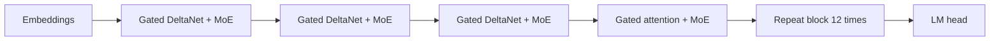

# Hybrid Models: Mixing Attention with Linear and State Space Layers

## Introduction

The previous page ended with a trade-off. Attention keeps an exact copy of every past token, which makes retrieval and copying easy, but its KV cache grows with the context. A recurrent layer such as Mamba keeps a fixed-size state, which makes long contexts cheap, but its memory is lossy (see [State Space Models and Mamba](./1-llm-state-space-models.mdx)).

Hybrid models refuse to choose. They stack mostly cheap recurrent layers and keep a small number of full attention layers for exact lookup. Since 2024 this has gone from research to production: Jamba, Nemotron-H, IBM Granite 4.0, MiniMax-01, Qwen3-Next, Qwen3.5 and Kimi Linear all ship hybrid stacks, each with a different recurrent layer and a different mixing ratio.

By the end of this page you will be able to:

- Derive linear attention as an RNN with a matrix-valued state and verify that its parallel and recurrent forms agree.
- Explain the family of update rules that followed: decay (RetNet), data-dependent gates (GLA, Mamba-2) and the delta rule (DeltaNet, Gated DeltaNet, Kimi Delta Attention).
- Read the layer layout of a hybrid model from its config.json.
- Compute the KV cache and recurrent state of real hybrids at 128K tokens.
- Judge when a hybrid is the right choice and when it is not.

## Linear Attention Is an RNN

Softmax attention for one query is

$$
o_t = \sum_{s \le t} \frac{\exp(q_t^\top k_s)}{\sum_{r \le t} \exp(q_t^\top k_r)}\, v_s
$$

The exponential couples $q_t$ and $k_s$ inside a nonlinearity, so nothing can be precomputed: every new query must touch every old key. Katharopoulos et al. ("Transformers are RNNs", 2020) replaced the exponential by a product of feature maps, $\mathrm{sim}(q, k) = \phi(q)^\top \phi(k)$. Then the sum factorizes:

$$
o_t = \frac{\sum_{s \le t} v_s\, \phi(k_s)^\top \phi(q_t)}{\sum_{s \le t} \phi(k_s)^\top \phi(q_t)} = \frac{S_t\, \phi(q_t)}{z_t^\top \phi(q_t)}, \qquad S_t = \sum_{s \le t} v_s \phi(k_s)^\top, \quad z_t = \sum_{s \le t} \phi(k_s)
$$

$S_t \in \mathbb{R}^{d_v \times d_k}$ is a matrix that summarizes the whole past, and it updates with a rank-one write per token:

$$
S_t = S_{t-1} + v_t\, \phi(k_t)^\top
$$

That is an RNN whose hidden state is a matrix. Generation costs $O(d_k d_v)$ per token per head regardless of position, and the state never grows. Training can still use the parallel form, a causal mask applied to $\phi(Q)\phi(K)^\top$ without softmax. Here are both forms side by side:

```python
import torch
import torch.nn.functional as F

torch.manual_seed(0)
B, H, L, d_k, d_v = 1, 2, 6, 4, 3
q, k = torch.randn(B, H, L, d_k), torch.randn(B, H, L, d_k)
v = torch.randn(B, H, L, d_v)
phi = lambda x: F.elu(x) + 1            # positive feature map from Katharopoulos et al. (2020)
q, k = phi(q), phi(k)

# Parallel (training) form: causal mask on q k^T, no softmax -> O(L^2) like attention
scores = q @ k.transpose(-1, -2)                         # (B, H, L, L)
mask = torch.tril(torch.ones(L, L))
num = (scores * mask) @ v                                # (B, H, L, d_v)
den = (scores * mask).sum(-1, keepdim=True)              # (B, H, L, 1) normalizer
out_parallel = num / den

# Recurrent (inference) form: a d_k x d_v matrix state S and a d_k vector z, O(1) per token
S = torch.zeros(B, H, d_k, d_v)                          # sum of k_s v_s^T
z = torch.zeros(B, H, d_k)                               # sum of k_s
outs = []
for t in range(L):
    S = S + k[:, :, t, :, None] * v[:, :, t, None, :]    # rank-1 write
    z = z + k[:, :, t]
    qt = q[:, :, t]                                      # (B, H, d_k)
    outs.append((qt[..., None] * S).sum(-2) / (qt * z).sum(-1, keepdim=True))
out_recurrent = torch.stack(outs, dim=2)                 # (B, H, L, d_v)

print("state per head:", tuple(S.shape[-2:]), "values, independent of L")
print("max diff parallel vs recurrent:", (out_parallel - out_recurrent).abs().max().item())
```

```text
state per head: (4, 3) values, independent of L
max diff parallel vs recurrent: 2.384185791015625e-07
```

(The code stores the state transposed, as $d_k \times d_v$, which is the usual layout in kernels; the math is identical.) Production kernels such as those in the `flash-linear-attention` library use a third, chunked form: quadratic attention inside chunks of 64 or so tokens, recurrent state passing between chunks. It is the same idea as Mamba-2's SSD algorithm, and for good reason, as the next section shows.

## Forgetting: Decay and Gates

Plain linear attention never forgets. Every write adds to $S$, so after many tokens the state is a blur of everything, and old associations interfere with new ones. The fix that every successor adopted is to shrink the old state before writing:

| Layer | Update rule | Forgetting | Introduced |
| --- | --- | --- | --- |
| Linear attention | $S_t = S_{t-1} + v_t k_t^\top$ | None | Katharopoulos et al., 2020 |
| RetNet | $S_t = \gamma\, S_{t-1} + v_t k_t^\top$ | Fixed decay $\gamma$ per head | Sun et al., 2023 |
| Mamba-2 | $S_t = a_t\, S_{t-1} + v_t k_t^\top$ | Data-dependent scalar per head | Dao and Gu, 2024 |
| GLA | $S_t = S_{t-1}\,\mathrm{diag}(\alpha_t) + v_t k_t^\top$ | Data-dependent vector over key channels | Yang et al., 2023 |
| DeltaNet | $S_t = S_{t-1}(I - \beta_t k_t k_t^\top) + \beta_t v_t k_t^\top$ | Erases what was stored under $k_t$ | Schlag et al., 2021; Yang et al., 2024 |
| Gated DeltaNet | $S_t = \alpha_t S_{t-1}(I - \beta_t k_t k_t^\top) + \beta_t v_t k_t^\top$ | Scalar gate plus targeted erase | Yang, Kautz, Hatamizadeh, 2024 |

In every row the output is read as $o_t = S_t q_t$, typically after normalization and an output gate. Mamba-2's row is exactly the state space duality from the previous page, with $C_t$ as the query, $B_t$ as the key and $x_t$ as the value. Seen this way, "SSM" and "linear attention" are two names for overlapping families of matrix-state recurrences, and the interesting differences are in the update rule.

## The Delta Rule: Writing Like a Key-Value Store

The additive write $S \leftarrow S + v k^\top$ has a flaw. If key $k$ was already associated with value $v_\mathrm{old}$, writing $v_\mathrm{new}$ under the same key gives a read-out of $v_\mathrm{old} + v_\mathrm{new}$, a blend of both. A real key-value store would replace the old value.

The delta rule, an idea from classic neural network learning that Schlag et al. ("Linear Transformers Are Secretly Fast Weight Programmers", 2021) brought to linear attention, does that. Treat the state $S$ as a little linear model that should map keys to values, and take one gradient step on the squared error of the current pair:

$$
\ell(S) = \tfrac{1}{2}\lVert S k_t - v_t \rVert^2, \qquad \nabla_S \ell = (S k_t - v_t)\, k_t^\top
$$

$$
S_t = S_{t-1} - \beta_t (S_{t-1} k_t - v_t) k_t^\top = S_{t-1}(I - \beta_t k_t k_t^\top) + \beta_t v_t k_t^\top
$$

Read the first form aloud: retrieve what the state currently says for $k_t$, compare it with the target $v_t$, and move it toward the target by a step $\beta_t \in (0, 1)$ that the model predicts per token. With a unit-norm key and $\beta_t = 1$, the old value stored under $k_t$ is erased completely and replaced. Keys orthogonal to $k_t$ are untouched.

Gated DeltaNet (Yang, Kautz and Hatamizadeh, "Gated Delta Networks: Improving Mamba2 with Delta Rule", 2024) multiplies the old state by a data-dependent gate $\alpha_t \in (0, 1)$ as well. The gate can wipe memory quickly (at a topic change or document boundary), and the delta term edits specific associations. Yang et al. ("Parallelizing Linear Transformers with the Delta Rule over Sequence Length", 2024) found a chunked parallel algorithm for it, which is what made it trainable at scale.

The difference is easy to see numerically. The script stores a value under a key, overwrites it, and then fills a $64 \times 64$ state with more and more random pairs:

```python
import torch
import torch.nn.functional as F

torch.manual_seed(0)
d = 64

def linear_write(S, k, v):                 # S <- S + v k^T
    return S + torch.outer(v, k)

def delta_write(S, k, v, beta=1.0, alpha=1.0):
    # gated delta rule: S <- alpha * S (I - beta k k^T) + beta v k^T
    # equivalently: read the old value S k, then move it toward v by a step beta
    return alpha * (S - beta * torch.outer(S @ k, k)) + beta * torch.outer(v, k)

# 1) Overwrite test: store key "x" with value A, later update it to value B
k = F.normalize(torch.randn(d), dim=0)
vA, vB = torch.randn(d), torch.randn(d)
for name, write in [("linear attention", linear_write), ("delta rule", delta_write)]:
    S = torch.zeros(d, d)
    S = write(S, k, vA)
    S = write(S, k, vB)
    r = S @ k                              # read with the same key
    print(f"{name:16s}  cos(read, B) = {F.cosine_similarity(r, vB, dim=0):.3f}  "
          f"cos(read, A) = {F.cosine_similarity(r, vA, dim=0):.3f}")

# 2) Capacity test: store n random (key, value) pairs in a 64x64 state, read every key back
print("\n  n   linear  delta   delta: oldest 25%  newest 25%")
for n in (8, 32, 64, 128, 256):
    keys = F.normalize(torch.randn(n, d), dim=-1)
    vals = torch.randn(n, d)
    cos = []
    for write in (linear_write, delta_write):
        S = torch.zeros(d, d)
        for i in range(n):
            S = write(S, keys[i], vals[i])
        cos.append(F.cosine_similarity(keys @ S.T, vals, dim=-1))   # (n,) one score per stored pair
    q = n // 4
    print(f"{n:>4}   {cos[0].mean():.3f}   {cos[1].mean():.3f}        "
          f"{cos[1][:q].mean():.3f}       {cos[1][-q:].mean():.3f}")
```

```text
linear attention  cos(read, B) = 0.660  cos(read, A) = 0.817
delta rule        cos(read, B) = 1.000  cos(read, A) = 0.105

  n   linear  delta   delta: oldest 25%  newest 25%
   8   0.951   0.975        0.946       1.000
  32   0.826   0.839        0.690       0.965
  64   0.700   0.659        0.402       0.895
 128   0.589   0.477        0.205       0.835
 256   0.443   0.241        0.028       0.631
```

Two lessons. First, the overwrite test: linear attention returns a mixture that resembles the stale value A more than the new value B, while the delta rule returns exactly B (its 0.105 similarity with A is just the chance overlap of two random vectors). Second, the capacity test: no update rule escapes the size of the state. A $64 \times 64$ matrix holds about 64 independent associations. Beyond that, linear attention degrades everything uniformly, while the delta rule behaves like a recency-ordered cache: the newest quarter stays readable (0.835 at $n = 128$) and the oldest is overwritten. For language, where recent and repeatedly used facts matter most, that is usually the better failure mode, but neither recovers a fact from 100,000 tokens ago. That is the job of the attention layers in a hybrid.

Kimi Linear (Kimi Team, 2025) refines Gated DeltaNet into Kimi Delta Attention (KDA) by making the gate channel-wise, a vector $\alpha_t$ over key channels like GLA, instead of a single scalar per head.

## Hybrid Layouts in Real Models

Most hybrids interleave a fixed pattern of layers. Qwen3-Next's model card states its 48-layer layout as 12 repetitions of three Gated DeltaNet layers followed by one gated attention layer, each followed by a MoE MLP:



The configs say the same thing in different dialects:

```json
{
  "model_type": "qwen3_next",
  "num_hidden_layers": 48,
  "full_attention_interval": 4,
  "linear_num_value_heads": 32,
  "linear_num_key_heads": 16,
  "linear_key_head_dim": 128,
  "linear_value_head_dim": 128,
  "num_attention_heads": 16,
  "num_key_value_heads": 2,
  "head_dim": 256
}
```

Jamba-v0.1 uses `"attn_layer_period": 8` and `"attn_layer_offset": 4` (one attention layer in every eight, at position 4) and `"expert_layer_period": 2` (MoE on every other layer). Nemotron-H-8B packs its whole layout into one string, `"hybrid_override_pattern": "M-M-M-M*-M-M-M-M-M*-..."`, where `M` is a Mamba-2 layer, `*` attention and `-` an MLP. IBM Granite 4.0-H and Qwen3.5 list every layer in a `"layer_types"` array. Kimi Linear gives explicit `kda_layers` and `full_attn_layers` index lists.

| Model | Year | Recurrent layer | Attention layer | Ratio, recurrent to attention | Notes |
| --- | --- | --- | --- | --- | --- |
| Griffin / RecurrentGemma | 2024 | RG-LRU (gated linear recurrence) | Local sliding-window MQA | 2 to 1 | Google DeepMind; no global attention at all |
| Jamba | 2024 | Mamba | GQA, no positional encoding | 7 to 1 | 52B total, 12B active MoE (16 experts, top 2) |
| Samba | 2024 | Mamba | Sliding window | 1 to 1 | Microsoft; layer-wise Mamba, MLP, SWA, MLP |
| Nemotron-H-8B | 2025 | Mamba-2 | GQA | 6 to 1 | 24 Mamba-2, 4 attention, 24 MLP layers |
| MiniMax-Text-01 | 2025 | Lightning attention (linear) | Softmax GQA | 7 to 1 | 456B total, 45.9B active |
| Falcon-H1 | 2025 | Mamba-2 | GQA | In parallel | Attention and SSM heads run side by side in every layer |
| Granite 4.0-H-Small | 2025 | Mamba-2 | GQA, no positional encoding | 9 to 1 | 36 Mamba-2, 4 attention, MoE MLPs |
| Qwen3-Next-80B-A3B | 2025 | Gated DeltaNet | Gated attention | 3 to 1 | 80B total, 3B active; MTP head |
| Kimi Linear 48B-A3B | 2025 | Kimi Delta Attention | MLA | about 3 to 1 | 20 KDA, 7 MLA layers |
| Qwen3.5 (for example 35B-A3B) | 2026 | Gated DeltaNet | Gated attention | 3 to 1 | Same pattern carried into a mainline family |

Several regularities stand out:

- **Few attention layers are enough.** NVIDIA's 8B study (Waleffe et al., 2024) used 43 percent Mamba-2, 7 percent attention and 50 percent MLP layers and found the hybrid beat an equally trained Transformer by 2.65 points on average across 12 tasks, while pure Mamba-2 lagged on in-context learning and recall. Jamba's ablations found 1:3 and 1:7 ratios performed about the same at 1.3B scale, and picked 1:7 for efficiency.
- **Attention layers often drop positional encoding.** Jamba found that its attention layers worked as well without RoPE, plausibly because the recurrent layers already encode order; Granite 4.0-H's config says `"position_embedding_type": "nope"`.
- **Pure SSMs fail at format following and in-context learning.** Jamba's paper reports pure Mamba scoring 48.8 on IMDB versus 84.1 for attention and 90.9 for the hybrid, often because it answered "Very Good" instead of the required label.
- **The attention layers get extra care.** Qwen3-Next adds a sigmoid output gate after attention (`"attn_output_gate": true` in Qwen3.5), following Qiu et al.'s "Gated Attention for Large Language Models" (2025), which reports better stability and no attention sinks.

## Worked Example: Cache Memory at 128K Tokens

The payoff of a hybrid is inference memory. Using the layer counts, KV head counts and state shapes from each config.json, this script computes the per-sequence cache at 131,072 tokens:

```python
# Per-sequence inference cache at 128K tokens for hybrid models, from their config.json files.
# bf16 (2 bytes) everywhere; real engines often keep recurrent states in fp32, doubling that part.
BYTES, T = 2, 131_072

def kv(layers, kv_heads, head_dim):            # softmax attention: K and V per token per layer
    return layers * 2 * kv_heads * head_dim * BYTES * T

models = {
    # name: (attention KV bytes, recurrent state bytes, layer summary)
    "Llama-3.1-8B (all attention)": (kv(32, 8, 128), 0, "32 attention"),
    "Nemotron-H-8B": (kv(4, 8, 128), 24 * 128 * 64 * 128 * BYTES,
                      "4 attention + 24 Mamba-2 + 24 MLP"),
    "Jamba-v0.1 (52B MoE)": (kv(4, 8, 128), 28 * 8192 * 16 * BYTES,
                             "4 attention + 28 Mamba"),
    "Qwen3-Next-80B-A3B": (kv(12, 2, 256), 36 * 32 * 128 * 128 * BYTES,
                           "12 gated attention + 36 Gated DeltaNet"),
    "Kimi-Linear-48B-A3B": (7 * (512 + 64) * BYTES * T, 20 * 32 * 128 * 128 * BYTES,
                            "7 MLA + 20 KDA"),
    "MiniMax-Text-01 (456B MoE)": (kv(10, 8, 128), 70 * 64 * 128 * 128 * BYTES,
                                   "10 softmax + 70 lightning"),
}

# Nemotron-H's config encodes its layout as a string: M = Mamba-2, * = attention, - = MLP
pattern = "M-M-M-M*-M-M-M-M-M*-M-M-M-M-M*-M-M-M-M-M*-M-M-M-M-M-"
print("Nemotron-H-8B pattern:", {c: pattern.count(c) for c in "M*-"}, "of", len(pattern), "layers\n")

print(f"{'model':30s} {'layers':40s} {'KV GiB':>7} {'state GiB':>9}")
for name, (kv_b, st_b, layers) in models.items():
    print(f"{name:30s} {layers:40s} {kv_b / 2**30:7.2f} {st_b / 2**30:9.3f}")
```

```text
Nemotron-H-8B pattern: {'M': 24, '*': 4, '-': 24} of 52 layers

model                          layers                                    KV GiB state GiB
Llama-3.1-8B (all attention)   32 attention                               16.00     0.000
Nemotron-H-8B                  4 attention + 24 Mamba-2 + 24 MLP           2.00     0.047
Jamba-v0.1 (52B MoE)           4 attention + 28 Mamba                      2.00     0.007
Qwen3-Next-80B-A3B             12 gated attention + 36 Gated DeltaNet      3.00     0.035
Kimi-Linear-48B-A3B            7 MLA + 20 KDA                              0.98     0.020
MiniMax-Text-01 (456B MoE)     10 softmax + 70 lightning                   5.00     0.137
```

Some things to notice:

- The recurrent states are tiny, tens of megabytes. Almost all the memory is still the KV cache of the few attention layers, which grows linearly with context. A hybrid divides the KV cache by the ratio, it does not remove it.
- Jamba's 2 GiB at 128K doubles to 4 GiB at 256K, matching the 4 GB the Jamba paper reports in its Table 1 (versus 32 GB for Mixtral and 128 GB for Llama-2-7B at that length).
- Kimi Linear stacks two tricks: a 3:1 hybrid and MLA for the remaining attention layers (576 cached numbers per token per layer, see [Multi-Head Latent Attention](../2-llm-attention/6-llm-mla.mdx)). Its paper reports up to 75 percent less KV cache than full MLA and up to 6 times higher decoding throughput at 1M tokens.
- Qwen3-Next combines 2 KV heads with 12 attention layers. Qwen reports 10 times the inference throughput of Qwen3-32B for contexts over 32K tokens.

Compute moves the same way. Prefill of a 128K prompt on an all-attention 8B model spends a large share of its FLOPs in the $L^2$ score matrices; replacing three of every four attention layers removes three quarters of that term, and the recurrent layers add only linear cost.

:::note
Memory savings turn into speed only if the serving engine supports the hybrid. vLLM and SGLang manage two cache types for these models (paged KV blocks for attention layers, fixed state slots for recurrent layers), and prefix caching is harder because a recurrent state cannot be sliced at an arbitrary token. Check your engine's model support list before choosing a hybrid for production.
:::

## When Not to Use a Hybrid

Hybrids are not a free win, and the field has not converged. MiniMax used a 7:1 lightning-attention hybrid in MiniMax-01 and MiniMax-M1 but switched back to full attention for MiniMax-M2 in late 2025. Their published explanation was that hybrids looked fine on public benchmarks yet fell short on complex multi-hop reasoning at scale, that the deficits were hard to detect without new internal metrics, and that kernels, low-precision states, prefix caching and speculative decoding were less mature for linear layers.

Practical guidance:

- **Short contexts and small batches.** Under about 8K tokens, the KV cache of a GQA model is small and attention kernels are extremely optimized. A hybrid saves little.
- **Retrieval-heavy workloads.** Tasks that quote long documents exactly lean on the attention layers; with few of them, quality can drop on hard retrieval even when needle tests pass (see [Long Context in Practice](../4-llm-positional-encoding/7-llm-long-context-evaluation.mdx)).
- **Fine-tuning and tooling.** LoRA, quantization and export tools must handle the recurrent layers; check that yours do before committing.
- **Long contexts and high concurrency.** This is where hybrids shine. Agents with 100K-token histories, long-document QA at scale, and many concurrent users per GPU all benefit directly from a 4 to 8 times smaller cache.

## Common Mistakes

- Assuming a hybrid has no KV cache. Its attention layers still need one, and it still grows linearly; only the constant shrinks.
- Comparing state sizes in configs without multiplying by heads and both head dimensions. A Gated DeltaNet head stores a $d_k \times d_v$ matrix, not a vector.
- Running a hybrid on an engine version without support for its layer type; it may fall back to slow reference kernels or refuse to load.
- Treating "linear attention" as one method. Additive, decayed, gated and delta-rule updates behave very differently on recall.
- Placing all attention layers at the start or the end when designing your own hybrid. Published hybrids spread them evenly through depth.
- Reading needle-in-a-haystack success as proof of long-context reasoning; hybrids can pass needles and still lose on multi-hop tasks.

## Summary

- Linear attention replaces softmax with a feature-map product, which turns attention into an RNN with a matrix state updated by rank-one writes.
- Successors add forgetting: fixed decay (RetNet), data-dependent gates (GLA, Mamba-2) and the delta rule, which edits the value stored under a key instead of adding to it (DeltaNet, Gated DeltaNet, KDA).
- Hybrids keep one attention layer in every 3 to 8 layers for exact retrieval and use recurrent layers for the rest; real configs encode this as periods, pattern strings or `layer_types` lists.
- At 128K tokens, hybrids cut the KV cache by roughly the mixing ratio, from 16 GiB for an all-attention 8B model to 1 to 5 GiB for current hybrids, while recurrent states add only tens of megabytes.
- The trade-off is not settled: MiniMax returned to full attention for M2, while Qwen and Kimi moved further toward hybrids.

## Further Reading

- [Transformers are RNNs (Katharopoulos et al., 2020)](https://arxiv.org/abs/2006.16236): linear attention and its recurrent form.
- [Linear Transformers Are Secretly Fast Weight Programmers (Schlag et al., 2021)](https://arxiv.org/abs/2102.11174): the delta rule for linear attention.
- [Retentive Network (Sun et al., 2023)](https://arxiv.org/abs/2307.08621): decayed linear attention.
- [Gated Linear Attention Transformers (Yang et al., 2023)](https://arxiv.org/abs/2312.06635): data-dependent gates and chunked training.
- [Parallelizing Linear Transformers with the Delta Rule (Yang et al., 2024)](https://arxiv.org/abs/2406.06484): making DeltaNet trainable at scale.
- [Gated Delta Networks (Yang, Kautz, Hatamizadeh, 2024)](https://arxiv.org/abs/2412.06464): the layer used in Qwen3-Next and Qwen3.5.
- [Jamba: A Hybrid Transformer-Mamba Language Model (Lieber et al., 2024)](https://arxiv.org/abs/2403.19887): ratio ablations and KV cache table.
- [Griffin (De et al., 2024)](https://arxiv.org/abs/2402.19427): gated linear recurrences mixed with local attention.
- [MiniMax-01 (MiniMax, 2025)](https://arxiv.org/abs/2501.08313): lightning attention at 456B parameters.
- [Kimi Linear (Kimi Team, 2025)](https://arxiv.org/abs/2510.26692): Kimi Delta Attention with MLA.
- [Gated Attention for Large Language Models (Qiu et al., 2025)](https://arxiv.org/abs/2505.06708): the output gate on attention.
- [Why Did MiniMax M2 End Up as a Full Attention Model?](https://huggingface.co/blog/MiniMax-AI/why-did-m2-end-up-as-a-full-attention-model): a production team's case against hybrids.
- [flash-linear-attention on GitHub](https://github.com/fla-org/flash-linear-attention): Triton kernels for GLA, DeltaNet, Gated DeltaNet and more.
