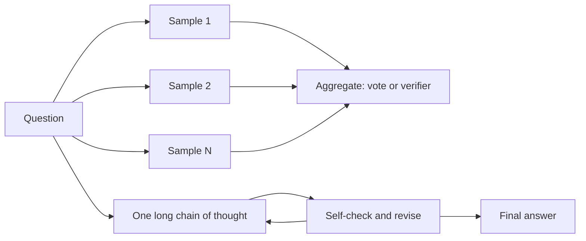

# Reasoning Models and Test-Time Compute

## Introduction

For most of the history of LLMs, there was one way to make a model smarter: train a bigger one on more data. Scaling laws (see [Scaling Laws](../6-llm-pretraining/2-llm-scaling-laws.mdx)) describe how loss falls as training compute grows. In September 2024, OpenAI's o1 announcement ("Learning to Reason with LLMs") showed a second axis: accuracy on hard math and coding problems kept improving, roughly linearly in the logarithm of compute, as the model was allowed to think longer at inference time. Four months later DeepSeek-R1 (DeepSeek-AI, 2025) published an open model and recipe that did the same.

These "reasoning models" are not a new architecture. They are ordinary decoder Transformers, often MoE, trained to produce a long chain of thought before the answer. What is new is where the compute goes. This page explains the techniques that spend compute at test time, how to measure them, and what they cost.

By the end of this page you will be able to:

- Explain why generating more tokens gives a fixed-size model more computation per answer.
- Compute pass@k with the unbiased estimator, and compare majority voting and best-of-N with a verifier.
- Describe outcome and process reward models and when search with a verifier helps.
- Summarize how RL with verifiable rewards produced long-thinking models (R1-Zero, R1) and how distillation passes the skill on.
- Control thinking length with a budget, in code, and estimate the latency and memory cost of a long trace.

## Why Thinking Tokens Add Compute

A forward pass of a dense model with $N$ parameters costs about $2N$ FLOPs per token (see [Counting Parameters, FLOPs and Memory](../3-llm-transformer/6-llm-parameter-and-flop-counting.mdx)). That is a hard ceiling on how much computation the model can do between reading the question and emitting the first answer token. A 1B model cannot multiply two 20-digit numbers in one step because one step is not enough serial computation.

Every generated token buys another full pass, and the new token's hidden states can attend to everything written so far. The chain of thought becomes a scratchpad: intermediate results are written down, read back and built upon. Producing $T$ reasoning tokens gives roughly

$$
C_\mathrm{answer} \approx 2N \cdot T
$$

FLOPs per answer, plus the attention cost over the growing context. A model with 37B active parameters (DeepSeek-V3 and R1) that thinks for 10,000 tokens spends about $2 \cdot 37 \times 10^9 \cdot 10^4 \approx 7.4 \times 10^{14}$ FLOPs on one answer, ten thousand times what a one-token answer costs.

Wei et al. ("Chain-of-Thought Prompting Elicits Reasoning in Large Language Models", 2022) showed that few-shot examples with worked solutions raise accuracy on multi-step problems for large models, and Kojima et al. (2022) found that the single phrase "Let's think step by step" does much of the same zero-shot. Reasoning models internalize this: they are trained so that long, self-checking chains of thought are the default behaviour, not a prompt trick.

There are two ways to spend extra test-time compute:

- **Parallel**: sample many independent answers and aggregate them (voting, a verifier, or a human picks).
- **Sequential**: let one answer get longer, with the model revising and checking its own work.



## Parallel Scaling: pass@k, Voting and Verifiers

### pass@k

If a model solves a problem with probability $p$ per sample, the chance that at least one of $k$ independent samples is correct is $1 - (1-p)^k$. That quantity, averaged over problems, is pass@k. It is an upper bound on what any selection method can achieve with $k$ samples, because it assumes an oracle that recognizes the correct one. For code with unit tests, the tests are such an oracle.

Estimating it naively from exactly $k$ samples has high variance. Chen et al. ("Evaluating Large Language Models Trained on Code", 2021) draw $n \ge k$ samples, count $c$ correct ones and use the unbiased estimator

$$
\mathrm{pass@}k = 1 - \frac{\binom{n-c}{k}}{\binom{n}{k}}
$$

which is the probability that a random subset of $k$ of the $n$ samples contains no correct one, subtracted from 1. Computing the binomials directly overflows, so the product form $\prod_{i=n-c+1}^{n} (1 - k/i)$ is used in practice, as in the code below.

Brown et al. ("Large Language Monkeys", 2024) showed that coverage, the fraction of problems solved by at least one sample, keeps rising over four orders of magnitude of samples. With DeepSeek-Coder-V2-Instruct on SWE-bench Lite, solved issues went from 15.9 percent with one sample to 56 percent with 250 samples. The hard part is the selection step.

### Majority Voting (Self-Consistency)

Without an oracle, the simplest aggregator is to sample $k$ reasoning paths, extract each final answer and return the most common one. Wang et al. ("Self-Consistency Improves Chain of Thought Reasoning", 2022) showed large gains on arithmetic and commonsense benchmarks. It works whenever answers can be compared for equality (a number, a multiple-choice letter) and the correct answer is the single most likely one. DeepSeek reports this as cons@64.

Voting has a ceiling: on a problem where one specific wrong answer is more likely than the right one, more votes make the wrong answer win more reliably.

### Best-of-N with a Verifier

A learned verifier, or reward model, scores each candidate and the highest-scoring one is returned. An outcome reward model (ORM) scores the final answer. A process reward model (PRM) scores every step. Lightman et al. ("Let's Verify Step by Step", 2023) collected 800,000 human step-level labels (PRM800K) and found that best-of-N selection with a PRM beat an ORM, solving 78 percent of problems from a representative subset of the MATH test set. A PRM also enables search: beam search or tree search that prunes partial solutions with low step scores, as in Tree of Thoughts (Yao et al., 2023).

Verifiers can be fooled. A reward model is itself a learned approximation, and the more candidates you search over, the more likely you are to find one that scores well for the wrong reason, a form of reward hacking (see [Alignment, Safety Training and Their Limits](../8-llm-post-training/6-llm-alignment-safety.mdx)).

### A Simulation You Can Run

To see how the three aggregators behave, simulate 400 problems. Each has a solve rate $p$ drawn from a skewed distribution (many hard problems, some easy), and wrong answers concentrate on three specific mistakes per problem. The verifier gives correct samples a score one standard deviation higher on average, a realistic but imperfect reward model.

```python
import numpy as np

rng = np.random.default_rng(0)
P, N = 400, 256                      # problems, samples drawn per problem

# Each problem has a solve rate p; wrong answers concentrate on a few "attractive" mistakes.
p = rng.beta(0.6, 0.9, size=P)       # many hard problems, some easy ones
wrong_probs = rng.dirichlet([1.0, 1.0, 1.0], size=P)   # spread of 3 wrong answers per problem

# answers: 0 = correct, 1..3 = specific wrong answers; shape (P, N)
correct = rng.random((P, N)) < p[:, None]
wrong = np.array([rng.choice([1, 2, 3], size=N, p=w) for w in wrong_probs])
answers = np.where(correct, 0, wrong)

# Noisy verifier (a reward model): higher score on correct samples, but overlapping
scores = rng.normal(loc=np.where(correct, 1.0, 0.0), scale=1.0)

def pass_at_k(n, c, k):
    """Unbiased estimator of pass@k from n samples with c correct (Chen et al., 2021)."""
    if n - c < k:
        return 1.0
    return 1.0 - np.prod(1.0 - k / np.arange(n - c + 1, n + 1))

print("   k   pass@k  majority@k  best-of-k (verifier)")
for k in (1, 4, 16, 64, 256):
    pk = np.mean([pass_at_k(N, c, k) for c in correct.sum(1)])
    maj, bon = [], []
    for trial in range(8):                       # average over random subsets of size k
        idx = rng.choice(N, size=k, replace=False)
        a, s = answers[:, idx], scores[:, idx]
        votes = np.stack([(a == v).sum(1) for v in range(4)], axis=1)   # (P, 4)
        maj.append(np.mean(votes.argmax(1) == 0))                       # ties go to the correct answer
        bon.append(np.mean(a[np.arange(P), s.argmax(1)] == 0))
    print(f"{k:>4}   {pk:.3f}     {np.mean(maj):.3f}        {np.mean(bon):.3f}")
best_wrong = ((1 - p)[:, None] * wrong_probs).max(1)    # probability of the most common mistake
print(f"\nceiling for majority voting (p beats every wrong answer): {np.mean(p > best_wrong):.3f}")
```

```text
   k   pass@k  majority@k  best-of-k (verifier)
   1   0.427     0.421        0.421
   4   0.697     0.528        0.561
  16   0.861     0.530        0.659
  64   0.941     0.531        0.724
 256   0.975     0.532        0.785

ceiling for majority voting (p beats every wrong answer): 0.535
```

The three curves tell the standard story:

- pass@k climbs toward 1 because almost every problem has some nonzero solve rate. It measures the model's coverage, not a usable system.
- Majority voting jumps from 42 to 53 percent by $k = 4$ and then stalls at its ceiling: the share of problems where the right answer is the plurality answer.
- Best-of-k with a verifier keeps improving, here to 78.5 percent at $k = 256$, because it can rescue problems where the right answer is rare but recognizable. It is limited by verifier quality.

Snell et al. ("Scaling LLM Test-Time Compute Optimally can be More Effective than Scaling Model Parameters", 2024) made this quantitative on real models: allocating test-time compute per problem (sequential revisions on easier problems, PRM-guided search on harder ones) was more than 4 times as efficient as plain best-of-N, and on problems where the small model had non-trivial success rates, a FLOPs-matched small model with test-time compute beat a 14 times larger model. On the hardest problems, more pretraining compute was still the better buy.

## Sequential Scaling: Learning to Think Longer

Parallel sampling cannot fix an approach that is wrong from the first line, because every sample starts from scratch. Sequential scaling lets the model notice a mistake and backtrack inside one trace. You cannot get that from prompting alone; it has to be trained.

### Reinforcement Learning with Verifiable Rewards

DeepSeek-R1-Zero started from the DeepSeek-V3 base model and ran large-scale RL with GRPO (see [Reinforcement Learning for Reasoning](../8-llm-post-training/4-llm-reasoning-rl.mdx)) using only rule-based rewards: is the final answer correct (checked against a reference or by running unit tests), and is the output in the required think-then-answer format. There was no supervised fine-tuning first and no learned reward model.

Two things emerged without being programmed. The pass@1 score on AIME 2024 rose from 15.6 percent to 71.0 percent during training, and to 86.7 percent with majority voting over 64 samples. The average response length grew steadily over training, from hundreds to thousands of tokens, as the policy discovered that longer reasoning earned more reward. The paper also describes an "aha moment" where an intermediate checkpoint stops, writes something like "Wait, wait. Wait. That's an aha moment I can flag here.", and re-evaluates its approach.

R1-Zero's traces were hard to read and mixed languages, so DeepSeek-R1 adds a small "cold start" SFT stage on curated long chains of thought, then reasoning RL, then rejection-sampled SFT and a final RL stage for general helpfulness. R1 reached 79.8 percent pass@1 on AIME 2024. The work was later published in Nature (2025).

Qwen3 (Qwen Team, 2025) uses a similar four-stage pipeline (long-CoT cold start, reasoning RL, thinking mode fusion, general RL). The third stage teaches one model both a thinking and a non-thinking mode, selected by the chat template.

### Distillation and Small Data

Long reasoning can be taught to smaller models by plain supervised fine-tuning on a strong model's traces (see [Knowledge Distillation for LLMs](../8-llm-post-training/5-llm-distillation.mdx)). DeepSeek fine-tuned Qwen2.5 and Llama 3 models on about 800,000 samples generated with R1. DeepSeek-R1-Distill-Qwen-32B scored 72.6 percent on AIME 2024, while the same 32B base model trained with large-scale RL alone (DeepSeek-R1-Zero-Qwen-32B) reached 47.0 percent. For small models, distilling from a strong reasoner was much cheaper and better than RL from scratch.

s1 (Muennighoff et al., "s1: Simple test-time scaling", 2025) went to the extreme: supervised fine-tuning of Qwen2.5-32B-Instruct on only 1,000 carefully selected questions with reasoning traces. It also introduced budget forcing, which the next section implements.

| Model or method | Year | How test-time compute is spent | Training signal |
| --- | --- | --- | --- |
| Chain-of-thought prompting | 2022 | One reasoning chain | None, prompting |
| Self-consistency | 2022 | Many chains, majority vote | None |
| PRM best-of-N and search | 2023 | Many chains or partial chains, verifier picks | Step-level labels |
| OpenAI o1 | 2024 | Long hidden chain of thought | RL, details not published |
| DeepSeek-R1-Zero and R1 | 2025 | Long visible chain of thought | GRPO with rule-based rewards |
| s1 | 2025 | Long chain, extended or cut by budget forcing | SFT on 1,000 traces |
| Qwen3 thinking mode | 2025 | Switchable thinking, thinking budget | Four-stage pipeline |

## Controlling the Thinking Budget

A long trace is expensive, and an easy question should not cost 5,000 tokens. Models and APIs expose controls:

- **Qwen3** takes `enable_thinking=True` or `False` in `apply_chat_template`, plus `/think` and `/no_think` soft switches in user turns. The thinking appears between `<think>` and `</think>` tokens. The model card recommends sampling (temperature 0.6, top-p 0.95, top-k 20) in thinking mode and warns against greedy decoding, which can cause endless repetition.
- **gpt-oss** (OpenAI's open-weight models) takes a reasoning effort of low, medium or high in its system prompt.
- **Budget forcing** (s1, and the Qwen3 report's "thinking budget"): if thinking reaches a token limit, stop it and insert text that closes the thinking block; if the model tries to stop too early, s1 instead appends "Wait" to make it continue. The Qwen3 report inserts the sentence "Considering the limited time by the user, I have to give the solution based on the thinking directly now." and notes that this ability was not explicitly trained but emerged from thinking mode fusion.

Here is budget forcing with Hugging Face `transformers` and Qwen3-0.6B, which is small enough for a CPU (about 1.5 GB download; expect a few minutes on a laptop). Generation is split into a thinking phase capped at `budget` tokens and an answer phase:

```python
import time
import torch
from transformers import AutoModelForCausalLM, AutoTokenizer

torch.manual_seed(0)
model_id = "Qwen/Qwen3-0.6B"
tok = AutoTokenizer.from_pretrained(model_id)
model = AutoModelForCausalLM.from_pretrained(model_id, dtype=torch.float32).eval()
END_THINK = tok.convert_tokens_to_ids("</think>")          # 151668 in the Qwen3 vocabulary

question = "A shop sells pens at 3 for 2 dollars. How many dollars do 18 pens cost? Answer with a number."
prompt = tok.apply_chat_template([{"role": "user", "content": question}],
                                 tokenize=False, add_generation_prompt=True, enable_thinking=True)
ids = tok(prompt, return_tensors="pt").input_ids
sample = dict(do_sample=True, temperature=0.6, top_p=0.95, top_k=20)   # model card settings

def run(budget):
    t0 = time.time()
    torch.manual_seed(0)
    # Phase 1: think for at most `budget` new tokens, stopping early at </think>
    out = model.generate(ids, max_new_tokens=budget, eos_token_id=[END_THINK, tok.eos_token_id], **sample)
    thought = out[0, ids.shape[1]:]
    if END_THINK not in thought.tolist():
        # Budget exhausted: force the end of thinking, as described in the Qwen3 report
        stop = ("\n\nConsidering the limited time by the user, I have to give the solution "
                "based on the thinking directly now.\n</think>\n\n")
        out = torch.cat([out, tok(stop, return_tensors="pt").input_ids], dim=1)
    # Phase 2: write the visible answer
    final = model.generate(out, max_new_tokens=300, **sample)
    answer = tok.decode(final[0, out.shape[1]:], skip_special_tokens=True).strip()
    n_think = (thought != END_THINK).sum().item()
    print(f"budget {budget:>4}: thinking tokens {n_think:>4}  answer ends: {answer[-60:]!r}  ({time.time() - t0:.0f}s)")

for budget in (32, 128, 1024):
    run(budget)
```

```text
budget   32: thinking tokens   32  answer ends: '\\times \\frac{2}{3} = 12 \\text{ dollars}\n$$\n\n**Answer:** $12.'  (638s)
budget  128: thinking tokens  128  answer ends: 'n by 18:\n\n$$\n18 \\times \\frac{2}{3} = 12\n$$\n\n**Answer:** $12.'  (692s)
budget 1024: thinking tokens  503  answer ends: '2\n$$\n\nThus, the total cost for 18 pens is:\n\n$$\n\\boxed{12}\n$$'  (984s)
```

All three runs reach the right answer, 12 dollars (the printout shows the last 60 characters of each visible answer). With the 1,024-token limit, the model closed its thinking block on its own after 503 tokens; with budgets of 32 and 128 tokens the thinking was cut off, the closing sentence was inserted, and the model wrote out the solution in the visible answer instead. On an easy problem the forced budget costs nothing and saves over 90 percent of the thinking tokens. On a hard problem it would cost accuracy, which is the trade-off s1 measured on AIME. The timings are from a shared, heavily loaded CPU; on an idle laptop expect them to be several times shorter.

Two implementation details are worth copying. The thinking phase uses both `</think>` and the end-of-sequence token as stop tokens, so a model that finishes early is not forced to keep going. And the inserted text ends with `</think>` followed by a blank line, matching the format the chat template produces, so the answer phase sees exactly what it saw in training.

## The Cost of Thinking

Test-time compute is paid on every request, by every user, forever. Training compute is paid once. That changes the economics in three ways.

**Latency.** Decoding is sequential and memory-bound (see [How LLM Inference Works](../10-llm-inference/0-llm-inference-overview.mdx)). At 50 tokens per second, 8,000 thinking tokens is nearly three minutes before the first visible word. Techniques that speed up decoding, such as speculative decoding and multi-token prediction (see [Multi-Token Prediction](./5-llm-multi-token-prediction.mdx)), matter more for reasoning models than for chat models.

**Memory.** The KV cache grows with the trace. Qwen3-0.6B has 28 layers, 8 KV heads and head dimension 128, so each token costs $2 \cdot 28 \cdot 8 \cdot 128 \cdot 2 = 114{,}688$ bytes in bf16. A 32,768-token reasoning trace therefore needs $114{,}688 \cdot 32{,}768 \approx 3.5$ GiB of KV cache, more than twice the 1.5 GB of bf16 weights (751 million parameters). For long traces, batch size and therefore throughput are limited by cache, which is one reason hybrids and MLA (see [Hybrid Models](./2-llm-hybrid-models.mdx)) are attractive for reasoning workloads.

**Overthinking.** Reasoning models often spend thousands of tokens on trivial questions. Chen et al. ("Do NOT Think That Much for 2+3=?", 2024) documented o1-like models generating many redundant solution rounds for simple arithmetic. Budgets, adaptive effort settings and length penalties in RL are the current countermeasures.

:::warning
A visible chain of thought is not a faithful record of how the model reached its answer. Chen et al. ("Reasoning Models Don't Always Say What They Think", 2025) gave reasoning models hints in the prompt and found that, in most settings, the models' chains of thought acknowledged using the hint less than 20 percent of the time when they did use it. Treat traces as useful for debugging and monitoring, not as proof of the model's reasons.
:::

## Common Mistakes

- Reporting pass@k from exactly $k$ samples instead of the unbiased estimator with $n > k$; the variance is huge for small $k$.
- Comparing a reasoning model with a non-reasoning one at equal model size but unequal output tokens. Compare at equal inference compute or equal cost.
- Using greedy decoding with thinking models; the Qwen3 model card explicitly warns it degrades quality and causes repetition.
- Feeding the previous turn's thinking back into multi-turn context. Most chat templates for reasoning models strip old `<think>` blocks, and keeping them wastes context and can confuse the model.
- Setting `max_new_tokens` too low and reading a truncated trace as "the model failed". Check whether the end-of-thinking token was produced.
- Trusting a verifier's best-of-1000 pick without checking for reward hacking; search amplifies verifier errors.
- Assuming test-time compute replaces a better base model. Snell et al. found pretraining compute was still more effective on the hardest problems.

## Summary

- Each generated token gives a model another $2N$ FLOPs of computation, so a long chain of thought is a way to buy more computation per answer at inference time.
- Parallel scaling samples many answers: pass@k measures coverage, majority voting plateaus at the plurality-correct ceiling, and verifiers keep improving but can be gamed.
- Sequential scaling trains the model to reason longer and self-correct; DeepSeek-R1-Zero showed that RL with rule-based rewards alone raises AIME 2024 pass@1 from 15.6 to 71.0 percent while response length grows.
- Distillation from a strong reasoner beats RL from scratch for small models; s1 showed that even 1,000 good traces plus budget forcing go a long way.
- Thinking budgets, effort settings and on/off switches control cost; latency, KV cache memory and overthinking are the main prices of test-time compute.

## Further Reading

- [Chain-of-Thought Prompting Elicits Reasoning in Large Language Models (Wei et al., 2022)](https://arxiv.org/abs/2201.11903): the original chain-of-thought paper.
- [Self-Consistency Improves Chain of Thought Reasoning (Wang et al., 2022)](https://arxiv.org/abs/2203.11171): majority voting over reasoning paths.
- [Evaluating Large Language Models Trained on Code (Chen et al., 2021)](https://arxiv.org/abs/2107.03374): the unbiased pass@k estimator.
- [Let's Verify Step by Step (Lightman et al., 2023)](https://arxiv.org/abs/2305.20050): process reward models and PRM800K.
- [Large Language Monkeys (Brown et al., 2024)](https://arxiv.org/abs/2407.21787): scaling repeated sampling.
- [Scaling LLM Test-Time Compute Optimally (Snell et al., 2024)](https://arxiv.org/abs/2408.03314): compute-optimal test-time strategies.
- [Learning to Reason with LLMs (OpenAI, 2024)](https://openai.com/index/learning-to-reason-with-llms/): the o1 announcement and test-time scaling plots.
- [DeepSeek-R1 (DeepSeek-AI, 2025)](https://arxiv.org/abs/2501.12948): RL with verifiable rewards, R1-Zero and distilled models.
- [s1: Simple test-time scaling (Muennighoff et al., 2025)](https://arxiv.org/abs/2501.19393): 1,000 training examples and budget forcing.
- [Qwen3 Technical Report (Qwen Team, 2025)](https://arxiv.org/abs/2505.09388): thinking mode fusion and thinking budgets.
- [Do NOT Think That Much for 2+3=? (Chen et al., 2024)](https://arxiv.org/abs/2412.21187): overthinking in o1-like models.
- [Reasoning Models Don't Always Say What They Think (Chen et al., 2025)](https://arxiv.org/abs/2505.05410): chain-of-thought faithfulness.
- [Qwen3-0.6B model card](https://huggingface.co/Qwen/Qwen3-0.6B): thinking switches and recommended sampling settings.
