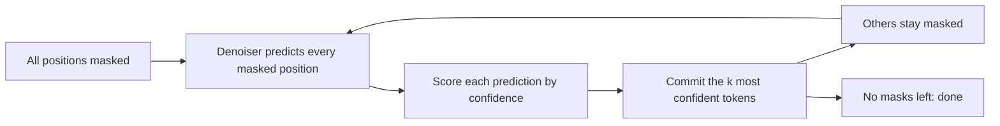

# Diffusion Language Models

## Introduction

An autoregressive (AR) LLM writes one token per forward pass, left to right, and can never revise a token once it is written. That is a strong assumption about how text should be produced, and it is the main reason decoding is slow: a 1,000-token answer takes 1,000 sequential passes through the network, each limited by memory bandwidth rather than compute (see [How LLM Inference Works](../10-llm-inference/0-llm-inference-overview.mdx)).

Diffusion models generate images by starting from noise and refining the whole picture over a few dozen steps. Diffusion language models (DLMs) apply the same idea to text: start from a sequence of blank "mask" tokens and, at every step, predict all of them at once and commit some. A 256-token block may take 20 to 50 passes instead of 256.

Until 2024 these were research curiosities. Then the masked diffusion formulation became simple and scalable: LLaDA (Nie et al., 2025) trained an 8B diffusion model from scratch that was competitive with Llama 3 8B on many benchmarks, Inception Labs launched the commercial Mercury models, Google showed Gemini Diffusion at I/O 2025, and in 2026 Google released the open-weight DiffusionGemma.

By the end of this page you will be able to:

- Describe the forward masking process and derive the masked diffusion training loss with its $1/t$ weight.
- Implement a masked diffusion LM and its sampler in PyTorch.
- Explain confidence-based remasking and why decoding many tokens in one step can produce inconsistent text.
- Describe block (semi-autoregressive) diffusion and how it brings back the KV cache.
- Weigh diffusion against autoregressive decoding on speed, quality and capabilities.

## From Continuous to Discrete Diffusion

Image diffusion adds Gaussian noise to pixel values and trains a network to remove it. Text is discrete, so "add a little noise to a token" has no obvious meaning. Two lines of work tried to bridge that gap.

**Continuous diffusion on embeddings.** Diffusion-LM (Li et al., 2022) ran Gaussian diffusion in word-embedding space and rounded back to tokens at the end. It allowed fine-grained control of generation but lagged far behind AR models in perplexity.

**Discrete diffusion.** D3PM (Austin et al., "Structured Denoising Diffusion Models in Discrete State-Spaces", 2021) defined the forward process directly on tokens with a transition matrix that, at each step, either keeps a token, swaps it for a random one ("uniform" noise) or replaces it with a special `[MASK]` token ("absorbing" noise). The absorbing variant worked best for text. SEDD (Lou, Meng and Ermon, 2023, an ICML 2024 best paper) introduced a score-entropy objective for discrete diffusion and narrowed the perplexity gap to GPT-2.

Then three groups showed independently in 2024 that, for absorbing noise, the complicated objectives collapse into something very familiar: a weighted masked language modeling loss. MDLM (Sahoo et al., "Simple and Effective Masked Diffusion Language Models", 2024), Shi et al.'s MD4 and RADD (Ou et al., 2024) made masked diffusion simple enough to scale. That formulation is what LLaDA, Dream, Mercury-style models and DiffusionGemma build on.

## The Masked Diffusion Process

Let $x_0 = (x_0^1, \dots, x_0^L)$ be a clean sequence and let $t \in [0, 1]$ be a continuous "time" that measures how corrupted the sequence is.

**Forward process.** At time $t$, each token is independently replaced by `[MASK]` with probability $t$ and kept with probability $1 - t$:

$$
q(x_t^i \mid x_0^i) = \begin{cases} 1 - t & x_t^i = x_0^i \\ t & x_t^i = \mathrm{M} \end{cases}
$$

At $t = 0$ the text is clean; at $t = 1$ every token is masked. Masked tokens stay masked as $t$ grows, which is why this noise is called absorbing.

**Reverse process.** A network $p_\theta$, usually a Transformer with no causal mask, sees the partially masked $x_t$ and predicts a distribution over the original token at every masked position. Generating text means starting at $t = 1$ (all masks) and repeatedly predicting and unmasking until $t = 0$.

**Training loss.** LLaDA writes the objective as

$$
\mathcal{L}(\theta) = -\,\mathbb{E}_{t \sim U(0,1),\; x_0,\; x_t \sim q(x_t \mid x_0)}\left[\frac{1}{t}\sum_{i=1}^{L} \mathbf{1}\!\left[x_t^i = \mathrm{M}\right]\, \log p_\theta\!\left(x_0^i \mid x_t\right)\right]
$$

Read it piece by piece:

- Sample a masking ratio $t$ uniformly per sequence and mask each token with probability $t$.
- Compute cross-entropy only at masked positions, exactly like BERT's masked language modeling.
- Multiply by $1/t$.

The $1/t$ weight is what makes this a generative model rather than a feature extractor. It comes from writing the ELBO of the continuous-time diffusion process; the result is an upper bound on the negative log-likelihood, $\mathcal{L} \ge -\mathbb{E}\log p_\theta(x_0)$, so the loss is directly comparable to an AR model's cross-entropy. Intuitively, a sequence with few masks (small $t$) contributes few loss terms, and the weight rescales it so that every noise level counts equally on average: in expectation there are $tL$ masked tokens, and $tL \cdot (1/t) = L$.

Two contrasts with BERT matter. BERT uses a fixed ratio of 15 percent masks, so it never learns to generate from a fully masked sequence. And BERT has no likelihood bound, so it cannot be used as a language model. A masked diffusion model trained over all ratios from 0 to 1 can.

A small worked example: take $L = 4$, the sequence "the cat sat down", and $t = 0.5$. Suppose positions 2 and 4 are masked: "the `[MASK]` sat `[MASK]`". If the model assigns probability 0.5 to "cat" and 0.25 to "down", the loss for this sample is $\frac{1}{0.5}\left(-\ln 0.5 - \ln 0.25\right) = 2(0.693 + 1.386) = 4.159$ nats, which is $4.159 / 4 \approx 1.04$ nats per token.

## Sampling: Predict, Commit, Remask

The reverse process has a free choice the forward process does not: which masked positions to commit at each step. With $S$ steps for a sequence of length $L$, about $L/S$ tokens are committed per step.



Common strategies:

- **Random order.** Commit a random subset of positions each step. This matches the forward process exactly in the limit of many steps.
- **Low-confidence remasking** (used by LLaDA, following MaskGIT for images). Predict everything, keep the $k$ predictions with the highest probability and remask the rest. Easy tokens such as punctuation and repeated names get fixed first, hard ones later with more context.
- **Entropy- or margin-based selection.** Variants that pick tokens by low entropy or by the gap between the top two probabilities. DiffusionGemma's model card recommends an entropy-bounded sampler that commits the lowest-entropy tokens while a bound stays below a threshold, with up to 48 denoising steps per block and early stopping when predictions stabilize.

### The Parallel Decoding Problem

Committing several tokens in one step hides a real statistical problem. The denoiser outputs a separate distribution for each position, $p_\theta(x^i \mid x_t)$. Sampling them in the same step treats them as independent, but the joint distribution of text is not a product of marginals.

The classic example: the prompt "A famous city: `[MASK]` `[MASK]`" has two good completions, "New York" and "San Francisco". The first position's marginal is about half "New", half "San"; the second is half "York", half "Francisco". Sampling both in one step gives "New Francisco" half of the time. With one token per step, the second token is predicted after the first is fixed and the problem disappears. This is the fundamental speed-quality trade-off of diffusion LMs, and the toy experiment below measures it.

## Experiment: A Toy Diffusion LM

The toy language makes the dependency between positions explicit: palindromes of length 12 over 8 symbols. The first half is random, and the second half must mirror it, so every token is tied to exactly one other token. A 3-layer bidirectional Transformer is trained with the loss above, then sampled with 12, 6, 3, 2 and 1 denoising passes. Training took 7 to 16 minutes on a shared CPU with two threads. Two details matter for such a small model: the position embeddings are initialized at the same scale as the token embeddings (with a tiny initialization the model could not tell positions apart and never learned the mirror rule), and $t$ is drawn with stratified sampling and floored at 0.05 so that the $1/t$ weight does not make the gradient too noisy.

```python
import time
import torch
import torch.nn as nn
import torch.nn.functional as F

torch.set_num_threads(2)
torch.manual_seed(0)

# Toy language: palindromes of length 12 over symbols 1..8. Token 0 is [MASK].
V, L, MASK = 9, 12, 0

def data(bs):
    half = torch.randint(1, V, (bs, L // 2))
    return torch.cat([half, half.flip(1)], dim=1)               # (bs, 12)

def is_valid(x):
    return (x == x.flip(1)).all(1) & (x != MASK).all(1)

class Denoiser(nn.Module):
    """Bidirectional Transformer: sees the partially masked sequence, predicts every position."""
    def __init__(self, d=128, layers=3):
        super().__init__()
        self.tok = nn.Embedding(V, d)
        self.pos = nn.Parameter(torch.randn(L, d))           # same scale as token embeddings
        layer = nn.TransformerEncoderLayer(d, 4, 4 * d, dropout=0.0, batch_first=True, norm_first=True)
        self.enc = nn.TransformerEncoder(layer, layers)        # no causal mask
        self.out = nn.Linear(d, V)

    def forward(self, x):                                       # x: (B, L) with some MASK tokens
        return self.out(self.enc(self.tok(x) + self.pos))       # (B, L, V) logits

def diffusion_loss(model, x0):
    B = x0.shape[0]
    # masking ratio t ~ U(0, 1), one per sequence; stratified (low-discrepancy) sampling as in MDLM
    # lowers the variance that the 1/t weight adds, and eps keeps 1/t bounded
    t = ((torch.rand(1) + torch.arange(B) / B) % 1).unsqueeze(1) * (1 - 0.05) + 0.05
    masked = torch.rand(B, L) < t                               # each token masked independently with prob t
    xt = torch.where(masked, torch.full_like(x0, MASK), x0)
    logits = model(xt)
    nll = F.cross_entropy(logits.transpose(1, 2), x0, reduction="none")   # (B, L)
    # loss only on masked positions, weighted by 1/t (LLaDA / MDLM objective), averaged per token
    return ((nll * masked) / t).sum() / (B * L)

model = Denoiser()
opt = torch.optim.AdamW(model.parameters(), lr=1e-3)
t0 = time.time()
for step in range(3001):
    loss = diffusion_loss(model, data(128))
    opt.zero_grad(); loss.backward()
    torch.nn.utils.clip_grad_norm_(model.parameters(), 1.0)
    opt.step()
    if step % 1000 == 0:
        print(f"step {step:>4}  loss {loss.item():.3f}")
print(f"trained in {time.time() - t0:.0f}s")

@torch.no_grad()
def sample(n, steps, strategy="confidence"):
    x = torch.full((n, L), MASK)                                # start from an all-mask "canvas"
    per_step = [L // steps + (i < L % steps) for i in range(steps)]  # how many tokens to reveal per step
    for k in per_step:
        probs = model(x).softmax(-1)
        probs[..., MASK] = 0                                    # never predict the mask token
        pred = torch.multinomial(probs.view(-1, V), 1).view(n, L)
        conf = probs.gather(-1, pred.unsqueeze(-1)).squeeze(-1)
        if strategy == "random":
            conf = torch.rand(n, L)
        conf[x != MASK] = -1.0                                  # already decoded positions stay fixed
        idx = conf.topk(k, dim=1).indices                       # reveal the k most confident masked slots
        x.scatter_(1, idx, pred.gather(1, idx))
    return x

torch.manual_seed(1)
print("\nexample:", sample(1, 12)[0].tolist())
print("\nforward passes  tokens/pass  valid (confidence)  valid (random order)")
for steps in (12, 6, 3, 2, 1):
    vc = is_valid(sample(2000, steps, "confidence")).float().mean().item()
    vr = is_valid(sample(2000, steps, "random")).float().mean().item()
    print(f"{steps:>14}  {L // steps:>11}  {vc:>18.3f}  {vr:>20.3f}")
```

```text
step    0  loss 2.424
step 1000  loss 1.119
step 2000  loss 1.112
step 3000  loss 1.104
trained in 962s

example: [2, 3, 4, 4, 5, 6, 6, 5, 4, 4, 3, 2]

forward passes  tokens/pass  valid (confidence)  valid (random order)
            12            1               1.000                 1.000
             6            2               0.492                 0.638
             3            4               0.020                 0.216
             2            6               0.076                 0.080
             1           12               0.000                 0.000
```

The training loss settles at about 1.10 nats per token. You can check that against theory: a token is masked with probability $t$, and it is unpredictable only if its mirror position is masked too (probability $t$ again), in which case the best the model can do is guess among 8 symbols, costing $\ln 8 = 2.08$ nats. The weighted loss per token is therefore $\mathbb{E}_t\!\left[\tfrac{1}{t} \cdot t \cdot t \cdot 2.08\right] = 2.08\,\mathbb{E}[t] \approx 1.09$ for $t$ drawn uniformly from $[0.05, 1]$. The model is at the optimum.

The sampling table is the parallel decoding problem in numbers:

- With 12 passes, one token per pass, every sample is a valid palindrome. Each new token is predicted given all previous commitments, so the mirror constraint is always respected.
- With 6 passes, two tokens per pass, validity drops to about half. Whenever the two tokens committed together form a mirror pair, they are sampled independently and agree only one time in eight.
- With 3 passes or fewer, almost nothing is valid. With one pass the 12 tokens are sampled from their marginals, which are uniform at the start, so the chance of a palindrome is $(1/8)^6$.

Confidence ordering does worse than random order here, which is a useful warning. At the start, every position is equally uncertain, so the "most confident" picks are arbitrary and often both halves of a pair; later, once one half is committed, its mirror becomes highly confident and is picked next, which is good. Real text has much stronger local structure than this toy, so real models can commit many tokens per step with little damage, but the failure mode is the same: tokens that depend on each other should not be committed in the same step.

## Block Diffusion and the KV Cache

A pure diffusion LM has two practical problems. Its attention is bidirectional, so changing any token changes the hidden states of all others: there is no KV cache in the AR sense, and every denoising step recomputes the whole sequence including the prompt. And the output length must be fixed in advance (LLaDA pads with end-of-sequence tokens, which the model learns to place).

Block diffusion (Arriola et al., "Block Diffusion: Interpolating Between Autoregressive and Diffusion Language Models", 2025) splits the output into blocks. Blocks are generated left to right, autoregressively; tokens inside a block are generated by diffusion. Attention is causal across blocks and bidirectional within one. Once a block is finished, its keys and values never change, so they can be cached like an AR model's, and the length is no longer fixed. With block size 1 it reduces to an AR model; with one block covering the whole output it is pure diffusion.

LLaDA supports a semi-autoregressive sampler of this kind without retraining. Fast-dLLM (Wu et al., 2025) added an approximate block-wise KV cache and confidence-thresholded parallel decoding to LLaDA and Dream without any training. DiffusionGemma makes the split explicit in its architecture: according to its model card, an autoregressive encoder processes the prompt and every finished 256-token "canvas" into a KV cache, and a decoder with bidirectional attention over the current canvas reads that cache through cross-attention. The card reports 15 to 20 tokens per forward pass and more than 1,100 tokens per second per user on an H100 in FP8 at low batch sizes.

## Real Diffusion Language Models

| Model | Organization, year | Size | How it was built | Notes |
| --- | --- | --- | --- | --- |
| LLaDA 8B | Renmin University and Ant Group, 2025 | 8B dense | From scratch, 2.3T tokens | Competitive with Llama 3 8B on many benchmarks; vanilla multi-head attention, 32 heads |
| Dream 7B | HKU and Huawei, 2025 | 7B dense | Initialized from Qwen2.5-7B | Context-adaptive token-level noise rescheduling |
| Mercury Coder Mini and Small | Inception Labs, 2025 | Not disclosed | Commercial | 1,109 and 737 tokens per second on H100 (Artificial Analysis) |
| Gemini Diffusion | Google DeepMind, 2025 | Not disclosed | Experimental | Quality comparable to Gemini 2.0 Flash-Lite at much higher speed |
| DiffusionGemma 26B A4B | Google DeepMind, 2026 | 25.2B total, 3.8B active MoE | Built on the Gemma 4 26B A4B architecture | Block diffusion with 256-token canvases, open weights |

LLaDA's config.json shows how little the backbone changes. It is a Llama-style block (`"block_type": "llama"`, RMSNorm, SwiGLU, `"rope_theta": 500000.0`) with 32 layers and `"d_model": 4096`. The differences are a reserved `"mask_token_id": 126336` and the absence of a causal mask. Dream 7B's config has exactly the dimensions of Qwen2.5-7B (28 layers, hidden size 3584, 4 KV heads) plus `"mask_token_id": 151666`, because it was adapted from that checkpoint instead of trained from scratch. Adapting a pretrained AR model is much cheaper and is now the usual route (see also Gong et al., "Scaling Diffusion Language Models via Adaptation from Autoregressive Models", 2024).

## Strengths and Weaknesses

**Speed at low batch size.** An AR decode step on a GPU is memory-bound: it streams all weights to produce one token per sequence. A diffusion step streams the same weights but produces predictions for a whole block, and commits many tokens. At batch size 1 to a few, this turns idle compute into tokens, which is where the 1,000-plus tokens per second numbers come from. At large batch sizes an AR server is already compute-bound, and the advantage shrinks (a similar argument applies to speculative decoding, see [Speculative Decoding](../10-llm-inference/4-llm-speculative-decoding.mdx)).

**Bidirectional context.** Because the denoiser sees both sides, infilling and editing are natural. LLaDA's paper tests the "reversal curse" on 496 pairs of lines from Chinese poems: given one line, produce the next (forward) or the previous one (reversal). LLaDA 8B Instruct scored 51.8 forward and 45.6 reversal; GPT-4o scored 82.7 forward but only 34.3 reversal.

**Quality.** At equal size, diffusion models still trail the best AR models. DiffusionGemma's own model card compares it with the AR Gemma 4 26B A4B it is built on: 77.6 vs 82.6 percent on MMLU Pro, 69.1 vs 88.3 percent on AIME 2026 without tools and 54.3 vs 73.8 percent on MMMU Pro. The trade is explicit: several times the speed for a quality drop.

**Training efficiency.** Nie et al. ("Scaling up Masked Diffusion Models on Text", 2024) found that masked diffusion scales at a rate comparable to AR models with a relatively small compute gap, but in their text generation comparison, MDMs needed 16 times more pretraining time to match AR models (while sampling 1.4 times faster). An AR model gets a training signal at every position of every sequence; a diffusion model only at the masked ones, at a random noise level.

**Tooling.** Serving engines, quantization and RL pipelines are built around causal attention and KV caches. Diffusion models need their own sampler implementations and, for RL, new ways to estimate sequence likelihoods.

:::note
Diffusion and autoregression are converging. Block diffusion is autoregressive across blocks; multi-token prediction (next page) lets an AR model propose several tokens per step. Expect future models to sit somewhere on that spectrum rather than at either end.
:::

## Common Mistakes

- Using a causal mask in the denoiser. A masked diffusion model needs bidirectional attention within the part being denoised, or it cannot use the right-hand context.
- Dropping the $1/t$ weight and sampling only a fixed masking ratio. That trains BERT, not a generative model, and the loss is no longer a likelihood bound.
- Comparing diffusion and AR speed at a single batch size. The diffusion advantage is largest at batch size 1 and can vanish under heavy concurrent load.
- Setting the number of denoising steps far below the length without checking coherence. Many tokens per step is exactly where independent-marginal errors appear.
- Forgetting that the generation length is a hyperparameter in pure diffusion samplers; too short truncates, too long wastes compute on padding.
- Assuming a published tokens-per-second figure transfers to your hardware. The figures above are for specific GPUs, precisions and batch sizes.

## Summary

- Masked (absorbing) diffusion corrupts text by masking each token with probability $t$ and trains a bidirectional Transformer to recover the originals.
- The training loss is masked cross-entropy weighted by $1/t$, averaged over $t \sim U(0,1)$; it upper-bounds the negative log-likelihood.
- Sampling starts from all masks and commits tokens over a number of steps; confidence-based remasking chooses easy tokens first.
- Committing several tokens per step samples them independently, which breaks dependencies between them; fewer steps means faster but less coherent text.
- Block diffusion generates blocks autoregressively and denoises within each block, restoring KV caching and variable length; DiffusionGemma uses a 256-token canvas.
- Current diffusion LMs are several times faster at low batch sizes and good at infilling and reversal, but still trail AR models of the same size on hard benchmarks.

## Further Reading

- [Structured Denoising Diffusion Models in Discrete State-Spaces (Austin et al., 2021)](https://arxiv.org/abs/2107.03006): D3PM and absorbing noise.
- [Diffusion-LM Improves Controllable Text Generation (Li et al., 2022)](https://arxiv.org/abs/2205.14217): continuous diffusion over embeddings.
- [Discrete Diffusion Modeling by Estimating the Ratios of the Data Distribution (Lou et al., 2023)](https://arxiv.org/abs/2310.16834): SEDD and score entropy.
- [Simple and Effective Masked Diffusion Language Models (Sahoo et al., 2024)](https://arxiv.org/abs/2406.07524): MDLM, the simplified objective.
- [Your Absorbing Discrete Diffusion Secretly Models the Conditional Distributions of Clean Data (Ou et al., 2024)](https://arxiv.org/abs/2406.03736): RADD and why time conditioning is unnecessary.
- [Scaling up Masked Diffusion Models on Text (Nie et al., 2024)](https://arxiv.org/abs/2410.18514): scaling laws and the compute gap.
- [Large Language Diffusion Models (Nie et al., 2025)](https://arxiv.org/abs/2502.09992): LLaDA 8B.
- [Block Diffusion (Arriola et al., 2025)](https://arxiv.org/abs/2503.09573): interpolating between AR and diffusion.
- [Fast-dLLM (Wu et al., 2025)](https://arxiv.org/abs/2505.22618): KV caching and parallel decoding for diffusion LLMs.
- [Dream 7B (Ye et al., 2025)](https://arxiv.org/abs/2508.15487): a diffusion LLM adapted from Qwen2.5.
- [Mercury: Ultra-Fast Language Models Based on Diffusion (Inception Labs, 2025)](https://arxiv.org/abs/2506.17298): a commercial diffusion LLM.
- [DiffusionGemma model card](https://huggingface.co/google/diffusiongemma-26B-A4B-it): architecture, sampler settings and benchmark comparison with Gemma 4.
