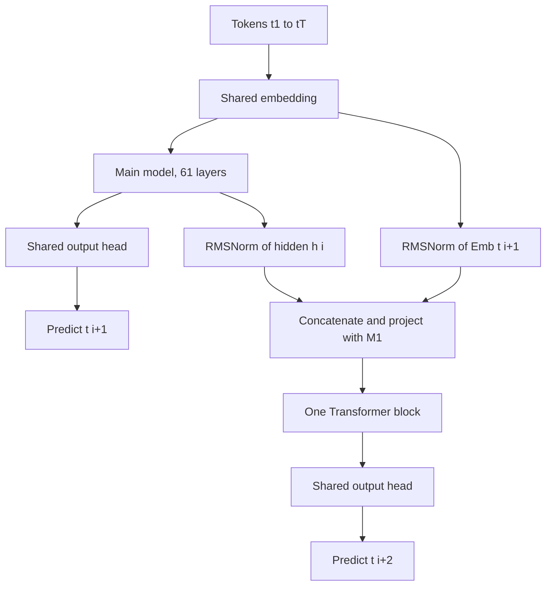

# Multi-Token Prediction

## Introduction

A standard LLM is trained on one question per position: given the tokens so far, what is the next one? Multi-token prediction (MTP) asks a few more: what are the next two, three or four tokens? The extra predictions are made by small additional heads or modules that sit on top of the main network.

This turns out to be useful twice. During training, the extra targets are an auxiliary loss that can make the model's internal representations better, especially for code and at large scale. During inference, the extra heads can draft future tokens that the main model then verifies, a form of speculative decoding that needs no separate draft model. DeepSeek-V3 (2024) made MTP part of a frontier model's recipe, and it has since appeared in MiMo-7B, GLM-4.5, Qwen3-Next and Qwen3.5, with Gemma 4 shipping separate MTP drafter checkpoints.

By the end of this page you will be able to:

- Write down the MTP objective for both the parallel-heads design (Gloeckle et al.) and the sequential-module design (DeepSeek-V3).
- Implement a DeepSeek-style MTP module and its loss in PyTorch.
- Use an MTP module for self-speculative decoding and prove that greedy output is unchanged.
- Compute the expected speedup from an acceptance rate, and explain why measured speedups are lower.
- Read the MTP fields in a config.json and enable MTP speculative decoding in vLLM and SGLang.

The page builds on [Speculative Decoding](../10-llm-inference/4-llm-speculative-decoding.mdx) and the GPT model from [Building a GPT from Scratch in PyTorch](../3-llm-transformer/5-llm-build-gpt-from-scratch.mdx).

## From Next-Token to Multi-Token Objectives

The next-token loss for a sequence $x_1, \dots, x_T$ is

$$
\mathcal{L}_1 = -\sum_{t} \log P_\theta(x_{t+1} \mid x_{1:t})
$$

A multi-token objective with $n$ future tokens adds terms for $x_{t+2}, \dots, x_{t+n}$:

$$
\mathcal{L}_n = -\sum_{t} \sum_{i=1}^{n} \log P_\theta(x_{t+i} \mid x_{1:t})
$$

The idea is old. Stern et al. ("Blockwise Parallel Decoding for Deep Autoregressive Models", 2018) trained extra heads to propose several tokens and verified them in parallel. ProphetNet (Qi et al., 2020) predicted future n-grams during sequence-to-sequence pretraining. Medusa (Cai et al., 2024) attached extra decoding heads to an already trained, frozen LLM and fine-tuned only them, purely for faster inference.

What changed in 2024 was evidence that MTP during pretraining helps the main model itself.

### Parallel Heads (Gloeckle et al., 2024)

Gloeckle et al. ("Better and Faster Large Language Models via Multi-token Prediction", Meta, 2024) use a shared Transformer trunk $f_s$ that produces a hidden state $z_t$ at every position, then $n$ independent output heads $f_{h_i}$, each one Transformer layer, followed by a shared unembedding $f_u$:

$$
P_\theta(x_{t+i} \mid x_{1:t}) = \mathrm{softmax}\!\left(f_u\!\left(f_{h_i}(z_t)\right)\right), \qquad z_t = f_s(x_{1:t})
$$

Head 1 is the ordinary next-token head. Heads 2 to $n$ predict further ahead from the same state $z_t$, without seeing the intermediate tokens. All heads are trained jointly.

A naive implementation materializes $n$ logit tensors of shape `(batch, seq_len, vocab)` at once, which is a lot of memory for a 100K-plus vocabulary. The paper instead runs the forward and backward pass of each head in turn after the trunk's forward pass, freeing each head's logits before the next and accumulating gradients at the trunk. Peak memory drops from $O(nV + d)$ to $O(V + d)$ with no runtime cost.

The main findings:

- **It helps at scale and hurts small models.** On MBPP, a 0.3B model with $n = 4$ scored 1.0 percent pass@1 versus 1.8 for next-token training; from about 1.3B the MTP models pulled ahead, and at 13B they solved 12 percent more HumanEval and 17 percent more MBPP problems than comparable next-token models.
- **$n = 4$ was best for code at 7B**, and $n = 8$ for byte-level models, where MBPP pass@1 rose from 19.3 to 32.3.
- **Inference is faster.** Using the extra heads for self-speculative decoding, the 4-token model ran 3.0 times faster on code and 2.7 times faster on text, and the 8-byte model 6.4 times faster.

## Sequential MTP Modules (DeepSeek-V3)

Parallel heads predict $x_{t+2}$ without knowing $x_{t+1}$. DeepSeek-V3 (DeepSeek-AI, 2024) keeps the causal chain instead. Its MTP module at depth $k$ takes two inputs at position $i$: the hidden state from the previous depth, $h_i^{k-1}$ (for $k = 1$, the main model's final hidden state), and the embedding of the token at position $i + k$, the token that the previous depth was supposed to predict:

$$
h_i'^{\,k} = M_k\left[\mathrm{RMSNorm}\!\left(h_i^{k-1}\right) ;\, \mathrm{RMSNorm}\!\left(\mathrm{Emb}(t_{i+k})\right)\right]
$$

Here $[\cdot\,;\cdot]$ is concatenation and $M_k \in \mathbb{R}^{d \times 2d}$ projects back to the model width. A full Transformer block $\mathrm{TRM}_k$ processes the sequence of $h_i'^{\,k}$ with causal attention, and the shared output head gives the prediction for the token $k + 1$ positions ahead:

$$
h_{1:T-k}^{k} = \mathrm{TRM}_k\!\left(h_{1:T-k}'^{\,k}\right), \qquad P_{i+k+1}^{k} = \mathrm{OutHead}\!\left(h_i^{k}\right)
$$

The embedding table and output head are shared with the main model. Each depth gets its own cross-entropy $\mathcal{L}_\mathrm{MTP}^k$, and the total MTP loss is averaged over $D$ depths and weighted:

$$
\mathcal{L}_\mathrm{MTP} = \frac{\lambda}{D}\sum_{k=1}^{D} \mathcal{L}_\mathrm{MTP}^{k}, \qquad \mathcal{L} = \mathcal{L}_\mathrm{main} + \mathcal{L}_\mathrm{MTP}
$$

DeepSeek-V3 uses $D = 1$, so the model learns to predict one token beyond the next. The weight was $\lambda = 0.3$ for the first 10T training tokens and $\lambda = 0.1$ for the remaining 4.8T. In ablations on a 15.7B and a 228.7B MoE, adding the MTP module improved most benchmarks, with the module discarded at inference so the comparison was at equal inference cost.



The config.json says how many modules there are. DeepSeek-V3 has `"num_hidden_layers": 61` and `"num_nextn_predict_layers": 1`; the MTP module's weights are stored as an extra layer in the checkpoint, which is why the Hugging Face release is 685B parameters: 671B main model plus 14B for the MTP module. MiMo-7B-Base and GLM-4.5-Air also have `"num_nextn_predict_layers": 1`, Qwen3.5 uses `"mtp_num_hidden_layers": 1`, and Kimi Linear sets `"num_nextn_predict_layers": 0`, showing the field exists in its config but MTP is not used.

| Design | Example | Sees intermediate tokens | Extra parameters | Main use |
| --- | --- | --- | --- | --- |
| Blockwise parallel heads | Stern et al., 2018 | No | Small heads | Faster decoding |
| Medusa heads | Medusa, 2024 | No | Small heads on a frozen model | Faster decoding, added after training |
| Parallel Transformer heads | Gloeckle et al., 2024 | No | $n - 1$ Transformer layers | Better pretraining, self-speculation |
| Sequential MTP modules | DeepSeek-V3, MiMo, GLM-4.5, Qwen3-Next | Yes, via embeddings | One block per depth | Better pretraining, self-speculation |
| Separate drafter checkpoints | Gemma 4 MTP drafters, 2026 | Yes | A small model reusing the target's embeddings and activations | Faster decoding |

## Why Predicting Further Ahead Can Help

Next-token training rewards the model for getting each token right in isolation. Most tokens in text are easy given the previous ones; a few are "choice points" where the continuation forks (which variable to return, which argument to make). Gloeckle et al. argue that multi-token losses implicitly put extra weight on those choice points, because a wrong choice there hurts several future predictions, not one. The model is pushed to encode in $z_t$ information about where the text is going, not just what comes next.

There is also a teacher-forcing argument. During training, the model always conditions on the true prefix; at inference it conditions on its own outputs. Predicting further ahead from the same state reduces reliance on the very last token being available.

These are explanations, not proofs, and the evidence is empirical: gains at larger scale, especially on code and reasoning benchmarks, and losses at small scale. Treat MTP as a pretraining choice to evaluate, not a guaranteed win.

## Self-Speculative Decoding with MTP

At inference, the MTP module can propose the token after next for free. The procedure with one module, using greedy decoding:

1. Run the main model on the sequence. Its last position gives the next token $a$ (this is exactly what plain greedy decoding would output).
2. Feed the main model's last hidden state and $\mathrm{Emb}(a)$ to the MTP module. It drafts $b$, a guess for the token after $a$.
3. On the next forward pass, append both $a$ and $b$. The main model's prediction at $a$'s position is the true token after $a$. If it equals $b$, accept $b$ and also take the main model's prediction at $b$'s position: two committed tokens plus a new token from one pass. Otherwise discard $b$ and keep the main model's token.

**Why the output is unchanged.** Every committed token is either the main model's own argmax at that position, or a draft that has just been checked to equal the main model's argmax at that position. By causal attention, the main model's prediction at a position depends only on the tokens before it, so appending a draft after it cannot change it. Hence the committed sequence is token for token identical to plain greedy decoding. For sampling, the same holds in distribution when you use the rejection rule from [Speculative Decoding](../10-llm-inference/4-llm-speculative-decoding.mdx).

**Expected speedup.** If the main model verifies $k$ drafted tokens left to right and each is accepted with probability $\alpha$, stopping at the first rejection, the expected number of tokens committed per forward pass is

$$
\mathbb{E}[\text{tokens per pass}] = 1 + \alpha + \alpha^2 + \dots + \alpha^k = \frac{1 - \alpha^{k+1}}{1 - \alpha}
$$

```python
# Expected tokens per forward pass when k draft tokens are verified left to right and each is
# accepted with probability alpha (acceptance stops at the first rejection).
def tokens_per_pass(alpha, k):
    return sum(alpha ** i for i in range(k + 1))       # 1 + alpha + ... + alpha^k

print("alpha   k=1    k=2    k=3")
for alpha in (0.5, 0.7, 0.85, 0.9):
    print(f"{alpha:<5}  " + "  ".join(f"{tokens_per_pass(alpha, k):.2f}" for k in (1, 2, 3)))
```

```text
alpha   k=1    k=2    k=3
0.5    1.50  1.75  1.88
0.7    1.70  2.19  2.53
0.85   1.85  2.57  3.19
0.9    1.90  2.71  3.44
```

DeepSeek reports that the second token predicted by its single MTP module is accepted 85 to 90 percent of the time across generation topics, which the formula turns into 1.85 to 1.90 tokens per pass. The measured end-to-end gain was 1.8 times the tokens per second. The gap comes from overheads: the verification pass processes two tokens instead of one, the MTP module itself runs once per pass, and rejected drafts waste a little work. The formula also assumes a constant $\alpha$; with several drafts, deeper drafts are usually accepted less often, so the $k = 2$ and $k = 3$ columns are optimistic.

## Implementing MTP in PyTorch

The experiment below trains two small character-level GPTs on the source code of a few Python standard-library modules, one with next-token prediction only and one with a DeepSeek-style MTP module ($D = 1$, $\lambda = 0.3$). It then uses the MTP model for self-speculative greedy decoding, checks that the output matches plain greedy decoding, and measures the acceptance rate. The corpus is built from `inspect.getsource`, so no download is needed. Training both models takes roughly 15 to 40 minutes on a laptop CPU; reduce `steps` for a quicker run.

```python
import inspect, json, collections, textwrap, time
import torch
import torch.nn as nn
import torch.nn.functional as F

torch.set_num_threads(2)
torch.manual_seed(0)

# Character-level corpus: the source code of a few standard-library modules (no download needed)
text = "".join(inspect.getsource(m) for m in (json, collections, textwrap))
chars = sorted(set(text))
stoi = {c: i for i, c in enumerate(chars)}
data = torch.tensor([stoi[c] for c in text])
split = int(0.9 * len(data))
train_data, val_data = data[:split], data[split:]
V, T, D = len(chars), 128, 128

def batch(src, bs=32):
    ix = torch.randint(len(src) - T - 2, (bs,))
    return torch.stack([src[i:i + T + 2] for i in ix])          # (bs, T+2): room for 2 future tokens

class Block(nn.Module):
    def __init__(self, d, n_head=4):
        super().__init__()
        self.n1, self.n2, self.h = nn.RMSNorm(d), nn.RMSNorm(d), n_head
        self.qkv, self.proj = nn.Linear(d, 3 * d), nn.Linear(d, d)
        self.mlp = nn.Sequential(nn.Linear(d, 4 * d), nn.GELU(), nn.Linear(4 * d, d))

    def forward(self, x):                                       # (B, T, d)
        B, L, d = x.shape
        q, k, v = self.qkv(self.n1(x)).view(B, L, 3, self.h, d // self.h).permute(2, 0, 3, 1, 4)
        a = F.scaled_dot_product_attention(q, k, v, is_causal=True)   # (B, h, T, d/h)
        x = x + self.proj(a.transpose(1, 2).reshape(B, L, d))
        return x + self.mlp(self.n2(x))

class MTPModule(nn.Module):
    """DeepSeek-V3 style: combine trunk state h_i with the embedding of token i+1, predict token i+2."""
    def __init__(self, d):
        super().__init__()
        self.norm_h, self.norm_e = nn.RMSNorm(d), nn.RMSNorm(d)
        self.M = nn.Linear(2 * d, d, bias=False)                # the projection M_k in the paper
        self.block, self.norm = Block(d), nn.RMSNorm(d)

    def forward(self, h, emb_next):                             # both (B, T', d)
        x = self.M(torch.cat([self.norm_h(h), self.norm_e(emb_next)], dim=-1))
        return self.norm(self.block(x))

class GPT(nn.Module):
    def __init__(self, mtp, layers=4):
        super().__init__()
        self.emb, self.pos = nn.Embedding(V, D), nn.Embedding(T + 2, D)
        self.blocks = nn.ModuleList(Block(D) for _ in range(layers))
        self.norm, self.head = nn.RMSNorm(D), nn.Linear(D, V, bias=False)  # head shared with MTP
        self.mtp = MTPModule(D) if mtp else None

    def trunk(self, idx):
        x = self.emb(idx) + self.pos(torch.arange(idx.shape[1]))
        for b in self.blocks:
            x = b(x)
        return x                                                # (B, L, D) hidden states h_i

    def losses(self, seq, lam=0.3):
        idx = seq[:, :T]                                        # inputs t_0 .. t_{T-1}
        h = self.trunk(idx)
        main = F.cross_entropy(self.head(self.norm(h)).transpose(1, 2), seq[:, 1:T + 1])
        if self.mtp is None:
            return main, main
        # depth 1: at position i, inputs are h_i and Emb(t_{i+1}); target is t_{i+2}
        g = self.mtp(h, self.emb(seq[:, 1:T + 1]) + self.pos(torch.arange(1, T + 1)))
        extra = F.cross_entropy(self.head(g).transpose(1, 2), seq[:, 2:T + 2])
        return main + lam * extra, main

def train(model, steps=2000):
    opt = torch.optim.AdamW(model.parameters(), lr=2e-3)
    for _ in range(steps):
        loss, _ = model.losses(batch(train_data))
        opt.zero_grad(); loss.backward(); opt.step()
    model.eval()
    with torch.no_grad():
        torch.manual_seed(123)
        return sum(model.losses(batch(val_data, 64))[1].item() for _ in range(10)) / 10

@torch.no_grad()
def greedy(model, prompt, n):
    seq = prompt.clone()
    for _ in range(n):
        h = model.trunk(seq[None, -T:])
        seq = torch.cat([seq, model.head(model.norm(h[0, -1:])).argmax(-1)])
    return seq

@torch.no_grad()
def self_speculative(model, prompt, n):
    """Greedy decoding where the MTP module drafts one extra token per forward pass."""
    seq, draft, passes, accepted, drafted = prompt.clone(), None, 0, 0, 0
    while len(seq) < len(prompt) + n:
        inp = seq if draft is None else torch.cat([seq, draft])
        h = model.trunk(inp[None, -T:])[0]                     # one forward pass of the main model
        logits = model.head(model.norm(h)).argmax(-1)           # greedy prediction at every position
        passes += 1
        pos = len(inp[-T:]) - 1 - (0 if draft is None else 1)  # position of the last committed token
        nxt = logits[pos:pos + 1]                               # verified next token
        if draft is not None:
            drafted += 1
            if nxt.item() == draft.item():                      # draft accepted: we get 2 tokens
                accepted += 1
                seq = torch.cat([seq, draft])
                pos, nxt = pos + 1, logits[pos + 1:pos + 2]
        seq = torch.cat([seq, nxt])
        # MTP drafts the token after `nxt` from h at `pos` and the embedding of `nxt`
        e = model.emb(nxt) + model.pos(torch.tensor([min(pos + 1, T + 1)]))
        draft = model.head(model.mtp(h[None, pos:pos + 1], e[None])[0]).argmax(-1)
    return seq[: len(prompt) + n], passes, accepted / max(drafted, 1)

results = {}
for use_mtp in (False, True):
    torch.manual_seed(0)
    model = GPT(mtp=use_mtp)
    t0 = time.time()
    results[use_mtp] = (model, train(model), time.time() - t0)
    print(f"{'next-token only' if not use_mtp else 'with MTP (lambda 0.3)':22s} "
          f"val loss of main head {results[use_mtp][1]:.3f}  ({results[use_mtp][2]:.0f}s)")

model = results[True][0]
prompt = torch.tensor([stoi[c] for c in "    def "])
ref = greedy(model, prompt, 112)
out, passes, acc = self_speculative(model, prompt, 112)
print(f"\nidentical to plain greedy decoding: {torch.equal(ref, out)}")
print(f"112 tokens in {passes} forward passes = {112 / passes:.2f} tokens/pass, acceptance rate {acc:.2f}")
print(repr("".join(chars[i] for i in out[:90].tolist())))
```

```text
next-token only        val loss of main head 2.659  (1119s)
with MTP (lambda 0.3)  val loss of main head 2.655  (1280s)

identical to plain greedy decoding: True
112 tokens in 73 forward passes = 1.53 tokens/pass, acceptance rate 0.54
'    def __reduce__(self):\n        return self.data.islower()\n\n    def isnumeric(self):\n   '
```

Read the result in three parts:

- **Quality.** The main head's validation loss is essentially the same with and without the MTP loss (2.655 vs 2.659). At 0.8M parameters (1.06M with the MTP module) that is the expected outcome; Gloeckle et al. saw gains only from about 1B parameters, and losses below that.
- **Correctness.** The self-speculative output is identical to plain greedy decoding, as the proof above requires.
- **Speed.** The MTP module's drafts were accepted 54 percent of the time, giving 1.53 tokens per forward pass, close to the $1 + \alpha = 1.54$ the formula predicts. A tiny character model guesses the character after next far less reliably than DeepSeek-V3 guesses the token after next (85 to 90 percent), but even this weak drafter removes about a third of the sequential passes. The generated text is a plausible mash-up of the `collections` source (`UserString` defines `isnumeric`, `__reduce__` appears elsewhere), which is what a model this small learns.

Points to check in the code against the equations:

- `MTPModule.forward` is $h'^{\,1}_i = M_1[\mathrm{RMSNorm}(h_i) ; \mathrm{RMSNorm}(\mathrm{Emb}(t_{i+1}))]$ followed by one Transformer block with causal attention.
- `self.head` is shared between the main model and the MTP module, as in DeepSeek-V3; the embedding table is shared too.
- The MTP target is shifted by two (`seq[:, 2:T + 2]`), the main target by one.
- Generation stays within the 128-token context so that both decoders see exactly the same positions; with a sliding window you would need to keep the window aligned for the equality check to hold.

## Serving MTP Models

Serving engines expose MTP as a speculative decoding method that needs no separate draft model. In vLLM:

```bash
vllm serve XiaomiMiMo/MiMo-7B-Base \
    --tensor-parallel-size 1 \
    --speculative-config '{"method": "mtp", "num_speculative_tokens": 1}'
```

The same dictionary goes into `LLM(..., speculative_config=...)` for offline use. The vLLM documentation suggests starting with `num_speculative_tokens` of 1, which matches a model trained with one MTP module; larger values reuse the module recursively, and acceptance drops for each extra step. SGLang's DeepSeek-V3 guide enables MTP through its EAGLE infrastructure with `--speculative-algorithm EAGLE` and the default settings `--speculative-num-steps 3 --speculative-eagle-topk 1 --speculative-num-draft-tokens 4`.

When does it pay off? Speculative decoding converts spare compute into fewer sequential steps, so it helps most at small batch sizes, where decoding is memory-bound. At high concurrency the GPU is already busy, verification work competes with other requests, and the gain shrinks or disappears. MoE models add a twist. Google's Gemma 4 MTP documentation warns that the drafter for the 26B A4B MoE model may not yield a speedup at batch size 1 on hardware without good parallelism: each drafted token may route to different experts, so verification loads extra expert weights, and only at larger batches do sequences share enough experts to amortize that. Benchmark on your own traffic.

:::tip
Long reasoning traces (see [Reasoning Models and Test-Time Compute](./3-llm-reasoning-models.mdx)) are where MTP speculation is most valuable: thousands of decode steps per request, usually at moderate batch sizes, and much of the text is predictable.
:::

## Common Mistakes

- Expecting MTP to help a small model's quality. Gloeckle et al. found MTP models worse than next-token baselines below roughly 1B parameters.
- Giving the MTP loss too much weight. DeepSeek-V3 used $\lambda = 0.3$ and then $0.1$; the main next-token loss must stay dominant.
- Materializing all heads' logits at once with a large vocabulary; compute heads sequentially or with chunked cross-entropy to keep memory flat.
- Feeding the MTP module the embedding of the wrong token. At position $i$ it needs $t_{i+1}$, the token the main head predicts, not $t_i$.
- Measuring speedup as tokens per forward pass. Report wall-clock tokens per second at a realistic batch size; verification and drafting have real costs.
- Setting `num_speculative_tokens` high for a model with one MTP module. Each extra recursive draft is less likely to be accepted.
- Dropping the MTP weights when converting or quantizing a checkpoint, then wondering why MTP speculation is unavailable. They are stored as an extra layer.

## Summary

- Multi-token prediction trains a model to predict several future tokens per position, through extra heads (Gloeckle et al.) or sequential modules (DeepSeek-V3).
- DeepSeek-V3's MTP module combines the main hidden state with the next token's embedding, runs one Transformer block and reuses the shared output head; it uses $D = 1$ and $\lambda = 0.3$ then $0.1$.
- As a training signal, MTP helps large models, especially on code, and hurts small ones.
- At inference, MTP modules draft tokens for self-speculative decoding; greedy output is provably unchanged, and DeepSeek-V3 reached 85 to 90 percent acceptance and 1.8 times the tokens per second.
- vLLM (`"method": "mtp"`) and SGLang support MTP speculation for models that ship MTP weights; the benefit is largest at small batch sizes.

## Further Reading

- [Blockwise Parallel Decoding for Deep Autoregressive Models (Stern et al., 2018)](https://arxiv.org/abs/1811.03115): the first propose-and-verify multi-token decoder.
- [ProphetNet (Qi et al., 2020)](https://arxiv.org/abs/2001.04063): future n-gram prediction in pretraining.
- [Medusa (Cai et al., 2024)](https://arxiv.org/abs/2401.10774): extra decoding heads on a frozen LLM.
- [EAGLE (Li et al., 2024)](https://arxiv.org/abs/2401.15077): feature-level drafting, the basis of SGLang's MTP path.
- [Better and Faster Large Language Models via Multi-token Prediction (Gloeckle et al., 2024)](https://arxiv.org/abs/2404.19737): parallel MTP heads in pretraining.
- [DeepSeek-V3 Technical Report (DeepSeek-AI, 2024)](https://arxiv.org/abs/2412.19437): sequential MTP modules, loss weights and acceptance rates.
- [MiMo: Unlocking the Reasoning Potential of Language Model (Xiaomi, 2025)](https://arxiv.org/abs/2505.07608): a 7B model trained with MTP.
- [vLLM: MTP speculative decoding](https://docs.vllm.ai/en/stable/features/speculative_decoding/mtp/): configuration and supported models.
- [SGLang: DeepSeek V3 usage](https://docs.sglang.io/basic_usage/deepseek_v3.html): MTP speculative decoding flags.
- [Gemma 4 multi-token prediction](https://ai.google.dev/gemma/docs/mtp/overview): Google's MTP drafter checkpoints and when they help.
