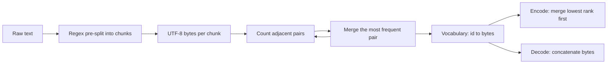

# Project: Build a Byte-Level BPE Tokenizer

## Introduction

Every LLM starts and ends with a tokenizer. Text goes in as a string, the tokenizer turns it into integer ids, the model predicts ids, and the tokenizer turns those back into text. If the tokenizer is wrong, nothing downstream can fix it: a model trained with one tokenizer is useless with another.

In this project you build a complete **byte-level byte-pair encoding (BPE)** tokenizer, the kind used by GPT-2, GPT-4, Llama 3 and most modern open models. It is about 130 lines of Python, and by the end it will:

- Train a vocabulary of any size from raw text, using the same regex pre-splitting as GPT-2.
- Encode any string, including emoji, Chinese and code, and decode it back byte for byte.
- Handle special tokens such as `<|endoftext|>`.
- Save to and load from a JSON file.
- Load the real GPT-2 vocabulary and produce **exactly** the same token ids as OpenAI's `tiktoken` library.

That last check is the point of the project. Matching a production tokenizer id for id proves you understood every detail, not just the idea.

The theory behind each step is in the tokenization section: [Tokenization Basics](../1-llm-tokenization/0-llm-tokenization-basics.mdx) explains why subwords, and [Byte-Pair Encoding from Scratch](../1-llm-tokenization/1-llm-bpe.mdx) derives the algorithm. This page is the hands-on build, so it moves faster on the "why" and spends its words on the code and on what the output tells you.

## What You Will Build

The project has one library file and four small scripts. All of them run on a CPU in seconds.

| File | What it does |
| --- | --- |
| `bpe.py` | The `ByteBPE` class: train, encode, decode, special tokens, save, load |
| `step1_train.py` | Train a 1,024-token vocabulary on Shakespeare and check the round trip |
| `fast_train.py` | A faster trainer that updates pair counts incrementally, plus a vocabulary-size sweep |
| `step3_parity.py` | Load GPT-2's real merges and compare against `tiktoken` |
| `step4_use.py` | Special tokens, reloading from disk, encoding speed |

Here is the data flow you are implementing. Training runs once and produces the vocabulary; encoding and decoding use it forever after.



## Setup

You need Python 3.10 or newer, the `regex` package (the standard `re` module does not support the `\p{L}` Unicode classes GPT-2 uses) and `tiktoken` for the final comparison.

```bash
python -m venv .venv && source .venv/bin/activate
pip install regex tiktoken
mkdir bpe-project && cd bpe-project
curl -LO https://raw.githubusercontent.com/karpathy/char-rnn/master/data/tinyshakespeare/input.txt
```

`input.txt` is the Tiny Shakespeare corpus: 1,115,394 characters of plays, a classic test set because it is small, public and has a recognizable style. We will train on the first 90% and measure compression on the last 10%.

## Step 1: Pre-Tokenization with the GPT-2 Regex

BPE could run on the whole text as one long byte string, but then merges would cross word boundaries: with enough data you would get tokens like `"e, and the"`. That wastes vocabulary on accidental phrases and makes tokens depend on their neighbors. GPT-2 (Radford et al., 2019) fixed this by first splitting text into **chunks** with a regular expression and running BPE inside each chunk only. Merges never cross a chunk boundary.

The pattern below is copied from `tiktoken`'s source (`r50k_pat_str`). It is a faster, equivalent rewrite of the pattern in the original GPT-2 release. Read it as a list of alternatives, tried left to right:

| Alternative | Matches | Example |
| --- | --- | --- |
| `'(?:[sdmt]\|ll\|ve\|re)` | English contractions | `'s`, `'ve` |
| ` ?\p{L}++` | an optional space plus a run of letters | ` world` |
| ` ?\p{N}++` | an optional space plus a run of digits | ` 2026` |
| ` ?[^\s\p{L}\p{N}]++` | an optional space plus punctuation | `...`, `):` |
| `\s++$` | trailing whitespace at the end | |
| `\s+(?!\S)` | whitespace not followed by a non-space | `\n\n ` |
| `\s` | any single remaining whitespace character | ` ` |

The leading space is attached to the word that follows it, so `" world"` and `"world"` are different tokens. That is why GPT-style tokenizers have one id for "the" at the start of a line and another for " the" in the middle of a sentence.

Let us see it split a line.

```python
import regex as re
from bpe import GPT2_SPLIT

text = "Hello world! It's 2026...  I've got 3 cats.\n\n  def f(x):"
print(re.findall(GPT2_SPLIT, text))
```

```text
['Hello', ' world', '!', ' It', "'s", ' 2026', '...', ' ', ' I', "'ve", ' got', ' 3', ' cats', '.', '\n\n ', ' def', ' f', '(', 'x', '):']
```

Notice two subtle cases. The double space before "I" becomes `' '` plus `' I'`: the `\s+(?!\S)` rule takes all whitespace except the last space, which is left to join the word. And `'\n\n '` keeps the two newlines with one space, leaving the second space for `' def'`. These rules matter for code, where indentation is long runs of spaces.

:::note
GPT-2's pattern treats each run of digits as one chunk, so `"2026"` can become a single token. Later tokenizers changed this. GPT-4's `cl100k_base` pattern splits digits into groups of at most three (`\p{N}{1,3}`), and Llama 3 adopted the same idea. See [Tokenization Pitfalls](../1-llm-tokenization/5-llm-tokenization-pitfalls.mdx) for why digit splitting affects arithmetic.
:::

## Step 2: The Byte-Level Base Vocabulary and Training

"Byte-level" means the starting alphabet is the 256 possible byte values, not characters. Every string is first encoded as UTF-8, so `"é"` is the two bytes `0xC3 0xA9` and an emoji is four bytes. The consequence is that **no input is ever out of vocabulary**: whatever the text, it is a sequence of bytes, and every byte has an id from 0 to 255.

Training then repeats one step. Count every adjacent pair of ids across the corpus, find the most frequent pair, give it a new id, and replace every occurrence. If we start with 256 ids and want a vocabulary of size $V$, we perform $V - 256$ merges. The merge created at step $i$ gets id $256 + i$.

Two details make training efficient even in a simple implementation:

1. We do not store the text as one sequence. We count how many times each **unique chunk** occurs and store each chunk once with its frequency. Shakespeare's 1 million characters split into about 267,000 chunks but only 14,134 distinct ones, so each merge touches 14,134 short tuples instead of a million bytes.
2. A pair's count is the sum, over chunks, of (occurrences in the chunk) times (chunk frequency).

Here is the first part of `bpe.py`: the regex, the two helpers, and the constructor.

```python
import json
import time
from collections import Counter

import regex as re

# GPT-2 split pattern, as written in tiktoken's openai_public.py (r50k_pat_str)
GPT2_SPLIT = r"""'(?:[sdmt]|ll|ve|re)| ?\p{L}++| ?\p{N}++| ?[^\s\p{L}\p{N}]++|\s++$|\s+(?!\S)|\s"""


def count_pairs(words):
    """words: dict tuple_of_ids -> frequency. Returns Counter of adjacent pairs."""
    pairs = Counter()
    for ids, freq in words.items():
        for a, b in zip(ids, ids[1:]):
            pairs[(a, b)] += freq
    return pairs


def merge_word(ids, pair, new_id):
    """Replace every non-overlapping occurrence of pair in ids by new_id."""
    out, i = [], 0
    while i < len(ids):
        if i + 1 < len(ids) and ids[i] == pair[0] and ids[i + 1] == pair[1]:
            out.append(new_id)
            i += 2
        else:
            out.append(ids[i])
            i += 1
    return tuple(out)


class ByteBPE:
    def __init__(self, pattern=GPT2_SPLIT):
        self.pattern = pattern
        self.split_re = re.compile(pattern)
        self.vocab = {i: bytes([i]) for i in range(256)}   # id -> bytes
        self.ranks = {bytes([i]): i for i in range(256)}   # bytes -> id (= rank)
        self.special = {}                                  # str -> id
        self.cache = {}
```

The class keeps two views of the same vocabulary. `vocab` maps an id to its bytes and is used for decoding. `ranks` maps bytes to an id and is used for encoding. In a BPE vocabulary the id doubles as the **rank**: a lower id means the merge was learned earlier, from a more frequent pair.

Next, the training method, still inside the class:

```python
    # ---------------- training ----------------
    def train(self, text, vocab_size, verbose=False):
        assert vocab_size >= 256
        chunks = Counter(self.split_re.findall(text))
        words = {tuple(c.encode("utf-8")): f for c, f in chunks.items()}
        for new_id in range(256, vocab_size):
            pairs = count_pairs(words)
            if not pairs:
                break
            # most frequent pair; ties broken by the smaller pair for determinism
            pair = max(pairs, key=lambda p: (pairs[p], -p[0], -p[1]))
            words = {merge_word(w, pair, new_id): f for w, f in words.items()}
            tok = self.vocab[pair[0]] + self.vocab[pair[1]]
            self.vocab[new_id] = tok
            self.ranks[tok] = new_id
            if verbose and (new_id < 266 or new_id % 128 == 0):
                print(f"merge {new_id - 255:4d}: {self.vocab[pair[0]]!r} + "
                      f"{self.vocab[pair[1]]!r} -> {tok!r} (count {pairs[pair]})")
        self.cache.clear()

    def add_special_tokens(self, tokens):
        for t in tokens:
            if t not in self.special:
                self.special[t] = len(self.vocab) + len(self.special)
```

The tie-break deserves a comment. When two pairs have the same count, Python's `max` would return whichever it saw first, which depends on dictionary order. The key `(count, -a, -b)` picks the numerically smallest pair instead, so training is reproducible across runs and machines.

### A Worked Example You Can Check by Hand

Before trusting the code on a million characters, run it on a corpus small enough to verify with a pencil. The words are `low` ×5, `lower` ×2, `newest` ×6 and `widest` ×3, separated by spaces.

```python
from bpe import ByteBPE

corpus = "low low low low low lower lower newest newest newest newest newest newest widest widest widest"
tok = ByteBPE()
tok.train(corpus, vocab_size=256 + 6, verbose=True)
for w in [" lowest", " newer", " wide"]:
    ids = tok.encode_ordinary(w)
    print(repr(w), ids, [tok.vocab[i] for i in ids])
```

```text
merge    1: b'e' + b's' -> b'es' (count 9)
merge    2: b'es' + b't' -> b'est' (count 9)
merge    3: b'l' + b'o' -> b'lo' (count 7)
merge    4: b'lo' + b'w' -> b'low' (count 7)
merge    5: b' ' + b'n' -> b' n' (count 6)
merge    6: b' ' + b'low' -> b' low' (count 6)
' lowest' [261, 257] [b' low', b'est']
' newer' [260, 101, 119, 101, 114] [b' n', b'e', b'w', b'e', b'r']
' wide' [32, 119, 105, 100, 101] [b' ', b'w', b'i', b'd', b'e']
```

Check the first merge. The pair `e s` appears once in each `newest` (6 times) and once in each `widest` (3 times): 9 in total. Nothing else reaches 9: `l o` appears in all 7 `low` and `lower` words. So `es` wins and becomes id 256, then `es` + `t` becomes `est` (id 257).

Merge 5 shows the tie-break and the pre-split at work. The very first `low` has no leading space (it starts the text), while the other 4 `low` and 2 `lower` chunks are ` low` and ` lower`. After merge 4, the pairs `(32, 110)` for `' n'` and `(32, 259)` for `' low'` both have count 6. The smaller pair, `(32, 110)`, wins.

The encode lines show generalization. The unseen word ` lowest` is built from two learned pieces. ` newer` reuses ` n` and falls back to single bytes for the rest. ` wide` never formed any merge, so it is five raw bytes. That fallback is what "byte-level" buys you.

## Step 3: Encoding and Decoding

To encode, split the text with the same regex, turn each chunk into bytes, and apply merges. But in which order? You must reproduce the order of training, or you get a different (usually longer) tokenization.

The rule used by `tiktoken`, which we copy exactly, is: among all adjacent pairs in the current chunk, merge the one whose **concatenated bytes have the lowest rank** in the vocabulary, leftmost first on a tie. Repeat until no adjacent pair forms a vocabulary entry. Because a lower rank means "learned earlier", this replays training's priorities.

```python
    # ---------------- encoding ----------------
    def _bpe(self, piece: bytes):
        """tiktoken-style merge: repeatedly merge the adjacent pair whose
        concatenation has the lowest rank, leftmost first."""
        parts = [bytes([b]) for b in piece]
        while len(parts) > 1:
            best, best_rank = None, None
            for i in range(len(parts) - 1):
                r = self.ranks.get(parts[i] + parts[i + 1])
                if r is not None and (best_rank is None or r < best_rank):
                    best, best_rank = i, r
            if best is None:
                break
            parts[best:best + 2] = [parts[best] + parts[best + 1]]
        return [self.ranks[p] for p in parts]

    def encode_ordinary(self, text):
        ids = []
        for chunk in self.split_re.findall(text):
            got = self.cache.get(chunk)
            if got is None:
                got = self._bpe(chunk.encode("utf-8"))
                self.cache[chunk] = got
            ids.extend(got)
        return ids
```

Each chunk of length $n$ bytes needs at most $n - 1$ merges and each merge scans the chunk, so `_bpe` is $O(n^2)$ per chunk. Chunks are short (a word), so this is fine. The `cache` dictionary makes it much faster on real text: common chunks like `" the"` are encoded once and reused. `tiktoken` does the same work in Rust and switches to a heap for long chunks, but the result is identical.

:::note
There is a subtle difference between "lowest rank of the concatenation" and "lowest rank of the pair". A token like `"abc"` might be reachable as `"ab" + "c"` or `"a" + "bc"`. Training created it from one specific pair, but the concatenation rule merges whichever split is present. For GPT-2's vocabulary this is the rule that matches `tiktoken`, and Step 6 proves it on real text.
:::

Decoding is the easy direction: look up each id's bytes, concatenate, then decode UTF-8.

```python
    def encode(self, text, allowed_special=()):
        allowed = [s for s in self.special if s in allowed_special]
        if not allowed:
            return self.encode_ordinary(text)
        special_re = "(" + "|".join(re.escape(s) for s in allowed) + ")"
        ids = []
        for part in re.split(special_re, text):
            if part in allowed:
                ids.append(self.special[part])
            elif part:
                ids.extend(self.encode_ordinary(part))
        return ids

    def decode(self, ids):
        inv_special = {i: s.encode("utf-8") for s, i in self.special.items()}
        data = b"".join(self.vocab[i] if i in self.vocab else inv_special[i] for i in ids)
        return data.decode("utf-8", errors="replace")
```

`errors="replace"` is not laziness. A single token can hold part of a multi-byte character (you will see GPT-2 do exactly that with Chinese below), so decoding an arbitrary slice of ids, for example while streaming tokens one at a time, can produce invalid UTF-8. A full sequence produced by `encode` always decodes cleanly.

## Step 4: Special Tokens and Saving

Special tokens are strings like `<|endoftext|>` that mark structure: document boundaries, chat roles, fill-in-the-middle markers. They get ids above the learned vocabulary and are **never** produced by BPE merges.

The `encode` method above only recognizes a special token when the caller passes it in `allowed_special`. Otherwise the string `"<|endoftext|>"` is tokenized as ordinary characters. This is a security feature copied from `tiktoken`: if user-supplied text could inject a real end-of-text or role token, a user could forge a system message. Your application decides which special tokens are allowed, the user's text never does.

Saving is straightforward. We store each token's bytes as hex, because raw bytes (like half of a UTF-8 character) are not valid JSON strings.

```python
    # ---------------- persistence ----------------
    def save(self, path):
        obj = {"pattern": self.pattern,
               "tokens": [self.vocab[i].hex() for i in range(len(self.vocab))],
               "special": self.special}
        with open(path, "w") as f:
            json.dump(obj, f)

    @classmethod
    def load(cls, path):
        with open(path) as f:
            obj = json.load(f)
        tok = cls(obj["pattern"])
        tok.vocab = {i: bytes.fromhex(h) for i, h in enumerate(obj["tokens"])}
        tok.ranks = {b: i for i, b in tok.vocab.items()}
        tok.special = obj["special"]
        return tok
```

GPT-2 itself took a different route: its `vocab.json` maps every byte to a printable Unicode character (so a space appears as `Ġ`) to keep the file human-readable. That mapping is purely cosmetic and changes nothing about the algorithm. Hex is simpler and unambiguous.

Those five snippets, in order, are the complete `bpe.py`.

## Step 5: Train on Shakespeare

Now train a 1,024-token vocabulary (768 merges) on 90% of Tiny Shakespeare and measure it on the held-out 10%.

```python
import time
from bpe import ByteBPE

text = open("input.txt", encoding="utf-8").read()
split = int(0.9 * len(text))
train_text, val_text = text[:split], text[split:]
print(f"train chars: {len(train_text):,}  val chars: {len(val_text):,}")

tok = ByteBPE()
t0 = time.time()
tok.train(train_text, vocab_size=1024, verbose=True)
print(f"trained 768 merges in {time.time() - t0:.1f} s")
tok.add_special_tokens(["<|endoftext|>"])
tok.save("shakespeare-1024.json")

ids = tok.encode_ordinary(val_text)
print(f"val: {len(val_text.encode()):,} bytes -> {len(ids):,} tokens, "
      f"{len(val_text.encode()) / len(ids):.2f} bytes/token")
assert tok.decode(ids) == val_text
print("round trip OK")
longest = sorted(tok.vocab.values(), key=len)[-5:]
print("longest tokens:", longest)
```

```text
train chars: 1,003,854  val chars: 111,540
merge    1: b' ' + b't' -> b' t' (count 21591)
merge    2: b'h' + b'e' -> b'he' (count 16418)
merge    3: b' ' + b'a' -> b' a' (count 12054)
merge    4: b'o' + b'u' -> b'ou' (count 11506)
merge    5: b' ' + b's' -> b' s' (count 10960)
merge    6: b' ' + b'm' -> b' m' (count 9581)
merge    7: b'i' + b'n' -> b'in' (count 9531)
merge    8: b' ' + b'w' -> b' w' (count 9469)
merge    9: b'r' + b'e' -> b're' (count 8863)
merge   10: b'h' + b'a' -> b'ha' (count 8723)
merge  129: b' w' + b'ill' -> b' will' (count 865)
merge  257: b' s' + b'he' -> b' she' (count 416)
merge  385: b'F' + b'irst' -> b'First' (count 249)
merge  513: b' ha' + b'st' -> b' hast' (count 179)
merge  641: b'The' + b'n' -> b'Then' (count 140)
trained 768 merges in 17.1 s
val: 111,540 bytes -> 49,420 tokens, 2.26 bytes/token
round trip OK
longest tokens: [b'SICINIUS', b'ORIOLANUS', b'GLOUCESTER', b' VINCENTIO', b'CORIOLANUS']
```

Read the output as a story about the corpus. The first merges are the most common English bigrams with a leading space (` t`, ` a`, ` s`) and inside words (`he`, `ou`, `in`). By merge 129 whole words like ` will` appear, and later merges capture Early Modern English (` hast`). The longest tokens are character names in capitals, because every line of dialogue in a play starts with the speaker's name: `CORIOLANUS` appears often enough to earn a single token. A tokenizer is a compressed summary of its training data, and that is why a tokenizer trained on English prose handles code or Thai badly.

The compression metric, **bytes per token**, tells you how much text each model step consumes. Raw bytes would be 1.00. Our 1,024 vocabulary reaches 2.26 on unseen text.

## Step 6: Make Training Fast

The simple trainer recounts every pair after every merge. That is fine for 768 merges, but its cost grows with vocabulary size times corpus size, and real tokenizers learn 50,000 to 200,000 merges. The fix is to notice that a merge only changes the chunks that contain the merged pair. If we keep an index from each pair to the chunks containing it, we can update counts locally.

```python
import time
from collections import Counter, defaultdict

from bpe import ByteBPE, merge_word


def train_fast(tok, text, vocab_size):
    """Same merges as ByteBPE.train, but only touches words that contain the pair."""
    chunks = Counter(tok.split_re.findall(text))
    words = [list(c.encode("utf-8")) for c in chunks]
    freqs = list(chunks.values())
    pairs = Counter()
    where = defaultdict(set)                      # pair -> indices of words containing it
    for wi, w in enumerate(words):
        for a, b in zip(w, w[1:]):
            pairs[(a, b)] += freqs[wi]
            where[(a, b)].add(wi)
    for new_id in range(256, vocab_size):
        if not pairs:
            break
        pair = max(pairs, key=lambda p: (pairs[p], -p[0], -p[1]))
        for wi in list(where[pair]):
            w, f = words[wi], freqs[wi]
            for a, b in zip(w, w[1:]):            # remove this word's old pairs
                pairs[(a, b)] -= f
                if pairs[(a, b)] == 0:
                    del pairs[(a, b)]
                where[(a, b)].discard(wi)
            w = list(merge_word(w, pair, new_id))
            words[wi] = w
            for a, b in zip(w, w[1:]):            # add its new pairs
                pairs[(a, b)] += f
                where[(a, b)].add(wi)
        tok_bytes = tok.vocab[pair[0]] + tok.vocab[pair[1]]
        tok.vocab[new_id] = tok_bytes
        tok.ranks[tok_bytes] = new_id
    tok.cache.clear()
    return tok


if __name__ == "__main__":
    text = open("input.txt", encoding="utf-8").read()
    train_text, val_text = text[: int(0.9 * len(text))], text[int(0.9 * len(text)):]
    t0 = time.time()
    fast = train_fast(ByteBPE(), train_text, 1024)
    print(f"fast trainer, 768 merges: {time.time() - t0:.1f} s")
    slow = ByteBPE.load("shakespeare-1024.json")
    print("identical vocab to the simple trainer:",
          all(fast.vocab[i] == slow.vocab[i] for i in range(1024)))
    n_bytes = len(val_text.encode())
    for V in [512, 1024, 2048, 4096, 8192]:
        t0 = time.time()
        t = train_fast(ByteBPE(), train_text, V)
        dt = time.time() - t0
        n = len(t.encode_ordinary(val_text))
        print(f"vocab {V:5d}: train {dt:5.1f} s, val {n:6,} tokens, {n_bytes / n:.2f} bytes/token")
```

```text
fast trainer, 768 merges: 0.8 s
identical vocab to the simple trainer: True
vocab   512: train   0.3 s, val 59,401 tokens, 1.88 bytes/token
vocab  1024: train   0.8 s, val 49,420 tokens, 2.26 bytes/token
vocab  2048: train   1.8 s, val 43,559 tokens, 2.56 bytes/token
vocab  4096: train   4.3 s, val 38,425 tokens, 2.90 bytes/token
vocab  8192: train   9.1 s, val 35,005 tokens, 3.19 bytes/token
```

The incremental trainer is about 20 times faster here (0.8 s against 17.1 s) and produces an identical vocabulary, which is the check that matters: an optimization that changes the merges is a bug. The remaining cost is the `max` over all pairs at each step. Production trainers such as Hugging Face `tokenizers` keep the pairs in a priority queue to remove that too.

The sweep shows **diminishing returns**. Each doubling of the vocabulary buys less compression: going from 512 to 1,024 saves 17% of the tokens, going from 4,096 to 8,192 saves 9%. Meanwhile the embedding matrix and output layer grow linearly with the vocabulary. This is the trade-off described in [Token Embeddings](../1-llm-tokenization/4-llm-embeddings.mdx): small models favor smaller vocabularies, large multilingual models can afford 128K to 256K tokens because the embedding table is a small fraction of their parameters.

## Step 7: Match tiktoken Exactly

Now the real test. `tiktoken` stores GPT-2's vocabulary as a dictionary from token bytes to rank, which is exactly our `ranks` table. We load it into a `ByteBPE`, add the one special token, and compare token ids on several difficult strings.

```python
import tiktoken
from bpe import ByteBPE

enc = tiktoken.get_encoding("gpt2")
gpt2 = ByteBPE()                                   # GPT-2 split pattern is the default
gpt2.ranks = dict(enc._mergeable_ranks)            # bytes -> rank, 50,256 entries
gpt2.vocab = {r: b for b, r in gpt2.ranks.items()}
gpt2.special = {"<|endoftext|>": 50256}
print("ordinary tokens:", len(gpt2.ranks))

text = open("input.txt", encoding="utf-8").read()
val_text = text[int(0.9 * len(text)):]
samples = [
    val_text,
    "Hello world! It's 2026, and GPT-2 can't count: 1234567 + 89 = ?",
    "def f(x):\n    return x**2  # tabs\tand   spaces\n\n",
    "Unicode: naïve café, 東京タワー, emoji \U0001F916\U0001F680, Ελληνικά",
    "Two docs<|endoftext|>joined by a special token",
]
for s in samples:
    ours = gpt2.encode(s, allowed_special={"<|endoftext|>"})
    ref = enc.encode(s, allowed_special={"<|endoftext|>"})
    assert ours == ref, (s[:40], ours[:20], ref[:20])
    assert gpt2.decode(ours) == s
print(f"all {len(samples)} samples match tiktoken exactly")
ids = gpt2.encode(samples[3])
print(len(samples[3].encode()), "bytes ->", len(ids), "tokens")
print([gpt2.vocab[i] for i in ids[:12]])
n = len(enc.encode_ordinary(val_text))
print(f"GPT-2 on Shakespeare val: {n:,} tokens, {len(val_text.encode()) / n:.2f} bytes/token")
```

```text
ordinary tokens: 50256
all 5 samples match tiktoken exactly
72 bytes -> 35 tokens
[b'Un', b'ic', b'ode', b':', b' na\xc3\xafve', b' caf\xc3\xa9', b',', b' \xe6', b'\x9d', b'\xb1', b'\xe4\xba', b'\xac']
GPT-2 on Shakespeare val: 36,059 tokens, 3.09 bytes/token
```

Every id matches, on 111,540 characters of Shakespeare, on code with tabs and runs of spaces, on four scripts and emoji, and across a special token. Your 130 lines of Python are a faithful GPT-2 tokenizer. `_mergeable_ranks` is a private attribute of `tiktoken`, so treat this as a test harness, not production code.

The token list exposes GPT-2's weakness on non-Latin text. `東` is three UTF-8 bytes, `E6 9D B1`, and GPT-2 splits it across three tokens, `b' \xe6'`, `b'\x9d'` and `b'\xb1'`, none of which is valid UTF-8 on its own. GPT-2's training data was mostly English, so few Chinese byte sequences earned merges. This is why later tokenizers trained on multilingual data have much larger vocabularies.

The last line is a fair comparison of our tokenizers. GPT-2's general-purpose 50K vocabulary gets 3.09 bytes per token on Shakespeare. Our Shakespeare-specific vocabulary reaches 2.90 with only 4,096 tokens and 3.19 with 8,192: a domain-specific tokenizer beats a general one six times larger, on its own domain.

## Step 8: Use It

Finally, load the saved tokenizer from disk, use a special token, and measure encoding speed.

```python
import time
from bpe import ByteBPE

tok = ByteBPE.load("shakespeare-1024.json")
print("vocab size incl. special:", len(tok.vocab) + len(tok.special))
s = "ROMEO:\nWhat light through yonder window breaks?<|endoftext|>JULIET:\nAy me!"
ids = tok.encode(s, allowed_special={"<|endoftext|>"})
print(ids)
print([tok.decode([i]) for i in ids])
print("special as text:", tok.encode("<|endoftext|>")[:8], "...")
assert tok.decode(ids) == s

text = open("input.txt", encoding="utf-8").read()
tok.cache.clear()
t0 = time.time()
ids = tok.encode_ordinary(text)
dt = time.time() - t0
print(f"encoded {len(text.encode()) / 1e6:.2f} MB into {len(ids):,} tokens in {dt:.2f} s")
```

```text
vocab size incl. special: 1025
[813, 58, 10, 467, 357, 350, 284, 114, 764, 282, 500, 272, 263, 508, 299, 754, 572, 115, 63, 1024, 951, 58, 10, 872, 320, 33]
['ROMEO', ':', '\n', 'What', ' li', 'ght', ' th', 'r', 'ough', ' y', 'ond', 'er', ' w', 'ind', 'ow', ' bre', 'ak', 's', '?', '<|endoftext|>', 'JULIET', ':', '\n', 'Ay', ' me', '!']
special as text: [60, 124, 458, 111, 102, 116, 101, 120] ...
encoded 1.12 MB into 460,578 tokens in 0.14 s
```

`ROMEO` and `JULIET` are single tokens (speaker names again), and the special token got id 1024, one past the learned vocabulary. When it is not allowed, the same string is just ordinary characters `<`, `|` and so on. Encoding the whole corpus takes 0.14 s thanks to the chunk cache: Shakespeare reuses the same few thousand chunks over and over.

## Extensions to Try

- **GPT-4 pattern.** Swap in the `cl100k_base` pattern from `tiktoken`'s source and compare compression on code and numbers.
- **Train on code.** Train on a folder of Python files and look at which indentation and keyword tokens appear first.
- **Plug it into a model.** Use your 1,024-token vocabulary instead of characters in [Project: Train a Small GPT on Your Laptop](./1-llm-project-char-gpt.mdx). Remember that loss per token is then not comparable to loss per character; compare bits per byte instead.
- **Priority queue.** Replace the `max` over pairs with a heap and lazy deletion, as production trainers do.

## Common Mistakes

- **Using `re` instead of `regex`.** The standard library does not understand `\p{L}` or possessive quantifiers like `++`, so the GPT-2 pattern fails or silently behaves differently.
- **Letting merges cross chunk boundaries.** Running BPE on the raw text without pre-splitting creates phrase tokens and will never match a real tokenizer.
- **Non-deterministic tie-breaking.** Picking "any" most frequent pair makes two training runs disagree. Always break ties with a fixed rule.
- **Applying merges in the wrong order when encoding.** Merging left to right, or by frequency in the current text, gives different tokens from training. Merge by lowest rank.
- **Allowing special tokens in user text.** Encoding untrusted input with special tokens enabled lets users inject document or role boundaries.
- **Decoding single tokens strictly.** One token can be half a UTF-8 character; decode with `errors="replace"` or buffer bytes until they form complete characters when streaming.
- **Comparing losses across tokenizers.** A model with a bigger vocabulary has fewer, harder tokens. Normalize to bits per byte before comparing.

## Summary

- A byte-level BPE tokenizer starts from 256 byte ids, so any text can be encoded; training adds one merged token per step by joining the most frequent adjacent pair.
- GPT-2 style tokenizers pre-split text with a regex so merges stay inside words, numbers, punctuation and whitespace runs, and attach the leading space to the word.
- Counting unique chunks with frequencies, and updating pair counts only for affected chunks, makes training fast and gives identical merges.
- Encoding repeatedly merges the adjacent pair whose concatenation has the lowest rank; with GPT-2's ranks this reproduces `tiktoken` id for id.
- Special tokens live outside the merge vocabulary and must be explicitly allowed when encoding.
- Bigger vocabularies compress better with diminishing returns, and a tokenizer reflects its training data: names in Shakespeare, poor coverage of Chinese in GPT-2.

## Further Reading

- [Neural Machine Translation of Rare Words with Subword Units (Sennrich et al., 2016)](https://arxiv.org/abs/1508.07909): the paper that brought BPE to NLP.
- [Language Models are Unsupervised Multitask Learners (Radford et al., 2019)](https://cdn.openai.com/better-language-models/language_models_are_unsupervised_multitask_learners.pdf): the GPT-2 paper, section 2.2 describes byte-level BPE.
- [tiktoken on GitHub](https://github.com/openai/tiktoken): OpenAI's fast BPE tokenizer; `tiktoken_ext/openai_public.py` holds the split patterns.
- [minbpe by Andrej Karpathy](https://github.com/karpathy/minbpe): a minimal, readable BPE implementation with a GPT-4 parity wrapper.
- [Hugging Face LLM Course: Byte-Pair Encoding tokenization](https://huggingface.co/learn/llm-course/chapter6/5): a walkthrough of BPE training with the `tokenizers` library.
- [Hugging Face Tokenizers documentation](https://huggingface.co/docs/tokenizers): the production Rust implementation used by most open models.
