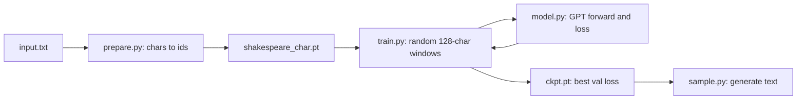

# Project: Train a Small GPT on Your Laptop

## Introduction

Reading about Transformers is one thing; watching one go from random noise to passable Shakespeare on your own machine is another. In this project you train a complete GPT from scratch on a CPU. No GPU, no cloud account, no pretrained weights: about 250 lines of PyTorch in four files.

The model is small (2.7 million parameters, roughly 1/3000 of an 8B model) but it is not a toy architecture. It uses the same building blocks as Llama, Qwen and Mistral:

- **RMSNorm** in a **pre-norm** residual stream,
- **rotary position embeddings** (RoPE) instead of learned positions,
- a **SwiGLU** feed-forward layer with the 8/3 hidden ratio,
- **tied** input and output embeddings,
- PyTorch's fused `scaled_dot_product_attention` with a causal mask,
- **AdamW** with weight decay on matrices only, **warmup plus cosine** learning-rate decay and **gradient clipping**.

By the end you will be able to read a training log and know what each number means, recognize overfitting, sample text with temperature and top-k, and change one design choice at a time to see its effect.

This page assumes you have read [Building a GPT from Scratch in PyTorch](../3-llm-transformer/5-llm-build-gpt-from-scratch.mdx), which derives the architecture. Here we focus on putting it together and running it end to end. If PyTorch itself is new, start with the [PyTorch tutorial](/docs/library/pytorch).

## What You Will Build

| File | What it does |
| --- | --- |
| `prepare.py` | Downloads nothing; turns `input.txt` into character ids and a train/validation split |
| `model.py` | The GPT: RMSNorm, RoPE, attention, SwiGLU, blocks, generation |
| `train.py` | The training loop with evaluation, learning-rate schedule and checkpointing |
| `sample.py` | Loads the best checkpoint and writes new text |



Setup is two commands:

```bash
pip install torch numpy
curl -LO https://raw.githubusercontent.com/karpathy/char-rnn/master/data/tinyshakespeare/input.txt
```

## Step 1: Prepare the Data

We model **characters**, not BPE tokens. With only 65 distinct characters the embedding table is tiny and you can read the model's mistakes directly. (Using the tokenizer from [Project: Build a Byte-Level BPE Tokenizer](./0-llm-project-tokenizer.mdx) is a good extension.)

```python
import torch

text = open("input.txt", encoding="utf-8").read()
chars = sorted(set(text))
stoi = {c: i for i, c in enumerate(chars)}
data = torch.tensor([stoi[c] for c in text], dtype=torch.uint8)   # 65 symbols fit in a byte
n = int(0.9 * len(data))
torch.save({"chars": chars, "train": data[:n], "val": data[n:]}, "shakespeare_char.pt")
print(f"{len(text):,} characters, vocab {len(chars)}: {''.join(chars)!r}")
print(f"train {n:,} tokens, val {len(data) - n:,} tokens")
```

```text
1,115,394 characters, vocab 65: "\n !$&',-.3:;?ABCDEFGHIJKLMNOPQRSTUVWXYZabcdefghijklmnopqrstuvwxyz"
train 1,003,854 tokens, val 111,540 tokens
```

The vocabulary is newline, space, 11 punctuation marks, the digit 3 and the 52 letters. Every id fits in a byte, so the whole corpus is a 1.1 MB `uint8` tensor. We split by position, not randomly: the last 10% of the file is the validation set, so the model is tested on scenes it has never seen, not on lines interleaved with training lines.

## Step 2: The Model

Here is `model.py` in full. Read it top to bottom once; the sections below explain the parts that matter most.

```python
import math
from dataclasses import dataclass

import torch
import torch.nn as nn
import torch.nn.functional as F


@dataclass
class GPTConfig:
    vocab_size: int = 65
    block_size: int = 256      # longest context seen in training
    n_layer: int = 6
    n_head: int = 6
    n_embd: int = 192
    dropout: float = 0.1
    rope_theta: float = 10000.0


class RMSNorm(nn.Module):
    def __init__(self, dim, eps=1e-6):
        super().__init__()
        self.eps = eps
        self.weight = nn.Parameter(torch.ones(dim))

    def forward(self, x):
        return self.weight * x * torch.rsqrt(x.pow(2).mean(-1, keepdim=True) + self.eps)


def apply_rope(x, cos, sin):
    # x: (B, n_head, T, head_dim); cos/sin: (T, head_dim)
    x1, x2 = x.chunk(2, dim=-1)
    rotated = torch.cat([-x2, x1], dim=-1)              # "rotate_half"
    return x * cos + rotated * sin


class Attention(nn.Module):
    def __init__(self, cfg):
        super().__init__()
        self.n_head, self.head_dim = cfg.n_head, cfg.n_embd // cfg.n_head
        self.qkv = nn.Linear(cfg.n_embd, 3 * cfg.n_embd, bias=False)
        self.proj = nn.Linear(cfg.n_embd, cfg.n_embd, bias=False)
        self.dropout = cfg.dropout

    def forward(self, x, cos, sin):
        B, T, C = x.shape
        q, k, v = self.qkv(x).split(C, dim=-1)          # each (B, T, C)
        q, k, v = (t.view(B, T, self.n_head, self.head_dim).transpose(1, 2) for t in (q, k, v))
        q, k = apply_rope(q, cos, sin), apply_rope(k, cos, sin)   # (B, nh, T, hd)
        y = F.scaled_dot_product_attention(
            q, k, v, is_causal=True, dropout_p=self.dropout if self.training else 0.0)
        y = y.transpose(1, 2).contiguous().view(B, T, C)
        return self.proj(y)


class SwiGLU(nn.Module):
    def __init__(self, cfg):
        super().__init__()
        hidden = int(8 * cfg.n_embd / 3)
        hidden = 64 * math.ceil(hidden / 64)            # round up to a multiple of 64
        self.gate = nn.Linear(cfg.n_embd, hidden, bias=False)
        self.up = nn.Linear(cfg.n_embd, hidden, bias=False)
        self.down = nn.Linear(hidden, cfg.n_embd, bias=False)

    def forward(self, x):
        return self.down(F.silu(self.gate(x)) * self.up(x))


class Block(nn.Module):
    def __init__(self, cfg):
        super().__init__()
        self.norm1, self.attn = RMSNorm(cfg.n_embd), Attention(cfg)
        self.norm2, self.mlp = RMSNorm(cfg.n_embd), SwiGLU(cfg)
        self.drop = nn.Dropout(cfg.dropout)

    def forward(self, x, cos, sin):
        x = x + self.drop(self.attn(self.norm1(x), cos, sin))
        x = x + self.drop(self.mlp(self.norm2(x)))
        return x


class GPT(nn.Module):
    def __init__(self, cfg):
        super().__init__()
        self.cfg = cfg
        self.tok_emb = nn.Embedding(cfg.vocab_size, cfg.n_embd)
        self.drop = nn.Dropout(cfg.dropout)
        self.blocks = nn.ModuleList(Block(cfg) for _ in range(cfg.n_layer))
        self.norm = RMSNorm(cfg.n_embd)
        self.lm_head = nn.Linear(cfg.n_embd, cfg.vocab_size, bias=False)
        self.lm_head.weight = self.tok_emb.weight       # weight tying
        self.apply(self._init)
        for name, p in self.named_parameters():         # scale residual projections
            if name.endswith("proj.weight") or name.endswith("down.weight"):
                nn.init.normal_(p, std=0.02 / math.sqrt(2 * cfg.n_layer))
        self.set_rope(cfg.rope_theta, cfg.block_size)

    @staticmethod
    def _init(m):
        if isinstance(m, (nn.Linear, nn.Embedding)):
            nn.init.normal_(m.weight, std=0.02)

    def set_rope(self, theta, max_len, positions_scale=1.0):
        """Build the cos/sin cache. positions_scale < 1 compresses positions (PI)."""
        hd = self.cfg.n_embd // self.cfg.n_head
        inv_freq = 1.0 / theta ** (torch.arange(0, hd, 2).float() / hd)
        self.set_inv_freq(inv_freq * positions_scale, max_len)

    def set_inv_freq(self, inv_freq, max_len):
        angles = torch.outer(torch.arange(max_len).float(), inv_freq)
        emb = torch.cat([angles, angles], dim=-1)
        self.register_buffer("cos", emb.cos(), persistent=False)
        self.register_buffer("sin", emb.sin(), persistent=False)

    def forward(self, idx, targets=None):
        B, T = idx.shape                                  # (B, T)
        assert T <= self.cos.shape[0], "sequence longer than the RoPE cache"
        cos, sin = self.cos[:T], self.sin[:T]
        x = self.drop(self.tok_emb(idx))                  # (B, T, C)
        for block in self.blocks:
            x = block(x, cos, sin)
        logits = self.lm_head(self.norm(x))               # (B, T, vocab)
        if targets is None:
            return logits, None
        loss = F.cross_entropy(logits.view(-1, logits.size(-1)), targets.view(-1))
        return logits, loss

    @torch.no_grad()
    def generate(self, idx, max_new_tokens, temperature=0.8, top_k=None):
        for _ in range(max_new_tokens):
            idx_cond = idx[:, -self.cfg.block_size:]
            logits, _ = self(idx_cond)
            logits = logits[:, -1, :] / temperature       # (B, vocab)
            if top_k is not None:
                kth = torch.topk(logits, top_k).values[:, -1, None]
                logits = logits.masked_fill(logits < kth, float("-inf"))
            probs = F.softmax(logits, dim=-1)
            idx = torch.cat([idx, torch.multinomial(probs, 1)], dim=1)
        return idx
```

### Where the Parameters Are

Our configuration is 6 layers, 6 heads, width $d = 192$ (head size 32), a context of 128 characters and the vocabulary of 65. It is worth counting the parameters by hand once, because the same arithmetic scales to real models (see [Counting Parameters, FLOPs and Memory](../3-llm-transformer/6-llm-parameter-and-flop-counting.mdx)).

| Component | Formula | Count |
| --- | --- | --- |
| Token embedding (shared with the output head) | $65 \times 192$ | 12,480 |
| Attention `qkv` per layer | $192 \times 576$ | 110,592 |
| Attention `proj` per layer | $192 \times 192$ | 36,864 |
| SwiGLU `gate` and `up` per layer | $2 \times 192 \times 512$ | 196,608 |
| SwiGLU `down` per layer | $512 \times 192$ | 98,304 |
| Two RMSNorm weights per layer | $2 \times 192$ | 384 |
| One layer | sum of the five rows above | 442,752 |
| Six layers plus final norm | $6 \times 442{,}752 + 192$ | 2,656,704 |
| Total | plus the embedding | 2,669,184 |

The SwiGLU hidden size is $\tfrac{8}{3} \cdot 192 = 512$, already a multiple of 64. Three matrices of size $d \times \tfrac{8}{3}d$ have the same parameter count as the classic two matrices of size $d \times 4d$, which is why Llama-style models use the 8/3 ratio ([Feed-Forward Networks, GELU and SwiGLU](../3-llm-transformer/4-llm-feed-forward-and-swiglu.mdx)). There are no biases anywhere, also following Llama. Weight tying saves a second $65 \times 192$ matrix; in a model with a 128K vocabulary the same trick saves hundreds of millions of parameters, which is why small models tie and large ones often do not.

### RoPE in Twelve Lines

`set_inv_freq` precomputes, for every position $m$ and every frequency $\omega_i = \theta^{-2i/d_h}$ (with $\theta = 10{,}000$ and head size $d_h = 32$), the angle $m \omega_i$, and stores its cosine and sine. `apply_rope` then rotates each query and key vector: with the vector split into halves $x = (x_1, x_2)$,

$$
\mathrm{RoPE}(x, m) = x \odot \cos(m\omega) + (-x_2, x_1) \odot \sin(m\omega)
$$

This is the "half-split" layout used by Hugging Face Llama models, explained with the interleaved alternative in [Implementing RoPE in PyTorch](../4-llm-positional-encoding/4-llm-rope-implementation.mdx). The rotation is applied after splitting heads and before attention, so the dot product $q_m \cdot k_n$ depends only on $m - n$. Because the cos/sin table is a buffer we can rebuild, the next project, [Measure RoPE Theta and Context Extension](./2-llm-project-rope-scaling.mdx), reuses this exact model to experiment with $\theta$ and context length.

### Initialization

Every matrix starts from $\mathcal{N}(0, 0.02^2)$, as in GPT-2. The two projections that write into the residual stream (`proj` and `down`) are scaled down by a further $1/\sqrt{2L}$ for $L$ layers. Each layer adds two such contributions to the residual stream; without the scaling, the variance of the stream grows with depth at initialization. Our initial loss is a good check that initialization is sane: a model that knows nothing should assign probability $1/65$ to every character, which is a loss of $\ln 65 = 4.174$. We will see 4.24, close to that.

## Step 3: The Training Loop

```python
import math
import time

import torch

from model import GPT, GPTConfig

torch.manual_seed(1337)
torch.set_num_threads(8)

# ---------------- hyperparameters ----------------
batch_size, block_size = 32, 128
max_steps, warmup_steps = 2000, 100
max_lr, min_lr = 2e-3, 2e-4
eval_every, eval_batches = 250, 40
cfg = GPTConfig(vocab_size=65, block_size=block_size, n_layer=6, n_head=6,
                n_embd=192, dropout=0.1)

d = torch.load("shakespeare_char.pt")
train_data, val_data = d["train"].long(), d["val"].long()


def get_batch(split):
    data = train_data if split == "train" else val_data
    ix = torch.randint(len(data) - block_size - 1, (batch_size,))
    x = torch.stack([data[i:i + block_size] for i in ix])          # (B, T)
    y = torch.stack([data[i + 1:i + 1 + block_size] for i in ix])  # (B, T), shifted by one
    return x, y


@torch.no_grad()
def estimate_loss(model):
    model.eval()
    out = {}
    for split in ("train", "val"):
        losses = torch.tensor([model(*get_batch(split))[1].item() for _ in range(eval_batches)])
        out[split] = losses.mean().item()
    model.train()
    return out


def lr_at(step):
    if step < warmup_steps:
        return max_lr * (step + 1) / warmup_steps
    progress = (step - warmup_steps) / (max_steps - warmup_steps)
    return min_lr + 0.5 * (max_lr - min_lr) * (1 + math.cos(math.pi * progress))


model = GPT(cfg)
print(f"parameters: {sum(p.numel() for p in model.parameters()):,}")
decay = [p for p in model.parameters() if p.dim() >= 2]
no_decay = [p for p in model.parameters() if p.dim() < 2]
opt = torch.optim.AdamW([{"params": decay, "weight_decay": 0.1},
                         {"params": no_decay, "weight_decay": 0.0}],
                        lr=max_lr, betas=(0.9, 0.99))

t0 = time.time()
best_val = float("inf")
for step in range(max_steps + 1):
    if step % eval_every == 0:
        losses = estimate_loss(model)
        print(f"step {step:5d} | train {losses['train']:.3f} | val {losses['val']:.3f} "
              f"| lr {lr_at(step):.2e} | {time.time() - t0:6.0f} s", flush=True)
        if losses["val"] < best_val:
            best_val = losses["val"]
            torch.save({"model": model.state_dict(), "cfg": cfg.__dict__, "step": step},
                       "ckpt.pt")
    if step == max_steps:
        break
    for g in opt.param_groups:
        g["lr"] = lr_at(step)
    x, y = get_batch("train")
    _, loss = model(x, y)
    opt.zero_grad(set_to_none=True)
    loss.backward()
    torch.nn.utils.clip_grad_norm_(model.parameters(), 1.0)
    opt.step()
print(f"best val loss {best_val:.3f}, total {time.time() - t0:.0f} s")
```

Some choices in this loop deserve explanation.

**Random windows.** Each batch takes 32 random 128-character windows from the training text. The target `y` is the same window shifted by one, so one forward pass yields 128 next-character predictions per window: position $t$ predicts character $t+1$ from characters $0..t$. That is 4,096 training signals per step from 32 sequences, the main reason Transformers train efficiently ([The Training Objective, Loss Curves and Data Loading](../6-llm-pretraining/1-llm-training-objective.mdx)).

**The learning-rate schedule.** The rate rises linearly for 100 steps, then follows a cosine from the peak $\eta_{\max} = 2 \times 10^{-3}$ to $\eta_{\min} = 2 \times 10^{-4}$:

$$
\eta(t) = \eta_{\min} + \tfrac{1}{2}(\eta_{\max} - \eta_{\min})\left(1 + \cos\!\left(\pi \, \frac{t - t_w}{T - t_w}\right)\right)
$$

Warmup matters because Adam's second-moment estimate is unreliable for the first few steps; large updates then can push the model into a bad region it never recovers from. Small models tolerate high peak rates like $2 \times 10^{-3}$; billion-parameter models use $10^{-4}$ to $3 \times 10^{-4}$ ([Optimizers, Learning Rate Schedules and Training Stability](../6-llm-pretraining/3-llm-optimizers-and-schedules.mdx)).

**Weight decay groups.** Weight decay pulls weights toward zero. It is applied to matrices (2D tensors) and not to the RMSNorm gains, whose natural value is 1. `betas=(0.9, 0.99)` makes the second moment react faster than the default 0.999, a common choice for small models with few steps.

**Gradient clipping.** If the global gradient norm exceeds 1.0 it is scaled down to 1.0. This costs nothing and stops one unlucky batch from wrecking training.

**Evaluation.** Every 250 steps we average the loss over 40 random batches of each split with dropout off (`model.eval()`), and save a checkpoint only when validation loss improves. A single batch's loss is too noisy to compare runs.

## Step 4: Run It

```bash
python prepare.py
python train.py
```

The full log of our run on a CPU (PyTorch 2.14, 8 threads):

```text
parameters: 2,669,184
step     0 | train 4.241 | val 4.238 | lr 2.00e-05 |      9 s
step   250 | train 1.689 | val 1.853 | lr 1.97e-03 |    235 s
step   500 | train 1.507 | val 1.689 | lr 1.81e-03 |    505 s
step   750 | train 1.426 | val 1.615 | lr 1.53e-03 |    756 s
step  1000 | train 1.348 | val 1.549 | lr 1.17e-03 |    962 s
step  1250 | train 1.313 | val 1.531 | lr 8.08e-04 |   1103 s
step  1500 | train 1.271 | val 1.503 | lr 4.90e-04 |   1238 s
step  1750 | train 1.244 | val 1.481 | lr 2.76e-04 |   1372 s
step  2000 | train 1.235 | val 1.492 | lr 2.00e-04 |   1507 s
best val loss 1.481, total 1507 s
```

:::note
This run took 1,507 seconds (25 minutes) on a 32-core desktop CPU that was also running other jobs. An earlier run of the same script on the same machine under much heavier load took 9,556 seconds and printed exactly the same losses: with a fixed seed and thread count the results are reproducible, only the time changes. Time the first 50 steps on your computer to estimate the total, and reduce `n_layer` to 4 and `n_embd` to 128 if it is too slow: that model has 0.86M parameters and steps about twice as fast.
:::

## Step 5: Read the Loss Curve

Each line tells you something specific.

- **Step 0, loss 4.24.** Close to $\ln 65 = 4.17$, the loss of a uniform guess. If your initial loss is much larger, your initialization is too large or the logits are not what you think.
- **Step 250, val 1.85.** The model has learned character frequencies, common words and line structure. A loss of 1.85 nats per character means a perplexity of $e^{1.85} \approx 6.4$: the model is as uncertain as choosing among about six characters.
- **Steps 500 to 1,750, val 1.69 down to 1.48.** Steady improvement as the learning rate decays. The perplexity at the best checkpoint is $e^{1.481} \approx 4.4$.
- **The gap.** At step 1,750 train loss is 1.244 and validation 1.481. The gap grows through training. Tiny Shakespeare is only 1 million characters, and a 2.7M-parameter model can start to memorize it. Dropout 0.1 and weight decay slow this down but do not stop it.
- **Step 2,000, val 1.492.** Validation loss went **up** slightly while training loss went down: the start of overfitting. This is why the loop saves the best checkpoint instead of the last one, and the checkpoint we sample from is from step 1,750.

For reference, Karpathy's nanoGPT reports a best validation loss of 1.4697 on the same data with a larger model trained for about 3 minutes on an A100 GPU (6 layers, width 384, context 256, 5,000 steps; about 10.6M parameters with our architecture). Our model is four times smaller, sees half the context and trains for 2,000 steps, and still gets close, which partly reflects the modern components.

To convert to the metric used for comparing tokenizers, bits per character: $1.481 / \ln 2 = 2.14$ bits per character.

## Step 6: Generate Text

```python
import sys

import torch

from model import GPT, GPTConfig

torch.manual_seed(42)
ckpt = torch.load(sys.argv[1] if len(sys.argv) > 1 else "ckpt.pt")
d = torch.load("shakespeare_char.pt")
chars = d["chars"]
stoi = {c: i for i, c in enumerate(chars)}

model = GPT(GPTConfig(**ckpt["cfg"]))
model.load_state_dict(ckpt["model"])
model.eval()
print(f"checkpoint from step {ckpt['step']}")

prompt = "ROMEO:\n"
idx = torch.tensor([[stoi[c] for c in prompt]])
out = model.generate(idx, max_new_tokens=400, temperature=0.8, top_k=40)
print("".join(chars[i] for i in out[0].tolist()))
```

```text
checkpoint from step 1750
ROMEO:
Thy lords and me with thee; and tell me alone.
Good Marcius, to consider his trice was too prophecy,
A man, having and their boys' sword.
What have he are been stay of quarrel,
Untitude excepting one upon thy brother hath
Than painted himself lies a happy hell against
A sudden spreak to smooth: but the noble lord,
But stands and strength beloved pity:
And now there ere that should pursue me.

GLOU

[exited with code 0]
```

The model has learned a lot from nothing but next-character prediction: the play format (a speaker name in capitals, a colon, a line break), line lengths and capitalization of verse, punctuation, mostly real English words, and even character names from the corpus (Marcius, from *Coriolanus*, and the start of GLOUCESTER). What it has not learned is meaning: the sentences are grammatical fragments that go nowhere. That is the expected result for a 2.7M-parameter model with a 128-character window; it cannot see further back than about two lines.

Two sampling knobs shape the output, as explained in [Decoding Strategies](../10-llm-inference/1-llm-decoding-strategies.mdx). `temperature=0.8` sharpens the distribution slightly (logits divided by 0.8). `top_k=40` removes all but the 40 most likely characters at each step, which, with a 65-character vocabulary, mainly cuts off rare, nonsensical choices. Try `temperature=0.3` for repetitive but very clean text and `1.2` for creative misspellings.

The `generate` method here recomputes the whole window at every step. That is fine for 400 characters; [Project: A Minimal Inference Engine](./4-llm-project-inference-engine.mdx) shows how a KV cache removes the repeated work.

## Experiments to Try

Change one thing at a time, rerun, and compare the best validation loss. Because of random batches, differences smaller than about 0.02 are noise.

- **Remove RoPE** by making `apply_rope` return `x` unchanged. The model becomes blind to order apart from the causal mask, and loss gets worse ([Why Transformers Need Positional Information](../4-llm-positional-encoding/0-llm-why-position-matters.mdx)).
- **Swap SwiGLU for a GELU MLP** with hidden size $4d$ (same parameter count).
- **Swap RMSNorm for `nn.LayerNorm`**, or move the norms after the residual addition (post-norm) and watch training become less stable at high learning rates.
- **Longer context**: `block_size=256`. Each step costs more, but the model can use more history.
- **Turn off weight tying** and compare parameter count and loss.
- **Add `torch.compile(model)`** after creating the model and measure whether it speeds up training on your machine.

## Common Mistakes

- **Forgetting to shift the targets.** If `y` equals `x`, the model learns to copy its input and the loss drops to almost zero; it then generates garbage.
- **No causal mask.** Without `is_causal=True`, each position can read the character it is supposed to predict. Training loss collapses, generation fails.
- **Evaluating in training mode.** Dropout makes validation loss look worse and noisy. Call `model.eval()` for evaluation and `model.train()` afterwards.
- **Judging progress by one batch.** Single-batch losses fluctuate by 0.1 or more. Average over many batches.
- **Sampling from the last checkpoint.** Once validation loss rises, the last checkpoint is worse than the best one.
- **Weight decay on norm gains.** Decaying RMSNorm weights toward zero fights against their natural value of one.
- **Comparing character-level and token-level losses.** Convert both to bits per byte (or per character) before comparing.

## Summary

- A 2.7M-parameter GPT with RMSNorm, RoPE, SwiGLU and tied embeddings trains on a CPU and reaches a validation loss of 1.481 nats per character (perplexity 4.4) on Tiny Shakespeare in 2,000 steps.
- The initial loss should be close to $\ln V$; for 65 characters that is 4.17, and we saw 4.24.
- Warmup plus cosine decay, AdamW with decay on matrices only, gradient clipping and best-checkpoint saving are the standard training recipe at every scale.
- The growing gap between training and validation loss, and the final uptick in validation loss, are overfitting on a 1M-character corpus.
- Samples show that next-character prediction alone learns format, spelling and names, while meaning needs far more data and parameters.

## Further Reading

- [Attention Is All You Need (Vaswani et al., 2017)](https://arxiv.org/abs/1706.03762): the Transformer.
- [Language Models are Unsupervised Multitask Learners (Radford et al., 2019)](https://cdn.openai.com/better-language-models/language_models_are_unsupervised_multitask_learners.pdf): GPT-2, including the residual-projection initialization.
- [RoFormer: Enhanced Transformer with Rotary Position Embedding (Su et al., 2021)](https://arxiv.org/abs/2104.09864): RoPE.
- [GLU Variants Improve Transformer (Shazeer, 2020)](https://arxiv.org/abs/2002.05202): SwiGLU.
- [Root Mean Square Layer Normalization (Zhang and Sennrich, 2019)](https://arxiv.org/abs/1910.07467): RMSNorm.
- [nanoGPT by Andrej Karpathy](https://github.com/karpathy/nanoGPT): the reference minimal GPT training code, with a Shakespeare character config.
- [PyTorch scaled_dot_product_attention](https://docs.pytorch.org/docs/stable/generated/torch.nn.functional.scaled_dot_product_attention.html): the fused attention call used in the model.
