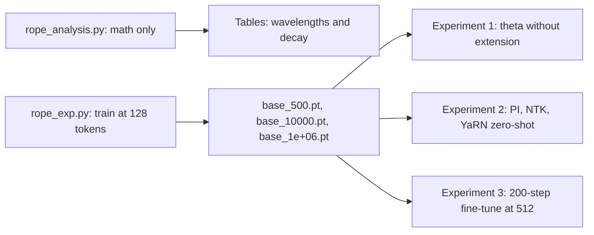

# Project: Measure RoPE Theta and Context Extension Experimentally

## Introduction

The RoPE pages make several claims: that the base frequency $\theta$ decides which dimensions "see" long distances, that a model trained on $L$ tokens degrades beyond $L$, that Position Interpolation needs fine-tuning while NTK-aware scaling works without it, and that YaRN combines the best of both. Claims like these are easy to repeat and hard to feel. In this project you measure them.

The project has two halves.

1. **Analysis without training.** Compute RoPE wavelengths, count how many dimension pairs complete a full rotation inside a context window, and measure the long-term decay of attention scores, for $\theta$ = 10,000, 500,000 and 1,000,000, the values in Llama 2, Llama 3 and Qwen.
2. **Experiments with training.** Train three tiny character-level GPTs at a context of 128 tokens with different $\theta$, then evaluate them at 256, 512 and 1,024 tokens with no extension, Position Interpolation, NTK-aware scaling and YaRN, both zero-shot and after a short fine-tune.

Everything runs on a CPU. The theory is in [Rotary Position Embedding (RoPE) Explained](../4-llm-positional-encoding/3-llm-rope.mdx), [RoPE Theta](../4-llm-positional-encoding/5-llm-rope-theta.mdx) and [Extending Context](../4-llm-positional-encoding/6-llm-context-extension.mdx); this page assumes you have skimmed them and focuses on what the numbers show.

:::warning
These are small models (0.86M parameters) trained for a few minutes on 1 MB of Shakespeare. Their behavior illustrates the mechanisms, and the directions agree with the papers, but the magnitudes do not transfer to 8B models trained on trillions of tokens. Treat every table here as a lab measurement on a toy, not as a benchmark.
:::

## What You Will Build

| File | What it does |
| --- | --- |
| `model.py` | The GPT from [Project: Train a Small GPT on Your Laptop](./1-llm-project-char-gpt.mdx), unchanged |
| `shakespeare_char.pt` | The character data made by that project's `prepare.py` |
| `rope_analysis.py` | Wavelengths, full turns per context, long-term decay |
| `rope_exp.py` | RoPE variants (PI, NTK, YaRN), training and per-position evaluation |
| `yarn_ramp.py` | Per-dimension frequency factors of each method |
| `extend_eval.py` | The three experiments |



## Part 1: What Theta Does, Without Training

### The Formulas

RoPE splits a head of dimension $d$ into $d/2$ pairs. Pair $i$ is rotated by angle $m\,\omega_i$ at position $m$, with frequency and wavelength

$$
\omega_i = \theta^{-2i/d}, \qquad \lambda_i = \frac{2\pi}{\omega_i} = 2\pi\,\theta^{2i/d}, \qquad i = 0, \dots, \tfrac{d}{2} - 1
$$

The wavelength $\lambda_i$ is the number of positions after which pair $i$ has turned a full circle. Pair 0 always has $\lambda_0 = 2\pi \approx 6.3$ positions, whatever $\theta$ is. The last pair has $\lambda \approx 2\pi\theta$. So $\theta$ sets the **longest** wavelength, and with it how slowly the slowest dimensions rotate.

For long-term decay, take a query and a key that are both all-ones vectors. Their RoPE score at distance $n$ is a sum of cosines, one per pair:

$$
\frac{q^\top R_n k}{q^\top k} = \frac{2}{d} \sum_{i=0}^{d/2-1} \cos(n\,\omega_i)
$$

At $n = 0$ this is 1. As $n$ grows, fast pairs average out to zero and only slow pairs still contribute, so the score drifts down. This is the "long-term decay" property claimed in the RoFormer paper (Su et al., 2021).

### The Measurements

```python
import math

import torch

torch.set_printoptions(precision=3, sci_mode=False)
head_dim = 128

print("wavelength (positions per full turn) of dimension pair i, head_dim 128")
print(f"{'theta':>10s} {'i=0':>6s} {'i=16':>8s} {'i=32':>9s} {'i=48':>11s} {'i=63':>12s}")
for theta in (10_000, 500_000, 1_000_000):
    inv_freq = 1.0 / theta ** (torch.arange(0, head_dim, 2).double() / head_dim)
    lam = 2 * math.pi / inv_freq
    print(f"{theta:>10,d} " + " ".join(f"{lam[i].item():>{w},.0f}"
                                       for i, w in zip((0, 16, 32, 48, 63), (6, 8, 9, 11, 12))))

print("\npairs (of 64) that complete at least one full turn inside the context")
print(f"{'theta':>10s} " + "".join(f"{L:>9,d}" for L in (4096, 8192, 131072)))
for theta in (10_000, 500_000, 1_000_000):
    inv_freq = 1.0 / theta ** (torch.arange(0, head_dim, 2).double() / head_dim)
    lam = 2 * math.pi / inv_freq
    print(f"{theta:>10,d} " + "".join(f"{int((lam <= L).sum()):>9d}" for L in (4096, 8192, 131072)))

print("\nlong-term decay: q = k = all ones, normalized score q.R(d)k / q.k at distance d")
dists = [0, 10, 100, 1_000, 10_000, 100_000]
print(f"{'theta':>10s} " + "".join(f"{d:>9,d}" for d in dists))
for theta in (10_000, 500_000, 1_000_000):
    inv_freq = 1.0 / theta ** (torch.arange(0, head_dim, 2).double() / head_dim)
    vals = [torch.cos(d * inv_freq).mean().item() for d in dists]   # each pair contributes 2cos
    print(f"{theta:>10,d} " + "".join(f"{v:>9.3f}" for v in vals))
```

```text
wavelength (positions per full turn) of dimension pair i, head_dim 128
     theta    i=0     i=16      i=32        i=48         i=63
    10,000      6       63       628       6,283       54,410
   500,000      6      167     4,443     118,143    2,559,196
 1,000,000      6      199     6,283     198,692    5,063,256

pairs (of 64) that complete at least one full turn inside the context
     theta     4,096    8,192  131,072
    10,000        46       50       64
   500,000        32       35       49
 1,000,000        31       34       47

long-term decay: q = k = all ones, normalized score q.R(d)k / q.k at distance d
     theta         0       10      100    1,000   10,000  100,000
    10,000     1.000    0.669    0.477    0.159   -0.028    0.056
   500,000     1.000    0.764    0.611    0.492    0.187    0.001
 1,000,000     1.000    0.775    0.586    0.491    0.312    0.036
```

Three things stand out.

**Raising theta stretches the slow end, not the fast end.** All three bases have the same 6-position wavelength at pair 0. At pair 48, $\theta = 10{,}000$ has a wavelength of 6,283 positions while $\theta = 1{,}000{,}000$ has 198,692. Raising $\theta$ is like adding slower hands to a clock: the second hand is unchanged, but the hour hand now takes days to go round.

**Full turns per context.** With $\theta = 10{,}000$ and an 8K context, 50 of the 64 pairs complete at least one full turn, and at 131K all 64 do. With $\theta = 500{,}000$ (Llama 3), only 35 pairs turn fully in 8K and 49 in 131K: 15 pairs still have not completed a rotation at 131K tokens, so every position in such a window has a distinct angle in those pairs. That is one argument for large bases in long-context models: positions far apart are never confused by wrap-around in the slow dimensions.

**Decay.** With $\theta = 10{,}000$ the normalized score falls to 0.159 at distance 1,000 and to about zero by 10,000. With $\theta = 1{,}000{,}000$ it is still 0.49 at 1,000 and 0.31 at 10,000. A small base therefore biases attention towards nearby tokens more strongly, which suits short contexts and hurts long ones.

These are the real values in shipped models. From their `config.json` files:

| Model | `rope_theta` | `max_position_embeddings` | `rope_scaling` |
| --- | --- | --- | --- |
| Llama 2 7B | 10,000 | 4,096 | none |
| Code Llama 7B | 1,000,000 | 16,384 | none |
| Llama 3 8B | 500,000 | 8,192 | none |
| Llama 3.1 8B | 500,000 | 131,072 | `llama3`, factor 8, original 8,192 |
| Qwen2.5 7B Instruct | 1,000,000 | 32,768 | none |
| Qwen3 8B | 1,000,000 | 40,960 | none |
| Qwen2.5 7B Instruct 1M | 10,000,000 | 1,010,000 | none |

The trend is unmistakable: as contexts grew from 4K to a million tokens, the base grew from 10,000 to 10,000,000.

## Part 2: The Experimental Setup

### RoPE Variants in Code

`rope_exp.py` holds everything: the extension methods, training, and an evaluation that returns the loss per block of positions.

```python
import argparse
import math
import time

import torch

from model import GPT, GPTConfig

DEV = "cuda" if torch.cuda.is_available() else "cpu"
torch.set_num_threads(4)
TRAIN_LEN = 128
d = torch.load("shakespeare_char.pt")
train_data, val_data = d["train"].long(), d["val"].long()


# ---------------------------------------------------------------- RoPE variants
def base_inv_freq(theta, head_dim):
    return 1.0 / theta ** (torch.arange(0, head_dim, 2).float() / head_dim)   # (head_dim/2,)


def scaled_inv_freq(method, theta, head_dim, s, train_len=TRAIN_LEN, alpha=1.0, beta=32.0):
    """Return (inv_freq, mscale) for a context-extension method with scale s = L'/L."""
    inv = base_inv_freq(theta, head_dim)
    if method == "none" or s <= 1:
        return inv, 1.0
    if method == "pi":                          # Chen et al. 2023: positions m -> m / s
        return inv / s, 1.0
    if method == "ntk":                         # NTK-aware: raise the base instead
        return base_inv_freq(theta * s ** (head_dim / (head_dim - 2)), head_dim), 1.0
    if method == "yarn":                        # Peng et al. 2023: NTK-by-parts + temperature
        wavelength = 2 * math.pi / inv
        r = train_len / wavelength              # full turns inside the training context
        gamma = ((r - alpha) / (beta - alpha)).clamp(0, 1)
        inv = (1 - gamma) * inv / s + gamma * inv   # interpolate low freqs, keep high freqs
        return inv, 0.1 * math.log(s) + 1.0
    raise ValueError(method)


def set_rope(model, inv_freq, max_len, mscale=1.0):
    """Rebuild the cos/sin cache. mscale multiplies q and k, i.e. divides the softmax
    temperature by mscale**2, which is how YaRN's attention scaling is applied."""
    angles = torch.outer(torch.arange(max_len).float(), inv_freq)
    emb = torch.cat([angles, angles], dim=-1)
    model.register_buffer("cos", (emb.cos() * mscale).to(DEV), persistent=False)
    model.register_buffer("sin", (emb.sin() * mscale).to(DEV), persistent=False)


# ---------------------------------------------------------------- train / eval
def batch(data, length, bs, gen=None):
    ix = torch.randint(len(data) - length - 1, (bs,), generator=gen)
    x = torch.stack([data[i:i + length] for i in ix])
    y = torch.stack([data[i + 1:i + 1 + length] for i in ix])
    return x.to(DEV), y.to(DEV)


def train(model, steps, length, lr, bs=32, log_every=0):
    opt = torch.optim.AdamW(model.parameters(), lr=lr, betas=(0.9, 0.99), weight_decay=0.1)
    warm = max(1, steps // 20)
    model.train()
    for step in range(steps):
        cur = lr * min(1.0, (step + 1) / warm) * 0.5 * (1 + math.cos(math.pi * step / steps))
        for g in opt.param_groups:
            g["lr"] = cur
        x, y = batch(train_data, length, bs)
        _, loss = model(x, y)
        opt.zero_grad(set_to_none=True)
        loss.backward()
        torch.nn.utils.clip_grad_norm_(model.parameters(), 1.0)
        opt.step()
        if log_every and step % log_every == 0:
            print(f"  step {step:5d} loss {loss.item():.3f}", flush=True)
    model.eval()


@torch.no_grad()
def loss_by_position(model, length, n_seq=64, bucket=128):
    """Mean val loss for each block of `bucket` positions, plus the overall mean."""
    gen = torch.Generator().manual_seed(0)                 # same text for every method
    losses = []
    for _ in range(n_seq // 16):
        x, y = batch(val_data, length, 16, gen)
        logits, _ = model(x)
        ce = torch.nn.functional.cross_entropy(logits.transpose(1, 2), y, reduction="none")
        losses.append(ce)                                  # (16, length)
    per_pos = torch.cat(losses).mean(0)                    # (length,)
    return per_pos.mean().item(), per_pos.view(-1, bucket).mean(1).tolist()


def new_model(theta):
    torch.manual_seed(1337)
    cfg = GPTConfig(vocab_size=65, block_size=TRAIN_LEN, n_layer=4, n_head=4,
                    n_embd=128, dropout=0.0, rope_theta=theta)
    return GPT(cfg).to(DEV)


if __name__ == "__main__":
    ap = argparse.ArgumentParser()
    ap.add_argument("--theta", type=float, default=10000.0)
    ap.add_argument("--steps", type=int, default=3000)
    ap.add_argument("--out", default="base.pt")
    a = ap.parse_args()
    model = new_model(a.theta)
    set_rope(model, base_inv_freq(a.theta, 32), TRAIN_LEN)
    t0 = time.time()
    train(model, a.steps, TRAIN_LEN, lr=2e-3, log_every=500)
    print(f"theta={a.theta:g}: trained {a.steps} steps at length {TRAIN_LEN} "
          f"in {time.time() - t0:.0f} s on {DEV}")
    torch.save(model.state_dict(), a.out)
```

`scaled_inv_freq` implements the three methods for a scale factor $s = L'/L$ (target length over trained length):

- **Position Interpolation** (Chen et al., 2023) maps position $m$ to $m/s$, equivalent to dividing every frequency by $s$. Every angle stays inside the range seen in training, but neighboring tokens are now $1/s$ of a step apart in every dimension.
- **NTK-aware scaling** (bloc97, 2023, formalized in the YaRN paper) changes the base instead: $\theta' = \theta \cdot s^{d/(d-2)}$. The exponent is chosen so that the slowest pair is slowed by exactly $s$ (like PI) while the fastest pair is untouched.
- **YaRN** (Peng et al., 2023) uses "NTK-by-parts": for each pair, compute $r_i = L/\lambda_i$, the number of full turns in the training window. Pairs with $r_i > \beta$ keep their frequency, pairs with $r_i < \alpha$ are interpolated like PI, and a linear ramp $\gamma$ blends in between: $\omega_i' = (1 - \gamma_i)\,\omega_i/s + \gamma_i\,\omega_i$. It also scales attention logits by a temperature, $\sqrt{1/t} = 0.1 \ln s + 1$; we multiply both $\cos$ and $\sin$ by that factor, which multiplies $q$ and $k$ by it and the logits by its square. The paper recommends $\alpha = 1$ and $\beta = 32$ for Llama models; we use those values as given.

`set_rope` rebuilds the model's cos/sin buffers, so a trained model can be evaluated under any scheme without retraining.

### What Each Method Does to Each Dimension

Before training anything, print the factor by which each method multiplies each pair's frequency for our model (head size 32, $\theta = 10{,}000$, trained at 128, extended 4x to 512):

```python
import math

import torch

from rope_exp import base_inv_freq, scaled_inv_freq

theta, head_dim, s = 10000.0, 32, 4.0
inv = base_inv_freq(theta, head_dim)
lam = 2 * math.pi / inv
r = 128 / lam                                        # turns inside the 128-token training window
gamma = ((r - 1) / (32 - 1)).clamp(0, 1)             # YaRN ramp with alpha=1, beta=32
ntk, _ = scaled_inv_freq("ntk", theta, head_dim, s)
yarn, mscale = scaled_inv_freq("yarn", theta, head_dim, s)
print(f"s={s}: NTK base = {theta * s ** (head_dim / (head_dim - 2)):,.0f}, YaRN mscale = {mscale:.4f}")
print(" i  wavelength  turns_in_128  gamma   PI_factor  NTK_factor  YaRN_factor")
for i in range(0, head_dim // 2):
    print(f"{i:2d} {lam[i].item():11.1f} {r[i].item():13.2f} {gamma[i].item():6.2f} "
          f"{0.25:10.3f} {(ntk[i] / inv[i]).item():11.3f} {(yarn[i] / inv[i]).item():12.3f}")
```

```text
s=4.0: NTK base = 43,873, YaRN mscale = 1.1386
 i  wavelength  turns_in_128  gamma   PI_factor  NTK_factor  YaRN_factor
 0         6.3         20.37   0.62      0.250       1.000        0.719
 1        11.2         11.46   0.34      0.250       0.912        0.503
 2        19.9          6.44   0.18      0.250       0.831        0.382
 3        35.3          3.62   0.08      0.250       0.758        0.313
 4        62.8          2.04   0.03      0.250       0.691        0.275
 5       111.7          1.15   0.00      0.250       0.630        0.254
 6       198.7          0.64   0.00      0.250       0.574        0.250
 7       353.3          0.36   0.00      0.250       0.524        0.250
 8       628.3          0.20   0.00      0.250       0.477        0.250
 9      1117.3          0.11   0.00      0.250       0.435        0.250
10      1986.9          0.06   0.00      0.250       0.397        0.250
11      3533.3          0.04   0.00      0.250       0.362        0.250
12      6283.2          0.02   0.00      0.250       0.330        0.250
13     11173.3          0.01   0.00      0.250       0.301        0.250
14     19869.2          0.01   0.00      0.250       0.274        0.250
15     35332.9          0.00   0.00      0.250       0.250        0.250
```

PI divides every frequency by 4. NTK leaves pair 0 alone (factor 1.000), slows pair 15 by exactly 4, and moves smoothly in between. YaRN's ramp is the surprise. With $\beta = 32$ and only 128 training positions, no pair completes 32 turns (the fastest completes 20.4), so **no pair keeps its original frequency** and pairs 5 to 15 are fully interpolated. The recommended $\alpha, \beta$ were tuned for Llama's 2K to 4K training windows, where many pairs turn hundreds of times. Keep that in mind when you read Experiment 2.

### Training the Three Models

Each model is the GPT from the previous project scaled down to 4 layers, 4 heads (head size 32) and width 128: 0.86M parameters. It is trained for 3,000 steps of batch 32 on 128-character windows, without dropout, with the same seed for every $\theta$ so that only the base differs.

```bash
python rope_exp.py --theta 10000 --out base_10000.pt
python rope_exp.py --theta 500 --out base_500.pt
python rope_exp.py --theta 1000000 --out base_1e+06.pt
```

The log for $\theta = 10{,}000$, then the three timing lines (the three runs were trained in parallel on a 32-core CPU, 4 threads each):

```text
  step     0 loss 4.238
  step   500 loss 1.505
  step  1000 loss 1.381
  step  1500 loss 1.243
  step  2000 loss 1.279
  step  2500 loss 1.245
theta=10000: trained 3000 steps at length 128 in 662 s on cpu
theta=1e+06: trained 3000 steps at length 128 in 681 s on cpu
theta=500: trained 3000 steps at length 128 in 684 s on cpu
```

## Experiment 1: Theta and Lengths Beyond Training

`extend_eval.py` runs the three experiments. Its evaluation always uses the same 64 validation windows (a fixed generator seed), so every number in a column is measured on the same text.

```python
import copy
import sys

import torch

import rope_exp as R

HEAD_DIM = 32
LENGTHS = [128, 256, 512, 1024]


def load(theta):
    model = R.new_model(theta)
    model.load_state_dict(torch.load(f"base_{theta:g}.pt"))
    return model.eval()


def evaluate(model, theta, method, length):
    s = length / R.TRAIN_LEN
    inv, mscale = R.scaled_inv_freq(method, theta, HEAD_DIM, s)
    R.set_rope(model, inv, length, mscale)
    return R.loss_by_position(model, length)


if __name__ == "__main__":
    part = sys.argv[1] if len(sys.argv) > 1 else "zero-shot"

    if part == "theta":                     # 1. no extension, different bases
        print("val loss without any context extension (trained at 128)")
        print(f"{'theta':>10s}" + "".join(f"{L:>8d}" for L in LENGTHS))
        for theta in (500, 10000, 1000000):
            m = load(theta)
            row = [evaluate(m, theta, "none", L)[0] for L in LENGTHS]
            print(f"{theta:>10g}" + "".join(f"{x:>8.3f}" for x in row))
        m = load(10000)
        _, buckets = evaluate(m, 10000, "none", 1024)
        print("\ntheta=10000, length 1024, loss per block of 128 positions:")
        print(" ".join(f"{b:.2f}" for b in buckets))

    if part == "zero-shot":                 # 2. extension methods without training
        print("theta=10000 model, val loss at each length, no fine-tuning")
        print(f"{'method':>8s}" + "".join(f"{L:>8d}" for L in LENGTHS))
        m = load(10000)
        for method in ("none", "pi", "ntk", "yarn"):
            row = [evaluate(m, 10000, method, L)[0] for L in LENGTHS]
            print(f"{method:>8s}" + "".join(f"{x:>8.3f}" for x in row))

    if part == "finetune":                  # 3. short fine-tune at 512 with each method
        L, steps = 512, 200
        print(f"fine-tune {steps} steps at length {L} (4x), then evaluate")
        print(f"{'method':>8s}" + "".join(f"{x:>8d}" for x in LENGTHS))
        for method in ("none", "pi", "ntk", "yarn"):
            m = load(10000)
            inv, mscale = R.scaled_inv_freq(method, 10000, HEAD_DIM, L / R.TRAIN_LEN)
            R.set_rope(m, inv, L, mscale)
            R.train(m, steps, L, lr=5e-4, bs=8)
            row = []
            for ev in LENGTHS:              # keep the 4x frequencies; s stays fixed at 4
                R.set_rope(m, inv, max(ev, L), mscale)
                row.append(R.loss_by_position(m, ev)[0])
            print(f"{method:>8s}" + "".join(f"{x:>8.3f}" for x in row), flush=True)
```

```bash
python extend_eval.py theta
```

```text
val loss without any context extension (trained at 128)
     theta     128     256     512    1024
       500   1.496   1.781   2.239   2.636
     10000   1.490   1.679   2.215   2.654
     1e+06   1.512   1.937   2.606   3.168

theta=10000, length 1024, loss per block of 128 positions:
1.50 1.91 2.52 2.76 2.96 3.15 3.19 3.25
```

**At the trained length the base barely matters.** At 128 tokens the three models are within 0.02 of each other. For 128 positions, even $\theta = 500$ (shortest wavelengths) provides enough distinct angles, and the slow pairs of $\theta = 10^6$ are nearly constant, acting like extra content dimensions.

**Beyond the trained length every model degrades, and the per-position breakdown shows where.** The $\theta = 10{,}000$ model's loss is 1.50 on positions 0 to 127, exactly what it was trained on, then 1.91 on positions 128 to 255 and up to 3.25 on positions 896 to 1023. The model never saw rotation angles larger than those at position 127 in its slow pairs, and attention patterns computed from unseen angles are out of distribution. This is the failure that every context-extension method addresses.

**A larger base extrapolates worse, here.** $\theta = 10^6$ degrades fastest (3.17 at 1,024). A big base does not let a model extrapolate for free: it only helps when the model is **trained** at a long context, so that its slow pairs actually rotate during training. That is how Llama 3 and Qwen use it: a large base together with long-context training data, not instead of it.

## Experiment 2: Extension Methods Without Fine-Tuning

```bash
python extend_eval.py zero-shot
```

```text
theta=10000 model, val loss at each length, no fine-tuning
  method     128     256     512    1024
    none   1.490   1.679   2.215   2.654
      pi   1.490   2.945   4.022   4.256
     ntk   1.490   1.518   1.820   2.260
    yarn   1.490   1.861   2.578   2.990
```

At 128 all methods coincide because $s = 1$. Beyond it:

- **NTK-aware scaling is clearly the best zero-shot method**: 1.52 at 256 against 1.68 with no extension, and 2.26 at 1,024 against 2.65. It keeps the fast pairs that encode local order exactly as trained and slows only the slow pairs, the ones that would otherwise go out of range.
- **Position Interpolation without fine-tuning is the worst**, worse even than doing nothing (2.95 at 256). Dividing all frequencies by $s$ means adjacent characters now differ by a quarter of the trained angle in the fastest pairs, and a character model relies heavily on exactly that local resolution. This matches the PI paper, which reported that PI needs a short fine-tune to recover.
- **YaRN lands between the two**, for the reason the ramp table showed: with $\beta = 32$ and a 128-token training window it interpolates nearly every pair, so it behaves much like PI softened by the temperature. On a real Llama model with a 4,096-token window, the same $\alpha, \beta$ keep the fast pairs intact, and the YaRN paper reports lower perplexity than both PI and NTK-aware scaling. The lesson is not that YaRN is bad; it is that its hyperparameters are tied to the training length.

## Experiment 3: A Short Fine-Tune at the New Length

Every method is meant to be followed by some training at the longer length. Here each model is fine-tuned for 200 steps (batch 8, peak learning rate $5 \times 10^{-4}$) on 512-character windows with the method's frequencies for $s = 4$, then evaluated with those frequencies fixed.

```bash
python extend_eval.py finetune
```

```text
fine-tune 200 steps at length 512 (4x), then evaluate
  method     128     256     512    1024
    none   1.500   1.467   1.525   1.506
      pi   1.647   1.615   1.670   2.061
     ntk   1.497   1.465   1.521   1.711
    yarn   1.497   1.473   1.522   1.892
```

200 steps, about 7% of the original training steps, change the picture completely. At 512 every method except PI reaches about 1.52, including the plain model ("none") reaches 1.525: for a model this small, the out-of-distribution angles are learned quickly once the model sees them. PI has recovered from 4.02 to 1.67 but is still the worst at 512, because it must relearn local order with compressed angles in every pair; the PI paper fine-tuned for 1,000 steps on much larger models.

The 1,024 column tests lengths beyond the **new** window: the frequencies stay set for 512, so $s$ should have been 8 there. PI (2.06) and YaRN (1.89) degrade, since they have compressed positions into a range that ends at 512. NTK (1.71) degrades less, and the plain model, which learned to cope with large unseen angles during fine-tuning, holds at 1.51.

## What the Experiments Show

| Claim from the RoPE pages | What we measured |
| --- | --- |
| $\theta$ sets the slow wavelengths, not the fast ones | Pair 0 is 6.3 positions for every base; pair 48 goes from 6,283 to 198,692 |
| Larger $\theta$ weakens the long-term decay | Normalized score at distance 1,000: 0.16 with 10K, 0.49 with 1M |
| Models degrade beyond their training length | Loss rises from 1.50 to 3.25 by position block, for every base |
| A large base alone does not extend context | $\theta = 10^6$ extrapolated worst when trained only at 128 |
| PI needs fine-tuning | Zero-shot PI was the worst method; after 200 steps it recovered |
| NTK-aware scaling works zero-shot | Best zero-shot method at every length |
| YaRN's ramp depends on the training length | With Llama's $\beta = 32$ on a 128-token model, nearly all pairs were interpolated |

## Extensions to Try

- **Tune YaRN for a short window.** Scale $\alpha$ and $\beta$ with the training length (for example $\beta = 4$) and rerun Experiment 2.
- **Dynamic NTK.** Recompute $s = \max(1, \ell/L)$ from the current length $\ell$ at each evaluation, as described in the YaRN paper.
- **Llama 3 style scaling.** Implement the `llama3` `rope_scaling` rule with `factor`, `low_freq_factor` and `high_freq_factor`, explained in [Extending Context](../4-llm-positional-encoding/6-llm-context-extension.mdx).
- **A retrieval task.** Loss on Shakespeare mostly measures local modeling. Build a synthetic passkey task as in [Long Context in Practice](../4-llm-positional-encoding/7-llm-long-context-evaluation.mdx) to test whether the model can actually use distant tokens.
- **Train at long context.** Train the $\theta = 10^6$ model at 1,024 from the start and compare to $\theta = 10{,}000$.

## Common Mistakes

- **Judging an extension method by average loss alone.** Look at loss per position block; an average over a long window hides exactly where things break.
- **Different evaluation text per method.** Fix the evaluation windows with a seeded generator, or small differences are noise.
- **Forgetting the cache length.** RoPE tables must be rebuilt for the longest evaluated length, or the model silently reuses wrong angles (our model asserts this).
- **Copying YaRN's $\alpha$ and $\beta$ to a different training length.** The ramp is defined in turns per training window.
- **Applying YaRN's temperature twice.** Multiplying cos and sin by $\sqrt{1/t}$ already scales the logits by $1/t$.
- **Assuming a big base means long context.** A model must be trained with long sequences for its slow pairs to be useful.

## Summary

- RoPE pair $i$ has wavelength $2\pi\theta^{2i/d}$; raising $\theta$ stretches the slow end only, so fewer pairs wrap around inside a long context and attention decays more slowly with distance.
- Shipped models raised `rope_theta` from 10,000 (Llama 2) to 500,000 (Llama 3), 1,000,000 (Qwen) and 10,000,000 (Qwen2.5 1M) as their context windows grew.
- Tiny models trained at 128 tokens degrade sharply beyond 128 whatever their base, and a large base without long training extrapolates worst.
- Zero-shot, NTK-aware scaling was best and Position Interpolation worst; YaRN with Llama's ramp settings over-interpolated a 128-token model.
- A 200-step fine-tune at the new length recovered almost all methods, which is why every real extension recipe ends with long-context training.

## Further Reading

- [RoFormer: Enhanced Transformer with Rotary Position Embedding (Su et al., 2021)](https://arxiv.org/abs/2104.09864): RoPE and its long-term decay property.
- [Extending Context Window of Large Language Models via Positional Interpolation (Chen et al., 2023)](https://arxiv.org/abs/2306.15595): Position Interpolation.
- [YaRN: Efficient Context Window Extension of Large Language Models (Peng et al., 2023)](https://arxiv.org/abs/2309.00071): NTK-aware, NTK-by-parts, dynamic scaling and YaRN, with the formulas used here.
- [Effective Long-Context Scaling of Foundation Models (Xiong et al., 2023)](https://arxiv.org/abs/2309.16039): Meta's study of raising the RoPE base for long context.
- [The Llama 3 Herd of Models (Llama Team, 2024)](https://arxiv.org/abs/2407.21783): base 500,000 and the long-context training stages.
- [Hugging Face RoPE utilities](https://github.com/huggingface/transformers/blob/main/src/transformers/modeling_rope_utils.py): reference implementations of every `rope_scaling` type.
