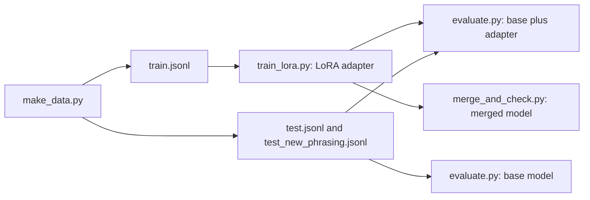

# Project: LoRA Fine-Tune an Open Model

## Introduction

Fine-tuning is where most developers first change a model's weights. The goal of this project is a complete, honest fine-tune: a task where the base model measurably fails, a dataset, a training run, an evaluation that proves the improvement, a check that the model generalizes to inputs it was not trained on, and a deployable artifact at the end.

The task is **structured extraction**: turn a free-text order such as "Can I get 8 keyboards and 10 backpacks? Deliver to Shenzhen on Friday. Name: Pierre Dubois." into exact JSON with the customer, city, day and a list of items with singular nouns and integer quantities. It is a typical production use of a small model: narrow, high-volume, and easy to score automatically.

The model is **SmolLM2-135M-Instruct** from Hugging Face (Allal et al., 2025): a Llama-architecture model with 135 million parameters, pretrained on 2 trillion tokens, then instruction-tuned with SFT and DPO, under the Apache 2.0 license. It is small enough to fine-tune on a laptop CPU, and capable enough that the result is useful.

You will:

- Generate a synthetic dataset with exact labels, including a test set with phrasings never seen in training.
- Measure the base model: 29.5% valid JSON and 0.5% exact matches.
- Train a LoRA adapter with PEFT and a plain PyTorch loop, with the loss masked to the answer only.
- Reach 100% exact match on the test set and on the new phrasings.
- Check that general behavior survives, merge the adapter into the weights, and compare artifact sizes.

The theory behind each step: [When to Fine-Tune](../9-llm-fine-tuning/0-llm-when-to-fine-tune.mdx), [LoRA Explained](../9-llm-fine-tuning/1-llm-lora.mdx), [Supervised Fine-Tuning and Chat Templates](../8-llm-post-training/1-llm-supervised-fine-tuning.mdx) and [Preparing Fine-Tuning Data](../9-llm-fine-tuning/4-llm-fine-tuning-data.mdx). The higher-level `SFTTrainer` route from TRL is covered in [Fine-Tuning with Hugging Face Transformers, PEFT and TRL](../9-llm-fine-tuning/3-llm-fine-tuning-with-hf.mdx); here we write the loop ourselves so every step is visible.

## What You Will Build

| File | What it does |
| --- | --- |
| `make_data.py` | 1,000 training, 200 test and 100 new-phrasing test examples, with exact JSON targets |
| `evaluate.py` | Batched greedy generation and three scores: valid JSON, exact match, field accuracy |
| `train_lora.py` | Chat-template encoding, prompt masking, LoRA with PEFT, the training loop |
| `merge_and_check.py` | General-question check, `merge_and_unload`, sizes on disk |



```bash
pip install torch transformers peft
```

The model (about 270 MB in bf16) downloads on first use.

## Step 1: Build the Dataset

When you can generate the data, you get perfect labels and unlimited examples, so a synthetic generator is the best way to learn fine-tuning. The generator combines 20 first names, 18 surnames, 16 cities, 7 days and 15 items into six message templates. Quantities are sometimes written as words ("three", "a dozen"), and the plural must be turned back into a singular noun, so the model has to do real normalization, not copying.

```python
import json
import random

random.seed(14)
FIRST = ["Maria", "John", "Aiko", "Pierre", "Fatima", "Liam", "Chen", "Olga", "Rahul", "Sofia",
         "Kwame", "Elena", "Mateo", "Yuki", "Hannah", "Omar", "Ingrid", "Diego", "Mei", "Tom"]
LAST = ["Lopez", "Smith", "Tanaka", "Dubois", "Khan", "Murphy", "Wang", "Petrova", "Gupta",
        "Rossi", "Mensah", "Novak", "Garcia", "Sato", "Becker", "Haddad", "Larsen", "Silva"]
CITY = ["Lisbon", "Toronto", "Osaka", "Lyon", "Nairobi", "Dublin", "Shenzhen", "Krakow",
        "Pune", "Turin", "Accra", "Austin", "Seville", "Sapporo", "Hamburg", "Cairo"]
DAY = ["Monday", "Tuesday", "Wednesday", "Thursday", "Friday", "Saturday", "Sunday"]
ITEM = ["notebook", "pen", "stapler", "desk lamp", "monitor", "keyboard", "webcam", "chair",
        "whiteboard", "marker", "backpack", "headset", "printer", "cable", "mug"]
NUM = {1: "one", 2: "two", 3: "three", 4: "four", 5: "five", 6: "six", 10: "ten", 12: "a dozen"}

TEMPLATES = [
    "Hi, this is {name}. Could you send {items} to {city} by {day}?",
    "{name} here. I need {items} delivered to our {city} office on {day}.",
    "Order for {name}: {items}. Ship to {city}, arriving {day} please.",
    "Hello! Please deliver {items} to {city} before {day}. Thanks, {name}",
    "Can I get {items}? Deliver to {city} on {day}. Name: {name}.",
    "We're out of supplies in {city}. {name} would like {items} by {day}.",
]


NEW_TEMPLATES = [   # phrasings never seen in training, for a generalization test
    "Quick request from {name}: we need {items}. Destination {city}. Deadline {day}.",
    "Please arrange {items} for {name}, delivered in {city} no later than {day}.",
]


def qty_text(q):
    return NUM[q] if q in NUM and random.random() < 0.4 else str(q)


def plural(item, q):
    if q == 1:
        return item
    return item + ("es" if item.endswith(("ch", "sh")) else "s")


def example(templates=TEMPLATES):
    name = f"{random.choice(FIRST)} {random.choice(LAST)}"
    city, day = random.choice(CITY), random.choice(DAY)
    items = random.sample(ITEM, random.randint(1, 3))
    qtys = [random.choice([1, 2, 3, 4, 5, 6, 8, 10, 12, 15, 20]) for _ in items]
    parts = [f"{qty_text(q)} {plural(i, q)}" for i, q in zip(items, qtys)]
    items_text = parts[0] if len(parts) == 1 else ", ".join(parts[:-1]) + " and " + parts[-1]
    msg = random.choice(templates).format(name=name, items=items_text, city=city, day=day)
    target = {"name": name, "city": city, "day": day,
              "items": [{"item": i, "qty": q} for i, q in zip(items, qtys)]}
    return msg, target


INSTRUCTION = ('Extract the order as JSON with keys "name", "city", "day" and "items" '
               '(a list of {"item": singular noun, "qty": integer}). Reply with JSON only.\n\n')


def to_record(msg, target):
    return {"prompt": [{"role": "user", "content": INSTRUCTION + msg}],
            "completion": [{"role": "assistant", "content": json.dumps(target)}]}


if __name__ == "__main__":
    seen = set()
    rows = []
    while len(rows) < 1200:
        msg, target = example()
        if msg not in seen:
            seen.add(msg)
            rows.append(to_record(msg, target))
    for name, part in [("train.jsonl", rows[:1000]), ("test.jsonl", rows[1000:])]:
        with open(name, "w") as f:
            for r in part:
                f.write(json.dumps(r) + "\n")
    with open("test_new_phrasing.jsonl", "w") as f:
        for _ in range(100):
            f.write(json.dumps(to_record(*example(NEW_TEMPLATES))) + "\n")
    print(json.dumps(rows[0], indent=1))
    print(f"wrote {1000} train, {len(rows) - 1000} test and 100 new-phrasing test examples")
```

```text
{
 "prompt": [
  {
   "role": "user",
   "content": "Extract the order as JSON with keys \"name\", \"city\", \"day\" and \"items\" (a list of {\"item\": singular noun, \"qty\": integer}). Reply with JSON only.\n\nHello! Please deliver two monitors, 20 mugs and 10 headsets to Krakow before Wednesday. Thanks, Pierre Larsen"
  }
 ],
 "completion": [
  {
   "role": "assistant",
   "content": "{\"name\": \"Pierre Larsen\", \"city\": \"Krakow\", \"day\": \"Wednesday\", \"items\": [{\"item\": \"monitor\", \"qty\": 2}, {\"item\": \"mug\", \"qty\": 20}, {\"item\": \"headset\", \"qty\": 10}]}"
  }
 ]
}
wrote 1000 train, 200 test and 100 new-phrasing test examples
```

Three design choices matter more than the code:

- **The instruction is part of the data.** Each prompt states the schema. The base model gets the same instruction at evaluation, so the baseline is fair: we are measuring what fine-tuning adds on top of prompting.
- **The data is in chat format** (`prompt` and `completion` lists of messages). The model's chat template will wrap it in the exact special tokens the model was instruction-tuned with.
- **A second test set uses two new templates** that never appear in training. Scoring well on `test.jsonl` could mean the model memorized six sentence shapes; scoring well on `test_new_phrasing.jsonl` means it learned the task.

## Step 2: Measure the Base Model

Never fine-tune before you have a number to beat. `evaluate.py` generates greedily for every test prompt, batching 16 prompts with **left padding** (so that generation continues from the last real token of every row), and scores three things: whether the output parses as a JSON object, whether it equals the target exactly, and the fraction of the four top-level fields that are exactly right.

```python
import json
import sys
import time

import torch
from transformers import AutoModelForCausalLM, AutoTokenizer

MODEL = "HuggingFaceTB/SmolLM2-135M-Instruct"
DEV = "cuda" if torch.cuda.is_available() else "cpu"
torch.set_num_threads(8)


def load(adapter=None):
    tok = AutoTokenizer.from_pretrained(MODEL, padding_side="left")
    model = AutoModelForCausalLM.from_pretrained(MODEL, dtype=torch.float32)
    if adapter:
        from peft import PeftModel
        model = PeftModel.from_pretrained(model, adapter)
    return tok, model.to(DEV).eval()


@torch.no_grad()
def predict(tok, model, prompts, batch_size=16, max_new_tokens=96):
    outs = []
    for i in range(0, len(prompts), batch_size):
        texts = [tok.apply_chat_template(p, tokenize=False, add_generation_prompt=True)
                 for p in prompts[i:i + batch_size]]
        enc = tok(texts, return_tensors="pt", padding=True).to(DEV)
        gen = model.generate(**enc, max_new_tokens=max_new_tokens, do_sample=False,
                             pad_token_id=tok.pad_token_id)
        outs += tok.batch_decode(gen[:, enc["input_ids"].shape[1]:], skip_special_tokens=True)
    return outs


def score(outputs, targets):
    valid = exact = fields = 0
    for out, tgt in zip(outputs, targets):
        try:
            pred = json.loads(out.strip())
        except json.JSONDecodeError:
            continue
        if not isinstance(pred, dict):
            continue
        valid += 1
        exact += pred == tgt
        fields += sum(pred.get(k) == tgt[k] for k in ("name", "city", "day", "items")) / 4
    n = len(targets)
    return {"valid_json": valid / n, "exact_match": exact / n, "field_accuracy": fields / n}


if __name__ == "__main__":
    adapter = sys.argv[1] if len(sys.argv) > 1 and sys.argv[1] != "none" else None
    test_file = sys.argv[2] if len(sys.argv) > 2 else "test.jsonl"
    rows = [json.loads(line) for line in open(test_file)]
    prompts = [r["prompt"] for r in rows]
    targets = [json.loads(r["completion"][0]["content"]) for r in rows]
    tok, model = load(adapter)
    t0 = time.time()
    outputs = predict(tok, model, prompts)
    print(f"model: {MODEL}" + (f" + adapter {adapter}" if adapter else " (no fine-tuning)")
          + f", test file {test_file}")
    print(f"generated {len(rows)} answers in {time.time() - t0:.0f} s on {DEV}")
    print({k: round(v, 3) for k, v in score(outputs, targets).items()})
    for out, r in list(zip(outputs, rows))[:2]:
        print("---\nINPUT :", r["prompt"][0]["content"].split("\n\n")[-1])
        print("OUTPUT:", out.strip()[:300])
```

```bash
python evaluate.py none test.jsonl
python evaluate.py none test_new_phrasing.jsonl
```

````text
model: HuggingFaceTB/SmolLM2-135M-Instruct (no fine-tuning), test file test.jsonl
generated 200 answers in 152 s on cpu
{'valid_json': 0.295, 'exact_match': 0.005, 'field_accuracy': 0.189}
---
INPUT : Hi, this is Sofia Novak. Could you send 2 pens and a dozen webcams to Osaka by Wednesday?
OUTPUT: JSON:

```json
{
  "name": "Sofia Novak",
  "city": "Osaka",
  "day": "Wednesday",
  "items": [
    {
      "item": "Pen",
      "qty": 2,
      "name": "Pen",
      "price": 10.99,
      "qty": 10,
      "name": "Pen",
      "price": 1
---
INPUT : Can I get 8 keyboards and 10 backpacks? Deliver to Shenzhen on Friday. Name: Pierre Dubois.
OUTPUT: JSON:
{
  "name": "Pierre Dubois",
  "city": "Shenzhen",
  "day": "Monday",
  "items": [
    {
      "item": "10",
      "qty": 10
    },
    {
      "item": "15",
      "qty": 15
    }
  ]
}

Here is the JSON response:
{
  "name": "P
````

```text
model: HuggingFaceTB/SmolLM2-135M-Instruct (no fine-tuning), test file test_new_phrasing.jsonl
generated 100 answers in 81 s on cpu
{'valid_json': 0.19, 'exact_match': 0.0, 'field_accuracy': 0.12}
```

The base model understands the task (it finds "Sofia Novak", "Osaka", "Wednesday") but fails the format in every way that matters for a program reading the output: it adds a preamble ("JSON:"), wraps the answer in a Markdown fence, invents fields ("price"), keeps capitalized or plural items, gets the day wrong, and keeps generating after the JSON. Only 29.5% of outputs parse, and 1 in 200 is exactly right. This is a classic case where fine-tuning beats prompting: the knowledge is there, the behavior is not.

## Step 3: Encode With the Chat Template and Mask the Prompt

An instruction-tuned model expects its chat template. For SmolLM2 this is the ChatML format:

```text
<|im_start|>system
You are a helpful AI assistant named SmolLM, trained by Hugging Face<|im_end|>
<|im_start|>user
Extract the order as JSON ... Thanks, Pierre Larsen<|im_end|>
<|im_start|>assistant
{"name": "Pierre Larsen", "city": "Krakow", ...}<|im_end|>
```

(The template inserts the default system message when the conversation has none.) We train on exactly this text so the fine-tuned model is used exactly as the base model was.

The training loss should cover **only the assistant's answer**. The prompt is given at inference time; learning to predict it wastes capacity and, worse, teaches the model to generate user messages. The standard trick is to set the labels of prompt tokens to $-100$, the `ignore_index` of PyTorch's cross-entropy. For a sequence $x_1, \dots, x_T$ whose answer starts at position $p$, the loss becomes

$$
\mathcal{L} = -\frac{1}{T - p + 1} \sum_{t=p}^{T} \log P_\theta(x_t \mid x_{<t})
$$

averaged over answer tokens only (Hugging Face models shift labels by one internally, so `labels` is simply a copy of `input_ids` with the prompt masked). The `encode` function in `train_lora.py` below computes the prompt tokens with `add_generation_prompt=True`, the full conversation, asserts that the first is a prefix of the second, and masks the prefix. The assertion is not paranoia: some chat templates render the prompt differently depending on whether an assistant turn follows, and then the mask would be silently wrong.

## Step 4: Configure LoRA

LoRA (Hu et al., 2021) freezes each pretrained weight matrix $W_0 \in \mathbb{R}^{d_\mathrm{out} \times d_\mathrm{in}}$ and learns a low-rank update:

$$
W = W_0 + \frac{\alpha}{r} B A, \qquad B \in \mathbb{R}^{d_\mathrm{out} \times r},\; A \in \mathbb{R}^{r \times d_\mathrm{in}}
$$

$B$ starts at zero, so training starts exactly from the base model. Our settings are rank $r = 16$, $\alpha = 32$ (scale 2), dropout 0.05 on the LoRA input, applied to all seven linear layers of every block: `q_proj`, `k_proj`, `v_proj`, `o_proj`, `gate_proj`, `up_proj` and `down_proj`. The QLoRA paper found that adapting all linear layers matters more than the rank; see [LoRA Explained](../9-llm-fine-tuning/1-llm-lora.mdx) for the trade-offs.

Count the trainable parameters by hand from SmolLM2's `config.json` (hidden size 576, 9 query heads and 3 key-value heads of size 64, MLP size 1,536, 30 layers). A LoRA pair on a $d_\mathrm{in} \to d_\mathrm{out}$ layer adds $r(d_\mathrm{in} + d_\mathrm{out})$ parameters:

| Module | Shape | LoRA parameters |
| --- | --- | --- |
| `q_proj`, `o_proj` | 576 to 576 | $2 \times 16 \times 1{,}152 = 36{,}864$ |
| `k_proj`, `v_proj` | 576 to 192 (3 KV heads of 64) | $2 \times 16 \times 768 = 24{,}576$ |
| `gate_proj`, `up_proj`, `down_proj` | 576 to 1,536 and back | $3 \times 16 \times 2{,}112 = 101{,}376$ |
| One layer | | 162,816 |
| 30 layers | | 4,884,480 |

That is exactly what PEFT reports below: 4.9M trainable parameters, 3.5% of the model. The `k_proj` and `v_proj` rows are smaller because of grouped-query attention ([Multi-Query and Grouped-Query Attention](../2-llm-attention/5-llm-mqa-gqa.mdx)).

## Step 5: Train

```python
import json
import math
import random
import time

import torch
from peft import LoraConfig, get_peft_model
from transformers import AutoModelForCausalLM, AutoTokenizer

torch.manual_seed(0)
random.seed(0)
MODEL = "HuggingFaceTB/SmolLM2-135M-Instruct"
DEV = "cuda" if torch.cuda.is_available() else "cpu"
EPOCHS, BATCH, LR, WARMUP = 2, 8, 2e-4, 10

tok = AutoTokenizer.from_pretrained(MODEL)
model = AutoModelForCausalLM.from_pretrained(MODEL, dtype=torch.float32).to(DEV)


# ---------------------------------------------------------------- data
def encode(row):
    """Token ids for prompt + answer, and labels that are -100 on the prompt."""
    prompt_ids = tok.apply_chat_template(row["prompt"], add_generation_prompt=True,
                                         tokenize=True, return_dict=False)
    full_ids = tok.apply_chat_template(row["prompt"] + row["completion"],
                                       tokenize=True, return_dict=False)
    assert full_ids[:len(prompt_ids)] == prompt_ids      # the prompt must be a prefix
    labels = [-100] * len(prompt_ids) + full_ids[len(prompt_ids):]
    return full_ids, labels


def collate(examples):
    T = max(len(ids) for ids, _ in examples)
    input_ids = torch.full((len(examples), T), tok.pad_token_id)
    labels = torch.full((len(examples), T), -100)
    attention_mask = torch.zeros((len(examples), T), dtype=torch.long)
    for i, (ids, lab) in enumerate(examples):              # right padding is fine for training
        input_ids[i, :len(ids)] = torch.tensor(ids)
        labels[i, :len(lab)] = torch.tensor(lab)
        attention_mask[i, :len(ids)] = 1
    return {"input_ids": input_ids.to(DEV), "labels": labels.to(DEV),
            "attention_mask": attention_mask.to(DEV)}


rows = [json.loads(line) for line in open("train.jsonl")]
data = [encode(r) for r in rows]
ids, labels = data[0]
n_loss = sum(l != -100 for l in labels)
print(f"{len(data)} examples; first has {len(ids)} tokens, {n_loss} with loss")
print("loss starts at:", repr(tok.decode(ids[len(ids) - n_loss:][:12])))

# ---------------------------------------------------------------- LoRA
lora = LoraConfig(
    r=16,                          # rank of the update B @ A
    lora_alpha=32,                 # update is scaled by alpha / r = 2
    lora_dropout=0.05,
    target_modules=["q_proj", "k_proj", "v_proj", "o_proj",
                    "gate_proj", "up_proj", "down_proj"],
    task_type="CAUSAL_LM",
)
model = get_peft_model(model, lora)
model.print_trainable_parameters()

params = [p for p in model.parameters() if p.requires_grad]
opt = torch.optim.AdamW(params, lr=LR, weight_decay=0.0)
total = EPOCHS * math.ceil(len(data) / BATCH)


def lr_at(step):
    if step < WARMUP:
        return LR * (step + 1) / WARMUP
    return 0.5 * LR * (1 + math.cos(math.pi * (step - WARMUP) / (total - WARMUP)))


# ---------------------------------------------------------------- train
model.train()
step, t0, running = 0, time.time(), []
for epoch in range(EPOCHS):
    random.shuffle(data)
    for i in range(0, len(data), BATCH):
        batch = collate(data[i:i + BATCH])
        loss = model(**batch).loss          # mean cross-entropy over tokens with labels
        loss.backward()
        torch.nn.utils.clip_grad_norm_(params, 1.0)
        for g in opt.param_groups:
            g["lr"] = lr_at(step)
        opt.step()
        opt.zero_grad(set_to_none=True)
        running.append(loss.item())
        step += 1
        if step % 25 == 0 or step == total:
            print(f"step {step:4d}/{total} | epoch {epoch} | loss {sum(running) / len(running):.4f} "
                  f"| lr {lr_at(step - 1):.2e} | {time.time() - t0:5.0f} s", flush=True)
            running = []
print(f"training took {time.time() - t0:.0f} s on {DEV}")
model.save_pretrained("smollm2-orders-lora")       # saves only the adapter weights
```

The loop is deliberately plain: shuffle, collate with right padding (padding side does not matter for training, because the attention mask hides pad tokens and their labels are $-100$), forward with `labels`, backward, clip, step. Only LoRA parameters are given to AdamW, so the optimizer state is 3.5% of what full fine-tuning would need. The learning rate of $2 \times 10^{-4}$ is the common LoRA default, roughly ten times what full fine-tuning would use, because the update is low-rank and starts from zero. The script uses a GPU when one is available and the CPU otherwise.

```bash
python train_lora.py
```

On an NVIDIA RTX 4060 Ti:

```text
1000 examples; first has 177 tokens, 73 with loss
loss starts at: '{"name": "Pierre Larsen", "city":'
trainable params: 4,884,480 || all params: 139,399,488 || trainable%: 3.5039
step   25/250 | epoch 0 | loss 0.1246 | lr 1.98e-04 |    18 s
step   50/250 | epoch 0 | loss 0.0079 | lr 1.87e-04 |    36 s
step   75/250 | epoch 0 | loss 0.0026 | lr 1.67e-04 |    54 s
step  100/250 | epoch 0 | loss 0.0013 | lr 1.39e-04 |    72 s
step  125/250 | epoch 0 | loss 0.0009 | lr 1.08e-04 |    90 s
step  150/250 | epoch 1 | loss 0.0007 | lr 7.54e-05 |   106 s
step  175/250 | epoch 1 | loss 0.0006 | lr 4.55e-05 |   124 s
step  200/250 | epoch 1 | loss 0.0006 | lr 2.15e-05 |   142 s
step  225/250 | epoch 1 | loss 0.0006 | lr 5.74e-06 |   159 s
step  250/250 | epoch 1 | loss 0.0006 | lr 8.57e-09 |   177 s
training took 177 s on cuda
```

The same script on a 32-core CPU (PyTorch 2.14, 8 threads, other jobs running) printed the same losses to three decimals and took 1,216 seconds, about 20 minutes, instead of 177. The CPU-trained adapter also scored 100% exact match on `test.jsonl`. The loss lines differ in the fourth decimal at most, because GPU and CPU kernels round differently.

The first line confirms the masking: of the first example's 177 tokens, 73 carry loss, and the loss starts exactly at the opening brace of the answer. The loss falls from 0.12 (average of the first 25 steps) to below 0.001. For a deterministic extraction task that is expected: once the model has learned the mapping, every answer token is nearly certain. A loss this low would be a red flag for a creative task (memorization), but here the test sets will tell us whether it generalizes.

The adapter is saved to `smollm2-orders-lora/`: an `adapter_config.json` that records the base model and LoRA settings, and `adapter_model.safetensors` with the 4.9M parameters.

## Step 6: Evaluate the Fine-Tuned Model

```bash
python evaluate.py smollm2-orders-lora test.jsonl
python evaluate.py smollm2-orders-lora test_new_phrasing.jsonl
```

```text
model: HuggingFaceTB/SmolLM2-135M-Instruct + adapter smollm2-orders-lora, test file test.jsonl
generated 200 answers in 144 s on cpu
{'valid_json': 1.0, 'exact_match': 1.0, 'field_accuracy': 1.0}
---
INPUT : Hi, this is Sofia Novak. Could you send 2 pens and a dozen webcams to Osaka by Wednesday?
OUTPUT: {"name": "Sofia Novak", "city": "Osaka", "day": "Wednesday", "items": [{"item": "pen", "qty": 2}, {"item": "webcam", "qty": 12}]}
---
INPUT : Can I get 8 keyboards and 10 backpacks? Deliver to Shenzhen on Friday. Name: Pierre Dubois.
OUTPUT: {"name": "Pierre Dubois", "city": "Shenzhen", "day": "Friday", "items": [{"item": "keyboard", "qty": 8}, {"item": "backpack", "qty": 10}]}
```

```text
model: HuggingFaceTB/SmolLM2-135M-Instruct + adapter smollm2-orders-lora, test file test_new_phrasing.jsonl
generated 100 answers in 66 s on cpu
{'valid_json': 1.0, 'exact_match': 1.0, 'field_accuracy': 1.0}
---
INPUT : Please arrange 2 whiteboards, 8 cables and three staplers for Tom Novak, delivered in Cairo no later than Wednesday.
OUTPUT: {"name": "Tom Novak", "city": "Cairo", "day": "Wednesday", "items": [{"item": "whiteboard", "qty": 2}, {"item": "cable", "qty": 8}, {"item": "stapler", "qty": 3}]}
---
INPUT : Please arrange a dozen staplers for Chen Petrova, delivered in Shenzhen no later than Wednesday.
OUTPUT: {"name": "Chen Petrova", "city": "Shenzhen", "day": "Wednesday", "items": [{"item": "stapler", "qty": 12}]}
```

From 0.5% to 100% exact match on the test set, and from 0% to 100% on phrasings the model never saw. The outputs are bare JSON with singular nouns ("whiteboard", "stapler"), integer quantities ("three" became 3, "a dozen" became 12), and generation stops cleanly at `<|im_end|>`. The new-phrasing result is the important one: the model learned "find the name, city, day and items in a request", not six sentence patterns.

| Test set | Model | Valid JSON | Exact match | Field accuracy |
| --- | --- | --- | --- | --- |
| `test.jsonl` (200) | base | 29.5% | 0.5% | 18.9% |
| `test.jsonl` (200) | base + LoRA | 100% | 100% | 100% |
| new phrasing (100) | base | 19% | 0% | 12% |
| new phrasing (100) | base + LoRA | 100% | 100% | 100% |

All four evaluations above were run on the CPU (PyTorch 2.14) with the adapter trained on the GPU; generation took 1 to 3 minutes per 200 answers depending on machine load. Be careful not to over-read a perfect score. The test inputs come from the same generator as the training data: same vocabulary of names, cities and items, same sentence lengths. Real orders contain typos, unknown products, missing fields and two requests in one message. Before deploying, test on real messages and add examples of every failure to the training data ([Evaluating a Fine-Tuned Model](../9-llm-fine-tuning/5-llm-evaluating-fine-tunes.mdx)).

## Step 7: Check General Behavior and Merge

Two questions remain. Did the adapter break the model for everything else? And how do we ship it?

```python
import os

import torch
from peft import PeftModel
from transformers import AutoModelForCausalLM, AutoTokenizer

MODEL = "HuggingFaceTB/SmolLM2-135M-Instruct"
tok = AutoTokenizer.from_pretrained(MODEL)
base = AutoModelForCausalLM.from_pretrained(MODEL, dtype=torch.float32)
model = PeftModel.from_pretrained(base, "smollm2-orders-lora").eval()

msg = [{"role": "user", "content": "What is the capital of France? Answer in one sentence."}]
ids = tok.apply_chat_template(msg, add_generation_prompt=True, return_tensors="pt", return_dict=True)


def answer(m):
    with torch.no_grad():
        out = m.generate(**ids, max_new_tokens=30, do_sample=False)
    return tok.decode(out[0, ids["input_ids"].shape[1]:], skip_special_tokens=True)


with torch.no_grad():
    lora_logits = model(**ids).logits
print("with adapter   :", repr(answer(model)))
with model.disable_adapter():
    print("adapter off    :", repr(answer(model)))

merged = model.merge_and_unload()               # W <- W + (alpha/r) * B @ A, adapter removed
with torch.no_grad():
    merged_logits = merged(**ids).logits
print("merged vs adapter, max logit diff:", (merged_logits - lora_logits).abs().max().item())
merged.save_pretrained("smollm2-orders-merged")
size = lambda d: sum(os.path.getsize(os.path.join(d, f)) for f in os.listdir(d)) / 2**20
print(f"adapter on disk: {size('smollm2-orders-lora'):.1f} MiB, "
      f"merged model on disk: {size('smollm2-orders-merged'):.1f} MiB")
```

```text
with adapter   : 'The capital of France is Paris.'
adapter off    : 'The capital of France is Paris.'
merged vs adapter, max logit diff: 0.0001125335693359375
adapter on disk: 18.7 MiB, merged model on disk: 513.2 MiB
```

A one-question check is not a forgetting benchmark, but it is the right smoke test: the model still answers a general question correctly and identically with the adapter on and off. LoRA updates are small (the largest entry of any $B$ matrix in our adapter is about 0.017) and touch only a rank-16 subspace, which is one reason LoRA forgets less than full fine-tuning. The PEFT `disable_adapter()` context manager makes this comparison free, since base and adapted model share the same weights in memory.

`merge_and_unload()` computes $W_0 + \frac{\alpha}{r} BA$ for every adapted layer and returns a plain `transformers` model with no PEFT dependency and no extra latency. The logits differ from the adapter version by about $10^{-4}$, float rounding from computing $W_0 x + s\,B(Ax)$ as one matrix. The two artifacts serve different deployments:

- **Ship the adapter** (18.7 MiB) when you serve many fine-tunes of one base model. Servers such as vLLM can load many LoRA adapters on top of one copy of the base weights and choose per request.
- **Ship the merged model** (513 MiB in fp32, half that in bf16) when you serve one fine-tune, or need a format such as GGUF for llama.cpp ([GGUF and Running Models Locally](../11-llm-quantization/2-llm-gguf-and-llama-cpp.mdx)).

## Extensions to Try

- **Rank sweep.** Train with $r$ = 1, 4 and 64. For a task this narrow even rank 1 or 4 may suffice; measure it.
- **Attention only.** Restrict `target_modules` to `q_proj` and `v_proj`, the setting of the original LoRA paper, and compare.
- **Fewer examples.** Train on 50, 100 and 300 examples to find how much data the task needs.
- **Harder data.** Add typos, missing fields (the target should use `null`), and messages with two orders.
- **TRL.** Rewrite the training with `trl.SFTTrainer` and a prompt-completion dataset, which applies the same masking automatically.
- **A larger model.** Swap in Qwen2.5-0.5B-Instruct and compare the base model's score before fine-tuning.

## Common Mistakes

- **No baseline.** Without the base model's score you cannot tell what fine-tuning added, or whether a better prompt would have been enough.
- **Training on the prompt.** Without label masking, the model spends capacity predicting instructions and may learn to generate user turns.
- **Formatting training data differently from inference.** Train and generate with the same chat template, including the generation prompt.
- **Right padding at generation time.** Batched generation must pad on the left, or rows continue from pad tokens.
- **Testing only on the training distribution.** Hold out phrasings, entities or sources, or a perfect score may just be memorization.
- **Full fine-tuning learning rates with LoRA, or the reverse.** LoRA typically needs around $10^{-4}$ to $2 \times 10^{-4}$; full fine-tuning an order of magnitude less.
- **Forgetting which base model an adapter belongs to.** An adapter only works on the exact base weights it was trained on; `adapter_config.json` records them.

## Summary

- A good fine-tuning project starts with a scored task and a baseline: the base SmolLM2-135M-Instruct produced valid JSON 29.5% of the time and exact answers 0.5% of the time.
- Encode with the model's chat template and set prompt labels to $-100$ so the loss covers only the answer.
- LoRA with $r = 16$ on all seven linear layers adds 4,884,480 trainable parameters (3.5%), which can be counted by hand from `config.json`.
- Two epochs over 1,000 examples took about 3 minutes on an RTX 4060 Ti and reached 100% exact match on both the test set and unseen phrasings.
- The adapter left a general answer unchanged, merges into a plain model with `merge_and_unload()`, and is 18.7 MiB against 513 MiB for the merged fp32 model.

## Further Reading

- [LoRA: Low-Rank Adaptation of Large Language Models (Hu et al., 2021)](https://arxiv.org/abs/2106.09685): the method.
- [QLoRA: Efficient Finetuning of Quantized LLMs (Dettmers et al., 2023)](https://arxiv.org/abs/2305.14314): 4-bit base models and the finding that all linear layers should be adapted.
- [SmolLM2: When Smol Goes Big (Allal et al., 2025)](https://arxiv.org/abs/2502.02737): the model used here.
- [SmolLM2-135M-Instruct model card](https://huggingface.co/HuggingFaceTB/SmolLM2-135M-Instruct): license, training data and chat template.
- [PEFT documentation: LoRA](https://huggingface.co/docs/peft/main/en/developer_guides/lora): `LoraConfig` options, merging and adapter management.
- [Hugging Face chat templates](https://huggingface.co/docs/transformers/main/en/chat_templating): how `apply_chat_template` and generation prompts work.
