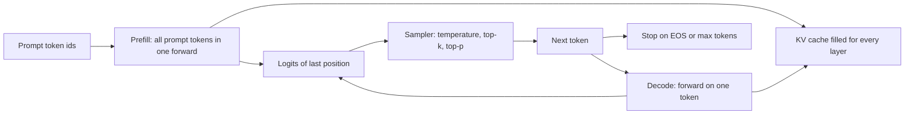

# Project: A Minimal Inference Engine with a KV Cache and Sampling

## Introduction

`model.generate()` hides a surprising amount of machinery. Behind one call sit a weight loader, a forward pass that can run on one new token at a time, a cache of every previous key and value, a sampler, a stopping rule and, for more than one request, padding and masking so that sequences of different lengths can share a batch. Serving engines such as vLLM, SGLang and llama.cpp are, at their core, highly optimized versions of exactly these parts.

In this project you build them yourself for **GPT-2 small** (124M parameters), in under 200 lines of PyTorch that run on a CPU. The engine:

- Loads the official `openai-community/gpt2` checkpoint from its `safetensors` file, with no `transformers` model class involved.
- Implements the GPT-2 forward pass directly on the raw tensors, and matches Hugging Face's logits exactly.
- Adds a preallocated **KV cache** with separate **prefill** and **decode** phases, and proves the cache changes nothing about the output.
- Implements **greedy, temperature, top-k and top-p** sampling, and checks the sampler against the math.
- Reproduces Hugging Face `generate()` token for token in greedy mode.
- Batches prompts of different lengths with **left padding**, correct position ids and attention masks, and proves batching changes nothing either.

The concepts are explained in [How LLM Inference Works: Prefill and Decode](../10-llm-inference/0-llm-inference-overview.mdx), [The KV Cache](../10-llm-inference/2-llm-kv-cache.mdx) and [Decoding Strategies](../10-llm-inference/1-llm-decoding-strategies.mdx). This page is where you implement them and watch them work.

## What You Will Build

| File | What it does |
| --- | --- |
| `engine.py` | Weight loading, the GPT-2 forward pass, `KVCache`, `sample`, `generate`, `generate_batch` |
| `step1_verify.py` | Logits against Hugging Face; cache against a full forward pass |
| `step2_generate.py` | Sampler check, greedy parity with `generate()`, cache speed-up, batching |



Install the dependencies. The model downloads automatically (about 550 MB) the first time.

```bash
pip install torch safetensors huggingface_hub tiktoken transformers
```

`transformers` is only used to check our results. The engine itself needs `torch`, `safetensors` and `huggingface_hub`, and `tiktoken` provides the GPT-2 tokenizer.

## Step 1: Load the Weights

A Hugging Face model repository is just files. `config.json` holds the hyperparameters and `model.safetensors` the tensors. For GPT-2 small the relevant config fields are:

```json
{
  "n_embd": 768,
  "n_head": 12,
  "n_layer": 12,
  "n_positions": 1024,
  "vocab_size": 50257,
  "layer_norm_epsilon": 1e-05,
  "activation_function": "gelu_new"
}
```

The checkpoint holds 160 tensors. Those of layer 0 and the non-layer tensors look like this (shapes as stored):

```text
h.0.attn.bias [1, 1, 1024, 1024]
h.0.attn.c_attn.bias [2304]
h.0.attn.c_attn.weight [768, 2304]
h.0.attn.c_proj.bias [768]
h.0.attn.c_proj.weight [768, 768]
h.0.ln_1.bias [768]
h.0.ln_1.weight [768]
h.0.ln_2.bias [768]
h.0.ln_2.weight [768]
h.0.mlp.c_fc.bias [3072]
h.0.mlp.c_fc.weight [768, 3072]
h.0.mlp.c_proj.bias [768]
h.0.mlp.c_proj.weight [3072, 768]
ln_f.bias [768]
ln_f.weight [768]
wpe.weight [1024, 768]
wte.weight [50257, 768]
```

Three details in this list trip up everyone who ports GPT-2 by hand.

1. **The weights are transposed relative to `nn.Linear`.** OpenAI's original code used a 1D convolution, and Hugging Face kept its `Conv1D` layout: `c_fc.weight` is `(in, out) = (768, 3072)`, whereas `nn.Linear` stores `(out, in)`. So the layer computes $xW + b$ directly, with no transpose.
2. **Q, K and V are fused.** `c_attn` maps 768 to $3 \times 768 = 2304$ and we split the result into three.
3. **`h.*.attn.bias` is not a parameter.** It is the old precomputed causal mask, a `(1024, 1024)` lower-triangular buffer. We ignore it and use our own mask.

Also note there is no separate output matrix: GPT-2 ties the language-model head to `wte`, so logits are $h\, W_{te}^\top$.

## Step 2: The Forward Pass and the KV Cache

Here is the whole engine. We will run its parts one by one afterwards.

```python
import json
import math
from dataclasses import dataclass

import torch
import torch.nn.functional as F
from huggingface_hub import hf_hub_download
from safetensors.torch import load_file


# ---------------------------------------------------------------- model
@dataclass
class Config:
    vocab_size: int
    n_positions: int
    n_embd: int
    n_layer: int
    n_head: int
    layer_norm_epsilon: float


def load_gpt2(repo="openai-community/gpt2"):
    cfg_json = json.load(open(hf_hub_download(repo, "config.json")))
    cfg = Config(**{k: cfg_json[k] for k in Config.__dataclass_fields__})
    weights = load_file(hf_hub_download(repo, "model.safetensors"))
    return cfg, weights


def gelu_tanh(x):  # "gelu_new" in the GPT-2 config
    return 0.5 * x * (1.0 + torch.tanh(math.sqrt(2.0 / math.pi) * (x + 0.044715 * x.pow(3))))


class KVCache:
    """Preallocated keys and values for every layer: (n_layer, B, n_head, max_len, head_dim)."""

    def __init__(self, cfg, batch_size, max_len, dtype=torch.float32):
        hd = cfg.n_embd // cfg.n_head
        shape = (cfg.n_layer, batch_size, cfg.n_head, max_len, hd)
        self.k = torch.zeros(shape, dtype=dtype)
        self.v = torch.zeros(shape, dtype=dtype)
        self.len = 0                                    # positions filled so far

    def nbytes(self):
        return self.k.numel() * self.k.element_size() * 2


class GPT2:
    """GPT-2 forward pass written against the raw checkpoint tensors."""

    def __init__(self, cfg, w):
        self.cfg, self.w = cfg, w
        self.hd = cfg.n_embd // cfg.n_head

    def _ln(self, x, name):
        return F.layer_norm(x, (self.cfg.n_embd,), self.w[name + ".weight"],
                            self.w[name + ".bias"], self.cfg.layer_norm_epsilon)

    def _linear(self, x, name):
        # GPT-2 uses Conv1D: weight is stored (in_features, out_features), so x @ W + b
        return torch.addmm(self.w[name + ".bias"], x.view(-1, x.shape[-1]),
                           self.w[name + ".weight"]).view(*x.shape[:-1], -1)

    @torch.inference_mode()
    def forward(self, idx, cache=None, pos=None, attn_mask=None):
        """idx: (B, T) new tokens. pos: (B, T) their positions.
        attn_mask: (B, 1, T, S) bool, True = may attend; S = keys after this step.
        Without a cache this is an ordinary full forward pass."""
        B, T = idx.shape
        if pos is None:
            start = cache.len if cache is not None else 0
            pos = torch.arange(start, start + T).expand(B, T)
        x = self.w["wte.weight"][idx] + self.w["wpe.weight"][pos]          # (B, T, C)
        for i in range(self.cfg.n_layer):
            p = f"h.{i}."
            h = self._ln(x, p + "ln_1")
            q, k, v = self._linear(h, p + "attn.c_attn").split(self.cfg.n_embd, dim=-1)
            q, k, v = (t.view(B, T, self.cfg.n_head, self.hd).transpose(1, 2)
                       for t in (q, k, v))                                 # (B, nh, T, hd)
            if cache is not None:
                s0 = cache.len
                cache.k[i, :, :, s0:s0 + T] = k                            # write new keys
                cache.v[i, :, :, s0:s0 + T] = v
                k = cache.k[i, :, :, :s0 + T]                              # (B, nh, S, hd)
                v = cache.v[i, :, :, :s0 + T]
            if attn_mask is None:
                # new queries sit at the end of the key sequence: causal with an offset
                S = k.shape[2]
                attn_mask = torch.ones(T, S, dtype=torch.bool).tril(S - T)
            y = F.scaled_dot_product_attention(q, k, v, attn_mask=attn_mask)
            y = y.transpose(1, 2).reshape(B, T, self.cfg.n_embd)
            x = x + self._linear(y, p + "attn.c_proj")
            h = self._ln(x, p + "ln_2")
            x = x + self._linear(gelu_tanh(self._linear(h, p + "mlp.c_fc")), p + "mlp.c_proj")
        if cache is not None:
            cache.len += T
        x = self._ln(x, "ln_f")
        return x @ self.w["wte.weight"].T                                  # (B, T, vocab), tied


# ---------------------------------------------------------------- sampling
def sample(logits, temperature=1.0, top_k=0, top_p=1.0, generator=None):
    """logits: (B, vocab) -> next token ids (B,). temperature 0 means greedy."""
    if temperature == 0:
        return logits.argmax(-1)
    logits = logits / temperature
    if top_k > 0:
        kth = torch.topk(logits, top_k, dim=-1).values[:, -1:]            # (B, 1)
        logits = logits.masked_fill(logits < kth, float("-inf"))
    if top_p < 1.0:
        sorted_logits, order = logits.sort(dim=-1, descending=True)
        cum = sorted_logits.softmax(-1).cumsum(-1)
        drop = cum - sorted_logits.softmax(-1) > top_p                     # keep the token that crosses p
        sorted_logits = sorted_logits.masked_fill(drop, float("-inf"))
        logits = torch.full_like(logits, float("-inf")).scatter(-1, order, sorted_logits)
    probs = logits.softmax(-1)
    return torch.multinomial(probs, 1, generator=generator).squeeze(-1)


# ---------------------------------------------------------------- generation
def generate(model, prompt_ids, max_new_tokens, eos_id=None, use_cache=True, **sampling):
    """Single sequence. prompt_ids: list[int]. Yields new token ids one at a time."""
    idx = torch.tensor([prompt_ids])
    if not use_cache:
        for _ in range(max_new_tokens):
            logits = model.forward(idx)[:, -1]                # recompute everything
            nxt = sample(logits, **sampling)
            idx = torch.cat([idx, nxt[:, None]], dim=1)
            yield nxt.item()
            if nxt.item() == eos_id:
                return
        return
    cache = KVCache(model.cfg, 1, len(prompt_ids) + max_new_tokens)
    logits = model.forward(idx, cache)[:, -1]                 # prefill: whole prompt at once
    for _ in range(max_new_tokens):
        nxt = sample(logits, **sampling)
        yield nxt.item()
        if nxt.item() == eos_id:
            return
        logits = model.forward(nxt[:, None], cache)[:, -1]    # decode: one token


def generate_batch(model, prompts, max_new_tokens, pad_id=0, **sampling):
    """Several prompts of different lengths at once, left-padded.
    Returns a list of generated id lists (no early stopping, for clarity)."""
    B, L = len(prompts), max(len(p) for p in prompts)
    idx = torch.full((B, L), pad_id)
    real = torch.zeros(B, L + max_new_tokens, dtype=torch.bool)   # which cache slots hold real tokens
    for b, p in enumerate(prompts):
        idx[b, L - len(p):] = torch.tensor(p)
        real[b, L - len(p):] = True
    real[:, L:] = True                                             # generated tokens are always real
    pos = (real[:, :L].long().cumsum(-1) - 1).clamp(min=0)         # positions restart at 0 per row
    cache = KVCache(model.cfg, B, L + max_new_tokens)
    causal = torch.ones(L, L, dtype=torch.bool).tril()
    mask = causal[None, None] & real[:, None, None, :L]            # (B, 1, L, L)
    mask = mask | torch.eye(L, dtype=torch.bool)[None, None]        # pad rows attend to themselves
    logits = model.forward(idx, cache, pos=pos, attn_mask=mask)[:, -1]
    next_pos = pos[:, -1] + 1
    out = [[] for _ in range(B)]
    for t in range(max_new_tokens):
        nxt = sample(logits, **sampling)                           # (B,)
        for b in range(B):
            out[b].append(nxt[b].item())
        S = L + t + 1
        mask = real[:, None, None, :S]                             # (B, 1, 1, S)
        logits = model.forward(nxt[:, None], cache, pos=next_pos[:, None], attn_mask=mask)[:, -1]
        next_pos = next_pos + 1
    return out
```

### The Cache Layout

`KVCache` preallocates one tensor for keys and one for values, each shaped `(n_layer, batch, n_head, max_len, head_dim)`, plus a counter `len` of filled positions. Every forward pass writes the new keys and values at positions `len .. len+T-1` of each layer and then attends over positions `0 .. len+T-1`.

The memory cost per token follows directly from the shape. For each token we store a key and a value vector of size $n_{\mathrm{head}} \cdot d_{\mathrm{head}} = d_{\mathrm{model}}$ in every layer:

$$
\text{bytes per token} = 2 \times n_{\mathrm{layer}} \times d_{\mathrm{model}} \times \text{bytes per element} = 2 \times 12 \times 768 \times 4 = 73{,}728
$$

That is 72 KiB per token in fp32, so a full 1,024-token context costs 72 MiB per sequence. For a modern model with grouped-query attention, replace $d_{\mathrm{model}}$ by $n_{\mathrm{kv\_heads}} \cdot d_{\mathrm{head}}$; the [KV Cache](../10-llm-inference/2-llm-kv-cache.mdx) page works this out for an 8B model, where the cache, not the weights, limits how many users you can serve.

Preallocating is deliberate. Growing the cache with `torch.cat` at every step would copy the entire cache each time, $O(T^2)$ memory traffic over a generation. vLLM's PagedAttention goes further and allocates the cache in fixed-size blocks shared across requests ([PagedAttention, Continuous Batching and Prefix Caching](../10-llm-inference/3-llm-paged-attention.mdx)).

### Masks with an Offset

During prefill of $T$ prompt tokens into an empty cache, the mask is the usual lower-triangular $T \times T$ causal mask. During decode, a single new query sits at the end of the sequence and may attend to all $S$ cached keys, so the mask is a row of ones. Both are the same rule: query $i$ of the new tokens is at absolute position $S - T + i$ and may see keys $0 .. S - T + i$. That is exactly what `torch.ones(T, S).tril(S - T)` builds, so one line handles prefill, decode, and prefill into a non-empty cache (useful for chunked prefill and multi-turn chats).

## Step 3: Verify Against Hugging Face

A from-scratch model is worthless until it is proven to match the reference. The check: run the same prompt through our forward pass and through `GPT2LMHeadModel`, and compare every logit. Then feed the prompt through the cache in pieces (a 5-token prefill, then one token at a time) and compare to the full forward pass.

```python
import tiktoken
import torch
from transformers import GPT2LMHeadModel

from engine import GPT2, KVCache, load_gpt2

torch.manual_seed(0)
cfg, w = load_gpt2()
print(cfg)
print(f"{len(w)} tensors, {sum(t.numel() for k, t in w.items() if not k.endswith('attn.bias')):,} parameters")
model = GPT2(cfg, w)
enc = tiktoken.get_encoding("gpt2")
ids = torch.tensor([enc.encode("The KV cache stores the keys and values of every previous token, so")])

ours = model.forward(ids)
hf = GPT2LMHeadModel.from_pretrained("openai-community/gpt2", dtype=torch.float32).eval()
with torch.no_grad():
    ref = hf(ids).logits
print("logits shape", tuple(ours.shape), "max |ours - HF| =", (ours - ref).abs().max().item())
print("next token, ours:", repr(enc.decode([ours[0, -1].argmax().item()])),
      "HF:", repr(enc.decode([ref[0, -1].argmax().item()])))

# the cache must give the same logits as a full forward pass
cache = KVCache(cfg, 1, ids.shape[1])
step_logits = [model.forward(ids[:, :5], cache)[:, -1]]        # prefill 5 tokens
for t in range(5, ids.shape[1]):                               # then one token at a time
    step_logits.append(model.forward(ids[:, t:t + 1], cache)[:, -1])
inc = torch.stack(step_logits, dim=1)                          # logits at positions 4..T-1
print("incremental vs full, max diff:", (inc - ours[:, 4:]).abs().max().item())
print(f"cache: {cache.nbytes() / 1024:.0f} KiB for {ids.shape[1]} tokens = "
      f"{cache.nbytes() / ids.shape[1] / 1024:.0f} KiB per token")
```

```text
Config(vocab_size=50257, n_positions=1024, n_embd=768, n_layer=12, n_head=12, layer_norm_epsilon=1e-05)
160 tensors, 124,412,160 parameters
logits shape (1, 15, 50257) max |ours - HF| = 0.0
next token, ours: ' you' HF: ' you'
incremental vs full, max diff: 0.00042724609375
cache: 1080 KiB for 15 tokens = 72 KiB per token
```

The maximum difference against Hugging Face is exactly 0.0: we perform the same floating-point operations in the same order (`addmm`, `layer_norm`, SDPA), so the results are bit-identical. The incremental path differs from the full pass by at most 4e-4 on logits whose magnitude is around 100. That is fp32 rounding: attention over a cached key set computes the same sums in a different order, and floating-point addition is not associative. The argmax, and every greedy decision, is unaffected, as Step 5 confirms.

## Step 4: The Sampler

The sampler turns the last position's logits into one token id. Each strategy is a transformation of the logits followed by a draw from the softmax:

- **Greedy** (`temperature=0`) takes the argmax.
- **Temperature** $\tau$ divides logits by $\tau$: $p_i \propto e^{z_i/\tau}$. Below 1 it sharpens, above 1 it flattens.
- **Top-k** keeps the $k$ largest logits and sets the rest to $-\infty$.
- **Top-p** (nucleus sampling, Holtzman et al., 2020) sorts tokens by probability and keeps the smallest prefix whose cumulative probability reaches $p$. The code keeps a token if the cumulative probability **before** it is at most $p$, so the token that crosses the threshold is included.

We can check the implementation against hand calculations on a 5-token distribution $p = (0.5, 0.3, 0.1, 0.06, 0.04)$ by drawing 20,000 samples. Here is the whole of `step2_generate.py`; its first block does this check, and the rest is used in Step 5:

```python
import time

import tiktoken
import torch
from transformers import GPT2LMHeadModel

from engine import GPT2, generate, generate_batch, load_gpt2, sample

torch.manual_seed(0)
torch.set_num_threads(8)
cfg, w = load_gpt2()
model = GPT2(cfg, w)
enc = tiktoken.get_encoding("gpt2")
EOS = enc.eot_token

# 1. the sampler on a toy distribution
logits = torch.log(torch.tensor([[0.5, 0.3, 0.1, 0.06, 0.04]]))
g = torch.Generator().manual_seed(0)
for kw in [dict(temperature=1.0), dict(temperature=0.5), dict(temperature=1.0, top_k=2),
           dict(temperature=1.0, top_p=0.85)]:
    draws = torch.stack([sample(logits, generator=g, **kw) for _ in range(20000)])
    freq = torch.bincount(draws.flatten(), minlength=5) / 20000
    print(f"{str(kw):40s} -> {[round(f, 3) for f in freq.tolist()]}")

# 2. greedy decoding must match Hugging Face generate()
prompt = enc.encode("The meaning of life is")
ours = list(generate(model, prompt, 30, temperature=0))
hf = GPT2LMHeadModel.from_pretrained("openai-community/gpt2", dtype=torch.float32).eval()
ref = hf.generate(torch.tensor([prompt]), max_new_tokens=30, do_sample=False,
                  pad_token_id=EOS)[0, len(prompt):].tolist()
print("greedy matches HF generate:", ours == ref)
print(repr(enc.decode(prompt + ours)))

# 3. sampling with a seed
torch.manual_seed(42)
text = enc.decode(list(generate(model, enc.encode("Once upon a time,"), 40,
                                temperature=0.8, top_p=0.95)))
print("sampled:", repr(text))

# 4. speed: with and without the KV cache
for use_cache in (False, True):
    t0 = time.time()
    n = len(list(generate(model, prompt, 200, use_cache=use_cache, temperature=0)))
    dt = time.time() - t0
    print(f"use_cache={use_cache!s:5s}: {n} tokens in {dt:5.1f} s = {n / dt:5.1f} tokens/s")

# 5. batching with left padding gives the same tokens as one-at-a-time
prompts = [enc.encode(s) for s in ["Hello, my name is", "The capital of France",
                                   "In 1969, the first person to walk on the Moon was"]]
batched = generate_batch(model, prompts, 15, pad_id=EOS, temperature=0)
single = [list(generate(model, p, 15, temperature=0)) for p in prompts]
print("batched == single:", batched == single)
for p, o in zip(prompts, batched):
    print("  ", repr(enc.decode(p + o)))
t0 = time.time()
generate_batch(model, prompts * 4, 50, pad_id=EOS, temperature=0)
dt = time.time() - t0
print(f"batch of 12: {12 * 50} tokens in {dt:.1f} s = {12 * 50 / dt:.1f} tokens/s")
```

The sampler lines of the output:

```text
{'temperature': 1.0}                     -> [0.497, 0.303, 0.099, 0.061, 0.04]
{'temperature': 0.5}                     -> [0.702, 0.256, 0.028, 0.01, 0.005]
{'temperature': 1.0, 'top_k': 2}         -> [0.627, 0.373, 0.0, 0.0, 0.0]
{'temperature': 1.0, 'top_p': 0.85}      -> [0.55, 0.332, 0.117, 0.0, 0.0]
```

Check each line by hand:

- **Temperature 1** reproduces $p$ within sampling noise (the standard error with 20,000 draws is about 0.0035).
- **Temperature 0.5** squares the probabilities and renormalizes: $0.5^2 = 0.25$, $0.3^2 = 0.09$, $0.1^2 = 0.01$, $0.06^2 = 0.0036$, $0.04^2 = 0.0016$, which sum to 0.3552, giving $(0.704, 0.253, 0.028, 0.010, 0.005)$. Measured: $(0.702, 0.256, 0.028, 0.01, 0.005)$.
- **Top-k 2** keeps 0.5 and 0.3 and renormalizes to $(0.625, 0.375)$. Measured: $(0.627, 0.373)$.
- **Top-p 0.85**: cumulative probabilities are 0.5, 0.8, 0.9, ... The first two are below 0.85 and the third crosses it, so three tokens survive and renormalize to $0.5/0.9 = 0.556$, $0.333$ and $0.111$. Measured: $(0.55, 0.332, 0.117)$.

## Step 5: Generation, Speed and Batching

The rest of `step2_generate.py` exercises the engine. Here is the rest of the output of our run on a 32-core CPU (PyTorch 2.14):

```text
greedy matches HF generate: True
'The meaning of life is not the same as the meaning of death.\n\nThe meaning of life is not the same as the meaning of death.\n\nThe meaning of'
sampled: " I would've been delighted to have heard the story of what happened to my friend and would've enjoyed it. The gist is that he wanted to go to an Indian temple and he wanted to go to"
use_cache=False: 200 tokens in  47.0 s =   4.3 tokens/s
use_cache=True : 200 tokens in   4.6 s =  43.5 tokens/s
batched == single: True
   "Hello, my name is John. I'm a writer, and I'm a writer. I'm"
   "The capital of France, Paris, is home to the world's largest concentration of the world's"
   'In 1969, the first person to walk on the Moon was a man named John F. Kennedy. He was a man who had been'
batch of 12: 600 tokens in 1.8 s = 337.0 tokens/s
```

**Greedy parity.** Our 30 greedy tokens are identical to `hf.generate(..., do_sample=False)`. Together with Step 3 that proves the forward pass, the cache, the positions and the decode loop are right. The text itself, a loop of "The meaning of life is not the same as the meaning of death", is the classic failure of greedy decoding on a small model: once a phrase is the most likely continuation of itself, greedy repeats it forever. Sampling breaks the loop, as the "Once upon a time" sample shows.

**The KV cache speed-up.** Generating 200 tokens took 47.0 s without the cache and 4.6 s with it: 4.3 against 43.5 tokens per second, a 10x speed-up for identical output.

Why is the gain not even larger? Without the cache, step $t$ processes $P + t$ tokens (prompt length $P$) and total work grows quadratically with the output length. With the cache, each decode step processes one token but must still read all 124M weights. At batch size 1 the decode step is **memory-bound**: the CPU spends its time streaming weights from RAM, about 500 MB in fp32 per token, not multiplying. That is the central fact of LLM inference, explained in [How LLM Inference Works](../10-llm-inference/0-llm-inference-overview.mdx).

**Batching.** Batching is the fix for memory-bound decoding: one pass over the weights now serves many sequences. Our batch of 12 sequences produced 600 tokens in 1.8 s, 337 tokens per second, 7.7 times the single-sequence rate with the cache. Twelve sequences cost little more than one, because the weights are read once per step for all of them. Serving engines push this to hundreds of concurrent sequences on a GPU.

### How Left Padding Works

`generate_batch` pads prompts on the **left** so that every sequence's last prompt token is in the same column. The next token for every row is then read from position `-1`, and new tokens are appended in lockstep. Three things must be right, and each one, if wrong, silently changes the output:

1. **Attention mask.** Pad slots must never be attended to. `real` marks which cache slots hold real tokens, and both the prefill mask (causal AND real) and every decode mask exclude pads. Pad rows themselves get a dummy self-attention entry (the `torch.eye` term) so their softmax is not over an empty set, which would produce NaN; their outputs are never used.
2. **Position ids.** With left padding, the first real token of a short prompt sits in column 7 or 8 of the padded batch, but it must get position 0, or GPT-2's learned position embeddings would treat it as the 8th or 9th token. `cumsum(real) - 1` gives each real token its true position.
3. **Decode positions.** Each row continues from its own last position, `pos[:, -1] + 1`, not from the shared column index.

The output `batched == single: True` is the proof: three prompts of 5, 4 and 12 tokens, generated together, produce exactly the tokens they produce alone.

## From This Engine to vLLM

Everything a production engine adds is a response to a limitation you can see in this code:

| Limitation here | Production answer |
| --- | --- |
| Batch members start and stop together | Continuous batching: requests join and leave every step |
| Cache preallocated per sequence at maximum length | PagedAttention: fixed-size blocks allocated on demand |
| Identical prompt prefixes recomputed | Prefix caching shares blocks across requests |
| One token per decode step | Speculative decoding drafts several, see [Speculative Decoding](../10-llm-inference/4-llm-speculative-decoding.mdx) |
| fp32 weights | bf16, FP8 or 4-bit weights, see [Quantization Basics](../11-llm-quantization/0-llm-quantization-basics.mdx) |
| Python loop around many small kernels | CUDA graphs, fused kernels, FlashAttention |

The [Serving Engines](../10-llm-inference/5-llm-serving-engines.mdx) page compares vLLM, SGLang, TensorRT-LLM and llama.cpp along these lines.

## Extensions to Try

- **Stop strings and streaming.** Yield decoded text as it is produced; buffer bytes so a multi-byte character split across tokens is printed only when complete.
- **Repetition penalty or min-p.** Add them to `sample` and see whether they fix the greedy loop.
- **bf16 weights.** Convert `w` with `.to(torch.bfloat16)` and measure speed and the logit difference.
- **Early stopping in batches.** Track which rows have emitted EOS and stop when all have.
- **A different model.** Port the engine to a Llama-architecture model such as SmolLM2-135M: RMSNorm, RoPE, SwiGLU and grouped-query attention replace LayerNorm, learned positions, GELU and multi-head attention.

## Common Mistakes

- **Forgetting the Conv1D transpose.** Loading GPT-2 weights into `nn.Linear` without transposing gives shape errors at best and garbage at worst.
- **Wrong positions during decode.** The new token's position is the cache length, not 0 and not the batch column.
- **Right padding for generation.** With right padding, the last position of a short prompt is a pad token, and the model continues from the pad.
- **Masking only during prefill.** Pad slots stay in the cache, so every decode step must mask them too.
- **Growing the cache with `torch.cat`.** It works but copies the whole cache every step.
- **Fully masked attention rows.** A row with no allowed key gives NaN from softmax, which then spreads through the batch.
- **Comparing sampled outputs for correctness.** Verify with greedy decoding and logits; sampled text differs for legitimate reasons.

## Summary

- A Hugging Face checkpoint is a config plus named tensors; GPT-2 stores linear weights as `(in, out)`, fuses Q, K and V, and ties the output head to the token embedding.
- A preallocated KV cache of shape `(n_layer, B, n_head, max_len, head_dim)` costs $2 \, n_{\mathrm{layer}} \, d_{\mathrm{model}}$ elements per token, 72 KiB per token for GPT-2 small in fp32.
- Prefill processes the prompt in one pass; decode processes one token per step against the cache. A single causal mask with an offset covers both.
- Our engine matched Hugging Face logits exactly and `generate()` token for token, and the cache made decoding 10 times faster on a CPU.
- Left-padded batching needs a padding-aware attention mask and per-row position ids, and amortizes the memory-bound weight reads across sequences.

## Further Reading

- [Language Models are Unsupervised Multitask Learners (Radford et al., 2019)](https://cdn.openai.com/better-language-models/language_models_are_unsupervised_multitask_learners.pdf): the GPT-2 paper.
- [The Curious Case of Neural Text Degeneration (Holtzman et al., 2020)](https://arxiv.org/abs/1904.09751): why greedy text repeats, and nucleus (top-p) sampling.
- [Efficient Memory Management for Large Language Model Serving with PagedAttention (Kwon et al., 2023)](https://arxiv.org/abs/2309.06180): the vLLM paper.
- [Hugging Face text generation strategies](https://huggingface.co/docs/transformers/generation_strategies): how `generate()` exposes these decoding options.
- [safetensors documentation](https://huggingface.co/docs/safetensors): the checkpoint format used here.
- [openai-community/gpt2 model card](https://huggingface.co/openai-community/gpt2): the checkpoint and its config.
