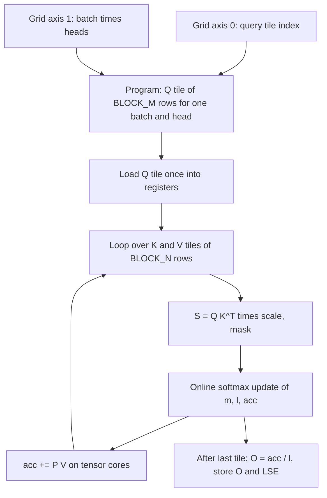

# Project: Write a Fused Attention Kernel in Triton

## Introduction

[FlashAttention Explained](../5-llm-flash-attention/2-llm-flash-attention.mdx) showed, on paper, why fusing attention into a single kernel is faster: the $T \times T$ score matrix never travels to GPU main memory. In this project you write that kernel yourself, in about 70 lines of **Triton**, and measure it against PyTorch.

By the end you will have:

- A pure-PyTorch tiled implementation of the algorithm that runs on any CPU and proves the math.
- A Triton forward kernel for causal and non-causal attention, fp16 and bf16, head dimensions 16 to 128 and any sequence length.
- A correctness test against `torch.nn.functional.scaled_dot_product_attention` (SDPA), including the log-sum-exp needed for training.
- A benchmark against naive PyTorch and PyTorch's own FlashAttention backend, and a tuning sweep over tile sizes.
- An autograd wrapper with a backward pass, checked against SDPA's gradients.

:::warning
The Triton kernel needs an NVIDIA GPU (compute capability 8.0 or newer is the safe choice for `tl.dot` in fp16 and bf16, and Triton also supports recent AMD GPUs). Every number on this page comes from an **NVIDIA GeForce RTX 4060 Ti 8 GB** (Ada, compute capability 8.9, 34 SMs) with PyTorch 2.14.1 (CUDA 13.0 build) and Triton 3.8. Without a GPU you can still do most of the project: Step 1 runs the identical algorithm in PyTorch on the CPU, and Step 5 runs the Triton kernel itself on the CPU in Triton's interpreter mode.
:::

The project follows the FlashAttention-2 work partition (Dao, 2023): one program per block of queries, looping over blocks of keys and values. The official Triton tutorial "Fused Attention" is a heavily optimized version of the same design; ours keeps only what is needed to understand it.

## The Algorithm in One Screen

For one query row $q$, attention over keys $k_1, \dots, k_T$ and values $v_1, \dots, v_T$ is

$$
o = \sum_{j=1}^{T} \frac{e^{s_j}}{\sum_{l} e^{s_l}}\, v_j, \qquad s_j = \frac{q \cdot k_j}{\sqrt{d}}
$$

We want to compute it while seeing the keys one **tile** of $B_N$ columns at a time, never holding all $T$ scores. The online softmax from [Online Softmax and Tiling](../5-llm-flash-attention/1-llm-online-softmax.mdx) keeps three running quantities per query row: the running maximum $m$, the running sum of exponentials $\ell$, and an unnormalized output accumulator $a$. When a new tile of scores $s^{(t)}$ arrives:

$$
m' = \max\!\left(m, \max_j s^{(t)}_j\right), \qquad \alpha = e^{m - m'}
$$

$$
\ell' = \alpha\,\ell + \sum_j e^{s^{(t)}_j - m'}, \qquad a' = \alpha\, a + \sum_j e^{s^{(t)}_j - m'}\, v_j
$$

The factor $\alpha \le 1$ rescales everything accumulated so far to the new maximum. After the last tile, $o = a / \ell$, and the log-sum-exp of the row is $m + \ln \ell$. Subtracting the running maximum keeps every exponent at most zero, so nothing overflows even in fp16.

Check it with numbers. Take one row with scores $(1, 3)$ in the first tile and $(2, 5)$ in the second, and scalar values $v = (10, 20, 30, 40)$.

- Tile 1: $m = 3$, $\ell = e^{-2} + e^{0} = 1.1353$, $a = 10 e^{-2} + 20 = 21.353$.
- Tile 2: $m' = 5$, $\alpha = e^{-2} = 0.13534$, $\ell' = 0.13534 \cdot 1.1353 + e^{-3} + e^{0} = 1.2034$, $a' = 0.13534 \cdot 21.353 + 30 e^{-3} + 40 = 44.383$.
- Output: $a'/\ell' = 36.88$. The direct softmax over $(1,3,2,5)$ gives weights $(0.0152, 0.1125, 0.0414, 0.8310)$ and the same $36.88$.

Two implementation tricks from the Triton tutorial are worth adopting. First, GPUs compute $2^x$ faster than $e^x$, and $e^x = 2^{x \log_2 e}$, so we fold $\log_2 e \approx 1.4427$ into the softmax scale once and use `exp2` everywhere; $m$ and the log-sum-exp are then in base 2 until we convert back at the end. Second, we divide by $\ell$ only once, after the loop, instead of normalizing every tile (one of the FlashAttention-2 changes over the first version).

## How Triton Thinks

A CUDA kernel is written per **thread**. A Triton kernel is written per **program**, and each program operates on whole blocks (tiles) of data at once: you write `tl.dot(q, k)` on a `(64, 64)` tile and the compiler decides how threads, warps, shared memory and tensor cores split the work. The Triton paper (Tillet, Kung and Cox, 2019) calls this a tile-based programming model.

The pieces you need:

| Triton | Meaning |
| --- | --- |
| `@triton.jit` | compile this Python function into a GPU kernel |
| `tl.program_id(axis)` | which program am I, along a launch-grid axis |
| `tl.arange(0, N)` | a vector `0..N-1`; N must be a power of two known at compile time |
| `tl.load(ptr, mask, other)` | read a tile; masked-off lanes get `other` instead of reading out of bounds |
| `tl.store(ptr, val, mask)` | write a tile |
| `tl.dot(a, b, acc)` | matrix multiply of two tiles on tensor cores, optionally adding into `acc` |
| `tl.constexpr` | an argument baked into the compiled kernel (tile sizes, flags) |

Pointers are plain integers. To address element $(t, d)$ of a tensor you add `t * stride_t + d` to the base pointer, and to address a whole tile you add a column vector of row offsets to a row vector of column offsets, which broadcasts to a 2D block of pointers. That is all the indexing in this project.

Our launch grid has two axes. Axis 0 picks a tile of $B_M$ queries, axis 1 picks one (batch, head) pair. Every program is independent, which is exactly the parallelism FlashAttention-2 added over the first version (which parallelized only over batch and heads).



## Step 1: The Algorithm in PyTorch, on the CPU

Before writing GPU code, write the exact loop the kernel will run, in PyTorch, and check it against SDPA. This is the CPU fallback for readers without a GPU, and it is the reference that catches algorithm bugs before they become kernel bugs. Save it as `tiled_reference.py`.

```python
import math

import torch
import torch.nn.functional as F


def tiled_attention(q, k, v, causal=False, block_m=64, block_n=64):
    """Exactly the loop the Triton kernel runs, written in PyTorch.
    q, k, v: (B, H, T, D). Returns output (B, H, T, D) and log-sum-exp (B, H, T)."""
    B, H, T, D = q.shape
    scale = 1.0 / math.sqrt(D)
    out = torch.empty_like(q)
    lse = torch.empty(B, H, T, dtype=torch.float32)
    for start_m in range(0, T, block_m):                      # one "program" per query tile
        qi = q[:, :, start_m:start_m + block_m].float()        # (B, H, bm, D)
        rows = torch.arange(start_m, start_m + qi.shape[2])
        m_i = torch.full(qi.shape[:3], float("-inf"))          # (B, H, bm)
        l_i = torch.zeros(qi.shape[:3])
        acc = torch.zeros_like(qi)                             # (B, H, bm, D)
        hi = min(start_m + block_m, T) if causal else T
        for start_n in range(0, hi, block_n):
            kj = k[:, :, start_n:start_n + block_n].float()    # (B, H, bn, D)
            vj = v[:, :, start_n:start_n + block_n].float()
            s = qi @ kj.transpose(-2, -1) * scale               # (B, H, bm, bn)
            if causal:
                cols = torch.arange(start_n, start_n + kj.shape[2])
                s = s.masked_fill(rows[:, None] < cols[None, :], float("-inf"))
            m_new = torch.maximum(m_i, s.amax(-1))
            alpha = torch.exp(m_i - m_new)                     # rescale factor for old stats
            p = torch.exp(s - m_new[..., None])
            l_i = l_i * alpha + p.sum(-1)
            acc = acc * alpha[..., None] + p @ vj
            m_i = m_new
        out[:, :, start_m:start_m + block_m] = (acc / l_i[..., None]).to(q.dtype)
        lse[:, :, start_m:start_m + block_m] = m_i + torch.log(l_i)
    return out, lse


if __name__ == "__main__":
    torch.manual_seed(0)
    for (B, H, T, D) in [(2, 4, 128, 64), (1, 2, 300, 32), (1, 1, 1000, 64)]:
        for causal in (False, True):
            q, k, v = (torch.randn(B, H, T, D) for _ in range(3))
            out, lse = tiled_attention(q, k, v, causal=causal)
            ref = F.scaled_dot_product_attention(q, k, v, is_causal=causal)
            s = q @ k.transpose(-2, -1) / math.sqrt(D)
            if causal:
                s = s.masked_fill(torch.ones(T, T, dtype=torch.bool).triu(1), float("-inf"))
            print(f"B={B} H={H} T={T:4d} D={D} causal={causal!s:5s} "
                  f"max|out-ref|={(out - ref).abs().max():.1e} "
                  f"max|lse-ref|={(lse - torch.logsumexp(s, -1)).abs().max():.1e}")
```

```text
B=2 H=4 T= 128 D=64 causal=False max|out-ref|=4.2e-07 max|lse-ref|=4.8e-07
B=2 H=4 T= 128 D=64 causal=True  max|out-ref|=3.6e-07 max|lse-ref|=4.8e-07
B=1 H=2 T= 300 D=32 causal=False max|out-ref|=1.8e-07 max|lse-ref|=9.5e-07
B=1 H=2 T= 300 D=32 causal=True  max|out-ref|=2.4e-07 max|lse-ref|=4.8e-07
B=1 H=1 T=1000 D=64 causal=False max|out-ref|=1.2e-07 max|lse-ref|=9.5e-07
B=1 H=1 T=1000 D=64 causal=True  max|out-ref|=3.6e-07 max|lse-ref|=9.5e-07
```

Errors around $10^{-7}$ are fp32 rounding: the tiled algorithm is exact, not an approximation. The test includes $T = 300$ and $T = 1000$, which are not multiples of 64, so the last tile is partial, and the causal case, where the loop stops early at `hi`. A query in tile $i$ can only see keys up to its own position, so tiles to the right of the diagonal are skipped entirely: for causal attention the kernel does about half the work.

## Step 2: The Triton Kernel

Now the same loop in Triton. Create `flash_triton.py`; we will add to it in later steps.

```python
import math

import torch
import triton
import triton.language as tl


@triton.jit
def _attn_fwd(
    Q, K, V, O, LSE,                       # pointers
    stride_qb, stride_qh, stride_qt,       # strides of Q (last dim must be contiguous)
    stride_kb, stride_kh, stride_kt,
    stride_vb, stride_vh, stride_vt,
    stride_ob, stride_oh, stride_ot,
    n_heads, seq_len, sm_scale,
    HEAD_DIM: tl.constexpr, BLOCK_M: tl.constexpr, BLOCK_N: tl.constexpr,
    CAUSAL: tl.constexpr,
):
    # one program = one block of BLOCK_M queries for one (batch, head)
    pid_m = tl.program_id(0)
    pid_bh = tl.program_id(1)
    b = pid_bh // n_heads
    h = pid_bh % n_heads

    offs_m = pid_m * BLOCK_M + tl.arange(0, BLOCK_M)       # query rows of this tile
    offs_n = tl.arange(0, BLOCK_N)                          # key columns inside a tile
    offs_d = tl.arange(0, HEAD_DIM)

    q_ptrs = Q + b * stride_qb + h * stride_qh + offs_m[:, None] * stride_qt + offs_d[None, :]
    q = tl.load(q_ptrs, mask=offs_m[:, None] < seq_len, other=0.0)   # (BLOCK_M, HEAD_DIM)

    m_i = tl.full([BLOCK_M], float("-inf"), dtype=tl.float32)   # running max (base 2)
    l_i = tl.zeros([BLOCK_M], dtype=tl.float32)                 # running sum of exp
    acc = tl.zeros([BLOCK_M, HEAD_DIM], dtype=tl.float32)       # running numerator

    qk_scale = sm_scale * 1.4426950408889634     # fold log2(e) in so we can use exp2

    # causal: keys beyond the last query of this tile are never needed
    hi = tl.minimum((pid_m + 1) * BLOCK_M, seq_len) if CAUSAL else seq_len

    k_base = K + b * stride_kb + h * stride_kh
    v_base = V + b * stride_vb + h * stride_vh
    for start_n in range(0, hi, BLOCK_N):
        cols = start_n + offs_n
        k = tl.load(k_base + cols[None, :] * stride_kt + offs_d[:, None],
                    mask=cols[None, :] < seq_len, other=0.0)        # (HEAD_DIM, BLOCK_N) = K^T tile
        s = tl.dot(q, k) * qk_scale                                  # (BLOCK_M, BLOCK_N) fp32
        valid = cols[None, :] < seq_len
        if CAUSAL:
            valid = valid & (offs_m[:, None] >= cols[None, :])
        s = tl.where(valid, s, float("-inf"))

        m_new = tl.maximum(m_i, tl.max(s, axis=1))                   # (BLOCK_M,)
        alpha = tl.math.exp2(m_i - m_new)                            # rescale old stats
        p = tl.math.exp2(s - m_new[:, None])                         # (BLOCK_M, BLOCK_N)
        l_i = l_i * alpha + tl.sum(p, axis=1)
        acc = acc * alpha[:, None]

        v = tl.load(v_base + cols[:, None] * stride_vt + offs_d[None, :],
                    mask=cols[:, None] < seq_len, other=0.0)        # (BLOCK_N, HEAD_DIM)
        acc = tl.dot(p.to(v.dtype), v, acc)                          # acc += P V
        m_i = m_new

    acc = acc / l_i[:, None]
    o_ptrs = O + b * stride_ob + h * stride_oh + offs_m[:, None] * stride_ot + offs_d[None, :]
    tl.store(o_ptrs, acc.to(O.dtype.element_ty), mask=offs_m[:, None] < seq_len)
    # natural-log log-sum-exp per row, used by the backward pass
    lse = (m_i + tl.math.log2(l_i)) / 1.4426950408889634
    tl.store(LSE + pid_bh * seq_len + offs_m, lse, mask=offs_m < seq_len)
```

Walk through it against the PyTorch version; every line has a counterpart.

**Addressing.** `offs_m[:, None] * stride_qt + offs_d[None, :]` is a `(BLOCK_M, HEAD_DIM)` grid of offsets, so `q_ptrs` points at the whole query tile. We assume the last dimension is contiguous (stride 1), which the launcher enforces.

**Loading K transposed for free.** For `tl.dot(q, k)` we need $K^\top$, a `(HEAD_DIM, BLOCK_N)` tile. Instead of transposing data, we build the pointers transposed: `cols[None, :] * stride_kt + offs_d[:, None]` puts the head dimension on rows and keys on columns. Memory is read in the same order either way; only the logical tile shape changes.

**Masks do three jobs.** The load masks stop reads past the end of the sequence when $T$ is not a multiple of the tile size (the `other=0.0` values are harmless because the scores for those columns are then set to $-\infty$). The `valid` mask applies causality inside the diagonal tile. And the store masks stop writes past the end. Forgetting a mask is the classic Triton bug: it does not crash, it silently reads a neighbor's memory.

**Precision.** `q`, `k`, `v` stay fp16 or bf16 so `tl.dot` can use tensor cores, but `tl.dot` accumulates in fp32, and `m_i`, `l_i`, `acc` are fp32. Before the second matmul, `p` is cast down to the input dtype: its values are in $[0, 1]$, where fp16 is accurate enough, and this is what keeps the $PV$ product on tensor cores.

**The causal bound.** `hi` stops the key loop at the end of this tile's diagonal. Only the last iteration (the diagonal tile) actually needs the causal mask; the official tutorial splits the loop into an unmasked part and a masked part to save the comparison work. We keep one loop for clarity.

## Step 3: The Launcher

Append the Python function that allocates outputs, computes the grid and launches the kernel.

```python
def flash_attn_fwd(q, k, v, causal=False, sm_scale=None, block_m=64, block_n=64,
                   num_warps=4, num_stages=2):
    """q, k, v: (batch, n_heads, seq_len, head_dim), fp16 or bf16, on the GPU."""
    B, H, T, D = q.shape
    assert q.shape == k.shape == v.shape and D in (16, 32, 64, 128)
    q, k, v = (t if t.stride(-1) == 1 else t.contiguous() for t in (q, k, v))
    sm_scale = sm_scale if sm_scale is not None else 1.0 / math.sqrt(D)
    o = torch.empty_like(q)
    lse = torch.empty((B * H, T), device=q.device, dtype=torch.float32)
    grid = (triton.cdiv(T, block_m), B * H)
    _attn_fwd[grid](
        q, k, v, o, lse,
        q.stride(0), q.stride(1), q.stride(2),
        k.stride(0), k.stride(1), k.stride(2),
        v.stride(0), v.stride(1), v.stride(2),
        o.stride(0), o.stride(1), o.stride(2),
        H, T, sm_scale,
        HEAD_DIM=D, BLOCK_M=block_m, BLOCK_N=block_n, CAUSAL=causal,
        num_warps=num_warps, num_stages=num_stages,
    )
    return o, lse.view(B, H, T)
```

Passing strides instead of assuming a layout means the kernel accepts views: for example `q` produced by `x.view(B, T, H, D).transpose(1, 2)` inside a model has a non-standard head stride, and works without a copy. `num_warps` sets how many 32-thread warps run each program, and `num_stages` how many tiles of K and V the compiler prefetches ahead (software pipelining). Each distinct combination of `constexpr` values compiles a separate kernel the first time it is used, so the first call is slow and later calls are fast.

## Step 4: Check Correctness on the GPU

The reference is SDPA in fp32: comparing against an fp16 reference would mix its rounding errors with ours. The cases include sequence lengths that are not multiples of 64, every supported head dimension, both dtypes and both masking modes. Save as `test_correct.py`.

```python
import torch
import torch.nn.functional as F

from flash_triton import flash_attn_fwd

torch.manual_seed(0)
dev = "cuda"
print(torch.cuda.get_device_name(), "| torch", torch.__version__)

cases = [(2, 4, 128, 64), (1, 8, 1000, 64), (2, 2, 257, 128), (4, 16, 2048, 64), (1, 4, 77, 32)]
for dtype in (torch.float16, torch.bfloat16):
    for B, H, T, D in cases:
        for causal in (False, True):
            q, k, v = (torch.randn(B, H, T, D, device=dev, dtype=dtype) for _ in range(3))
            out, lse = flash_attn_fwd(q, k, v, causal=causal)
            # reference in fp32 so we measure our error, not the reference's
            ref = F.scaled_dot_product_attention(q.float(), k.float(), v.float(), is_causal=causal)
            scores = q.float() @ k.float().transpose(-2, -1) / D ** 0.5
            if causal:
                scores = scores.masked_fill(torch.ones(T, T, device=dev, dtype=torch.bool).triu(1),
                                            float("-inf"))
            ref_lse = torch.logsumexp(scores, dim=-1)
            err = (out.float() - ref).abs().max().item()
            lse_err = (lse - ref_lse).abs().max().item()
            print(f"{str(dtype):15s} B={B} H={H:2d} T={T:4d} D={D:3d} causal={causal!s:5s} "
                  f"max|out-ref|={err:.1e} max|lse-ref|={lse_err:.1e}")
            tol = 2e-2 if dtype == torch.bfloat16 else 4e-3
            assert err < tol and lse_err < 1e-2
print("all cases pass")
```

```text
NVIDIA GeForce RTX 4060 Ti | torch 2.14.1+cu130
torch.float16   B=2 H= 4 T= 128 D= 64 causal=False max|out-ref|=2.9e-04 max|lse-ref|=9.5e-07
torch.float16   B=2 H= 4 T= 128 D= 64 causal=True  max|out-ref|=8.4e-04 max|lse-ref|=9.5e-07
torch.float16   B=1 H= 8 T=1000 D= 64 causal=False max|out-ref|=1.3e-04 max|lse-ref|=1.4e-06
torch.float16   B=1 H= 8 T=1000 D= 64 causal=True  max|out-ref|=8.6e-04 max|lse-ref|=1.4e-06
torch.float16   B=2 H= 2 T= 257 D=128 causal=False max|out-ref|=2.2e-04 max|lse-ref|=9.5e-07
torch.float16   B=2 H= 2 T= 257 D=128 causal=True  max|out-ref|=9.5e-04 max|lse-ref|=9.5e-07
torch.float16   B=4 H=16 T=2048 D= 64 causal=False max|out-ref|=1.3e-04 max|lse-ref|=1.9e-06
torch.float16   B=4 H=16 T=2048 D= 64 causal=True  max|out-ref|=9.7e-04 max|lse-ref|=1.9e-06
torch.float16   B=1 H= 4 T=  77 D= 32 causal=False max|out-ref|=2.8e-04 max|lse-ref|=4.8e-07
torch.float16   B=1 H= 4 T=  77 D= 32 causal=True  max|out-ref|=8.1e-04 max|lse-ref|=4.8e-07
torch.bfloat16  B=2 H= 4 T= 128 D= 64 causal=False max|out-ref|=3.3e-03 max|lse-ref|=9.5e-07
torch.bfloat16  B=2 H= 4 T= 128 D= 64 causal=True  max|out-ref|=7.6e-03 max|lse-ref|=9.5e-07
torch.bfloat16  B=1 H= 8 T=1000 D= 64 causal=False max|out-ref|=1.1e-03 max|lse-ref|=1.4e-06
torch.bfloat16  B=1 H= 8 T=1000 D= 64 causal=True  max|out-ref|=5.9e-03 max|lse-ref|=9.5e-07
torch.bfloat16  B=2 H= 2 T= 257 D=128 causal=False max|out-ref|=2.0e-03 max|lse-ref|=9.5e-07
torch.bfloat16  B=2 H= 2 T= 257 D=128 causal=True  max|out-ref|=6.1e-03 max|lse-ref|=9.5e-07
torch.bfloat16  B=4 H=16 T=2048 D= 64 causal=False max|out-ref|=9.4e-04 max|lse-ref|=1.9e-06
torch.bfloat16  B=4 H=16 T=2048 D= 64 causal=True  max|out-ref|=8.4e-03 max|lse-ref|=1.4e-06
torch.bfloat16  B=1 H= 4 T=  77 D= 32 causal=False max|out-ref|=2.3e-03 max|lse-ref|=4.8e-07
torch.bfloat16  B=1 H= 4 T=  77 D= 32 causal=True  max|out-ref|=5.7e-03 max|lse-ref|=4.8e-07
all cases pass
```

(Your first run may also print C compiler warnings while Triton builds its launcher stub; they are harmless.)

How do we know these errors are acceptable? Three observations. The log-sum-exp error is around $10^{-6}$, which means the softmax statistics are computed in fp32 correctly. The output error is around $10^{-3}$ for fp16 and $10^{-2}$ for bf16, matching the precision of the formats: fp16 has 10 mantissa bits (relative spacing about $10^{-3}$) and bf16 has 7 (about $8 \times 10^{-3}$). And causal errors are larger than non-causal because early query rows average over few keys, so their outputs are larger in magnitude and so is their rounding. The benchmark in Step 6 adds the decisive check: PyTorch's own fp16 flash kernel has exactly the same error as ours.

## Step 5: Run the Kernel on a CPU with the Interpreter

Triton ships an interpreter that executes kernels on the CPU with NumPy, one program at a time. It is meant for debugging (you can even put `print` calls inside the kernel), but it also lets you run this project without a GPU. Set `TRITON_INTERPRET=1` before Triton is imported and pass CPU tensors. `pip install triton` works on Linux machines without a GPU for this purpose.

```python
import os
os.environ["TRITON_INTERPRET"] = "1"          # must be set before triton is imported

import time

import torch
import torch.nn.functional as F

from flash_triton import flash_attn_fwd

torch.manual_seed(0)
for causal in (False, True):
    q, k, v = (torch.randn(1, 2, 200, 64, dtype=torch.float16) for _ in range(3))  # CPU tensors
    t0 = time.time()
    out, lse = flash_attn_fwd(q, k, v, causal=causal, block_m=32, block_n=32)
    dt = time.time() - t0
    ref = F.scaled_dot_product_attention(q.float(), k.float(), v.float(), is_causal=causal)
    print(f"interpreter, causal={causal!s:5s}: max|out-ref| = "
          f"{(out.float() - ref).abs().max().item():.1e} ({dt:.1f} s)")
```

```text
interpreter, causal=False: max|out-ref| = 2.4e-04 (0.4 s)
interpreter, causal=True : max|out-ref| = 5.4e-04 (0.2 s)
```

This ran on a CPU-only PyTorch 2.14 install with Triton 3.8. The interpreter checks the logic of the kernel (indexing, masks, the online softmax) but not its performance, and it does not reproduce every GPU detail, so always confirm on real hardware before trusting speed or rare edge cases.

## Step 6: Benchmark

We compare four implementations on causal attention with batch 4, 16 heads, head dimension 64, fp16:

- **naive**: matmul, mask, softmax, matmul in PyTorch. It materializes the `(B, H, T, T)` score matrix.
- **sdpa-flash**: `F.scaled_dot_product_attention` forced to its FlashAttention backend with `torch.nn.attention.sdpa_kernel`.
- **triton 64x64** and **triton 128x64**: our kernel with two tile configurations.

Throughput counts the useful FLOPs: two matmuls of $2 T^2 d$ FLOPs per head, halved for the causal mask, so $2 B H T^2 d$ in total. `triton.testing.do_bench` handles warmup and timing. Save as `bench.py`.

```python
import torch
import torch.nn.functional as F
import triton
from torch.nn.attention import SDPBackend, sdpa_kernel

from flash_triton import flash_attn_fwd

torch.manual_seed(0)
B, H, D, dtype = 4, 16, 64, torch.float16


def naive(q, k, v):
    T = q.shape[-2]
    s = (q @ k.transpose(-2, -1)) * D ** -0.5                     # (B, H, T, T) in HBM
    mask = torch.ones(T, T, device=q.device, dtype=torch.bool).triu(1)
    return torch.softmax(s.masked_fill(mask, float("-inf")), dim=-1) @ v


def sdpa_flash(q, k, v):
    with sdpa_kernel(SDPBackend.FLASH_ATTENTION):
        return F.scaled_dot_product_attention(q, k, v, is_causal=True)


def ours(bm, bn, w, s):
    return lambda q, k, v: flash_attn_fwd(q, k, v, causal=True, block_m=bm, block_n=bn,
                                          num_warps=w, num_stages=s)[0]


impls = {"naive": naive, "sdpa-flash": sdpa_flash,
         "triton 64x64": ours(64, 64, 4, 2), "triton 128x64": ours(128, 64, 4, 3)}

print(f"causal forward, B={B} H={H} D={D} fp16; best-of-5 time in ms (TFLOP/s)")
print("T      " + "".join(f"{n:>22s}" for n in impls))
for T in (512, 1024, 2048, 4096, 8192):
    q, k, v = (torch.randn(B, H, T, D, device="cuda", dtype=dtype) for _ in range(3))
    flops = 4 * B * H * T * T * D / 2                       # two matmuls, half masked away
    row = f"{T:<7d}"
    for name, fn in impls.items():
        if name == "naive" and T > 2048:          # its (B, H, T, T) scores would need > 6 GiB
            row += f"{'skipped':>22s}"
            continue
        try:
            ms = min(triton.testing.do_bench(lambda: fn(q, k, v), warmup=25, rep=100)
                     for _ in range(5))                     # best of 5: the GPU is shared
            row += f"{ms:>12.3f} ({flops / ms / 1e9:5.1f})  "
        except torch.OutOfMemoryError:
            row += f"{'OOM':>22s}"
            torch.cuda.empty_cache()
    print(row)

# peak memory for one call at T=2048
T = 2048
q, k, v = (torch.randn(B, H, T, D, device="cuda", dtype=dtype) for _ in range(3))
for name in ("naive", "sdpa-flash", "triton 64x64"):
    torch.cuda.synchronize(); torch.cuda.reset_peak_memory_stats()
    base = torch.cuda.memory_allocated()
    impls[name](q, k, v); torch.cuda.synchronize()
    print(f"T={T} {name:13s} extra peak memory: {(torch.cuda.max_memory_allocated() - base) / 2**20:8.1f} MiB")

# the fp16 error of SDPA itself, as a yardstick for ours
T = 2048
q, k, v = (torch.randn(1, 8, T, D, device="cuda", dtype=dtype) for _ in range(3))
ref = F.scaled_dot_product_attention(q.float(), k.float(), v.float(), is_causal=True)
print("fp16 error vs fp32 reference: sdpa-flash "
      f"{(sdpa_flash(q, k, v).float() - ref).abs().max().item():.1e}, triton "
      f"{(impls['triton 64x64'](q, k, v).float() - ref).abs().max().item():.1e}")
```

```text
causal forward, B=4 H=16 D=64 fp16; best-of-5 time in ms (TFLOP/s)
T                       naive            sdpa-flash          triton 64x64         triton 128x64
512           1.437 (  1.5)         0.110 ( 19.6)         0.097 ( 22.2)         0.102 ( 21.1)
1024          5.453 (  1.6)         0.272 ( 31.6)         0.243 ( 35.4)         0.267 ( 32.2)
2048         21.316 (  1.6)         0.945 ( 36.4)         1.200 ( 28.6)         0.958 ( 35.9)
4096                  skipped       3.523 ( 39.0)         3.371 ( 40.8)         3.712 ( 37.0)
8192                  skipped      13.548 ( 40.6)        12.971 ( 42.4)        13.055 ( 42.1)
T=2048 naive         extra peak memory:   1540.0 MiB
T=2048 sdpa-flash    extra peak memory:     16.5 MiB
T=2048 triton 64x64  extra peak memory:     16.5 MiB
fp16 error vs fp32 reference: sdpa-flash 9.8e-04, triton 9.8e-04
```

:::note
All GPU numbers on this page were measured on an RTX 4060 Ti that was shared with other jobs, so individual timings varied by up to 2x between runs; that is why the script keeps the best of five. The best cuBLAS fp16 matmul (8192 by 8192) we measured on the card was 45.5 TFLOP/s, a useful ceiling for any kernel built on its tensor cores. Rerun the script on your own hardware and read the trends, not the third digit.
:::

What the table says:

- **Our 70-line kernel matches PyTorch's FlashAttention backend** within a few percent at long sequences, reaching about 40 TFLOP/s, close to the matmul ceiling of this card. At 8K tokens, the attention computation is limited by tensor-core throughput, not memory.
- **The naive version is 13 to 23 times slower and cannot run long sequences at all.** Its time is dominated by writing and reading the score matrix: the forward pass alone allocates 1.5 GiB extra at $T = 2048$ (the scores, the masked copy and the softmax output, each $4 \cdot 16 \cdot 2048^2 \cdot 2$ bytes = 512 MiB). At $T = 4096$ each of those would be 2 GiB, more than this shared 8 GB card could spare, so the script skips it.
- **The fused kernels need only 16.5 MiB extra**: the 16 MiB output plus 0.5 MiB of fp32 log-sum-exp. Memory is linear in $T$ instead of quadratic, which is the whole point of FlashAttention.
- **The errors are identical**, 9.8e-04 for both. That is the definitive answer to "is our accuracy acceptable": it is as accurate as the production kernel.

## Step 7: Tune the Tile Sizes

Tile sizes trade parallelism, register pressure and data reuse. A bigger `BLOCK_M` reuses each K and V tile for more queries (fewer loads from memory) but needs more registers for `acc` and creates fewer programs to spread across the 34 SMs. A bigger `BLOCK_N` makes each `tl.dot` larger but grows the `s` and `p` tiles. The only reliable way to pick is to measure.

```python
import torch
import triton

from flash_triton import flash_attn_fwd

torch.manual_seed(0)
B, H, T, D = 4, 16, 4096, 64
q, k, v = (torch.randn(B, H, T, D, device="cuda", dtype=torch.float16) for _ in range(3))
flops = 4 * B * H * T * T * D / 2
print(f"causal, B={B} H={H} T={T} D={D}")
for bm, bn in [(32, 32), (64, 32), (64, 64), (128, 32), (128, 64), (128, 128)]:
    for warps in (4, 8):
        for stages in (2, 3):
            try:
                ms = min(triton.testing.do_bench(        # best of 3: the GPU is shared
                    lambda: flash_attn_fwd(q, k, v, causal=True, block_m=bm, block_n=bn,
                                           num_warps=warps, num_stages=stages), rep=100)
                    for _ in range(3))
                print(f"BLOCK_M={bm:3d} BLOCK_N={bn:3d} warps={warps} stages={stages}: "
                      f"{ms:6.3f} ms  {flops / ms / 1e9:5.1f} TFLOP/s")
            except Exception as e:                       # e.g. out of shared memory
                print(f"BLOCK_M={bm:3d} BLOCK_N={bn:3d} warps={warps} stages={stages}: "
                      f"{type(e).__name__}")
```

```text
causal, B=4 H=16 T=4096 D=64
BLOCK_M= 32 BLOCK_N= 32 warps=4 stages=2:  4.452 ms   30.9 TFLOP/s
BLOCK_M= 32 BLOCK_N= 32 warps=4 stages=3:  6.451 ms   21.3 TFLOP/s
BLOCK_M= 32 BLOCK_N= 32 warps=8 stages=2: 17.614 ms    7.8 TFLOP/s
BLOCK_M= 32 BLOCK_N= 32 warps=8 stages=3: 10.275 ms   13.4 TFLOP/s
BLOCK_M= 64 BLOCK_N= 32 warps=4 stages=2:  4.742 ms   29.0 TFLOP/s
BLOCK_M= 64 BLOCK_N= 32 warps=4 stages=3:  3.357 ms   40.9 TFLOP/s
BLOCK_M= 64 BLOCK_N= 32 warps=8 stages=2:  8.545 ms   16.1 TFLOP/s
BLOCK_M= 64 BLOCK_N= 32 warps=8 stages=3: 18.046 ms    7.6 TFLOP/s
BLOCK_M= 64 BLOCK_N= 64 warps=4 stages=2:  6.757 ms   20.3 TFLOP/s
BLOCK_M= 64 BLOCK_N= 64 warps=4 stages=3:  4.432 ms   31.0 TFLOP/s
BLOCK_M= 64 BLOCK_N= 64 warps=8 stages=2: 18.172 ms    7.6 TFLOP/s
BLOCK_M= 64 BLOCK_N= 64 warps=8 stages=3:  7.675 ms   17.9 TFLOP/s
BLOCK_M=128 BLOCK_N= 32 warps=4 stages=2:  3.605 ms   38.1 TFLOP/s
BLOCK_M=128 BLOCK_N= 32 warps=4 stages=3:  3.853 ms   35.7 TFLOP/s
BLOCK_M=128 BLOCK_N= 32 warps=8 stages=2:  4.032 ms   34.1 TFLOP/s
BLOCK_M=128 BLOCK_N= 32 warps=8 stages=3:  6.587 ms   20.9 TFLOP/s
BLOCK_M=128 BLOCK_N= 64 warps=4 stages=2:  3.698 ms   37.2 TFLOP/s
BLOCK_M=128 BLOCK_N= 64 warps=4 stages=3: 10.964 ms   12.5 TFLOP/s
BLOCK_M=128 BLOCK_N= 64 warps=8 stages=2:  4.717 ms   29.1 TFLOP/s
BLOCK_M=128 BLOCK_N= 64 warps=8 stages=3:  7.076 ms   19.4 TFLOP/s
BLOCK_M=128 BLOCK_N=128 warps=4 stages=2:  6.521 ms   21.1 TFLOP/s
BLOCK_M=128 BLOCK_N=128 warps=4 stages=3:  4.724 ms   29.1 TFLOP/s
BLOCK_M=128 BLOCK_N=128 warps=8 stages=2:  5.047 ms   27.2 TFLOP/s
BLOCK_M=128 BLOCK_N=128 warps=8 stages=3:  4.161 ms   33.0 TFLOP/s
```

Be honest about what a sweep on a shared GPU can tell you. We ran it three times while other jobs used the card, and the exact ranking changed between runs: the same configuration could move by 1.5x. What held in every run: the best configurations reached 38 to 41 TFLOP/s, all of them used 4 warps with `BLOCK_M` of 64 or 128, and 8 warps were slower for most tile shapes, because with head dimension 64 there is not enough work per tile to keep eight warps busy and the extra warps add synchronization. The largest 128 by 128 tiles were never the winner: their fp32 score tile plus the accumulator use so many registers that fewer programs fit on each SM at once. The best configuration also differs between GPUs (an H100 has more shared memory per SM and favors larger tiles), which is why production kernels wrap the kernel in `@triton.autotune` with a list of `triton.Config` candidates and let Triton time them on first use.

## Step 8: Make It Trainable

A forward kernel alone cannot train a model. A true FlashAttention backward is another fused kernel, longer than the forward. Here we take the shortcut that teaches the important idea: the forward saves only the output $O$ and the log-sum-exp $L$ per row, and the backward **recomputes** the probabilities from them instead of storing the $T \times T$ matrix.

With $S = QK^\top/\sqrt{d}$ and $P = \mathrm{softmax}(S)$ row by row, $P_{ij} = e^{S_{ij} - L_i}$. Given the upstream gradient $dO$, the standard softmax backward gives

$$
dV = P^\top dO, \qquad dP = dO\, V^\top, \qquad D_i = \sum_k dO_{ik} O_{ik}
$$

$$
dS = P \circ (dP - D), \qquad dQ = \frac{dS\, K}{\sqrt{d}}, \qquad dK = \frac{dS^\top Q}{\sqrt{d}}
$$

The term $D_i = \sum_j P_{ij} dP_{ij}$ is computed as a row-wise dot product of $dO$ and $O$, a FlashAttention trick that avoids needing $P$ for it. Append this to `flash_triton.py`:

```python
class FlashAttention(torch.autograd.Function):
    """Triton forward + a plain PyTorch backward that recomputes P from the saved LSE."""

    @staticmethod
    def forward(ctx, q, k, v, causal):
        o, lse = flash_attn_fwd(q, k, v, causal=causal)
        ctx.save_for_backward(q, k, v, o, lse)
        ctx.causal = causal
        return o

    @staticmethod
    def backward(ctx, do):
        q, k, v, o, lse = ctx.saved_tensors
        T, D = q.shape[-2], q.shape[-1]
        scale = 1.0 / math.sqrt(D)
        qf, kf, vf, of, dof = (t.float() for t in (q, k, v, o, do))
        s = qf @ kf.transpose(-2, -1) * scale                          # (B, H, T, T)
        if ctx.causal:
            s = s.masked_fill(torch.ones(T, T, device=q.device, dtype=torch.bool).triu(1),
                              float("-inf"))
        p = torch.exp(s - lse[..., None])                               # softmax, recomputed
        dv = p.transpose(-2, -1) @ dof                                  # (B, H, T, D)
        dp = dof @ vf.transpose(-2, -1)                                 # (B, H, T, T)
        delta = (dof * of).sum(-1, keepdim=True)                        # rowsum(dO * O)
        ds = p * (dp - delta)
        dq = ds @ kf * scale
        dk = ds.transpose(-2, -1) @ qf * scale
        return dq.to(q.dtype), dk.to(k.dtype), dv.to(v.dtype), None


def flash_attention(q, k, v, causal=False):
    return FlashAttention.apply(q, k, v, causal)
```

And check the gradients against SDPA in fp32 (`test_grad.py`). The script uses the GPU when there is one and the CPU otherwise.

```python
import torch
import torch.nn.functional as F

from flash_triton import flash_attention

torch.manual_seed(0)
dev = "cuda" if torch.cuda.is_available() else "cpu"
B, H, T, D = 2, 4, 300, 64
q, k, v = (torch.randn(B, H, T, D, device=dev, dtype=torch.float16, requires_grad=True)
           for _ in range(3))
do = torch.randn(B, H, T, D, device=dev, dtype=torch.float16)

out = flash_attention(q, k, v, causal=True)
out.backward(do)
ours = [t.grad.float().clone() for t in (q, k, v)]

q32, k32, v32 = (t.detach().float().requires_grad_() for t in (q, k, v))
ref = F.scaled_dot_product_attention(q32, k32, v32, is_causal=True)
ref.backward(do.float())
for name, g, r in zip("qkv", ours, (q32.grad, k32.grad, v32.grad)):
    print(f"d{name}: max abs err {(g - r).abs().max().item():.1e}, "
          f"relative {((g - r).norm() / r.norm()).item():.1e}")
```

On the RTX 4060 Ti:

```text
dq: max abs err 9.5e-04, relative 2.3e-04
dk: max abs err 1.1e-03, relative 2.4e-04
dv: max abs err 9.7e-04, relative 2.1e-04
```

On a CPU with `TRITON_INTERPRET=1 python test_grad.py`:

```text
dq: max abs err 9.6e-04, relative 2.3e-04
dk: max abs err 8.9e-04, relative 2.3e-04
dv: max abs err 1.9e-03, relative 2.1e-04
```

Relative errors of $2 \times 10^{-4}$ are fp16 rounding, so the backward is correct. Be clear about what this shortcut costs: our backward still builds $T \times T$ matrices, so training memory is quadratic again. The real FlashAttention backward tiles this computation the same way the forward does, looping over K/V blocks in the outer loop and accumulating $dQ$ with atomic adds or a separate pass. The official Triton tutorial contains such a kernel and is the natural next step.

## What Production Kernels Add

Our kernel is a faithful FlashAttention-2 forward, but the official Triton tutorial and the `flash-attn` package go further. [FlashAttention-2, 3 and 4](../5-llm-flash-attention/3-llm-flash-attention-2-3.mdx) covers the details; in brief:

| Feature | What it buys |
| --- | --- |
| Separate masked and unmasked loops for causal attention | no mask arithmetic on off-diagonal tiles |
| `@triton.autotune` over tile sizes, warps and stages | the best configuration per GPU and shape |
| Tensor descriptors (TMA) on Hopper and newer | hardware-managed bulk copies from HBM to shared memory |
| Warp specialization (FlashAttention-3) | producer warps load data while consumer warps compute |
| FP8 inputs | double tensor-core throughput on Hopper and Blackwell |
| A fused backward kernel | linear memory for training, not just inference |
| GQA, sliding windows, variable-length batches, paged KV | the features real models need, see [Using FlashAttention](../5-llm-flash-attention/4-llm-using-flash-attention.mdx) |

## Common Mistakes

- **Missing masks on loads and stores.** Out-of-bounds reads do not crash in Triton; they read neighboring memory and give wrong answers only for some sequence lengths. Test lengths that are not multiples of the tile size.
- **Comparing against an fp16 reference.** Then you cannot tell your error from the reference's. Compare against fp32, and use the production kernel's own error as the yardstick.
- **Accumulating in fp16.** Keep `m`, `l` and the accumulator in fp32; only cast `p` down for the second matmul.
- **Mixing $e^x$ and $2^x$.** If you fold $\log_2 e$ into the scale, every exponential and the final log-sum-exp must be base 2 until you convert back.
- **Assuming a contiguous layout.** Tensors from `view(...).transpose(1, 2)` have unusual strides. Pass strides to the kernel, and make the last dimension contiguous.
- **Benchmarking the first call.** The first call compiles the kernel. Use `triton.testing.do_bench`, which warms up first, and repeat runs on a shared machine.
- **Expecting the interpreter to predict speed.** `TRITON_INTERPRET=1` checks correctness only.

## Summary

- A fused attention kernel streams K and V tiles past a resident Q tile and keeps a running max, running sum and unnormalized output per query row, so the $T \times T$ scores never reach HBM.
- Triton expresses this in about 70 lines: one program per (query tile, batch-head), pointer arithmetic with masks, `tl.dot` for both matmuls, `exp2` with a folded $\log_2 e$.
- A PyTorch version of the same loop runs on any CPU, matches SDPA to $10^{-7}$, and is the first thing to write; the Triton interpreter runs the actual kernel on a CPU too.
- On an RTX 4060 Ti the kernel matched PyTorch's FlashAttention backend at about 40 TFLOP/s for long sequences, with identical error and 16.5 MiB of extra memory versus 1.5 GiB for naive attention at 2K tokens.
- Saving the log-sum-exp lets the backward pass recompute $P$ instead of storing it; production kernels also fuse and tile the backward.

## Further Reading

- [FlashAttention: Fast and Memory-Efficient Exact Attention with IO-Awareness (Dao et al., 2022)](https://arxiv.org/abs/2205.14135): the original tiled, IO-aware algorithm.
- [FlashAttention-2: Faster Attention with Better Parallelism and Work Partitioning (Dao, 2023)](https://arxiv.org/abs/2307.08691): the query-tile partition and deferred normalization used here.
- [Online normalizer calculation for softmax (Milakov and Gimelshein, 2018)](https://arxiv.org/abs/1805.02867): the running max and sum recurrence.
- [Triton: An Intermediate Language and Compiler for Tiled Neural Network Computations (Tillet, Kung and Cox, 2019)](https://www.eecs.harvard.edu/~htk/publication/2019-mapl-tillet-kung-cox.pdf): the paper behind Triton.
- [Triton tutorial: Fused Attention](https://triton-lang.org/main/getting-started/tutorials/06-fused-attention.html): the optimized forward and backward kernels this project simplifies.
- [Triton documentation](https://triton-lang.org/main/index.html): the language reference, including the interpreter and autotuning.
- [PyTorch scaled_dot_product_attention](https://docs.pytorch.org/docs/stable/generated/torch.nn.functional.scaled_dot_product_attention.html): the reference implementation and its backends.
