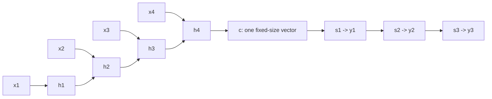
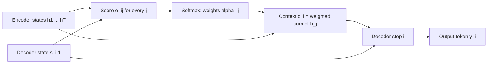

# Attention Intuition: Why Sequence Models Needed It

## Introduction

Every large language model you will meet in this tutorial is built from one operation repeated dozens of times: **attention**. Before we derive its formula on the next page, it helps to understand the problem it was invented to solve and the simple idea behind it.

The story starts in 2014 with neural machine translation. Researchers had just shown that a recurrent network could read a sentence in one language and write it in another. It worked well on short sentences and fell apart on long ones. The fix, published by Dzmitry Bahdanau, Kyunghyun Cho and Yoshua Bengio, let the decoder look back at every input word instead of relying on one summary vector. Three years later the Transformer kept the looking back and threw away the recurrence.

By the end of this page you will be able to:

- Explain the fixed-length bottleneck of encoder-decoder RNNs and why it hurts long inputs.
- Write down Bahdanau's additive attention and implement it in PyTorch.
- Describe attention as a **soft dictionary lookup** with queries, keys and values.
- Compute a small attention example by hand and check it in code.

If you need a refresher on softmax or linear layers first, read [Neural Network Refresher for LLMs](../0-llm-fundamentals/3-llm-neural-network-refresher.mdx). For the longer history of language models, see [From N-grams to GPT](../0-llm-fundamentals/2-llm-history.mdx).

## The Encoder-Decoder Bottleneck

In 2014 two groups introduced the recurrent **encoder-decoder** (also called sequence-to-sequence): Cho et al. in "Learning Phrase Representations using RNN Encoder-Decoder for Statistical Machine Translation" and Sutskever, Vinyals and Le in "Sequence to Sequence Learning with Neural Networks".

The design has two recurrent networks:

1. The **encoder** reads the source tokens $x_1, \dots, x_T$ one at a time and updates a hidden state $h_j = f(h_{j-1}, x_j)$.
2. The final hidden state $h_T$ becomes a single vector $c$, the "meaning" of the whole sentence.
3. The **decoder** starts from $c$ and generates target tokens $y_1, y_2, \dots$ one at a time, each step conditioned on its own previous state and the previous output.



The weak point is the vector $c$. Whether the input is 5 words or 50, everything the decoder will ever know about it must fit in, say, 1,000 numbers. Think of reading a whole page, closing the book and then translating it from memory. Short sentences survive; long ones lose details, especially from the beginning, because the recurrent state has been overwritten many times since.

Bahdanau et al. measured this directly. In their 2014 paper "Neural Machine Translation by Jointly Learning to Align and Translate" (arXiv 1409.0473, published at ICLR 2015), the BLEU score of the plain encoder-decoder dropped sharply as sentences grew longer, while their attention model held up much better on long sentences.

There is a second, quieter problem: **path length**. For the decoder to use word 1 of a 50-word sentence, that information must travel through 50 encoder steps and then through every decoder step. Gradients travel the same long path backwards, and they shrink or explode along the way. LSTMs and GRUs soften this, but they do not remove it.

## Bahdanau Attention: Let the Decoder Look Back

The fix is easy to say: **keep all the encoder states and let the decoder choose which ones to read at each step.** Instead of one vector $c$, the decoder gets a different context vector $c_i$ for every output token $i$.

Bahdanau's model computes it in three steps. Let $h_1, \dots, h_T$ be the encoder states (they used a bidirectional RNN, so each $h_j$ summarizes the words around position $j$), and let $s_{i-1}$ be the decoder state just before producing output $i$.

**Step 1: score every source position.** A small neural network rates how relevant source position $j$ is for the next output:

$$
e_{ij} = v_a^\top \tanh\!\left(W_a s_{i-1} + U_a h_j\right)
$$

Here $W_a$ and $U_a$ are learned matrices that project the decoder state and the encoder state into a shared space of size $d_a$, and $v_a \in \mathbb{R}^{d_a}$ is a learned vector that turns the result into one number. Because the two projections are added, this is called **additive attention**.

**Step 2: turn scores into weights with softmax.**

$$
\alpha_{ij} = \frac{\exp(e_{ij})}{\sum_{k=1}^{T} \exp(e_{ik})}
$$

Every weight is positive and the weights for output $i$ sum to 1, so they form a probability distribution over source positions. The paper calls them **alignment** weights: when translating a word, the model learns to put most of the weight on the source word it corresponds to.

**Step 3: take the weighted average of encoder states.**

$$
c_i = \sum_{j=1}^{T} \alpha_{ij}\, h_j
$$

The decoder then uses $c_i$, along with $s_{i-1}$ and $y_{i-1}$, to produce $s_i$ and the next word.



Two things changed. First, the bottleneck is gone: the decoder can reach any source word directly, no matter how long the sentence is. Second, the path from any source word to any output step is now **one step** of attention, so gradients flow easily.

Everything here is differentiable, so the model learns where to look from translation pairs alone. Nobody labeled which words align. That was the surprising part of the paper: the learned weights, plotted as a matrix, look like a human word alignment, including the crossings where French and English put adjectives in different orders.

### A PyTorch Version

Here is additive attention as a module. It takes one decoder state per batch item and all the encoder states, and returns the context vector and the weights.

```python
import torch
import torch.nn as nn

torch.manual_seed(0)


class AdditiveAttention(nn.Module):
    """Bahdanau-style attention: score(s, h) = v^T tanh(W s + U h)."""

    def __init__(self, dec_dim, enc_dim, attn_dim):
        super().__init__()
        self.W = nn.Linear(dec_dim, attn_dim, bias=False)
        self.U = nn.Linear(enc_dim, attn_dim, bias=False)
        self.v = nn.Linear(attn_dim, 1, bias=False)

    def forward(self, s, H):
        # s: (batch, dec_dim)          previous decoder state
        # H: (batch, src_len, enc_dim) all encoder states
        e = self.v(torch.tanh(self.W(s).unsqueeze(1) + self.U(H)))  # (batch, src_len, 1)
        alpha = torch.softmax(e.squeeze(-1), dim=-1)                 # (batch, src_len)
        context = torch.bmm(alpha.unsqueeze(1), H).squeeze(1)        # (batch, enc_dim)
        return context, alpha


batch, src_len, enc_dim, dec_dim = 2, 5, 8, 6
H = torch.randn(batch, src_len, enc_dim)
s = torch.randn(batch, dec_dim)

attn = AdditiveAttention(dec_dim, enc_dim, attn_dim=4)
context, alpha = attn(s, H)
print("alpha shape  :", tuple(alpha.shape))
print("context shape:", tuple(context.shape))
print("alpha[0]     :", alpha[0].detach().numpy().round(3))
print("row sums     :", alpha.sum(-1).detach().numpy())
```

```text
alpha shape  : (2, 5)
context shape: (2, 8)
alpha[0]     : [0.116 0.264 0.141 0.255 0.224]
row sums     : [1.        1.0000001]
```

The weights are spread out because the module is untrained; training would sharpen them onto the relevant words. Note the `unsqueeze(1)`: the projected decoder state of shape `(batch, 1, attn_dim)` is broadcast against every source position of shape `(batch, src_len, attn_dim)`. That broadcast is the "compare one thing with all positions" pattern you will see in every attention variant.

### Luong's Simpler Scores

In 2015 Minh-Thang Luong, Hieu Pham and Christopher Manning ("Effective Approaches to Attention-based Neural Machine Translation", arXiv 1508.04025) compared several score functions, including:

| Name | Score between decoder state $s$ and encoder state $h$ |
| --- | --- |
| dot | $s^\top h$ |
| general | $s^\top W_a h$ |
| concat (additive) | $v_a^\top \tanh(W_a [s; h])$ |

The **dot** score has no parameters and is just one inner product. The **general** score adds one matrix. These multiplicative scores can be computed for all pairs at once with a single matrix multiplication, which is exactly what GPUs are good at. That property is why the Transformer chose a (scaled) dot product, as the next page explains.

## Queries, Keys and Values: A Soft Dictionary

The Transformer paper, "Attention Is All You Need" by Ashish Vaswani et al. (2017, arXiv 1706.03762), gave attention the vocabulary used ever since: **queries**, **keys** and **values**. The names come from information retrieval and key-value memories, and they make the idea concrete.

Think of a Python dictionary:

```python
phone_book = {"alice": "555-0100", "bob": "555-0199"}
phone_book["alice"]   # exact match on the key, return its value
```

A dictionary lookup has three parts: the **query** you ask with (`"alice"`), the **keys** you compare it against, and the **values** you get back. The match is all or nothing: one key wins, the others contribute nothing.

Attention is the same lookup made **soft**:

1. Compare the query with **every** key and get a similarity score.
2. Turn the scores into weights with softmax, so they are positive and sum to 1.
3. Return the **weighted average of all values**.

In Bahdanau's model the query is the decoder state $s_{i-1}$, and the encoder states play both the key and the value role. The Transformer separates the roles: each token's vector is projected three times, into a query $q$ (what am I looking for?), a key $k$ (what do I contain, for matching?) and a value $v$ (what do I hand over if selected?). Splitting key and value lets a token advertise one thing for matching and pass along something else.

Why soft instead of hard? A hard lookup (take the argmax) has zero gradient almost everywhere: nudging the query a little does not change which key wins, so the model cannot learn which key it should have picked. The softmax version changes smoothly with the query, so gradient descent can improve it. It also lets the model blend several sources, for example when a pronoun's meaning depends on two earlier nouns.

### A Worked Lookup

Take three keys in two dimensions, with a value for each, and a query that resembles the first key. The similarity score is the dot product $q \cdot k_j$.

| Key | $k_j$ | Value $v_j$ | Score $q \cdot k_j$ with $q = (0.9, 0.1)$ |
| --- | --- | --- | --- |
| "cat" | $(1.0, 0.0)$ | $(10, 0)$ | $0.9$ |
| "car" | $(0.0, 1.0)$ | $(0, 10)$ | $0.1$ |
| "cart" | $(0.7, 0.7)$ | $(5, 5)$ | $0.63 + 0.07 = 0.7$ |

By hand: $e^{0.9} = 2.460$, $e^{0.1} = 1.105$, $e^{0.7} = 2.014$, and their sum is $5.579$. The weights are $2.460/5.579 = 0.441$, $0.198$ and $0.361$. The output is

$$
0.441 \cdot (10, 0) + 0.198 \cdot (0, 10) + 0.361 \cdot (5, 5) = (6.21,\ 3.79)
$$

The hard lookup would return $(10, 0)$. The soft lookup leans toward "cat" but mixes in the others. Now the same thing in PyTorch, plus what happens when the query vector gets longer:

```python
import torch

torch.manual_seed(0)

# A tiny "dictionary": 3 keys and their values, each a 2-dimensional vector.
keys = torch.tensor([[1.0, 0.0],    # "cat"
                     [0.0, 1.0],    # "car"
                     [0.7, 0.7]])   # "cart"
values = torch.tensor([[10.0, 0.0],
                       [0.0, 10.0],
                       [5.0, 5.0]])

query = torch.tensor([0.9, 0.1])     # something close to "cat"

# Hard lookup: pick the single best key.
scores = keys @ query                # (3,)
hard = values[scores.argmax()]

# Soft lookup: weight every value by how well its key matches.
weights = torch.softmax(scores, dim=0)
soft = weights @ values              # (3,) @ (3, 2) -> (2,)

print("scores :", scores)
print("weights:", weights, "sum =", weights.sum().item())
print("hard   :", hard)
print("soft   :", soft)

# Scale the query up: the softmax gets sharper and soft lookup approaches hard lookup.
for scale in [1, 5, 20]:
    w = torch.softmax(keys @ (scale * query), dim=0)
    print(f"scale {scale:>2}: weights {w.numpy().round(3)}  result {(w @ values).numpy().round(2)}")
```

```text
scores : tensor([0.9000, 0.1000, 0.7000])
weights: tensor([0.4409, 0.1981, 0.3610]) sum = 1.0
hard   : tensor([10.,  0.])
soft   : tensor([6.2140, 3.7860])
scale  1: weights [0.441 0.198 0.361]  result [6.21 3.79]
scale  5: weights [0.721 0.013 0.265]  result [8.54 1.46]
scale 20: weights [0.982 0.    0.018]  result [9.91 0.09]
```

The last three lines show a property that matters a lot later: **the size of the scores controls how sharp the attention is.** Multiply the query by 20 and the soft lookup is almost a hard one. A model can learn to make its queries long (focused attention) or short (broad averaging). It also means that if scores grow large by accident, for example because vectors have many dimensions, attention becomes nearly one-hot and its gradients vanish. That is exactly why the Transformer divides by $\sqrt{d_k}$, derived on the [next page](./1-llm-scaled-dot-product-attention.mdx).

## From Cross-Attention to Self-Attention

Bahdanau attention is **cross-attention**: queries come from one sequence (the target being written) and keys and values from another (the source). The Transformer added **self-attention**, where queries, keys and values all come from the **same** sequence. Every token asks "which other tokens in this sentence matter for me?"

Consider the sentence "The animal didn't cross the street because it was too tired." To represent "it" well, the model needs information from "animal". In an RNN that information must survive several recurrent steps. With self-attention, the query of "it" can match the key of "animal" directly and pull in its value in one step.

| Property | RNN encoder | Self-attention |
| --- | --- | --- |
| Steps between two distant tokens | grows with their distance | 1 |
| Sequential operations per layer | $T$ (one per token) | 1 (all tokens at once) |
| Work per layer | $O(T d^2)$ | $O(T^2 d + T d^2)$ |
| Built-in word order | yes, from recurrence | none; must be added |

The table holds the whole trade-off of the Transformer era:

- **Parallelism.** An RNN must process token 2 after token 1. Self-attention computes all positions in parallel with matrix multiplications. This, more than anything, is what made training on trillions of tokens practical.
- **Short paths.** Any token can influence any other in one layer, which makes long-range dependencies easier to learn.
- **Quadratic cost.** Every token compares itself with every other, so the work and the score matrix grow with $T^2$. At 1 million tokens that becomes the dominant cost. See [The Quadratic Cost of Attention](./7-llm-attention-complexity.mdx).
- **No order.** Attention is a weighted sum, and sums do not care about order. Shuffle the input and each token gets the same output (shuffled). Position must be injected separately, the topic of [Why Transformers Need Positional Information](../4-llm-positional-encoding/0-llm-why-position-matters.mdx).

In a decoder-only LLM such as GPT, Llama or Qwen, all attention is self-attention, with one restriction: a token may only look at earlier tokens, never later ones. That restriction is the **causal mask**, covered in [Causal Masking and Autoregressive Decoding](./3-llm-causal-masking.mdx).

## A Mental Model to Keep

Picture each layer of an LLM as a room full of tokens. In the attention step, every token writes a question on a card (its query), wears a name tag describing itself (its key), and holds a folder of information (its value). Each token reads every name tag, decides how relevant each one is to its question, and collects a weighted mix of everyone's folders. Then each token updates itself with what it collected. Many such rounds, with different questions in different heads and layers, build up the meaning of the text.

This picture explains several facts you will meet later:

- **Keys and values must be stored for every past token** during generation, because future tokens will read them. That storage is the KV cache, and shrinking it is the reason for [Multi-Query and Grouped-Query Attention](./5-llm-mqa-gqa.mdx) and [Multi-Head Latent Attention](./6-llm-mla.mdx).
- **Different questions need different heads**, which is [Multi-Head Attention](./4-llm-multi-head-attention.mdx).
- **The room gets crowded quadratically**: twice as many tokens means four times as many comparisons.

## Worked Scenario: Translating a Long Sentence

Let us trace what changes for one concrete case. Suppose we translate a 40-word English sentence into French and the 35th French word depends on the 2nd English word (say, the gender of a noun introduced early).

**Without attention.** The encoder processes 40 words; information about word 2 has to survive 38 more updates of the hidden state before it is packed into $c$. Then the decoder runs 34 steps before it reaches output 35, and $c$ only influences that step through the chain of decoder states. The gradient that should teach the model this dependency flows back through roughly 70 nonlinear steps.

**With Bahdanau attention.** At output step 35 the decoder scores all 40 encoder states. If its query matches the key of position 2, $\alpha_{35,2}$ is large, and $h_2$ flows into $c_{35}$ directly. The gradient for this dependency passes through one softmax and one weighted sum.

**With self-attention in a decoder-only model.** The English sentence and the French output sit in one sequence. The token being generated attends to all previous tokens, English and French alike. The path is again one step, and there is no separate encoder at all.

The cost moved, it did not vanish. The attention model now does 40 score computations per output token instead of none. For sentences that is cheap; for a 128,000-token context it is the main expense of inference.

## Common Mistakes

- **Thinking attention weights are probabilities of something the model "believes".** They are mixing coefficients for an average. High weight means "this value contributed a lot to the output", not "this token is the answer".
- **Forgetting that softmax is over keys.** For each query, the weights over all keys sum to 1. Normalizing over the query axis instead is a common bug in hand-written code.
- **Treating hard selection as equivalent.** Replacing softmax with argmax breaks training, because argmax has no useful gradient.
- **Assuming attention knows word order.** Plain attention is order-blind. Without positional information "dog bites man" and "man bites dog" look the same up to a reordering.
- **Mixing up the roles in cross-attention.** Queries come from the sequence being produced; keys and values come from the sequence being read.
- **Ignoring the scale of the scores.** Large dot products make attention almost hard and stall learning. The $\sqrt{d_k}$ factor on the next page exists for this reason.

## Summary

- Encoder-decoder RNNs squeezed a whole input into one fixed-size vector, which lost information on long inputs and created long gradient paths.
- Bahdanau, Cho and Bengio (2014) let the decoder compute a fresh context vector at every step as a softmax-weighted average of all encoder states, with additive scores $v_a^\top \tanh(W_a s + U_a h)$.
- Luong et al. (2015) showed simpler multiplicative scores (dot, general) work well; dot products map onto fast matrix multiplication.
- Attention is a soft dictionary lookup: compare a query with every key, softmax the scores, return the weighted average of the values.
- The magnitude of the scores controls sharpness: large scores push attention toward a hard, gradient-free lookup.
- Self-attention (Vaswani et al., 2017) lets every token attend to every token in the same sequence, trading recurrence for parallelism and one-step paths, at a cost that grows with $T^2$ and with no built-in sense of order.

## Further Reading

- [Neural Machine Translation by Jointly Learning to Align and Translate (Bahdanau, Cho, Bengio, 2014)](https://arxiv.org/abs/1409.0473): the paper that introduced attention for sequence-to-sequence models.
- [Learning Phrase Representations using RNN Encoder-Decoder (Cho et al., 2014)](https://arxiv.org/abs/1406.1078): the RNN encoder-decoder and the GRU.
- [Sequence to Sequence Learning with Neural Networks (Sutskever, Vinyals, Le, 2014)](https://arxiv.org/abs/1409.3215): the LSTM encoder-decoder with a single context vector.
- [Effective Approaches to Attention-based Neural Machine Translation (Luong, Pham, Manning, 2015)](https://arxiv.org/abs/1508.04025): dot, general and concat scores, plus local attention.
- [Attention Is All You Need (Vaswani et al., 2017)](https://arxiv.org/abs/1706.03762): the Transformer, built on self-attention alone.
- [PyTorch tutorial on this site](/docs/library/pytorch): tensors, modules and autograd used throughout this section.
