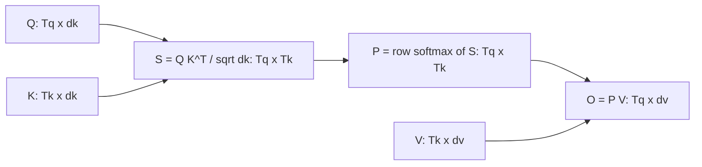

# Scaled Dot-Product Attention, Step by Step

## Introduction

The [previous page](./0-llm-attention-intuition.mdx) described attention as a soft dictionary lookup: compare a query with every key, turn the scores into weights, and average the values. The Transformer writes the whole lookup, for every query at once, as one line:

$$
\mathrm{Attention}(Q,K,V) = \mathrm{softmax}\!\left(\frac{QK^\top}{\sqrt{d_k}}\right)V
$$

This page takes that line apart. You will see how it follows from the one-query version, what shape every matrix has, why the scores are divided by $\sqrt{d_k}$ (with a proof, not a slogan), what the softmax gradient looks like and why it vanishes when scores are large, and how real models such as Gemma, Qwen3 and DeepSeek adjust the scale. A small example is computed by hand and then checked in PyTorch.

After this page you will be able to:

- Derive the matrix form of attention from the per-query form and state every shape.
- Prove that the dot product of two random $d_k$-dimensional vectors has variance $d_k$, and explain what the scale fixes.
- Derive the softmax Jacobian and use it to explain saturation.
- Compute attention for a 3-token example with pencil and paper.

## From One Query to a Matrix Formula

Start with a single query vector $q \in \mathbb{R}^{d_k}$ and $T_k$ key-value pairs: keys $k_1, \dots, k_{T_k} \in \mathbb{R}^{d_k}$ and values $v_1, \dots, v_{T_k} \in \mathbb{R}^{d_v}$. The symbols:

- $d_k$: dimension of queries and keys. They must match because we take their dot product.
- $d_v$: dimension of values. It can differ from $d_k$, though in most LLMs it is the same (the head dimension, often 128).
- $T_q$, $T_k$: number of queries and number of keys. In self-attention both equal the sequence length $T$.

The lookup is three steps:

$$
s_j = \frac{q \cdot k_j}{\sqrt{d_k}}, \qquad
p_j = \frac{\exp(s_j)}{\sum_{l=1}^{T_k} \exp(s_l)}, \qquad
o = \sum_{j=1}^{T_k} p_j\, v_j
$$

Now stack the vectors as rows of matrices: $Q \in \mathbb{R}^{T_q \times d_k}$ (one query per row), $K \in \mathbb{R}^{T_k \times d_k}$ and $V \in \mathbb{R}^{T_k \times d_v}$.

**Scores.** Entry $(i, j)$ of $QK^\top$ is row $i$ of $Q$ times column $j$ of $K^\top$, which is $q_i \cdot k_j$. So one matrix multiplication computes all $T_q \times T_k$ dot products:

$$
S = \frac{QK^\top}{\sqrt{d_k}} \in \mathbb{R}^{T_q \times T_k}
$$

**Weights.** Apply softmax to **each row** of $S$ separately. Row $i$ holds the scores of query $i$ against all keys, so after softmax each row is a probability distribution over keys:

$$
P = \mathrm{softmax}_{\text{row}}(S), \qquad P_{ij} = \frac{\exp(S_{ij})}{\sum_{l} \exp(S_{il})}, \qquad \sum_j P_{ij} = 1
$$

**Output.** Row $i$ of $PV$ is $\sum_j P_{ij} v_j$, exactly the weighted average for query $i$:

$$
O = PV \in \mathbb{R}^{T_q \times d_v}
$$



| Tensor | Shape | Meaning |
| --- | --- | --- |
| $Q$ | $T_q \times d_k$ | one query per position |
| $K$ | $T_k \times d_k$ | one key per position |
| $V$ | $T_k \times d_v$ | one value per position |
| $S$, $P$ | $T_q \times T_k$ | score and weight for every query-key pair |
| $O$ | $T_q \times d_v$ | one output per query |

With a batch and several heads, PyTorch adds leading dimensions: `q` has shape `(batch, n_heads, T_q, d_k)` and the formula applies independently to every `(batch, head)` slice. That is why the code later writes `k.transpose(-2, -1)`: it transposes only the last two dimensions.

The cost is easy to read off. $QK^\top$ needs $T_q T_k d_k$ multiply-adds and $PV$ needs $T_q T_k d_v$. With $T_q = T_k = T$, attention is $O(T^2 d)$ in time, and storing $P$ is $O(T^2)$ in memory. The [last page of this section](./7-llm-attention-complexity.mdx) puts real numbers on that.

## Why Divide by the Square Root of d_k

The scale factor is the only part of the formula that is not obvious. Vaswani et al. justify it in a footnote with a variance argument. Here it is in full.

### The Variance of a Dot Product

Assume the components of $q$ and $k$ are independent random variables with mean 0 and variance 1. This is roughly the situation at initialization, when inputs are normalized and projection weights are random.

The dot product is a sum of $d_k$ terms:

$$
q \cdot k = \sum_{i=1}^{d_k} q_i k_i
$$

**Mean of one term.** By independence, $\mathbb{E}[q_i k_i] = \mathbb{E}[q_i]\,\mathbb{E}[k_i] = 0 \cdot 0 = 0$.

**Variance of one term.** Using $\mathrm{Var}(X) = \mathbb{E}[X^2] - \mathbb{E}[X]^2$ and independence:

$$
\mathrm{Var}(q_i k_i) = \mathbb{E}[q_i^2 k_i^2] - 0 = \mathbb{E}[q_i^2]\,\mathbb{E}[k_i^2] = (\mathrm{Var}(q_i) + 0)(\mathrm{Var}(k_i) + 0) = 1
$$

**Variance of the sum.** The $d_k$ terms are independent of each other, and variances of independent variables add:

$$
\mathrm{Var}(q \cdot k) = \sum_{i=1}^{d_k} \mathrm{Var}(q_i k_i) = d_k
$$

So the standard deviation of a raw score is $\sqrt{d_k}$. With a head dimension of 128 a typical score is about $\pm 11$, and with 1024 it is about $\pm 32$. Dividing by $\sqrt{d_k}$ uses $\mathrm{Var}(aX) = a^2 \mathrm{Var}(X)$:

$$
\mathrm{Var}\!\left(\frac{q \cdot k}{\sqrt{d_k}}\right) = \frac{1}{d_k} \cdot d_k = 1
$$

The scaled score has variance 1 no matter how wide the heads are. A quick simulation confirms it:

```python
import torch

torch.manual_seed(0)
n = 100_000
for d_k in [4, 64, 512]:
    q = torch.randn(n, d_k)            # components ~ N(0, 1)
    k = torch.randn(n, d_k)
    dots = (q * k).sum(-1)             # n independent dot products
    scaled = dots / d_k ** 0.5
    print(f"d_k={d_k:>3}  var(q.k)={dots.var():8.2f}  "
          f"var(q.k/sqrt(d_k))={scaled.var():.3f}")
```

```text
d_k=  4  var(q.k)=    3.99  var(q.k/sqrt(d_k))=0.999
d_k= 64  var(q.k)=   64.17  var(q.k/sqrt(d_k))=1.003
d_k=512  var(q.k)=  514.18  var(q.k/sqrt(d_k))=1.004
```

### Why Large Scores Hurt: The Softmax Jacobian

Large variance by itself would be harmless if softmax did not care about scale. It does. Recall from the previous page that multiplying scores by 20 turned a soft lookup into a nearly hard one. To see why that blocks learning, compute the derivative of softmax.

Let $p = \mathrm{softmax}(s)$ with $p_i = e^{s_i} / Z$ and $Z = \sum_l e^{s_l}$. Differentiate $p_i$ with respect to $s_j$ using the quotient rule.

If $i = j$:

$$
\frac{\partial p_i}{\partial s_i} = \frac{e^{s_i} Z - e^{s_i} e^{s_i}}{Z^2} = p_i - p_i^2 = p_i(1 - p_i)
$$

If $i \neq j$, the numerator $e^{s_i}$ does not depend on $s_j$:

$$
\frac{\partial p_i}{\partial s_j} = \frac{0 - e^{s_i} e^{s_j}}{Z^2} = -p_i p_j
$$

Both cases together, with $\delta_{ij}$ equal to 1 when $i = j$ and 0 otherwise:

$$
\frac{\partial p_i}{\partial s_j} = p_i(\delta_{ij} - p_j), \qquad J = \mathrm{diag}(p) - p\,p^\top
$$

Now look at what happens when attention is nearly one-hot, say $p \approx (1, 0, \dots, 0)$. The diagonal entries are $p_i(1 - p_i)$, which is $1 \cdot 0 = 0$ for the winner and $0 \cdot 1 = 0$ for the rest. The off-diagonal entries $-p_i p_j$ are 0 as well. **The whole Jacobian goes to zero.** Any gradient arriving from the loss is multiplied by $J$ on its way back to the scores, so nothing reaches $W_Q$ and $W_K$. The model cannot learn to change where it looks.

The largest possible diagonal entry, $p_i(1-p_i) = 1/4$, occurs at $p_i = 1/2$: softmax learns fastest when it is undecided. Keeping scores at unit variance keeps attention in that responsive region at the start of training.

The next experiment measures this. For random queries and 16 keys it reports the average largest weight and the average norm of the Jacobian, with and without scaling:

```python
import torch

torch.manual_seed(0)
T, trials = 16, 200                      # 16 keys, average over 200 random queries


def softmax_jacobian(p):
    # d softmax_i / d s_j = p_i (delta_ij - p_j)
    return torch.diag(p) - torch.outer(p, p)


for d_k in [16, 128, 1024]:
    for name, scale in [("unscaled", 1.0), ("scaled  ", d_k ** -0.5)]:
        max_w = jac = 0.0
        for _ in range(trials):
            q, K = torch.randn(d_k), torch.randn(T, d_k)
            p = torch.softmax((K @ q) * scale, dim=0)
            max_w += p.max().item() / trials
            jac += softmax_jacobian(p).norm().item() / trials
        print(f"d_k={d_k:>4} {name}  mean max weight={max_w:.3f}  "
              f"mean Jacobian norm={jac:.4f}")
```

```text
d_k=  16 unscaled  mean max weight=0.681  mean Jacobian norm=0.2847
d_k=  16 scaled    mean max weight=0.240  mean Jacobian norm=0.3016
d_k= 128 unscaled  mean max weight=0.907  mean Jacobian norm=0.1154
d_k= 128 scaled    mean max weight=0.241  mean Jacobian norm=0.3040
d_k=1024 unscaled  mean max weight=0.953  mean Jacobian norm=0.0647
d_k=1024 scaled    mean max weight=0.241  mean Jacobian norm=0.3044
```

Without the scale, wider heads make attention more and more one-hot (the top weight goes from 0.68 to 0.95) and the Jacobian norm, which scales every gradient flowing back into the scores, falls from 0.28 to 0.065. With the scale, both numbers are the same at every width. That independence is the real point: you can change the head dimension without retuning anything else.

:::note
The variance argument is about initialization. During training the model is free to grow its queries and keys and produce sharp attention when it needs to. The scale does not prevent sharp attention; it prevents attention from being accidentally sharp before the model has learned anything.
:::

### Why Not Additive Attention

Vaswani et al. note that additive and dot-product attention perform similarly for small $d_k$, and that additive attention beat **unscaled** dot-product attention for larger $d_k$ in earlier experiments (Britz et al., 2017). Their explanation is the saturation shown above, and the scale fixes it. With that fixed, dot-product attention wins on speed: the scores for all pairs are one matrix multiplication, while additive attention needs a $\tanh$ over a $T_q \times T_k \times d_a$ tensor.

## A Worked Example by Hand

Take three tokens with $d_k = 4$ (so $\sqrt{d_k} = 2$) and $d_v = 2$:

$$
Q = \begin{pmatrix} 1 & 0 & 1 & 0 \\ 0 & 1 & 0 & 1 \\ 1 & 1 & 0 & 0 \end{pmatrix}, \quad
K = \begin{pmatrix} 1 & 0 & 1 & 0 \\ 0 & 2 & 0 & 0 \\ 1 & 1 & 1 & 1 \end{pmatrix}, \quad
V = \begin{pmatrix} 1 & 0 \\ 0 & 1 \\ 1 & 1 \end{pmatrix}
$$

**Step 1: scores.** Each entry is a dot product of a row of $Q$ with a row of $K$. For example $q_1 \cdot k_3 = 1 \cdot 1 + 0 \cdot 1 + 1 \cdot 1 + 0 \cdot 1 = 2$ and $q_3 \cdot k_1 = 1 + 0 + 0 + 0 = 1$.

$$
QK^\top = \begin{pmatrix} 2 & 0 & 2 \\ 0 & 2 & 2 \\ 1 & 2 & 2 \end{pmatrix}, \qquad
S = \frac{QK^\top}{2} = \begin{pmatrix} 1 & 0 & 1 \\ 0 & 1 & 1 \\ 0.5 & 1 & 1 \end{pmatrix}
$$

**Step 2: row softmax.** Row 1 has $e^1 = 2.7183$, $e^0 = 1$, $e^1 = 2.7183$; the sum is $6.4366$, so the weights are $0.4223, 0.1554, 0.4223$. Row 2 is the same numbers in a different order. Row 3 has $e^{0.5} = 1.6487$ and two copies of $2.7183$, sum $7.0853$, giving $0.2327, 0.3837, 0.3837$.

$$
P = \begin{pmatrix} 0.4223 & 0.1554 & 0.4223 \\ 0.1554 & 0.4223 & 0.4223 \\ 0.2327 & 0.3837 & 0.3837 \end{pmatrix}
$$

**Step 3: weighted values.** Row 1 of the output is $0.4223 \cdot (1, 0) + 0.1554 \cdot (0, 1) + 0.4223 \cdot (1, 1) = (0.8446, 0.5777)$. Similarly for the others:

$$
O = PV = \begin{pmatrix} 0.8446 & 0.5777 \\ 0.5777 & 0.8446 \\ 0.6164 & 0.7673 \end{pmatrix}
$$

Read the result as lookups. Query 1 matches keys 1 and 3 equally and key 2 not at all, so its output is the average of $v_1$ and $v_3$ with a little $v_2$ mixed in. Query 3 slightly prefers keys 2 and 3. Now check it with PyTorch:

```python
import torch
import torch.nn.functional as F

Q = torch.tensor([[1., 0., 1., 0.],
                  [0., 1., 0., 1.],
                  [1., 1., 0., 0.]])   # (3 queries, d_k = 4)
K = torch.tensor([[1., 0., 1., 0.],
                  [0., 2., 0., 0.],
                  [1., 1., 1., 1.]])   # (3 keys, d_k = 4)
V = torch.tensor([[1., 0.],
                  [0., 1.],
                  [1., 1.]])           # (3 values, d_v = 2)

d_k = Q.shape[-1]
scores = Q @ K.T                       # (3, 3)
scaled = scores / d_k ** 0.5           # divide by sqrt(4) = 2
weights = torch.softmax(scaled, dim=-1)
out = weights @ V                      # (3, 2)

torch.set_printoptions(precision=4)
print("scores:\n", scores)
print("scaled:\n", scaled)
print("weights:\n", weights)
print("output:\n", out)
print("matches F.scaled_dot_product_attention:",
      torch.allclose(out, F.scaled_dot_product_attention(Q, K, V)))
```

```text
scores:
 tensor([[2., 0., 2.],
        [0., 2., 2.],
        [1., 2., 2.]])
scaled:
 tensor([[1.0000, 0.0000, 1.0000],
        [0.0000, 1.0000, 1.0000],
        [0.5000, 1.0000, 1.0000]])
weights:
 tensor([[0.4223, 0.1554, 0.4223],
        [0.1554, 0.4223, 0.4223],
        [0.2327, 0.3837, 0.3837]])
output:
 tensor([[0.8446, 0.5777],
        [0.5777, 0.8446],
        [0.6163, 0.7673]])
matches F.scaled_dot_product_attention: True
```

(The last digit of $0.6164$ differs only by rounding: $0.2327 + 0.3837$ uses rounded weights.) `F.scaled_dot_product_attention` divides by $\sqrt{d_k}$ by default, so it agrees with our manual version.

## Numerical Stability of the Softmax

The formula $e^{s_j} / \sum_l e^{s_l}$ overflows in floating point when any score is large: in float16, $e^{12}$ already exceeds the largest finite value (65504). Every real implementation uses the identity

$$
\mathrm{softmax}(s)_j = \frac{e^{s_j - m}}{\sum_l e^{s_l - m}}, \qquad m = \max_l s_l
$$

which holds because the factor $e^{-m}$ cancels between numerator and denominator. After subtracting the maximum, the largest exponent is $e^0 = 1$ and nothing overflows. `torch.softmax` does this internally. FlashAttention extends the trick to compute softmax block by block without ever seeing the whole row, the subject of [Online Softmax and Tiling](../5-llm-flash-attention/1-llm-online-softmax.mdx).

Masking uses the same machinery: setting a score to $-\infty$ makes $e^{-\infty} = 0$, so that key gets zero weight. The [causal masking page](./3-llm-causal-masking.mdx) builds on this.

## The Scale in Real Models

$1/\sqrt{d_k}$ is the default, and most models use exactly that: Llama 3.1 8B has `head_dim` 128 and divides by $\sqrt{128} \approx 11.3$. But the config.json of several well-known models shows that the scale is a design choice, and that controlling the size of attention scores remains an active concern.

| Model | What config.json says | Effect on the scores |
| --- | --- | --- |
| Llama 3.1 8B | `head_dim` 128 | standard $1/\sqrt{128}$ |
| Gemma 2 27B | `head_dim` 128, `query_pre_attn_scalar` 144 | scale $1/\sqrt{144} = 1/12$ instead of $1/\sqrt{128}$ |
| Gemma 2 (all sizes) | `attn_logit_softcapping` 50.0 | scores squashed by $50 \tanh(s/50)$, never beyond $\pm 50$ |
| Gemma 3 27B | `query_pre_attn_scalar` 168, no softcapping | soft-capping replaced by normalizing $q$ and $k$ (QK-norm) |
| DeepSeek-V3 | query/key head dim $128 + 64 = 192$, YaRN `mscale_all_dim` 1.0 | base scale $1/\sqrt{192}$, multiplied by a YaRN correction for long context |

Three ideas show up here:

- **Changing the constant.** Gemma's `query_pre_attn_scalar` sets the divisor independently of the head dimension (144 is the hidden size 4608 divided by 32 heads).
- **Capping the scores.** Soft-capping with $c \tanh(s/c)$ is nearly the identity for small scores and bounds large ones, which protects against the runaway logits that can destabilize training.
- **Normalizing $q$ and $k$.** QK-norm, used by Gemma 3 and Qwen3, applies a normalization layer to each query and key before the dot product, so score magnitudes cannot grow without bound. See [LayerNorm, RMSNorm, Pre-Norm and Post-Norm](../3-llm-transformer/3-llm-normalization.mdx) for details.

A different line of research, the maximal update parametrization (muP) of Yang et al., argues for a $1/d_k$ scale so that hyperparameters transfer across model widths; it is discussed in [Optimizers, Learning Rate Schedules and Training Stability](../6-llm-pretraining/3-llm-optimizers-and-schedules.mdx). In PyTorch any of these choices is a keyword argument: `F.scaled_dot_product_attention(q, k, v, scale=1/12)`.

## Common Mistakes

- **Normalizing over the wrong axis.** Softmax goes over keys (`dim=-1` on a `(..., T_q, T_k)` tensor). Using `dim=-2` makes columns sum to 1 and silently produces garbage.
- **Dividing by $d_k$ instead of $\sqrt{d_k}$**, or by the model width instead of the head width. The variance argument uses the dimension of the vectors in the dot product, which is the per-head dimension.
- **Scaling twice.** Some code pre-multiplies the query by the scale; if it then calls a function that also scales, the scores are too small and attention becomes nearly uniform.
- **Writing `k.T` on a 4D tensor.** `.T` on more than two dimensions is deprecated and reverses all axes. Use `k.transpose(-2, -1)`.
- **Computing softmax by hand without subtracting the max.** It works in tests with small numbers and overflows in float16 on real data.
- **Assuming the scale guarantees unit variance forever.** It only fixes initialization; trained models can and do produce large scores, which is why soft-capping and QK-norm exist.

## Summary

- Scaled dot-product attention is $\mathrm{softmax}(QK^\top / \sqrt{d_k})V$: one matrix multiplication for all scores, a row-wise softmax, and one matrix multiplication for the outputs.
- Shapes: $Q$ is $T_q \times d_k$, $K$ is $T_k \times d_k$, $V$ is $T_k \times d_v$, the weights are $T_q \times T_k$ and the output is $T_q \times d_v$.
- With independent unit-variance components, $\mathrm{Var}(q \cdot k) = d_k$; dividing by $\sqrt{d_k}$ restores variance 1 at any head width.
- The softmax Jacobian is $\mathrm{diag}(p) - pp^\top$, which vanishes as attention becomes one-hot; unscaled scores push attention there and starve $W_Q$ and $W_K$ of gradient.
- Subtracting the row maximum makes softmax numerically safe; $-\infty$ scores give exactly zero weight.
- Real models tune the scale (Gemma's `query_pre_attn_scalar`), cap the scores (Gemma 2 soft-capping) or normalize queries and keys (QK-norm in Gemma 3 and Qwen3).

## Further Reading

- [Attention Is All You Need (Vaswani et al., 2017)](https://arxiv.org/abs/1706.03762): section 3.2.1 defines scaled dot-product attention; footnote 4 gives the variance argument.
- [Massive Exploration of Neural Machine Translation Architectures (Britz et al., 2017)](https://arxiv.org/abs/1703.03906): the comparison of additive and multiplicative attention cited by the Transformer paper.
- [PyTorch documentation for scaled_dot_product_attention](https://docs.pytorch.org/docs/stable/generated/torch.nn.functional.scaled_dot_product_attention.html): the reference semantics, including the `scale` argument.
- [Gemma 2: Improving Open Language Models at a Practical Size (Gemma Team, 2024)](https://arxiv.org/abs/2408.00118): logit soft-capping in attention.
- [Gemma 3 Technical Report (Gemma Team, 2025)](https://arxiv.org/abs/2503.19786): replacing soft-capping with QK-norm.
- [Tensor Programs V: Tuning Large Neural Networks via Zero-Shot Hyperparameter Transfer (Yang et al., 2022)](https://arxiv.org/abs/2203.03466): muP and its $1/d$ attention scale.
