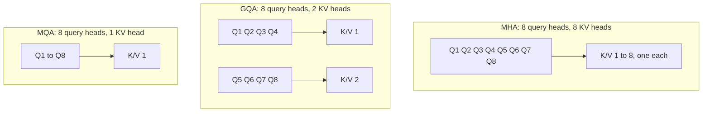

# Multi-Query and Grouped-Query Attention

## Introduction

Every token an LLM generates must read the keys and values of **all previous tokens** in **every layer**. Those tensors live in the KV cache, and for a model like Llama 2 7B at a 4,096-token context they take 2 GiB per sequence. During generation the GPU spends most of its time not computing but moving that cache from memory to the compute units, once per token.

**Multi-query attention** (MQA, Shazeer 2019) and **grouped-query attention** (GQA, Ainslie et al. 2023) attack the problem directly: keep many query heads, but let groups of them **share** key and value heads. Fewer KV heads means a proportionally smaller cache and proportionally less memory traffic per token, at a modest cost in quality. Today almost every open model uses GQA, and the `num_key_value_heads` field in config.json tells you which variant you are looking at.

On this page you will:

- Derive why decoding is memory-bound and how sharing KV heads changes its arithmetic intensity.
- Write the KV cache size formula and compute it for real models from their configs.
- Implement GQA in PyTorch two ways and verify them against each other.
- Convert a multi-head checkpoint to GQA by mean pooling (the GQA paper's uptraining recipe) and measure what breaks before uptraining.
- Know which model families use MHA, MQA, GQA or MLA, and what the published ablations say about quality.

## Decoding Is Memory-Bound

Consider one decode step for one sequence in one layer with multi-head attention. There is one new query per head, and $T$ cached tokens. Using $h$ heads of dimension $d_h$:

- **Data read:** all cached keys and values, $2 \cdot h \cdot d_h \cdot T$ numbers.
- **Work done:** for each head, $T$ dot products of length $d_h$ for the scores and a weighted sum of $T$ vectors of length $d_h$ for the output. That is $2 \cdot 2 \cdot h \cdot d_h \cdot T$ FLOPs (a multiply and an add per element, twice).

The ratio of work to data, the **arithmetic intensity**, is

$$
\frac{4 h d_h T \ \text{FLOPs}}{2 h d_h T \ \text{elements}} = 2 \ \text{FLOPs per element} = 1 \ \text{FLOP per byte in bf16}
$$

An NVIDIA H100 SXM delivers about 989 TFLOP/s of dense bf16 compute but about 3.35 TB/s of memory bandwidth, so it needs roughly $989 / 3.35 \approx 295$ FLOPs per byte to keep its compute units busy. Decode attention offers 1. The GPU is idle more than 99% of the time, waiting for memory. (The [GPU Memory Hierarchy](../5-llm-flash-attention/0-llm-gpu-memory-hierarchy.mdx) page develops this roofline argument in detail.)

Training and prefill do not have this problem: there, $T$ queries reuse each loaded key, and the intensity grows with $T$. Decoding is the odd one out because each step brings only one new query per sequence.

The conclusion is that decode speed depends on **how many bytes of KV cache must be read per token**, not on FLOPs. Shrinking the cache speeds up decoding almost proportionally, and it also lets more sequences fit in GPU memory at once, which raises throughput further.

## Multi-Query Attention

Noam Shazeer's 2019 paper "Fast Transformer Decoding: One Write-Head is All You Need" proposed the extreme version: keep $h$ query heads but use a **single** key head and a **single** value head shared by all of them.

$$
\mathrm{head}_i = \mathrm{Attention}\!\left(X W_Q^{(i)},\ X W_K,\ X W_V\right), \qquad i = 1, \dots, h
$$

The KV cache shrinks by a factor of $h$ (32 for a 32-head model). And because every query head now reads the **same** keys and values, each loaded element is used $h$ times, raising the arithmetic intensity of decode attention from 2 to $2h$ FLOPs per element. Shazeer reported much faster incremental decoding with only a minor quality loss relative to the multi-head baseline.

MQA was adopted by PaLM (2022), Falcon-7B (its config.json has `"multi_query": true`) and the first-generation Gemma 2B (`num_key_value_heads: 1`). But the quality loss was not always minor in practice, and MQA had a training-stability reputation; the field converged on a middle ground.

## Grouped-Query Attention

Joshua Ainslie and colleagues at Google ("GQA: Training Generalized Multi-Query Transformer Models from Multi-Head Checkpoints", EMNLP 2023) interpolated between the two: divide the $h$ query heads into $g$ groups, and give each group one key head and one value head.



With $h$ query heads and $h_{kv}$ key-value heads ($h_{kv}$ divides $h$), query head $i$ (counting from 0) uses KV head

$$
\left\lfloor \frac{i}{h / h_{kv}} \right\rfloor
$$

so consecutive query heads share a KV head. GQA with $h_{kv} = h$ is MHA, and $h_{kv} = 1$ is MQA. The KV cache shrinks by $h / h_{kv}$, and the arithmetic intensity of decoding rises by the same factor.

In config.json, `num_attention_heads` is $h$ and `num_key_value_heads` is $h_{kv}$. When the second field is missing, the model is MHA.

## The KV Cache Formula

For each token, each layer stores one key and one value vector per KV head. With $L$ layers and $b$ bytes per element (2 for bf16):

$$
\text{KV bytes per token} = 2 \cdot L \cdot h_{kv} \cdot d_h \cdot b
$$

Multiply by the context length and the batch size for the total. The following script computes it for real models, with every number taken from the model's config.json:

```python
# KV cache size from config.json values (bf16 = 2 bytes per element).
models = {
    # name:               (layers, q_heads, kv_heads, head_dim)
    "Llama-2-7B":         (32, 32, 32, 128),
    "Llama-2-70B":        (80, 64,  8, 128),
    "Llama-3.1-8B":       (32, 32,  8, 128),
    "Llama-3.1-70B":      (80, 64,  8, 128),
    "Mistral-7B-v0.1":    (32, 32,  8, 128),
    "Qwen2.5-7B":         (28, 28,  4, 128),
    "Qwen3-8B":           (36, 32,  8, 128),
    "Qwen3-235B-A22B":    (94, 64,  4, 128),
    "Falcon-7B (MQA)":    (32, 71,  1,  64),
    "Gemma-2B (MQA)":     (18,  8,  1, 256),
}
print(f"{'model':18} {'q/kv':>6} {'KiB/token':>10} {'GiB @ 32k':>10} {'GiB @ 128k':>11}")
for name, (L, hq, hkv, hd) in models.items():
    per_token = 2 * L * hkv * hd * 2                      # K and V, every layer, 2 bytes each
    print(f"{name:18} {hq:>3}/{hkv:<2} {per_token / 1024:10.0f} "
          f"{per_token * 32_768 / 2**30:10.1f} {per_token * 131_072 / 2**30:11.1f}")
```

```text
model                q/kv  KiB/token  GiB @ 32k  GiB @ 128k
Llama-2-7B          32/32        512       16.0        64.0
Llama-2-70B         64/8         320       10.0        40.0
Llama-3.1-8B        32/8         128        4.0        16.0
Llama-3.1-70B       64/8         320       10.0        40.0
Mistral-7B-v0.1     32/8         128        4.0        16.0
Qwen2.5-7B          28/4          56        1.8         7.0
Qwen3-8B            32/8         144        4.5        18.0
Qwen3-235B-A22B     64/4         188        5.9        23.5
Falcon-7B (MQA)     71/1           8        0.2         1.0
Gemma-2B (MQA)       8/1          18        0.6         2.2
```

(The 32k and 128k columns are hypothetical for models whose context window is shorter, such as Llama 2 at 4,096 tokens; they show the scaling.)

The comparison of Llama 2 7B with Llama 3.1 8B is the cleanest example. They have the same depth, width and head size; Llama 3.1 has 8 KV heads instead of 32, and its cache per token is 4 times smaller. At 128k tokens, the MHA layout would need 64 GiB per sequence, several times the roughly 13.5 GB of its own bf16 weights. The 70B models need only 320 KiB per token despite being ten times larger, because their 64 query heads share 8 KV heads. Qwen3-235B-A22B, a mixture-of-experts model, uses only 4 KV heads across 94 layers.

## Implementing GQA

The implementation differs from multi-head attention in one place: $W_K$ and $W_V$ produce $h_{kv}$ heads instead of $h$. Before attention, each KV head must be made available to its group of query heads. PyTorch offers two ways: copy the KV heads with `repeat_interleave`, or pass `enable_gqa=True` to SDPA and let the kernel do the broadcasting.

```python
import torch
import torch.nn as nn
import torch.nn.functional as F

torch.manual_seed(0)


class GroupedQueryAttention(nn.Module):
    def __init__(self, d_model, n_heads, n_kv_heads):
        super().__init__()
        assert n_heads % n_kv_heads == 0
        self.h, self.h_kv = n_heads, n_kv_heads
        self.hd = d_model // n_heads
        self.W_q = nn.Linear(d_model, n_heads * self.hd, bias=False)
        self.W_k = nn.Linear(d_model, n_kv_heads * self.hd, bias=False)   # smaller than W_q
        self.W_v = nn.Linear(d_model, n_kv_heads * self.hd, bias=False)
        self.W_o = nn.Linear(n_heads * self.hd, d_model, bias=False)

    def forward(self, x, use_enable_gqa=False):
        B, T, _ = x.shape
        q = self.W_q(x).view(B, T, self.h, self.hd).transpose(1, 2)       # (B, h,    T, hd)
        k = self.W_k(x).view(B, T, self.h_kv, self.hd).transpose(1, 2)    # (B, h_kv, T, hd)
        v = self.W_v(x).view(B, T, self.h_kv, self.hd).transpose(1, 2)    # (B, h_kv, T, hd)
        if use_enable_gqa:
            o = F.scaled_dot_product_attention(q, k, v, is_causal=True, enable_gqa=True)
        else:
            rep = self.h // self.h_kv                                     # query heads per KV head
            k = k.repeat_interleave(rep, dim=1)                           # (B, h, T, hd)
            v = v.repeat_interleave(rep, dim=1)
            o = F.scaled_dot_product_attention(q, k, v, is_causal=True)
        return self.W_o(o.transpose(1, 2).reshape(B, T, -1))


x = torch.randn(2, 10, 64)
for n_kv in [8, 2, 1]:                       # 8 = MHA, 2 = GQA, 1 = MQA
    layer = GroupedQueryAttention(d_model=64, n_heads=8, n_kv_heads=n_kv)
    with torch.no_grad():
        a, b = layer(x), layer(x, use_enable_gqa=True)
    params = sum(p.numel() for p in layer.parameters())
    print(f"kv_heads={n_kv}: params={params:5d}  repeat_interleave == enable_gqa: "
          f"{torch.allclose(a, b, atol=1e-6)}")
```

```text
kv_heads=8: params=16384  repeat_interleave == enable_gqa: True
kv_heads=2: params=10240  repeat_interleave == enable_gqa: True
kv_heads=1: params= 9216  repeat_interleave == enable_gqa: True
```

Points to notice:

- **`repeat_interleave`, not `repeat`.** `repeat_interleave(4, dim=1)` turns KV heads `[A, B]` into `[A, A, A, A, B, B, B, B]`, matching "consecutive query heads share a KV head". `repeat` would produce `[A, B, A, B, ...]`, the wrong pairing; it would still run, but would not match pretrained weights. Hugging Face's `repeat_kv` helper does the same expansion as `repeat_interleave`.
- **Copying defeats part of the purpose.** `repeat_interleave` materializes $h / h_{kv}$ copies of the keys and values. The cache stays small, but each step reads more memory than necessary. Fused kernels (FlashAttention, and SDPA with `enable_gqa=True` on supported backends) index the shared KV head directly. In production code prefer them.
- **Parameters shrink too**, from $4d^2$ toward $2d^2 + 2 d \cdot h_{kv} d_h$. In a real model the saving is usually spent elsewhere (a wider MLP), keeping the total size fixed.
- **The cache stores the un-repeated tensors**, shape `(B, h_kv, T, d_h)`. Repeat only right before the attention computation.

## Uptraining: Converting an MHA Checkpoint

Training a large model from scratch is expensive. The GQA paper's second contribution was a cheap way to convert an existing multi-head checkpoint:

1. **Mean-pool the KV heads in each group.** For group $g$, the new key projection is the average of the key projections of the heads in that group, $W_K^{(g)} = \frac{1}{\lvert G_g \rvert} \sum_{i \in G_g} W_K^{(i)}$, and the same for values. The paper found mean pooling worked better than keeping a single head per group or initializing new heads randomly.
2. **Continue pretraining** for a small fraction of the original compute. With T5-XXL, uptraining for 5% of the original pretraining compute brought GQA close to the multi-head model's quality at a speed close to MQA's.

How much does step 2 matter? The following experiment applies step 1 to GPT-2 small (12 heads, all MHA) without any further training and measures perplexity on a short paragraph. It compares mean pooling with keeping the first head of each group. It downloads GPT-2 (about 550 MB) and takes a minute or two on a CPU.

```python
import copy
import torch
from transformers import AutoModelForCausalLM, AutoTokenizer

torch.manual_seed(0)
name = "openai-community/gpt2"                     # 12 layers, 12 heads, head_dim 64, MHA
tok = AutoTokenizer.from_pretrained(name)
base = AutoModelForCausalLM.from_pretrained(name).eval()

text = (
    "The first bicycles had no pedals. Riders pushed the ground with their feet, "
    "much like a child on a balance bike today. Pedals attached to the front wheel "
    "came later, and because one turn of the pedals meant one turn of the wheel, "
    "makers built enormous front wheels to go faster. These machines were fast but "
    "dangerous, since a small bump could throw the rider over the handlebars. The "
    "safety bicycle solved the problem with two wheels of equal size and a chain that "
    "drove the rear wheel through gears. Air-filled tyres arrived a few years later "
    "and made the ride far more comfortable. Within a decade the design had settled "
    "into the shape we still recognise, and cycling became a cheap way for ordinary "
    "workers to travel to factories, shops and the countryside."
)
ids = tok(text, return_tensors="pt").input_ids


def perplexity(model):
    with torch.no_grad():
        return torch.exp(model(ids, labels=ids).loss).item()


def to_gqa(model, n_groups, how="mean"):
    """Share K and V inside each group of heads by mean-pooling (or picking) their weights."""
    model = copy.deepcopy(model)
    d, h = model.config.n_embd, model.config.n_head
    hd, per_group = d // h, h // n_groups
    for block in model.transformer.h:
        W, b = block.attn.c_attn.weight.data, block.attn.c_attn.bias.data   # (d, 3d), (3d,)
        for part in (1, 2):                                                 # 1 = K, 2 = V
            cols = slice(part * d, (part + 1) * d)
            w = W[:, cols].reshape(d, n_groups, per_group, hd)              # split columns by head
            bb = b[cols].reshape(n_groups, per_group, hd)
            if how == "mean":
                w_g, b_g = w.mean(2, keepdim=True), bb.mean(1, keepdim=True)
            else:                                                           # keep the first head
                w_g, b_g = w[:, :, :1], bb[:, :1]
            W[:, cols] = w_g.expand_as(w).reshape(d, d)                     # every head in a group
            b[cols] = b_g.expand_as(bb).reshape(d)                          # now has the same K/V
    return model


print(f"tokens: {ids.shape[1]}")
print(f"MHA (12 KV heads)      ppl = {perplexity(base):8.2f}")
for g in [6, 4, 2, 1]:
    print(f"GQA {g:>2} KV heads  mean  ppl = {perplexity(to_gqa(base, g)):8.2f}   "
          f"first-head ppl = {perplexity(to_gqa(base, g, 'first')):8.2f}")
```

```text
tokens: 151
MHA (12 KV heads)      ppl =    38.44
GQA  6 KV heads  mean  ppl =   261.67   first-head ppl =  1294.69
GQA  4 KV heads  mean  ppl =   280.12   first-head ppl =  4992.71
GQA  2 KV heads  mean  ppl =   432.57   first-head ppl =  4311.77
GQA  1 KV heads  mean  ppl =   584.16   first-head ppl =  4345.90
```

Three observations:

- **Conversion without training badly damages the model.** Even halving the KV heads raises perplexity from 38 to 262. The heads in a pretrained MHA model were never encouraged to be similar, so averaging them is an approximation that the rest of the network does not expect. This is why the uptraining step exists.
- **Mean pooling is a much better starting point** than picking one head (262 against 1,295 at 6 groups), matching the GQA paper's finding. Averaging keeps some information from every head; picking one discards the rest.
- **The damage grows with fewer groups**, which mirrors the quality ordering MHA > GQA > MQA that ablations report after training.

Converting the weights here meant writing the same averaged matrix into every head of a group, so the model still computes 12 KV heads; a real conversion stores only one per group and changes `num_key_value_heads`. Note also that GPT-2's `Conv1D` stores weights as `(in, out)`, the transpose of `nn.Linear`, which is why the code slices columns.

## How Much Quality Does Sharing Cost?

The answer depends on scale, training budget and how the saved parameters are reinvested, so it is worth looking at controlled comparisons rather than anecdotes.

- **GQA paper (T5-XXL, uptrained):** GQA with 8 groups came close to MHA quality while running nearly as fast as MQA; MQA was faster still but lost more quality.
- **DeepSeek-V2 paper, appendix D.1:** three dense 7B models trained on 1.33T tokens, with layer counts adjusted to equalize parameters. On MMLU (5-shot) the scores were 45.2 for MHA, 41.2 for GQA with 8 groups and 37.9 for MQA, with the same ordering on BBH, C-Eval and CMMLU. That gap is what motivated DeepSeek to design MLA instead (next page).
- **Practice:** Meta used GQA for the 34B and 70B Llama 2 models and for every Llama 3 size, including 8B. Their models are competitive, which suggests that at large scale and long training the gap can be recovered or offset by spending the saved memory on longer contexts and bigger batches.

The honest summary: sharing KV heads costs some quality at equal training budget, GQA with 8 KV heads loses much less than MQA, and the inference savings have been judged worth it by almost every lab.

## Which Models Use Which

| Attention | KV heads | Example models (from config.json or paper) |
| --- | --- | --- |
| MHA | $h_{kv} = h$ | GPT-2, GPT-3, Llama 1, Llama 2 7B and 13B |
| MQA | 1 | PaLM, Falcon-7B, Gemma (first generation) 2B |
| GQA | $1 < h_{kv} < h$ | Llama 2 70B (8), Llama 3 and 3.1 all sizes (8), Mistral 7B and Mixtral (8), Qwen2.5-7B (4), Qwen3-8B and 32B (8), Qwen3-235B-A22B (4), Gemma 2 9B (8), Gemma 2 27B and Gemma 3 27B (16), Falcon-40B (8), gpt-oss (8) |
| MLA | latent, not heads | DeepSeek-V2, DeepSeek-V3 and R1, Kimi K2 |

Eight KV heads is the most common choice for large models. One practical reason is **tensor parallelism**: serving engines split attention heads across GPUs, and 8 KV heads divide evenly across 8 GPUs. When the tensor-parallel degree exceeds the number of KV heads, the KV heads must be replicated on several GPUs, wasting some of the savings.

## Common Mistakes

- **Using `repeat` instead of `repeat_interleave`** to expand KV heads; it pairs query heads with the wrong KV heads.
- **Caching the repeated tensors.** Store `(B, h_kv, T, d_h)` and expand only inside attention, or the cache is as large as MHA's.
- **Computing the KV cache with `num_attention_heads`.** The cache size uses `num_key_value_heads`; using the query head count overestimates it by $h / h_{kv}$.
- **Forgetting the factor 2** (keys and values) or the per-layer factor in the cache formula.
- **Converting MHA to GQA without uptraining** and expecting the model to work.
- **Assuming GQA changes the FLOPs much.** Prefill FLOPs are almost unchanged; the gain is in memory size and memory traffic during decoding.
- **Choosing a KV head count that does not divide the query heads**, or one smaller than your tensor-parallel degree, without accounting for replication.

## Summary

- Decoding reads the entire KV cache for every generated token with an arithmetic intensity of about 1 FLOP per byte, far below what GPUs need, so decode speed is set by KV cache bytes.
- MQA (Shazeer, 2019) shares one key and value head among all query heads, cutting the cache by $h$; GQA (Ainslie et al., 2023) shares one KV head per group, cutting it by $h / h_{kv}$.
- KV cache per token is $2 \cdot L \cdot h_{kv} \cdot d_h \cdot b$ bytes: 512 KiB for Llama 2 7B (MHA) against 128 KiB for Llama 3.1 8B (GQA with 8 KV heads).
- Implement GQA with smaller $W_K$ and $W_V$ and either `repeat_interleave` or `enable_gqa=True` in SDPA; cache the un-repeated tensors.
- Existing MHA checkpoints can be converted by mean-pooling KV heads within groups and uptraining for about 5% of the original compute; without uptraining the converted model degrades badly.
- Controlled ablations show MHA > GQA > MQA in quality at equal budget; GQA with 8 KV heads is the industry default, and DeepSeek's MLA is the main alternative.

## Further Reading

- [Fast Transformer Decoding: One Write-Head is All You Need (Shazeer, 2019)](https://arxiv.org/abs/1911.02150): multi-query attention and the memory-bandwidth argument.
- [GQA: Training Generalized Multi-Query Transformer Models from Multi-Head Checkpoints (Ainslie et al., 2023)](https://arxiv.org/abs/2305.13245): grouped-query attention and uptraining.
- [Llama 2: Open Foundation and Fine-Tuned Chat Models (Touvron et al., 2023)](https://arxiv.org/abs/2307.09288): GQA in the 34B and 70B models.
- [DeepSeek-V2 (DeepSeek-AI, 2024)](https://arxiv.org/abs/2405.04434): appendix D.1 compares MHA, GQA and MQA at 7B.
- [PaLM: Scaling Language Modeling with Pathways (Chowdhery et al., 2022)](https://arxiv.org/abs/2204.02311): multi-query attention at 540B parameters.
- [torch.nn.functional.scaled_dot_product_attention](https://docs.pytorch.org/docs/stable/generated/torch.nn.functional.scaled_dot_product_attention.html): the `enable_gqa` argument.
- [The KV Cache](../10-llm-inference/2-llm-kv-cache.mdx) and [KV Cache Compression and Quantization](../11-llm-quantization/4-llm-kv-cache-quantization.mdx): what else can be done about cache size.
