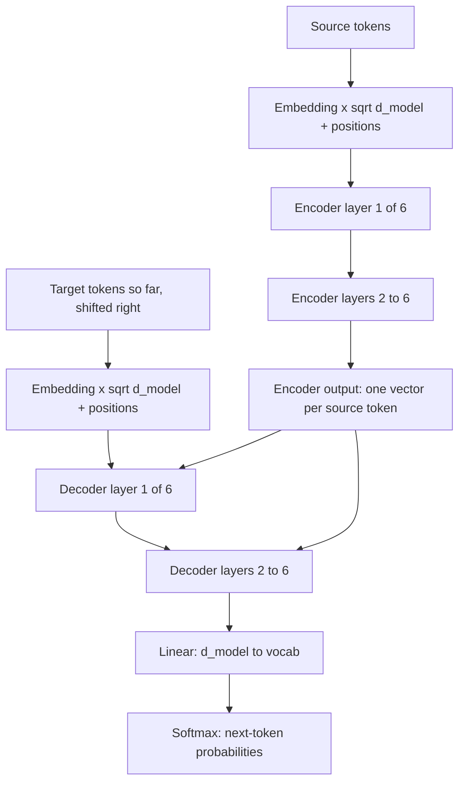

# The Transformer Architecture Overview

## Introduction

Every large language model you can download today, from GPT-2 to Llama 3, Qwen3, Gemma 3 and DeepSeek-V3, is a descendant of one paper: "Attention Is All You Need" by Ashish Vaswani and seven co-authors at Google, posted to arXiv in June 2017 and presented at NeurIPS that December. The paper proposed a translation model called the Transformer. It threw away recurrence entirely and built a sequence model out of attention, small per-position neural networks, residual connections and layer normalization.

The modern LLM is a simplified, scaled-up version of half of that model. To understand why a Llama block looks the way it does, it helps to see the full original first: what each part was for, which parts survived, and which were dropped or rearranged.

By the end of this page you will be able to:

- draw the original encoder-decoder Transformer and follow a sentence through it, with the shape of every tensor;
- explain the role of embeddings, positional encodings, self-attention, cross-attention, feed-forward layers, residual connections and LayerNorm;
- reproduce the paper's training recipe (Adam settings, the warmup schedule, label smoothing) and compute its learning rate by hand;
- build the base model with `torch.nn.Transformer`, count its parameters and reconcile the count with the paper's "65M";
- name the changes that turned this 2017 design into the 2025-2026 decoder-only recipe covered in the rest of this section.

This page assumes you know scaled dot-product and multi-head attention from the [Attention](../2-llm-attention/1-llm-scaled-dot-product-attention.mdx) section. We reuse that material rather than re-deriving it.

## The Problem the Transformer Solved

In 2017 the best translation systems were recurrent encoder-decoders: an LSTM read the source sentence one token at a time, and another LSTM wrote the translation one token at a time, looking back at the source through Bahdanau-style attention (see [Attention Intuition](../2-llm-attention/0-llm-attention-intuition.mdx)). They worked, but they had two structural problems.

The first is sequential computation. An RNN computes hidden state $h_t$ from $h_{t-1}$, so the 50th token cannot be processed until the 49th is done. A GPU has thousands of cores that want to work in parallel; an RNN gives them a chain. Training on long sequences was slow no matter how much hardware you bought.

The second is path length. For information from token 1 to influence token 50, it must survive 49 nonlinear updates of the hidden state. Gradients flowing back along that path shrink or explode. LSTMs mitigate this with gates, but the path is still long.

Self-attention fixes both. Every token computes its output from every other token in one matrix multiplication, so all positions are processed at once during training, and the path between any two tokens has length one. The price is that attention compares every pair of tokens, which costs time and memory proportional to the square of the sequence length; [The Quadratic Cost of Attention](../2-llm-attention/7-llm-attention-complexity.mdx) works out what that means at 8k, 128k and 1M tokens.

The paper's Table 1 summarizes this trade-off: per layer, self-attention costs $O(n^2 d)$ operations with $O(1)$ sequential steps and $O(1)$ maximum path length, while a recurrent layer costs $O(n d^2)$ with $O(n)$ sequential steps and $O(n)$ path length. For sentences, where $n$ (a few dozen tokens) is smaller than $d$ (512), self-attention is even cheaper in raw operations.

The results made the case. The large Transformer reached 28.4 BLEU on WMT 2014 English-to-German and 41.8 on English-to-French, beating previous single models and ensembles, after 3.5 days of training on eight NVIDIA P100 GPUs. The base model trained in about 12 hours on the same machine.

## The Big Picture: Encoder, Decoder and Data Flow

The original Transformer is an encoder-decoder. The encoder reads the whole source sentence and produces one vector per source token. The decoder generates the target sentence one token at a time; at each step it looks at the tokens it has already produced and at the encoder's vectors.



Each of the six encoder layers has two sublayers: multi-head self-attention and a position-wise feed-forward network. Each of the six decoder layers has three: masked (causal) multi-head self-attention, multi-head cross-attention over the encoder output, and a feed-forward network. Every sublayer is wrapped in a residual connection followed by layer normalization.

The base configuration from the paper's Table 3 is the one to remember, because its numbers echo through later models:

| Hyperparameter | Symbol | Base | Big |
|---|---|---|---|
| Layers per stack | $N$ | 6 | 6 |
| Model width | $d_\mathrm{model}$ | 512 | 1024 |
| Feed-forward width | $d_\mathrm{ff}$ | 2048 | 4096 |
| Attention heads | $h$ | 8 | 16 |
| Head dimension | $d_k = d_v$ | 64 | 64 |
| Dropout | $P_\mathrm{drop}$ | 0.1 | 0.3 |
| Training steps | | 100K | 300K |
| Parameters | | 65M | 213M |

Notice the ratio $d_\mathrm{ff} = 4 d_\mathrm{model}$ and the head dimension of 64. GPT-2, BERT and GPT-3 all kept the factor 4; head dimensions of 64 or 128 are still standard.

## Input: Embeddings, Scaling and Positions

The input to each stack is a sequence of token ids. An embedding matrix $E \in \mathbb{R}^{V \times d_\mathrm{model}}$ turns each id into a vector (see [Token Embeddings](../1-llm-tokenization/4-llm-embeddings.mdx)). For English-German the paper used a shared byte-pair vocabulary of about 37,000 tokens, so one matrix serves both languages.

The paper shares that one matrix three ways: as the source embedding, the target embedding and the pre-softmax output projection. Output weight tying (Press and Wolf, 2016) saves parameters and gives the output layer a well-trained representation of every token. GPT-2 kept it; many large modern models (Llama 3 8B, Qwen3-8B) untie the output layer, while small ones (Llama 3.2 1B, the smaller Qwen models) still tie.

The embeddings are multiplied by $\sqrt{d_\mathrm{model}}$ before positions are added. With small initial weights, the embedding entries would otherwise be tiny compared with the positional signal. The scale factor survives in the Gemma family, which multiplies embeddings by $\sqrt{d_\mathrm{model}}$; Llama and Qwen do not.

Attention by itself ignores word order: shuffle the input tokens and each output vector is shuffled the same way, with the same values (we demonstrate this in [Why Transformers Need Positional Information](../4-llm-positional-encoding/0-llm-why-position-matters.mdx)). The paper adds a fixed sinusoidal vector to each embedding:

$$
\mathrm{PE}(p, 2i) = \sin\!\left(\frac{p}{10000^{2i/d_\mathrm{model}}}\right), \qquad
\mathrm{PE}(p, 2i+1) = \cos\!\left(\frac{p}{10000^{2i/d_\mathrm{model}}}\right)
$$

Here $p$ is the position and $i$ indexes pairs of dimensions. Each pair oscillates at its own frequency, from one cycle every $2\pi$ positions down to one cycle every $2\pi \cdot 10000$ positions. The base of 10,000 here is the same number that later appears as `rope_theta` in Llama 2's config. [Sinusoidal and Learned Positional Embeddings](../4-llm-positional-encoding/1-llm-sinusoidal-and-learned.mdx) and [RoPE](../4-llm-positional-encoding/3-llm-rope.mdx) take positions much further.

After this step, the source sentence is a tensor of shape `(batch, src_len, 512)`.

## The Encoder Layer

An encoder layer maps `(batch, src_len, d_model)` to the same shape. Its first sublayer is multi-head self-attention without a mask: every source token can attend to every other source token, including later ones. That is fine, because the whole source sentence is known in advance.

$$
\mathrm{MultiHead}(X) = \mathrm{Concat}(\mathrm{head}_1, \dots, \mathrm{head}_h)\, W^O, \qquad
\mathrm{head}_j = \mathrm{softmax}\!\left(\frac{X W_j^Q (X W_j^K)^\top}{\sqrt{d_k}}\right) X W_j^V
$$

With $h = 8$ heads of size $d_k = 64$, the concatenated heads have width $8 \times 64 = 512 = d_\mathrm{model}$, so the cost matches a single full-width head. [Multi-Head Attention](../2-llm-attention/4-llm-multi-head-attention.mdx) walks through the reshapes.

The second sublayer is the position-wise feed-forward network: the same two-layer MLP applied to every position independently.

$$
\mathrm{FFN}(x) = \max(0,\, x W_1 + b_1)\, W_2 + b_2, \qquad W_1 \in \mathbb{R}^{512 \times 2048},\; W_2 \in \mathbb{R}^{2048 \times 512}
$$

Attention moves information between positions; the FFN processes each position on its own. That division of labor is the core idea of every Transformer block, and [Inside a Decoder Block](./2-llm-transformer-block.mdx) develops it further.

Each sublayer is wrapped like this:

$$
x \leftarrow \mathrm{LayerNorm}\big(x + \mathrm{Dropout}(\mathrm{Sublayer}(x))\big)
$$

This is called post-norm, because normalization comes after the residual addition. The residual connection (He et al., 2015, from ResNet) gives gradients a direct path through the network; LayerNorm (Ba, Kiros and Hinton, 2016) keeps the activations at a stable scale. Post-norm turned out to be hard to train when stacks get deep, and essentially all modern LLMs moved the normalization inside the residual branch (pre-norm). [LayerNorm, RMSNorm, Pre-Norm and Post-Norm](./3-llm-normalization.mdx) explains why.

## The Decoder Layer and Cross-Attention

The decoder produces the translation autoregressively. During training it receives the whole target sentence shifted right by one position (a start token is prepended), and it must predict, at each position, the next target token. This is teacher forcing, covered in [Causal Masking and Autoregressive Decoding](../2-llm-attention/3-llm-causal-masking.mdx).

Its three sublayers are:

1. **Masked self-attention.** Like the encoder's, but with a causal mask so that position $t$ attends only to positions $0, \dots, t$. Without the mask, the model could read the answer it is supposed to predict.
2. **Cross-attention** (the paper calls it encoder-decoder attention). The queries come from the decoder; the keys and values come from the final encoder output. This is how the target side "looks at" the source sentence, in the same role Bahdanau attention played in RNN translators.
3. **Feed-forward network**, identical in form to the encoder's.

Cross-attention is the only place where the two stacks meet. Its shapes are worth spelling out, because the queries and keys have different lengths:

$$
Q = Y W^Q \in \mathbb{R}^{T \times d_k}, \quad K = M W^K \in \mathbb{R}^{S \times d_k}, \quad V = M W^V \in \mathbb{R}^{S \times d_v}, \quad
\mathrm{softmax}\!\left(\frac{Q K^\top}{\sqrt{d_k}}\right) \in \mathbb{R}^{T \times S}
$$

Here $Y$ is the decoder's stream (target length $T$), $M$ is the encoder output (source length $S$). Each target position produces a probability distribution over source positions, which is the soft alignment that translation needs. No mask is needed in cross-attention: the whole source is visible to every target position.

The decoder's final vectors go through the tied output projection and a softmax, giving a distribution over the 37,000-token vocabulary at every target position. The training loss is cross-entropy against the actual next token.

At inference time the encoder runs once. The decoder then runs in a loop: feed the start token, pick the next token from the softmax, append it, run again. The paper used beam search with beam size 4 and a length penalty of 0.6. Modern implementations cache the decoder's keys and values so that each step only processes the newest token; see [The KV Cache](../10-llm-inference/2-llm-kv-cache.mdx).

## The Training Recipe

Several details of the paper's training setup became standard practice, and one became a running joke because it was so specific.

**Optimizer.** Adam with $\beta_1 = 0.9$, $\beta_2 = 0.98$ and $\epsilon = 10^{-9}$. The lower $\beta_2$ (the usual default is 0.999) makes the second-moment estimate adapt faster. LLMs today use AdamW with $\beta_2$ of 0.95, for a similar reason.

**Learning rate schedule.** The paper defines

$$
\mathrm{lr}(s) = d_\mathrm{model}^{-0.5} \cdot \min\!\left(s^{-0.5},\; s \cdot w^{-1.5}\right), \qquad w = 4000
$$

where $s$ is the step number and $w$ the number of warmup steps. For $s \le w$ the second term is smaller, so the rate grows linearly; after that, it decays with the inverse square root of the step. The two branches meet at $s = w$. Plugging in $d_\mathrm{model} = 512$:

| Step $s$ | Branch used | Learning rate |
|---|---|---|
| 1 | warmup | 1.75e-7 |
| 1,000 | warmup | 1.75e-4 |
| 4,000 | peak | 6.99e-4 |
| 16,000 | decay | 3.49e-4 |
| 100,000 | decay | 1.40e-4 |

You can check the peak by hand: $512^{-0.5} \approx 0.0442$ and $4000^{-0.5} \approx 0.0158$, whose product is about $7.0 \times 10^{-4}$. Warmup followed by decay is still universal; the decay shape changed to cosine or warmup-stable-decay (see [Optimizers, Learning Rate Schedules and Training Stability](../6-llm-pretraining/3-llm-optimizers-and-schedules.mdx)). Part of the reason warmup was essential here is post-norm, as Xiong et al. showed in 2020.

**Regularization.** Dropout of 0.1 on every sublayer output and on the summed embeddings, and label smoothing of 0.1: the target distribution puts 0.9 on the correct token and spreads 0.1 over the rest. Label smoothing hurt perplexity but improved BLEU. Modern LLM pretraining usually uses neither, because a model that sees each token once (or a few times) does not overfit the way a translation model on 4.5 million sentence pairs does.

**Batching and checkpoints.** Batches held roughly 25,000 source and 25,000 target tokens, grouped by length. The reported base results average the last five checkpoints; the big model averages the last twenty.

## Worked Example: Building the Base Model in PyTorch

PyTorch ships the original architecture as `torch.nn.Transformer`, with post-norm and ReLU by default. Wrapping it with the paper's shared embedding, scaling and sinusoidal positions gives a faithful base model. The snippet runs on a CPU in a few seconds.

```python
import math
import torch
import torch.nn as nn

torch.manual_seed(0)

# The "base" model from Attention Is All You Need (Table 3)
d_model, n_heads, d_ff, n_layers, vocab = 512, 8, 2048, 6, 37000

class Seq2SeqTransformer(nn.Module):
    def __init__(self):
        super().__init__()
        self.embed = nn.Embedding(vocab, d_model)          # shared by source, target and output layer
        self.core = nn.Transformer(d_model, n_heads, n_layers, n_layers, d_ff,
                                   dropout=0.1, batch_first=True)   # post-norm, ReLU, like the paper
        self.out = nn.Linear(d_model, vocab, bias=False)
        self.out.weight = self.embed.weight                # weight tying

    def positions(self, T):                                # sinusoidal encoding, (T, d_model)
        pos = torch.arange(T).unsqueeze(1)
        div = torch.exp(torch.arange(0, d_model, 2) * (-math.log(10000.0) / d_model))
        pe = torch.zeros(T, d_model)
        pe[:, 0::2] = torch.sin(pos * div)
        pe[:, 1::2] = torch.cos(pos * div)
        return pe

    def forward(self, src, tgt):                           # src (B, S), tgt (B, T) token ids
        s = self.embed(src) * math.sqrt(d_model) + self.positions(src.size(1))
        t = self.embed(tgt) * math.sqrt(d_model) + self.positions(tgt.size(1))
        causal = nn.Transformer.generate_square_subsequent_mask(tgt.size(1))   # (T, T)
        h = self.core(s, t, tgt_mask=causal)               # (B, T, d_model)
        return self.out(h)                                 # (B, T, vocab)

model = Seq2SeqTransformer()
enc = sum(p.numel() for p in model.core.encoder.parameters())
dec = sum(p.numel() for p in model.core.decoder.parameters())
emb = model.embed.weight.numel()
print(f"encoder stack: {enc:,}")
print(f"decoder stack: {dec:,}")
print(f"shared embedding: {emb:,}")
print(f"total: {sum(p.numel() for p in model.parameters()):,}")

src = torch.randint(0, vocab, (2, 11))                     # 2 source sentences, 11 tokens
tgt = torch.randint(0, vocab, (2, 9))                      # 2 target prefixes, 9 tokens
print("logits:", tuple(model(src, tgt).shape))
```

```text
encoder stack: 18,915,328
decoder stack: 25,225,216
shared embedding: 18,944,000
total: 63,084,544
logits: (2, 9, 37000)
```

Now check the numbers by hand, which is the habit [Counting Parameters, FLOPs and Memory](./6-llm-parameter-and-flop-counting.mdx) builds on. With $d = 512$ and $d_\mathrm{ff} = 2048$:

- One attention sublayer has four $d \times d$ matrices plus four bias vectors: $4 \cdot 512^2 + 4 \cdot 512 = 1{,}050{,}624$.
- One FFN has $2 \cdot 512 \cdot 2048$ weights plus biases of size 2048 and 512: $2{,}099{,}712$.
- A LayerNorm has a gain and a bias: $2 \cdot 512 = 1{,}024$.

An encoder layer is one attention, one FFN and two LayerNorms: $3{,}152{,}384$. Six of them plus the final LayerNorm that PyTorch adds give $18{,}915{,}328$, matching the printout. A decoder layer adds a second attention and a third LayerNorm: $4{,}204{,}032$, and six of them plus a final norm give $25{,}225{,}216$. The shared embedding is $37{,}000 \times 512 = 18{,}944{,}000$.

The total of 63.1M is close to the paper's 65M. The paper does not spell out its exact count, and the vocabulary size is given only as "about 37,000", so a gap of a few percent is expected. Note one thing about the proportions: in this small model the embedding is almost 30% of the parameters. In Llama 3 8B, with a vocabulary of 128,256, the input embedding is about 6.5% of the parameters (and the untied output layer another 6.5%). Vocabulary size weighs much more heavily on small models.

The output shape `(2, 9, 37000)` says that for each of the 9 target positions in each of the 2 sentences, the model produces a score for every vocabulary entry. During training all 9 predictions are scored at once; at inference only the last one is used to pick the next token.

## What Changed Between 2017 and Today

The block structure (attention, then MLP, each with a residual connection) is unchanged in today's models. Nearly everything around it has been revised. The rest of this section covers each change in detail:

| Component | 2017 Transformer | Typical 2025-2026 LLM | Where it is covered |
|---|---|---|---|
| Overall shape | Encoder-decoder | Decoder-only | [Encoder-Only, Decoder-Only and Encoder-Decoder](./1-llm-encoder-decoder-variants.mdx) |
| Norm placement | Post-norm | Pre-norm, sometimes with extra norms | [Normalization](./3-llm-normalization.mdx) |
| Norm type | LayerNorm | RMSNorm, plus QK-norm in Qwen3, Gemma 3, OLMo 2 | [Normalization](./3-llm-normalization.mdx) |
| FFN | ReLU, 4x width | SwiGLU, about 8/3x to 3.5x width | [Feed-Forward Networks](./4-llm-feed-forward-and-swiglu.mdx) |
| Positions | Sinusoidal, added to input | RoPE inside attention | [RoPE](../4-llm-positional-encoding/3-llm-rope.mdx) |
| Attention heads | Full multi-head | Grouped-query or latent attention | [MQA and GQA](../2-llm-attention/5-llm-mqa-gqa.mdx), [MLA](../2-llm-attention/6-llm-mla.mdx) |
| Biases | Everywhere | Usually none | [Modern Recipe](./7-llm-modern-architecture-recipe.mdx) |
| Dropout, label smoothing | 0.1 each | Usually none in pretraining | This page |
| Depth and width | 6 layers, 512 wide | 32 to 100+ layers, 4096 to 16384 wide | [Counting Parameters](./6-llm-parameter-and-flop-counting.mdx) |

:::note
The 2017 paper is still worth reading in full. It is short (about ten pages of main text), and many of its design choices, including the scaled dot product, multi-head attention, the factor 4 in the FFN and warmup, came with a one-sentence justification that later research either confirmed or overturned.
:::

## Common Mistakes

- **Treating the Transformer as one fixed architecture.** "Transformer" names a family. When a paper says it uses a Transformer, check the norm placement, activation, positional scheme and attention variant; they change the training behavior.
- **Forgetting that the encoder's self-attention is unmasked.** Only the decoder's self-attention is causal. Applying a causal mask to an encoder throws away half of its context; omitting it in a decoder leaks the answer.
- **Confusing cross-attention shapes.** Queries come from the decoder (length $T$), keys and values from the encoder (length $S$). The score matrix is $T \times S$, not square.
- **Copying the 2017 schedule into an LLM training run.** The inverse square-root decay with 4,000 warmup steps was tuned for a post-norm translation model. LLMs use AdamW with cosine or WSD schedules and different hyperparameters.
- **Dropping the $\sqrt{d_\mathrm{model}}$ factor when porting a model that uses it** (Gemma, the original Transformer), or adding it to one that does not (Llama, Qwen). Load-time logits will look wrong in a way that is hard to debug.
- **Reading "65M parameters" as an exact number.** Reported counts are rounded and depend on vocabulary size, tying and whether embeddings are included. Count them yourself.

## Summary

- The Transformer (Vaswani et al., 2017) replaced recurrence with attention, making training parallel across positions and giving every pair of tokens a path of length one, at a cost quadratic in sequence length.
- The original is an encoder-decoder: six encoder layers (self-attention, FFN) and six decoder layers (causal self-attention, cross-attention, FFN), each sublayer wrapped as `LayerNorm(x + Sublayer(x))`.
- Base model: $d_\mathrm{model} = 512$, 8 heads of 64, $d_\mathrm{ff} = 2048$, about 65M parameters, trained in 12 hours on eight P100s.
- Embeddings are shared and scaled by $\sqrt{d_\mathrm{model}}$; sinusoidal positions with base 10,000 are added to them.
- The training recipe introduced warmup plus decay, Adam with $\beta_2 = 0.98$, dropout and label smoothing.
- Modern LLMs keep the block structure but use only the decoder, pre-norm RMSNorm, SwiGLU, RoPE, grouped-query attention and no biases.

## Further Reading

- [Attention Is All You Need (Vaswani et al., 2017)](https://arxiv.org/abs/1706.03762): the original paper; Table 3 holds the base and big configurations.
- [The Annotated Transformer (Harvard NLP)](https://nlp.seas.harvard.edu/annotated-transformer/): the paper interleaved with a line-by-line PyTorch implementation.
- [torch.nn.Transformer documentation](https://docs.pytorch.org/docs/stable/generated/torch.nn.Transformer.html): the built-in module used above, including the `norm_first` switch for pre-norm.
- [Neural Machine Translation by Jointly Learning to Align and Translate (Bahdanau et al., 2014)](https://arxiv.org/abs/1409.0473): the attention mechanism that cross-attention generalizes.
- [Using the Output Embedding to Improve Language Models (Press and Wolf, 2016)](https://arxiv.org/abs/1608.05859): the case for weight tying.
- [On Layer Normalization in the Transformer Architecture (Xiong et al., 2020)](https://arxiv.org/abs/2002.04745): why post-norm needs warmup and pre-norm does not.
- [Deep Residual Learning for Image Recognition (He et al., 2015)](https://arxiv.org/abs/1512.03385): the residual connections every Transformer sublayer uses.
