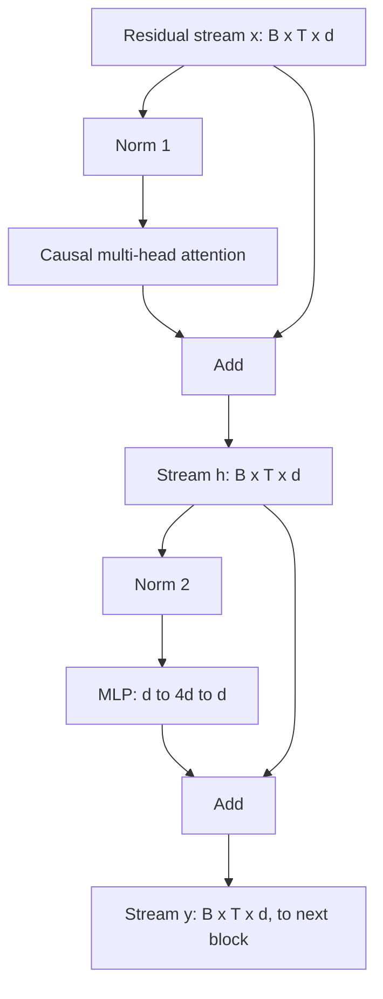

# Inside a Decoder Block: Attention, MLP and Residual Stream

## Introduction

A decoder-only LLM is mostly a single block repeated. Llama 3.1 8B has 32 copies, Qwen3-8B has 36, DeepSeek-V3 has 61. Each copy has the same structure: normalize, attend, add; normalize, run an MLP, add. If you understand one block thoroughly, including its shapes, its parameter budget and what each part contributes, you understand most of the model.

This page takes the block apart. The central idea is the **residual stream**: a vector per token that flows from the embedding to the output, which every sublayer reads from and writes to by addition. That view, popularized by Anthropic's "A Mathematical Framework for Transformer Circuits" (Elhage et al., 2021), turns a deep network into something you can reason about piece by piece.

You will be able to:

- write the pre-norm decoder block as two equations and implement it in about 40 lines of PyTorch;
- explain why attention is the only place tokens exchange information and why the MLP works on each token alone;
- verify numerically that the final hidden state is the embedding plus the sum of every sublayer's output;
- account for where a block's parameters go (about one third attention, two thirds MLP in a classic block; more MLP-heavy with GQA);
- explain why residual connections make deep stacks trainable, and how GPT-2's initialization exploits them.

## The Block in Two Equations

Let $x \in \mathbb{R}^{T \times d}$ be the residual stream entering block $\ell$: one $d$-dimensional vector per position. A pre-norm decoder block computes

$$
h = x + \mathrm{Attn}\big(\mathrm{Norm}_1(x)\big), \qquad
y = h + \mathrm{MLP}\big(\mathrm{Norm}_2(h)\big)
$$

and passes $y$ to block $\ell + 1$. That is all. Two sublayers, each reading a normalized copy of the stream and adding its result back. The input and output shapes are identical, `(batch, seq_len, d_model)`, which is what makes blocks stackable.



The straight lines from $x$ to the first "Add" and from $h$ to the second are the residual connections. Notice that nothing is ever normalized on the main path: the norms only produce inputs for the sublayers. This is the pre-norm arrangement used by GPT-2 and every major LLM since; the original Transformer normalized the main path itself, which [LayerNorm, RMSNorm, Pre-Norm and Post-Norm](./3-llm-normalization.mdx) compares in detail.

The full model wraps the stack with an embedding at the bottom and an unembedding at the top:

$$
x^{(0)} = E[\mathrm{tokens}] \;(+\, \text{positions}), \qquad
x^{(\ell)} = \mathrm{Block}_\ell\big(x^{(\ell-1)}\big), \qquad
\mathrm{logits} = \mathrm{Norm}_f\big(x^{(L)}\big)\, W_U
$$

where $W_U \in \mathbb{R}^{d \times V}$ maps each final vector to a score per vocabulary entry. In a model with weight tying, $W_U = E^\top$.

## The Residual Stream View

Unroll the recursion. Each block adds two terms to the stream, so after $L$ blocks

$$
x^{(L)} = x^{(0)} + \sum_{\ell=1}^{L} \Big( a^{(\ell)} + m^{(\ell)} \Big)
$$

where $a^{(\ell)}$ is what block $\ell$'s attention wrote and $m^{(\ell)}$ what its MLP wrote. The final representation is literally the embedding plus a sum of $2L$ contributions. No sublayer overwrites the stream; each one only adds to it.

A good analogy is a shared whiteboard that travels with each token. The embedding writes the token's identity on it. Each attention sublayer reads the whiteboards of earlier tokens and copies some information onto this one. Each MLP reads this whiteboard and writes conclusions derived from it. At the end, the unembedding reads the whiteboard and guesses the next token. Because writing is additive, information written early is still there at the end unless a later sublayer writes something that cancels it.

This has practical consequences:

- **Sublayers communicate through subspaces.** The stream has $d$ dimensions (4,096 in Llama 3 8B). A sublayer reads a few directions through its input projections and writes to a few through its output projection. Different features can live in different, nearly orthogonal directions and coexist.
- **You can inspect intermediate states.** Applying the final norm and unembedding to $x^{(\ell)}$ for an intermediate $\ell$ (the "logit lens") shows what the model would predict if it stopped there. Interpretability work in [Mechanistic Interpretability](../12-llm-evaluation/4-llm-interpretability.mdx) relies on this.
- **Layers can be removed or skipped with graceful degradation.** Deleting one block from a trained deep model usually hurts only a little, because each block's contribution is one term in a sum.

The code below builds a three-block model and checks the unrolled identity numerically. It also checks two properties that every decoder block must have: causality and the position-wise MLP.

```python
import torch
import torch.nn as nn
import torch.nn.functional as F

torch.manual_seed(0)

class Attention(nn.Module):
    def __init__(self, d, n_head):
        super().__init__()
        self.n_head, self.hd = n_head, d // n_head
        self.qkv = nn.Linear(d, 3 * d, bias=False)
        self.o = nn.Linear(d, d, bias=False)

    def forward(self, x):                                   # x: (B, T, d)
        B, T, d = x.shape
        q, k, v = self.qkv(x).view(B, T, 3, self.n_head, self.hd).unbind(2)  # each (B, T, h, hd)
        q, k, v = (t.transpose(1, 2) for t in (q, k, v))    # (B, h, T, hd)
        y = F.scaled_dot_product_attention(q, k, v, is_causal=True)          # (B, h, T, hd)
        return self.o(y.transpose(1, 2).reshape(B, T, d))   # (B, T, d)

class MLP(nn.Module):
    def __init__(self, d):
        super().__init__()
        self.up, self.down = nn.Linear(d, 4 * d, bias=False), nn.Linear(4 * d, d, bias=False)

    def forward(self, x):                                   # (B, T, d) -> (B, T, d)
        return self.down(F.gelu(self.up(x)))

class DecoderBlock(nn.Module):
    def __init__(self, d, n_head):
        super().__init__()
        self.norm1, self.attn = nn.LayerNorm(d), Attention(d, n_head)
        self.norm2, self.mlp = nn.LayerNorm(d), MLP(d)

    def forward(self, x, writes=None):
        a = self.attn(self.norm1(x))                        # read the stream, mix across positions
        x = x + a                                           # write back
        m = self.mlp(self.norm2(x))                         # read again, transform each position
        x = x + m                                           # write back
        if writes is not None:
            writes += [a, m]
        return x

d, n_head, n_layer = 64, 4, 3
blocks = nn.ModuleList(DecoderBlock(d, n_head) for _ in range(n_layer))
x0 = torch.randn(1, 5, d)                                   # pretend these are token embeddings

# 1) The final stream is exactly the embedding plus everything every sublayer wrote.
writes, x = [], x0
for blk in blocks:
    x = blk(x, writes)
print("sublayer writes:", len(writes))
print("max |x_L - (x_0 + sum of writes)|:", (x - (x0 + sum(writes))).abs().max().item())

# 2) Causality: changing the last token does not change earlier outputs.
x_alt = x0.clone()
x_alt[0, -1] += 1.0
y, y_alt = x0, x_alt
for blk in blocks:
    y, y_alt = blk(y), blk(y_alt)
print("change at positions 0-3:", (y - y_alt)[0, :4].abs().max().item())
print("change at position 4:   ", (y - y_alt)[0, 4].abs().max().item())

# 3) The MLP is position-wise: running it on one token alone gives the same answer.
mlp = blocks[0].mlp
print("MLP position-wise:", torch.allclose(mlp(x0)[0, 2], mlp(x0[:, 2:3])[0, 0], atol=1e-6))
```

```text
sublayer writes: 6
max |x_L - (x_0 + sum of writes)|: 2.384185791015625e-07
change at positions 0-3: 0.0
change at position 4:    1.0000004768371582
MLP position-wise: True
```

The identity holds up to float32 rounding ($2.4 \times 10^{-7}$). Perturbing the last token leaves positions 0 to 3 bit-for-bit unchanged, as the causal mask promises; that is what makes training on all positions at once valid and what makes the KV cache possible. The change at position 4 is about 1.0, the size of the perturbation itself, carried straight through by the residual path.

## Attention: How Tokens Talk to Each Other

The attention sublayer is the only part of the block where information moves between positions. For each head $j$, it projects the normalized stream $\bar{x} = \mathrm{Norm}_1(x)$ into queries, keys and values, mixes values across positions with causal softmax weights, and maps the result back to the stream:

$$
\mathrm{Attn}(\bar{x}) = \sum_{j=1}^{h} \mathrm{softmax}\!\left(\frac{\bar{x} W_j^Q \big(\bar{x} W_j^K\big)^\top}{\sqrt{d_h}} + M\right) \bar{x}\, W_j^V W_j^O
$$

Here $d_h = d/h$ is the head dimension, $M$ is the causal mask (0 on and below the diagonal, $-\infty$ above), and $W_j^O \in \mathbb{R}^{d_h \times d}$ is head $j$'s slice of the output projection. Writing the output projection as a sum over heads (instead of "concatenate, then project") is mathematically identical and makes the residual-stream picture clearer: **each head independently reads from the stream and writes back to it**.

Elhage et al. split each head into two circuits. The QK circuit, $W_j^Q W_j^{K\top}$, decides where to look: which earlier positions get high attention weight. The OV circuit, $W_j^V W_j^O$, decides what to copy from those positions into the current stream. A "previous token head" has a QK circuit that attends one position back and an OV circuit that copies the token identity; combined with a later head, it forms an induction head, the mechanism behind much of in-context learning.

Parameters per layer, without biases, for standard multi-head attention:

$$
P_\mathrm{attn} = \underbrace{d \cdot d}_{W^Q} + \underbrace{d \cdot d}_{W^K} + \underbrace{d \cdot d}_{W^V} + \underbrace{d \cdot d}_{W^O} = 4 d^2
$$

With grouped-query attention (see [MQA and GQA](../2-llm-attention/5-llm-mqa-gqa.mdx)), $W^K$ and $W^V$ shrink to $d \times (n_\mathrm{kv} d_h)$. Llama 3.1 8B, with 32 query heads, 8 KV heads and $d_h = 128$, has $W^K$ of size $4096 \times 1024$, a quarter of the full size.

## The MLP: How Each Token Thinks Alone

The MLP sublayer applies the same two-layer network to each position independently:

$$
\mathrm{MLP}(\bar{h}) = \phi\big(\bar{h}\, W_\mathrm{up}\big)\, W_\mathrm{down}, \qquad W_\mathrm{up} \in \mathbb{R}^{d \times 4d}, \; W_\mathrm{down} \in \mathbb{R}^{4d \times d}
$$

with a nonlinearity $\phi$ such as GELU. No information crosses positions; the third check in the code confirms that running the MLP on one token in isolation gives exactly the same output. The MLP widens each vector by 4x, applies the nonlinearity elementwise, and projects back.

One useful reading of the MLP comes from Geva et al. ("Transformer Feed-Forward Layers Are Key-Value Memories", 2021). Each of the $4d$ hidden units has an input vector (a column of $W_\mathrm{up}$) and an output vector (a row of $W_\mathrm{down}$). The input vector acts as a key: the unit fires when the stream points in its direction. The output vector is the value written to the stream when it fires. With 14,336 hidden units per layer in Llama 3 8B, each MLP is a large soft lookup table, and much of a model's factual knowledge appears to be stored in these layers.

Parameters, without biases: $P_\mathrm{mlp} = d \cdot 4d + 4d \cdot d = 8 d^2$. Modern models replace this MLP with SwiGLU, which has three matrices instead of two; [Feed-Forward Networks, GELU and SwiGLU](./4-llm-feed-forward-and-swiglu.mdx) explains the change and the resulting hidden sizes.

## Where the Parameters and Compute Go

A classic block (MHA, 4x MLP, no biases) has $4d^2 + 8d^2 = 12 d^2$ weights plus two norm vectors. The MLP holds two thirds. With GQA and a wider SwiGLU, modern blocks are even more MLP-heavy. Using the shapes from the Llama 3.1 8B config.json (`hidden_size` 4096, `num_attention_heads` 32, `num_key_value_heads` 8, `head_dim` 128, `intermediate_size` 14336):

| Part | Shape | Parameters | Share of block |
|---|---|---|---|
| $W^Q$ | 4096 x 4096 | 16,777,216 | 7.7% |
| $W^K$ | 4096 x 1024 | 4,194,304 | 1.9% |
| $W^V$ | 4096 x 1024 | 4,194,304 | 1.9% |
| $W^O$ | 4096 x 4096 | 16,777,216 | 7.7% |
| MLP gate, up, down | 3 x 4096 x 14336 | 176,160,768 | 80.8% |
| Two RMSNorm gains | 2 x 4096 | 8,192 | under 0.01% |
| **Block total** | | **218,112,000** | 100% |

Thirty-two such blocks hold 6.98 billion of the model's 8.03 billion parameters; the rest is the embedding and output layer. Since matrix-multiply FLOPs are proportional to weights, the MLP also takes about 80% of the per-token compute at short context. At long context, the attention score computation, which grows with sequence length, takes over; [Counting Parameters, FLOPs and Memory](./6-llm-parameter-and-flop-counting.mdx) works out the crossover.

Here is the same block as a tensor-shape trace for a batch of 2 sequences of 5 tokens, $d = 64$ and 4 heads, matching the code above:

| Step | Tensor | Shape |
|---|---|---|
| Input stream | `x` | `(2, 5, 64)` |
| Fused projection | `qkv(norm1(x))` | `(2, 5, 192)` |
| Split heads | `q`, `k`, `v` | `(2, 4, 5, 16)` each |
| Scores | `q @ k.transpose(-2, -1)` | `(2, 4, 5, 5)` |
| Weighted values | `softmax(scores) @ v` | `(2, 4, 5, 16)` |
| Merge heads, project | `o(...)` | `(2, 5, 64)` |
| After first residual | `h` | `(2, 5, 64)` |
| MLP hidden | `gelu(up(norm2(h)))` | `(2, 5, 256)` |
| Block output | `y` | `(2, 5, 64)` |

The only tensor whose size depends on $T^2$ is the score matrix, `(2, 4, 5, 5)`. Every other tensor is linear in $T$.

## Why Residual Connections Make Depth Possible

Consider the gradient through one residual sublayer $x_{\ell+1} = x_\ell + F(x_\ell)$:

$$
\frac{\partial x_{\ell+1}}{\partial x_\ell} = I + \frac{\partial F}{\partial x_\ell}
$$

Chain $L$ of them and the gradient from the loss to an early layer is a product of $(I + J_\ell)$ terms. Expanding the product, one term is the identity: there is always a path along which the gradient arrives unchanged, however deep the network. Without the residual, the product is $\prod J_\ell$, which tends to shrink or blow up exponentially with depth. Veit, Wilber and Belongie (2016) described residual networks as behaving like an ensemble of many shallower paths, which fits the unrolled sum above.

Residuals also make a good initialization easy: if each $F$ starts near zero, every block starts near the identity, and the network starts as "embedding in, unembedding out", a trivially trainable bigram model. Training then grows each contribution as it becomes useful.

The flip side is that the stream's magnitude grows with depth: $2L$ roughly independent contributions add up, so the variance of $x^{(L)}$ grows about linearly in $L$ if each has similar size. GPT-2 counters this by initializing each sublayer's output projection ($W^O$ and $W_\mathrm{down}$) with standard deviation scaled by $1/\sqrt{2L}$, so the sum of $2L$ writes has the same variance as one. Our [GPT from scratch](./5-llm-build-gpt-from-scratch.mdx) uses exactly this rule. Pre-norm makes the growth harmless for the sublayers, since each one reads a normalized copy; the final norm before the unembedding handles it at the output.

## Variations on the Block

The sequential block above is the standard, but two variations appear in real models.

**Parallel block.** GPT-J (Wang and Komatsuzaki, 2021) and PaLM (Chowdhery et al., 2022) compute attention and MLP from the same normalized input and add both at once:

$$
y = x + \mathrm{Attn}\big(\mathrm{Norm}(x)\big) + \mathrm{MLP}\big(\mathrm{Norm}(x)\big)
$$

The input projections of both sublayers can then be fused into one big matrix multiply. The PaLM paper reports about 15% faster training at large scale, with a small quality loss at 8B and none measured at 62B. Most later open models (Llama, Qwen, DeepSeek) stayed with the sequential block.

**Extra norms around sublayers.** Gemma 2 and Gemma 3 normalize both the input and the output of each sublayer before adding it to the stream; OLMo 2 normalizes only the outputs. These change how much each write can grow; [the normalization page](./3-llm-normalization.mdx) covers them.

Other changes, such as mixture-of-experts MLPs ([Mixture of Experts](../7-llm-mixture-of-experts/0-llm-moe-introduction.mdx)) or sliding-window attention in some layers, replace one sublayer while keeping the read-normalize-write-add pattern intact.

:::note
In Hugging Face's Llama code the second norm is called `post_attention_layernorm`. Despite the name it is a pre-norm: it normalizes the stream after the attention residual has been added, as input to the MLP. The stream itself is never normalized inside the block.
:::

## Common Mistakes

- **Normalizing the residual stream instead of the sublayer input.** In a pre-norm block, `x = norm(x); x = x + attn(x)` is wrong; it discards the unnormalized stream. Write `x = x + attn(norm(x))`.
- **Forgetting the final norm.** Pre-norm models need a norm after the last block, before the unembedding. Without it, logits scale with the uncontrolled stream magnitude.
- **Mixing up the merge of heads.** After attention, transpose `(B, h, T, d_h)` back to `(B, T, h, d_h)` before reshaping to `(B, T, d)`. Reshaping without the transpose silently scrambles positions and heads.
- **Assuming attention dominates parameters.** In a classic block it is one third; in Llama 3 8B it is under 20%. Optimizations aimed at parameter count usually target the MLP.
- **Initializing output projections like every other layer in a deep model.** Without the $1/\sqrt{2L}$ scaling (or an equivalent), the stream grows with depth and early training becomes unstable.
- **Thinking the MLP sees context.** It sees only what attention has already written into the current position's stream.

## Summary

- A pre-norm decoder block is $h = x + \mathrm{Attn}(\mathrm{Norm}(x))$, $y = h + \mathrm{MLP}(\mathrm{Norm}(h))$, with input and output of shape `(B, T, d)`.
- The residual stream is a per-token vector that every sublayer reads (through a norm and projections) and writes (by addition); the final state is the embedding plus the sum of all $2L$ writes.
- Attention is the only cross-position operation; each head has a QK circuit (where to look) and an OV circuit (what to copy). The MLP acts on each position alone and behaves like a key-value memory.
- A classic block has $12 d^2$ weights, two thirds in the MLP; Llama 3.1 8B's block has 218M weights, 81% in the SwiGLU MLP.
- Residuals give gradients an identity path through any depth; GPT-2 scales output projections by $1/\sqrt{2L}$ to keep the stream's variance in check.

## Further Reading

- [A Mathematical Framework for Transformer Circuits (Elhage et al., 2021)](https://transformer-circuits.pub/2021/framework/index.html): the residual-stream view, QK and OV circuits.
- [Transformer Feed-Forward Layers Are Key-Value Memories (Geva et al., 2021)](https://arxiv.org/abs/2012.14913): what MLP units store.
- [Residual Networks Behave Like Ensembles of Relatively Shallow Networks (Veit et al., 2016)](https://arxiv.org/abs/1605.06431): the many-paths view of residual stacks.
- [Language Models are Unsupervised Multitask Learners (Radford et al., 2019)](https://cdn.openai.com/better-language-models/language_models_are_unsupervised_multitask_learners.pdf): GPT-2, pre-norm and the scaled residual initialization.
- [PaLM (Chowdhery et al., 2022)](https://arxiv.org/abs/2204.02311): the parallel block and its measured trade-off.
- [Hugging Face Llama modeling code](https://github.com/huggingface/transformers/blob/main/src/transformers/models/llama/modeling_llama.py): a production decoder block to compare with the one above.
