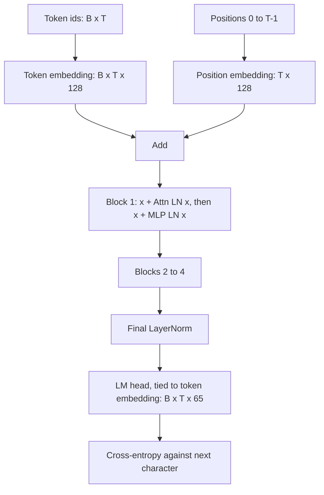

# Building a GPT from Scratch in PyTorch

## Introduction

This page puts the whole section together. You will write a complete decoder-only Transformer in PyTorch, the same architecture as GPT-2 at a tiny scale, run three sanity checks that catch the most common bugs, train it for 1,000 steps on Tiny Shakespeare on a CPU, and sample new text from it. Every number and every line of sample text below comes from actually running the code.

The model is small: 4 layers, width 128, 4 heads, a context of 128 characters and 812,288 parameters. It trains in a minute or two on a laptop CPU and reaches a validation loss of about 1.73 nats per character, enough to produce text that looks like a play script with invented words. Scaling the same code up (more layers, a BPE tokenizer, a GPU and billions of tokens) is exactly what [Pretraining a Small Language Model End to End](../6-llm-pretraining/6-llm-training-small-model.mdx) and the [laptop GPT project](../14-llm-projects/1-llm-project-char-gpt.mdx) do.

The design follows Andrej Karpathy's nanoGPT and the GPT-2 paper, with two modern touches: no bias terms (as in PaLM and Llama) and PyTorch's fused `F.scaled_dot_product_attention`. By the end you will be able to:

- implement token and position embeddings, causal multi-head attention, the MLP, pre-norm blocks, the final norm and a tied output layer, with the shape of every tensor;
- explain GPT-2's initialization, including the $1/\sqrt{2L}$ scaling of residual projections;
- verify a fresh model with three checks: initial loss, causality and single-batch memorization;
- write a training loop with AdamW, warmup, cosine decay, weight-decay groups and gradient clipping;
- implement sampling with temperature and top-k, and read a loss curve.

## The Architecture We Are Building



This is the decoder-only pattern from [Encoder-Only, Decoder-Only and Encoder-Decoder Models](./1-llm-encoder-decoder-variants.mdx), built from the pre-norm block of [Inside a Decoder Block](./2-llm-transformer-block.mdx). We use a character-level vocabulary to keep the focus on the model; real LLMs use a byte-level BPE tokenizer such as the one built in [Byte-Pair Encoding from Scratch](../1-llm-tokenization/1-llm-bpe.mdx), and the model code does not change at all, only `vocab_size`.

The configuration, and what each number controls:

| Field | Value | Meaning |
|---|---|---|
| `vocab_size` | 65 | distinct characters in Tiny Shakespeare |
| `block_size` | 128 | maximum context length $T$ |
| `n_layer` | 4 | number of decoder blocks $L$ |
| `n_head` | 4 | attention heads; head size $128 / 4 = 32$ |
| `d_model` | 128 | width of the residual stream $d$ |
| `dropout` | 0.0 | no dropout; we train for far less than one epoch's worth of overfitting |
| `bias` | False | no bias vectors in linear layers or LayerNorm |

## The Model, Piece by Piece

Here is the complete `model.py`. It has no dependencies beyond PyTorch. Read it once top to bottom; the subsections after it explain each class.

```python
# model.py - a complete GPT (decoder-only Transformer) in one file.
import math
from dataclasses import dataclass

import torch
import torch.nn as nn
import torch.nn.functional as F


@dataclass
class GPTConfig:
    vocab_size: int = 65
    block_size: int = 128      # maximum context length T
    n_layer: int = 4
    n_head: int = 4
    d_model: int = 128
    dropout: float = 0.0
    bias: bool = False         # no biases in Linear / LayerNorm, as in PaLM and Llama


class CausalSelfAttention(nn.Module):
    def __init__(self, cfg):
        super().__init__()
        assert cfg.d_model % cfg.n_head == 0
        self.n_head = cfg.n_head
        self.head_dim = cfg.d_model // cfg.n_head
        self.qkv = nn.Linear(cfg.d_model, 3 * cfg.d_model, bias=cfg.bias)   # W_Q, W_K, W_V fused
        self.proj = nn.Linear(cfg.d_model, cfg.d_model, bias=cfg.bias)      # W_O
        self.dropout = cfg.dropout

    def forward(self, x):
        B, T, C = x.shape                                  # (batch, seq_len, d_model)
        q, k, v = self.qkv(x).split(C, dim=2)              # each (B, T, C)
        # split heads: (B, T, C) -> (B, n_head, T, head_dim)
        q = q.view(B, T, self.n_head, self.head_dim).transpose(1, 2)
        k = k.view(B, T, self.n_head, self.head_dim).transpose(1, 2)
        v = v.view(B, T, self.n_head, self.head_dim).transpose(1, 2)
        y = F.scaled_dot_product_attention(                # softmax(QK^T/sqrt(d)) V with a causal mask
            q, k, v, is_causal=True,
            dropout_p=self.dropout if self.training else 0.0)  # (B, n_head, T, head_dim)
        y = y.transpose(1, 2).contiguous().view(B, T, C)   # merge heads -> (B, T, C)
        return self.proj(y)


class MLP(nn.Module):
    def __init__(self, cfg):
        super().__init__()
        self.up = nn.Linear(cfg.d_model, 4 * cfg.d_model, bias=cfg.bias)
        self.down = nn.Linear(4 * cfg.d_model, cfg.d_model, bias=cfg.bias)
        self.drop = nn.Dropout(cfg.dropout)

    def forward(self, x):                                  # (B, T, C) -> (B, T, 4C) -> (B, T, C)
        return self.drop(self.down(F.gelu(self.up(x))))


class Block(nn.Module):
    """Pre-norm decoder block: x + Attn(LN(x)), then x + MLP(LN(x))."""
    def __init__(self, cfg):
        super().__init__()
        self.ln1 = nn.LayerNorm(cfg.d_model, bias=cfg.bias)
        self.attn = CausalSelfAttention(cfg)
        self.ln2 = nn.LayerNorm(cfg.d_model, bias=cfg.bias)
        self.mlp = MLP(cfg)

    def forward(self, x):
        x = x + self.attn(self.ln1(x))                     # tokens talk to each other
        x = x + self.mlp(self.ln2(x))                      # each token thinks on its own
        return x


class GPT(nn.Module):
    def __init__(self, cfg):
        super().__init__()
        self.cfg = cfg
        self.tok_emb = nn.Embedding(cfg.vocab_size, cfg.d_model)
        self.pos_emb = nn.Embedding(cfg.block_size, cfg.d_model)
        self.drop = nn.Dropout(cfg.dropout)
        self.blocks = nn.ModuleList([Block(cfg) for _ in range(cfg.n_layer)])
        self.ln_f = nn.LayerNorm(cfg.d_model, bias=cfg.bias)
        self.lm_head = nn.Linear(cfg.d_model, cfg.vocab_size, bias=False)
        self.lm_head.weight = self.tok_emb.weight          # weight tying
        self.apply(self._init_weights)
        for name, p in self.named_parameters():            # GPT-2: scale residual projections
            if name.endswith("proj.weight") or name.endswith("down.weight"):
                nn.init.normal_(p, mean=0.0, std=0.02 / math.sqrt(2 * cfg.n_layer))

    def _init_weights(self, m):
        if isinstance(m, nn.Linear):
            nn.init.normal_(m.weight, mean=0.0, std=0.02)
            if m.bias is not None:
                nn.init.zeros_(m.bias)
        elif isinstance(m, nn.Embedding):
            nn.init.normal_(m.weight, mean=0.0, std=0.02)

    def forward(self, idx, targets=None):
        B, T = idx.shape                                   # (batch, seq_len) of token ids
        assert T <= self.cfg.block_size
        pos = torch.arange(T, device=idx.device)           # (T,)
        x = self.drop(self.tok_emb(idx) + self.pos_emb(pos))   # (B, T, C)
        for block in self.blocks:
            x = block(x)                                   # (B, T, C)
        logits = self.lm_head(self.ln_f(x))                # (B, T, vocab)
        loss = None
        if targets is not None:
            loss = F.cross_entropy(logits.view(-1, logits.size(-1)), targets.view(-1))
        return logits, loss

    @torch.no_grad()
    def generate(self, idx, max_new_tokens, temperature=1.0, top_k=None):
        for _ in range(max_new_tokens):
            idx_cond = idx[:, -self.cfg.block_size:]       # crop to the context window
            logits, _ = self(idx_cond)
            logits = logits[:, -1, :] / temperature        # (B, vocab): only the last position
            if top_k is not None:
                v, _ = torch.topk(logits, top_k)
                logits[logits < v[:, [-1]]] = -float("inf")
            probs = F.softmax(logits, dim=-1)
            next_id = torch.multinomial(probs, num_samples=1)   # (B, 1)
            idx = torch.cat([idx, next_id], dim=1)
        return idx
```

### CausalSelfAttention

One linear layer `qkv` computes queries, keys and values together: its weight is $W_Q$, $W_K$ and $W_V$ stacked into a `(3d, d)` matrix, which is faster than three separate matmuls. The `split` cuts the `(B, T, 3C)` output into three `(B, T, C)` tensors.

The `view` plus `transpose(1, 2)` turns `(B, T, C)` into `(B, n_head, T, head_dim)`, so each head is a separate slice that the batched matmul inside attention handles in parallel. [Multi-Head Attention](../2-llm-attention/4-llm-multi-head-attention.mdx) walks through this reshape element by element.

`F.scaled_dot_product_attention` computes $\mathrm{softmax}(QK^\top/\sqrt{d_h} + M)V$ with the causal mask $M$ when `is_causal=True`. On a CPU it runs a fused C++ kernel; on a GPU it dispatches to FlashAttention or a memory-efficient kernel when available ([Using FlashAttention in PyTorch](../5-llm-flash-attention/4-llm-using-flash-attention.mdx)). It never materializes the mask as a Python tensor. If you want to see the arithmetic, replace it with the explicit version from [Implementing Self-Attention from Scratch](../2-llm-attention/2-llm-self-attention-from-scratch.mdx); the outputs match to within floating-point tolerance.

After attention, `transpose(1, 2).contiguous().view(B, T, C)` merges the heads back. The `contiguous()` is required because `transpose` only changes strides, and `view` needs contiguous memory. Finally `proj` is $W_O$.

### MLP and Block

The MLP expands to $4d = 512$, applies GELU and projects back, exactly the GPT-2 FFN from [Feed-Forward Networks, GELU and SwiGLU](./4-llm-feed-forward-and-swiglu.mdx). The `Block` is two lines of real logic: `x = x + self.attn(self.ln1(x))` and `x = x + self.mlp(self.ln2(x))`. That is the pre-norm residual structure, with the stream never normalized in place ([LayerNorm, RMSNorm, Pre-Norm and Post-Norm](./3-llm-normalization.mdx)).

### GPT: Embeddings, Tying and Initialization

`tok_emb` maps each id to a 128-vector; `pos_emb` is a learned table with one vector per position up to `block_size`, as in GPT-2 (modern models use RoPE instead, see [Implementing RoPE in PyTorch](../4-llm-positional-encoding/4-llm-rope-implementation.mdx)). Their sum is the initial residual stream.

`self.lm_head.weight = self.tok_emb.weight` ties the output layer to the input embedding. Both are `(65, 128)` matrices: `nn.Linear(128, 65)` stores its weight as `(out, in) = (65, 128)`, the same shape as the embedding table, so the assignment works without a transpose. The logit for character $c$ is then the dot product of the final hidden state with $c$'s embedding vector.

Initialization follows GPT-2: every weight matrix and embedding is drawn from $\mathcal{N}(0, 0.02^2)$, and the two projections that write into the residual stream in each block (`proj` and `down`) get a smaller standard deviation of $0.02/\sqrt{2L}$. With $L = 4$ blocks there are $2L = 8$ residual writes, so each starts at $0.02/\sqrt{8} \approx 0.0071$, keeping the variance of their sum comparable to that of a single write.

`forward` returns logits of shape `(B, T, vocab)` and, if targets are given, the mean cross-entropy over all $B \times T$ positions. Flattening to `(B*T, vocab)` and `(B*T,)` is what `F.cross_entropy` expects.

### generate

Generation is a loop. Crop the context to the last `block_size` tokens (the position table has no entries beyond that), run the model, keep only the logits at the last position, divide by the temperature, optionally keep only the top-$k$ logits, convert to probabilities and sample one token with `torch.multinomial`. Append and repeat. This recomputes the whole context every step, which is fine for 300 characters; a real engine keeps a KV cache so each step costs one token's worth of compute ([The KV Cache](../10-llm-inference/2-llm-kv-cache.mdx)). [Decoding Strategies](../10-llm-inference/1-llm-decoding-strategies.mdx) explains temperature, top-k and alternatives in depth.

## Counting the Parameters by Hand

Before training anything, check that the parameter count is what the architecture implies. With $d = 128$, $V = 65$, $T_\mathrm{max} = 128$, $L = 4$ and no biases:

| Component | Formula | Count |
|---|---|---|
| Token embedding (shared with LM head) | $V d$ | 8,320 |
| Position embedding | $T_\mathrm{max}\, d$ | 16,384 |
| Attention per block ($W_{QKV}$ and $W_O$) | $3d^2 + d^2$ | 65,536 |
| MLP per block | $4d^2 + 4d^2$ | 131,072 |
| Two LayerNorm gains per block | $2d$ | 256 |
| One block | $12d^2 + 2d$ | 196,864 |
| Four blocks | | 787,456 |
| Final LayerNorm gain | $d$ | 128 |
| **Total** | | **812,288** |

That matches the `parameters: 812,288` line the training script prints. Because of tying, the LM head adds nothing. Notice that 97% of the parameters are in the blocks; at this tiny vocabulary the embedding is negligible, the opposite of a real LLM with a 128K-token vocabulary at small width. [Counting Parameters, FLOPs and Memory](./6-llm-parameter-and-flop-counting.mdx) generalizes this table.

## Three Sanity Checks Before Training

A model with a bug often still trains, just worse, and you only find out after hours of compute. These three checks take seconds and catch the most common mistakes.

```python
# checks.py - three sanity checks to run before any long training job.
import math
import torch
from model import GPT, GPTConfig

torch.manual_seed(0)
cfg = GPTConfig(vocab_size=65)
model = GPT(cfg)
x = torch.randint(0, 65, (4, 32))                          # (B, T) random token ids
y = torch.randint(0, 65, (4, 32))

# 1) At initialization the model should be close to uniform: loss ~ ln(vocab).
_, loss = model(x, y)
print(f"initial loss {loss.item():.3f}  vs ln(65) = {math.log(65):.3f}")

# 2) Causality: logits at position t must not depend on tokens after t.
model.eval()
x2 = x.clone()
x2[:, 20:] = torch.randint(0, 65, (4, 12))                 # change the future
l1, _ = model(x)
l2, _ = model(x2)
print("max logit change at positions 0-19:", (l1[:, :20] - l2[:, :20]).abs().max().item())
print("max logit change at positions 20+: ", round((l1[:, 20:] - l2[:, 20:]).abs().max().item(), 3))

# 3) Capacity: the model must be able to memorize one small batch.
model.train()
opt = torch.optim.AdamW(model.parameters(), lr=3e-3)
for step in range(150):
    _, loss = model(x, y)
    opt.zero_grad(); loss.backward(); opt.step()
print(f"loss after 150 steps on one batch: {loss.item():.4f}")
```

```text
initial loss 4.219  vs ln(65) = 4.174
max logit change at positions 0-19: 0.0
max logit change at positions 20+:  1.541
loss after 150 steps on one batch: 0.0035
```

**Initial loss.** A freshly initialized model with small weights produces nearly uniform predictions, so the cross-entropy should be close to $\ln V = \ln 65 \approx 4.174$. A much larger value means the logits are too big at initialization (a scaling bug, or a missing final norm); a much smaller value on random targets means information is leaking.

**Causality.** Changing tokens at positions 20 and later must leave the logits at positions 0 to 19 exactly unchanged, and they are (difference 0.0). If the mask were wrong, the model would learn to copy the next token from the input during training, reach a near-zero training loss, and generate garbage. This is the single most common bug in hand-written GPTs.

**Memorizing one batch.** With only 4 sequences of 32 random tokens, the model has more than enough capacity to memorize the targets, so the loss should fall far below the initial 4.17. If it does not, something blocks learning: a detached tensor, a wrong optimizer parameter list or a broken residual path.

## The Training Script

`train.py` loads the data, builds the character vocabulary, trains for 1,000 steps and samples. It imports the model from `model.py`.

```python
# train.py - train the GPT from model.py on Tiny Shakespeare and sample from it.
import math, os, time, urllib.request

import torch
from model import GPT, GPTConfig

torch.manual_seed(1337)
torch.set_num_threads(8)                       # use up to 8 CPU threads

# ---------------------------------------------------------------- data
URL = "https://raw.githubusercontent.com/karpathy/char-rnn/master/data/tinyshakespeare/input.txt"
if not os.path.exists("input.txt"):
    urllib.request.urlretrieve(URL, "input.txt")
text = open("input.txt", encoding="utf-8").read()

chars = sorted(set(text))                      # character-level vocabulary
stoi = {ch: i for i, ch in enumerate(chars)}
itos = {i: ch for ch, i in stoi.items()}
encode = lambda s: [stoi[c] for c in s]
decode = lambda ids: "".join(itos[i] for i in ids)

data = torch.tensor(encode(text), dtype=torch.long)
n = int(0.9 * len(data))
train_data, val_data = data[:n], data[n:]
print(f"chars: {len(text):,}  vocab: {len(chars)}  train: {len(train_data):,}  val: {len(val_data):,}")

# ---------------------------------------------------------------- training
cfg = GPTConfig(vocab_size=len(chars))
model = GPT(cfg)
n_params = sum(p.numel() for p in model.parameters())
print(f"parameters: {n_params:,}")

batch_size, max_steps, eval_every = 32, 1000, 100
lr_max, warmup = 3e-3, 50

def get_batch(split):
    d = train_data if split == "train" else val_data
    ix = torch.randint(len(d) - cfg.block_size - 1, (batch_size,))
    x = torch.stack([d[i : i + cfg.block_size] for i in ix])          # (B, T)
    y = torch.stack([d[i + 1 : i + 1 + cfg.block_size] for i in ix])  # (B, T), shifted by one
    return x, y

@torch.no_grad()
def estimate_loss(iters=20):
    model.eval()
    out = {}
    for split in ("train", "val"):
        losses = torch.tensor([model(*get_batch(split))[1].item() for _ in range(iters)])
        out[split] = losses.mean().item()
    model.train()
    return out

def lr_at(step):                                           # linear warmup, then cosine decay to 10%
    if step < warmup:
        return lr_max * (step + 1) / warmup
    progress = (step - warmup) / (max_steps - warmup)
    return 0.1 * lr_max + 0.9 * lr_max * 0.5 * (1 + math.cos(math.pi * progress))

decay = [p for p in model.parameters() if p.dim() >= 2]    # weight decay on matrices only
no_decay = [p for p in model.parameters() if p.dim() < 2]
opt = torch.optim.AdamW([{"params": decay, "weight_decay": 0.1},
                         {"params": no_decay, "weight_decay": 0.0}],
                        lr=lr_max, betas=(0.9, 0.95))

start = time.time()
for step in range(max_steps + 1):
    if step % eval_every == 0:
        l = estimate_loss()
        print(f"step {step:4d} | train {l['train']:.3f} | val {l['val']:.3f} | {time.time() - start:5.1f}s")
    if step == max_steps:
        break
    for g in opt.param_groups:
        g["lr"] = lr_at(step)
    x, y = get_batch("train")
    _, loss = model(x, y)
    opt.zero_grad(set_to_none=True)
    loss.backward()
    torch.nn.utils.clip_grad_norm_(model.parameters(), 1.0)
    opt.step()

# ---------------------------------------------------------------- sampling
model.eval()
prompt = torch.tensor([encode("ROMEO:\n")], dtype=torch.long)    # (1, 7)
out = model.generate(prompt, max_new_tokens=300, temperature=0.8, top_k=20)
print(decode(out[0].tolist()))
torch.save(model.state_dict(), "gpt.pt")
```

Points worth noticing:

- **Batches are random windows.** `get_batch` picks 32 random start offsets and slices 128-character windows. The targets `y` are the same windows shifted by one, so position $t$ of `y` is the character after position $t$ of `x`: one sequence yields 128 next-token predictions. [The Training Objective](../6-llm-pretraining/1-llm-training-objective.mdx) explains shifting and packing for real corpora.
- **Learning rate.** A linear warmup over 50 steps to $3 \times 10^{-3}$, then cosine decay to 10% of the peak. Small models tolerate large learning rates; GPT-3-sized models use around $10^{-4}$ ([Optimizers, Learning Rate Schedules and Training Stability](../6-llm-pretraining/3-llm-optimizers-and-schedules.mdx)).
- **AdamW with two parameter groups.** Weight decay of 0.1 applies to matrices (embeddings and linear weights) but not to the LayerNorm gains, which are vectors. Decaying gains toward zero would fight the normalization. $\beta_2 = 0.95$ is the usual LLM choice.
- **Gradient clipping** at a global norm of 1.0 limits the damage of an occasional bad batch.
- **Evaluation** averages the loss over 20 random batches from each split every 100 steps, with the model in `eval()` mode and gradients off.

## Results: Loss Curve and Samples

Run `python train.py`. This is the complete output, with times from a run on an otherwise idle 32-core Linux machine using 8 threads. A second run of the same files on a heavily shared machine took 1,005 seconds but printed exactly the same losses and the same sample, character for character: with the same seed, thread count and PyTorch version (2.14 here) the results are reproducible, and only the time column depends on your hardware.

```text
chars: 1,115,394  vocab: 65  train: 1,003,854  val: 111,540
parameters: 812,288
step    0 | train 4.184 | val 4.179 |   0.9s
step  100 | train 2.475 | val 2.470 |   7.8s
step  200 | train 2.286 | val 2.306 |  14.7s
step  300 | train 2.105 | val 2.148 |  21.7s
step  400 | train 1.963 | val 2.053 |  28.7s
step  500 | train 1.823 | val 1.971 |  36.1s
step  600 | train 1.757 | val 1.880 |  43.2s
step  700 | train 1.686 | val 1.837 |  50.4s
step  800 | train 1.608 | val 1.775 |  59.3s
step  900 | train 1.579 | val 1.740 |  66.9s
step 1000 | train 1.544 | val 1.729 |  73.9s
ROMEO:
Nay, or when not the from anged so my lord.

Clown:
She ancures your so?

Clown:
Never I will that did be thine, I fave he seed for parise
To a mark in chime son. But I know wome not
to never marriks the from love be majt
That winder matter to fortwer.

DUKE OF AUMERLE:
You come when they beack enou
```

How to read it:

- **Step 0: 4.184.** Almost exactly $\ln 65$, as the sanity check predicted.
- **Step 100: about 2.47.** The model has learned character frequencies and common pairs, roughly what a bigram model achieves. Spaces, newlines and frequent letters dominate.
- **Steps 200 to 500: down to about 1.97.** It learns words, the speaker-name format (`NAME:` on its own line) and line lengths.
- **Step 1,000: train 1.544, val 1.729.** The gap of 0.19 nats is the start of overfitting: 812K parameters have seen 1,000 batches of $32 \times 128$ characters, about 4.1M characters, roughly four passes over the million-character training set.

A validation loss of 1.729 nats per character means the model's average probability for the correct next character is $e^{-1.729} \approx 0.18$, compared with $1/65 \approx 0.015$ for uniform guessing. In bits, it is $1.729 / \ln 2 \approx 2.49$ bits per character.

The sample, generated from the prompt `ROMEO:` at temperature 0.8 with top-k 20, shows what that loss buys. The structure is right: speaker names on their own line followed by a colon (Clown and DUKE OF AUMERLE are both real roles in the plays), short verse-like lines, plausible punctuation, many real words (lord, thine, love, matter) and near-misses such as "marriks". The meaning is not there, and many words are invented. A word-level understanding needs much more data and parameters, which is what scaling laws quantify ([Scaling Laws](../6-llm-pretraining/2-llm-scaling-laws.mdx)).

:::tip
To make the model better on the same CPU budget, train longer (5,000 steps) and grow it to `n_layer=6, d_model=192, n_head=6`, adding `dropout=0.1` once the train-val gap grows. Watch the validation loss, not the training loss: with only about a million characters of text, the data soon becomes the limit rather than the model.
:::

## Making It Modern

The model above is GPT-2's 2019 design. Swapping in the components that 2025-2026 models use is a good exercise, and each swap is a few lines:

| Change | Replace | With | Covered in |
|---|---|---|---|
| RMSNorm | `nn.LayerNorm(d, bias=False)` | `nn.RMSNorm(d)` | [Normalization](./3-llm-normalization.mdx) |
| SwiGLU | `MLP` | the `SwiGLU` module, hidden $\approx 8d/3$ | [Feed-Forward Networks](./4-llm-feed-forward-and-swiglu.mdx) |
| RoPE | `pos_emb` | rotate `q` and `k` inside attention | [Implementing RoPE](../4-llm-positional-encoding/4-llm-rope-implementation.mdx) |
| Grouped-query attention | full-width `k`, `v` | fewer KV heads, `enable_gqa=True` in SDPA | [MQA and GQA](../2-llm-attention/5-llm-mqa-gqa.mdx) |
| QK-norm | nothing | `nn.RMSNorm(head_dim)` on `q` and `k` | [Normalization](./3-llm-normalization.mdx) |
| Untied head | `lm_head.weight = tok_emb.weight` | separate weights | [Token Embeddings](../1-llm-tokenization/4-llm-embeddings.mdx) |

[The Modern LLM Recipe](./7-llm-modern-architecture-recipe.mdx) implements a Llama-style block with all of these and checks it against Hugging Face's implementation.

## Common Mistakes

- **Shifting targets twice or not at all.** `y` must be `x` shifted by one. If you also shift inside the loss (as Hugging Face models do when you pass `labels`), the model learns to predict two tokens ahead. If you never shift, it learns to copy its input.
- **Wrong mask or no mask.** Training loss collapses toward zero while samples are garbage. The causality check catches this in a second.
- **`view` after `transpose` without `contiguous()`.** PyTorch raises an error, and the tempting fix, `reshape`, is correct, but replacing the transpose with a plain `view` to "avoid" the copy silently mixes heads and positions.
- **Forgetting `model.eval()` and `torch.no_grad()` during evaluation and generation.** With dropout above zero, eval-mode matters for correctness; `no_grad` keeps memory from growing.
- **Generating past `block_size`.** Without the crop `idx[:, -block_size:]`, the position table is indexed out of range once the sequence exceeds 128 tokens.
- **Weight-decaying norm gains and biases.** Put only tensors with two or more dimensions in the decay group.
- **Comparing losses across tokenizers.** 1.73 nats per character is not comparable to a loss per BPE token; convert to bits per character or per byte first.

## Summary

- A GPT is token and position embeddings, $L$ pre-norm blocks of causal attention and MLP, a final norm and a (tied) linear head; here that is 812,288 parameters, which you can count by hand.
- `F.scaled_dot_product_attention(q, k, v, is_causal=True)` implements causal attention in one call, with fused kernels on CPU and GPU.
- GPT-2 initialization uses $\mathcal{N}(0, 0.02^2)$ and scales residual output projections by $1/\sqrt{2L}$.
- Check a new model before training: initial loss near $\ln V$, no dependence on future tokens, and the ability to memorize one batch.
- On Tiny Shakespeare, 1,000 CPU steps take the loss from 4.18 to a validation loss of 1.73 nats per character and produce text with correct play-script structure but little meaning.

## Further Reading

- [nanoGPT (Karpathy)](https://github.com/karpathy/nanoGPT): the reference implementation this page follows, with GPU training scripts for GPT-2 reproduction.
- [Let's build GPT: from scratch, in code, spelled out (Karpathy, video)](https://www.youtube.com/watch?v=kCc8FmEb1nY): a two-hour walk through a nearly identical model on the same dataset.
- [Language Models are Unsupervised Multitask Learners (Radford et al., 2019)](https://cdn.openai.com/better-language-models/language_models_are_unsupervised_multitask_learners.pdf): GPT-2, including pre-norm and the residual initialization.
- [torch.nn.functional.scaled_dot_product_attention](https://docs.pytorch.org/docs/stable/generated/torch.nn.functional.scaled_dot_product_attention.html): arguments, backends and the `enable_gqa` flag.
- [The char-rnn Tiny Shakespeare dataset (Karpathy)](https://github.com/karpathy/char-rnn): the origin of the dataset used here.
- [Decoupled Weight Decay Regularization (Loshchilov and Hutter, 2017)](https://arxiv.org/abs/1711.05101): AdamW.
