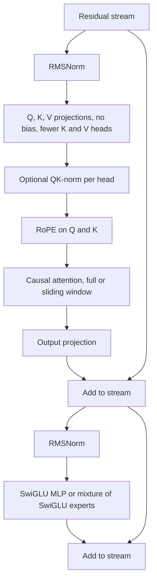

# The Modern LLM Recipe: What Llama, Qwen and DeepSeek Changed

## Introduction

Open the config.json of almost any open-weight model released since 2023 and you will find the same handful of fields: `hidden_act: "silu"`, `rms_norm_eps`, `rope_theta`, `num_key_value_heads`, `tie_word_embeddings`, sometimes `sliding_window` or `n_routed_experts`. Behind those fields is a shared recipe that took shape when Meta released LLaMA in February 2023: a decoder-only Transformer with pre-norm RMSNorm, SwiGLU, rotary position embeddings and no biases. Since then labs have mostly tuned that recipe rather than replaced it: grouped-query attention, larger RoPE bases, QK-norm, interleaved local and global attention, latent attention and mixtures of experts.

This page assembles the recipe, compares ten real models choice by choice using values read from their configs and technical reports, and then implements a modern block whose outputs match Hugging Face's Llama and Qwen3 implementations to within floating-point rounding. You will be able to:

- list the components of the modern recipe and say what each replaced and why;
- read a config.json and identify the architectural choices it encodes;
- compare GPT-2, Llama 2, Llama 3.1, Mistral, Qwen2.5, Qwen3, Gemma 3, OLMo 2, DeepSeek-V3 and gpt-oss on one table;
- implement a Llama-style block (RMSNorm, RoPE, GQA, SwiGLU) with optional Qwen3 QK-norm and verify it against `transformers`.

## The Recipe

A modern decoder block, written as data flow:



Compared with the 2017 Transformer and with GPT-2, here is what changed and the reason in one line each. The other pages of this section, and the attention and positional-encoding sections, give the full arguments.

| Component | Old choice | Modern choice | Why |
|---|---|---|---|
| Overall shape | Encoder-decoder (2017) | Decoder-only | Every token is a target, one objective for all tasks, cheap multi-turn caching ([variants](./1-llm-encoder-decoder-variants.mdx)) |
| Norm placement | Post-norm (2017) | Pre-norm, plus final norm | Stable gradients at depth, less dependence on warmup ([normalization](./3-llm-normalization.mdx)) |
| Norm type | LayerNorm | RMSNorm | Same quality, less work ([normalization](./3-llm-normalization.mdx)) |
| FFN | ReLU or GELU, 4x | SwiGLU, about 2.7x to 3.5x | Better loss at matched parameters ([SwiGLU](./4-llm-feed-forward-and-swiglu.mdx)) |
| Positions | Sinusoidal or learned, added to input | RoPE inside attention | Relative positions, better length behavior ([RoPE](../4-llm-positional-encoding/3-llm-rope.mdx)) |
| RoPE base | 10,000 | 500,000 to 1,000,000 or more, plus scaling | Long contexts ([RoPE theta](../4-llm-positional-encoding/5-llm-rope-theta.mdx)) |
| KV heads | One per query head | GQA groups, or MLA latents | KV cache size and decode bandwidth ([GQA](../2-llm-attention/5-llm-mqa-gqa.mdx), [MLA](../2-llm-attention/6-llm-mla.mdx)) |
| Biases | In every linear layer | None, with a few exceptions | Simpler, reported more stable at scale (PaLM) |
| Attention logits | Unbounded | QK-norm in some families | Prevents logit growth and entropy collapse |
| Attention span | Full in every layer | Some families mix sliding-window layers | Cheaper long context ([sparse attention](../5-llm-flash-attention/5-llm-sparse-and-linear-attention.mdx)) |
| FFN capacity | Dense | Mixture of experts in the largest models | More parameters at the same active compute ([MoE](../7-llm-mixture-of-experts/0-llm-moe-introduction.mdx)) |
| Vocabulary | 30K to 50K | 128K to 260K | Fewer tokens per text, better multilingual coverage ([embeddings](../1-llm-tokenization/4-llm-embeddings.mdx)) |
| Dropout | 0.1 | 0 | Single-epoch pretraining does not overfit |

LLaMA (Touvron et al., 2023) described its own changes as borrowed: pre-normalization from GPT-3, SwiGLU from PaLM and rotary embeddings from GPT-Neo. Its contribution was showing that this combination, trained on more tokens than Chinchilla's rule suggests, gives small models that compete with much larger ones. Because its weights were widely available, its architecture became the default that everyone else measured against.

## Ten Models, Choice by Choice

Every number below is read from the model's config.json on Hugging Face (fields in parentheses) or, where noted, from its technical report. "Ratio" is `intermediate_size / hidden_size`.

| Model | Year | Layers x width | Heads q / kv (head dim) | Norm | FFN | RoPE base and scaling | Vocab | Tied |
|---|---|---|---|---|---|---|---|---|
| GPT-2 small | 2019 | 12 x 768 | 12 / 12 (64) | LayerNorm, pre | GELU, 4x | learned positions, 1,024 | 50,257 | yes |
| Llama 2 7B | 2023 | 32 x 4,096 | 32 / 32 (128) | RMSNorm, pre | SwiGLU, 2.69x | 10,000 | 32,000 | no |
| Mistral 7B v0.1 | 2023 | 32 x 4,096 | 32 / 8 (128) | RMSNorm, pre | SwiGLU, 3.5x | 10,000 | 32,000 | no |
| Llama 3.1 8B | 2024 | 32 x 4,096 | 32 / 8 (128) | RMSNorm, pre | SwiGLU, 3.5x | 500,000, llama3 scaling x8 | 128,256 | no |
| Qwen2.5-7B | 2024 | 28 x 3,584 | 28 / 4 (128) | RMSNorm, pre | SwiGLU, 5.29x | 1,000,000 | 152,064 | no |
| OLMo 2 7B | 2024 | 32 x 4,096 | 32 / 32 (128) | RMSNorm on outputs, QK-norm | SwiGLU, 2.69x | 500,000 | 100,352 | no |
| DeepSeek-V3 | 2024 | 61 x 7,168 | 128 heads, MLA | RMSNorm, pre | SwiGLU MoE: 256 routed + 1 shared, top-8 | 10,000, YaRN x40 | 129,280 | no |
| Gemma 3 27B | 2025 | 62 x 5,376 | 32 / 16 (128) | RMSNorm sandwich, QK-norm | GeGLU, 4x | 1,000,000 global (linear x8), 10,000 local | 262,208 | yes |
| Qwen3-8B | 2025 | 36 x 4,096 | 32 / 8 (128) | RMSNorm, pre, QK-norm | SwiGLU, 3x | 1,000,000 | 151,936 | no |
| gpt-oss-120b | 2025 | 36 x 2,880 | 64 / 8 (64) | RMSNorm, pre | clamped SwiGLU MoE: 128 experts, top-4 | 150,000, YaRN x32 | 201,088 | no |

The details that do not fit in a table cell:

- **Llama 3.1 8B** has `max_position_embeddings` 131,072. Its `rope_scaling` block (`rope_type: "llama3"`, `factor: 8.0`, `low_freq_factor: 1.0`, `high_freq_factor: 4.0`, `original_max_position_embeddings: 8192`) stretches the low RoPE frequencies from the original 8K training context; [Extending Context](../4-llm-positional-encoding/6-llm-context-extension.mdx) explains the formula.
- **Mistral 7B v0.1** uses sliding-window attention (`sliding_window: 4096`) in every layer: each token attends to at most the previous 4,096 tokens, and information travels further through the stack of layers.
- **Qwen2.5** keeps biases on the Q, K and V projections (the Hugging Face `Qwen2Attention` builds them with `bias=True`), an exception to the no-bias rule. Qwen3 removed them and added QK-norm, as its technical report states. Qwen2.5's FFN ratio of 5.29 is the largest in the table.
- **OLMo 2** normalizes sublayer outputs instead of inputs and applies QK-norm over the full projection width; it is the only model here with full multi-head attention ($n_{kv} = n_q$) besides Llama 2 and GPT-2.
- **DeepSeek-V3** uses Multi-head Latent Attention: keys and values are reconstructed from a 512-dimensional latent (`kv_lora_rank`), queries from a 1,536-dimensional one (`q_lora_rank`), with 128-dim non-rotary and 64-dim rotary parts per head (`qk_nope_head_dim`, `qk_rope_head_dim`). Its first 3 layers are dense (`first_k_dense_replace: 3`, `intermediate_size: 18432`); the other 58 use 256 routed experts of width 2,048 plus one shared expert, 8 routed experts per token. The report gives 671B total and 37B active parameters, and adds multi-token prediction as a training objective ([Multi-Token Prediction](../13-llm-advanced-architectures/5-llm-multi-token-prediction.mdx)).
- **Gemma 3** interleaves 5 local sliding-window layers (window 1,024) with 1 global layer (`sliding_window_pattern: 6`), uses RoPE base 10,000 in local layers and 1,000,000 in global ones, normalizes both inputs and outputs of each sublayer with a $(1 + w)$ gain, multiplies embeddings by $\sqrt{d}$ and scales attention by `query_pre_attn_scalar` (168 for 27B) instead of the head dimension. Its report says QK-norm replaced Gemma 2's attention soft-capping.
- **gpt-oss-120b** alternates sliding-window layers (window 128) with full-attention layers (`layer_types`), adds a learned per-head "sink" logit to every softmax so a head can attend to nothing, keeps biases in attention (`attention_bias: true`), and uses a SwiGLU variant clamped at 7 with $z \sigma(1.702 z)$ as its activation.

The trend lines are easy to see. Every model after GPT-2 uses RMSNorm, a gated MLP, RoPE and no input-level position embedding. Every model after Llama 2 except OLMo 2 uses grouped or latent KV. RoPE bases grew a hundredfold. Vocabularies grew roughly five- to eightfold. The newest models add one of three stability or efficiency features: QK-norm, local-global interleaving or experts.

## What Did Not Change

It is just as instructive to see what has stayed constant since 2019:

- **The residual stream and the two-sublayer block.** Every model above is "normalize, attend, add; normalize, MLP, add" repeated, as in [Inside a Decoder Block](./2-llm-transformer-block.mdx).
- **Softmax attention with scaled dot products.** Variants change which keys are visible and how keys and values are stored, not the core $\mathrm{softmax}(QK^\top/\sqrt{d_h})V$ (Gemma changes only the scale constant).
- **Head dimension of 64 to 128.** Wider models add heads, not wider heads (Gemma 2's 256 is the exception).
- **Next-token prediction.** All of them are pretrained as causal language models; DeepSeek-V3's multi-token prediction is an auxiliary objective on top.
- **The rough shape of the compute.** Per token, about two FLOPs per active parameter plus an attention term that grows with context ([Counting Parameters, FLOPs and Memory](./6-llm-parameter-and-flop-counting.mdx)).

Architectures that break these rules, such as state space models and hybrids mixing attention with linear recurrent layers, are covered in [Advanced Architectures](../13-llm-advanced-architectures/2-llm-hybrid-models.mdx). As of late 2026 the dense or MoE Transformer described here is still the mainstream design.

## Worked Example: A Modern Block That Matches Hugging Face

The best test of understanding a recipe is to implement it and compare against a reference. The code below writes a Llama-style model from scratch, about 80 lines, with module names chosen to match Hugging Face's checkpoints so the weights load directly. A `qk_norm` flag adds Qwen3's per-head RMSNorm on queries and keys. It then builds small random Hugging Face `LlamaForCausalLM` and `Qwen3ForCausalLM` models, copies their weights into ours, randomizes the norm gains so they are actually tested, and compares logits.

```python
import torch
import torch.nn as nn
import torch.nn.functional as F
from transformers import LlamaConfig, LlamaForCausalLM, Qwen3Config, Qwen3ForCausalLM

torch.manual_seed(0)

class Attention(nn.Module):
    def __init__(self, d, n_q, n_kv, head_dim, theta, qk_norm, eps):
        super().__init__()
        self.n_q, self.n_kv, self.hd = n_q, n_kv, head_dim
        self.q_proj = nn.Linear(d, n_q * head_dim, bias=False)
        self.k_proj = nn.Linear(d, n_kv * head_dim, bias=False)       # GQA: fewer K/V heads
        self.v_proj = nn.Linear(d, n_kv * head_dim, bias=False)
        self.o_proj = nn.Linear(n_q * head_dim, d, bias=False)
        self.q_norm = nn.RMSNorm(head_dim, eps=eps) if qk_norm else nn.Identity()
        self.k_norm = nn.RMSNorm(head_dim, eps=eps) if qk_norm else nn.Identity()
        inv_freq = 1.0 / theta ** (torch.arange(0, head_dim, 2).float() / head_dim)
        self.register_buffer("inv_freq", inv_freq, persistent=False)  # (head_dim/2,)

    def rope(self, x):                                   # x: (B, heads, T, hd), half-split layout
        T = x.shape[2]
        freqs = torch.outer(torch.arange(T).float(), self.inv_freq)    # (T, hd/2)
        cos, sin = freqs.cos().repeat(1, 2), freqs.sin().repeat(1, 2)  # (T, hd)
        x1, x2 = x.chunk(2, dim=-1)
        return x * cos + torch.cat([-x2, x1], dim=-1) * sin

    def forward(self, x):                                # x: (B, T, d)
        B, T, _ = x.shape
        q = self.q_norm(self.q_proj(x).view(B, T, self.n_q, self.hd)).transpose(1, 2)
        k = self.k_norm(self.k_proj(x).view(B, T, self.n_kv, self.hd)).transpose(1, 2)
        v = self.v_proj(x).view(B, T, self.n_kv, self.hd).transpose(1, 2)
        q, k = self.rope(q), self.rope(k)                # (B, n_q, T, hd), (B, n_kv, T, hd)
        y = F.scaled_dot_product_attention(q, k, v, is_causal=True, enable_gqa=True)
        return self.o_proj(y.transpose(1, 2).reshape(B, T, -1))

class SwiGLU(nn.Module):
    def __init__(self, d, f):
        super().__init__()
        self.gate_proj = nn.Linear(d, f, bias=False)
        self.up_proj = nn.Linear(d, f, bias=False)
        self.down_proj = nn.Linear(f, d, bias=False)

    def forward(self, x):
        return self.down_proj(F.silu(self.gate_proj(x)) * self.up_proj(x))

class Block(nn.Module):
    def __init__(self, c, qk_norm):
        super().__init__()
        self.input_layernorm = nn.RMSNorm(c.hidden_size, eps=c.rms_norm_eps)
        self.self_attn = Attention(c.hidden_size, c.num_attention_heads, c.num_key_value_heads,
                                   c.head_dim, c.rope_parameters["rope_theta"], qk_norm, c.rms_norm_eps)
        self.post_attention_layernorm = nn.RMSNorm(c.hidden_size, eps=c.rms_norm_eps)  # pre-norm of the MLP
        self.mlp = SwiGLU(c.hidden_size, c.intermediate_size)

    def forward(self, x):
        x = x + self.self_attn(self.input_layernorm(x))
        return x + self.mlp(self.post_attention_layernorm(x))

class ModernLM(nn.Module):
    def __init__(self, c, qk_norm=False):
        super().__init__()
        self.embed_tokens = nn.Embedding(c.vocab_size, c.hidden_size)
        self.layers = nn.ModuleList(Block(c, qk_norm) for _ in range(c.num_hidden_layers))
        self.norm = nn.RMSNorm(c.hidden_size, eps=c.rms_norm_eps)
        self.lm_head = nn.Linear(c.hidden_size, c.vocab_size, bias=False)   # untied

    def forward(self, ids):                              # ids: (B, T)
        x = self.embed_tokens(ids)                       # no position embedding: RoPE is inside attention
        for layer in self.layers:
            x = layer(x)
        return self.lm_head(self.norm(x))                # (B, T, vocab)

def load_from_hf(ours, hf):
    sd = {k.removeprefix("model."): v for k, v in hf.state_dict().items()}
    missing, unexpected = ours.load_state_dict(sd, strict=False)
    assert not unexpected and all("inv_freq" in m for m in missing), (missing, unexpected)

small = dict(vocab_size=256, hidden_size=64, intermediate_size=176, num_hidden_layers=2,
             num_attention_heads=4, num_key_value_heads=2, head_dim=16, rms_norm_eps=1e-6,
             tie_word_embeddings=False, attn_implementation="eager")
ids = torch.randint(0, 256, (2, 12))

for name, cfg_cls, model_cls, qk_norm in [("Llama-style", LlamaConfig, LlamaForCausalLM, False),
                                         ("Qwen3-style", Qwen3Config, Qwen3ForCausalLM, True)]:
    cfg = cfg_cls(**small, rope_theta=500000.0)
    hf = model_cls(cfg).eval()
    with torch.no_grad():                               # randomize norm gains so they are really tested
        for n, p in hf.named_parameters():
            if "norm" in n:
                p.uniform_(0.5, 1.5)
    ours = ModernLM(cfg, qk_norm=qk_norm).eval()
    load_from_hf(ours, hf)
    with torch.no_grad():
        diff = (ours(ids) - hf(ids).logits).abs().max().item()
    print(f"{name}: {sum(p.numel() for p in ours.parameters()):,} params, max |logit diff| = {diff:.2e}")
```

```text
Llama-style: 125,248 params, max |logit diff| = 1.79e-07
Qwen3-style: 125,312 params, max |logit diff| = 2.09e-07
```

Both models agree with Hugging Face to about $2 \times 10^{-7}$, the level of float32 rounding. That confirms every detail: the half-split RoPE layout with `rotate_half`, the order "project, QK-norm, then RoPE" in Qwen3, GQA through `enable_gqa=True` (each pair of query heads shares one KV head here), the gate and up roles in SwiGLU, and that `post_attention_layernorm` is the MLP's pre-norm. The Qwen3 version has 64 more parameters: two 16-dim gain vectors per layer for `q_norm` and `k_norm`, times two layers.

Two practical notes surfaced while writing this. In `transformers` v5, `rope_theta` is no longer a top-level attribute of the config object: it lives in `config.rope_parameters["rope_theta"]` (the config.json files on the Hub still store `rope_theta` at the top level and are converted on load). And our model has no `max_position_embeddings` limit at all: RoPE computes rotations for any position, so the context limit of a RoPE model is a property of its training, not of a lookup table.

To turn this into a real Llama 3.1 8B, change the config to the values in the table and load the checkpoint's safetensors; the only missing piece is the `llama3` RoPE frequency scaling, which modifies `inv_freq` once at construction ([Extending Context](../4-llm-positional-encoding/6-llm-context-extension.mdx)). For inference you would also add a KV cache, which [the inference engine project](../14-llm-projects/4-llm-project-inference-engine.mdx) builds.

## Choosing Among the Options

If you are designing or picking a small model today, the table suggests sensible defaults and the trade-offs that move them:

- **GQA with 4 to 8 KV heads** unless you have reason to do otherwise. Llama 3, Mistral, Qwen3 and Gemma 3 all chose it; the quality cost is small and the KV cache shrinks by $n_q / n_{kv}$. MLA compresses further but is more complex to implement and serve.
- **QK-norm** if you train at high learning rates or large scale. It costs almost nothing and removes a known divergence mode; Qwen3, Gemma 3 and OLMo 2 adopted it.
- **Tie embeddings in small models.** At 1B parameters a 128K vocabulary is a quarter of the model; tying halves that. Large models untie because the cost is relatively small and separate matrices help slightly.
- **FFN ratio 3 to 4 for dense models.** Spend parameters on width and depth before vocabulary.
- **Local-global attention** when long context matters and the KV cache is the bottleneck. Gemma 3's report shows a 5:1 ratio with a 1,024 window loses little perplexity while cutting KV memory sharply.
- **Mixture of experts** when you need more knowledge capacity at a fixed inference compute, and you can afford the memory and the engineering of expert parallelism ([Training and Serving MoE Models](../7-llm-mixture-of-experts/4-llm-moe-training-and-serving.mdx)).

:::note
Architecture is only part of what separates these models. Data quality and quantity, tokenizer, training schedule and post-training usually matter more than any single row of the table. Two models with nearly identical configs (Llama 3.1 8B and Mistral 7B v0.1 share depth, width, FFN size and KV heads, and differ mainly in vocabulary, RoPE base and sliding window) can differ a great deal in capability.
:::

## Common Mistakes

- **Reading `max_position_embeddings` as the trained context.** For RoPE models it is a configured limit, and with `rope_scaling` the training context is `original_max_position_embeddings`. Check the model card.
- **Assuming all "Llama-like" models are drop-in compatible.** Qwen2.5 has QKV biases, Qwen3 has QK-norm, Gemma scales embeddings and uses $(1 + w)$ norm gains, Mistral has a sliding window. Each needs its own modeling code.
- **Comparing parameter counts of MoE and dense models directly.** DeepSeek-V3's 671B total corresponds to 37B active per token; for compute compare active parameters, for memory compare totals.
- **Using `config.rope_theta` with transformers v5.** Read `config.rope_parameters["rope_theta"]`, or read the raw config.json.
- **Ignoring `head_dim` when it is set explicitly.** In Qwen3 and Gemma 3, `head_dim` times `num_attention_heads` need not equal `hidden_size` (Gemma 3 27B: $32 \times 128 = 4096 \neq 5376$). Code that computes `hidden_size // num_heads` gets the wrong shapes.
- **Treating the recipe as final.** Each row of the comparison table changed within the last three years; expect more changes, and read each new model's config.json rather than assuming.

## Summary

- The modern recipe is a decoder-only Transformer with pre-norm RMSNorm, SwiGLU, RoPE, no biases, grouped-query attention and untied (large) or tied (small) embeddings, established by LLaMA in 2023.
- Since then models have raised the RoPE base (10,000 to 500,000 and 1,000,000), grown vocabularies (32K to 128K-262K), added QK-norm (Qwen3, Gemma 3, OLMo 2), interleaved local and global attention (Gemma 3, gpt-oss) and moved to mixtures of experts (DeepSeek-V3, gpt-oss).
- DeepSeek-V3 combines MLA, 256-expert MoE with a shared expert and multi-token prediction; Gemma 3 uses sandwich norms, QK-norm and a 5:1 local-global pattern.
- The residual block, softmax attention, head sizes of 64 to 128 and next-token pretraining have not changed.
- A from-scratch Llama/Qwen3 block in about 80 lines matches Hugging Face's logits to within $2 \times 10^{-7}$, which is the best way to check that you understand a config.json.

## Further Reading

- [LLaMA: Open and Efficient Foundation Language Models (Touvron et al., 2023)](https://arxiv.org/abs/2302.13971): the recipe and where each piece came from.
- [The Llama 3 Herd of Models (Llama Team, 2024)](https://arxiv.org/abs/2407.21783): GQA, the 128K vocabulary and the RoPE base of 500,000.
- [Qwen3 Technical Report (Qwen Team, 2025)](https://arxiv.org/abs/2505.09388): QK-norm and the removal of QKV bias.
- [Gemma 3 Technical Report (Gemma Team, 2025)](https://arxiv.org/abs/2503.19786): 5:1 local-global attention and QK-norm.
- [DeepSeek-V3 Technical Report (DeepSeek-AI, 2024)](https://arxiv.org/abs/2412.19437): MLA, auxiliary-loss-free MoE and multi-token prediction.
- [2 OLMo 2 Furious (Team OLMo, 2024)](https://arxiv.org/abs/2501.00656): a fully open model with documented stability ablations.
- [Mistral 7B (Jiang et al., 2023)](https://arxiv.org/abs/2310.06825): GQA and sliding-window attention in a 7B model.
- [gpt-oss model card (OpenAI, 2025)](https://huggingface.co/openai/gpt-oss-120b): the gpt-oss architecture and config.
- [Hugging Face transformers models directory](https://github.com/huggingface/transformers/tree/main/src/transformers/models): reference modeling code for every architecture in the table.
