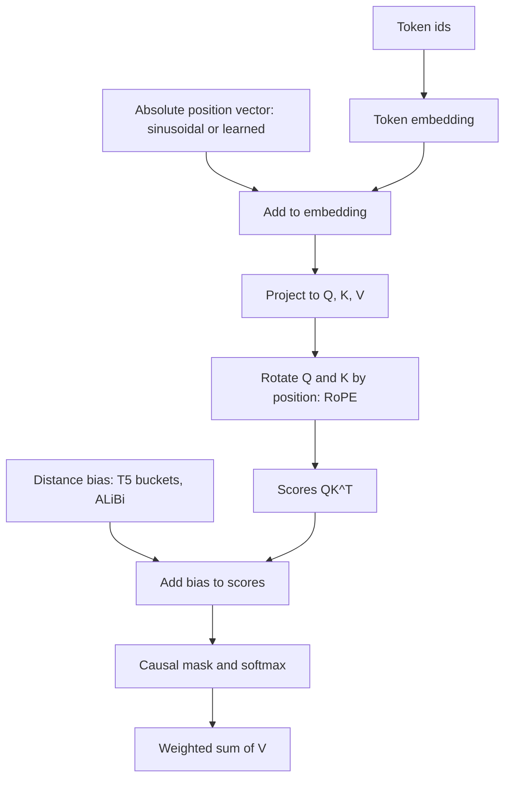

# Why Transformers Need Positional Information

## Introduction

"The dog bit the man" and "the man bit the dog" use exactly the same words. Only the order differs, and the order carries the whole meaning. A recurrent network gets order for free, because it reads one token after another and its hidden state at step 5 has literally been through steps 1 to 4. A Transformer does not read in order. Self-attention looks at all tokens at once and compares every pair, and the comparison itself has no idea where either token sits.

That is a strength for speed (every position is processed in parallel on a GPU) but a problem for language. If nothing tells the model where each token is, a sentence is just a bag of words. This page shows the problem precisely, proves it in code, and then sets up the rest of the section, which is a tour of the ways people have injected position back into the model: sinusoidal and learned embeddings, relative biases such as T5 and ALiBi, and Rotary Position Embedding (RoPE), which almost every open large language model uses today.

By the end of this page you will be able to:

- state what permutation equivariance means and why plain self-attention has it,
- verify it numerically for one attention layer and for a full PyTorch Transformer encoder,
- explain why a causal mask partially breaks the symmetry (and why that is not enough on its own),
- name the main families of position encodings and what problem each one solves.

If attention itself is new to you, read [Scaled Dot-Product Attention, Step by Step](../2-llm-attention/1-llm-scaled-dot-product-attention.mdx) first.

## Self-Attention Is a Set Operation

Take a sequence of $n$ token vectors stacked as rows of a matrix $X \in \mathbb{R}^{n \times d}$. One attention head computes

$$
Q = XW_Q,\quad K = XW_K,\quad V = XW_V,\qquad
\mathrm{Attn}(X) = \mathrm{softmax}\!\left(\frac{QK^\top}{\sqrt{d}}\right)V
$$

where $W_Q, W_K, W_V \in \mathbb{R}^{d \times d}$ are learned weights and the softmax is taken row by row.

Look at what each symbol depends on. Row $i$ of $Q$ is $x_i W_Q$: it depends on the content of token $i$ and nothing else. The score between tokens $i$ and $j$ is $q_i \cdot k_j / \sqrt{d}$, again pure content. Nowhere does the index $i$ or $j$ enter the arithmetic. The positions are only labels on rows.

Now shuffle the tokens. A shuffle is a permutation matrix $P$ (an identity matrix with its rows reordered), and the shuffled input is $PX$. Then

$$
\begin{aligned}
Q' &= PXW_Q = PQ, \qquad K' = PK, \qquad V' = PV, \\
Q'K'^\top &= PQK^\top P^\top .
\end{aligned}
$$

The score matrix gets its rows and its columns shuffled by the same permutation. A row-wise softmax does not care about the order of entries inside a row beyond moving them, so $\mathrm{softmax}(PSP^\top) = P\,\mathrm{softmax}(S)\,P^\top$. Multiplying by $V' = PV$ and using $P^\top P = I$ gives

$$
\mathrm{Attn}(PX) = P\,\mathrm{softmax}(S)\,P^\top P V = P\,\mathrm{Attn}(X).
$$

This property is called **permutation equivariance**: shuffle the input and the output is shuffled the same way, but each token's output vector is unchanged. Token "dog" gets the same output vector whether it is the first word or the last.

The other parts of a Transformer block do not help. The feed-forward network, layer normalization and residual connections all act on each position independently, so they are trivially equivariant too. Stacking equivariant layers keeps the whole stack equivariant. If you then pool (for example average) the outputs, the result is fully **permutation invariant**: the model literally cannot tell "dog bites man" from "man bites dog".

:::note
Equivariance is not a bug of attention, it is the reason attention generalizes so well to sets, graphs and point clouds. For language, though, order is part of the input, so we must add it back explicitly.
:::

## Proving It in Code

The first script builds one attention layer by hand, feeds it five random token vectors, then feeds it the same tokens in a different order.

```python
import torch
import torch.nn.functional as F

torch.manual_seed(0)

d_model = 8
seq_len = 5

# One self-attention layer with no positional information at all.
W_q = torch.randn(d_model, d_model) / d_model**0.5
W_k = torch.randn(d_model, d_model) / d_model**0.5
W_v = torch.randn(d_model, d_model) / d_model**0.5

def self_attention(x, causal=False):
    # x: (seq_len, d_model)
    q, k, v = x @ W_q, x @ W_k, x @ W_v          # each (seq_len, d_model)
    scores = q @ k.T / d_model**0.5              # (seq_len, seq_len)
    if causal:
        mask = torch.triu(torch.ones(len(x), len(x), dtype=torch.bool), 1)
        scores = scores.masked_fill(mask, float("-inf"))
    return F.softmax(scores, dim=-1) @ v         # (seq_len, d_model)

x = torch.randn(seq_len, d_model)                # five token embeddings
perm = torch.tensor([3, 0, 4, 1, 2])             # shuffle the tokens

out = self_attention(x)
out_perm = self_attention(x[perm])

# Equivariance: attention(P x) == P attention(x)
print("bidirectional, outputs permute with inputs:",
      torch.allclose(out_perm, out[perm], atol=1e-6))

# Mean pooling throws away the order completely: the two sequences look identical.
print("pooled vectors identical:",
      torch.allclose(out.mean(0), out_perm.mean(0), atol=1e-6))

# A causal mask breaks the symmetry.
c = self_attention(x, causal=True)
c_perm = self_attention(x[perm], causal=True)
print("causal, outputs permute with inputs:",
      torch.allclose(c_perm, c[perm], atol=1e-6))
```

```text
bidirectional, outputs permute with inputs: True
pooled vectors identical: True
causal, outputs permute with inputs: False
```

`x[perm]` is exactly $PX$, and `out[perm]` is $P\,\mathrm{Attn}(X)$. The first `True` is the equation from the previous section, checked to six decimal places. The third line is the interesting one, and we will come back to it.

One layer is convincing, but real models have many layers, multiple heads, layer norm and an MLP. The second script uses PyTorch's stock `nn.TransformerEncoder` with two layers and four heads, and checks the output vector of the word "dog" in both sentences.

```python
import torch
import torch.nn as nn

torch.manual_seed(0)

vocab = {"dog": 0, "bites": 1, "man": 2}
d_model, n_heads = 16, 4

embed = nn.Embedding(len(vocab), d_model)
encoder = nn.TransformerEncoder(
    nn.TransformerEncoderLayer(d_model, n_heads, dim_feedforward=32,
                               dropout=0.0, batch_first=True),
    num_layers=2,
).eval()

def encode(words, pos_emb=None):
    ids = torch.tensor([[vocab[w] for w in words]])         # (1, seq_len)
    h = embed(ids)                                           # (1, seq_len, d_model)
    if pos_emb is not None:
        h = h + pos_emb(torch.arange(len(words)))[None]      # add position vectors
    with torch.no_grad():
        return encoder(h)[0]                                 # (seq_len, d_model)

a = encode(["dog", "bites", "man"])
b = encode(["man", "bites", "dog"])

# Output vector for the word "dog" in both sentences
print("no positions,   'dog' vectors equal:", torch.allclose(a[0], b[2], atol=1e-5))

pos = nn.Embedding(8, d_model)                                # learned positions
a = encode(["dog", "bites", "man"], pos)
b = encode(["man", "bites", "dog"], pos)
print("with positions, 'dog' vectors equal:", torch.allclose(a[0], b[2], atol=1e-5))
```

```text
no positions,   'dog' vectors equal: True
with positions, 'dog' vectors equal: False
```

Without positions, "dog" produces the same vector whether it is the subject or the object. The model has no way to know who bit whom. Adding a position vector to each token embedding (here a learned table, the approach used by GPT-2 and BERT) is enough to make the two contexts different. The next page studies that idea in detail.

## A Hand-Checkable Example

Small numbers make the symmetry concrete. Use $d = 2$, set $W_Q = W_K = W_V = I$ and skip the $\sqrt{d}$ scaling. Take three tokens

$$
x_A = (1, 0),\qquad x_B = (0, 1),\qquad x_C = (1, 1).
$$

For the order A, B, C the score row for token A is $x_A \cdot x_A, x_A \cdot x_B, x_A \cdot x_C = 1, 0, 1$. The softmax of $(1, 0, 1)$ is $(0.422, 0.155, 0.422)$, so A's output is

$$
0.422\,(1,0) + 0.155\,(0,1) + 0.422\,(1,1) = (0.845,\ 0.578).
$$

Now use the order C, A, B. Token A's score row is $x_A \cdot x_C, x_A \cdot x_A, x_A \cdot x_B = 1, 1, 0$, the same three numbers in a different order. Its weights are $(0.422, 0.422, 0.155)$, attached to the same three value vectors, and the weighted sum is again $(0.845, 0.578)$. Attention pairs each weight with its own value vector, so the order of the pairs never matters. That is the whole proof in miniature.

## The Causal Mask Breaks the Symmetry, Partly

Decoder-only language models such as GPT and Llama apply a causal mask: token $i$ may attend only to tokens $j \le i$ (see [Causal Masking and Autoregressive Decoding](../2-llm-attention/3-llm-causal-masking.mdx)). The mask depends on the index, so it is a source of order information, and the third line of the first script printed `False` for exactly this reason. The first token in a sequence sees only itself; the tenth token sees ten tokens. Shuffling changes who sees whom.

How much position can a model recover from the mask alone? More than you might expect. The script below uses the simplest possible head: all keys are identical, so causal attention spreads its weight uniformly over the visible prefix. Give the first token (think of the `<bos>` token that starts every sequence) a value of 1 and every other token a value of 0.

```python
import torch

# Causal attention with identical keys gives uniform weights over the prefix.
seq_len = 6
scores = torch.zeros(seq_len, seq_len)                       # all keys look the same
mask = torch.triu(torch.ones(seq_len, seq_len, dtype=torch.bool), 1)
weights = scores.masked_fill(mask, float("-inf")).softmax(-1)  # (seq_len, seq_len)

# Value channel: 1 for the first token (think <bos>), 0 for every other token.
v = torch.zeros(seq_len, 1)
v[0] = 1.0

out = weights @ v                                            # (seq_len, 1)
for t, val in enumerate(out.squeeze(1).tolist()):
    print(f"position {t}: output {val:.4f}   1/(t+1) = {1/(t+1):.4f}")
```

```text
position 0: output 1.0000   1/(t+1) = 1.0000
position 1: output 0.5000   1/(t+1) = 0.5000
position 2: output 0.3333   1/(t+1) = 0.3333
position 3: output 0.2500   1/(t+1) = 0.2500
position 4: output 0.2000   1/(t+1) = 0.2000
position 5: output 0.1667   1/(t+1) = 0.1667
```

The output at position $t$ is exactly $1/(t+1)$, a number that encodes the absolute position. Later layers can read it. This is the mechanism behind the finding of Haviv et al. (2022), "Transformer Language Models without Positional Encodings Still Learn Positional Information": causal language models trained with no position encoding at all reach perplexity close to models with one, while bidirectional (masked) language models without positions fail. Kazemnejad et al. (2023) went further and found that this "NoPE" setting generalizes to longer sequences better than several explicit encodings on small reasoning tasks.

So why not stop here? Three reasons:

- **Resolution fades with distance.** The signal $1/(t+1)$ is easy to read at position 3 but tiny at position 30,000: $1/30001$ and $1/30002$ differ by about $10^{-9}$, far below bf16 precision. Distinguishing nearby tokens deep into a long context is hard without explicit help.
- **Relative order is what language needs.** Grammar cares about "the word right before this one" far more than "word number 4,817". The mask gives absolute counts; turning them into relative offsets takes model capacity.
- **Encoders have no mask.** BERT-style models and the encoder half of T5 see the whole sequence and get no order signal at all.

In practice, the best-known models that drop positions do it only in some layers. SmolLM3 and Llama 4 Scout list a `no_rope_layers` pattern in their config.json files in which every fourth layer has no rotary embedding and the rest use RoPE. We return to these hybrids on the [ALiBi and NoPE page](./2-llm-relative-position-and-alibi.mdx).

## The Design Space of Position Encodings

Every method in this section answers two questions: **where** does position enter the computation, and **what** is encoded, absolute position or the distance between two tokens.



| Method | Where it enters | What it encodes | Introduced | Used by |
|---|---|---|---|---|
| Sinusoidal | Added to input embeddings | Absolute position | Vaswani et al., 2017 | Original Transformer |
| Learned absolute | Added to input embeddings | Absolute position | Gehring et al. 2017; GPT, BERT | GPT-2 (1,024 positions), BERT (512) |
| Relative embeddings | Inside attention scores | Clipped distance | Shaw et al., 2018 | Early MT models, Transformer-XL variant |
| T5 relative bias | Scalar added to scores | Bucketed distance | Raffel et al., 2019 | T5, Flan-T5 |
| ALiBi | Linear penalty on scores | Distance | Press et al., 2021 | BLOOM |
| RoPE | Rotates Q and K | Absolute angle, relative in dot product | Su et al., 2021 | Llama, Qwen, Mistral, Gemma, DeepSeek, gpt-oss |
| NoPE | Nowhere | Only what the causal mask implies | Haviv et al. 2022; Kazemnejad et al. 2023 | Some layers of SmolLM3 and Llama 4 |

The trend over time is clear. Position moved from the input of the network into the attention score itself, and from absolute toward relative. RoPE won because it encodes relative distance while costing almost nothing and staying compatible with fast fused attention kernels such as FlashAttention: it only modifies Q and K before the kernel runs, and never needs an explicit $n \times n$ bias matrix.

## A Quick Experiment: How Much Does Order Matter?

You can feel the problem directly with a toy task. Train two tiny Transformer encoders to classify whether a sequence of digits is sorted, one with learned position embeddings and one without. The model without positions cannot do better than guessing on sequences that contain the same multiset of digits in different orders, because by the proof above it receives identical information for both. Concretely:

1. Generate sequences of 8 distinct digits; label half of them sorted, half shuffled.
2. Encode with the `encode` function above (with and without `pos`), mean-pool, and add a linear classifier.
3. Train each for a few hundred steps with Adam.

The no-position model cannot get below a loss of $\ln 2 \approx 0.693$, because every sorted sequence has a shuffled twin with exactly the same pooled representation. In our run (two-layer encoder, $d = 32$, 400 Adam steps of 256 sequences, CPU) the model without positions ended at loss 0.693 and 49.6% test accuracy, a coin flip, while the same model with a learned position table reached loss 0.000 and 99.9% accuracy. This makes a nice warm-up before the [GPT from scratch](../3-llm-transformer/5-llm-build-gpt-from-scratch.mdx) project, where you will add positions to a real language model.

## Common Mistakes

- **Assuming multiple heads or layers fix the problem.** Every head and every layer is equivariant, so the stack is too. Only an index-dependent operation (a mask, a position vector, a position-dependent bias or rotation) breaks the symmetry.
- **Thinking a causal model without positions "knows nothing about order".** It knows quite a lot through the mask, as the $1/(t+1)$ demo shows. It just knows it poorly at long range.
- **Adding position after attention.** Position must reach the attention scores (directly or through the input). Adding it to the output of the last layer does nothing for how tokens attend to each other.
- **Forgetting positions after a padding or packing change.** If you left-pad a batch or pack several documents into one row, position ids must be computed per document or per real token, otherwise each token gets the wrong position. Hugging Face models accept an explicit `position_ids` tensor for this reason.
- **Confusing "permutation equivariant" with "permutation invariant".** Attention outputs move with the inputs (equivariant). Only after pooling do you lose order entirely (invariant).

## Summary

- Self-attention computes scores from content only, so $\mathrm{Attn}(PX) = P\,\mathrm{Attn}(X)$: it is permutation equivariant, and a Transformer without position information treats a sentence as a bag of words.
- MLPs, layer norm and residuals are per-position, so a full encoder stack stays equivariant, as the `nn.TransformerEncoder` check showed.
- A causal mask leaks absolute position (the $1/(t+1)$ signal), which is why causal NoPE models work at all, but the signal is weak at long range and absent in encoders.
- Position encodings differ in where they enter (input, scores, Q and K) and what they encode (absolute or relative). The field moved toward relative encodings inside attention, ending with RoPE.
- The rest of this section builds up to RoPE, its `rope_theta` base, and the scaling methods that extend context length.

## Further Reading

- [Attention Is All You Need (Vaswani et al., 2017)](https://arxiv.org/abs/1706.03762): the Transformer paper; Section 3.5 introduces sinusoidal position encodings.
- [Transformer Language Models without Positional Encodings Still Learn Positional Information (Haviv et al., 2022)](https://arxiv.org/abs/2203.16634): shows causal LMs infer position from the mask.
- [The Impact of Positional Encoding on Length Generalization in Transformers (Kazemnejad et al., 2023)](https://arxiv.org/abs/2305.19466): compares NoPE, ALiBi, RoPE and T5 bias on length generalization.
- [RoFormer: Enhanced Transformer with Rotary Position Embedding (Su et al., 2021)](https://arxiv.org/abs/2104.09864): the RoPE paper, covered later in this section.
- [PyTorch nn.TransformerEncoderLayer documentation](https://pytorch.org/docs/stable/generated/torch.nn.TransformerEncoderLayer.html): the module used in the equivariance check.
- [Our PyTorch tutorial](/docs/library/pytorch): background on tensors and modules used in the snippets.
