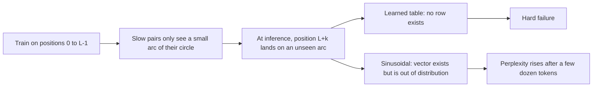

# Sinusoidal and Learned Positional Embeddings

## Introduction

The [previous page](./0-llm-why-position-matters.mdx) showed that self-attention cannot tell one order of tokens from another. The first fix, used by the original Transformer in 2017 and by the GPT-2 and BERT generation of models, is the most direct one: give every position its own vector and add it to the token embedding before the first layer. Token "dog" at position 0 and "dog" at position 2 then enter the network as different vectors, and the symmetry is broken.

There are two ways to choose those position vectors. You can compute them with a fixed formula (the **sinusoidal** encoding of Vaswani et al., 2017) or you can learn them as ordinary parameters (**learned absolute** embeddings). Both are called absolute position encodings because each vector depends on the position index alone.

This page derives the sinusoidal formula, proves its two useful properties in code, explains why those properties do not survive the attention projections as cleanly as one would hope, and compares it with learned embeddings. You need this background for RoPE: RoPE reuses the exact frequency schedule of the sinusoidal encoding, including its famous constant 10,000, which is the default `rope_theta` you will meet later.

After reading you will be able to:

- write the sinusoidal encoding from memory and explain every symbol,
- show that a shift by $k$ positions is a rotation, and that dot products depend only on distance,
- implement both encodings in PyTorch and explain their extrapolation behavior,
- read the `n_positions` or `max_position_embeddings` field of an older model's config.json.

## The Additive Recipe

Both methods follow the same recipe. Let $e_t \in \mathbb{R}^d$ be the embedding of the token at position $t$ and $p_t \in \mathbb{R}^d$ the position vector. The input to layer 1 is

$$
h_t^{(0)} = e_t + p_t .
$$

Everything after this point is a standard Transformer. The position information enters once, at the bottom, and every later layer has to carry it along in the residual stream.

Adding instead of concatenating keeps the width $d$ unchanged. It looks like it might blur content and position together, but in high dimensions the two can live in nearly orthogonal subspaces, and the network learns to separate them. Because the information is mixed into the hidden state, though, the attention score between two tokens becomes a sum of four terms:

$$
(e_m + p_m) W_Q W_K^\top (e_n + p_n)^\top
= \underbrace{e_m W e_n^\top}_{\text{content}}
+ \underbrace{e_m W p_n^\top + p_m W e_n^\top}_{\text{cross terms}}
+ \underbrace{p_m W p_n^\top}_{\text{position}}
$$

with $W = W_Q W_K^\top$. Keep this decomposition in mind. Transformer-XL (Dai et al., 2019), T5 and finally RoPE are all attempts to rewrite it so that only the relative distance $m - n$ appears.

## Deriving the Sinusoidal Encoding

Vaswani et al. defined, for position $t$ and pair index $i = 0, 1, \dots, d/2 - 1$,

$$
p_{t,2i} = \sin\!\left(\frac{t}{10000^{2i/d}}\right), \qquad
p_{t,2i+1} = \cos\!\left(\frac{t}{10000^{2i/d}}\right).
$$

It helps to name the frequency of pair $i$:

$$
\omega_i = 10000^{-2i/d}, \qquad p_{t,2i} = \sin(\omega_i t), \qquad p_{t,2i+1} = \cos(\omega_i t).
$$

So the position vector is $d/2$ clocks, each a point $(\sin \omega_i t, \cos \omega_i t)$ moving around the unit circle at its own speed. Pair 0 has $\omega_0 = 1$ radian per token and completes a turn every $2\pi \approx 6.28$ tokens. Each following pair is slower by the constant factor $10000^{-2/d}$. The last pair, $i = d/2 - 1$, moves at $10000^{-(d-2)/d}$ radians per token.

The **wavelength** of a pair is the number of tokens for one full turn:

$$
\lambda_i = \frac{2\pi}{\omega_i} = 2\pi \cdot 10000^{2i/d}.
$$

The wavelengths form a geometric series from $2\pi$ up to almost $2\pi \cdot 10000 \approx 62{,}832$ tokens. This is the same idea as a binary counter, where bit 0 flips every step, bit 1 every two steps, and so on, except that the clocks are smooth instead of discrete. Fast clocks tell neighbouring positions apart; slow clocks tell distant regions apart. No two positions within the slow clocks' range share the same full vector.

Why 10,000? The paper does not justify it. A large base just makes the slowest wavelength much longer than any sequence the authors trained on (a few hundred tokens), so positions never wrap around. We will see on the [RoPE theta page](./5-llm-rope-theta.mdx) that this arbitrary constant became one of the most important hyperparameters in modern LLMs once context windows grew past 10,000 tokens.

## Two Properties, Proved

**Property 1: a shift is a rotation.** For a fixed offset $k$, the angle addition formulas give

$$
\begin{aligned}
\sin(\omega(t+k)) &= \sin(\omega t)\cos(\omega k) + \cos(\omega t)\sin(\omega k),\\
\cos(\omega(t+k)) &= \cos(\omega t)\cos(\omega k) - \sin(\omega t)\sin(\omega k).
\end{aligned}
$$

The coefficients $\cos(\omega k)$ and $\sin(\omega k)$ depend on $k$ but not on $t$. So there is one matrix $M_k$, block diagonal with a $2 \times 2$ rotation per pair, such that $p_{t+k} = p_t M_k$ for every $t$. Vaswani et al. offered this as the reason the model "could easily learn to attend by relative positions": a linear layer can, in principle, implement "look $k$ tokens back".

**Property 2: the dot product depends only on distance.** Multiply the pairs out:

$$
p_m \cdot p_n = \sum_{i=0}^{d/2-1} \big(\sin\omega_i m \sin\omega_i n + \cos\omega_i m \cos\omega_i n\big)
= \sum_{i=0}^{d/2-1} \cos\!\big(\omega_i (m-n)\big).
$$

Only $m - n$ appears. At distance 0 every cosine is 1 and the sum is $d/2$. As the distance grows, the fast clocks fall out of phase first and the sum shrinks. Hold on to this sum of cosines: it reappears, almost unchanged, in the RoPE long-term decay argument and in the 2024 analysis of how the base bounds context length.

The script checks both properties numerically.

```python
import math
import torch

torch.manual_seed(0)

def sinusoidal_table(max_len, d_model, base=10000.0):
    """Vaswani et al. 2017: PE[pos, 2i] = sin(pos / base^(2i/d)), PE[pos, 2i+1] = cos(...)."""
    pos = torch.arange(max_len, dtype=torch.float64)[:, None]          # (max_len, 1)
    i = torch.arange(0, d_model, 2, dtype=torch.float64)               # (d_model/2,) = 0, 2, 4, ...
    omega = base ** (-i / d_model)                                     # (d_model/2,) frequencies
    angles = pos * omega                                               # (max_len, d_model/2)
    pe = torch.zeros(max_len, d_model, dtype=torch.float64)
    pe[:, 0::2] = torch.sin(angles)
    pe[:, 1::2] = torch.cos(angles)
    return pe, omega

pe, omega = sinusoidal_table(max_len=2048, d_model=64)
print("table shape:", tuple(pe.shape))
print("PE[1, :6] =", [round(v, 4) for v in pe[1, :6].tolist()])

# Wavelength of each sin/cos pair: 2*pi / omega
wl = 2 * math.pi / omega
print(f"shortest wavelength {wl[0]:.2f} tokens, longest {wl[-1]:,.0f} tokens")

# 1) PE[pos + k] is a fixed linear map (a rotation per pair) of PE[pos].
k = 7
def shift_matrix(k):
    blocks = []
    for w in omega.tolist():
        c, s = math.cos(k * w), math.sin(k * w)
        # acts on the pair (sin, cos)
        blocks.append(torch.tensor([[c, -s], [s, c]], dtype=torch.float64))
    return torch.block_diag(*blocks)                                   # (d_model, d_model)
M = shift_matrix(k)
for p in [0, 100, 1500]:
    print(f"PE[{p}+{k}] == PE[{p}] @ M_k :", torch.allclose(pe[p] @ M, pe[p + k]))

# 2) The dot product between two positions depends only on their distance.
print("PE[10].PE[15] =", round((pe[10] @ pe[15]).item(), 4),
      " PE[900].PE[905] =", round((pe[900] @ pe[905]).item(), 4))
for dist in [0, 1, 2, 5, 10, 50, 200, 1000]:
    print(f"distance {dist:5d}: dot = {(pe[0] @ pe[dist]).item():7.3f}")
```

```text
table shape: (2048, 64)
PE[1, :6] = [0.8415, 0.5403, 0.6816, 0.7318, 0.5332, 0.846]
shortest wavelength 6.28 tokens, longest 47,117 tokens
PE[0+7] == PE[0] @ M_k : True
PE[100+7] == PE[100] @ M_k : True
PE[1500+7] == PE[1500] @ M_k : True
PE[10].PE[15] = 23.504  PE[900].PE[905] = 23.504
distance     0: dot =  32.000
distance     1: dot =  30.917
distance     2: dot =  28.304
distance     5: dot =  23.504
distance    10: dot =  21.052
distance    50: dot =  15.674
distance   200: dot =  11.435
distance  1000: dot =   8.926
```

The shift matrix reproduces the table exactly at three very different positions, and the dot products for (10, 15) and (900, 905) agree because both pairs are 5 apart. The dot product decays with distance, from $d/2 = 32$ at distance 0, but not monotonically forever: a sum of cosines oscillates, and it never goes to zero in any clean way.

### A Worked Example by Hand

Take $d = 4$, so there are two pairs with $\omega_0 = 1$ and $\omega_1 = 10000^{-2/4} = 0.01$. At position $t = 1$:

$$
p_1 = (\sin 1, \cos 1, \sin 0.01, \cos 0.01) = (0.8415,\ 0.5403,\ 0.0100,\ 1.0000).
$$

At $t = 2$: $p_2 = (0.9093, -0.4161, 0.0200, 0.9998)$. Their dot product is $0.7651 - 0.2248 + 0.0002 + 0.9998 = 1.5403$, and the formula predicts $\cos(1) + \cos(0.01) = 0.5403 + 1.0000 = 1.5403$. The fast pair already disagrees after one step; the slow pair barely moved. That split between fast "local" pairs and slow "global" pairs is exactly what RoPE inherits.

## Why the Nice Properties Do Not Reach Attention

Property 2 is about the raw dot product $p_m \cdot p_n$. Attention never computes that. It computes $(p_m W_Q) \cdot (p_n W_K)$, and an arbitrary matrix $W_Q W_K^\top$ in the middle destroys the "only $m - n$" structure. The cross terms from the four-term decomposition make it worse, since content and position mix.

```python
import torch
import torch.nn as nn

torch.manual_seed(0)
d_model, max_len = 64, 2048

# Sinusoidal table (same formula as before), float32 this time
pos = torch.arange(max_len, dtype=torch.float32)[:, None]
omega = 10000.0 ** (-torch.arange(0, d_model, 2, dtype=torch.float32) / d_model)
pe = torch.zeros(max_len, d_model)
pe[:, 0::2], pe[:, 1::2] = torch.sin(pos * omega), torch.cos(pos * omega)

# After the Q and K projections the clean "depends only on distance" property is gone.
W_q = torch.randn(d_model, d_model) / d_model**0.5
W_k = torch.randn(d_model, d_model) / d_model**0.5
def pos_score(m, n):
    return ((pe[m] @ W_q) @ (pe[n] @ W_k)).item()
print("raw dot   (10,15) vs (900,905):", round((pe[10] @ pe[15]).item(), 3), round((pe[900] @ pe[905]).item(), 3))
print("projected (10,15) vs (900,905):", round(pos_score(10, 15), 3), round(pos_score(900, 905), 3))

# A learned table simply has no row for unseen positions.
learned = nn.Embedding(1024, d_model)       # GPT-2 style: n_positions = 1024
try:
    learned(torch.tensor([1024]))
except IndexError as e:
    print("learned table at position 1024 ->", type(e).__name__)
print("learned parameters:", learned.weight.numel())
```

```text
raw dot   (10,15) vs (900,905): 23.504 23.504
projected (10,15) vs (900,905): -2.15 -0.635
learned table at position 1024 -> IndexError
learned parameters: 65536
```

After projection the two pairs, both at distance 5, get different scores. A trained model can learn projections that keep some relative structure, but nothing forces it to. RoPE fixes precisely this: it applies the rotation **after** the projections, so the relative property holds exactly for every learned $W_Q$ and $W_K$.

## Learned Absolute Embeddings

The alternative is to stop designing and let gradient descent decide. Allocate a table $P \in \mathbb{R}^{L_{\max} \times d}$, initialize it randomly, and train it with the rest of the model: $p_t = P[t]$. In PyTorch this is one line, `nn.Embedding(max_len, d_model)`, which is what the second script above created.

Learned embeddings appeared in convolutional sequence models (Gehring et al., 2017), and Vaswani et al. report that learned and sinusoidal embeddings gave "nearly identical results" on translation. Learned tables then became the default for the 2018 to 2020 generation:

| Model | config.json field | Value | Table size |
|---|---|---|---|
| GPT-2 (small) | `n_positions` | 1024 | 1024 x 768 |
| BERT base | `max_position_embeddings` | 512 | 512 x 768 |
| OPT-125M | `max_position_embeddings` | 2048 | 2050 x 768 (two extra offset rows) |
| T5-small | `n_positions` | 512 (no absolute table; uses relative bias) | none |

The values come from the models' config.json files on Hugging Face. They show the main limitation at a glance: the context length is a hard number baked into the shape of a parameter. GPT-2 cannot see token 1,025, not because attention cannot handle it, but because row 1,024 of the table does not exist (the `IndexError` above).

Learned tables have real advantages too. They are flexible enough to learn whatever position structure the data needs, with no hand-picked frequencies. The costs are $L_{\max} \times d$ extra parameters (small for GPT-2, but 128K rows times 4,096 would be 537 million parameters), rows near the end of the table get few training updates because long documents are rare, and there is no way to extrapolate.

## Extrapolation: The Promise and the Reality

Vaswani et al. chose sinusoids partly because they "may allow the model to extrapolate to sequence lengths longer than the ones encountered during training". The formula certainly produces a vector for position 1,000,000. But does the model know what to do with it?

Press et al. tested this directly in the ALiBi paper (2021). They trained a 16-layer language model on WikiText-103 with sinusoidal embeddings and $L = 512$ training tokens, then evaluated on longer inputs. Perplexity improved for about 20 extra tokens, held steady to about 50, and then degraded steadily; the $L = 1024$ model behaved the same way. So the sinusoidal model "cannot extrapolate to more than a few dozen tokens beyond L" in their words.

The reason is that the network was trained only on angle combinations that occur within $L$ tokens. At position 600 the slow clocks sit at angles the model never saw, and the vector $p_{600}$ is a new input, even though each coordinate is a perfectly ordinary number between -1 and 1. A neural network has no reason to behave sensibly on inputs outside its training distribution. This "out-of-distribution positions" story is the same one that later motivates RoPE position interpolation.



## Experiment: Visualize the Clocks

A five-minute experiment makes the frequency structure tangible. Compute `pe = sinusoidal_table(512, 64)[0]` and plot it as an image with positions on the vertical axis and dimensions on the horizontal axis (for example with `matplotlib.pyplot.imshow(pe, aspect="auto", cmap="RdBu")`). You will see:

- the left columns flicker every few rows (wavelength 6.28 tokens),
- each column further right varies more slowly,
- the rightmost columns are almost constant over 512 positions, since their wavelength is tens of thousands of tokens.

Then plot `pe[0] @ pe.T`, the similarity of position 0 to every other position. With the default base it starts at 32, falls to about 21 at distance 10 and 16 at distance 50, and then wobbles slowly downward (about 6.4 at distance 500). Re-run with `base=100`: the slowest wavelength drops to $2\pi \cdot 100^{62/64} \approx 544$ tokens, the similarity falls below zero (its minimum, about -9.7, is at distance 229) and then climbs back to about 3.9 by distance 500, because the slow clocks complete a large part of their turn and distant positions start to look alike again. This is your first glimpse of why the base must grow with the context length.

## Common Mistakes

- **Interleaving versus concatenation.** The paper interleaves sin and cos (`pe[:, 0::2] = sin`, `pe[:, 1::2] = cos`). Many implementations instead put all sines in the first half and all cosines in the second. Both work if training and inference agree; mixing them silently breaks a pretrained checkpoint.
- **Computing the table in half precision.** `pos * omega` for position 30,000 in bf16 loses most of its precision. Build the table in float32 (or float64), then cast.
- **Scaling the embeddings inconsistently.** The original Transformer multiplies token embeddings by $\sqrt{d}$ before adding positions so that the two have comparable magnitude. Dropping that factor in a reimplementation lets positions dominate small embeddings.
- **Assuming sinusoidal embeddings extrapolate.** They produce vectors for any position, but quality degrades a few dozen tokens past the training length.
- **Indexing a learned table past its end.** Truncate or chunk inputs to `max_position_embeddings`, and remember that some models (OPT) reserve extra rows, so the usable length is the config value, not the table shape.

## Summary

- Absolute encodings add a position vector $p_t$ to each token embedding before the first layer; attention then sees content, position and cross terms mixed together.
- The sinusoidal encoding uses $d/2$ sin/cos pairs with frequencies $\omega_i = 10000^{-2i/d}$, wavelengths from $2\pi$ to nearly $2\pi \cdot 10000$ tokens.
- A shift by $k$ is a fixed rotation $M_k$, and $p_m \cdot p_n = \sum_i \cos(\omega_i (m-n))$ depends only on distance, but neither property survives the $W_Q$, $W_K$ projections exactly.
- Learned tables (GPT-2: 1,024 positions; BERT: 512) are flexible but hard-limit the context length and cannot extrapolate at all.
- Sinusoidal models extrapolate only a few dozen tokens in practice (Press et al., 2021); the next pages move position into the attention score to do better.

## Further Reading

- [Attention Is All You Need (Vaswani et al., 2017)](https://arxiv.org/abs/1706.03762): Section 3.5 defines the sinusoidal encoding and compares it with learned embeddings.
- [Convolutional Sequence to Sequence Learning (Gehring et al., 2017)](https://arxiv.org/abs/1705.03122): an early use of learned position embeddings.
- [Train Short, Test Long: Attention with Linear Biases (Press et al., 2021)](https://arxiv.org/abs/2108.12409): measures how far sinusoidal, rotary and T5 models extrapolate.
- [Transformer-XL (Dai et al., 2019)](https://arxiv.org/abs/1901.02860): rewrites the four-term score decomposition with relative positions.
- [GPT-2 config.json on Hugging Face](https://huggingface.co/openai-community/gpt2/blob/main/config.json): see `n_positions` and `n_embd`.
- [Hugging Face BERT documentation](https://huggingface.co/docs/transformers/model_doc/bert): `max_position_embeddings` and `position_embedding_type`.
