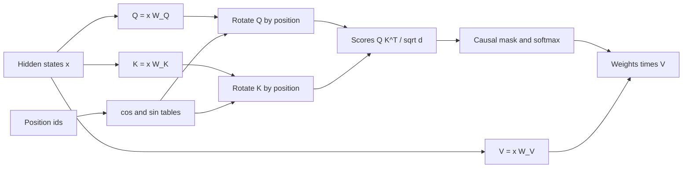

# Rotary Position Embedding (RoPE) Explained

## Introduction

Rotary Position Embedding, RoPE, is the position encoding of almost every open large language model released since 2023: Llama 2, 3 and 4, Mistral, Qwen 2 and 3, Gemma, DeepSeek-V3 (in its decoupled form), gpt-oss and many more. If you read a modern config.json you will find `rope_theta` in it, and in long-context models a `rope_scaling` or `rope_parameters` block as well. To understand those fields you have to understand what RoPE actually does.

RoPE was introduced by Jianlin Su and colleagues at Zhuiyi Technology, first in a Chinese blog post in early 2021 and then in the paper "RoFormer: Enhanced Transformer with Rotary Position Embedding" (arXiv, April 2021). EleutherAI quickly adopted it for GPT-J and GPT-NeoX, and from there it spread to PaLM, Llama and the rest.

The idea fits in one sentence: **rotate each query and key by an angle proportional to its position, so that the dot product between them depends only on how far apart they are**. This page derives that idea from scratch in three views (2D rotation, complex numbers, block-diagonal matrices), proves the relative-position property, and explains the frequency schedule. The [next page](./4-llm-rope-implementation.mdx) turns it into production-style PyTorch, and the [RoPE theta page](./5-llm-rope-theta.mdx) goes deep into the base frequency.

You will be able to:

- state the RoPE formula and explain every symbol,
- prove $\langle f(q, m), f(k, n) \rangle = g(q, k, m - n)$ by hand,
- verify the property numerically in 2D and in $d$ dimensions,
- explain why RoPE is applied to Q and K but not V, and why it plays well with fast attention kernels.

## The Problem RoPE Solves

The previous pages ended with two unsatisfying options:

- **Absolute encodings** (sinusoidal or learned) are added to the input. They are cheap, but after the $W_Q$ and $W_K$ projections the score mixes content and absolute position, and the clean "depends only on distance" property of sinusoids is lost.
- **Relative biases** (T5, ALiBi) put the distance into the score directly, but they add a bias that depends on each $(i, j)$ pair, which is either costly to materialize or (for ALiBi) so rigid that distant tokens are suppressed.

Su et al. stated the goal precisely. Find a function $f(x, t)$ that injects position $t$ into a query or key vector $x$ such that the attention score depends on the two contents and their relative position only:

$$
\big\langle f(q, m),\ f(k, n) \big\rangle = g(q, k, m - n).
$$

Here $q = x_m W_Q$ is the query of the token at position $m$, $k = x_n W_K$ is the key of the token at position $n$, and $\langle \cdot, \cdot \rangle$ is the dot product attention already computes. If $f$ can be applied to $q$ and $k$ individually, before the dot product, then attention does not need any extra bias, and any attention kernel (including FlashAttention) works unchanged.

## The 2D Case: Rotation

Start with $d = 2$. A rotation by angle $\alpha$ is the matrix

$$
R(\alpha) = \begin{pmatrix} \cos\alpha & -\sin\alpha \\ \sin\alpha & \cos\alpha \end{pmatrix}.
$$

Rotations have two properties we need:

1. Composing rotations adds angles: $R(\alpha) R(\beta) = R(\alpha + \beta)$.
2. The transpose undoes a rotation: $R(\alpha)^\top = R(-\alpha)$.

Now pick a frequency $\theta$ and define $f(x, t) = R(t\theta)\,x$: rotate the vector by $t\theta$ radians, where $t$ is its position. The score between a query at $m$ and a key at $n$ is

$$
f(q, m)^\top f(k, n) = q^\top R(m\theta)^\top R(n\theta)\, k = q^\top R\big((n - m)\theta\big)\, k .
$$

The absolute positions $m$ and $n$ have vanished. Only $n - m$ is left. That is the whole trick, and it is exact for **any** $q$ and $k$, which means for any learned $W_Q$ and $W_K$. Compare this with sinusoidal embeddings, where the relative property only held for the raw position vectors.

Rotations also preserve length, $\lVert R(\alpha) x \rVert = \lVert x \rVert$, so RoPE never changes the magnitude of a query or key, only its direction. Training stays well-conditioned and the softmax temperature is unaffected.

We can expand the 2D score to see exactly how distance enters. Writing $\varphi = (n - m)\theta$,

$$
q^\top R(\varphi)\, k = (q_1 k_1 + q_2 k_2)\cos\varphi + (q_2 k_1 - q_1 k_2)\sin\varphi .
$$

The first bracket is the ordinary dot product; the second is the 2D cross product. The score oscillates between them as the distance changes.

### A Worked Example by Hand

Take $q = (1, 2)$, $k = (3, 1)$ and $\theta = 0.5$. The plain dot product is $3 + 2 = 5$ and the cross term is $q_2 k_1 - q_1 k_2 = 6 - 1 = 5$.

- Query at $m = 2$, key at $n = 0$: $\varphi = (0 - 2)(0.5) = -1$. Score $= 5\cos(-1) + 5\sin(-1) = 5(0.5403) - 5(0.8415) = -1.5058$.
- Query at $m = 12$, key at $n = 10$: again $\varphi = -1$, so again $-1.5058$.
- Query at $m = 3$, key at $n = 5$: $\varphi = +1$, score $= 2.7015 + 4.2074 = 6.9089$.

Note that $n - m = -2$ and $n - m = +2$ give different scores. RoPE knows the direction of the offset, not just its size, which is essential for a causal language model where keys are always behind the query. The script confirms the arithmetic:

```python
import math
import torch

def rot(angle):
    c, s = math.cos(angle), math.sin(angle)
    return torch.tensor([[c, -s], [s, c]], dtype=torch.float64)   # counter-clockwise rotation

theta = 0.5                                   # one frequency, radians per token
q = torch.tensor([1.0, 2.0], dtype=torch.float64)
k = torch.tensor([3.0, 1.0], dtype=torch.float64)

print("plain dot q.k =", q @ k)
for m, n in [(2, 0), (5, 3), (12, 10), (3, 5)]:
    q_m = rot(m * theta) @ q                  # rotate the query by its position
    k_n = rot(n * theta) @ k                  # rotate the key by its position
    rel = q @ rot((n - m) * theta) @ k        # q^T R((n-m) theta) k
    print(f"m={m:2d} n={n:2d}  q_m.k_n = {q_m @ k_n:.4f}   q^T R((n-m)theta) k = {rel:.4f}   |q_m| = {q_m.norm():.4f}")
```

```text
plain dot q.k = tensor(5., dtype=torch.float64)
m= 2 n= 0  q_m.k_n = -1.5058   q^T R((n-m)theta) k = -1.5058   |q_m| = 2.2361
m= 5 n= 3  q_m.k_n = -1.5058   q^T R((n-m)theta) k = -1.5058   |q_m| = 2.2361
m=12 n=10  q_m.k_n = -1.5058   q^T R((n-m)theta) k = -1.5058   |q_m| = 2.2361
m= 3 n= 5  q_m.k_n = 6.9089   q^T R((n-m)theta) k = 6.9089   |q_m| = 2.2361
```

The norm $\sqrt{5} = 2.2361$ never changes.

## The Complex-Number View

The RoFormer paper actually derives RoPE with complex numbers, and the complex view is how Meta's reference Llama code implements it. Identify the 2D vector $(x_1, x_2)$ with the complex number $z = x_1 + i x_2$. Multiplying by $e^{i\alpha} = \cos\alpha + i \sin\alpha$ rotates $z$ by $\alpha$:

$$
f(z, t) = z\, e^{i t \theta}.
$$

For two complex numbers, the real dot product of the corresponding 2D vectors is $\mathrm{Re}[a \bar b]$, where $\bar b$ is the complex conjugate. So

$$
\big\langle f(q, m), f(k, n) \big\rangle
= \mathrm{Re}\!\left[q e^{im\theta}\ \overline{k e^{in\theta}}\right]
= \mathrm{Re}\!\left[q \bar k\, e^{i(m - n)\theta}\right].
$$

The phases $e^{im\theta}$ and $e^{-in\theta}$ multiply into $e^{i(m-n)\theta}$. This is the identity $e^{ia} e^{-ib} = e^{i(a-b)}$, and it is the cleanest proof of the relative property. The RoFormer paper goes the other way too: it starts from the requirement $\langle f(q,m), f(k,n)\rangle = g(q,k,m-n)$ plus the initial condition $f(x, 0) = x$, and derives the rotation $z e^{it\theta}$ as a solution.

## Going to d Dimensions

Real heads have $d = 64$ or $128$ dimensions, not 2. RoPE splits the head vector into $d/2$ pairs and rotates each pair with its own frequency:

$$
R_{\Theta, t} = \begin{pmatrix}
R(t\theta_0) & & & \\
& R(t\theta_1) & & \\
& & \ddots & \\
& & & R(t\theta_{d/2-1})
\end{pmatrix},
\qquad \theta_i = b^{-2i/d},\quad i = 0, 1, \dots, \tfrac{d}{2} - 1 .
$$

This is a block-diagonal matrix of $2 \times 2$ rotations. The base $b$ is $10{,}000$ in the RoFormer paper, copied from the sinusoidal encoding; it is the `rope_theta` field in config.json. Each block is an independent 2D rotation, so the proof goes through block by block:

$$
\begin{aligned}
f(q, m)^\top f(k, n) &= q^\top R_{\Theta,m}^\top R_{\Theta,n}\, k = q^\top R_{\Theta, n-m}\, k \\
&= \sum_{i=0}^{d/2-1} \mathrm{Re}\!\left[q^{(i)}\, \overline{k^{(i)}}\, e^{i(m-n)\theta_i}\right],
\end{aligned}
$$

where $q^{(i)} = q_{2i} + i\,q_{2i+1}$ is the $i$-th pair as a complex number. The score is a sum of $d/2$ terms, each oscillating at its own frequency as the distance changes.

The script below implements the complex form with `torch.polar` and `torch.view_as_complex`, builds the explicit block-diagonal matrix for comparison, and checks the relative property at absolute positions up to 100,000.

```python
import torch

torch.manual_seed(0)
d, base = 8, 10000.0

theta = base ** (-torch.arange(0, d, 2, dtype=torch.float64) / d)   # (d/2,) theta_i = base^(-2i/d)

def rope_complex(x, pos):
    """x: (d,) real vector, pos: int. Pair (x0,x1),(x2,x3),... as complex numbers and rotate."""
    z = torch.view_as_complex(x.view(-1, 2).contiguous())       # (d/2,) complex
    rotor = torch.polar(torch.ones_like(theta), pos * theta)    # e^{i pos theta_j}
    return torch.view_as_real(z * rotor).flatten()              # (d,)

def rope_matrix(pos):
    """The same map as an explicit block-diagonal d x d rotation matrix."""
    blocks = []
    for t in theta.tolist():
        a = pos * t
        c, s = torch.cos(torch.tensor(a)), torch.sin(torch.tensor(a))
        blocks.append(torch.stack([torch.stack([c, -s]), torch.stack([s, c])]).double())
    return torch.block_diag(*blocks)

q, k = torch.randn(d, dtype=torch.float64), torch.randn(d, dtype=torch.float64)

print("complex form == matrix form:", torch.allclose(rope_complex(q, 7), rope_matrix(7) @ q))
print("norm preserved:", torch.allclose(rope_complex(q, 1234).norm(), q.norm()))

# The score depends only on n - m: shift both positions by the same amount.
scores = [(rope_complex(q, m) @ rope_complex(k, m + 3)).item() for m in [0, 1, 50, 999, 100_000]]
print("scores for offset 3 at five absolute positions:", [round(s, 6) for s in scores])

# Explicit check of R_m^T R_n = R_{n-m}
print("R_m^T R_n == R_(n-m):", torch.allclose(rope_matrix(10).T @ rope_matrix(25), rope_matrix(15)))
```

```text
complex form == matrix form: True
norm preserved: True
scores for offset 3 at five absolute positions: [1.585057, 1.585057, 1.585057, 1.585057, 1.585057]
R_m^T R_n == R_(n-m): True
```

Even at position 100,000 the score for offset 3 is identical to the score at position 0 (in float64; in low precision this breaks down, see the [implementation page](./4-llm-rope-implementation.mdx)). Nobody multiplies by the $d \times d$ matrix in practice: it is $d/2$ independent 2D rotations, which cost about $3d$ multiply-adds per vector, a rounding error next to the $Q K^\top$ product.

## Where RoPE Sits in an Attention Layer

RoPE is applied inside every attention layer, after the Q and K projections and before the dot product. The value vectors are not rotated.



Some consequences:

- **Every layer gets position information directly.** Absolute embeddings enter once at the bottom and must be carried up the residual stream; RoPE re-injects position in every layer's scores.
- **V is unrotated, so outputs carry no explicit position.** The position only shapes which tokens are mixed, not what is mixed. The ALiBi paper suggests this separation helps extrapolation, a property RoPE shares.
- **The KV cache stores rotated keys.** A key is rotated once, by its own position, and cached. New queries are rotated by their own positions at decode time. The [KV cache page](../10-llm-inference/2-llm-kv-cache.mdx) relies on this.
- **Attention kernels are untouched.** RoPE modifies Q and K before the kernel, so FlashAttention, PagedAttention and grouped-query attention all work as is. This is the decisive practical advantage over T5-style biases.

## The Frequencies

The frequency schedule $\theta_i = b^{-2i/d}$ is the sinusoidal schedule from the [previous page](./1-llm-sinusoidal-and-learned.mdx), so each rotation pair is one of the "clocks" from that page, now applied to Q and K instead of being added to the input. With $d = 128$ and $b = 10{,}000$ (Llama 2):

| Pair $i$ | $\theta_i$ (radians per token) | Wavelength $2\pi/\theta_i$ (tokens) | Role |
|---|---|---|---|
| 0 | 1.0 | 6.3 | Very fast: distinguishes neighbours |
| 16 | 0.1 | 63 | Phrase scale |
| 32 | 0.01 | 628 | Paragraph scale |
| 48 | 0.001 | 6,283 | Document scale |
| 63 | 0.000115 | 54,410 | Almost frozen over a 4K context |

Three things follow.

**High-frequency pairs encode fine position.** Pair 0 turns one radian per token. Over a few tokens its contribution to the score swings strongly, so heads that care about "the previous token" can use it. Barbero et al. (2024) found that Gemma 7B uses the highest frequencies to build such positional attention patterns.

**Low-frequency pairs barely rotate.** Pair 63 turns only 0.47 radians over all 4,096 positions of a Llama 2 context, less than a tenth of a turn. Within the context window, these pairs act almost like a position-free dot product, which makes them useful for matching content regardless of distance. The same Barbero et al. study found that Gemma 7B concentrates much of its query and key norm in the lowest frequencies and suggested they act as "semantic channels".

**The score decays, on average, with distance.** When many pairs with different frequencies drift out of phase, the sum $\sum_i \mathrm{Re}[q^{(i)} \overline{k^{(i)}} e^{i(m-n)\theta_i}]$ tends to shrink for random-ish contents. RoFormer calls this the long-term decay property and proves an upper bound for it. Whether this decay is actually why RoPE works is debated, and how the base $b$ controls it is the central topic of the [RoPE theta page](./5-llm-rope-theta.mdx).

### Partial RoPE

Not every model rotates the whole head. GPT-NeoX and Pythia rotate only the first 25% of each head (`"rotary_pct": 0.25` in their config.json), Phi-2 rotates 40% (`"partial_rotary_factor": 0.4`), and Qwen3-Next rotates 25%. DeepSeek's Multi-Head Latent Attention keeps a separate small 64-dimensional rotary part per head (`"qk_rope_head_dim": 64` in DeepSeek-V3) because rotating the compressed latent would break its weight-absorption trick; see [Multi-Head Latent Attention](../2-llm-attention/6-llm-mla.mdx). The unrotated dimensions behave like NoPE channels inside a RoPE model.

## Why RoPE Won

| Property | Sinusoidal / learned | T5 bias | ALiBi | RoPE |
|---|---|---|---|---|
| Relative score for any $W_Q$, $W_K$ | No | Yes | Yes | Yes |
| Position in every layer | No | Yes | Yes | Yes |
| Extra parameters | Table (learned) | Small table | None | None |
| Works inside FlashAttention unchanged | Yes | No | Needs kernel support | Yes |
| Keeps far tokens reachable | Yes | Bucketed | Penalized | Yes |
| Extrapolates past training length | No | Somewhat | Smoothly | No, but adjustable via base and scaling |

RoPE combines the relative property of biases with the zero-overhead integration of absolute embeddings. Its one weakness, poor extrapolation beyond the training length, turned out to be fixable after pretraining by adjusting the frequencies, which is what `rope_theta` increases and `rope_scaling` methods (Position Interpolation, NTK-aware scaling, YaRN, Llama 3 scaling) do. Those are covered on the [context extension page](./6-llm-context-extension.mdx).

## Experiment: Score Versus Distance

Take one random query and key with $d = 128$ and plot their RoPE score for every distance from 0 to 8,192, once with $b = 10{,}000$ and once with $b = 500{,}000$:

```python
import torch

torch.manual_seed(0)
d = 128
q = torch.randn(d, dtype=torch.float64)
k = q + 0.3 * torch.randn(d, dtype=torch.float64)      # a key similar to the query

def rope_score(q, k, dist, base):
    theta = base ** (-torch.arange(0, d, 2, dtype=torch.float64) / d)
    zq = torch.view_as_complex(q.view(-1, 2).contiguous())
    zk = torch.view_as_complex(k.view(-1, 2).contiguous())
    phase = torch.polar(torch.ones_like(theta), dist * theta)
    return (zq * zk.conj() * phase).real.sum().item()   # Re sum q k* e^{i dist theta}

for base in [10_000.0, 500_000.0]:
    vals = [rope_score(q, k, t, base) for t in [0, 1, 4, 16, 64, 256, 1024, 4096, 8192]]
    print(f"base {base:>9,.0f}:", [round(v, 1) for v in vals])
```

```text
base    10,000: [131.7, 126.2, 90.5, 78.4, 45.3, 44.4, 45.3, -23.9, 6.7]
base   500,000: [131.7, 127.4, 100.0, 98.4, 81.4, 63.4, 51.8, 47.5, 19.9]
```

At distance 0 the score is the plain dot product of two similar vectors (131.7). As distance grows the fast pairs decorrelate and the score drops. With base 10,000 it has fallen to about a third by distance 64 and even turns negative at 4,096: at that distance this similar key would score lower than an unrelated one. With base 500,000 more pairs stay in phase for longer, and the similar key still scores 47.5 at distance 4,096. (One random draw is noisy; the curve wiggles, but the gap between the two bases is systematic.) This observation, quantified properly, is what drove `rope_theta` from 10,000 to 500,000 in Llama 3 and to 1,000,000 or more in Qwen. The [RoPE theta page](./5-llm-rope-theta.mdx) makes it rigorous.

## Common Mistakes

- **Rotating V.** RoPE applies to queries and keys only. Rotating values changes the model and breaks pretrained checkpoints.
- **Rotating before the projection.** RoPE must act on $q = x W_Q$ and $k = x W_K$, not on $x$. Rotating $x$ first brings back the cross terms and loses the exact relative property.
- **Mixing pair layouts.** The math pairs dimensions $(2i, 2i+1)$, but Hugging Face Llama pairs $i$ with $i + d/2$. Both are valid, but weights trained with one layout give garbage with the other; see the [implementation page](./4-llm-rope-implementation.mdx).
- **Using the wrong position for cached keys.** During generation the new token's position is the number of tokens already in the cache (plus any offset), not 0.
- **Assuming RoPE extrapolates because it is relative.** The relative property holds for any distance mathematically, but the model only ever trained on distances below its context length, and low-frequency pairs see unseen angles beyond it. That is why context extension needs scaling.

## Summary

- RoPE rotates each 2D pair of a query or key by $t\theta_i$, where $t$ is the token's position and $\theta_i = b^{-2i/d}$.
- Because $R(m\theta)^\top R(n\theta) = R((n-m)\theta)$, the score $q_m^\top k_n$ depends only on content and the signed distance $n - m$, for any learned projections.
- In complex form, $f(z, t) = z e^{it\theta}$ and the score is $\mathrm{Re}\sum_i q^{(i)} \overline{k^{(i)}} e^{i(m-n)\theta_i}$.
- Rotations preserve norms, cost $O(d)$ per vector, and happen before the attention kernel, so FlashAttention and KV caches work unchanged.
- High-frequency pairs resolve nearby positions; low-frequency pairs barely move and behave like position-free channels. The base $b$ (`rope_theta`) sets this spectrum.

## Further Reading

- [RoFormer: Enhanced Transformer with Rotary Position Embedding (Su et al., 2021)](https://arxiv.org/abs/2104.09864): the original paper with the derivation and long-term decay bound.
- [Rotary Embeddings: A Relative Revolution (EleutherAI blog, 2021)](https://blog.eleuther.ai/rotary-embeddings/): an accessible explanation and early experiments in GPT-NeoX.
- [Su Jianlin's original blog post (Chinese, 2021)](https://kexue.fm/archives/8265): the first presentation of RoPE.
- [Round and Round We Go! What Makes Rotary Positional Encodings Useful? (Barbero et al., 2024)](https://arxiv.org/abs/2410.06205): how Gemma uses high and low RoPE frequencies.
- [Hugging Face Llama modeling code](https://github.com/huggingface/transformers/blob/main/src/transformers/models/llama/modeling_llama.py): `LlamaRotaryEmbedding` and `apply_rotary_pos_emb`.
