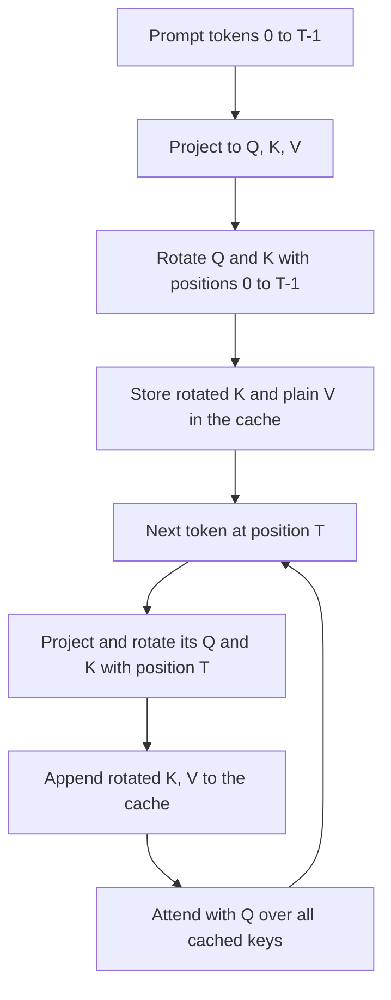

# Implementing RoPE in PyTorch

## Introduction

The [previous page](./3-llm-rope.mdx) derived RoPE as a rotation of each query and key pair by $t\theta_i$. On paper it is a block-diagonal matrix multiply. In real code nobody builds that matrix: RoPE is a handful of element-wise multiplies and adds on tensors shaped `(batch, n_heads, seq_len, head_dim)`, using cosine and sine tables that are computed once.

Getting those few lines right is surprisingly subtle. There are two incompatible ways of pairing dimensions, the Hugging Face checkpoints of Llama silently permute weights to switch between them, positions must be offset correctly during cached generation, and low-precision arithmetic quietly destroys the angles at long context. Each of these has caused real bugs in real ports.

This page builds RoPE step by step, then verifies it four ways:

- the interleaved and half-split (`rotate_half`) layouts are the same rotation in different coordinates,
- our implementation matches `transformers`' `LlamaRotaryEmbedding` and `apply_rotary_pos_emb` exactly,
- scores are unchanged when every position shifts, and incremental decoding with a KV cache matches a full forward pass,
- precision: what happens to the angles in bf16 and fp32 at long positions.

All snippets run on CPU with PyTorch 2.x; the Hugging Face comparison uses `transformers` 5.x.

## The Element-Wise Formula

For one pair $(x_{a}, x_{b})$ rotated by angle $\phi = t\theta_i$, the rotation matrix gives

$$
\begin{aligned}
x_a' &= x_a \cos\phi - x_b \sin\phi, \\
x_b' &= x_a \sin\phi + x_b \cos\phi .
\end{aligned}
$$

So for a whole vector we need, for every position $t$ and pair $i$, the numbers $\cos(t\theta_i)$ and $\sin(t\theta_i)$. That is a table of shape `(seq_len, head_dim / 2)`, independent of the batch, the heads and the layer. Every implementation computes this table once (the "cos/sin cache") and reuses it in every attention layer, for both queries and keys.

The only real design choice is **which two dimensions form a pair**:

| Layout | Pairs | Used by | Also called |
|---|---|---|---|
| Interleaved | $(0,1), (2,3), (4,5), \dots$ | RoFormer paper, Meta's original Llama code, GPT-J, Llama 4 in Hugging Face | "GPT-J style", `rotary_interleaved=True` in flash-attn |
| Half-split | $(0, \tfrac{d}{2}), (1, \tfrac{d}{2}+1), \dots$ | GPT-NeoX, Hugging Face Llama, Qwen, Mistral, Gemma | "NeoX style", `rotate_half`, `is_neox_style` in vLLM |

Both are valid RoPE: they apply the same $d/2$ rotations to different pairs of coordinates. A model trained with one layout learns $W_Q$ and $W_K$ whose output dimensions are arranged for that layout. Use the other layout at inference and the rotations land on the wrong pairs.

## Building the Cache and Both Layouts

```python
import torch

torch.manual_seed(0)

def rope_cache(seq_len, head_dim, base=10000.0, device=None):
    """Precompute cos/sin in float32. Returns two tensors of shape (seq_len, head_dim // 2)."""
    inv_freq = 1.0 / (base ** (torch.arange(0, head_dim, 2, dtype=torch.float32, device=device) / head_dim))
    pos = torch.arange(seq_len, dtype=torch.float32, device=device)
    freqs = torch.outer(pos, inv_freq)                 # (seq_len, head_dim/2): angle t * theta_i
    return freqs.cos(), freqs.sin()

def apply_rope_interleaved(x, cos, sin):
    """Pairs (0,1), (2,3), ... as in the RoFormer paper and Meta's reference code.
    x: (batch, n_heads, seq_len, head_dim); cos, sin: (seq_len, head_dim/2)."""
    x1, x2 = x[..., 0::2], x[..., 1::2]                # (B, H, T, D/2) each
    out = torch.stack((x1 * cos - x2 * sin,
                       x1 * sin + x2 * cos), dim=-1)   # (B, H, T, D/2, 2)
    return out.flatten(-2).type_as(x)                  # (B, H, T, D)

def rotate_half(x):
    x1, x2 = x.chunk(2, dim=-1)
    return torch.cat((-x2, x1), dim=-1)

def apply_rope_half(x, cos, sin):
    """Pairs (i, i + D/2) as in GPT-NeoX and Hugging Face Llama."""
    cos = torch.cat((cos, cos), dim=-1)                # (T, D): same angle for i and i + D/2
    sin = torch.cat((sin, sin), dim=-1)
    return (x * cos + rotate_half(x) * sin).type_as(x)

B, H, T, D = 2, 4, 16, 64
q = torch.randn(B, H, T, D)                            # (batch, n_heads, seq_len, head_dim)
cos, sin = rope_cache(T, D)

# 1) The two layouts are the same rotation applied to differently ordered dimensions.
perm = torch.cat((torch.arange(0, D, 2), torch.arange(1, D, 2)))   # evens first, then odds
a = apply_rope_interleaved(q, cos, sin)[..., perm]
b = apply_rope_half(q[..., perm], cos, sin)
print("interleaved == half-split after permuting dims:", torch.allclose(a, b, atol=1e-6))
print("interleaved == half-split with no permutation:   ",
      torch.allclose(apply_rope_interleaved(q, cos, sin), apply_rope_half(q, cos, sin), atol=1e-6))

# 2) Relative property inside a full attention score matrix.
k = torch.randn(B, H, T, D)
cos_big, sin_big = rope_cache(T + 1000, D)
def scores(offset):
    c, s = cos_big[offset:offset + T], sin_big[offset:offset + T]
    return apply_rope_half(q, c, s) @ apply_rope_half(k, c, s).transpose(-2, -1)   # (B, H, T, T)
print("scores unchanged when every position shifts by 1000:",
      torch.allclose(scores(0), scores(1000), atol=1e-3))
print("max abs difference:", (scores(0) - scores(1000)).abs().max().item())
```

```text
interleaved == half-split after permuting dims: True
interleaved == half-split with no permutation:    False
scores unchanged when every position shifts by 1000: True
max abs difference: 0.0004544258117675781
```

Walk through the pieces:

- `rope_cache` computes `inv_freq` $= \theta_i = b^{-2i/d}$ (shape `(D/2,)`), multiplies by positions with `torch.outer` to get every angle $t\theta_i$, and returns the cosines and sines. Everything is float32.
- `apply_rope_interleaved` slices even and odd dimensions (`x[..., 0::2]` and `x[..., 1::2]`), applies the two formulas, and stacks the results back into interleaved order with `torch.stack(..., dim=-1).flatten(-2)`.
- `rotate_half` turns $(x_1, x_2)$, the two halves of the vector, into $(-x_2, x_1)$. Then `x * cos + rotate_half(x) * sin` computes, for dimension $i$ in the first half, $x_i\cos\phi - x_{i+d/2}\sin\phi$, and for dimension $i + d/2$, $x_{i+d/2}\cos\phi + x_i \sin\phi$. That is exactly the rotation of the pair $(i, i + d/2)$. The cos and sin tables are concatenated with themselves so both halves of the pair see the same angle.

The first check is the important one. If you reorder dimensions so that all even indices come first and all odd indices after (`perm`), the interleaved rotation becomes the half-split rotation. The second check shows that without the permutation the two layouts disagree. The third confirms the relative property on a full `(batch, heads, T, T)` score matrix: shifting every position by 1,000 leaves the scores unchanged up to float32 rounding (a maximum difference of about $5 \times 10^{-4}$ on scores of order 10; we return to precision below).

## How Hugging Face Llama Got Its Layout

Meta's reference Llama code uses the complex-number formulation with interleaved pairs:

```python
import torch

def precompute_freqs_cis(dim: int, end: int, theta: float = 10000.0):
    freqs = 1.0 / (theta ** (torch.arange(0, dim, 2)[: (dim // 2)].float() / dim))
    t = torch.arange(end, device=freqs.device)
    freqs = torch.outer(t, freqs).float()
    return torch.polar(torch.ones_like(freqs), freqs)   # complex64, (end, dim/2)

def apply_rotary_emb(xq, xk, freqs_cis):
    # xq, xk: (batch, seq_len, n_heads, head_dim); pairs (0,1), (2,3), ... become complex numbers
    xq_ = torch.view_as_complex(xq.float().reshape(*xq.shape[:-1], -1, 2))
    xk_ = torch.view_as_complex(xk.float().reshape(*xk.shape[:-1], -1, 2))
    freqs_cis = freqs_cis[None, :, None, :]              # broadcast over batch and heads
    xq_out = torch.view_as_real(xq_ * freqs_cis).flatten(3)
    xk_out = torch.view_as_real(xk_ * freqs_cis).flatten(3)
    return xq_out.type_as(xq), xk_out.type_as(xk)

freqs_cis = precompute_freqs_cis(64, 16)
xq = torch.randn(1, 16, 4, 64)
print(apply_rotary_emb(xq, xq, freqs_cis)[0].shape)
```

```text
torch.Size([1, 16, 4, 64])
```

Hugging Face's Llama implementation uses `rotate_half` instead, the GPT-NeoX convention. To make Meta's weights work with it, the conversion script (`convert_llama_weights_to_hf.py`) permutes the output rows of `wq` and `wk` with this reshape:

```python
def permute(w, n_heads, dim1, dim2):
    return w.view(n_heads, dim1 // n_heads // 2, 2, dim2).transpose(1, 2).reshape(dim1, dim2)
```

Inside each head, it moves rows $0, 2, 4, \dots$ to the first half and rows $1, 3, 5, \dots$ to the second half: exactly the `perm` from the previous section, applied to the weights instead of the activations. The next script proves that "original weights + interleaved RoPE" and "permuted weights + `rotate_half`" produce identical attention scores, and that forgetting the permutation does not:

```python
import torch

torch.manual_seed(0)
d_model, n_heads, T = 64, 4, 10
head_dim = d_model // n_heads
inv_freq = 1.0 / (10000.0 ** (torch.arange(0, head_dim, 2, dtype=torch.float32) / head_dim))
freqs = torch.arange(T).float()[:, None] * inv_freq            # (T, head_dim/2)
cos, sin = freqs.cos(), freqs.sin()

def rope_interleaved(x):                                       # Meta layout: pairs (2i, 2i+1)
    x1, x2 = x[..., 0::2], x[..., 1::2]
    return torch.stack((x1 * cos - x2 * sin, x1 * sin + x2 * cos), -1).flatten(-2)

def rope_half(x):                                              # HF layout: pairs (i, i + D/2)
    c, s = torch.cat((cos, cos), -1), torch.cat((sin, sin), -1)
    x1, x2 = x.chunk(2, -1)
    return x * c + torch.cat((-x2, x1), -1) * s

def permute_for_half(w):
    """Reorder output rows of a q/k projection so interleaved pairs become half-split pairs.
    w: (n_heads * head_dim, d_model). The same reshape as Hugging Face's Llama conversion script."""
    return w.view(n_heads, head_dim // 2, 2, d_model).transpose(1, 2).reshape(n_heads * head_dim, d_model)

x = torch.randn(T, d_model)
W_q, W_k = torch.randn(d_model, d_model), torch.randn(d_model, d_model)   # "Meta" checkpoint, (out, in)

def heads(y):                                                  # (T, d_model) -> (n_heads, T, head_dim)
    return y.view(T, n_heads, head_dim).transpose(0, 1)

s_meta = rope_interleaved(heads(x @ W_q.T)) @ rope_interleaved(heads(x @ W_k.T)).transpose(-2, -1)
s_hf = rope_half(heads(x @ permute_for_half(W_q).T)) @ rope_half(heads(x @ permute_for_half(W_k).T)).transpose(-2, -1)
s_wrong = rope_half(heads(x @ W_q.T)) @ rope_half(heads(x @ W_k.T)).transpose(-2, -1)

print("permuted weights + rotate_half == original weights + interleaved:", torch.allclose(s_meta, s_hf, atol=1e-3))
print("unpermuted weights + rotate_half (a conversion bug):           ", torch.allclose(s_meta, s_wrong, atol=1e-3))
```

```text
permuted weights + rotate_half == original weights + interleaved: True
unpermuted weights + rotate_half (a conversion bug):            False
```

This is why you cannot copy `q_proj` weights from a Hugging Face Llama checkpoint into code that uses interleaved RoPE (or the reverse) without undoing the permutation. Inference engines handle this with a flag: vLLM's rotary embedding takes `is_neox_style`, and llama.cpp distinguishes "normal" and "NeoX" RoPE types per architecture. Note that Hugging Face's Llama 4 port went back to the complex, interleaved form (`torch.view_as_complex` in `modeling_llama4.py`), so the layout really does vary per model.

## Matching Hugging Face Exactly

With `transformers` 5.x the RoPE settings live in `config.rope_parameters`, a dictionary that combines the old top-level `rope_theta` and the `rope_scaling` block (old-style configs are standardized automatically when loaded). `LlamaRotaryEmbedding` returns `cos` and `sin` of shape `(batch, seq_len, head_dim)` for given `position_ids`, already duplicated for the two halves, and `apply_rotary_pos_emb` applies them to queries and keys of shape `(batch, heads, seq_len, head_dim)`.

```python
import torch
from transformers import LlamaConfig
from transformers.models.llama.modeling_llama import LlamaRotaryEmbedding, apply_rotary_pos_emb

torch.manual_seed(0)

def rotate_half(x):
    x1, x2 = x.chunk(2, dim=-1)
    return torch.cat((-x2, x1), dim=-1)

def my_rope(x, positions, base):
    D = x.shape[-1]
    inv_freq = 1.0 / (base ** (torch.arange(0, D, 2, dtype=torch.float32) / D))
    freqs = positions.float()[:, None] * inv_freq            # (T, D/2)
    emb = torch.cat((freqs, freqs), dim=-1)                  # (T, D)
    return x * emb.cos() + rotate_half(x) * emb.sin()

config = LlamaConfig(hidden_size=256, num_attention_heads=4, num_key_value_heads=4,
                     max_position_embeddings=4096, rope_theta=500000.0)
print("rope_parameters:", config.rope_parameters)
rotary = LlamaRotaryEmbedding(config)

B, H, T, D = 1, 4, 10, 64
q, k = torch.randn(B, H, T, D), torch.randn(B, H, T, D)
position_ids = torch.arange(100, 100 + T)[None]              # (B, T), e.g. after a 100-token prefix
cos, sin = rotary(q, position_ids)                           # (B, T, D) each
q_hf, k_hf = apply_rotary_pos_emb(q, k, cos, sin)            # unsqueezes the head dim

q_me = my_rope(q, position_ids[0], 500000.0)
print("cos/sin shape from HF:", tuple(cos.shape))
print("matches Hugging Face Llama RoPE:", torch.allclose(q_hf, q_me, atol=1e-5))
```

```text
rope_parameters: {'rope_theta': 500000.0, 'rope_type': 'default'}
cos/sin shape from HF: (1, 10, 64)
matches Hugging Face Llama RoPE: True
```

Our ten-line `my_rope` matches the library implementation for arbitrary positions (here 100 to 109, as if a 100-token prompt were already in the cache). Note how `rope_theta=500000.0`, passed the old way, ends up inside `rope_parameters` with `rope_type: "default"`. For scaled variants such as `"llama3"` or `"yarn"`, the same class swaps in a different `inv_freq` function from `ROPE_INIT_FUNCTIONS`; see [Extending Context](./6-llm-context-extension.mdx).

## Positions During Generation

During autoregressive generation with a KV cache, each new token must be rotated by its **true position**, which is the number of tokens before it (including the prompt), not its index in the current forward call (which is always 0 when decoding one token at a time). Keys are rotated once, by their own position, and stored rotated; a cached key is never rotated again.

```python
import torch

torch.manual_seed(0)
D, base = 64, 10000.0
inv_freq = 1.0 / (base ** (torch.arange(0, D, 2, dtype=torch.float32) / D))

def rotate_half(x):
    x1, x2 = x.chunk(2, dim=-1)
    return torch.cat((-x2, x1), dim=-1)

def rope(x, positions):
    # x: (..., T, D); positions: (T,) integer tensor
    freqs = positions.float()[:, None] * inv_freq
    emb = torch.cat((freqs, freqs), dim=-1)
    return x * emb.cos() + rotate_half(x) * emb.sin()

# Prefill 12 tokens, then decode 4 more one at a time with a KV cache of rotated keys.
T_prompt, T_new, H = 12, 4, 2
x_q = torch.randn(H, T_prompt + T_new, D)          # stand-ins for projected queries
x_k = torch.randn(H, T_prompt + T_new, D)          # and keys, (n_heads, seq_len, head_dim)

# Reference: full causal scores in one pass.
pos_all = torch.arange(T_prompt + T_new)
full = rope(x_q, pos_all) @ rope(x_k, pos_all).transpose(-2, -1)

# Incremental: cache keys rotated by their own positions.
k_cache = rope(x_k[:, :T_prompt], torch.arange(T_prompt))
rows = []
for t in range(T_prompt, T_prompt + T_new):
    pos = torch.tensor([t])                         # position = number of tokens already cached
    k_cache = torch.cat([k_cache, rope(x_k[:, t:t + 1], pos)], dim=1)
    q_t = rope(x_q[:, t:t + 1], pos)                # (H, 1, D)
    rows.append(q_t @ k_cache.transpose(-2, -1))    # (H, 1, t + 1)
ok = all(torch.allclose(r[:, 0], full[:, T_prompt + i, :T_prompt + i + 1], atol=1e-5)
         for i, r in enumerate(rows))
print("incremental decode matches full pass:", ok)

# The classic bug: restarting positions at 0 for each new token.
q_bad = rope(x_q[:, -1:], torch.tensor([0]))
print("position reset to 0 gives the same scores:",
      torch.allclose(q_bad @ k_cache.transpose(-2, -1), rows[-1], atol=1e-5))
```

```text
incremental decode matches full pass: True
position reset to 0 gives the same scores: False
```

The incremental scores match the full causal pass, row by row. Resetting the position to 0 for each decoded token gives different scores: the model would think the new token sits at the start of the document. In Hugging Face models this bookkeeping is done with `position_ids` (and `cache_position`), which `generate` computes for you.



Two related cases need care:

- **Left padding.** If a batch is left-padded, the first real token of a short sequence sits at index 5 but should have position 0. Hugging Face builds `position_ids` from the attention mask (a cumulative sum minus one) for this reason.
- **Sequence packing.** When several documents are packed into one training row, restart `position_ids` at 0 for each document (together with a document mask); otherwise the second document is trained as if it started at position 2,000.

## Precision: Compute Angles in Float32

The angle $t\theta_i$ grows linearly with position. For the fastest pair ($\theta_0 = 1$) at position 100,000 the angle is 100,000 radians, and the cosine depends on that number modulo $2\pi$. A floating-point format with few mantissa bits cannot even represent the position exactly:

```python
import torch

D, base = 128, 500000.0
inv_freq = 1.0 / (base ** (torch.arange(0, D, 2, dtype=torch.float32) / D))

print("bf16 can represent position 8193?", torch.tensor(8193.0, dtype=torch.bfloat16).item())
print("bf16 spacing near 100,000:", (torch.tensor(100_000.0, dtype=torch.bfloat16).item(),
                                      torch.nextafter(torch.tensor(100_000.0, dtype=torch.bfloat16),
                                                      torch.tensor(1e9, dtype=torch.bfloat16)).item()))

for pos in [100, 8_000, 100_000]:
    exact = torch.tensor(float(pos), dtype=torch.float64) * inv_freq.double()     # reference angles
    fp32 = (torch.tensor(float(pos)) * inv_freq).double()
    bf16 = (torch.tensor(float(pos), dtype=torch.bfloat16) * inv_freq.bfloat16()).double()
    err32 = (torch.cos(fp32) - torch.cos(exact)).abs().max().item()
    err16 = (torch.cos(bf16) - torch.cos(exact)).abs().max().item()
    print(f"position {pos:>7,}: max cos error fp32 = {err32:.1e}, bf16 = {err16:.2f}")
```

```text
bf16 can represent position 8193? 8192.0
bf16 spacing near 100,000: (99840.0, 100352.0)
position     100: max cos error fp32 = 1.3e-06, bf16 = 0.12
position   8,000: max cos error fp32 = 2.2e-04, bf16 = 1.79
position 100,000: max cos error fp32 = 1.2e-03, bf16 = 1.98
```

bf16 has 8 bits of significand precision, so 8,193 rounds to 8,192, and near 100,000 representable values are 512 apart. Cosines computed from bf16 angles are already off by up to 0.12 at position 100, and at 8,000 the cosines are essentially random (errors near 2 mean the sign is flipped). Float32 is fine for typical context lengths, with errors of about $10^{-3}$ at 100,000 because the angle itself carries only about 7 significant digits. This is why `LlamaRotaryEmbedding.forward` explicitly computes `freqs` in float32 and only casts the final `cos` and `sin` to the model dtype, and why the scaling methods on later pages compute `inv_freq` in float32 or float64.

:::warning
If you write your own RoPE and train in bf16 with autocast, make sure the position tensor and `inv_freq` are float32 when multiplied. A model whose RoPE angles were computed in bf16 during training has effectively learned noisy positions and may generate fine at short lengths but fall apart past a few thousand tokens.
:::

## Performance Notes

RoPE costs about $3d$ floating-point operations per query or key vector, negligible next to attention, but it is memory-bound: it reads and writes Q and K once more. Production stacks fuse it:

- FlashAttention's `flash_attn_with_kvcache` accepts `rotary_cos`, `rotary_sin` and `rotary_interleaved` and applies RoPE inside the kernel during decoding.
- vLLM and SGLang ship custom rotary kernels that rotate Q and K in place, taking the layout flag mentioned above.
- In plain PyTorch, `torch.compile` fuses the element-wise RoPE ops with neighbouring operations.

For learning and for most research code, the unfused version above is fine.

## Common Mistakes

- **Layout mismatch.** Loading Hugging Face Llama weights into interleaved RoPE code, or Meta-format weights into `rotate_half` code, produces fluent-looking nonsense or immediate garbage. Check which layout the checkpoint expects.
- **Forgetting to duplicate cos and sin for `rotate_half`.** The half-split formula needs a `(T, D)` table in which columns $i$ and $i + D/2$ hold the same angle. Using a `(T, D)` table of distinct frequencies (`torch.arange(0, D)` instead of `torch.arange(0, D, 2)`) is a common off-by-two bug.
- **Wrong positions with a KV cache.** Decode-time queries and keys need position `cache_length`, not 0. Packed or left-padded batches need per-sequence `position_ids`.
- **Rotating cached keys again.** Keys are stored after rotation. Re-rotating them on each step adds their position twice.
- **Computing angles in bf16 or fp16.** Always compute `positions * inv_freq` in float32, then cast cos and sin.
- **Broadcasting along the wrong axis.** Hugging Face returns cos and sin as `(batch, seq_len, head_dim)` and unsqueezes dimension 1 for `(batch, heads, seq_len, head_dim)` tensors; models that keep `(batch, seq_len, heads, head_dim)` need `unsqueeze_dim=2`.

## Summary

- RoPE in code is `x * cos + rotate(x) * sin` with a precomputed `(seq_len, head_dim/2)` table of angles $t\theta_i$ in float32.
- Interleaved pairs $(2i, 2i+1)$ and half-split pairs $(i, i + d/2)$ are the same rotation in permuted coordinates; Hugging Face Llama uses half-split and permutes Meta's $W_Q$, $W_K$ rows to match.
- Our minimal implementation matches `transformers`' `LlamaRotaryEmbedding` + `apply_rotary_pos_emb`, whose settings live in `config.rope_parameters` in v5.
- With a KV cache, rotate each token once with its absolute position and cache the rotated keys; reset positions per document when packing.
- Low precision ruins angles at long positions; compute them in float32, and use fused kernels for speed.

## Further Reading

- [RoFormer: Enhanced Transformer with Rotary Position Embedding (Su et al., 2021)](https://arxiv.org/abs/2104.09864): the math behind the implementation.
- [Meta Llama reference model code](https://github.com/meta-llama/llama/blob/main/llama/model.py): `precompute_freqs_cis` and `apply_rotary_emb` in complex form.
- [Hugging Face Llama modeling code](https://github.com/huggingface/transformers/blob/main/src/transformers/models/llama/modeling_llama.py): `LlamaRotaryEmbedding`, `rotate_half`, `apply_rotary_pos_emb`.
- [Hugging Face RoPE utilities](https://github.com/huggingface/transformers/blob/main/src/transformers/modeling_rope_utils.py): `rope_parameters` and `ROPE_INIT_FUNCTIONS` for scaled variants.
- [GPT-NeoX repository](https://github.com/EleutherAI/gpt-neox): the origin of the `rotate_half` layout and partial rotary dimensions.
- [flash-attention README](https://github.com/Dao-AILab/flash-attention): fused rotary support in `flash_attn_with_kvcache`.
