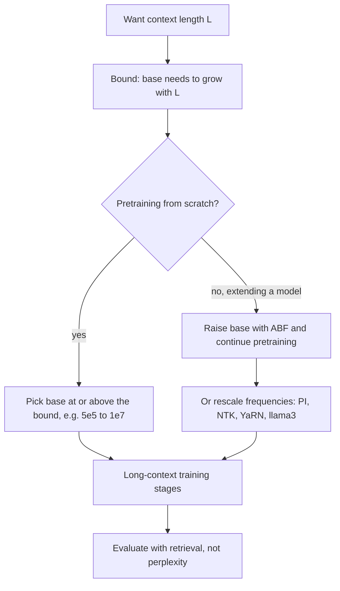

# RoPE Theta: The Base Frequency and Why It Grew from 10,000 to Millions

## Introduction

Open the config.json of Llama 2 and RoPE uses a base of 10,000, the default inherited from the 2017 sinusoidal encoding (the Hugging Face file does not even list it). Open Llama 3 and you find `"rope_theta": 500000.0`. Code Llama has 1,000,000, Qwen2.5 has 1,000,000, Qwen2.5-7B-Instruct-1M has 10,000,000, and SmolLM3 has 5,000,000. A constant that nobody thought about for six years became one of the most consequential hyperparameters of long-context models.

This page explains what `rope_theta` controls and why it grew. We will:

1. write down the per-pair frequencies $\theta_i = b^{-2i/d}$ and their wavelengths, and compute how many full rotations each pair makes over a model's context window,
2. derive the long-term decay bound from the RoFormer paper and see how the base changes it,
3. work through the 2024 analysis "Base of RoPE Bounds Context Length" (Men et al.), which turns the decay argument into a lower bound on the base for a given context length, and reproduce its table numerically,
4. read what Meta, Alibaba's Qwen team, Google and others actually did and why, and
5. build a table of `rope_theta`, context length and `rope_scaling` from real config.json files, with code that downloads them.

Throughout, $b$ is the base (`rope_theta`), $d$ is the number of rotated dimensions per head (usually `head_dim`), $i = 0, \dots, d/2 - 1$ indexes the rotation pairs, and $L$ is a context length in tokens. Read [RoPE Explained](./3-llm-rope.mdx) first if the rotation itself is unfamiliar.

## Frequencies, Wavelengths and Rotations per Context

RoPE rotates pair $i$ of a query or key at position $t$ by the angle $t\theta_i$, where

$$
\theta_i = b^{-2i/d}, \qquad i = 0, 1, \dots, \tfrac{d}{2} - 1 .
$$

Two facts about this schedule matter.

**The fastest pair never changes.** $\theta_0 = b^0 = 1$ radian per token for every base. The base only affects how fast the frequencies fall off from there.

**The frequencies form a geometric series.** Each pair is slower than the previous one by the factor $b^{-2/d}$. For $d = 128$ that factor is $10000^{-1/64} = 0.866$ with $b = 10{,}000$, and $500000^{-1/64} = 0.815$ with $b = 500{,}000$. A bigger base means the series falls faster and reaches much lower frequencies at the end.

The **wavelength** of pair $i$, the number of tokens for one full turn, is

$$
\lambda_i = \frac{2\pi}{\theta_i} = 2\pi\, b^{2i/d}.
$$

It runs from $\lambda_0 = 2\pi \approx 6.28$ tokens up to $\lambda_{d/2-1} = 2\pi\, b^{(d-2)/d}$, which is slightly less than $2\pi b$. Over a context of $L$ tokens, pair $i$ completes

$$
r_i = \frac{L}{\lambda_i} = \frac{L\,\theta_i}{2\pi}
$$

rotations. The slowest pair is the interesting one: if $r_{d/2-1} < 1$, then during training that pair never sees its full circle. Liu et al. (2023, "Scaling Laws of RoPE-based Extrapolation") call the number of dimensions whose wavelength fits inside the training length the **critical dimension**,

$$
d_{\mathrm{extra}} = 2 \left\lceil \frac{d}{2} \log_b \frac{L_{\mathrm{train}}}{2\pi} \right\rceil ,
$$

and argue that only the dimensions beyond it cause trouble when a model runs past its training length: their angles leave the range seen in training. The script computes all of these for real models:

```python
import math

def rope_stats(base, head_dim, context):
    """Per-pair RoPE frequencies theta_i = base^(-2i/d) and what they do over a context window."""
    pairs = head_dim // 2
    theta = [base ** (-2 * i / head_dim) for i in range(pairs)]
    wavelength = [2 * math.pi / t for t in theta]                 # tokens per full turn
    full_turns = sum(1 for w in wavelength if w <= context)        # pairs that complete >= 1 turn
    slow_rot = context / wavelength[-1]                            # turns of the slowest pair
    return wavelength[0], wavelength[-1], slow_rot, full_turns, pairs

models = [
    # name, rope_theta, head_dim, trained context
    ("Llama 2 7B",          10_000,      128, 4_096),
    ("Code Llama 7B",       1_000_000,   128, 16_384),
    ("Llama 3 8B",          500_000,     128, 8_192),
    ("Qwen2.5 7B",          1_000_000,   128, 32_768),
    ("Qwen2.5-7B-1M",       10_000_000,  128, 262_144),
    ("Gemma 3 4B, global",  1_000_000,   256, 32_768),
    ("Gemma 3 4B, local",   10_000,      256, 1_024),
]
print(f"{'model':20s} {'base':>11s} {'d':>4s} {'context':>8s} {'fastest':>8s} {'slowest':>12s} {'turns':>8s} {'pairs >=1 turn':>15s}")
for name, base, d, ctx in models:
    fast, slow, rot, full, pairs = rope_stats(base, d, ctx)
    print(f"{name:20s} {base:>11,} {d:>4d} {ctx:>8,} {fast:>8.2f} {slow:>12,.0f} {rot:>8.3f} {full:>8d} of {pairs}")

# Liu et al. (2023) critical dimension: d_extra = 2 * ceil(d/2 * log_base(T / 2 pi))
for name, base, d, ctx in models[:3]:
    d_extra = 2 * math.ceil(d / 2 * math.log(ctx / (2 * math.pi), base))
    print(f"{name}: critical dimension d_extra = {d_extra} of {d}")
```

```text
model                       base    d  context  fastest      slowest    turns  pairs >=1 turn
Llama 2 7B                10,000  128    4,096     6.28       54,410    0.075       46 of 64
Code Llama 7B          1,000,000  128   16,384     6.28    5,063,256    0.003       37 of 64
Llama 3 8B               500,000  128    8,192     6.28    2,559,196    0.003       35 of 64
Qwen2.5 7B             1,000,000  128   32,768     6.28    5,063,256    0.006       40 of 64
Qwen2.5-7B-1M         10,000,000  128  262,144     6.28   48,843,285    0.005       43 of 64
Gemma 3 4B, global     1,000,000  256   32,768     6.28    5,640,335    0.006       80 of 128
Gemma 3 4B, local         10,000  256    1,024     6.28       58,470    0.018       71 of 128
Llama 2 7B: critical dimension d_extra = 92 of 128
Code Llama 7B: critical dimension d_extra = 74 of 128
Llama 3 8B: critical dimension d_extra = 70 of 128
```

Read the Llama 2 row slowly. With $b = 10{,}000$ and $d = 128$, the slowest pair has a wavelength of 54,410 tokens and turns only 0.075 times (27 degrees) over the 4,096-token training window. 46 of the 64 pairs complete at least one full turn; the other 18 pairs (36 dimensions, which is $128 - d_{\mathrm{extra}} = 128 - 92$) only ever see a partial arc. Those are the dimensions that go out of distribution first when you feed Llama 2 a longer input.

Now compare Llama 3. Raising the base to 500,000 stretches the slowest wavelength to 2.56 million tokens, so over 8,192 tokens it turns just 0.003 times (about one degree). Fewer pairs complete a full turn (35 of 64). This is the counterintuitive part: a larger base makes **more** dimensions "incomplete" within the training window. So the reason for a large base is not "every pair should complete a turn". It is about something else, which the next two sections explain: what happens to attention scores at long distances.

## A Worked Example with Small Numbers

Take a toy head with $d = 8$ (four pairs) and compare $b = 100$ with $b = 10{,}000$:

| Pair $i$ | $\theta_i$ with $b = 100$ | $\lambda_i$ | $\theta_i$ with $b = 10{,}000$ | $\lambda_i$ |
|---|---|---|---|---|
| 0 | $100^{0} = 1$ | 6.3 | $10000^{0} = 1$ | 6.3 |
| 1 | $100^{-1/4} = 0.316$ | 19.9 | $10000^{-1/4} = 0.1$ | 62.8 |
| 2 | $100^{-1/2} = 0.1$ | 62.8 | $10000^{-1/2} = 0.01$ | 628 |
| 3 | $100^{-3/4} = 0.0316$ | 199 | $10000^{-3/4} = 0.001$ | 6,283 |

With base 100, the slowest pair completes a full turn every 199 tokens, so on its own it cannot tell a distance of 0 from a distance of 199; once every pair has wrapped around several times, distant positions start to look alike. With base 10,000, the slowest pair needs 6,283 tokens per turn, so distances up to a few thousand tokens remain distinguishable. The base sets the longest "ruler" the head can use.

## The Long-Term Decay Argument (RoFormer)

The RoPE score between a query $q$ at position $m$ and a key $k$ at position $n$ is a sum over pairs. Writing each pair as a complex number, $q^{(i)} = q_{2i} + \mathrm{i}\,q_{2i+1}$ and similarly for $k$,

$$
s(m - n) = \mathrm{Re}\left[\sum_{i=0}^{d/2-1} h_i\, e^{\mathrm{i}(m-n)\theta_i}\right], \qquad h_i = q^{(i)}\,\overline{k^{(i)}} .
$$

Su et al. bound this sum with a discrete version of integration by parts (the Abel transformation). Define partial sums of the phases $S_j = \sum_{k=0}^{j-1} e^{\mathrm{i}(m-n)\theta_k}$, with $S_0 = 0$, and set $h_{d/2} = 0$. Then

$$
\sum_{i=0}^{d/2-1} h_i\,(S_{i+1} - S_i) = -\sum_{i=0}^{d/2-1} S_{i+1}\,(h_{i+1} - h_i),
$$

and taking absolute values,

$$
\left\lvert \sum_{i} h_i\, e^{\mathrm{i}(m-n)\theta_i} \right\rvert
\le \Big(\max_i \lvert h_{i+1} - h_i \rvert\Big) \sum_{j=1}^{d/2} \lvert S_j \rvert .
$$

The first factor depends only on the content of $q$ and $k$. The second factor, $\sum_j \lvert S_j \rvert$, depends only on the distance and the frequencies. When $m - n = 0$ every phase is 1 and $\lvert S_j \rvert = j$, the maximum. As the distance grows, the phases point in different directions and the partial sums partly cancel. RoFormer plots $\frac{1}{d/2}\sum_j \lvert S_j\rvert$ against distance and calls the downward trend **long-term decay**: far-apart tokens can have, at most, a weaker interaction.

The base enters through the phases. A larger base means lower frequencies, so phases stay aligned for longer and the bound decays more slowly. The script computes RoFormer's quantity, together with the quantity Men et al. use in the next section:

```python
import torch

def roformer_decay(dist, base, d=128):
    """RoFormer Sec. 3.4.3: (1/(d/2)) * sum_j |S_j|, S_j = sum_{k<j} e^{i dist theta_k}.
    It upper-bounds the score (up to max |h_{i+1} - h_i|) and shrinks with distance."""
    theta = base ** (-torch.arange(0, d, 2, dtype=torch.float64) / d)       # (d/2,)
    phases = torch.polar(torch.ones_like(theta), dist * theta)              # e^{i dist theta_k}
    S = torch.cumsum(phases, dim=0)                                         # S_1 .. S_{d/2}
    return S.abs().mean().item()

def B(dist, base, d=128):
    """Men et al. 2024: B_{m,theta} = sum_i cos(m theta_i), proportional to how much more a query
    attends to a similar key than to a random key at distance m."""
    theta = base ** (-torch.arange(0, d, 2, dtype=torch.float64) / d)
    return torch.cos(dist * theta).sum().item()

dists = [0, 10, 100, 1_000, 4_000, 16_000, 32_000, 128_000]
for base in [10_000, 500_000, 10_000_000]:
    print(f"base {base:>10,}  RoFormer bound:", [round(roformer_decay(m, base), 1) for m in dists])
for base in [10_000, 500_000, 10_000_000]:
    print(f"base {base:>10,}  B_m           :", [round(B(m, base), 1) for m in dists])
```

```text
base     10,000  RoFormer bound: [32.5, 18.0, 10.2, 4.5, 5.0, 4.2, 5.8, 2.7]
base    500,000  RoFormer bound: [32.5, 20.9, 13.7, 10.2, 6.0, 5.5, 3.3, 5.8]
base 10,000,000  RoFormer bound: [32.5, 22.4, 14.4, 13.1, 9.1, 7.1, 5.8, 3.6]
base     10,000  B_m           : [64.0, 42.8, 30.5, 10.2, 0.5, -0.7, 8.9, -5.1]
base    500,000  B_m           : [64.0, 48.9, 39.1, 31.5, 15.7, 9.3, 12.8, -5.4]
base 10,000,000  B_m           : [64.0, 51.6, 40.0, 37.4, 30.4, 25.5, 19.0, 15.4]
```

For the RoFormer bound (first three rows), all bases start at 32.5 at distance 0. With base 10,000 the bound is already down to 4.5 at distance 1,000; with base 10,000,000 it is still 13.1 there and 9.1 at 4,000. That is the "reduces the decaying effect" argument Xiong et al. (2023) give for raising the base, and Code Llama's appendix makes the same point with a plot of expected attention scores versus distance.

The bound has a weakness, though. It is an upper bound that is tight only when the $h_i$ are nearly constant, which is not how trained queries and keys look. Barbero et al. (2024, "Round and Round We Go!") went further and argued that decay is unlikely to be the core reason RoPE works at all, based on how Gemma 7B uses its frequencies. A more useful question is not "how large can the score be" but "can the model still prefer a relevant key over an irrelevant one at distance $m$". That is the question Men et al. asked.

## Base of RoPE Bounds Context Length (Men et al., 2024)

"Base of RoPE Bounds Context Length" by Xin Men, Mingyu Xu, Bingning Wang and colleagues (Baichuan Inc. and ISCAS, arXiv 2405.14591, NeurIPS 2024) makes the decay argument concrete.

**Setup.** Let $q$ be a query and consider two keys: a **similar** key $k^* = q + \epsilon$ (the token the query is looking for, with small noise $\epsilon$ of mean zero) and a **random** key $k$. Assume the components of $q$ and $k$ are independent and identically distributed with standard deviation $\sigma$. A useful attention head should give the similar key a higher expected score than the random one, at every distance it is supposed to handle.

**Theorem 1 of the paper.** Under these assumptions,

$$
\frac{1}{2\sigma^2}\Big(\mathbb{E}\big[q^\top R_{m}\, k^*\big] - \mathbb{E}\big[q^\top R_{m}\, k\big]\Big) = \sum_{i=0}^{d/2-1} \cos(m\,\theta_i) \;=:\; B_{m,\theta},
$$

where $R_m$ is the RoPE rotation for relative distance $m$. Intuitively: the random key contributes nothing in expectation, while the similar key contributes $\lVert q^{(i)}\rVert^2 \cos(m\theta_i)$ per pair, each pair weighted equally on average, and $\mathbb{E}\lVert q^{(i)}\rVert^2 = 2\sigma^2$.

This is exactly the sum of cosines we met for sinusoidal embeddings, now with a precise meaning: $B_{m,\theta}$ measures **how much more attention a matching token gets than a random one at distance $m$**. If $B_{m,\theta} < 0$, a random token beats the matching one on average, and the head effectively cannot retrieve at that distance.

**The bound.** The paper defines the context length a base can truly support as the largest $L$ such that $B_{m,\theta} \ge 0$ for all $m \le L$, and conversely the lower bound on the base for a target length $L$:

$$
b_L = \inf\left\{ b \;:\; B_{m,\theta} \ge 0 \ \text{for all } m \in [0, L] \right\}, \qquad \theta_i = b^{-2i/d}.
$$

There is no closed form because $B_{m,\theta}$ is a sum of many cosines, so the paper computes it numerically ($d = 128$) and reports, in its Table 2: 4.3e3 for 1K tokens, 2.7e4 for 4K, 8.4e4 for 8K, 6.4e5 for 32K, 7.8e6 for 128K and 5.1e8 for 1M.

Look back at the $B_m$ rows of the previous script. With base 10,000, $B_m$ is 0.5 at distance 4,000 and $-0.7$ at 16,000: a 10K base cannot support those lengths by this criterion. With base 10,000,000, $B_m$ is still 15.4 at 128,000.

We can reproduce the table. The code scans a log-spaced grid of bases and returns the first one for which $B_m$ stays non-negative up to $L$:

```python
import math
import numpy as np

def min_B(inv_freq, L):
    """min over m in [0, L] of B_m = sum_i cos(m * theta_i), evaluated in float64."""
    m = np.arange(L + 1, dtype=np.float64)[:, None]
    return np.cos(m * inv_freq[None, :]).sum(axis=1).min()

def default_inv_freq(base, d=128):
    return base ** (-np.arange(0, d, 2, dtype=np.float64) / d)

def smallest_base(L, d=128, grid=np.logspace(3, 8, 200)):
    """Smallest base on a log grid for which B_m >= 0 for every distance up to L (Men et al. 2024)."""
    for b in grid:
        if min_B(default_inv_freq(b, d), L) >= 0:
            return b

paper = {1_000: 4.3e3, 2_000: 1.6e4, 4_000: 2.7e4, 8_000: 8.4e4, 16_000: 3.1e5, 32_000: 6.4e5}
for L, reported in paper.items():
    print(f"context {L:>6,}: smallest base on grid = {smallest_base(L):.1e}   (paper, Table 2: {reported:.1e})")
```

```text
context  1,000: smallest base on grid = 4.2e+03   (paper, Table 2: 4.3e+03)
context  2,000: smallest base on grid = 1.6e+04   (paper, Table 2: 1.6e+04)
context  4,000: smallest base on grid = 2.7e+04   (paper, Table 2: 2.7e+04)
context  8,000: smallest base on grid = 9.1e+04   (paper, Table 2: 8.4e+04)
context 16,000: smallest base on grid = 3.4e+05   (paper, Table 2: 3.1e+05)
context 32,000: smallest base on grid = 8.7e+05   (paper, Table 2: 6.4e+05)
```

The numbers agree with the paper to within the resolution of the search. They cannot agree exactly, because $\min_m B_{m,\theta}$ is not monotonic in the base: a slightly larger base can dip below zero again at some distance. A grid search (ours) and the paper's solver therefore land on slightly different "first valid" bases, especially at 32K. The order of magnitude is the point: **every doubling of the context needs roughly a 2x to 4x larger base**.

**What the experiments showed.** The paper's most striking results are about what happens when the base is too small:

- Fine-tuning Llama2-7B to 32K tokens with different bases, perplexity barely changed across bases, but accuracy on a long-range retrieval evaluation collapsed for bases below the derived bound. The base that gave the best perplexity (2e5) had very poor retrieval accuracy.
- A model trained with base 500 kept low perplexity even at 128K tokens, which looks like great extrapolation, but failed needle-in-a-haystack retrieval at about 1K tokens. The authors call this a **superficial** long-context ability: $B_{m,\theta}$ turns negative early, so the model only really attends locally, and local attention is enough for low perplexity.
- Pretraining a 2B model from scratch with base 100 and 4K context, it could only retrieve from about the last 500 tokens; with base 1e6 its effective context was much longer.

The paper is also careful about limits: the bound is not strict, because stacked layers can relay information beyond any single layer's range, so a real model can exceed it. We can check that against real configs.

### Checking Real Models Against the Bound

The script below finds the first distance at which $B_m$ goes negative for several real configurations, including Llama 3.1, whose `llama3` `rope_scaling` changes the frequencies (the formula is explained on the [context extension page](./6-llm-context-extension.mdx); here it is copied from `transformers`, and we checked that it reproduces `_compute_llama3_parameters` exactly).

```python
import math
import numpy as np

def first_negative_B(inv_freq, L, chunk=65_536):
    """First distance m <= L where B_m = sum_i cos(m theta_i) < 0, or None if B stays >= 0."""
    for start in range(0, L + 1, chunk):
        m = np.arange(start, min(start + chunk, L + 1), dtype=np.float64)[:, None]
        Bm = np.cos(m * inv_freq[None, :]).sum(axis=1)
        neg = np.nonzero(Bm < 0)[0]
        if len(neg):
            return start + int(neg[0])
    return None

def default_inv_freq(base, d=128):
    return base ** (-np.arange(0, d, 2, dtype=np.float64) / d)

def llama3_inv_freq(base=500_000.0, d=128, factor=8.0, low=1.0, high=4.0, old_ctx=8192):
    """Llama 3.1 'llama3' rope_scaling, same formula as transformers' _compute_llama3_parameters."""
    inv = default_inv_freq(base, d)
    wavelen = 2 * math.pi / inv
    smooth = (old_ctx / wavelen - low) / (high - low)
    scaled = np.where(wavelen > old_ctx / low, inv / factor, inv)         # low frequencies / factor
    mid = (wavelen >= old_ctx / high) & (wavelen <= old_ctx / low)
    return np.where(mid, (1 - smooth) * inv / factor + smooth * inv, scaled)

cases = [
    ("Llama 2, base 1e4",            default_inv_freq(1e4),   4_096),
    ("Code Llama, base 1e6",         default_inv_freq(1e6),   100_000),
    ("Llama 3, base 5e5",            default_inv_freq(5e5),   131_072),
    ("Llama 3.1, 5e5 + llama3 x8",   llama3_inv_freq(),       131_072),
    ("Qwen2.5, base 1e6",            default_inv_freq(1e6),   131_072),
    ("Qwen2.5-1M, base 1e7",         default_inv_freq(1e7),   1_010_000),
]
for name, inv, L in cases:
    m = first_negative_B(inv, L)
    verdict = "B_m >= 0 for every distance" if m is None else f"B_m first < 0 at distance {m:,}"
    print(f"{name:28s} checked to {L:>9,}: {verdict}")
```

```text
Llama 2, base 1e4            checked to     4,096: B_m first < 0 at distance 1,707
Code Llama, base 1e6         checked to   100,000: B_m first < 0 at distance 27,115
Llama 3, base 5e5            checked to   131,072: B_m first < 0 at distance 18,438
Llama 3.1, 5e5 + llama3 x8   checked to   131,072: B_m first < 0 at distance 85,133
Qwen2.5, base 1e6            checked to   131,072: B_m first < 0 at distance 27,115
Qwen2.5-1M, base 1e7         checked to 1,010,000: B_m first < 0 at distance 144,660
```

How to read this:

- **Llama 2** goes negative at 1,707 tokens, well inside its 4,096-token window, and still works at 4K. The bound is a single-layer, average-case heuristic, and real networks beat it. It is a guide to orders of magnitude, not a hard wall.
- **Llama 3's** 500,000 base on its own stays positive to 18,438 tokens, comfortably beyond its 8,192-token training window, and consistent with Meta citing Xiong et al. for "contexts up to 32,768".
- **Llama 3.1** keeps base 500,000 but divides the low frequencies by 8. That pushes the first negative $B_m$ out to 85,133 tokens. For the 128K target the bound asks for about 7.8e6; the llama3 scaling gets most of the way there without retraining from scratch.
- **Qwen2.5's** base of 1,000,000 stays positive to 27,115, close to its 32,768-token pretraining length, and the Qwen team relies on YaRN plus Dual Chunk Attention at inference to reach 128K.
- **Qwen2.5-1M's** base of 10,000,000 stays positive to 144,660 tokens, below its 1M target; again the Qwen2.5-1M report pairs the base with Dual Chunk Attention, which remaps large relative distances to small ones.

The pattern is consistent: real long-context models raise the base into the range the bound suggests, then cover the rest of the distance with scaling or chunked attention.

## Why Llama 3, Code Llama and Qwen Raised the Base

The history is a sequence of empirical discoveries, now with the theory above to explain them.

**Mid-2023: community and Code Llama.** Users on r/LocalLLaMA found that increasing the base of a pretrained Llama ("NTK-aware" scaling) extended its usable context with little or no fine-tuning. Code Llama (Rozière et al., August 2023) made it standard practice: for long-context fine-tuning on 16,384-token sequences, "we increase the base period θ from 10,000 to 1,000,000", which in their words "reduces bias towards short-distance attention". Code Llama was then shown to be stable up to 100,000 tokens, far beyond its 16K fine-tuning length. Its config.json records `"rope_theta": 1000000`.

**September 2023: ABF.** Xiong et al. at Meta ("Effective Long-Context Scaling of Foundation Models", the Llama 2 Long paper) found that plain continued pretraining on long data did not let Llama 2 attend effectively beyond about 4,000 to 6,000 tokens, and blamed RoPE's decay for distant tokens. They raised the base from 10,000 to 500,000, called it **adjusted base frequency (ABF)**, and found it the best of the variants they tried, ahead of position interpolation, at 32,768 tokens. They also note the base is "not very sensitive": performance depends on it only logarithmically.

**April 2024: Llama 3.** Meta pretrained Llama 3 with base 500,000 from the start. The Llama 3 paper states it increased "the RoPE base frequency hyperparameter to 500,000", citing Xiong et al. for its effectiveness up to 32,768 tokens. Llama 3.1 then extended context from 8K to 128K "in six stages" with about 800B tokens of long-context pretraining, keeping the base and adding the `llama3` frequency scaling.

**Qwen.** The Qwen2.5 report says that in the final pretraining stage the context goes from 4,096 to 32,768 tokens and "we increase the base frequency of RoPE from 10,000 to 1,000,000 using the ABF technique". Qwen3's report repeats the same change. Qwen2.5-Turbo used base 10,000,000 while progressing through 32K, 64K, 128K and 256K stages, and the Qwen2.5-1M models stepped the base from 1,000,000 to 5,000,000 to 10,000,000 as the training length went from 64K to 128K to 256K, the clearest real-world example of "raise the base with the context".

**Gemma 3.** Google's Gemma 3 uses two bases in one model: 1,000,000 for the global attention layers and 10,000 for the local sliding-window layers (window 1,024 in the 4B config). Local layers never see distances beyond their window, so a small base keeps their positional resolution high; global layers need the long ruler.

**What a too-large base costs.** If the base were free, everyone would use $10^{12}$. It is not free:

- **Resolution.** More pairs become nearly static over the context window (35 of 64 rotate fully for Llama 3 at 8K, versus 46 for Llama 2 at 4K). Those pairs carry almost no positional signal, so the model has fewer dimensions for distinguishing positions in the middle range.
- **Changing it requires training.** A pretrained model's weights are adapted to its base. Switching the base without continued training changes every score; Code Llama noted that loss curves recover within a few gradient steps at a low learning rate, but a fine-tuning stage is still needed.
- **Precision.** Very low frequencies mean tiny angles over long ranges, and the slowest pairs differ by small amounts between nearby positions; computing angles in float32 (see the [implementation page](./4-llm-rope-implementation.mdx)) becomes mandatory.



## Real Values from config.json

The table below was produced by the script after it, which downloads each repository's config.json with `huggingface_hub`. Meta's and Google's own repositories are gated, so the script reads public re-hosts of the same checkpoints (`NousResearch`, `unsloth`); all other repositories are the official ones.

| Model (repository) | `rope_theta` | Rotated dims | `max_position_embeddings` | `rope_scaling` |
|---|---|---|---|---|
| Llama 2 7B (NousResearch/Llama-2-7b-hf) | absent, default 10,000 | 128 | 4,096 | none |
| Code Llama 7B (codellama/CodeLlama-7b-hf) | 1,000,000 | 128 | 16,384 | none |
| Llama 3 8B (unsloth/llama-3-8b) | 500,000 | 128 | 8,192 | none |
| Llama 3.1 8B (unsloth/Meta-Llama-3.1-8B) | 500,000 | 128 | 131,072 | llama3, factor 8, low 1, high 4, original 8,192 |
| Llama 3.2 1B (unsloth/Llama-3.2-1B) | 500,000 | 64 | 131,072 | llama3, factor 32, low 1, high 4, original 8,192 |
| Llama 4 Scout (unsloth/Llama-4-Scout-17B-16E-Instruct) | 500,000 | 128 | 10,485,760 | llama3, factor 16, low 1, high 1, original 8,192 |
| Mistral 7B v0.1 | 10,000 | 128 | 32,768 | none (4,096 sliding window) |
| Mistral 7B Instruct v0.2 | 1,000,000 | 128 | 32,768 | none |
| Mistral NeMo Base 2407 | 1,000,000 | 128 | 131,072 | none |
| Qwen2 7B | 1,000,000 | 128 | 131,072 | none |
| Qwen2.5 7B Instruct | 1,000,000 | 128 | 32,768 | none (README: add YaRN factor 4 for 128K) |
| Qwen2.5 7B Instruct 1M | 10,000,000 | 128 | 1,010,000 | none |
| Qwen3 8B | 1,000,000 | 128 | 40,960 | none (README: YaRN factor 4 from 32,768) |
| Qwen3-Next 80B-A3B | 10,000,000 | 64 of 256 | 262,144 | none |
| Gemma 3 4B (unsloth/gemma-3-4b-pt) | 1,000,000 global, 10,000 local | 256 | 131,072 | linear, factor 8 |
| DeepSeek-V3 | 10,000 | 64 (decoupled RoPE part) | 163,840 | yarn, factor 40, original 4,096 |
| gpt-oss-20b | 150,000 | 64 | 131,072 | yarn, factor 32, original 4,096 |
| SmolLM3 3B | 5,000,000 | 128 | 65,536 | none (every 4th layer NoPE) |
| Phi-3 mini 128K | 10,000 | 96 | 131,072 | longrope (per-pair factors) |

Patterns worth noticing:

- Models that were **pretrained** for long context raise the base (Llama 3, Qwen, Mistral v0.2 and NeMo, SmolLM3).
- Models that were **extended** after pretraining keep a modest base and use `rope_scaling` (DeepSeek-V3 and gpt-oss from 4K with YaRN, Phi-3 with LongRoPE, Gemma 3 with linear interpolation on top of a raised global base).
- Llama 3.1 and later do both: a raised base plus llama3 scaling.
- `max_position_embeddings` is not always the trained length. Qwen3 sets 40,960 (32,768 plus room for output, per its README) and Qwen2.5-7B-Instruct sets 32,768 even though the README describes 128K with YaRN.

The script that generated these rows:

```python
import json
from huggingface_hub import hf_hub_download

# Ungated repos. The unsloth and NousResearch repos re-host Meta's and Google's gated checkpoints,
# so their config.json can be downloaded without accepting a license.
REPOS = [
    "NousResearch/Llama-2-7b-hf",
    "codellama/CodeLlama-7b-hf",
    "unsloth/llama-3-8b",
    "unsloth/Meta-Llama-3.1-8B",
    "unsloth/Llama-3.2-1B",
    "unsloth/Llama-4-Scout-17B-16E-Instruct",
    "mistralai/Mistral-7B-v0.1",
    "mistralai/Mistral-7B-Instruct-v0.2",
    "mistralai/Mistral-Nemo-Base-2407",
    "Qwen/Qwen2-7B",
    "Qwen/Qwen2.5-7B-Instruct",
    "Qwen/Qwen2.5-7B-Instruct-1M",
    "Qwen/Qwen3-8B",
    "Qwen/Qwen3-Next-80B-A3B-Instruct",
    "unsloth/gemma-3-4b-pt",
    "deepseek-ai/DeepSeek-V3",
    "openai/gpt-oss-20b",
    "HuggingFaceTB/SmolLM3-3B",
    "microsoft/Phi-3-mini-128k-instruct",
]

def summarize_scaling(rs):
    if not rs:
        return "none"
    kind = rs.get("rope_type") or rs.get("type")
    keep = {k: v for k, v in rs.items() if k not in ("rope_type", "type", "long_factor", "short_factor")}
    return f"{kind} {keep}" if keep else kind

for repo in REPOS:
    with open(hf_hub_download(repo, "config.json")) as f:
        cfg = json.load(f)
    cfg = {**cfg, **cfg.get("text_config", {})}        # multimodal configs nest the LLM settings
    theta = cfg.get("rope_theta", "absent (10000 default)")
    head_dim = cfg.get("head_dim") or cfg["hidden_size"] // cfg["num_attention_heads"]
    # dimensions that are actually rotated: DeepSeek MLA has a separate rope part, some models rotate a fraction
    rope_dim = cfg.get("qk_rope_head_dim") or int(head_dim * cfg.get("partial_rotary_factor", 1.0))
    extra = ""
    if "rope_local_base_freq" in cfg:
        extra = f" local={cfg['rope_local_base_freq']}"
    print(f"{repo:40s} theta={theta}{extra} rope_dim={rope_dim} "
          f"max_pos={cfg['max_position_embeddings']} scaling={summarize_scaling(cfg.get('rope_scaling'))}")
```

```text
NousResearch/Llama-2-7b-hf               theta=absent (10000 default) rope_dim=128 max_pos=4096 scaling=none
codellama/CodeLlama-7b-hf                theta=1000000 rope_dim=128 max_pos=16384 scaling=none
unsloth/llama-3-8b                       theta=500000.0 rope_dim=128 max_pos=8192 scaling=none
unsloth/Meta-Llama-3.1-8B                theta=500000.0 rope_dim=128 max_pos=131072 scaling=llama3 {'factor': 8.0, 'high_freq_factor': 4.0, 'low_freq_factor': 1.0, 'original_max_position_embeddings': 8192}
unsloth/Llama-3.2-1B                     theta=500000.0 rope_dim=64 max_pos=131072 scaling=llama3 {'factor': 32.0, 'high_freq_factor': 4.0, 'low_freq_factor': 1.0, 'original_max_position_embeddings': 8192}
unsloth/Llama-4-Scout-17B-16E-Instruct   theta=500000.0 rope_dim=128 max_pos=10485760 scaling=llama3 {'factor': 16.0, 'high_freq_factor': 1.0, 'low_freq_factor': 1.0, 'original_max_position_embeddings': 8192}
mistralai/Mistral-7B-v0.1                theta=10000.0 rope_dim=128 max_pos=32768 scaling=none
mistralai/Mistral-7B-Instruct-v0.2       theta=1000000.0 rope_dim=128 max_pos=32768 scaling=none
mistralai/Mistral-Nemo-Base-2407         theta=1000000.0 rope_dim=128 max_pos=131072 scaling=none
Qwen/Qwen2-7B                            theta=1000000.0 rope_dim=128 max_pos=131072 scaling=none
Qwen/Qwen2.5-7B-Instruct                 theta=1000000.0 rope_dim=128 max_pos=32768 scaling=none
Qwen/Qwen2.5-7B-Instruct-1M              theta=10000000.0 rope_dim=128 max_pos=1010000 scaling=none
Qwen/Qwen3-8B                            theta=1000000 rope_dim=128 max_pos=40960 scaling=none
Qwen/Qwen3-Next-80B-A3B-Instruct         theta=10000000 rope_dim=64 max_pos=262144 scaling=none
unsloth/gemma-3-4b-pt                    theta=1000000.0 local=10000.0 rope_dim=256 max_pos=131072 scaling=linear {'factor': 8.0}
deepseek-ai/DeepSeek-V3                  theta=10000 rope_dim=64 max_pos=163840 scaling=yarn {'beta_fast': 32, 'beta_slow': 1, 'factor': 40, 'mscale': 1.0, 'mscale_all_dim': 1.0, 'original_max_position_embeddings': 4096}
openai/gpt-oss-20b                       theta=150000 rope_dim=64 max_pos=131072 scaling=yarn {'beta_fast': 32.0, 'beta_slow': 1.0, 'factor': 32.0, 'original_max_position_embeddings': 4096, 'truncate': False}
HuggingFaceTB/SmolLM3-3B                 theta=5000000.0 rope_dim=128 max_pos=65536 scaling=none
microsoft/Phi-3-mini-128k-instruct       theta=10000.0 rope_dim=96 max_pos=131072 scaling=longrope
```

In `transformers` 5.x you can read the same information from a loaded config as `config.rope_parameters`, a dictionary that merges `rope_theta` and the scaling block (for example `{'rope_theta': 500000.0, 'rope_type': 'llama3', 'factor': 8.0, ...}` for Llama 3.1).

## Experiment: How Big Must the Base Be for Your Context?

Combine the pieces into a quick planning tool. For a head dimension $d$ and a target context $L$, compute (1) the Men et al. bound with `smallest_base`, (2) the turns of the slowest pair with `rope_stats`, and (3) where $B_m$ first turns negative for the base you intend to use, with `first_negative_B`. For $d = 128$:

- For $L = 32{,}000$ the grid search gives about $8.7 \times 10^5$, and the paper gives $6.4 \times 10^5$; Qwen's 1,000,000 sits right at that level.
- Rerun `smallest_base(L, d=64)` (gpt-oss and Llama 3.2 1B rotate 64 dimensions). The same grid gives about $5.2 \times 10^5$ for 8,000 tokens and $4.9 \times 10^6$ for 32,000 tokens, roughly five to six times the $d = 128$ values ($9.1 \times 10^4$ and $8.7 \times 10^5$). With only 32 cosines in the sum, it takes lower frequencies to keep $B_m$ positive, so the rotated head dimension matters as much as the base.

To go from analysis to measurement, the [RoPE scaling project](../14-llm-projects/2-llm-project-rope-scaling.mdx) trains small models with different bases and measures retrieval accuracy as a function of distance.

## Common Mistakes

- **Assuming a missing `rope_theta` means "no RoPE".** Llama 2's Hugging Face config omits it; the library default (10,000) applies. Always check the model class default.
- **Changing `rope_theta` at inference time and expecting longer context.** A pretrained model's weights are tuned to its base; changing it without training (or a principled scaling method) degrades quality. Extending context is the topic of the [next page](./6-llm-context-extension.mdx).
- **Judging the base by perplexity.** Men et al. showed perplexity can look excellent with a base far too small for real long-range retrieval. Use retrieval and long-context benchmarks.
- **Reading the critical-dimension story as "bigger base means everything rotates".** A bigger base makes the slowest pairs rotate less, not more; its benefit is slower decay of the similar-versus-random gap.
- **Treating the bound as exact.** It is a single-layer, average-case argument, and real models (Llama 2 at 4K) exceed it. Use it for orders of magnitude.
- **Forgetting which dimensions are rotated.** For DeepSeek-V3 use `qk_rope_head_dim` (64), for partial-rotary models multiply `head_dim` by `partial_rotary_factor`. The frequencies depend on the rotated dimension count.

## Summary

- `rope_theta` is the base $b$ in $\theta_i = b^{-2i/d}$. The fastest pair always turns at 1 radian per token; the base sets how slow the slowest pair is, with wavelength just under $2\pi b$.
- With $b = 10{,}000$ the slowest Llama 2 pair turns 0.075 times over 4K tokens; with $b = 500{,}000$ the slowest Llama 3 pair turns 0.003 times over 8K.
- RoFormer's long-term decay bound $\sum_j \lvert S_j \rvert$ decays more slowly with a larger base, but it is a loose upper bound and its role is debated.
- Men et al. (2024) show that the similar-minus-random score gap is proportional to $B_{m,\theta} = \sum_i \cos(m\theta_i)$ and derive a minimum base per context length (about 6.4e5 for 32K, 7.8e6 for 128K); too small a base gives only superficial long context with low perplexity but failed retrieval.
- Code Llama (1e6), Llama 2 Long and Llama 3 (5e5), Qwen2.5 and Qwen3 (1e6), Qwen2.5-1M (up to 1e7) and Gemma 3 global layers (1e6) all raised the base as their contexts grew, usually combined with `rope_scaling` or chunked attention to reach the final length.

## Further Reading

- [RoFormer: Enhanced Transformer with Rotary Position Embedding (Su et al., 2021)](https://arxiv.org/abs/2104.09864): Section 3.4.3 derives the long-term decay bound.
- [Base of RoPE Bounds Context Length (Men et al., 2024)](https://arxiv.org/abs/2405.14591): the $B_{m,\theta}$ analysis and the lower-bound table.
- [Scaling Laws of RoPE-based Extrapolation (Liu et al., 2023)](https://arxiv.org/abs/2310.05209): the critical dimension and how base and training length interact.
- [Effective Long-Context Scaling of Foundation Models (Xiong et al., 2023)](https://arxiv.org/abs/2309.16039): adjusted base frequency (ABF), base 500,000.
- [Code Llama: Open Foundation Models for Code (Rozière et al., 2023)](https://arxiv.org/abs/2308.12950): base 1,000,000 for long-context fine-tuning.
- [The Llama 3 Herd of Models (Llama Team, 2024)](https://arxiv.org/abs/2407.21783): base 500,000 and staged extension to 128K.
- [Qwen2.5 Technical Report](https://arxiv.org/abs/2412.15115) and [Qwen2.5-1M Technical Report](https://arxiv.org/abs/2501.15383): ABF to 1e6 and the 1e6, 5e6, 1e7 schedule.
- [Gemma 3 Technical Report](https://arxiv.org/abs/2503.19786): separate bases for local and global layers.
- [Round and Round We Go! (Barbero et al., 2024)](https://arxiv.org/abs/2410.06205): a critical look at the decay explanation.
