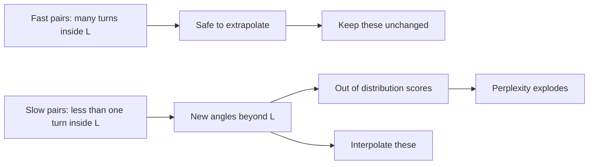

# Extending Context: Position Interpolation, NTK-Aware Scaling, YaRN and Llama 3 Scaling

## Introduction

Pretraining on very long sequences is expensive: attention cost grows with the square of the length, and long documents are rare. So nearly every long-context model is made in two steps. First pretrain at a moderate length (4K or 8K tokens), then **extend** the context to 32K, 128K or more with a short extra phase. The [RoPE theta page](./5-llm-rope-theta.mdx) covered one way to do that: raise the base and continue pretraining (ABF). This page covers the other family: **rescale the RoPE frequencies** so that the long context looks, to the model, like the short one it was trained on.

These methods are what the `rope_scaling` block in config.json describes. You will learn:

- **Position Interpolation (PI)**: squeeze positions by a factor $s$ (`"rope_type": "linear"`),
- **NTK-aware scaling**: change the base instead, so fast pairs stay untouched, and its **dynamic** variant (`"dynamic"`),
- **YaRN**: interpolate only the slow pairs, leave the fast pairs alone, and add an attention temperature (`"yarn"`),
- **Llama 3 scaling**: a wavelength-based piecewise version used by Llama 3.1 and later (`"llama3"`),
- **LongRoPE**: searched per-pair factors (`"longrope"`, Phi-3).

For each one we derive the formula, implement it in a few lines, and verify it against `transformers`' `ROPE_INIT_FUNCTIONS`. Then we look at the configs of real models and at how to switch these methods on in Hugging Face, vLLM and llama.cpp.

## The Problem: Unseen Angles

Recall that pair $i$ of a query or key at position $t$ is rotated by $t\theta_i$, with $\theta_i = b^{-2i/d}$. During pretraining at length $L$, pair $i$ only sees angles in $[0, L\theta_i]$.

- For fast pairs, $L\theta_i$ is many full turns. Every angle on the circle has been seen many times, so longer inputs bring nothing new.
- For slow pairs, $L\theta_i < 2\pi$. The model has only seen an arc. Feed it a longer input and these pairs produce angles it has never seen, which is out of distribution for every layer.

For Llama 2 ($b = 10{,}000$, $d = 128$, $L = 4{,}096$) the slowest pair reaches only 0.473 radians in training. At 32,768 tokens it would reach 3.78 radians, eight times further around the circle than anything the model saw. Chen et al. (2023) showed that the attention scores of LLaMA models can then become catastrophically large just beyond the trained length, and perplexity explodes.



All methods on this page agree on the goal: **keep the largest angle of the slowest pairs within the trained range**. They differ in what they do to the other pairs.

## Position Interpolation (PI)

Chen et al. at Meta ("Extending Context Window of Large Language Models via Position Interpolation", June 2023), and concurrently kaiokendev in the open-source SuperHOT models, proposed the simplest possible fix. To extend from $L$ to $L' = sL$, divide every position by $s$:

$$
f'(x, t) = f\!\left(x, \frac{t}{s}\right) \quad\Longleftrightarrow\quad \theta_i' = \frac{\theta_i}{s} \ \text{ for every pair } i.
$$

Positions $0, 1, \dots, sL - 1$ become $0, 1/s, \dots, L - 1/s$, all inside the trained range. Instead of extrapolating to new angles, the model interpolates between angles it knows.

The paper backs this with a bound: under their assumptions, the attention score as a function of (fractional) position is smooth enough that interpolated values stay close to trained ones, and the interpolation error bound is at least about 600 times smaller than the extrapolation bound for LLaMA 7B. In practice, PI extended LLaMA models from 2,048 to 32,768 tokens with about 1,000 steps of fine-tuning on the Pile.

**The cost.** PI slows every pair by $s$, including the fastest ones. Pair 0 used to turn 1 radian per token; with $s = 8$ it turns 0.125 radians, so adjacent tokens now differ by an angle the model associated with "8 tokens apart" on its fastest channel. Nearby tokens become harder to distinguish. The YaRN authors argue that this loss of high-frequency information is why PI tends to degrade past about $s = 8$ even with fine-tuning. Gemma 3 uses this method (`"rope_type": "linear", "factor": 8.0`) for its global layers, on top of a raised base.

## NTK-Aware Scaling and Dynamic NTK

In June 2023, a Reddit post by bloc97 on r/LocalLLaMA proposed "NTK-aware" scaling, named after Neural Tangent Kernel results on how networks learn high-frequency features. Instead of dividing all frequencies by $s$, **change the base** so that the fastest pair is untouched and the slowest pair is slowed by exactly $s$:

$$
b' = b \cdot s^{\,d/(d-2)}, \qquad \theta_i' = b'^{\,-2i/d} = \theta_i \cdot s^{-2i/(d-2)} .
$$

Check the endpoints: for $i = 0$, $\theta_0' = \theta_0$; for $i = d/2 - 1$, the exponent is $-(d-2)/(d-2) = -1$, so $\theta'_{d/2-1} = \theta_{d/2-1}/s$, exactly the PI factor. In between, the slowdown grows geometrically. The interpolation "pressure" is spread across pairs, with most of it on the slow pairs that need it.

This is the same move as ABF (raising `rope_theta`), seen from a different angle: Code Llama's base of 1,000,000 is, in the YaRN paper's words, "NTK-aware" scaling done by hand. NTK-aware scaling worked surprisingly well **without any fine-tuning**, which made it popular for local inference. Its weakness: some middle pairs still extrapolate a little, and the best base for a given target length has to be found empirically, which is why the YaRN authors note the effective scale often has to be set higher than the target.

**Dynamic NTK** (emozilla, Reddit, 2023) recomputes the base at every forward pass from the current sequence length, so short inputs run with the original frequencies and only long inputs get scaled. The `transformers` version (`"rope_type": "dynamic"`) uses

$$
b' = b\left(\frac{s \cdot \ell}{L} - (s - 1)\right)^{d/(d-2)}, \qquad \ell = \max(\text{current length}, L),
$$

which equals $b$ at $\ell = L$ and $b \cdot s^{d/(d-2)}$ at $\ell = sL$. The catch: the frequencies change as the sequence grows, so keys cached early in a long generation were rotated with a different base than later ones. Serving engines that cache keys therefore mostly prefer static methods.

## YaRN: Interpolate by Parts, Then Adjust the Temperature

Peng, Quesnelle, Fan and Shippole ("YaRN: Efficient Context Window Extension of Large Language Models", August 2023) combined two ideas.

**NTK-by-parts.** Think in wavelengths. Let $r_i = L/\lambda_i = L\theta_i/2\pi$ be the number of turns pair $i$ makes in the original context. Pick two thresholds, $\alpha$ and $\beta$ (the paper recommends $\alpha = 1$, $\beta = 32$ for Llama models):

- pairs with $r_i > \beta$ (many turns) are left unchanged: they encode only relative position and are safe,
- pairs with $r_i < \alpha$ (less than a turn) are interpolated exactly like PI: divided by $s$,
- pairs in between are blended with a ramp $\gamma_i \in [0, 1]$.

$$
\theta_i' = (1 - \gamma_i)\,\frac{\theta_i}{s} + \gamma_i\,\theta_i .
$$

The paper writes the ramp as linear in $r_i$. The reference implementation, and `transformers`, compute the two pair indices where $r_i = \beta$ and $r_i = \alpha$ (the functions `find_correction_dim` and `find_correction_range`) and ramp linearly over pair index between them, which is linear in $\log r_i$. The code below follows the implementation, since that is what real checkpoints use. The `beta_fast` and `beta_slow` fields in config.json are these two thresholds, 32 and 1.

**Attention temperature.** Interpolation makes attention distributions over a longer context slightly flatter (higher entropy). YaRN compensates by scaling the logits by $1/t$, with an empirical fit on LLaMA models:

$$
\sqrt{1/t} = 0.1 \ln s + 1 .
$$

It is implemented without touching the attention code: multiply both the cosine and the sine tables by $\sqrt{1/t}$, which scales $q$ and $k$ and therefore their product by $1/t$. In `transformers` this is the `attention_factor` returned with the frequencies (1.2079 for $s = 8$; 1.1386 for $s = 4$).

YaRN reached 64K and 128K contexts on Llama 2 with 400 fine-tuning steps (and, by the paper's count, about 10 times fewer tokens and 2.5 times fewer steps than earlier methods). It is now the most widely used scaling method in open models: DeepSeek-V3 (factor 40 from 4,096), gpt-oss (factor 32 from 4,096), and Qwen2.5 and Qwen3 (factor 4 from 32,768, recommended in their READMEs).

## Llama 3 Scaling

Meta's Llama 3.1 introduced a piecewise rule defined directly on wavelengths, with four parameters: `factor` $s = 8$, `low_freq_factor` $= 1$, `high_freq_factor` $= 4$, and `original_max_position_embeddings` $L = 8{,}192$. Define two wavelength thresholds,

$$
\lambda_{\mathrm{high}} = \frac{L}{\text{high\_freq\_factor}} = 2{,}048, \qquad
\lambda_{\mathrm{low}} = \frac{L}{\text{low\_freq\_factor}} = 8{,}192 .
$$

- If $\lambda_i < \lambda_{\mathrm{high}}$ (more than 4 turns in 8K): keep $\theta_i$.
- If $\lambda_i > \lambda_{\mathrm{low}}$ (less than 1 turn in 8K): use $\theta_i / s$.
- Otherwise blend with $\mu_i = \dfrac{L/\lambda_i - \text{low\_freq\_factor}}{\text{high\_freq\_factor} - \text{low\_freq\_factor}}$: $\theta_i' = (1 - \mu_i)\,\theta_i/s + \mu_i\,\theta_i$.

Since $L/\lambda_i = r_i$, this is NTK-by-parts with $\alpha = 1$ and $\beta = 4$, a ramp linear in $r_i$, and no temperature. Llama 3.1 applies it on top of the raised base of 500,000 and long-context continued pretraining. Llama 3.2 1B uses factor 32, and Llama 4 Scout uses factor 16 with `high_freq_factor` 1 (a hard switch at 8,192-token wavelength) in its RoPE layers.

## All Methods in Code, Checked Against transformers

The script implements PI, NTK-aware, YaRN and Llama 3 scaling for a Llama 2-like head ($d = 128$, $b = 10{,}000$, 4K to 32K), compares three of them with the `transformers` implementations, then prints how much each method slows each pair.

```python
import math
import torch
from transformers import LlamaConfig
from transformers.modeling_rope_utils import ROPE_INIT_FUNCTIONS

D, BASE, L_ORIG, S = 128, 10_000.0, 4_096, 8.0       # Llama 2-like head, extend 4K -> 32K
i = torch.arange(0, D, 2, dtype=torch.float64)          # 0, 2, ..., D-2
theta = BASE ** (-i / D)                                # original frequencies, (D/2,)

def pi_freqs():                                         # Position Interpolation: positions / s
    return theta / S

def ntk_aware_freqs():                                  # change the base: b' = b * s^(D/(D-2))
    return (BASE * S ** (D / (D - 2))) ** (-i / D)

def yarn_freqs(beta_fast=32.0, beta_slow=1.0):  # NTK-by-parts + temperature (Peng et al. 2023)
    # Pair index at which a pair makes exactly n rotations over the original context:
    # L_ORIG * BASE^(-2j/D) / (2 pi) = n  ->  j = D * ln(L_ORIG / (2 pi n)) / (2 ln BASE)
    def pair_at(n):
        return D * math.log(L_ORIG / (2 * math.pi * n)) / (2 * math.log(BASE))
    lo, hi = pair_at(beta_fast), pair_at(beta_slow)    # pairs with > 32 turns keep theta, < 1 turn get theta/s
    ramp = ((torch.arange(D // 2, dtype=torch.float64) - lo) / (hi - lo)).clamp(0, 1)
    freqs = ramp * theta / S + (1 - ramp) * theta      # blend between interpolation and the original
    attn = 0.1 * math.log(S) + 1                       # applied to cos and sin, i.e. to q and k
    return freqs, attn

def llama3_freqs(factor=S, low=1.0, high=4.0, old=L_ORIG):
    wl = 2 * math.pi / theta
    smooth = (old / wl - low) / (high - low)
    out = torch.where(wl > old / low, theta / factor, theta)
    mid = (wl >= old / high) & (wl <= old / low)
    return torch.where(mid, (1 - smooth) * theta / factor + smooth * theta, out)

def hf(rope_parameters):
    cfg = LlamaConfig(hidden_size=D * 4, num_attention_heads=4, max_position_embeddings=int(L_ORIG * S),
                      rope_parameters={"rope_theta": BASE, **rope_parameters})
    inv, attn = ROPE_INIT_FUNCTIONS[rope_parameters["rope_type"]](cfg)
    return inv.double(), attn

checks = {
    "linear (PI)": (pi_freqs(), hf({"rope_type": "linear", "factor": S})[0]),
    "yarn":        (yarn_freqs()[0], hf({"rope_type": "yarn", "factor": S,
                                         "original_max_position_embeddings": L_ORIG, "truncate": False})[0]),
    "llama3":      (llama3_freqs(), hf({"rope_type": "llama3", "factor": S, "low_freq_factor": 1.0,
                                        "high_freq_factor": 4.0, "original_max_position_embeddings": L_ORIG})[0]),
}
for name, (mine, ref) in checks.items():
    print(f"{name:12s} matches transformers: {torch.allclose(mine, ref, rtol=1e-5)}")
print("yarn attention factor:", round(yarn_freqs()[1], 4), "| transformers:",
      round(hf({"rope_type": "yarn", "factor": S, "original_max_position_embeddings": L_ORIG})[1], 4))

# How much each method slows down each pair (theta_new / theta_old), and max angle over the new context.
L_NEW = int(L_ORIG * S)
rows = {"PI": pi_freqs(), "NTK-aware": ntk_aware_freqs(), "YaRN": yarn_freqs()[0], "llama3": llama3_freqs()}
pairs = [0, 16, 32, 40, 48, 56, 63]
print("\npair i          ", "".join(f"{p:>9d}" for p in pairs))
print("orig wavelength ", "".join(f"{2 * math.pi / theta[p].item():>9,.0f}" for p in pairs))
for name, f in rows.items():
    print(f"{name:16s}", "".join(f"{(f[p] / theta[p]).item():>9.3f}" for p in pairs))
print("\nslowest pair: max angle seen in training = %.3f rad" % (L_ORIG * theta[-1].item()))
for name, f in rows.items():
    print(f"  {name:10s} max angle over {L_NEW:,} tokens = {L_NEW * f[-1].item():.3f} rad")
print(f"  {'no scaling':10s} max angle over {L_NEW:,} tokens = {L_NEW * theta[-1].item():.3f} rad")
```

```text
linear (PI)  matches transformers: True
yarn         matches transformers: True
llama3       matches transformers: True
yarn attention factor: 1.2079 | transformers: 1.2079

pair i                   0       16       32       40       48       56       63
orig wavelength          6       63      628    1,987    6,283   19,869   54,410
PI                   0.125    0.125    0.125    0.125    0.125    0.125    0.125
NTK-aware            1.000    0.590    0.348    0.267    0.205    0.157    0.125
YaRN                 1.000    1.000    0.598    0.308    0.125    0.125    0.125
llama3               1.000    1.000    1.000    0.435    0.125    0.125    0.125

slowest pair: max angle seen in training = 0.473 rad
  PI         max angle over 32,768 tokens = 0.473 rad
  NTK-aware  max angle over 32,768 tokens = 0.473 rad
  YaRN       max angle over 32,768 tokens = 0.473 rad
  llama3     max angle over 32,768 tokens = 0.473 rad
  no scaling max angle over 32,768 tokens = 3.784 rad
```

The first block confirms that the short formulas above are exactly what `transformers` computes (for YaRN we pass `"truncate": False`; by default the library rounds the two correction indices to integers, which changes the ramp slightly). The table is the heart of the page. Each row is $\theta_i'/\theta_i$:

- **PI** slows every pair by 8, even pair 0 with its 6-token wavelength.
- **NTK-aware** leaves pair 0 alone and slows the others smoothly, reaching 8 only at the slowest pair.
- **YaRN** leaves every pair with more than 32 turns untouched (pairs 0 to about 20 here), interpolates fully every pair with less than one turn (from about pair 45), and ramps in between.
- **llama3** (run here with $L = 4{,}096$, so its thresholds are wavelengths of 1,024 and 4,096 tokens) leaves pairs up to about 35 untouched, more than YaRN does, and fully interpolates only pairs with less than one turn.

The last block shows that all four methods achieve the shared goal: the slowest pair's largest angle over 32,768 tokens is 0.473 radians, the same as in training, while unscaled RoPE would push it to 3.78.

### A Hand-Checkable Example

Take pair $i = 40$ of the Llama 2 head: $\theta_{40} = 10000^{-80/128} = 10^{-2.5} = 0.003162$, so $\lambda = 1{,}987$ tokens and $r = 4096/1987 = 2.06$ turns in the original context.

- PI: $\theta' = 0.003162/8 = 0.000395$ (factor 0.125).
- NTK-aware: factor $8^{-80/126} = 8^{-0.635} = 0.267$.
- llama3 (with $L = 4{,}096$ in this example): $\mu = (2.06 - 1)/(4 - 1) = 0.354$, factor $= (1 - 0.354)/8 + 0.354 = 0.435$.

All three match the printed table.

## Configs in the Wild

The `rope_scaling` blocks below come from the models' config.json files (see the [RoPE theta page](./5-llm-rope-theta.mdx) for the download script). In `transformers` 5.x these fields are merged with `rope_theta` into `config.rope_parameters`.

```json
{
  "_comment": "unsloth/Meta-Llama-3.1-8B (a re-host of meta-llama/Llama-3.1-8B)",
  "rope_theta": 500000.0,
  "max_position_embeddings": 131072,
  "rope_scaling": {
    "factor": 8.0,
    "low_freq_factor": 1.0,
    "high_freq_factor": 4.0,
    "original_max_position_embeddings": 8192,
    "rope_type": "llama3"
  }
}
```

```json
{
  "_comment": "deepseek-ai/DeepSeek-V3",
  "rope_theta": 10000,
  "max_position_embeddings": 163840,
  "qk_rope_head_dim": 64,
  "rope_scaling": {
    "type": "yarn",
    "factor": 40,
    "original_max_position_embeddings": 4096,
    "beta_fast": 32,
    "beta_slow": 1,
    "mscale": 1.0,
    "mscale_all_dim": 1.0
  }
}
```

```json
{
  "_comment": "openai/gpt-oss-20b",
  "rope_theta": 150000,
  "max_position_embeddings": 131072,
  "rope_scaling": {
    "rope_type": "yarn",
    "factor": 32.0,
    "original_max_position_embeddings": 4096,
    "beta_fast": 32.0,
    "beta_slow": 1.0,
    "truncate": false
  }
}
```

Notes on these:

- **DeepSeek-V3** applies YaRN only to its 64-dimensional decoupled RoPE part (see [Multi-Head Latent Attention](../2-llm-attention/6-llm-mla.mdx)). The DeepSeek-V2 paper describes the same setup (scale 40, $\alpha = 1$, $\beta = 32$, target 160K) and a slightly different temperature, $\sqrt{t} = 0.0707 \ln s + 1$. With `mscale` and `mscale_all_dim` both 1, the `attention_factor` on cos and sin cancels to 1, and the `transformers` DeepSeek-V3 attention instead multiplies the softmax scale by $(0.1 \ln 40 + 1)^2$.
- **gpt-oss** combines a raised base (150,000) with YaRN factor 32 from a 4K original length.
- **Phi-3 mini 128K** uses `"type": "longrope"` with 48 `long_factor` and 48 `short_factor` values, one per pair of its 96-dimensional heads. LongRoPE (Ding et al., Microsoft, 2024) finds these non-uniform per-pair factors by evolutionary search, and its paper extends LLaMA 2 and Mistral to 2,048K tokens. `transformers` uses `short_factor` up to the original length and `long_factor` beyond it, with an attention factor of $\sqrt{1 + \ln s / \ln L}$.
- **Qwen2.5 and Qwen3** ship with no scaling and ask you to add YaRN only when you need long inputs. Their READMEs warn that open-source frameworks implement static YaRN, which slightly hurts short-text quality, so a smaller `factor` (2.0 for 64K) is better if your inputs are shorter.

## Worked Scenario: Running Qwen3 at 128K

Qwen3-8B is trained natively at 32,768 tokens. To serve 131,072-token inputs, enable YaRN with factor 4. In `transformers` 5.x, pass a complete `rope_parameters` dictionary when loading the config:

```python
from transformers import AutoConfig

cfg = AutoConfig.from_pretrained("Qwen/Qwen3-8B")
print(cfg.rope_parameters, cfg.max_position_embeddings)

cfg_long = AutoConfig.from_pretrained(
    "Qwen/Qwen3-8B",
    rope_parameters={"rope_type": "yarn", "factor": 4.0,
                     "original_max_position_embeddings": 32768, "rope_theta": 1000000.0},
    max_position_embeddings=131072,
)
print(cfg_long.rope_parameters, cfg_long.max_position_embeddings)

# Old-style keyword: rope_theta is not carried over
cfg_old = AutoConfig.from_pretrained(
    "Qwen/Qwen3-8B",
    rope_scaling={"rope_type": "yarn", "factor": 4.0, "original_max_position_embeddings": 32768},
)
print("old-style kwarg ->", cfg_old.rope_parameters)
```

```text
{'rope_theta': 1000000, 'rope_type': 'default'} 40960
{'rope_type': 'yarn', 'factor': 4.0, 'original_max_position_embeddings': 32768, 'rope_theta': 1000000.0} 131072
old-style kwarg -> {'rope_type': 'yarn', 'factor': 4.0, 'original_max_position_embeddings': 32768, 'rope_theta': None}
```

Then pass `config=cfg_long` to `AutoModelForCausalLM.from_pretrained`. The third call is a trap worth knowing about: with `transformers` 5.21, passing the old `rope_scaling` keyword produced a `rope_parameters` dictionary with `rope_theta: None`, so always include `rope_theta` explicitly. Building the rotary module from `cfg_long` gives `rope_type == "yarn"` and `attention_scaling == 1.1386`, which is $0.1 \ln 4 + 1$.

For serving, the vLLM documentation (current releases) says the old `--rope-scaling` flag is no longer supported and uses `--hf-overrides` instead:

```bash
vllm serve Qwen/Qwen3-8B \
  --hf-overrides '{"rope_parameters": {"factor": 4.0, "original_max_position_embeddings": 32768, "rope_theta": 1000000, "rope_type": "yarn"}}' \
  --max-model-len 131072
```

With llama.cpp, the equivalent flags are:

```bash
llama-server -m qwen3-8b-q4_k_m.gguf -c 131072 \
  --rope-scaling yarn --rope-scale 4 --yarn-orig-ctx 32768
```

Whatever the engine, the context length you allocate (`--max-model-len`, `-c`) must equal the factor times the original length, and the KV cache for 128K tokens needs far more memory than for 32K (see [The KV Cache](../10-llm-inference/2-llm-kv-cache.mdx)).

## Choosing a Method

| Method | Fine-tuning needed | Changes fast pairs | Extra knobs | Typical use |
|---|---|---|---|---|
| PI (`linear`) | Yes, short (about 1,000 steps) | Yes, all pairs by $s$ | `factor` | Moderate factors; Gemma 3 global layers |
| NTK-aware (base change) | Optional; works zero-shot | No | Base or `factor` | Quick local extension; same idea as ABF |
| Dynamic NTK (`dynamic`) | No | No | `factor` | Zero-shot, unstable with KV cache |
| YaRN (`yarn`) | Short, or none for small $s$ | No | `factor`, `beta_fast`, `beta_slow`, mscale | DeepSeek-V3, gpt-oss, Qwen long-context mode |
| Llama 3 (`llama3`) | Used with long-context pretraining | No | `factor`, low and high freq factors | Llama 3.1, 3.2, 3.3, 4 |
| LongRoPE (`longrope`) | Yes, with progressive extension | Per pair | Searched factor lists | Phi-3 128K models |
| ABF (raise `rope_theta`) | Yes, continued pretraining | No | Base | Code Llama, Llama 2 Long, Qwen |

In practice, modern recipes stack these: raise the base during pretraining (ABF), continue pretraining on long data, and then add YaRN or Llama 3 scaling for the last 4x to 16x. Whatever you choose, scaling makes positions **valid**, but it does not teach the model to **use** them. Long-context data and evaluation with retrieval tasks, covered in [Long Context in Practice](./7-llm-long-context-evaluation.mdx), decide whether the extension works.

## Common Mistakes

- **Setting `factor` without `original_max_position_embeddings`.** YaRN and Llama 3 scaling are defined relative to the original training length; leaving it out (or using the new length) computes the wrong pair boundaries.
- **Stacking scaling on top of an already-scaled config.** Llama 3.1 already contains `llama3` scaling. Adding YaRN on top multiplies the slowdowns and breaks the model.
- **Enabling static YaRN for short inputs.** Static YaRN changes frequencies for every input. Qwen's model cards recommend adding it only when you need long contexts.
- **Using dynamic NTK with a cached prefix.** Keys rotated with one base and queries rotated with another break the relative property; prefer static methods for serving.
- **Forgetting the attention factor.** A hand-written YaRN without the $0.1 \ln s + 1$ factor on cos and sin underperforms the published method.
- **Treating `max_position_embeddings` as a guarantee.** It is the largest position the config allows, not proof of quality there. Measure.

## Summary

- Beyond the training length, slow RoPE pairs see unseen angles; every extension method keeps the slowest pair's maximum angle within the trained range.
- PI divides all frequencies by $s$; it is simple and proven but blurs fast pairs. NTK-aware scaling changes the base to $b s^{d/(d-2)}$ so fast pairs are untouched; dynamic NTK recomputes it per length.
- YaRN interpolates slow pairs, keeps fast pairs, ramps between them (`beta_fast` 32, `beta_slow` 1), and scales q and k by $0.1 \ln s + 1$; it powers DeepSeek-V3, gpt-oss and Qwen's long mode.
- Llama 3 scaling is a wavelength-based by-parts rule (factor 8, thresholds $L/4$ and $L$) used with a raised base and long-context pretraining.
- Configure these through `rope_parameters` in `transformers` 5.x, `--hf-overrides` in vLLM, and `--rope-scaling yarn` flags in llama.cpp.

## Further Reading

- [Extending Context Window of Large Language Models via Position Interpolation (Chen et al., 2023)](https://arxiv.org/abs/2306.15595): PI and its interpolation bound.
- [YaRN: Efficient Context Window Extension of Large Language Models (Peng et al., 2023)](https://arxiv.org/abs/2309.00071): NTK-aware, NTK-by-parts, dynamic scaling and YaRN in one paper.
- [LongRoPE: Extending LLM Context Window Beyond 2 Million Tokens (Ding et al., 2024)](https://arxiv.org/abs/2402.13753): searched non-uniform factors.
- [Effective Long-Context Scaling of Foundation Models (Xiong et al., 2023)](https://arxiv.org/abs/2309.16039): ABF compared with PI.
- [The Llama 3 Herd of Models (2024)](https://arxiv.org/abs/2407.21783): staged long-context pretraining for Llama 3.1.
- [Hugging Face RoPE utilities](https://github.com/huggingface/transformers/blob/main/src/transformers/modeling_rope_utils.py): reference implementations of every `rope_type`.
- [vLLM context extension guide](https://docs.vllm.ai/en/latest/features/context_extension/): `--hf-overrides` with `rope_parameters`.
- [Qwen3-8B model card](https://huggingface.co/Qwen/Qwen3-8B): YaRN settings for 131,072 tokens and the static-YaRN caveat.
