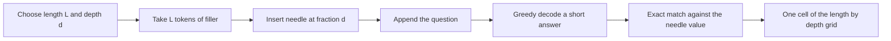

# Long Context in Practice: Needle Tests, RULER and Lost in the Middle

## Introduction

A config.json that says `"max_position_embeddings": 131072` tells you the largest position the model will accept. It does not tell you whether the model can find, use or reason over a fact that sits 100,000 tokens back. The previous pages showed how `rope_theta` and `rope_scaling` make long positions **valid**; this page is about measuring whether they are **useful**.

That gap is real and large. RULER (Hsieh et al., NVIDIA, 2024) evaluated 17 long-context models that claimed 32K tokens or more and found that only about half kept satisfactory performance at 32K, even though nearly all of them scored perfectly on the classic needle-in-a-haystack test. "Lost in the Middle" (Liu et al., 2023) showed that models use information at the start and end of a long prompt much better than information in the middle. NoLiMa (Modarressi et al., 2025) showed that when the question and the needle share no keywords, most models claiming 128K drop below half their short-context accuracy by 32K.

By the end of this page you will:

- know why perplexity is a weak test of long context,
- run a needle-in-a-haystack (NIAH) grid on CPU with a small open model and read the result,
- understand what RULER adds (multi-needle, multi-hop tracing, aggregation, QA) and how it defines **effective context length**,
- know the Lost-in-the-Middle U-curve and the harder 2024 and 2025 benchmarks (NoLiMa, HELMET),
- have a checklist for evaluating your own extended model.

## Why Perplexity Is Not Enough

The natural first test of an extended model is perplexity on long documents: if the loss stays flat out to 128K tokens, the model must be handling long context. Unfortunately, low perplexity is easy to get from local context alone. Most next-token predictions in natural text depend on the last few hundred tokens, so a model that effectively ignores everything further back can still have excellent long-document perplexity.

Two results from earlier in this section make this concrete:

- **ALiBi** keeps perplexity flat far beyond its training length, but its own authors attribute most of the gain to avoiding the early token curse rather than to using longer history ([Relative Positions, T5 Bias and ALiBi](./2-llm-relative-position-and-alibi.mdx)).
- **Men et al. (2024)** trained a model with RoPE base 500 that kept low perplexity at 128K tokens yet failed needle retrieval at about 1K tokens, and found that the Llama2-7B fine-tune with the best perplexity had very poor long-range retrieval ([RoPE Theta](./5-llm-rope-theta.mdx)).

Perplexity is still useful as a sanity check: if it explodes past the training length, positions are broken (the unscaled-RoPE failure from [Extending Context](./6-llm-context-extension.mdx)). For how to compute it correctly with a sliding window, see [Perplexity and Intrinsic Metrics](../12-llm-evaluation/1-llm-perplexity.mdx). But a flat curve is a necessary condition, not a sufficient one. To test long-range use, you need tasks whose answer is only available far away.

## Needle in a Haystack and Passkey Retrieval

The simplest such task hides one fact in a long distractor text and asks for it:

- **Passkey retrieval** (used by Mohtashami and Jaggi, 2023, in the Landmark Attention paper, and widely since): a random number is hidden in repetitive filler, and the model must repeat it.
- **Needle in a haystack** (Greg Kamradt, 2023): a sentence (the needle) is inserted into a long natural document (originally a collection of Paul Graham essays) at a chosen **depth** (0% is the start, 100% the end), and the model is asked about it. The test is run over a grid of context lengths and depths and shown as a heatmap.



NIAH is cheap, intuitive and good at catching broken position handling: a mis-configured `rope_scaling` or a wrong `original_max_position_embeddings` shows up immediately as a wall of failures past some length. Model reports use it widely; DeepSeek-V2 and Qwen2.5-Turbo, for example, report NIAH and passkey results up to 128K and 1M tokens respectively.

### Running a NIAH Grid on CPU

The script below runs a small grid with Qwen2.5-0.5B-Instruct, which is small enough for a laptop CPU (expect several minutes; the 16K row dominates). The haystack is RULER's "repeat" noise, the needle is a 7-digit number, and the answer is scored by exact match.

```python
import random
import torch
from transformers import AutoModelForCausalLM, AutoTokenizer

torch.manual_seed(0)
random.seed(0)
torch.set_num_threads(8)

MODEL = "Qwen/Qwen2.5-0.5B-Instruct"         # 0.5B parameters, runs on CPU
tok = AutoTokenizer.from_pretrained(MODEL)
model = AutoModelForCausalLM.from_pretrained(MODEL, dtype=torch.float32).eval()

FILLER = ("The grass is green. The sky is blue. The sun is yellow. "
          "Here we go. There and back again. ")          # repetitive haystack, as in early NIAH tests
QUESTION = "What is the special magic number mentioned in the text? Answer with the number only."

def build_prompt(n_tokens, depth, secret):
    needle = f" The special magic number is {secret}. "
    filler_ids = tok(FILLER * (n_tokens // 10 + 50))["input_ids"][:n_tokens]
    cut = int(len(filler_ids) * depth)
    haystack = tok.decode(filler_ids[:cut]) + needle + tok.decode(filler_ids[cut:])
    messages = [{"role": "user", "content": haystack + "\n\n" + QUESTION}]
    return tok.apply_chat_template(messages, tokenize=False, add_generation_prompt=True)

@torch.no_grad()
def ask(prompt):
    ids = tok(prompt, return_tensors="pt")
    out = model.generate(**ids, max_new_tokens=8, do_sample=False)
    return tok.decode(out[0, ids["input_ids"].shape[1]:], skip_special_tokens=True), ids["input_ids"].shape[1]

lengths = [1_000, 4_000, 16_000]
depths = [0.0, 0.25, 0.5, 0.75, 1.0]
print("length  " + "  ".join(f"d={d:<4}" for d in depths))
for n in lengths:
    row = []
    for d in depths:
        secret = str(random.randint(1_000_000, 9_999_999))
        answer, n_in = ask(build_prompt(n, d, secret))
        row.append("PASS  " if secret in answer else "fail  ")
    print(f"{n_in:>6}  " + "  ".join(row))
```

Output on a CPU-only machine (the first column is the actual prompt length in tokens, including the chat template and question; the run took about 30 minutes on a heavily loaded server):

```text
length  d=0.0   d=0.25  d=0.5   d=0.75  d=1.0 
  1061  PASS    PASS    PASS    PASS    PASS  
  4061  PASS    PASS    PASS    PASS    PASS  
 16061  PASS    PASS    PASS    PASS    PASS  
```

Every cell passes, at every depth, up to 16K tokens. A 0.5B-parameter model, far too small to answer most questions well, retrieves the needle perfectly. That is the first lesson of NIAH: a green heatmap is easy. It proves that the model's positions are configured correctly (Qwen2.5-0.5B-Instruct has `rope_theta` 1,000,000 and a 32K window) and that it can copy a salient, keyword-matched fact. It does not prove much more, which is why the harder benchmarks below exist. To make the grid informative for your own model, extend `lengths` toward its claimed limit, use 11 depths instead of 5, and repeat each cell with several random needles.

### The Limits of NIAH

The vanilla needle test is too easy to separate strong long-context models. The needle is lexically identical to the question ("special magic number"), it is the only out-of-place sentence in a repetitive haystack, and the model only has to copy it. Attention can solve that by matching keywords, which a handful of heads do well. Three ways to make it harder are to add distractors, to require combining information, and to remove the keyword overlap. RULER does the first two; NoLiMa does the third.

## RULER: Effective Context Length

RULER ("What's the Real Context Size of Your Long-Context Language Models?", Hsieh et al., COLM 2024) generates synthetic tasks at any length in four categories, 13 tasks in total:

| Category | Example tasks | What it tests |
|---|---|---|
| Retrieval | Single NIAH, multi-key NIAH (distractor needles), multi-value, multi-query | Finding the right needle among similar ones |
| Multi-hop tracing | Variable tracking: `X1 = 12345`, `X2 = X1`, ... which variables equal 12345? | Following chains of references, a proxy for coreference |
| Aggregation | Common words and frequent words extraction | Using information spread across the whole context, a proxy for summarization |
| Question answering | SQuAD and HotpotQA paragraphs hidden among distractor paragraphs | Answering real questions in long distracting context |

RULER's key contribution is a definition of **effective context length**: the largest tested length at which a model's average score over the 13 tasks stays above a fixed threshold, chosen as Llama2-7B's score at 4K tokens (85.6%). A few rows from the paper's main table:

| Model | Claimed length | Effective length (RULER) |
|---|---|---|
| Gemini-1.5-Pro | 1M | more than 128K |
| GPT-4 | 128K | 64K |
| Llama3.1 70B | 128K | 64K |
| Llama3.1 8B | 128K | 32K |
| Qwen2 72B | 128K | 32K |
| Mistral-v0.2 7B | 32K | 16K |

Almost every model passes vanilla NIAH at its claimed length and fails RULER's threshold well before it. The paper also notes that the top-ranked open models (Llama3.1, Qwen2, Command-R-plus) share larger sizes and larger RoPE base frequencies, which ties back to the [RoPE theta page](./5-llm-rope-theta.mdx). Model developers now report RULER routinely; the Qwen2.5 report, for instance, shows its 7B to 72B models with and without YaRN plus Dual Chunk Attention up to 128K.

You can feel the multi-key difficulty with the same small model. This variant hides several needles of the form "The special magic number for KEY is VALUE" and asks for one key:

```python
import random
import torch
from transformers import AutoModelForCausalLM, AutoTokenizer

torch.manual_seed(0)
random.seed(1)
torch.set_num_threads(8)

MODEL = "Qwen/Qwen2.5-0.5B-Instruct"
tok = AutoTokenizer.from_pretrained(MODEL)
model = AutoModelForCausalLM.from_pretrained(MODEL, dtype=torch.float32).eval()

FILLER = ("The grass is green. The sky is blue. The sun is yellow. "
          "Here we go. There and back again. ")
KEYS = ["apple", "river", "candle", "violin", "harbor", "pepper", "falcon", "marble"]

def build(n_tokens, n_needles, target):
    """RULER-style multi-key NIAH: several similar needles, ask for one of them."""
    values = {k: str(random.randint(1_000_000, 9_999_999)) for k in KEYS[:n_needles]}
    filler_ids = tok(FILLER * (n_tokens // 10 + 50))["input_ids"][:n_tokens]
    cuts = sorted(random.sample(range(len(filler_ids)), n_needles))
    parts, prev = [], 0
    for cut, (k, v) in zip(cuts, values.items()):
        parts.append(tok.decode(filler_ids[prev:cut]))
        parts.append(f" The special magic number for {k} is {v}. ")
        prev = cut
    parts.append(tok.decode(filler_ids[prev:]))
    q = f"What is the special magic number for {target}? Answer with the number only."
    msgs = [{"role": "user", "content": "".join(parts) + "\n\n" + q}]
    return tok.apply_chat_template(msgs, tokenize=False, add_generation_prompt=True), values[target]

@torch.no_grad()
def ask(prompt):
    ids = tok(prompt, return_tensors="pt")
    out = model.generate(**ids, max_new_tokens=8, do_sample=False)
    return tok.decode(out[0, ids["input_ids"].shape[1]:], skip_special_tokens=True)

for n_tokens in [1_000, 4_000]:
    for n_needles in [1, 4, 8]:
        hits = 0
        for trial in range(4):
            target = KEYS[trial % n_needles]
            prompt, answer = build(n_tokens, n_needles, target)
            hits += answer in ask(prompt)
        print(f"{n_tokens:>5} tokens, {n_needles} needles: {hits}/4 correct")
```

```text
 1000 tokens, 1 needles: 4/4 correct
 1000 tokens, 4 needles: 4/4 correct
 1000 tokens, 8 needles: 4/4 correct
 4000 tokens, 1 needles: 4/4 correct
 4000 tokens, 4 needles: 4/4 correct
 4000 tokens, 8 needles: 3/4 correct
```

The first error appears with eight similar needles at 4K tokens: once the haystack contains several sentences that all match "special magic number", the model must also bind the right key to the right value, and keyword matching alone no longer suffices. Four trials per cell is far too few for a reliable estimate (RULER uses hundreds of samples per task and length), so treat this as a demonstration of the trend, not a measurement. Scaling up the trials, lengths and needle counts is exactly how RULER turns a pass/fail toy into an effective-length curve.

## Lost in the Middle

Liu et al. (Stanford, 2023, "Lost in the Middle: How Language Models Use Long Contexts") ran two controlled tasks: multi-document question answering (the answer is in one of, for example, 20 retrieved Wikipedia passages, about 4K tokens in total) and synthetic key-value retrieval over JSON. They moved the relevant passage from the first position to the last and measured accuracy.

The result is a **U-shaped curve**: accuracy is highest when the relevant information is at the very beginning (primacy) or the very end (recency) of the context, and drops significantly in the middle. For GPT-3.5-Turbo on the 20-document task, accuracy with the answer in the middle fell below its closed-book accuracy of 56.1%, meaning that adding the right document in the middle of the prompt was worse than giving no documents at all. Extended-context versions of models were not better at using their context than their shorter siblings, and even base models without instruction tuning showed the curve.

Possible contributing causes discussed in the literature include training data in which important information tends to sit at the start or end, causal attention that gives early tokens more attention (the "attention sink" effect described in [Sliding Window, Sparse and Linear Attention](../5-llm-flash-attention/5-llm-sparse-and-linear-attention.mdx)), and recency bias from position encodings with long-term decay. Newer models trained with deliberately position-balanced long-context data have flattened the curve on easy tasks, but it reappears on harder ones.

**Practical consequences** for retrieval-augmented generation and long prompts:

- Put the instructions and the question at the end, after the documents, so the part the model must act on benefits from recency.
- Put the most relevant retrieved passages first or last, not in the middle; retrieve fewer, better passages rather than more.
- When you evaluate, sweep the position of the key information, as the NIAH depth axis does.

For prompt-construction patterns in applications, see the [AI Agents tutorial](/docs/ai/agents).

## Beyond Literal Matching: NoLiMa and HELMET

**NoLiMa** ("Long-Context Evaluation Beyond Literal Matching", Modarressi et al., 2025) builds needles and questions with minimal lexical overlap, so finding the needle requires a latent association rather than keyword matching (for instance, a question about a character who has been to a certain country, with the needle mentioning only a landmark in that country). Evaluating 13 models that claim at least 128K tokens, it found strong performance below 1K tokens but large drops with length: at 32K, 11 of the 13 models fell below 50% of their own short-context baseline, and even GPT-4o dropped from 99.3% to 69.7%. The authors attribute the decline to attention having a harder time locating relevant information in long contexts when there is no literal match to latch onto.

**HELMET** ("How to Evaluate Long-Context Language Models Effectively and Thoroughly", Yen et al., ICLR 2025) argues that synthetic tests and small task subsets give noisy, inconsistent rankings. It covers seven application-oriented categories (including retrieval-augmented generation, citation generation, re-ranking, long-document QA, summarization, many-shot in-context learning and synthetic recall) at controllable lengths up to 128K, with model-based scoring and few-shot prompts so that base models can be evaluated too. Across 59 models, it found that NIAH-style synthetic tasks do not reliably predict downstream performance, that categories correlate weakly with each other, and that open models lag closed ones most on tasks requiring full-context reasoning. It recommends its RAG tasks as a fast proxy during model development.

| Benchmark | Year | Main idea | What it catches that NIAH misses |
|---|---|---|---|
| Passkey / NIAH | 2023 | One needle, vary length and depth | Broken positions, gross failures |
| Lost in the Middle | 2023 | Move the key passage through real QA prompts | Position bias (U-curve) |
| RULER | 2024 | 13 synthetic tasks, effective length | Distractors, multi-hop, aggregation |
| HELMET | 2024 to 2025 | 7 application categories up to 128K | Real downstream use, reliable rankings |
| NoLiMa | 2025 | Needles without lexical overlap | Reliance on keyword matching |

## A Checklist for Evaluating an Extended Model

When you extend a model with a larger base, YaRN or Llama 3 scaling (or download one that claims a long context), evaluate it in this order:

1. **Short-context regression.** Re-run your normal benchmarks at 4K or less. Static scaling methods can cost some short-context quality, as the Qwen model cards warn.
2. **Perplexity sanity check** with a sliding window out to the target length. A blow-up means the configuration is wrong; a flat curve proves little.
3. **NIAH grid** at several lengths and depths. Anything less than near-perfect here usually means a configuration error (wrong factor, wrong original length, missing scaling at inference time).
4. **RULER** at the lengths you care about, and compute the effective length against a threshold that matters for your use case.
5. **Position sweep** on a task from your application (the Lost-in-the-Middle protocol): move the key document from first to last.
6. **A semantic, non-literal test** such as NoLiMa, or application-level suites such as HELMET, LongBench or your own long-document tasks.
7. **Cost and latency.** Prefill time and KV-cache memory grow with length (see [The Quadratic Cost of Attention](../2-llm-attention/7-llm-attention-complexity.mdx) and [The KV Cache](../10-llm-inference/2-llm-kv-cache.mdx)). Sometimes retrieval over a shorter context beats a long one on both quality and cost.

For a hands-on version of steps 2 to 4 with models you train yourself, see the [RoPE scaling project](../14-llm-projects/2-llm-project-rope-scaling.mdx).

## Common Mistakes

- **Equating claimed and effective length.** `max_position_embeddings` and model-card numbers are upper limits; RULER found most models fall below its threshold well before them.
- **Reporting only vanilla NIAH.** A green heatmap shows that positions work and copying works, nothing more. Add distractors, multi-hop and non-literal variants.
- **Using the chat model without its chat template.** Instruction-tuned models often fail NIAH when the prompt is not wrapped in the template, which looks like a context failure but is not.
- **Forgetting to enable scaling at inference.** Many Qwen checkpoints ship without `rope_scaling`; testing them at 128K without adding YaRN measures extrapolation, not the advertised capability.
- **Ignoring tokenization in length targets.** "16K tokens" depends on the tokenizer; build haystacks by token count, as the script does, not by characters.
- **Placing the question before a long document.** With very long inputs the question then sits far from where the answer is generated; putting it after the documents is usually the safer default.

## Summary

- Long positions being valid is not the same as long context being used; measure the latter directly.
- Perplexity can stay flat while a model only attends locally; treat it as a sanity check.
- NIAH and passkey tests vary length and needle depth and catch configuration errors, but are easy for modern models.
- RULER's 13 tasks (retrieval with distractors, variable tracking, aggregation, QA) define an effective context length; most models' effective length is well below their claimed length.
- Lost in the Middle shows a U-shaped position bias; NoLiMa shows large drops when needles do not lexically match the question; HELMET argues for application-level, multi-category evaluation.

## Further Reading

- [RULER: What's the Real Context Size of Your Long-Context Language Models? (Hsieh et al., 2024)](https://arxiv.org/abs/2404.06654) and its [GitHub repository](https://github.com/NVIDIA/RULER).
- [Lost in the Middle: How Language Models Use Long Contexts (Liu et al., 2023)](https://arxiv.org/abs/2307.03172): the U-shaped curve.
- [Needle in a Haystack test (Kamradt, GitHub)](https://github.com/gkamradt/LLMTest_NeedleInAHaystack): the original NIAH harness.
- [Landmark Attention: Random-Access Infinite Context Length for Transformers (Mohtashami and Jaggi, 2023)](https://arxiv.org/abs/2305.16300): an early use of passkey retrieval.
- [NoLiMa: Long-Context Evaluation Beyond Literal Matching (Modarressi et al., 2025)](https://arxiv.org/abs/2502.05167): non-lexical needles.
- [HELMET: How to Evaluate Long-Context Language Models Effectively and Thoroughly (Yen et al., 2024)](https://arxiv.org/abs/2410.02694): application-centric long-context benchmark.
- [Base of RoPE Bounds Context Length (Men et al., 2024)](https://arxiv.org/abs/2405.14591): why perplexity can hide superficial long context.
