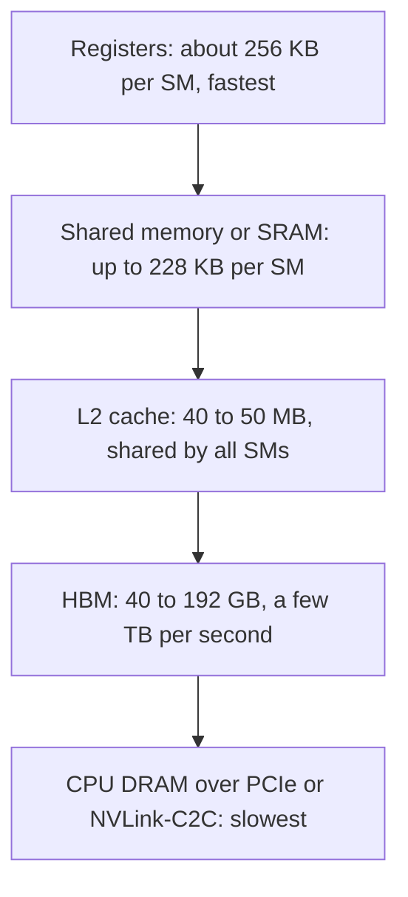

# GPU Memory Hierarchy: HBM, SRAM and Arithmetic Intensity

## Introduction

A modern data-center GPU can do about a quadrillion multiply-adds per second, yet a naive attention layer often runs at a small fraction of that speed. The arithmetic is not the problem. The problem is that the GPU spends most of its time waiting for numbers to arrive from memory, and attention, written the obvious way, moves an enormous number of them.

FlashAttention (Dao et al., 2022) is the best-known fix, but it only makes sense once you see the hardware the way its authors did: as a small amount of very fast memory next to the compute units and a large amount of slower memory further away. The whole trick of FlashAttention is to rearrange attention so it lives in the fast memory.

After this page you will be able to:

- name the levels of the GPU memory hierarchy and give rough sizes and bandwidths for A100, H100 and B200;
- compute the arithmetic intensity of an operation and place it on a roofline to decide whether it is compute-bound or memory-bound;
- count the bytes that standard attention reads and writes and show, with numbers, why it is memory-bound;
- explain why kernel fusion is the cure, and why fusing attention is harder than fusing an activation function.

We assume you know what attention computes. If not, read [Scaled Dot-Product Attention, Step by Step](../2-llm-attention/1-llm-scaled-dot-product-attention.mdx) and [The Quadratic Cost of Attention](../2-llm-attention/7-llm-attention-complexity.mdx) first.

## The GPU Memory Hierarchy

A GPU is a collection of streaming multiprocessors (SMs). Each SM has its own arithmetic units (CUDA cores for general math, Tensor Cores for matrix multiplication), its own register file, and a block of on-chip SRAM that programmers use as shared memory (it doubles as the L1 cache). All SMs share an L2 cache and, off the chip but in the same package, the high-bandwidth memory (HBM) that holds your model weights, activations and KV cache.



The higher levels are tiny and fast; the lower levels are huge and slow. A useful analogy is a kitchen. Registers are the cutting board, shared memory is the counter, the L2 cache is the pantry, and HBM is the supermarket across the street. A cook who walks to the supermarket for every onion will be slow no matter how fast they chop.

Here are the numbers for three generations. They come from the FlashAttention papers and NVIDIA's published specifications; treat the SRAM bandwidth figures as estimates, since NVIDIA does not publish a single official number.

| GPU | SMs | Shared memory per SM | L2 | HBM capacity | HBM bandwidth | Dense BF16 Tensor Core peak |
| --- | --- | --- | --- | --- | --- | --- |
| A100 SXM (Ampere, 2020) | 108 | 192 KB (L1 plus shared) | 40 MB | 40 or 80 GB | 1.5 to 2.0 TB/s | 312 TFLOP/s |
| H100 SXM (Hopper, 2022) | 132 | 228 KB | 50 MB | 80 GB | 3.35 TB/s | 989 TFLOP/s |
| B200 (Blackwell, 2024) | 148 | shared memory plus 256 KB tensor memory | not listed here | 180 to 192 GB | about 8 TB/s | about 2,250 TFLOP/s |

The FlashAttention paper estimates the aggregate SRAM bandwidth of an A100 at around 19 TB/s, roughly ten times its HBM bandwidth, while the SRAM is thousands of times smaller (about 20 MB in total across all SMs versus 40 to 80 GB). The FlashAttention-3 paper lists 31 TB/s of aggregate shared-memory bandwidth for the H100. Blackwell adds a new level, tensor memory (TMEM), a 256 KB per-SM store that the Tensor Cores write their results into directly; we return to it in [FlashAttention-2, FlashAttention-3 and FlashAttention-4](./3-llm-flash-attention-2-3.mdx).

Two trends matter for the rest of this section:

1. **Compute grows faster than bandwidth.** From A100 to B200, BF16 Tensor Core throughput grew about 7x, while HBM bandwidth grew about 4x. Every generation makes memory traffic relatively more expensive.
2. **Not all compute grows.** The special-function unit that evaluates `exp` did not get faster from Hopper to Blackwell (16 operations per clock per SM on both, according to the FlashAttention-4 paper), even though matrix throughput doubled. Softmax is full of `exp`, which is why the newest FlashAttention versions work hard to avoid or emulate it.

## Kernels and the Round Trip Through HBM

Code on a GPU runs as a sequence of **kernels**. A kernel is launched over a grid of thread blocks; each thread block runs on one SM, loads its inputs from HBM into registers and shared memory, computes, and writes its outputs back to HBM. When the kernel finishes, everything in registers and shared memory is gone. The next kernel has to read its inputs from HBM again.

So a chain of PyTorch operations such as

```python
y = torch.softmax(x * scale + mask, dim=-1)
```

can become several kernels in eager mode, each of which reads a full tensor from HBM and writes a full tensor back. The arithmetic per element is tiny (a multiply, an add, an exponential), so the GPU spends its time moving data.

The standard cure is **kernel fusion**: do several operations in one kernel so the intermediate values stay in registers and never visit HBM. Compilers such as `torch.compile` fuse elementwise chains automatically. Attention is harder to fuse for two reasons:

- the softmax is a reduction over an entire row of length $N$, so a thread block cannot finish a row until it has seen every key;
- in training, the backward pass needs the attention probabilities, so a naive implementation writes them to HBM anyway to save them for later.

FlashAttention solves the first with online softmax ([Online Softmax and Tiling](./1-llm-online-softmax.mdx)) and the second with recomputation ([FlashAttention Explained](./2-llm-flash-attention.mdx)).

## Arithmetic Intensity and the Roofline Model

To decide whether an operation is limited by compute or by memory, compare how much work it does with how much data it moves.

**Arithmetic intensity** is the number of floating-point operations per byte moved between HBM and the chip:

$$
I = \frac{\text{FLOPs}}{\text{bytes read} + \text{bytes written}}
$$

A GPU with peak throughput $\pi$ (FLOP/s) and memory bandwidth $\beta$ (byte/s) needs at least $\text{FLOPs}/\pi$ seconds to do the math and at least $\text{bytes}/\beta$ seconds to move the data. If the two overlap perfectly, the runtime is the larger of the two, so the attainable throughput is

$$
\text{attainable FLOP/s} = \min\left(\pi,\; \beta \cdot I\right).
$$

Plotted against $I$ on log axes this is a sloped line that meets a flat ceiling, which looks like a roof; hence the name **roofline model** (Williams, Waterman and Patterson, 2009). The corner sits at the **ridge point**

$$
I^{\ast} = \frac{\pi}{\beta}.
$$

An operation with $I \lt I^{\ast}$ is **memory-bound**: buying more FLOP/s will not help. An operation with $I \gt I^{\ast}$ is **compute-bound**.

For the H100, $I^{\ast} = 989 \times 10^{12} / 3.35 \times 10^{12} \approx 295$ FLOP/byte. An operation has to do about 300 floating-point operations for every byte it touches before the Tensor Cores become the bottleneck.

### Intensity of Common Operations

**Matrix multiplication.** For $C = AB$ with $A \in \mathbb{R}^{m \times k}$ and $B \in \mathbb{R}^{k \times n}$, each output element is a dot product of length $k$, so the FLOP count is $2mkn$ (one multiply and one add per term). With $e$ bytes per element, the minimum traffic is $e(mk + kn + mn)$. For square matrices of size $n$ in BF16 ($e = 2$):

$$
I_{\text{matmul}} = \frac{2n^3}{2 \cdot 3n^2} = \frac{n}{3}.
$$

At $n = 4096$ that is about 1,365 FLOP/byte, comfortably compute-bound on every GPU in the table.

**Elementwise operations and reductions.** Adding a constant, an activation function, dropout or a softmax does a handful of FLOPs per element and must read and write every element. A softmax does roughly five operations per element (max, subtract, exponential, sum, divide) and moves $2e$ bytes per element, so

$$
I_{\text{softmax}} \approx \frac{5}{2 \cdot 2} = 1.25 \;\text{FLOP/byte},
$$

more than 200 times below the H100 ridge point. These operations run at memory speed, period.

You can see the same split on a CPU, which has the same kind of hierarchy (caches instead of SRAM, DRAM instead of HBM). The script below measures a matrix multiplication and an elementwise add on arrays much larger than the caches:

```python
import time
import torch

torch.manual_seed(0)
torch.set_num_threads(2)

def bench(fn, repeat=10):
    fn()                                   # warm-up
    t0 = time.perf_counter()
    for _ in range(repeat):
        fn()
    return (time.perf_counter() - t0) / repeat

n = 2048
A, B = torch.randn(n, n), torch.randn(n, n)
X = torch.randn(4096, 4096)                # 64 MiB, far bigger than the CPU caches

t_mm = bench(lambda: A @ B)
t_add = bench(lambda: X + 1.0)
mm_flops, mm_bytes = 2 * n**3, 3 * n * n * 4
add_flops, add_bytes = X.numel(), 2 * X.numel() * 4
print(f"matmul : AI={mm_flops / mm_bytes:7.1f} FLOP/B  {mm_flops / t_mm / 1e9:7.1f} GFLOP/s"
      f"  {mm_bytes / t_mm / 1e9:6.1f} GB/s")
print(f"x + 1  : AI={add_flops / add_bytes:7.3f} FLOP/B  {add_flops / t_add / 1e9:7.1f} GFLOP/s"
      f"  {add_bytes / t_add / 1e9:6.1f} GB/s")
```

On a heavily loaded 16-core AMD Ryzen laptop CPU, limited to two threads, it printed:

```text
matmul : AI=  341.3 FLOP/B    109.2 GFLOP/s     0.3 GB/s
x + 1  : AI=  0.125 FLOP/B      0.9 GFLOP/s     7.4 GB/s
```

The matrix multiplication reaches about 100 GFLOP/s while barely using the memory bus. The add uses the memory bus hard and achieves about 1 GFLOP/s, over a hundred times slower per FLOP. Your numbers will differ, but the gap will not close: the add is memory-bound by construction.

## Why Standard Attention Is Memory-Bound

Take one attention head with sequence length $N$ and head dimension $d$, inputs $Q, K, V \in \mathbb{R}^{N \times d}$. The textbook implementation, which the FlashAttention paper calls Algorithm 0, runs three steps, each a separate kernel:

1. $S = QK^\top / \sqrt{d}$: read $Q$ and $K$, write $S \in \mathbb{R}^{N \times N}$.
2. $P = \mathrm{softmax}(S)$: read $S$, write $P \in \mathbb{R}^{N \times N}$.
3. $O = PV$: read $P$ and $V$, write $O \in \mathbb{R}^{N \times d}$.

Count the elements moved, assuming each matrix multiplication reads its inputs exactly once (the best case):

| Step | Reads | Writes | FLOPs |
| --- | --- | --- | --- |
| $S = QK^\top$ | $2Nd$ | $N^2$ | $2N^2 d$ |
| $P = \mathrm{softmax}(S)$ | $N^2$ | $N^2$ | about $5N^2$ |
| $O = PV$ | $N^2 + Nd$ | $Nd$ | $2N^2 d$ |
| Total | $3Nd + 2N^2$ | $Nd + 2N^2$ | about $4N^2 d$ |

The total HBM traffic is $4Nd + 4N^2$ elements. Because $N \gg d$ in practice (GPT-2 uses $N = 1024$, $d = 64$; Llama 3.1 8B uses $d = 128$ with contexts up to 131,072), the $4N^2$ term dominates. The paper writes this as $\Theta(Nd + N^2)$ HBM accesses.

Now look at the arithmetic intensity of each step in BF16:

- **The first matmul** does $2N^2 d$ FLOPs and moves about $2N^2$ bytes (the $S$ write dominates), so $I \approx d$. With $d = 128$, $I \approx 128$, which is below the H100 ridge of 295. Even the matrix multiplication is memory-bound, because its output is so much larger than its inputs.
- **The softmax** sits at about 1.25 FLOP/byte.
- **The second matmul** is symmetric to the first: it reads $N^2$ elements of $P$ to produce only $Nd$ outputs.

Real eager PyTorch is worse than this best case. Scaling, masking and dropout are often separate kernels, each another full read and write of an $N \times N$ matrix. And in training, $P$ (or $S$) must stay in HBM until the backward pass, which reads it again.

:::note
Notice what is *not* the problem. The $4N^2 d$ FLOPs are the same for every exact attention algorithm, including FlashAttention. What FlashAttention removes is the $N^2$ term in the memory traffic and in the memory footprint.
:::

### A Fused Kernel in the Ideal Case

Suppose a single kernel could read $Q$, $K$ and $V$ once and write $O$ once, keeping everything else on chip. The traffic would be $4Nd$ elements and the intensity

$$
I_{\text{fused}} = \frac{4N^2 d}{2 \cdot 4Nd} = \frac{N}{2},
$$

which grows with sequence length. At $N = 8192$ that is about 4,000 FLOP/byte, far into compute-bound territory. FlashAttention does not quite reach this ideal (it has to re-read some blocks; the next pages count exactly how many), but it gets close enough that attention becomes limited by Tensor Core throughput and by the `exp` unit instead of by HBM.

## Worked Example: One Layer of a Llama-3-8B-Sized Model

Let us put real numbers on all of this. Take the attention shapes of Llama 3.1 8B (32 query heads, head dimension 128), batch size 1, sequence length 8,192, BF16, on an H100. The script estimates each step's time as the maximum of its compute time and its memory time:

```python
# Roofline estimates for the three steps of standard attention vs a fused kernel.
GPUS = {                     # dense BF16 tensor-core peak (FLOP/s), HBM bandwidth (byte/s)
    "A100 SXM": (312e12, 2.0e12),
    "H100 SXM": (989e12, 3.35e12),
    "B200":     (2250e12, 8.0e12),
}
for name, (peak, bw) in GPUS.items():
    print(f"{name:9s} ridge point = {peak / bw:6.1f} FLOP/byte")

def step(name, flops, bytes_, peak, bw):
    t_compute, t_memory = flops / peak, bytes_ / bw
    bound = "compute" if t_compute > t_memory else "memory"
    print(f"  {name:24s} AI={flops / bytes_:7.1f}  compute={t_compute*1e3:6.3f} ms"
          f"  memory={t_memory*1e3:6.3f} ms  -> {bound}-bound")
    return max(t_compute, t_memory)

# One attention layer of a Llama-3-8B-sized model: 32 query heads, head_dim 128,
# batch 1, sequence length 8192, BF16 (2 bytes per element).
B, H, N, d, e = 1, 32, 8192, 128, 2
BH = B * H
peak, bw = GPUS["H100 SXM"]
print(f"\nStandard attention, B={B} H={H} N={N} d={d} on H100:")
t = 0
t += step("S = Q K^T  (write S)", BH * 2 * N * N * d, BH * e * (2 * N * d + N * N), peak, bw)
t += step("P = softmax(S)", BH * 5 * N * N, BH * e * (2 * N * N), peak, bw)
t += step("O = P V    (read P)", BH * 2 * N * N * d, BH * e * (N * N + 2 * N * d), peak, bw)
print(f"  total ~ {t*1e3:.2f} ms, N x N scratch = {BH * N * N * e / 2**30:.1f} GiB per matrix")

print(f"\nFused attention (reads Q, K, V once, writes O once):")
flops = BH * (4 * N * N * d + 5 * N * N)
t_fused = step("fused kernel", flops, BH * e * 4 * N * d, peak, bw)
print(f"  speedup bound vs standard ~ {t / t_fused:.1f}x")
```

```text
A100 SXM  ridge point =  156.0 FLOP/byte
H100 SXM  ridge point =  295.2 FLOP/byte
B200      ridge point =  281.2 FLOP/byte

Standard attention, B=1 H=32 N=8192 d=128 on H100:
  S = Q K^T  (write S)     AI=  124.1  compute= 0.556 ms  memory= 1.322 ms  -> memory-bound
  P = softmax(S)           AI=    1.2  compute= 0.011 ms  memory= 2.564 ms  -> memory-bound
  O = P V    (read P)      AI=  124.1  compute= 0.556 ms  memory= 1.322 ms  -> memory-bound
  total ~ 5.21 ms, N x N scratch = 4.0 GiB per matrix

Fused attention (reads Q, K, V once, writes O once):
  fused kernel             AI= 4136.0  compute= 1.123 ms  memory= 0.080 ms  -> compute-bound
  speedup bound vs standard ~ 4.6x
```

Read the output carefully:

- All three steps of standard attention are memory-bound. The softmax alone spends about 2.6 ms moving 8 GiB, while its arithmetic would take 11 microseconds at Tensor Core speed (and softmax does not even run on Tensor Cores, so the real compute time is longer, but still small).
- Each $N \times N$ matrix takes 4 GiB for one layer of one sequence. With 32 layers and the need to keep $P$ for the backward pass, training at this length the naive way runs out of memory on an 80 GB GPU.
- The fused version is compute-bound and about 4.6x faster in this idealized model. That number is a bound, not a measurement: it ignores the extra `exp` work, the re-reads of $K$ and $V$, and launch overheads. But it is in line with what the paper measured.

The FlashAttention paper reports exactly this kind of comparison for GPT-2 medium (sequence length 1024, head dimension 64, 16 heads, batch size 64) on an A100, forward plus backward:

| | Standard attention | FlashAttention |
| --- | --- | --- |
| GFLOPs | 66.6 | 75.2 |
| HBM reads and writes | 40.3 GB | 4.4 GB |
| Runtime | 41.7 ms | 7.3 ms |

FlashAttention does *more* arithmetic (it recomputes the attention matrix in the backward pass) and is still 5.7x faster, because it moves about 9x less data. That table is the single best summary of why IO-awareness matters.

## Common Mistakes

- **Optimizing FLOPs for a memory-bound operation.** Approximate attention methods that cut FLOPs often failed to deliver wall-clock speedups because they did not reduce memory traffic. Always ask which side of the ridge point you are on.
- **Assuming a matrix multiplication is always compute-bound.** $QK^\top$ has a tiny inner dimension ($d$) and a huge output ($N^2$), so its intensity is only about $d$ FLOP/byte in BF16.
- **Quoting sparse or "with sparsity" FLOP/s.** Vendor peak numbers are often given for 2:4 structured sparsity, which doubles them. Use the dense number for attention.
- **Forgetting the backward pass.** In training, intermediate $N \times N$ tensors are saved for backward, which costs memory and another round of reads. Inference-only analyses miss half the problem.
- **Treating `exp` as free.** On Hopper and Blackwell, the special-function unit is hundreds of times slower than the Tensor Cores. Once memory traffic is fixed, softmax arithmetic becomes the next bottleneck.

## Summary

- GPUs have a small, fast on-chip SRAM (shared memory, about 200 KB per SM) and a large, slow HBM (tens to hundreds of GB at a few TB/s); SRAM is roughly an order of magnitude faster.
- Every kernel reads its inputs from HBM and writes its outputs back; kernel fusion keeps intermediates on chip.
- Arithmetic intensity (FLOPs per byte) compared with the ridge point $\pi / \beta$ tells you whether an operation is memory-bound or compute-bound; the H100 ridge is about 295 FLOP/byte.
- Standard attention moves $\Theta(Nd + N^2)$ elements, and all three of its steps are memory-bound; its $N \times N$ intermediates also dominate memory use.
- A fused attention kernel has intensity of about $N/2$ FLOP/byte and becomes compute-bound; that is the opportunity FlashAttention exploits.

## Further Reading

- [FlashAttention: Fast and Memory-Efficient Exact Attention with IO-Awareness](https://arxiv.org/abs/2205.14135) (Dao, Fu, Ermon, Rudra, Re, 2022): section 2 is a compact introduction to the GPU memory hierarchy and the standard attention algorithm.
- [FlashAttention-3](https://arxiv.org/abs/2407.08608) (Shah et al., 2024): table 1 lists the H100 memory hierarchy with capacities and bandwidths.
- [FlashAttention-4](https://arxiv.org/abs/2603.05451) (Zadouri et al., 2026): section 2 explains Blackwell's asymmetric scaling, tensor memory and exponential-unit throughput.
- [Roofline: An Insightful Visual Performance Model for Multicore Architectures](https://dl.acm.org/doi/10.1145/1498765.1498785) (Williams, Waterman, Patterson, 2009): the original roofline paper.
- [NVIDIA CUDA C++ Programming Guide](https://docs.nvidia.com/cuda/cuda-c-programming-guide/): the official description of the memory hierarchy and shared memory.
- [Making Deep Learning Go Brrrr From First Principles](https://horace.io/brrr_intro.html) (Horace He): a readable essay on compute, memory and overhead bottlenecks.
