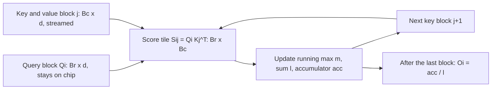

# Online Softmax and Tiling

## Introduction

The previous page showed that standard attention is slow because it writes the $N \times N$ score matrix to slow GPU memory, reads it back for the softmax, writes the probabilities, and reads them again. The obvious fix is to keep the scores on chip. But the chip holds only a small tile of the matrix at a time, and softmax needs a whole row: you cannot divide by the row sum before you have seen every element of the row.

**Online softmax** removes that obstacle. It computes the softmax normalizer in a single streaming pass, carrying only two numbers per row (a running maximum and a running sum) and correcting earlier partial results whenever a larger value shows up. Combine it with a running weighted sum of value vectors and you can compute exact attention one tile at a time. That combination is the mathematical core of FlashAttention.

After this page you will be able to:

- explain why the naive softmax overflows and how the "safe" softmax fixes it;
- derive the online softmax recurrence and prove it correct by induction;
- merge softmax statistics from independent blocks in any order;
- write a tiled attention function in PyTorch that never materializes the full score matrix and matches naive attention to within floating-point rounding.

The ideas are older than FlashAttention: Milakov and Gimelshein published the online normalizer at NVIDIA in 2018, and Rabe and Staats (2021) used the same decomposition to show that attention does not need quadratic memory. FlashAttention's contribution was to turn it into a fast GPU kernel.

## Softmax and the Overflow Problem

For a vector $x \in \mathbb{R}^N$, softmax is

$$
\mathrm{softmax}(x)_i = \frac{e^{x_i}}{\sum_{j=1}^{N} e^{x_j}}.
$$

Computed literally, this overflows. In float32 the largest representable number is about $3.4 \times 10^{38}$, so $e^{x}$ becomes infinity for $x \gt 88.7$. In float16 the limit is $x \gt 11.1$. Attention scores of that size are common, especially before training stabilizes. Once the numerator and denominator are both infinite, their ratio is `nan`.

The standard fix uses the fact that softmax is unchanged when you subtract the same constant $c$ from every element:

$$
\frac{e^{x_i - c}}{\sum_j e^{x_j - c}} = \frac{e^{-c} e^{x_i}}{e^{-c} \sum_j e^{x_j}} = \mathrm{softmax}(x)_i.
$$

Choosing $c = m = \max_j x_j$ makes every exponent at most zero, so every term is in $(0, 1]$ and the sum is between 1 and $N$. This is the **safe softmax**, and every deep learning library implements it.

```python
import torch

torch.manual_seed(0)

def naive_softmax(x):
    e = torch.exp(x)
    return e / e.sum()

def safe_softmax(x):
    m = x.max()
    e = torch.exp(x - m)
    return e / e.sum()

x = torch.tensor([1000.0, 1001.0, 1002.0])   # float32 logits
print("naive:", naive_softmax(x))
print("safe: ", safe_softmax(x))
print("torch:", torch.softmax(x, dim=0))
```

```text
naive: tensor([nan, nan, nan])
safe:  tensor([0.0900, 0.2447, 0.6652])
torch: tensor([0.0900, 0.2447, 0.6652])
```

The catch is the number of passes over the data. Safe softmax needs:

1. one pass to find the maximum $m$;
2. one pass to compute the sum $\ell = \sum_j e^{x_j - m}$;
3. one pass to write $e^{x_i - m} / \ell$.

If $x$ lives in slow memory, that is three reads and one write per element. For attention it is worse: you need all $N$ scores of a row before you can even start pass 2.

## The Online Softmax Recurrence

The idea is to fuse passes 1 and 2. Process the elements one at a time, keeping a running maximum $m_j$ and a running sum $\ell_j$ that is always expressed *relative to the current maximum*:

$$
m_j = \max_{i \le j} x_i, \qquad \ell_j = \sum_{i \le j} e^{x_i - m_j}.
$$

When the next element $x_{j+1}$ arrives, the maximum may grow. Every term already in $\ell_j$ was computed relative to the old maximum $m_j$, so it must be rescaled by $e^{m_j - m_{j+1}}$ to be relative to the new one:

$$
m_{j+1} = \max(m_j, x_{j+1}), \qquad
\ell_{j+1} = \ell_j \, e^{m_j - m_{j+1}} + e^{x_{j+1} - m_{j+1}}.
$$

Start with $m_0 = -\infty$ and $\ell_0 = 0$ (the first rescale factor is $e^{-\infty} = 0$, which correctly ignores the empty sum).

**Proof by induction.** Suppose the invariant $\ell_j = \sum_{i \le j} e^{x_i - m_j}$ holds. Then

$$
\ell_{j+1}
= \left(\sum_{i \le j} e^{x_i - m_j}\right) e^{m_j - m_{j+1}} + e^{x_{j+1} - m_{j+1}}
= \sum_{i \le j} e^{x_i - m_{j+1}} + e^{x_{j+1} - m_{j+1}}
= \sum_{i \le j+1} e^{x_i - m_{j+1}},
$$

so the invariant holds for $j + 1$. After the last element, $m_N$ is the true maximum and $\ell_N$ is exactly the safe-softmax denominator. Every exponent that was ever evaluated is at most zero ($x_{j+1} \le m_{j+1}$ and $m_j \le m_{j+1}$), so nothing overflows.

This replaces three passes with two: one streaming pass for the statistics, one to write the output.

```python
import torch

torch.manual_seed(0)

def online_softmax_stats(x):
    """One pass over x: return the running max m and running sum l."""
    m = torch.tensor(float("-inf"))
    l = torch.tensor(0.0)
    for xi in x:                       # stream the elements one at a time
        m_new = torch.maximum(m, xi)
        l = l * torch.exp(m - m_new) + torch.exp(xi - m_new)
        m = m_new
    return m, l

def online_softmax(x):
    m, l = online_softmax_stats(x)     # pass 1: statistics
    return torch.exp(x - m) / l        # pass 2: normalize

x = torch.randn(10_000) * 20           # wide range of logits
ref = torch.softmax(x, dim=0)
out = online_softmax(x)
print("max abs diff vs torch.softmax:", (out - ref).abs().max().item())

# Hand-checkable trace on a tiny vector
x = torch.tensor([3.0, 1.0, 5.0, 2.0])
m = torch.tensor(float("-inf")); l = torch.tensor(0.0)
for i, xi in enumerate(x):
    m_new = torch.maximum(m, xi)
    l = l * torch.exp(m - m_new) + torch.exp(xi - m_new)
    m = m_new
    print(f"step {i}: x={xi.item():.0f}  m={m.item():.0f}  l={l.item():.4f}")
print("softmax:", (torch.exp(x - m) / l).numpy().round(4))
print("torch:  ", torch.softmax(x, 0).numpy().round(4))
```

```text
max abs diff vs torch.softmax: 1.7881393432617188e-07
step 0: x=3  m=3  l=1.0000
step 1: x=1  m=3  l=1.1353
step 2: x=5  m=5  l=1.1537
step 3: x=2  m=5  l=1.2034
softmax: [0.1125 0.0152 0.831  0.0414]
torch:   [0.1125 0.0152 0.831  0.0414]
```

Check step 2 by hand. Before it, $m = 3$ and $\ell = 1 + e^{-2} = 1.1353$. The new element 5 is larger, so the old sum shrinks by $e^{3 - 5} = 0.1353$, giving $0.1536$, and the new element contributes $e^{0} = 1$. Total: $1.1537$. Step 3 adds $e^{2 - 5} = 0.0498$ without rescaling, because the maximum did not change.

## Merging Blocks in Any Order

On a GPU you do not process one element at a time; you process a block of elements in parallel. The recurrence generalizes to blocks. Give each block $b$ its own local statistics, the block maximum $m^{(b)}$ and the block sum $\ell^{(b)} = \sum_{i \in b} e^{x_i - m^{(b)}}$. Two blocks combine as

$$
m = \max\!\left(m^{(1)}, m^{(2)}\right), \qquad
\ell = \ell^{(1)} e^{m^{(1)} - m} + \ell^{(2)} e^{m^{(2)} - m}.
$$

This is the formula the FlashAttention paper writes down in section 3.1. It is the same argument as before: each partial sum is moved from its own reference point to the common one.

The merge is **associative and commutative**. You can see this by noticing that the pair $(m, \ell)$ is just a numerically safe encoding of the single number $m + \log \ell = \log \sum_i e^{x_i}$, the logsumexp of the elements seen so far, and merging two pairs computes the logsumexp of their union. Addition of sums of exponentials does not care about order or grouping, so neither does the merge. That property is what lets a GPU reduce blocks in a tree, and what later lets Ring Attention merge results that arrive from different GPUs.

```python
import torch

torch.manual_seed(0)

def block_stats(x):
    """Local statistics of one block: (max, sum of exp relative to that max)."""
    m = x.max()
    return m, torch.exp(x - m).sum()

def merge(m1, l1, m2, l2):
    """Combine the statistics of two disjoint blocks."""
    m = torch.maximum(m1, m2)
    return m, l1 * torch.exp(m1 - m) + l2 * torch.exp(m2 - m)

x = torch.randn(4096) * 10
blocks = x.split(512)                      # 8 blocks of 512

# Combine left to right (what a single GPU thread block does) ...
m, l = block_stats(blocks[0])
for b in blocks[1:]:
    m, l = merge(m, l, *block_stats(b))

# ... or as a tree (what a parallel reduction does). Same answer.
stats = [block_stats(b) for b in blocks]
while len(stats) > 1:
    stats = [merge(*stats[i], *stats[i + 1]) for i in range(0, len(stats), 2)]
m_tree, l_tree = stats[0]

logsumexp = torch.logsumexp(x, dim=0)
print("sequential  m + log l:", (m + torch.log(l)).item())
print("tree        m + log l:", (m_tree + torch.log(l_tree)).item())
print("torch.logsumexp      :", logsumexp.item())
```

```text
sequential  m + log l: 41.20237350463867
tree        m + log l: 41.20237350463867
torch.logsumexp      : 41.20237350463867
```

## From Softmax to the Attention Output in One Pass

Attention does not need the softmax probabilities themselves; it needs their weighted sum of value vectors. For a single query $q$ with scores $s_j = q \cdot k_j / \sqrt{d}$:

$$
o = \sum_{j=1}^{N} \frac{e^{s_j}}{\sum_{i} e^{s_i}} \, v_j.
$$

Keep a third running quantity, an **unnormalized** output accumulator expressed relative to the current maximum:

$$
a_j = \sum_{i \le j} e^{s_i - m_j} \, v_i \in \mathbb{R}^d.
$$

It obeys the same kind of recurrence as $\ell$:

$$
a_{j+1} = a_j \, e^{m_j - m_{j+1}} + e^{s_{j+1} - m_{j+1}} \, v_{j+1},
$$

with exactly the same induction proof (multiply each term by $v_i$). At the end, $a_N / \ell_N = o$. The softmax denominator is applied once, at the very end, and the third pass disappears entirely. Attention becomes a **single pass** over the keys and values with $O(d)$ state per query.

```python
import math
import torch

torch.manual_seed(0)

N, d = 1000, 16
q = torch.randn(d)                         # one query               (d,)
K = torch.randn(N, d)                      # all keys                (N, d)
V = torch.randn(N, d)                      # all values              (N, d)
scale = 1.0 / math.sqrt(d)

# Reference: materialize all N scores, softmax, weighted sum.
p = torch.softmax(K @ q * scale, dim=0)    # (N,)
o_ref = p @ V                              # (d,)

# One pass, one key at a time, O(d) state: running max m, running sum l,
# and an UNNORMALIZED running output acc.
m = torch.tensor(float("-inf"))
l = torch.tensor(0.0)
acc = torch.zeros(d)
for j in range(N):
    s = (q @ K[j]) * scale                 # score of key j (scalar)
    m_new = torch.maximum(m, s)
    alpha = torch.exp(m - m_new)           # how much the old state shrinks
    p_j = torch.exp(s - m_new)
    l = alpha * l + p_j
    acc = alpha * acc + p_j * V[j]
    m = m_new
o = acc / l                                # normalize once at the end

print("max abs diff vs softmax(qK^T)V:", (o - o_ref).abs().max().item())
```

```text
max abs diff vs softmax(qK^T)V: 5.21540641784668e-08
```

### A Worked Example by Hand

One query, head dimension 1, four keys split into two blocks. Scores $s = [1, 3 \mid 5, 0]$ and values $v = [10, 20 \mid 30, 40]$.

**Block 1** (scores 1 and 3): $m = 3$, $\ell = e^{-2} + e^{0} = 1.1353$, $a = 10 e^{-2} + 20 = 21.3534$.

**Block 2** (scores 5 and 0): the block maximum 5 beats 3, so $m_{\text{new}} = 5$ and the old state is scaled by $\alpha = e^{3 - 5} = 0.1353$.

- $\ell = 0.1353 \times 1.1353 + (e^{0} + e^{-5}) = 0.1536 + 1.0067 = 1.1604$
- $a = 0.1353 \times 21.3534 + 30 e^{0} + 40 e^{-5} = 2.8899 + 30 + 0.2695 = 33.1594$

**Output:** $o = 33.1594 / 1.1604 = 28.576$.

**Direct check:** the weights are $e^{1}, e^{3}, e^{5}, e^{0}$, and $\sum_j e^{s_j} v_j / \sum_j e^{s_j} = 28.576$. The block-wise answer is exact, not an approximation.

## Tiling Attention in Two Dimensions

Now apply all of this to full attention with $N$ queries. Split $Q$ into row blocks of $B_r$ queries and $K, V$ into column blocks of $B_c$ keys. Each pair $(i, j)$ of blocks defines one tile $S_{ij} = Q_i K_j^\top / \sqrt{d}$ of size $B_r \times B_c$. For a fixed query block, stream over the key blocks and keep, for each of the $B_r$ rows, a running max, a running sum and an accumulator.



On a GPU, one thread block owns one query block, so all of this state lives in registers and shared memory. The largest object ever created is one $B_r \times B_c$ tile. With $B_r = B_c = 128$ that is 16,384 scores, 64 KB in float32, compared with $N^2$ scores for the full matrix.

Here is a complete reference implementation. It is slow in Python (it is a loop over tiles), but every number it computes is what a real kernel computes.

```python
import math
import torch

torch.manual_seed(0)

def naive_attention(Q, K, V):
    # Q, K, V: (N, d)
    S = Q @ K.T / math.sqrt(Q.shape[-1])         # (N, N)  materialized
    P = torch.softmax(S, dim=-1)                  # (N, N)  materialized
    return P @ V                                  # (N, d)

def tiled_attention(Q, K, V, Br=64, Bc=64):
    """Exact attention computed tile by tile with online softmax.
    Never holds more than a (Br, Bc) tile of scores."""
    N, d = Q.shape
    scale = 1.0 / math.sqrt(d)
    O = torch.empty_like(Q)
    for i0 in range(0, N, Br):                    # one block of query rows
        Qi = Q[i0:i0 + Br]                        # (Br, d)
        m = torch.full((Qi.shape[0],), float("-inf"), dtype=Q.dtype)  # row max (Br,)
        l = torch.zeros(Qi.shape[0], dtype=Q.dtype)   # row sum (Br,)
        acc = torch.zeros(Qi.shape[0], d, dtype=Q.dtype)  # unnormalized output (Br, d)
        for j0 in range(0, N, Bc):                # stream key/value blocks
            Kj, Vj = K[j0:j0 + Bc], V[j0:j0 + Bc] # (Bc, d)
            S = Qi @ Kj.T * scale                 # (Br, Bc) one tile only
            m_new = torch.maximum(m, S.max(dim=1).values)
            alpha = torch.exp(m - m_new)          # rescale factor for old state
            P = torch.exp(S - m_new[:, None])     # (Br, Bc)
            l = alpha * l + P.sum(dim=1)
            acc = alpha[:, None] * acc + P @ Vj
            m = m_new
        O[i0:i0 + Br] = acc / l[:, None]          # normalize once per row block
    return O

for N, d, Br, Bc in [(256, 32, 64, 64), (1000, 64, 128, 96), (2048, 128, 128, 128)]:
    Q, K, V = (torch.randn(N, d) for _ in range(3))
    diff = (tiled_attention(Q, K, V, Br, Bc) - naive_attention(Q, K, V)).abs().max()
    print(f"N={N:5d} d={d:3d} Br={Br:3d} Bc={Bc:3d}  max abs diff = {diff.item():.2e}")

# Same check in float64 to show the remaining difference is only rounding.
Q, K, V = (torch.randn(1000, 64, dtype=torch.float64) for _ in range(3))
diff = (tiled_attention(Q, K, V, 128, 96) - naive_attention(Q, K, V)).abs().max()
print(f"float64 N= 1000 d= 64            max abs diff = {diff.item():.2e}")
```

```text
N=  256 d= 32 Br= 64 Bc= 64  max abs diff = 2.24e-07
N= 1000 d= 64 Br=128 Bc= 96  max abs diff = 1.86e-07
N= 2048 d=128 Br=128 Bc=128  max abs diff = 8.94e-08
float64 N= 1000 d= 64            max abs diff = 5.55e-16
```

The second case deliberately uses a sequence length (1000) that is not a multiple of either block size (128 and 96); Python slicing handles the ragged last block. In float32 the difference is around $10^{-7}$, the size of float32 rounding error; in float64 it drops to $10^{-16}$. The tiled algorithm is **exact**. Its result differs from naive attention only because floating-point addition is not associative, so the sums are rounded in a different order.

:::tip
The order of the two loops matters on a GPU. Here the outer loop is over query blocks and the running state never leaves the chip. The original FlashAttention paper used the opposite order (outer loop over key blocks), which forces the running state to be written back to HBM after every tile. The next page counts the cost of each choice.
:::

### What Lives Where

For one query block, the on-chip working set is:

| Object | Shape | Elements for $B_r = B_c = 128$, $d = 128$ |
| --- | --- | --- |
| $Q_i$ | $B_r \times d$ | 16,384 |
| $K_j$, $V_j$ | $2 \times B_c \times d$ | 32,768 |
| Score tile $S_{ij}$ | $B_r \times B_c$ | 16,384 |
| Accumulator | $B_r \times d$ | 16,384 |
| $m$, $\ell$ | $2 \times B_r$ | 256 |

That is about 82,000 numbers, which fits in the registers and shared memory of one SM when the inputs are 16-bit and the accumulator is 32-bit. Nothing in the table depends on $N$. That is the whole point: memory use per thread block is constant, and the total extra memory is just $O(N)$ for the final per-row statistics.

## Common Mistakes

- **Forgetting to rescale the accumulator.** When the running max grows, both $\ell$ and the output accumulator must be multiplied by $e^{m_{\text{old}} - m_{\text{new}}}$. Rescaling only $\ell$ gives outputs that look plausible and are wrong.
- **Normalizing inside the loop.** Dividing by $\ell$ after every tile is correct but wastes work. Keep the accumulator unnormalized and divide once at the end (the FlashAttention-2 paper makes this exact point).
- **Initializing the max to zero.** The running max must start at $-\infty$. Starting at 0 is algebraically still correct, but if every score in a row is very negative (below about $-104$ in float32), every exponential underflows to zero and the row becomes $0/0$.
- **Fully masked rows.** If every score in a row is $-\infty$ (possible with padding), then $m = -\infty$ and $e^{m - m}$ is `nan`. Real kernels special-case this; production code must too.
- **Believing tiling is an approximation.** It is exact. Differences of $10^{-7}$ in float32 are rounding, as the float64 check shows.

## Summary

- Safe softmax subtracts the row maximum to avoid overflow but needs three passes over the data.
- Online softmax keeps a running max $m$ and a running sum $\ell$ relative to it, rescaling $\ell$ by $e^{m_{\text{old}} - m_{\text{new}}}$ whenever the max grows; an induction proof shows it is exact.
- Block statistics merge associatively, because $(m, \ell)$ encodes the logsumexp $m + \log \ell$; blocks can be combined in any order.
- Adding an unnormalized output accumulator with the same rescaling turns attention into a single pass over keys and values with $O(d)$ state per query.
- Tiled attention holds only $B_r \times B_c$ scores at a time and reproduces naive attention to within floating-point rounding.

## Further Reading

- [Online Normalizer Calculation for Softmax](https://arxiv.org/abs/1805.02867) (Milakov and Gimelshein, 2018): the original online softmax paper, from NVIDIA.
- [Self-attention Does Not Need O(n^2) Memory](https://arxiv.org/abs/2112.05682) (Rabe and Staats, 2021): applies the same decomposition to attention to cut its memory use.
- [FlashAttention](https://arxiv.org/abs/2205.14135) (Dao et al., 2022): section 3.1 states the block decomposition of softmax used here.
- [FlashAttention-2](https://arxiv.org/abs/2307.08691) (Dao, 2023): section 3.1 explains deferring the normalization to the end of the loop.
- [PyTorch torch.logsumexp](https://docs.pytorch.org/docs/stable/generated/torch.logsumexp.html): the library function behind the merge identity.
