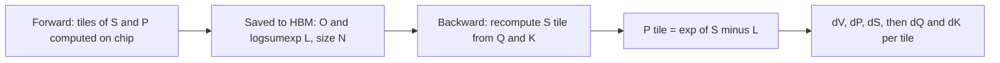

# FlashAttention Explained

## Introduction

FlashAttention was introduced by Tri Dao, Daniel Y. Fu, Stefano Ermon, Atri Rudra and Christopher Re in "FlashAttention: Fast and Memory-Efficient Exact Attention with IO-Awareness" (arXiv, May 2022; NeurIPS 2022). Its pitch was unusual for an attention paper at the time. Dozens of papers had proposed *approximate* attention to cut the quadratic FLOP count, and few of them ran faster in practice. FlashAttention computed *exact* attention, did slightly *more* arithmetic than the standard implementation, and still ran 2 to 4 times faster while using memory linear in the sequence length.

The reason is the one developed on the previous two pages. Attention is limited by traffic to GPU high-bandwidth memory (HBM), not by arithmetic. FlashAttention combines tiling with online softmax so that the $N \times N$ score and probability matrices are never written to HBM, and it recomputes them in the backward pass instead of storing them.

The paper reported a 15% end-to-end speedup for BERT-large training over the MLPerf 1.1 record, 3x faster GPT-2 training at sequence length 1K, and the first Transformers to beat chance on the Path-X (16K tokens) and Path-256 (64K tokens) long-range benchmarks, because the memory savings made those lengths trainable at all.

After this page you will be able to:

- state the FlashAttention forward algorithm and explain each line;
- count HBM reads and writes for standard attention and for FlashAttention, and derive the paper's $\Theta(N^2 d^2 M^{-1})$ bound;
- derive the attention backward pass and explain why recomputing $P$ is faster than storing it;
- run a reference implementation in PyTorch that matches naive attention in the forward and backward pass, with and without a causal mask.

Read [Online Softmax and Tiling](./1-llm-online-softmax.mdx) first; this page builds directly on its recurrence.

## The Forward Algorithm

Notation: $Q, K, V \in \mathbb{R}^{N \times d}$ in HBM, an on-chip SRAM that holds $M$ numbers, row blocks of $B_r$ queries and column blocks of $B_c$ keys, so $T_r = \lceil N / B_r \rceil$ query blocks and $T_c = \lceil N / B_c \rceil$ key blocks. The running statistics are a row maximum $m \in \mathbb{R}^N$ and a row sum $\ell \in \mathbb{R}^N$.

The paper's Algorithm 1, in words:

```text
Choose block sizes  Bc = ceil(M / 4d),  Br = min(ceil(M / 4d), d)
Initialize in HBM:  O = 0 (N x d),  l = 0 (N),  m = -inf (N)
for j = 1 .. Tc:                                   # outer loop over key/value blocks
    load Kj, Vj from HBM to SRAM                    # Bc x d each
    for i = 1 .. Tr:                               # inner loop over query blocks
        load Qi, Oi, li, mi from HBM to SRAM
        Sij   = Qi Kj^T                             # Br x Bc, on chip
        mij   = rowmax(Sij);  Pij = exp(Sij - mij);  lij = rowsum(Pij)
        mnew  = max(mi, mij)
        lnew  = exp(mi - mnew) li + exp(mij - mnew) lij
        Oi    = ( li exp(mi - mnew) Oi + exp(mij - mnew) Pij Vj ) / lnew
        write Oi, lnew, mnew back to HBM
return O
```

The block sizes come from fitting everything into SRAM: $K_j$ and $V_j$ need $2 B_c d$ numbers, $Q_i$ and $O_i$ need $2 B_r d$, and the tile $S_{ij}$ needs $B_r B_c$. Choosing $B_c \approx M / 4d$ uses about half the SRAM for $K_j, V_j$; capping $B_r$ at $d$ keeps the score tile at most $B_c d \approx M / 4$. (Real kernels pick fixed sizes such as 64 or 128 per GPU and head dimension, tuned by benchmarking.)

Three details matter:

1. **Everything between the two matrix multiplications is fused.** Scaling by $1/\sqrt{d}$, masking, the exponential, the row sums and dropout all happen on the tile in registers. This is one CUDA kernel.
2. **The output is kept normalized after every update.** Each inner step divides by $\ell^{\text{new}}$, so $O$ in HBM is always the correct attention output over the key blocks seen so far. FlashAttention-2 later moved this division to the end.
3. **The loop order is "keys outside, queries inside".** Each $K_j, V_j$ is loaded once, but $Q$, $O$, $\ell$ and $m$ are loaded and stored $T_c$ times. FlashAttention-2 swapped the loops. We will count what each order costs.

The paper's Theorem 1 states that this algorithm returns exactly $\mathrm{softmax}(QK^\top)V$ using $O(N^2 d)$ FLOPs and $O(N)$ extra memory beyond the inputs and output (the vectors $\ell$ and $m$).

## A Reference Implementation with an HBM Counter

The code below implements standard attention (Algorithm 0) and FlashAttention (Algorithm 1) in plain PyTorch on the CPU. A tiny `HBM` class stands in for global memory: every time a kernel would load a tile into SRAM we call `hbm.load`, and every time it would write a result we call `hbm.store`, and the class counts elements. We also implement the FlashAttention-2 loop order for comparison. The asserts check the measured counts against closed-form formulas derived in the next section.

```python
import math
import torch

torch.manual_seed(0)

class HBM:
    """Counts elements moved between 'HBM' (full tensors) and 'SRAM' (tiles)."""
    def __init__(self):
        self.reads = 0
        self.writes = 0
    def load(self, t):
        self.reads += t.numel()
        return t.clone()                  # the on-chip copy
    def store(self, dst, src):
        self.writes += src.numel()
        dst.copy_(src)

def standard_attention(Q, K, V, hbm):
    """Algorithm 0: materialize S and P in HBM."""
    N, d = Q.shape
    S = torch.empty(N, N); P = torch.empty(N, N); O = torch.empty(N, d)
    hbm.store(S, hbm.load(Q) @ hbm.load(K).T / math.sqrt(d))   # read Q,K  write S
    hbm.store(P, torch.softmax(hbm.load(S), dim=-1))           # read S    write P
    hbm.store(O, hbm.load(P) @ hbm.load(V))                    # read P,V  write O
    return O

def flash_attention_v1(Q, K, V, hbm, Br=16, Bc=16):
    """Algorithm 1 of the FlashAttention paper: outer loop over K/V blocks,
    inner loop over Q blocks; O, l, m live in HBM between iterations."""
    N, d = Q.shape
    scale = 1.0 / math.sqrt(d)
    O = torch.zeros(N, d)                       # in HBM
    l = torch.zeros(N)                          # in HBM
    m = torch.full((N,), float("-inf"))         # in HBM
    for j0 in range(0, N, Bc):
        Kj = hbm.load(K[j0:j0 + Bc])            # (Bc, d) on chip
        Vj = hbm.load(V[j0:j0 + Bc])            # (Bc, d) on chip
        for i0 in range(0, N, Br):
            rows = slice(i0, i0 + Br)
            Qi, Oi = hbm.load(Q[rows]), hbm.load(O[rows])       # (Br, d)
            li, mi = hbm.load(l[rows]), hbm.load(m[rows])       # (Br,)
            Sij = Qi @ Kj.T * scale                             # (Br, Bc)
            mij = Sij.max(dim=1).values                         # (Br,)
            Pij = torch.exp(Sij - mij[:, None])                 # (Br, Bc)
            lij = Pij.sum(dim=1)                                # (Br,)
            mi_new = torch.maximum(mi, mij)
            li_new = torch.exp(mi - mi_new) * li + torch.exp(mij - mi_new) * lij
            Oi_new = (li * torch.exp(mi - mi_new))[:, None] * Oi \
                     + torch.exp(mij - mi_new)[:, None] * (Pij @ Vj)
            Oi_new = Oi_new / li_new[:, None]
            hbm.store(O[rows], Oi_new)
            hbm.store(l[rows], li_new)
            hbm.store(m[rows], mi_new)
    return O

def flash_attention_v2_order(Q, K, V, hbm, Br=16, Bc=16):
    """FlashAttention-2 loop order: outer loop over Q blocks, state stays on chip."""
    N, d = Q.shape
    scale = 1.0 / math.sqrt(d)
    O = torch.empty(N, d); L = torch.empty(N)             # in HBM
    for i0 in range(0, N, Br):
        Qi = hbm.load(Q[i0:i0 + Br])                       # (Br, d)
        mi = torch.full((Qi.shape[0],), float("-inf"))     # on chip
        li = torch.zeros(Qi.shape[0])
        acc = torch.zeros(Qi.shape[0], d)
        for j0 in range(0, N, Bc):
            Kj, Vj = hbm.load(K[j0:j0 + Bc]), hbm.load(V[j0:j0 + Bc])
            S = Qi @ Kj.T * scale
            m_new = torch.maximum(mi, S.max(dim=1).values)
            P = torch.exp(S - m_new[:, None])
            alpha = torch.exp(mi - m_new)
            li = alpha * li + P.sum(dim=1)
            acc = alpha[:, None] * acc + P @ Vj
            mi = m_new
        hbm.store(O[i0:i0 + Br], acc / li[:, None])
        hbm.store(L[i0:i0 + Br], mi + torch.log(li))       # logsumexp for backward
    return O, L

N, d = 1024, 64
Q, K, V = (torch.randn(N, d) for _ in range(3))
h0 = HBM(); O_std = standard_attention(Q, K, V, h0)
print(f"standard        : total={h0.reads + h0.writes:9,d}  (4Nd + 4N^2 = {4*N*d + 4*N*N:,})")
for B in (16, 64, 128, 256):
    h1 = HBM(); O1 = flash_attention_v1(Q, K, V, h1, Br=B, Bc=B)
    h2 = HBM(); O2, _ = flash_attention_v2_order(Q, K, V, h2, Br=B, Bc=B)
    T = N // B
    assert h1.reads + h1.writes == 2*N*d + T*(3*N*d + 4*N)
    assert h2.reads + h2.writes == 2*N*d + 2*N*d*T + N
    print(f"B={B:3d}  v1 order: total={h1.reads + h1.writes:9,d} diff={(O1 - O_std).abs().max():.1e}"
          f" | v2 order: total={h2.reads + h2.writes:9,d} diff={(O2 - O_std).abs().max():.1e}")
```

```text
standard        : total=4,456,448  (4Nd + 4N^2 = 4,456,448)
B= 16  v1 order: total=12,976,128 diff=4.0e-07 | v2 order: total=8,520,704 diff=3.9e-07
B= 64  v1 order: total=3,342,336 diff=2.7e-07 | v2 order: total=2,229,248 diff=3.1e-07
B=128  v1 order: total=1,736,704 diff=3.1e-07 | v2 order: total=1,180,672 diff=3.0e-07
B=256  v1 order: total=  933,888 diff=3.0e-07 | v2 order: total=  656,384 diff=3.0e-07
```

Three things to read off this output:

- **Both tiled versions are exact.** The maximum difference from standard attention is about $3 \times 10^{-7}$, float32 rounding.
- **Small blocks are worse than no tiling.** With 16 by 16 blocks, FlashAttention moves almost three times more data than standard attention. Tiling only pays off when the blocks are large compared with the head dimension.
- **Large blocks win big, and the FlashAttention-2 order wins more.** At $B = 256$ the original loop order moves 4.8x less data than standard attention, and the swapped order 6.8x less.

## IO Complexity: Counting HBM Reads and Writes

Now derive the counts that the asserts check. All counts are in elements; multiply by 2 for bytes in BF16.

### Standard Attention

From the table on [the memory hierarchy page](./0-llm-gpu-memory-hierarchy.mdx):

- step 1 reads $Q, K$ ($2Nd$) and writes $S$ ($N^2$);
- step 2 reads $S$ ($N^2$) and writes $P$ ($N^2$);
- step 3 reads $P$ and $V$ ($N^2 + Nd$) and writes $O$ ($Nd$).

$$
\text{HBM}_{\text{standard}} = 4Nd + 4N^2 = \Theta(Nd + N^2).
$$

For $N = 1024$ and $d = 64$: $4 \cdot 65{,}536 + 4 \cdot 1{,}048{,}576 = 4{,}456{,}448$ elements, the number the script printed.

### FlashAttention, Original Loop Order

- Each $K_j$ and $V_j$ is loaded once: $2Nd$ in total.
- For each of the $T_c$ outer iterations, the inner loop loads all of $Q$ and $O$ ($2Nd$) and all of $\ell$ and $m$ ($2N$), and stores all of $O$, $\ell$ and $m$ ($Nd + 2N$).

$$
\text{HBM}_{\text{FA1}} = 2Nd + T_c\,(3Nd + 4N).
$$

For $N = 1024$, $d = 64$ and $B_c = 128$ ($T_c = 8$): $131{,}072 + 8 \cdot (196{,}608 + 4{,}096) = 1{,}736{,}704$. Again the printed number.

### FlashAttention-2 Loop Order

- Each $Q_i$ is loaded once ($Nd$); for each of the $T_r$ query blocks, all of $K$ and $V$ are streamed ($2Nd$ each time); $O$ and the logsumexp $L$ are written once ($Nd + N$).

$$
\text{HBM}_{\text{FA2 order}} = 2Nd + 2Nd\,T_r + N.
$$

### From Counts to the Theorem

Since $T_c = N / B_c$ and the paper chooses $B_c = \Theta(M / d)$,

$$
\text{HBM}_{\text{FA1}} = \Theta\!\left(Nd \cdot T_c\right) = \Theta\!\left(Nd \cdot \frac{N d}{M}\right) = \Theta\!\left(\frac{N^2 d^2}{M}\right).
$$

This is the paper's Theorem 2: standard attention needs $\Theta(Nd + N^2)$ HBM accesses, FlashAttention needs $\Theta(N^2 d^2 M^{-1})$. Compare the two by their ratio, roughly $N^2$ against $N^2 d^2 / M$, so FlashAttention wins by a factor of about $M / d^2$. With $d$ between 64 and 128 and $M$ around 100,000 elements (about 200 KB of SRAM in 16-bit), $d^2$ is 4,096 to 16,384, many times smaller than $M$.

Two honest remarks about this bound:

- **It is still quadratic in $N$.** FlashAttention does not make attention linear. It shrinks the constant in front of $N^2$ from 4 to roughly $d^2 / M$ (times a small constant), and it removes the $N^2$ memory *footprint* entirely.
- **It is close to the best possible.** Proposition 3 of the paper proves that no exact attention algorithm can do asymptotically fewer HBM accesses for every SRAM size $M$ between $d$ and $Nd$.

With realistic fixed blocks of 128 the pessimistic count, which charges every re-read of a $K, V$ tile to HBM, looks like this (MiB per head, BF16):

| $d$ | $N$ | Standard | FA1 order | FA2 order | Standard / FA2 |
| --- | --- | --- | --- | --- | --- |
| 64 | 4,096 | 130 | 50 | 33 | 3.9x |
| 64 | 65,536 | 32,800 | 12,560 | 8,208 | 4.0x |
| 128 | 4,096 | 132 | 99 | 66 | 2.0x |
| 128 | 65,536 | 32,832 | 24,864 | 16,416 | 2.0x |

For large $N$ the ratio settles at $4N^2 / (2N^2 d / B_r) = 2B_r / d$. In practice the measured savings are larger, for two reasons the count leaves out. Many thread blocks working on the same head read the same $K, V$ tiles at about the same time, so a large share of those re-reads are served from the L2 cache rather than from HBM. And real standard attention makes extra $N \times N$ passes for masking, dropout and the backward pass. The paper's measurement for GPT-2 medium was 40.3 GB of HBM traffic for standard attention versus 4.4 GB for FlashAttention, forward plus backward.

:::note
The memory footprint is where the difference is dramatic rather than a constant factor. Standard attention needs $N^2$ extra numbers per head (and must keep them for the backward pass); FlashAttention needs one logsumexp per row, $N$ numbers. At $N = 65{,}536$ that is 8 GiB of BF16 per head versus 256 KB of float32.
:::

## The Backward Pass and Recomputation

Training needs gradients of the loss with respect to $Q$, $K$ and $V$. Write $S = QK^\top / \sqrt{d}$, $P = \mathrm{softmax}(S)$ row-wise, $O = PV$, and let $dO = \partial \mathcal{L} / \partial O$ arrive from the layer above.

**Through $O = PV$.** Matrix multiplication rules give

$$
dV = P^\top dO, \qquad dP = dO\, V^\top.
$$

**Through the softmax.** For one row $p = \mathrm{softmax}(s)$, the Jacobian is $\partial p / \partial s = \mathrm{diag}(p) - p p^\top$, so

$$
ds_j = p_j \left( dp_j - \sum_k p_k \, dp_k \right).
$$

The inner sum looks like it needs the whole row of $P$ and $dP$. It does not:

$$
\sum_k p_k \, dp_k = \sum_k p_k \,(dO_i \cdot v_k) = dO_i \cdot \Big(\sum_k p_k v_k\Big) = dO_i \cdot O_i.
$$

So define $D_i = \mathrm{rowsum}(dO \circ O)_i$, a vector of length $N$ computed once from tensors we already have, and

$$
dS = P \circ \left(dP - D\,\mathbf{1}^\top\right).
$$

**Through $S = QK^\top / \sqrt{d}$.**

$$
dQ = \frac{1}{\sqrt{d}}\, dS\, K, \qquad dK = \frac{1}{\sqrt{d}}\, dS^\top Q.
$$

Standard autograd saves $P$ ($N^2$ numbers per head) during the forward pass to use here. FlashAttention instead saves only $O$ and one number per row: the logsumexp $L_i = m_i + \log \ell_i$. In the backward pass it recomputes each tile exactly:

$$
P_{ij} = \exp\!\left(S_{ij} - L_i\right),
$$

no running max needed, because $L$ is already the final normalizer. The paper calls this a form of selective gradient checkpointing. Unlike ordinary checkpointing, it is not a speed-for-memory trade: recomputing $S$ costs an extra $2N^2 d$ FLOPs, but skipping the $N^2$ reads of a stored $P$ saves more time than that, because the operation was memory-bound to begin with. That is why the GFLOPs went up (66.6 to 75.2) while runtime went down (41.7 ms to 7.3 ms) in the paper's measurement.



The backward loop runs over key blocks on the outside, so $dK_j$ and $dV_j$ accumulate on chip, while $dQ_i$ receives contributions from every key block and is accumulated in HBM. In a GPU kernel that accumulation uses atomic adds; in our single-threaded reference it is a plain `+=`.

### Forward and Backward Reference, Checked Against Autograd

This implementation uses the FlashAttention-2 loop order for the forward pass, returns the logsumexp, implements the backward pass with recomputation, and wraps both in a `torch.autograd.Function` so that `loss.backward()` calls our code. It also supports a causal mask with block skipping: tiles entirely above the diagonal are never computed, and only tiles that straddle the diagonal need an explicit mask.

```python
import math
import torch

torch.manual_seed(0)

def flash_fwd(Q, K, V, causal=False, Br=64, Bc=64):
    """Tiled forward. Returns O and the per-row logsumexp L (all that backward needs)."""
    N, d = Q.shape
    scale = 1.0 / math.sqrt(d)
    O = torch.empty_like(Q)
    L = torch.empty(N, dtype=Q.dtype)
    tiles = 0
    for i0 in range(0, N, Br):
        i1 = min(i0 + Br, N)
        Qi = Q[i0:i1]                                          # (Br, d)
        m = torch.full((i1 - i0,), float("-inf"), dtype=Q.dtype)
        l = torch.zeros(i1 - i0, dtype=Q.dtype)
        acc = torch.zeros(i1 - i0, d, dtype=Q.dtype)
        j_end = i1 if causal else N                            # skip tiles above the diagonal
        for j0 in range(0, j_end, Bc):
            j1 = min(j0 + Bc, N)
            tiles += 1
            S = Qi @ K[j0:j1].T * scale                        # (Br, Bc)
            if causal and j1 > i0:                             # only diagonal tiles need a mask
                rows = torch.arange(i0, i1)[:, None]
                cols = torch.arange(j0, j1)[None, :]
                S = S.masked_fill(cols > rows, float("-inf"))
            m_new = torch.maximum(m, S.max(dim=1).values)
            P = torch.exp(S - m_new[:, None])
            alpha = torch.exp(m - m_new)
            l = alpha * l + P.sum(dim=1)
            acc = alpha[:, None] * acc + P @ V[j0:j1]
            m = m_new
        O[i0:i1] = acc / l[:, None]
        L[i0:i1] = m + torch.log(l)
    return O, L, tiles

def flash_bwd(Q, K, V, O, dO, L, causal=False, Br=64, Bc=64):
    """Tiled backward with recomputation: rebuild P from Q, K and L tile by tile."""
    N, d = Q.shape
    scale = 1.0 / math.sqrt(d)
    dQ, dK, dV = torch.zeros_like(Q), torch.zeros_like(K), torch.zeros_like(V)
    D = (dO * O).sum(dim=1)                                    # (N,) rowsum(dO * O)
    for j0 in range(0, N, Bc):                                 # outer loop: K/V blocks
        j1 = min(j0 + Bc, N)
        Kj, Vj = K[j0:j1], V[j0:j1]
        dKj = torch.zeros_like(Kj); dVj = torch.zeros_like(Vj)
        i_start = (j0 // Br) * Br if causal else 0             # rows above can't see this block
        for i0 in range(i_start, N, Br):
            i1 = min(i0 + Br, N)
            S = Q[i0:i1] @ Kj.T * scale                        # recompute the scores
            if causal and j1 > i0:
                rows = torch.arange(i0, i1)[:, None]
                cols = torch.arange(j0, j1)[None, :]
                S = S.masked_fill(cols > rows, float("-inf"))
            P = torch.exp(S - L[i0:i1, None])                  # exact softmax, no new max needed
            dVj += P.T @ dO[i0:i1]
            dP = dO[i0:i1] @ Vj.T
            dS = P * (dP - D[i0:i1, None])
            dQ[i0:i1] += dS @ Kj * scale                       # a kernel uses atomic adds here
            dKj += dS.T @ Q[i0:i1] * scale
        dK[j0:j1], dV[j0:j1] = dKj, dVj
    return dQ, dK, dV

class FlashAttentionRef(torch.autograd.Function):
    @staticmethod
    def forward(ctx, Q, K, V, causal):
        O, L, _ = flash_fwd(Q, K, V, causal)
        ctx.save_for_backward(Q, K, V, O, L)                   # O(N d) memory, no N x N matrix
        ctx.causal = causal
        return O
    @staticmethod
    def backward(ctx, dO):
        Q, K, V, O, L = ctx.saved_tensors
        return (*flash_bwd(Q, K, V, O, dO, L, ctx.causal), None)

def naive(Q, K, V, causal):
    S = Q @ K.T / math.sqrt(Q.shape[-1])
    if causal:
        N = Q.shape[0]
        S = S.masked_fill(torch.ones(N, N, dtype=torch.bool).triu(1), float("-inf"))
    return torch.softmax(S, dim=-1) @ V

N, d = 500, 64                         # N is not a multiple of the block size on purpose
for causal in (False, True):
    Q, K, V = (torch.randn(N, d, requires_grad=True) for _ in range(3))
    dO = torch.randn(N, d)
    O_ref = naive(Q, K, V, causal); O_ref.backward(dO)
    grads_ref = [t.grad.clone() for t in (Q, K, V)]
    for t in (Q, K, V): t.grad = None
    O = FlashAttentionRef.apply(Q, K, V, causal); O.backward(dO)
    print(f"causal={causal!s:5}  O diff={(O - O_ref).abs().max():.1e}  "
          + "  ".join(f"d{n} diff={(t.grad - g).abs().max():.1e}"
                      for n, t, g in zip("QKV", (Q, K, V), grads_ref)))

_, _, full = flash_fwd(Q.detach(), K.detach(), V.detach(), causal=False)
_, _, caus = flash_fwd(Q.detach(), K.detach(), V.detach(), causal=True)
print(f"tiles computed: full={full}, causal={caus}")
```

```text
causal=False  O diff=1.8e-07  dQ diff=2.4e-07  dK diff=2.1e-07  dV diff=1.6e-07
causal=True   O diff=3.6e-07  dQ diff=7.7e-07  dK diff=1.7e-06  dV diff=1.4e-06
tiles computed: full=64, causal=36
```

The forward output and all three gradients match PyTorch autograd on naive attention to within about $10^{-6}$, with and without the causal mask, for a sequence length (500) that is not a multiple of the block size. The saved state is $O$ and $L$: $N(d + 1)$ numbers, against $N^2$ for the probabilities autograd would keep.

The last line shows the effect of causal block skipping: 36 of 64 tiles. For $T$ blocks per side, a causal mask needs $T(T + 1)/2$ tiles out of $T^2$, which tends to half. The FlashAttention-2 paper reports a 1.7 to 1.8x speedup for causal attention from this skipping.

## Extensions in the Original Paper

**Block-sparse FlashAttention.** If the attention pattern is given as a block mask over the $T_r \times T_c$ grid of tiles, the kernel simply skips the zero blocks. The paper's Proposition 4 gives $\Theta(Nd + N^2 d^2 M^{-1} s)$ HBM accesses, where $s$ is the fraction of nonzero blocks, so IO falls in proportion to sparsity. This is the same mechanism our causal skipping uses, and the ancestor of today's `block_mask` in FlexAttention ([Using FlashAttention in PyTorch, Hugging Face and vLLM](./4-llm-using-flash-attention.mdx)).

**Dropout without storing a mask.** Attention dropout needs the same random mask in the forward and backward passes. Instead of storing an $N \times N$ mask, FlashAttention saves the random number generator state and regenerates the mask tile by tile in the backward pass.

## Worked Scenario: How Much Memory Does This Save in Training?

Take a 32-layer model with 32 attention heads, batch size 1, sequence length 32,768, BF16.

- **Standard attention** must keep $P$ for each head and layer: $32 \times 32 \times 32{,}768^2 \times 2$ bytes $= 2{,}048$ GiB. That is 2 TiB, about 25 times the HBM of an 80 GB GPU, for the attention probabilities alone.
- **FlashAttention** keeps $L$ instead: $32 \times 32 \times 32{,}768 \times 4$ bytes (float32) $= 128$ MiB.

The activations that remain (the inputs $Q$, $K$, $V$ and the output $O$) are linear in $N$. This is why every long-context model of the last few years was trained with a FlashAttention-style kernel; without it, context lengths beyond a few thousand tokens were impractical on a single GPU.

## Common Mistakes

- **Thinking FlashAttention is approximate.** It computes exact attention. Differences from a naive implementation are floating-point rounding, as the checks above show.
- **Thinking FlashAttention reduces FLOPs.** It does the same forward FLOPs and more backward FLOPs. It reduces memory traffic and memory footprint.
- **Expecting a linear-time algorithm.** HBM traffic is $\Theta(N^2 d^2 / M)$, still quadratic in $N$ with a much smaller constant. Compute is still $\Theta(N^2 d)$.
- **Saving $m$ and $\ell$ separately for backward.** One logsumexp per row is enough, as FlashAttention-2 noted, and it removes the rescaling from the backward pass.
- **Computing $D$ as a sum over $P \circ dP$.** That would need full rows. Use $D = \mathrm{rowsum}(dO \circ O)$.
- **Tiny blocks.** Tiling with blocks much smaller than $d$ moves more data than standard attention, as the $B = 16$ row shows.

## Summary

- FlashAttention (Dao et al., 2022) fuses all of attention into one kernel that streams tiles of $Q$, $K$ and $V$ through SRAM and never writes $S$ or $P$ to HBM.
- Its forward pass uses online softmax over key blocks; its backward pass recomputes $P$ tile by tile from the saved logsumexp $L$, using $D = \mathrm{rowsum}(dO \circ O)$ for the softmax gradient.
- HBM traffic falls from $\Theta(Nd + N^2)$ to $\Theta(N^2 d^2 M^{-1})$, which the paper proves is optimal over a range of SRAM sizes; extra memory falls from $\Theta(N^2)$ to $\Theta(N)$.
- Recomputation adds FLOPs but saves time, because attention is memory-bound; the paper measured 9x less HBM traffic and 5.7x lower runtime for GPT-2 medium attention.
- Block sizes must be large compared with $d$, and causal masks let the kernel skip about half of the tiles.

## Further Reading

- [FlashAttention: Fast and Memory-Efficient Exact Attention with IO-Awareness](https://arxiv.org/abs/2205.14135) (Dao et al., 2022): Algorithm 1, Theorems 1 and 2, and the backward pass in Appendix B.
- [FlashAttention-2](https://arxiv.org/abs/2307.08691) (Dao, 2023): the swapped loop order, logsumexp-only saving and causal block skipping.
- [Dao-AILab/flash-attention on GitHub](https://github.com/Dao-AILab/flash-attention): the official kernels and installation notes.
- [Self-attention Does Not Need O(n^2) Memory](https://arxiv.org/abs/2112.05682) (Rabe and Staats, 2021): concurrent work on memory-efficient exact attention.
- [Triton fused attention tutorial](https://triton-lang.org/main/getting-started/tutorials/06-fused-attention.html): a readable GPU implementation of the same algorithm; our [Triton attention project](../14-llm-projects/5-llm-project-triton-attention.mdx) builds one step by step.
