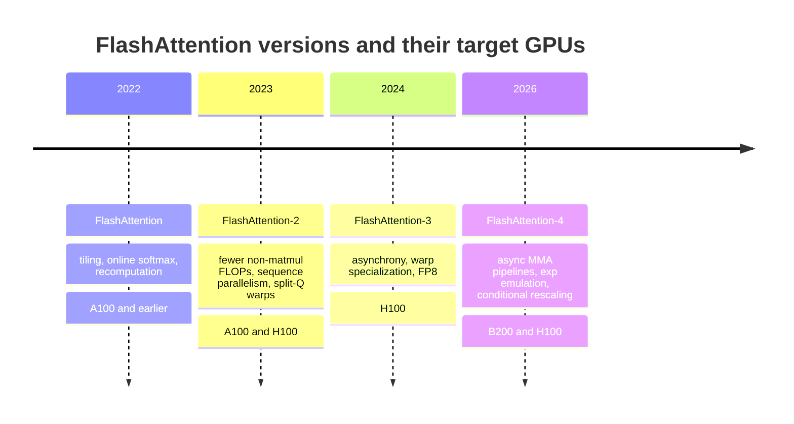
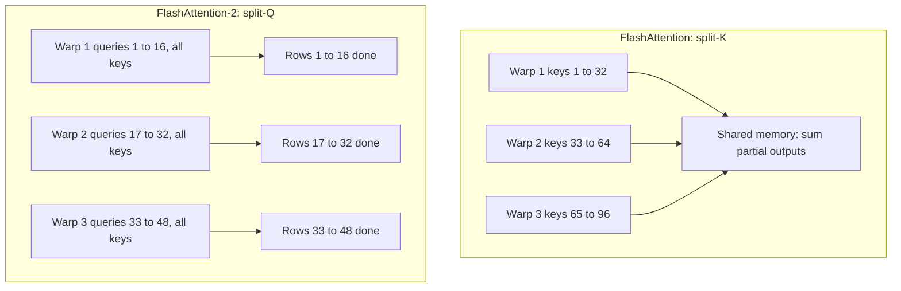

# FlashAttention-2, FlashAttention-3 and FlashAttention-4

## Introduction

The original FlashAttention fixed the memory traffic problem of attention. That moved the bottleneck somewhere else, and each later version is a response to where the bottleneck went on the GPU generation of its day:



The pattern is worth internalizing. The math of attention has not changed since the first version: every version computes the same exact softmax attention with the same online softmax recurrence. What changes is how the work is split across thread blocks and warps, which hardware units do which part, and how their work is overlapped. Matrix-multiply units keep getting faster much more quickly than everything else on the chip, so each version works harder to keep them busy.

After this page you will be able to:

- explain the three changes in FlashAttention-2 and why they doubled speed on the A100;
- describe warp specialization, ping-pong scheduling and FP8 block quantization in FlashAttention-3;
- say what FlashAttention-4 actually is (a 2026 paper and a CuTe-DSL implementation for Blackwell and Hopper) and reproduce two of its tricks, conditional rescaling and software `exp2`, in PyTorch;
- pick the version that matches your GPU.

## FlashAttention-2: Better Work Partitioning

FlashAttention-2 (Tri Dao, "FlashAttention-2: Faster Attention with Better Parallelism and Work Partitioning", July 2023; ICLR 2024) started from an observation: FlashAttention reached only 25 to 40% of the A100's peak FLOP/s, while a well-tuned matrix multiplication reaches 80 to 90%. The memory traffic was already fixed. The problem was how the work was laid out on the GPU. It made three changes.

### 1. Fewer Non-Matmul FLOPs

On an A100, Tensor Cores deliver 312 TFLOP/s of FP16/BF16 matrix math, but ordinary FP32 arithmetic (the exponentials, maxima, rescalings and divisions of softmax) runs at only 19.5 TFLOP/s. Each non-matmul FLOP costs as much time as 16 matmul FLOPs. FlashAttention-2 trimmed them:

- **Deferred normalization.** FlashAttention divided the output block by the new row sum $\ell$ after every tile. FlashAttention-2 keeps an unnormalized accumulator and divides once at the end, exactly as in our [online softmax implementation](./1-llm-online-softmax.mdx). Per tile, that removes a $B_r \times d$ division and one of the two rescalings.
- **One statistic for backward.** Instead of saving both $m$ and $\ell$, save the logsumexp $L = m + \log \ell$ and recompute probabilities as $\exp(S - L)$.
- **Causal block skipping.** Tiles entirely above the diagonal are skipped, and only diagonal tiles apply a mask. The paper reports 1.7 to 1.8x speedup for causal attention compared with no mask.

### 2. Parallelism Over the Sequence Length

FlashAttention launched one thread block per (batch, head) pair. An A100 has 108 SMs, so this fills the GPU only when batch size times heads is large, say 80 or more. Long-context training is exactly the opposite regime: batch size 1 with 32 heads gives 32 thread blocks and leaves more than two thirds of the SMs idle.

FlashAttention-2 swapped the loops (queries outside, keys inside; the swap and sequence-parallel scheduling were first implemented by Phil Tillet in the Triton fused-attention tutorial) and launched one thread block per (batch, head, query block). Query blocks are independent in the forward pass, so they need no communication. With batch 1, 32 heads, sequence length 32,768 and 128-row blocks, that is $32 \times 256 = 8{,}192$ thread blocks, plenty to fill any GPU. In the backward pass, thread blocks own key blocks and accumulate $dQ$ with atomic adds.

### 3. Split-Q Instead of Split-K Inside a Thread Block

A thread block on an A100 runs 4 or 8 warps (groups of 32 threads). FlashAttention gave each warp a slice of $K$ and $V$ and let all warps see all of $Q_i$ ("split-K"). Each warp then held a *partial* sum of $P V$ for every query row, so the warps had to write partial results to shared memory, synchronize and add them up on every tile.

FlashAttention-2 gives each warp a slice of the *queries* ("split-Q") and lets all warps read the same $K_j$ and $V_j$. Each warp computes complete rows of $S$, softmax and output by itself, with no inter-warp communication at all.



**Results.** About 2x faster than FlashAttention, reaching 50 to 73% of the theoretical maximum FLOP/s on an A100 in the forward pass, and up to 225 TFLOP/s per A100 (72% model FLOPs utilization) when training GPT-style models end to end. FlashAttention-2 also added head dimensions up to 256 and native multi-query and grouped-query attention (indexing shared $K, V$ heads instead of copying them). Later releases added sliding-window attention, ALiBi, a paged KV cache and soft-capping. It runs on Ampere, Ada and Hopper GPUs, and the same repository ships ROCm backends for AMD Instinct GPUs.

## FlashAttention-3: Asynchrony and Low Precision on Hopper

FlashAttention-2 reached only about 35% of peak on the H100, compared with 80 to 90% for matrix multiplication. Part of the reason was that it used Ampere-era instructions. FlashAttention-3 (Jay Shah, Ganesh Bikshandi, Ying Zhang, Vijay Thakkar, Pradeep Ramani and Tri Dao, July 2024; Colfax Research, Meta, NVIDIA and Together AI) rebuilt the kernel around three Hopper features:

- **WGMMA**, a warpgroup-wide (4 warps, 128 threads) Tensor Core instruction that runs *asynchronously*: a warpgroup issues it and keeps executing other instructions while the Tensor Cores work;
- **TMA**, the Tensor Memory Accelerator, a hardware unit that copies tiles between HBM and shared memory asynchronously, computing addresses itself, so only one thread needs to issue a copy;
- **FP8 Tensor Cores** with twice the FP16 throughput.

### Warp Specialization: Producers and Consumers

FlashAttention-3 splits each thread block's warpgroups into roles. A **producer** warpgroup only issues TMA loads of $K_j$ and $V_j$ into a circular buffer of shared-memory stages. **Consumer** warpgroups only issue WGMMAs and do the softmax. Barriers tell consumers when a stage is full and producers when it is free. Because the producer needs almost no registers, the kernel uses Hopper's `setmaxnreg` instruction to move registers from the producer to the consumers, which need many for their accumulators.

### Hiding the Exponential Behind the Matrix Multiplications

This is where the exponential becomes the star. Per score element, attention does $2d$ FLOPs for $QK^\top$ and $2d$ for $PV$, so $4d$ matmul FLOPs, but one exponential. At $d = 128$ that is 512 matmul FLOPs per `exp`. The H100 SXM delivers 989 TFLOP/s of FP16 matmul but only about 3.9 TFLOP/s of special functions (16 per SM per clock, times 132 SMs, times about 1.83 GHz), a factor of about 256. So, per element, the `exp` takes about $256 / 512$, half as long as the matrix multiplications. If the two run one after the other, the Tensor Cores sit idle a third of the time.

FlashAttention-3 overlaps them two ways:

- **Ping-pong scheduling between warpgroups.** Two consumer warpgroups are synchronized so that while warpgroup 1 does its softmax, warpgroup 2 runs its GEMMs, and then they swap. The paper measured 570 TFLOP/s rising to 620 to 640 TFLOP/s from this alone (FP16 forward, head dimension 128, sequence length 8K).
- **Intra-warpgroup pipelining.** Within one warpgroup, the softmax of tile $j$ runs while the WGMMA for $S_{j+1} = Q K_{j+1}^\top$ is in flight. This breaks a sequential dependency in the FlashAttention-2 loop at the cost of more registers.

### FP8 with Block Quantization and Incoherent Processing

FP8 doubles Tensor Core throughput but has only 3 mantissa bits in the E4M3 format, and LLM activations have outliers: a few channels or tokens with values far larger than the rest. FlashAttention-3 uses two accuracy techniques (plus some register-layout shuffling that FP8 WGMMA requires):

1. **Block quantization:** one scale per $B_r \times d$ or $B_c \times d$ block instead of one per tensor. The kernel already works block by block, so applying the scales is free.
2. **Incoherent processing:** multiply $Q$ and $K$ by the same random orthogonal matrix $M$ before quantizing. Since $MM^\top = I$, $(QM)(KM)^\top = QK^\top$ exactly, but each entry of $QM$ is now a random mix of many entries of $Q$, which spreads an outlier channel across all channels. FlashAttention-3 uses $M$ = random $\pm 1$ diagonal times a Hadamard matrix, which costs $O(d \log d)$ per vector and can be fused into the rotary embedding kernel.

You can see the effect of the rotation by simulating FP8 on the CPU with PyTorch's `float8_e4m3fn` dtype:

```python
import math
import torch

torch.manual_seed(0)
E4M3_MAX = 448.0                                    # largest finite float8_e4m3fn value

def fp8(x, block=None):
    """Simulated FP8 E4M3 quantization with one scale per tensor or per block of rows."""
    if block is None:
        scale = x.abs().max() / E4M3_MAX
        return (x / scale).to(torch.float8_e4m3fn).float() * scale
    out = torch.empty_like(x)
    for i in range(0, x.shape[0], block):
        out[i:i + block] = fp8(x[i:i + block])
    return out

def hadamard(n):
    H = torch.ones(1, 1)
    while H.shape[0] < n:
        H = torch.cat([torch.cat([H, H], 1), torch.cat([H, -H], 1)], 0)
    return H / math.sqrt(n)                         # orthogonal: H @ H.T = I

N, d = 1024, 128
Q, K = torch.randn(N, d), torch.randn(N, d)
Q[:, 7] *= 30; K[:, 7] *= 30                        # one outlier channel, as seen in real LLMs
Q[5] *= 20                                          # and one outlier token
S_ref = Q @ K.T

M = torch.diag(torch.randint(0, 2, (d,)) * 2.0 - 1) @ hadamard(d)  # random signs x Hadamard
print("rotation keeps QK^T exactly:", torch.allclose((Q @ M) @ (K @ M).T, S_ref, atol=1e-2))

def rel_err(S):
    return ((S - S_ref).norm() / S_ref.norm()).item()

print(f"per-tensor FP8              : {rel_err(fp8(Q) @ fp8(K).T):.4f}")
print(f"per-block FP8 (128 rows)    : {rel_err(fp8(Q, 128) @ fp8(K, 128).T):.4f}")
QM, KM = Q @ M, K @ M
print(f"Hadamard + per-block FP8    : {rel_err(fp8(QM, 128) @ fp8(KM, 128).T):.4f}")
```

```text
rotation keeps QK^T exactly: True
per-tensor FP8              : 0.0364
per-block FP8 (128 rows)    : 0.0366
Hadamard + per-block FP8    : 0.0041
```

The rotation leaves $QK^\top$ unchanged and cuts the error of the FP8 score matrix by about 9x in this example. Per-block scaling alone does not help here, because the problem is an outlier *channel* that appears in every block; floating-point formats already adapt to differences in magnitude between blocks through their exponent bits, so block scales matter mainly when a block would otherwise underflow. The paper reports 2.6x lower numerical error than per-tensor FP8 attention on inputs with outliers.

**Results.** On H100 GPUs, FlashAttention-3 is 1.5 to 2.0x faster than FlashAttention-2 in the forward pass with FP16, reaching up to 740 TFLOP/s (75% of peak), and close to 1.2 PFLOP/s with FP8. It is distributed from the `hopper/` directory of the repository (imported as `flash_attn_interface`) and requires an H100 or H800 with CUDA 12.3 or later.

## FlashAttention-4: Algorithm and Kernel Co-Design for Blackwell

The name is sometimes used loosely, so here is precisely what it refers to. **FlashAttention-4** is the paper "FlashAttention-4: Algorithm and Kernel Pipelining Co-Design for Asymmetric Hardware Scaling" by Ted Zadouri, Markus Hoehnerbach, Jay Shah, Timmy Liu, Vijay Thakkar and Tri Dao (arXiv 2603.05451, March 2026; MLSys 2026), together with its implementation, which is written in CuTe-DSL, NVIDIA's Python-embedded kernel language, and lives in `flash_attn/cute` in the same repository. It targets Blackwell data-center GPUs (B200, GB200) and also supports Hopper.

### Asymmetric Scaling

The paper's starting point is a set of per-SM, per-clock throughputs:

| Unit | H100 (Hopper) | B200 (Blackwell) |
| --- | --- | --- |
| BF16 Tensor Core | 4,096 FLOPs per clock per SM | 8,192 FLOPs per clock per SM |
| Exponential unit (MUFU) | 16 ops per clock per SM | 16 ops per clock per SM |
| Shared-memory reads | 128 bytes per clock per SM | 128 bytes per clock per SM |

Matrix throughput doubled; the exponential unit and shared-memory bandwidth did not. (The paper notes that B300 and GB300 double the exponential throughput to 32 per clock.) For a tile of $128 \times 128$ scores with $d = 128$, its roofline gives 1,024 cycles of MMA, 1,024 cycles of exponentials and 768 cycles of shared-memory reads. The exponential is now as expensive as the matrix math, so overlapping is no longer enough; the kernel must also do *less* exponential and rescaling work.

Blackwell also brings new features that FlashAttention-4 is built around: 256 KB of **tensor memory** (TMEM) per SM, into which the Tensor Cores write accumulators directly; $128 \times 128$ MMA tiles; fully asynchronous MMA instructions; and a **2-CTA** mode in which a pair of thread blocks on neighboring SMs cooperate on one larger MMA.

### The Techniques

1. **New asynchronous pipelines with larger tiles.** The forward pass processes two 128-row query tiles per thread block in a ping-pong arrangement, with separate warps for loading, MMA issue, softmax and a "correction" warpgroup that rescales the output. Score and probability tiles stay in TMEM.
2. **Software-emulated exponential.** Part of each row's `exp2` calls are computed on the ordinary FMA units with a polynomial instead of on the MUFU, so both units work in parallel. Only 10 to 25% of the entries are emulated, because emulation costs registers.
3. **Conditional softmax rescaling.** The running output is rescaled only when the row maximum grows by more than a threshold, not on every increase.
4. **A cheaper backward pass.** TMEM holds more intermediates, and the 2-CTA mode lets each thread block load half of an operand, cutting shared-memory traffic and halving the atomic adds for $dQ$. There is also a deterministic backward mode for reproducible training.
5. **Python implementation.** Writing the kernels in CuTe-DSL gave 20 to 30x faster compile times than the C++ template approach of earlier versions.

**Results.** On B200 with BF16, up to 1.3x faster than cuDNN 9.13 and 2.7x faster than Triton, reaching up to 1,613 TFLOP/s (71% utilization). It installs with `pip install flash-attn-4` and is imported as `from flash_attn.cute import flash_attn_func`.

Two of these tricks are pure algorithm, so we can reproduce them in PyTorch.

### Conditional Rescaling

In the online softmax, every time the row maximum grows, the accumulator must be multiplied by $\alpha = 2^{m_{\text{old}} - m_{\text{new}}}$ (kernels work in base 2 by folding $\log_2 e$ into the softmax scale). FlashAttention-4 observes that the maximum does not have to be the *exact* running maximum. Any reference value works, as long as the exponentials do not overflow and the final normalization uses the same reference. So it updates the reference only when the new block maximum exceeds the current one by more than $\tau = \log_2 256 = 8$:

$$
O_j =
\begin{cases}
2^{m_{j-1} - m_j} O_{j-1} + 2^{S_j - m_j} V_j & \text{if } m_j - m_{j-1} \gt \tau, \\
O_{j-1} + 2^{S_j - m_{j-1}} V_j & \text{otherwise.}
\end{cases}
$$

In the second case, entries of $2^{S_j - m_{j-1}}$ can be as large as $2^8 = 256$, which is harmless in FP32 accumulators.

```python
import math
import torch

torch.manual_seed(0)
LOG2E = 1.4426950408889634

def attention_exp2(Q, K, V, Bc=64, tau=None):
    """Online-softmax attention in base 2, the way GPU kernels do it.
    tau=None: rescale whenever the max grows (FlashAttention-2/3).
    tau=8.0 : rescale only when the max grows by more than 8 (FlashAttention-4)."""
    N, d = Q.shape
    s2 = LOG2E / math.sqrt(d)                       # fold log2(e) into the softmax scale
    m = torch.full((N,), float("-inf"))
    l = torch.zeros(N)
    acc = torch.zeros(N, d)
    rescales = 0
    for j0 in range(0, N, Bc):
        S = Q @ K[j0:j0 + Bc].T * s2                # scores in log2 units  (N, Bc)
        m_blk = S.max(dim=1).values
        if tau is None:
            need = m_blk > m                        # any growth triggers a rescale
        else:
            need = m_blk - m > tau                  # tolerate growth up to tau
        if need.any():                              # a real kernel decides per warp
            m_new = torch.where(need, torch.maximum(m, m_blk), m)
            alpha = torch.exp2(m - m_new)
            acc, l, m = alpha[:, None] * acc, alpha * l, m_new
            rescales += int(need.sum())
        P = torch.exp2(S - m[:, None])              # entries can reach 2**tau = 256
        l = l + P.sum(dim=1)
        acc = acc + P @ V[j0:j0 + Bc]
    return acc / l[:, None], rescales

N, d = 2048, 64
Q, K, V = (torch.randn(N, d) for _ in range(3))
ref = torch.softmax(Q @ K.T / math.sqrt(d), dim=-1) @ V
for tau in (None, 8.0):
    O, n = attention_exp2(Q, K, V, tau=tau)
    print(f"tau={tau!s:4}  row rescales={n:6d}  max abs diff={(O - ref).abs().max():.1e}")

Qs = Q * 4.0                                        # much peakier attention
ref = torch.softmax(Qs @ K.T / math.sqrt(d), dim=-1) @ V
for tau in (None, 8.0):
    O, n = attention_exp2(Qs, K, V, tau=tau)
    print(f"peaky tau={tau!s:4}  row rescales={n:6d}  max abs diff={(O - ref).abs().max():.1e}")
```

```text
tau=None  row rescales=  8374  max abs diff=1.6e-07
tau=8.0   row rescales=  2048  max abs diff=1.2e-07
peaky tau=None  row rescales=  8374  max abs diff=3.1e-06
peaky tau=8.0   row rescales=  2701  max abs diff=3.1e-06
```

With $\tau = 8$ only the first block of each row (where the max starts at $-\infty$) needs a rescale for these random inputs; the exact-max version rescales four times as often. The output is unchanged to within rounding. (The "peaky" run multiplies $Q$ by 4, which scales every score by the same positive factor and therefore does not change *where* the maximum grows; the exact-max count stays at 8,374, while the thresholded count rises because the increases are now larger.) In a kernel the decision is made per warp, rescaling if any row in the warp needs it, to avoid divergent branches.

### Software exp2 with a Polynomial

The FMA units can compute $2^x$ without the MUFU. Split $x$ into its integer and fractional parts (Cody-Waite range reduction):

$$
2^x = 2^{\lfloor x \rfloor} \cdot 2^{x - \lfloor x \rfloor}, \qquad x - \lfloor x \rfloor \in [0, 1).
$$

The integer power is a shift into the floating-point exponent bits. The fractional power is approximated by a short polynomial $1 + c_1 f + c_2 f^2 + c_3 f^3$ evaluated with Horner's rule, three fused multiply-adds.

```python
import torch

torch.manual_seed(0)

# Fit 2**f ~ 1 + c1 f + c2 f^2 + c3 f^3 on [0, 1). Fixing c0 = 1 makes 2**0 exact,
# as in the FlashAttention-4 paper. We minimize the RELATIVE error by least squares
# (the paper uses a minimax fit from the Sollya tool, which is slightly better).
f = torch.linspace(0, 1, 10_001, dtype=torch.float64)
target = torch.exp2(f)
A = torch.stack([f, f**2, f**3], dim=1) / target[:, None]       # rows scaled by 1 / 2**f
c1, c2, c3 = torch.linalg.lstsq(A, ((target - 1) / target)[:, None]).solution.squeeze(1).tolist()
print(f"coefficients: c1={c1:.6f} c2={c2:.6f} c3={c3:.6f}")

def exp2_emulated(x):
    """2**x = 2**floor(x) * 2**frac(x). The integer part goes into the exponent bits
    (ldexp); the fractional part is a cubic evaluated with Horner's rule (3 FMAs)."""
    x = torch.clamp(x, min=-127.0)                       # avoid underflow, as in the paper
    xi = torch.floor(x)
    xf = x - xi                                          # in [0, 1)
    p = ((c3 * xf + c2) * xf + c1) * xf + 1.0            # Horner
    return torch.ldexp(p, xi.to(torch.int32))            # multiply by 2**xi exactly

x = -torch.rand(1_000_000) * 30                          # softmax exponents are <= 0
exact = torch.exp2(x.double())
rel = ((exp2_emulated(x).double() - exact) / exact).abs()
print(f"float32 max relative error : {rel.max():.2e}")
emu_bf16 = ((exp2_emulated(x).bfloat16().double() - exact) / exact).abs()
hw_bf16 = ((torch.exp2(x).bfloat16().double() - exact) / exact).abs()
print(f"after rounding to bfloat16 : emulated {emu_bf16.max():.2e}   built-in exp2 {hw_bf16.max():.2e}")
```

```text
coefficients: c1=0.695036 c2=0.228308 c3=0.076326
float32 max relative error : 1.65e-04
after rounding to bfloat16 : emulated 3.90e-03   built-in exp2 3.89e-03
```

A cubic has a relative error around $10^{-4}$ in FP32 (the paper's minimax cubic reaches $8.8 \times 10^{-5}$), but once the probabilities are rounded to BF16 for the $PV$ matrix multiplication, BF16's own rounding error of about $3.9 \times 10^{-3}$ dominates and the emulated and hardware results are indistinguishable. That is exactly the paper's finding for degree 3.

## Which Version Should You Use?

| | FlashAttention-2 | FlashAttention-3 | FlashAttention-4 |
| --- | --- | --- | --- |
| Paper | Dao, 2023 | Shah et al., 2024 | Zadouri et al., 2026 |
| Target GPUs | Ampere, Ada, Hopper; AMD Instinct via ROCm | H100, H800 | B200, GB200; also H100 |
| Precision | FP16, BF16 | FP16, BF16; FP8 forward | BF16, FP16 |
| Key idea | split-Q warps, sequence parallelism | warp specialization, async overlap, FP8 | async MMA pipelines, exp emulation, conditional rescaling |
| Package | `flash-attn` (`flash_attn`) | built from `hopper/` (`flash_attn_interface`) | `flash-attn-4` (`flash_attn.cute`) |
| Reported speed | up to 73% of A100 peak forward | up to 740 TFLOP/s FP16 on H100 | up to 1,613 TFLOP/s BF16 on B200 |

In practice you rarely call these packages directly. PyTorch's `scaled_dot_product_attention` ships a FlashAttention-2 kernel and can be switched to FlashAttention-3 or -4, Hugging Face `transformers` exposes all three through `attn_implementation`, and vLLM picks FlashAttention-2, -3 or -4 automatically by GPU generation. The next page, [Using FlashAttention in PyTorch, Hugging Face and vLLM](./4-llm-using-flash-attention.mdx), shows how.

:::warning
Check that your GPU matches the version before you spend an hour compiling. FlashAttention-2 does not support Turing (T4, RTX 2080; a separate community repository does), FlashAttention-3 needs Hopper, and FlashAttention-4 needs Hopper or Blackwell data-center GPUs. On anything else PyTorch's SDPA falls back to other kernels.
:::

## Common Mistakes

- **Expecting a new version to change results.** All versions compute the same exact attention. Differences are rounding, except for FP8, which is a real precision trade-off.
- **Benchmarking a new GPU with an old kernel.** FlashAttention-2 reaches only about 35% of peak on H100; on Blackwell, older kernels cannot even use the new MMA instructions. Use the version built for your hardware.
- **Ignoring the exponential.** Beyond Ampere, softmax arithmetic, not HBM, is the bottleneck of a well-written attention kernel. Tricks that look tiny (deferred division, conditional rescaling) matter.
- **Assuming FP8 attention is free accuracy-wise.** Without block scaling and outlier handling, FP8 attention can lose noticeable precision; validate on your own model.
- **Calling FlashAttention-4 a rumor.** Since March 2026 it is a published paper with open-source code and a PyPI package.

## Summary

- FlashAttention-2 (2023) cut non-matmul FLOPs, parallelized over the sequence length, and switched warps from split-K to split-Q, roughly doubling speed on A100.
- FlashAttention-3 (2024) used Hopper's asynchronous WGMMA and TMA with producer and consumer warpgroups, ping-pong and intra-warpgroup pipelining to hide the exponential, and FP8 with block quantization and Hadamard-based incoherent processing.
- FlashAttention-4 (2026) targets Blackwell, where Tensor Core throughput doubled but the exponential unit and shared memory did not; it uses TMEM-based asynchronous pipelines, partial software `exp2`, conditional rescaling with threshold 8, and a 2-CTA backward pass, all written in CuTe-DSL.
- Every version computes the same exact attention; the differences are scheduling, precision and hardware use.

## Further Reading

- [FlashAttention-2: Faster Attention with Better Parallelism and Work Partitioning](https://arxiv.org/abs/2307.08691) (Dao, 2023).
- [FlashAttention-3: Fast and Accurate Attention with Asynchrony and Low-precision](https://arxiv.org/abs/2407.08608) (Shah et al., 2024).
- [FlashAttention-4: Algorithm and Kernel Pipelining Co-Design for Asymmetric Hardware Scaling](https://arxiv.org/abs/2603.05451) (Zadouri et al., 2026).
- [Dao-AILab/flash-attention](https://github.com/Dao-AILab/flash-attention): the repository with all versions, installation instructions and supported GPUs.
- [FlashAttention-4 CuTe-DSL source](https://github.com/Dao-AILab/flash-attention/tree/main/flash_attn/cute): the Python kernel implementation.
- [Triton fused attention tutorial](https://triton-lang.org/main/getting-started/tutorials/06-fused-attention.html): where the FlashAttention-2 loop order first appeared.
- [FP8, MXFP4 and NVFP4](../11-llm-quantization/3-llm-fp8-and-fp4.mdx): background on the E4M3 and E5M2 formats used by FP8 attention.
