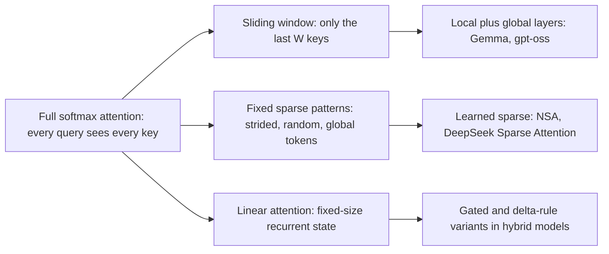

# Sliding Window, Sparse and Linear Attention

## Introduction

FlashAttention makes exact attention as fast as the hardware allows, but it does not change the arithmetic: a sequence of $N$ tokens still costs $\Theta(N^2 d)$ FLOPs per layer, and during generation every new token still reads the whole KV cache. At 128K or 1M tokens that is the dominant cost of a model (see [The Quadratic Cost of Attention](../2-llm-attention/7-llm-attention-complexity.mdx)). To go further you have to change *what* is computed: let each query look at fewer keys, or replace softmax attention with something that has a fixed-size state.

This page walks through the families that real models use, from the simplest to the most aggressive:



After this page you will be able to implement sliding-window attention with a rolling KV cache, explain attention sinks, describe how NSA and DeepSeek Sparse Attention choose which keys to attend to, derive linear attention's recurrent form, and read the relevant fields of a model's `config.json`.

## Sliding Window Attention

In sliding window attention (SWA), query $i$ attends only to keys $j$ with $i - W \lt j \le i$, the last $W$ tokens including itself. The cost per layer drops from $\Theta(N^2 d)$ to $\Theta(N W d)$, linear in $N$, and the KV cache for that layer never holds more than $W$ entries.

Information still travels further than $W$ tokens, just not in one step. After one layer, position $i$ has seen positions back to $i - W + 1$; after two layers, it has seen what *those* positions saw, so roughly $2W$ back; after $L$ layers, about $L \cdot W$. This is the same receptive-field argument as stacked convolutions. The Mistral 7B paper (Jiang et al., 2023) uses $W = 4096$ with 32 layers and points out a theoretical attention span of about 131K tokens. In practice information decays across many hops, so a sliding window model is not as good at precise long-range retrieval as a full-attention model of the same size.

**Longformer** (Beltagy, Peters and Cohan, 2020) popularized windowed attention for encoders, combining a local window with a few task-specific **global** tokens (such as the classification token) that attend to and are attended by every position. **Mistral 7B** brought SWA to decoder LLMs, with $W = 4096$ in its `config.json`:

```json
{
  "max_position_embeddings": 32768,
  "num_attention_heads": 32,
  "num_hidden_layers": 32,
  "num_key_value_heads": 8,
  "sliding_window": 4096
}
```

Interestingly, Mistral-7B-Instruct-v0.2 sets `"sliding_window": null`, returning to full attention over its 32K context. SWA saves memory, but it costs some long-range ability, and many later models chose to mix it with full attention rather than use it everywhere.

### The Rolling Buffer KV Cache

Because a window layer never looks back more than $W$ tokens, its KV cache can be a ring buffer of $W$ slots: token $t$ is written to slot $t \bmod W$, overwriting the token that just left the window. Softmax does not care about the order of the keys, so the buffer never needs reordering. The script checks a decode loop with a rolling buffer against masked full attention:

```python
import math
import torch

torch.manual_seed(0)
N, d, W = 40, 16, 8                       # sequence length, head dim, window size
q, k, v = (torch.randn(N, d) for _ in range(3))

# Prefill-style reference: full attention with a causal sliding-window mask.
i = torch.arange(N)
allowed = (i[:, None] >= i[None, :]) & (i[:, None] - i[None, :] < W)   # (N, N)
s = (q @ k.T / math.sqrt(d)).masked_fill(~allowed, float("-inf"))
ref = torch.softmax(s, dim=-1) @ v

# Decode-style: a rolling buffer that only ever holds W keys and values.
k_cache = torch.zeros(W, d); v_cache = torch.zeros(W, d)
outs = []
for t in range(N):
    slot = t % W                           # overwrite the oldest entry
    k_cache[slot], v_cache[slot] = k[t], v[t]
    n_valid = min(t + 1, W)
    kc, vc = k_cache[:n_valid], v_cache[:n_valid]   # order does not matter for softmax
    p = torch.softmax(kc @ q[t] / math.sqrt(d), dim=0)
    outs.append(p @ vc)
print("rolling buffer vs masked attention, max abs diff:",
      (torch.stack(outs) - ref).abs().max().item())
print("cache entries kept:", W, "instead of", N)
```

```text
rolling buffer vs masked attention, max abs diff: 3.5762786865234375e-07
cache entries kept: 8 instead of 40
```

Inside a FlashAttention kernel, sliding windows are almost free to support: tiles that lie entirely outside the band are skipped, like the causal tiles above the diagonal. The `flash-attn` package exposes this as `window_size=(left, right)`, and FlexAttention as a `mask_mod` ([Using FlashAttention](./4-llm-using-flash-attention.mdx) has a runnable example).

### Mixing Local and Global Layers

Most recent models that use windows interleave them with full ("global") attention layers, so some layers can still reach every token:

| Model | Local window | Pattern | Source |
| --- | --- | --- | --- |
| Gemma 2 9B | 4,096 | alternating local and global, 42 layers | `config.json`: `sliding_window` 4096, `layer_types` |
| Gemma 3 27B | 1,024 | 5 local layers per global layer, 62 layers | `config.json`: `sliding_window` 1024, `sliding_window_pattern` 6 |
| gpt-oss-120b | 128 | alternating banded window and dense, 36 layers | model card and `config.json`: `sliding_window` 128 |
| DeepSeek-V4 | 128 | sliding window combined with compressed attention | `config.json`: `sliding_window` 128 |

The payoff is in the KV cache. For Gemma 3 27B at its 131,072-token context, 10 of the 62 layers are global and keep all 131,072 positions, while the other 52 keep only 1,024. The cache holds $10 \times 131{,}072 + 52 \times 1{,}024 = 1{,}363{,}968$ layer-positions instead of $62 \times 131{,}072 = 8{,}126{,}464$, which is 16.8% of a full-attention cache of the same shape.

## Attention Sinks

Here is a puzzle. Take a full-attention model trained on 4K-token sequences and run it on an endless stream, keeping only the last 4K tokens in the KV cache. Perplexity explodes as soon as the first tokens are evicted, even though they are thousands of tokens away and seem irrelevant.

Xiao, Tian, Chen, Han and Lewis ("Efficient Streaming Language Models with Attention Sinks", 2023) explained it. Softmax weights must sum to 1, so a head that has nothing useful to attend to has to put its probability mass *somewhere*. Models learn to dump it on the first few tokens, which every later token can see; these tokens become **attention sinks**. Evict them, and that mass is spread over the remaining keys, corrupting every head that was "resting".

Their fix, **StreamingLLM**, is a cache policy: always keep the KV entries of the first few tokens (4 were enough) plus a sliding window of recent tokens. With it, Llama-2, MPT, Falcon and Pythia models ran stably on streams of up to 4 million tokens, and it was up to 22.2x faster than recomputing a sliding window from scratch. It does not extend what the model can *remember*; tokens outside the window are still gone.

A cleaner fix is to give softmax an explicit place to put unused mass. gpt-oss does this: per its model card, each attention head has a learned bias in the softmax denominator, "similar to off-by-one attention and attention sinks", so a head can attend to nothing. It is one extra logit with no value vector:

```python
import torch

torch.manual_seed(0)
scores = torch.tensor([-2.0, -1.5, -3.0, -2.5])   # a query that matches no key well

# Standard softmax must hand out all of its probability mass.
print("softmax          :", torch.softmax(scores, 0).numpy().round(3))

# gpt-oss style learned sink: one extra logit per head joins the normalizer
# but has no value vector, so mass assigned to it simply disappears.
sink = torch.tensor(1.0)                          # a learned parameter in the model
p = torch.softmax(torch.cat([scores, sink[None]]), 0)[:-1]
print("softmax with sink:", p.numpy().round(3), " sum =", round(p.sum().item(), 3))
```

```text
softmax          : [0.276 0.455 0.102 0.167]
softmax with sink: [0.042 0.07  0.016 0.026]  sum = 0.153
```

With the sink, the head can give only 15% of its attention to real tokens when none of them match. This is especially useful in short sliding windows (gpt-oss's are 128 tokens), where there is often nothing relevant in view.

## Sparse Attention: Fixed and Learned Patterns

Sliding windows are one sparsity pattern. Others were proposed early on:

- **Sparse Transformer** (Child, Gray, Radford and Sutskever, 2019): strided and fixed patterns in which each position attends to a local block plus every $k$-th position, $O(N \sqrt{N})$ cost.
- **BigBird** (Zaheer et al., 2020): window plus a few global tokens plus random connections, with a proof that this combination keeps the expressive power of full attention.

Fixed patterns decide in advance which keys matter. The idea behind modern *learned* sparse attention is that the model should decide, per query, and that the decision must be cheap and hardware-friendly. How much can a query lose by attending to only its top-$k$ keys? It depends on how concentrated its attention is. The script measures the fraction of softmax probability that falls on the top $k$ of 4,096 keys for queries of different sharpness, using an "oracle" that knows the exact scores:

```python
import torch

torch.manual_seed(0)
N, d = 4096, 64
k = torch.randn(N, d)

def mass_captured(q, top):
    """Fraction of the softmax probability that lands on the top-k keys."""
    p = torch.softmax(k @ q / d**0.5, dim=0)
    return p.topk(top).values.sum().item()

# Queries of increasing "sharpness": aligned with a handful of keys plus noise.
targets = k[[10, 700, 2048, 3500]].sum(0) / 2
queries = {"diffuse": torch.randn(d) * 0.5,
           "medium ": targets * 1.5 + torch.randn(d) * 0.5,
           "sharp  ": targets * 3.0 + torch.randn(d) * 0.5}
print("keys kept:      " + "".join(f"{t:>8d}" for t in (16, 64, 256, 1024)))
for name, q in queries.items():
    print(f"{name} query:  " + "".join(f"{mass_captured(q, t):8.3f}" for t in (16, 64, 256, 1024)))
```

```text
keys kept:            16      64     256    1024
diffuse query:     0.016   0.051   0.158   0.444
medium  query:     0.208   0.338   0.550   0.827
sharp   query:     0.955   0.977   0.992   0.999
```

A sharp query is almost fully served by 16 keys; a diffuse one needs most of the context. Trained LLMs have many sharp heads (retrieval, induction, copying), which is why top-$k$ selection works in practice, but no single fixed $k$ is safe for every head. Real systems also cannot afford the oracle: computing exact scores for all keys *is* full attention. They need a cheap way to guess which keys are in the top $k$.

### Native Sparse Attention (NSA)

NSA (Yuan et al., "Native Sparse Attention: Hardware-Aligned and Natively Trainable Sparse Attention", DeepSeek with academic collaborators, February 2025) gives each query three branches and mixes them with learned gates:

1. **Compressed attention:** keys and values are compressed in blocks (block length 32, stride 16 in the paper) into one summary token each, and the query attends to all summaries. This gives a coarse view of the whole context.
2. **Selected attention:** the compressed-attention scores rank blocks; the query attends at full resolution to the top 16 blocks of 64 tokens (always including the first block and two local blocks).
3. **Sliding window:** a 512-token local window, so local patterns do not compete with the other branches.

Selection works on contiguous blocks shared by all heads in a GQA group, so the kernel loads dense tiles, which is what makes it fast on GPUs. And NSA is trained with sparsity from the start ("natively trainable") rather than applied to a dense model after the fact. On a 27B-parameter model, the paper reports quality matching or exceeding full attention and, at 64K context, up to 11.6x faster decoding, 9.0x faster forward and 6.0x faster backward passes.

### DeepSeek Sparse Attention (DSA)

DeepSeek-V3.2-Exp (September 2025) and DeepSeek-V3.2 introduced DeepSeek Sparse Attention, added to the V3.1-Terminus model by continued training. A small **lightning indexer**, a few low-precision heads with ReLU-weighted dot products, scores every previous token for each query; then only the top-$k$ tokens go through the main Multi-head Latent Attention ([MLA](../2-llm-attention/6-llm-mla.mdx)). The `config.json` shows the indexer's size and $k$:

```json
{
  "index_head_dim": 128,
  "index_n_heads": 64,
  "index_topk": 2048,
  "max_position_embeddings": 163840
}
```

The indexer is still quadratic, but it is very cheap per pair, so the expensive attention becomes $O(N k)$ with $k = 2048$. **DeepSeek-V4** (April 2026) goes further with a hybrid its model card calls Compressed Sparse Attention (CSA) and Heavily Compressed Attention (HCA). Its `config.json` lists per-layer `compress_ratios` of 4 and 128, a `sliding_window` of 128, and `index_topk` of 1,024 (V4-Pro) or 512 (V4-Flash) for a 1,048,576-token context. The model card reports that at 1M tokens, V4-Pro needs 27% of the per-token inference FLOPs and 10% of the KV cache of DeepSeek-V3.2.

## Linear Attention

Linear attention attacks the softmax itself. Write attention for query $i$ with a general similarity function:

$$
o_i = \frac{\sum_{j \le i} \mathrm{sim}(q_i, k_j)\, v_j}{\sum_{j \le i} \mathrm{sim}(q_i, k_j)}.
$$

Softmax attention uses $\mathrm{sim}(q, k) = \exp(q \cdot k / \sqrt{d})$. Katharopoulos, Vyas, Pappas and Fleuret ("Transformers are RNNs", 2020) replaced it with a product of feature maps, $\mathrm{sim}(q, k) = \phi(q)^\top \phi(k)$, with $\phi(x) = \mathrm{elu}(x) + 1$ to keep similarities positive. Then the sums factor:

$$
o_i = \frac{\phi(q_i)^\top \sum_{j \le i} \phi(k_j)\, v_j^\top}{\phi(q_i)^\top \sum_{j \le i} \phi(k_j)}
= \frac{\phi(q_i)^\top S_i}{\phi(q_i)^\top z_i},
$$

where $S_i = \sum_{j \le i} \phi(k_j) v_j^\top \in \mathbb{R}^{d \times d}$ and $z_i = \sum_{j \le i} \phi(k_j) \in \mathbb{R}^d$. Both are running sums, so

$$
S_i = S_{i-1} + \phi(k_i)\, v_i^\top, \qquad z_i = z_{i-1} + \phi(k_i).
$$

That is a recurrent neural network with a $d \times d$ matrix state. Generation costs $O(d^2)$ per token regardless of context length, and there is no KV cache that grows. Training can still use the parallel form (an $N \times N$ masked matrix without softmax) or chunked algorithms that mix the two.

```python
import torch
import torch.nn.functional as F

torch.manual_seed(0)
N, d = 512, 32
q, k, v = (torch.randn(N, d) for _ in range(3))

def phi(x):                                    # feature map of Katharopoulos et al. (2020)
    return F.elu(x) + 1                        # positive, so the normalizer stays > 0

# Parallel (training) form: an N x N matrix, but without softmax.
A = (phi(q) @ phi(k).T).tril()                 # (N, N) causal
out_parallel = (A @ v) / A.sum(dim=1, keepdim=True)

# Recurrent (inference) form: a fixed-size state, O(d^2) per token.
S = torch.zeros(d, d)                          # running sum of phi(k_j) v_j^T
z = torch.zeros(d)                             # running sum of phi(k_j)
outs = []
for t in range(N):
    S += torch.outer(phi(k[t]), v[t])
    z += phi(k[t])
    outs.append((phi(q[t]) @ S) / (phi(q[t]) @ z))
out_recurrent = torch.stack(outs)
print("parallel vs recurrent, max abs diff:", (out_parallel - out_recurrent).abs().max().item())
print("state size per head:", S.numel() + z.numel(), "numbers, independent of N")

# How different is it from real softmax attention on the same inputs?
s = (q @ k.T / d**0.5).masked_fill(torch.ones(N, N, dtype=torch.bool).triu(1), float("-inf"))
out_softmax = torch.softmax(s, dim=-1) @ v
cos = F.cosine_similarity(out_parallel, out_softmax, dim=1).mean()
print(f"mean cosine similarity to softmax attention: {cos:.3f}")
```

```text
parallel vs recurrent, max abs diff: 4.76837158203125e-07
state size per head: 1056 numbers, independent of N
mean cosine similarity to softmax attention: 0.639
```

The two forms agree, and the state is 1,056 numbers per head whatever $N$ is. The last line shows the catch: on the same inputs, linear attention computes a rather different function from softmax attention. The exponential is what lets softmax attention focus sharply on one key; a fixed-size state that only ever *adds* $\phi(k_j) v_j^\top$ cannot forget or overwrite, so it blurs old and new information together. Plain linear attention underperformed softmax attention in language modeling, especially at in-context retrieval.

Later work fixed much of this by letting the state decay or be overwritten: data-dependent gates (as in Gated Linear Attention and Mamba-2) and the **delta rule**, which updates $S$ toward the new key-value association instead of adding to it. Gated DeltaNet (Yang, Kautz and Hatamizadeh, 2024) combines both. Production models use these layers in **hybrids** with some full-attention layers: Qwen3-Next-80B-A3B, for example, has 48 layers with `"full_attention_interval": 4` in its config, so three Gated DeltaNet layers for every gated softmax-attention layer. State space models and hybrids are covered in [State Space Models and Mamba](../13-llm-advanced-architectures/1-llm-state-space-models.mdx) and [Hybrid Models](../13-llm-advanced-architectures/2-llm-hybrid-models.mdx).

## Choosing Among Them

| Method | Attention cost per layer | KV state per layer | Exact? | Typical use |
| --- | --- | --- | --- | --- |
| Full attention (FlashAttention) | $O(N^2 d)$ | $O(N d)$ | yes | default; global layers of hybrids |
| Sliding window $W$ | $O(N W d)$ | $O(W d)$ | exact within the window | local layers (Gemma, gpt-oss, Mistral 7B) |
| Sinks plus window | $O(N W d)$ | $O((W + 4) d)$ | no | streaming inference |
| Learned top-$k$ (NSA, DSA) | $O(N k d)$ plus a cheap selector | $O(N d)$, but less is read | no | long-context models (DeepSeek-V3.2, V4) |
| Linear and gated linear | $O(N d^2)$ | $O(d^2)$ | no | hybrid models (Qwen3-Next) |

Notice that sparse attention reduces compute and memory *reads*, but in most designs the full KV cache still has to be stored, because any token might be selected later. Only windows and recurrent states shrink storage itself. Combining methods is the norm: almost every efficient long-context model of 2025 and 2026 mixes a few full-attention layers with cheaper ones.

:::warning
Do not judge these methods by perplexity alone. Approximate attention often matches full attention on perplexity and still fails at retrieving a specific fact from far back in the context. Evaluate with long-context retrieval tasks; see [Long Context in Practice](../4-llm-positional-encoding/7-llm-long-context-evaluation.mdx).
:::

## Common Mistakes

- **Equating the window with the context length.** A sliding-window layer sees $W$ tokens, the stack sees up to about $L \cdot W$, and in practice far-away information is weak. Check `sliding_window` and `layer_types` in `config.json`.
- **Evicting the first tokens from a streaming cache.** Without sinks, a full-attention model degrades as soon as the initial tokens leave the cache.
- **Assuming sparse attention shrinks the KV cache.** Top-$k$ selection reduces what is read, not what must be stored, unless the design also compresses.
- **Applying sparsity after training without adaptation.** A dense model was not trained to work with missing keys; NSA and DSA train with sparsity.
- **Treating linear attention as a drop-in replacement.** It is a different function with a fixed memory; quality depends on gating and on keeping some full-attention layers.

## Summary

- Sliding window attention costs $O(NWd)$ and needs only a $W$-slot rolling KV cache; models such as Gemma 2 and 3 and gpt-oss interleave window layers with global layers.
- Attention sinks are early tokens that absorb unused attention; StreamingLLM keeps them in the cache, and gpt-oss adds a learned per-head sink logit instead.
- Learned sparse attention selects keys per query: NSA mixes compressed, selected and window branches; DeepSeek Sparse Attention uses a lightning indexer and top-2048 selection; DeepSeek-V4 adds heavy KV compression.
- Linear attention replaces the softmax kernel with feature maps, giving an RNN with a $d \times d$ state; gated and delta-rule variants in hybrid models such as Qwen3-Next close much of its quality gap.
- Full attention remains the reference; efficient models mix it with cheaper layers rather than replacing it everywhere.

## Further Reading

- [Longformer: The Long-Document Transformer](https://arxiv.org/abs/2004.05150) (Beltagy et al., 2020): windowed plus global attention.
- [Mistral 7B](https://arxiv.org/abs/2310.06825) (Jiang et al., 2023): sliding window attention and the rolling buffer cache.
- [Efficient Streaming Language Models with Attention Sinks](https://arxiv.org/abs/2309.17453) (Xiao et al., 2023): StreamingLLM.
- [gpt-oss-120b and gpt-oss-20b Model Card](https://arxiv.org/abs/2508.10925) (OpenAI, 2025): banded window layers and learned attention sinks.
- [Generating Long Sequences with Sparse Transformers](https://arxiv.org/abs/1904.10509) (Child et al., 2019) and [Big Bird](https://arxiv.org/abs/2007.14062) (Zaheer et al., 2020): fixed sparse patterns.
- [Native Sparse Attention](https://arxiv.org/abs/2502.11089) (Yuan et al., 2025): hardware-aligned, trainable sparse attention.
- [DeepSeek-V3.2: Pushing the Frontier of Open Large Language Models](https://arxiv.org/abs/2512.02556) (DeepSeek-AI, 2025): DeepSeek Sparse Attention and the lightning indexer.
- [Transformers are RNNs](https://arxiv.org/abs/2006.16236) (Katharopoulos et al., 2020): linear attention.
- [Gated Delta Networks: Improving Mamba2 with Delta Rule](https://arxiv.org/abs/2412.06464) (Yang et al., 2024): the layer used in Qwen3-Next.
