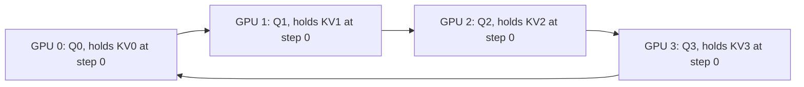

# Ring Attention and Context Parallelism

## Introduction

FlashAttention keeps the memory of attention linear in the sequence length, but linear is not small. Training a model on 1M-token sequences means storing the activations of a million positions in every layer: queries, keys, values, MLP inputs, residuals. For a 7B-class model that is far beyond the memory of one GPU even with FlashAttention and activation checkpointing. Data, tensor and pipeline parallelism (see [Distributed Training](../6-llm-pretraining/5-llm-distributed-training.mdx)) split the batch, the weights or the layers, but none of them splits a single sequence.

**Context parallelism** (CP), also called sequence parallelism in some papers, splits the sequence itself across $P$ devices. Most of a Transformer is easy to split this way: layer norms, MLPs and projections act on each token independently. Attention is the exception, because every query needs every (earlier) key and value. This page covers the three standard ways to handle it:

- **Ring Attention:** pass key/value blocks around a ring of devices and merge partial results with online softmax.
- **All-gather context parallelism:** gather all keys and values on every device, as Llama 3 did.
- **DeepSpeed-Ulysses:** use all-to-all communication to switch from sequence sharding to head sharding for the attention computation.

After this page you will be able to explain each scheme, derive when Ring Attention's communication is hidden behind computation, fix the load imbalance that causal masks create, and run a working ring attention across processes on a CPU.

## The Key Fact: Attention Merges Exactly Across Key Blocks

Everything on this page rests on the block merge from [Online Softmax and Tiling](./1-llm-online-softmax.mdx). Split the keys and values into chunks. For a query block, compute attention against one chunk at a time, keeping the chunk's output $O^{(c)}$ (normalized within the chunk) and its row-wise logsumexp $L^{(c)}$. Two partial results combine exactly:

$$
L = \log\!\left(e^{L^{(1)}} + e^{L^{(2)}}\right), \qquad
O = e^{L^{(1)} - L}\, O^{(1)} + e^{L^{(2)} - L}\, O^{(2)}.
$$

The weights $e^{L^{(c)} - L}$ are the fraction of the total softmax mass that falls in each chunk, so the formula is just a weighted average of the two partial outputs. The merge is associative and commutative. So it does not matter *which device* computes which chunk, or in what order the chunks arrive. FlashAttention uses this across tiles in SRAM; context parallelism uses it across GPUs.

## Ring Attention

Ring Attention was introduced by Hao Liu, Matei Zaharia and Pieter Abbeel in "Ring Attention with Blockwise Transformers for Near-Infinite Context" (October 2023), building on their Blockwise Parallel Transformer. Arrange $P$ devices in a ring. Device $r$ owns chunk $r$ of the queries, keys and values. In each of $P$ steps, every device:

1. computes blockwise attention of its own query chunk against the key/value chunk it currently holds and merges the result into its running $(O, L)$;
2. at the same time, sends that key/value chunk to the next device and receives one from the previous device.

After $P$ steps every query chunk has met every key/value chunk, and every device holds the exact attention output for its own queries.



Each arrow carries a key/value chunk one hop per step. No device ever holds more than its own queries, its current K/V chunk and the chunk being received, so memory per device is proportional to $N / P$, and the maximum context grows linearly with the number of devices. The simulation below plays all four devices in one process and checks the result:

```python
import math
import torch

torch.manual_seed(0)

def attn_block(q, k, v, mask=None):
    """Attention of a query chunk against one K/V chunk. Returns the partial
    output (already normalized within the chunk) and its logsumexp."""
    s = q @ k.T / math.sqrt(q.shape[-1])
    if mask is not None:
        s = s.masked_fill(~mask, float("-inf"))
    lse = torch.logsumexp(s, dim=-1)                       # (n,)
    out = torch.exp(s - lse[:, None]) @ v                  # (n, d)
    return out, lse

def merge(out, lse, out_b, lse_b):
    """Combine two partial results exactly (online softmax over chunks)."""
    new_lse = torch.logaddexp(lse, lse_b)
    w, w_b = torch.exp(lse - new_lse), torch.exp(lse_b - new_lse)
    return w[:, None] * out + w_b[:, None] * out_b, new_lse

P, N, d = 4, 1024, 64                                      # 4 "devices"
q, k, v = (torch.randn(N, d) for _ in range(3))
Qs, Ks, Vs = q.chunk(P), k.chunk(P), v.chunk(P)            # device r owns chunk r of each

outs = []
for r in range(P):                                         # what device r computes
    out, lse = None, None
    for step in range(P):
        src = (r - step) % P                               # K/V chunk that arrives at this step
        o_b, l_b = attn_block(Qs[r], Ks[src], Vs[src])
        out, lse = (o_b, l_b) if out is None else merge(out, lse, o_b, l_b)
    outs.append(out)
ref = torch.softmax(q @ k.T / math.sqrt(d), dim=-1) @ v
print("ring (non-causal) vs full attention, max abs diff:",
      (torch.cat(outs) - ref).abs().max().item())
```

```text
ring (non-causal) vs full attention, max abs diff: 3.5762786865234375e-07
```

### When Is the Communication Free?

Ring Attention is attractive because the send of the next chunk can overlap with the computation on the current one. Overlap is complete when computing one block takes at least as long as sending one. Let each device hold $c$ tokens, head dimension $d$ (summed over heads), compute throughput $F$ (FLOP/s) and link bandwidth $B$ (byte/s), with 2-byte elements:

- compute per step: the block of $c$ queries against $c$ keys costs $4 d c^2$ FLOPs ($2dc^2$ for $QK^\top$, $2dc^2$ for $PV$);
- communication per step: one chunk of keys and one of values, $2 \cdot c \cdot d \cdot 2 = 4cd$ bytes.

Overlap requires

$$
\frac{4 d c^2}{F} \ge \frac{4 c d}{B} \quad\Longleftrightarrow\quad c \ge \frac{F}{B}.
$$

The block size per device must be at least the ratio of FLOP/s to bytes per second. The paper tabulates this: for an A100 (312 TFLOP/s) over NVLink (300 GB/s, unidirectional) $c \ge$ about 1,000 tokens; over 12.5 GB/s InfiniBand, about 24,500 tokens. In other words, Ring Attention is cheap as soon as each device has a few thousand tokens over fast links, and needs much longer sequences across slow ones.

**A worked example.** A Llama-3.1-8B-shaped model (32 query heads and 8 KV heads of size 128) trained at 128K context with $P = 8$ gives 16,384 tokens per GPU. Per layer and step:

- K and V chunk: $2 \times 16{,}384 \times 8 \times 128 \times 2$ bytes $= 64$ MiB, about 0.15 ms at 450 GB/s over NVLink, or 1.3 ms at 50 GB/s over a 400 Gb/s network link;
- compute: $4 \times 16{,}384^2 \times 32 \times 128 = 4.4$ TFLOP, about 7.3 ms at a realistic 600 TFLOP/s on an H100.

Communication is hidden with plenty of margin. Grouped-query attention helps: keys and values have a quarter of the heads of the queries, so they are cheap to move. (These figures ignore the causal mask, which halves the useful compute, the topic of the next section.)

### A Real Ring Across Processes

The same algorithm with real message passing. Each of four processes (on CPU, using PyTorch's `gloo` backend) owns a quarter of the sequence, posts a non-blocking send and receive with `batch_isend_irecv`, computes on the block it holds while the message is in flight, then waits and swaps buffers:

```python
import math
import os
import torch
import torch.distributed as dist
import torch.multiprocessing as mp

N, d, WORLD = 1024, 64, 4

def ring_attention(q, k, v):
    """q, k, v: this rank's (N/P, d) chunks. K/V travel around the ring while
    each rank keeps its queries and a running (out, lse) pair."""
    rank, world = dist.get_rank(), dist.get_world_size()
    send_to, recv_from = (rank + 1) % world, (rank - 1) % world
    out = torch.zeros_like(q); lse = torch.full((q.shape[0],), float("-inf"))
    kv = torch.stack([k, v])                                  # (2, N/P, d): one message
    for step in range(world):
        if step < world - 1:                                  # start sending the next block early
            recv_buf = torch.empty_like(kv)
            reqs = dist.batch_isend_irecv([dist.P2POp(dist.isend, kv, send_to),
                                           dist.P2POp(dist.irecv, recv_buf, recv_from)])
        s = q @ kv[0].T / math.sqrt(d)                        # compute while the message is in flight
        blk_lse = torch.logsumexp(s, dim=-1)
        blk_out = torch.exp(s - blk_lse[:, None]) @ kv[1]
        new_lse = torch.logaddexp(lse, blk_lse)
        out = torch.exp(lse - new_lse)[:, None] * out + torch.exp(blk_lse - new_lse)[:, None] * blk_out
        lse = new_lse
        if step < world - 1:
            for r in reqs:
                r.wait()
            kv = recv_buf
    return out

def worker(rank):
    os.environ.update(MASTER_ADDR="127.0.0.1", MASTER_PORT="29531")
    dist.init_process_group("gloo", rank=rank, world_size=WORLD)
    torch.manual_seed(0)                                      # every rank builds the same full tensors
    q, k, v = (torch.randn(N, d) for _ in range(3))
    chunk = slice(rank * N // WORLD, (rank + 1) * N // WORLD)
    local = ring_attention(q[chunk], k[chunk], v[chunk])      # only 1/WORLD of the sequence
    gathered = [torch.empty_like(local) for _ in range(WORLD)]
    dist.all_gather(gathered, local)
    if rank == 0:
        ref = torch.softmax(q @ k.T / math.sqrt(d), dim=-1) @ v
        print("ring attention over", WORLD, "processes, max abs diff vs full:",
              (torch.cat(gathered) - ref).abs().max().item())
    dist.destroy_process_group()

if __name__ == "__main__":
    mp.spawn(worker, nprocs=WORLD)
```

```text
ring attention over 4 processes, max abs diff vs full: 3.5762786865234375e-07
```

On GPUs you would use the `nccl` backend and FlashAttention for the block computation (using its returned logsumexp), but the structure is identical.

## Causal Masks and Load Balancing

With a causal mask, query position $i$ only needs keys $j \le i$. If the sequence is split into contiguous chunks, device 0 holds the earliest queries, which need only its own chunk, while the last device needs every chunk. In a ring, device 0 sits idle for most steps while the last device does all the work, and every step waits for the slowest device.

The fix is to give every device a mix of early and late positions. Llama 3 (Dubey et al., 2024) splits the sequence into $2P$ chunks and gives device $r$ chunks $r$ and $2P - 1 - r$, a "zigzag" layout. Striped Attention (Brandon et al., 2023) instead assigns tokens round-robin, so each device holds every $P$-th token. The script runs causal ring attention with both contiguous and zigzag layouts, skipping K/V chunks that are entirely in the future, and counts the score pairs each device computes:

```python
import math
import torch

torch.manual_seed(0)
P, N, d = 4, 1024, 64
q, k, v = (torch.randn(N, d) for _ in range(3))
pos = torch.arange(N)

def layout(kind):
    """Which token positions each rank owns."""
    if kind == "contiguous":
        return list(pos.chunk(P))
    c = pos.chunk(2 * P)                                   # zigzag: rank r gets c[r] and c[2P-1-r]
    return [torch.cat([c[r], c[2 * P - 1 - r]]) for r in range(P)]

def ring_causal(kind):
    owned = layout(kind)
    outs, work = torch.empty(N, d), []
    for r in range(P):
        qi = owned[r]
        num = torch.zeros(len(qi), d); m = torch.full((len(qi),), float("-inf"))
        den = torch.zeros(len(qi)); pairs = 0
        for step in range(P):
            kj = owned[(r - step) % P]                      # K/V positions arriving this step
            mask = qi[:, None] >= kj[None, :]               # causal, using global positions
            if not mask.any():
                continue                                    # whole chunk is in the future: skip
            pairs += int(mask.sum())
            s = (q[qi] @ k[kj].T / math.sqrt(d)).masked_fill(~mask, float("-inf"))
            m_new = torch.maximum(m, s.max(dim=1).values)
            a = torch.exp(m - m_new); p = torch.exp(s - m_new[:, None])
            num = a[:, None] * num + p @ v[kj]; den = a * den + p.sum(1); m = m_new
        outs[qi] = num / den[:, None]
        work.append(pairs)
    return outs, work

S = (q @ k.T / math.sqrt(d)).masked_fill(pos[None, :] > pos[:, None], float("-inf"))
ref = torch.softmax(S, dim=-1) @ v
for kind in ("contiguous", "zigzag"):
    out, work = ring_causal(kind)
    print(f"{kind:10s} max abs diff={(out - ref).abs().max():.1e}  "
          f"score pairs per rank={work}  max/mean={max(work) / (sum(work) / P):.2f}")
```

```text
contiguous max abs diff=6.0e-07  score pairs per rank=[32896, 98432, 163968, 229504]  max/mean=1.75
zigzag     max abs diff=6.0e-07  score pairs per rank=[131200, 131200, 131200, 131200]  max/mean=1.00
```

Both layouts give the exact causal result, because the mask uses global positions. With contiguous chunks the busiest device does 7 times the work of the idlest, and the run is 1.75 times slower than a balanced one. Zigzag gives every device exactly the same work. Remember that the layout affects everything that depends on position, such as RoPE, which must use each token's *global* position index.

## All-Gather Context Parallelism

A simpler alternative: before attention, every device all-gathers the full keys and values, then computes attention for its own query chunk against all of them. The Llama 3 paper used exactly this for training at up to 128K tokens, with the zigzag split for balance, and gave two reasons for choosing it over a ring:

1. it is easier to support arbitrary attention masks, such as document masks for packed sequences;
2. the exposed all-gather latency is small, because with GQA the K and V tensors are much smaller than Q, and attention computation is $O(N^2)$ while the all-gather is $O(N)$.

The cost is memory: every device temporarily holds the keys and values of the whole sequence for one layer. That is fine at 128K with GQA and a moderate CP degree, but it limits how far the approach scales.

## DeepSpeed-Ulysses: Switching From Sequence to Head Sharding

DeepSpeed-Ulysses (Jacobs et al., 2023) takes a different route. Attention heads are independent, so instead of passing K/V blocks around, it reshards:

1. Before attention, each device holds all heads for its $N/P$ tokens. An **all-to-all** sends each device's slice of head group $g$ to device $g$. Afterwards, each device holds $H/P$ heads for **all** $N$ tokens.
2. Each device runs ordinary FlashAttention on its heads, over the full sequence; any mask works.
3. A second all-to-all returns to sequence sharding.

```python
import torch
import torch.nn.functional as F

torch.manual_seed(0)
P, H, N, d = 4, 8, 1024, 64                          # 4 devices, 8 heads
q, k, v = (torch.randn(H, N, d) for _ in range(3))   # (heads, seq, head_dim)

# Start: device r holds ALL heads for its sequence chunk r.
seq_shards = [tuple(t[:, r * N // P:(r + 1) * N // P] for t in (q, k, v)) for r in range(P)]

# All-to-all #1: device r sends head group g of its chunk to device g.
# Afterwards device g holds heads [g*H/P, (g+1)*H/P) for the FULL sequence.
def all_to_all_seq_to_heads(shards, idx):
    return [torch.cat([shards[src][idx][g * H // P:(g + 1) * H // P] for src in range(P)], dim=1)
            for g in range(P)]
q_h, k_h, v_h = (all_to_all_seq_to_heads(seq_shards, i) for i in range(3))

# Each device runs ordinary (Flash)Attention on its heads, full sequence.
o_h = [F.scaled_dot_product_attention(q_h[g], k_h[g], v_h[g], is_causal=True) for g in range(P)]

# All-to-all #2: back to sequence sharding, all heads.
o_seq = [torch.cat([o_h[g][:, r * N // P:(r + 1) * N // P] for g in range(P)], dim=0)
         for r in range(P)]

ref = F.scaled_dot_product_attention(q, k, v, is_causal=True)
print("Ulysses vs full attention, max abs diff:", (torch.cat(o_seq, dim=1) - ref).abs().max().item())
print("heads per device during attention:", q_h[0].shape[0], "of", H)
```

```text
Ulysses vs full attention, max abs diff: 0.0
heads per device during attention: 2 of 8
```

The result is bit-identical to full attention because each head is computed in one piece. Ulysses keeps the per-link communication volume constant when the sequence length and the number of devices grow together, and it reuses the unmodified attention kernel. Its limit is the head count: the parallel degree cannot exceed the number of heads, and with GQA the key/value heads (often only 8) are the tighter constraint. **USP** (Fang and Zhao, 2024) combines both, Ulysses within a node and Ring Attention across nodes.

## Comparing the Schemes

| | Ring Attention | All-gather CP | DeepSpeed-Ulysses |
| --- | --- | --- | --- |
| Communication | $P - 1$ point-to-point K/V passes, overlapped | one all-gather of K and V per layer | two all-to-alls per attention layer (Q, K, V in; O out) |
| Extra memory per device | about two K/V chunks | full K and V of the sequence | full sequence for $H/P$ heads |
| Max degree | unlimited | limited by gathered K/V memory | number of (KV) heads |
| Masks | needs care per step | easy | easy |
| Kernel | FlashAttention plus merge | FlashAttention | FlashAttention, unchanged |
| Used by | Ring Attention paper, Large World Model | Llama 3 training | DeepSpeed, Megatron-style frameworks, USP |

In PyTorch, `torch.distributed.tensor.experimental.context_parallel` (a prototype API) patches `scaled_dot_product_attention` to run context-parallel over a device mesh and shards your buffers along the sequence dimension; `set_rotate_method("allgather")` (the default) or `"alltoall"` selects how K/V shards move. Megatron-Core exposes the same idea through its `--context-parallel-size` option. GPU-only sketch, launched with `torchrun --nproc-per-node 8`:

```python
# GPU-only, multi-GPU: torchrun --nproc-per-node 8 train_cp.py
import torch
from torch.distributed.device_mesh import init_device_mesh
from torch.distributed.tensor.experimental import context_parallel

mesh = init_device_mesh("cuda", (8,), mesh_dim_names=("cp",))
model = build_model().cuda()                          # any model that calls F.scaled_dot_product_attention
tokens = torch.randint(0, 32000, (1, 131072), device="cuda")    # (batch, seq)
labels = torch.roll(tokens, -1, dims=1)

with context_parallel(mesh, buffers=[tokens, labels], buffer_seq_dims=[1, 1]):
    loss = torch.nn.functional.cross_entropy(model(tokens).flatten(0, 1), labels.flatten())
    loss.backward()                                   # each rank holds 131072 / 8 tokens
```

Context parallelism also matters at inference time: prefilling a million-token prompt on one GPU is slow, and serving engines can split the prefill across GPUs the same way.

:::tip
Context parallelism composes with the other kinds. A typical long-context training layout nests them as tensor parallelism inside a node, then context parallelism, then pipeline and data parallelism; Llama 3 ordered its dimensions [TP, CP, PP, DP] from innermost to outermost so the most bandwidth-hungry dimension uses the fastest links.
:::

## Common Mistakes

- **Merging partial outputs by plain averaging.** Partial results must be weighted by their logsumexp; a plain average is wrong whenever chunks hold different amounts of attention mass.
- **Using local positions for RoPE or masks.** After sharding (and especially after zigzag reordering), each token's position is its global index, not its index within the chunk.
- **Contiguous chunks with a causal mask.** This leaves devices idle; use zigzag or striped layouts.
- **Ring Attention over slow links with small chunks.** If $c \lt F / B$, communication is exposed and the ring becomes slower than expected.
- **Ulysses degree above the head count.** The all-to-all needs at least one (KV) head per device; with GQA that can be as few as 8.

## Summary

- Context parallelism splits one sequence across devices; attention is the only layer that needs special handling.
- Partial attention results over key blocks merge exactly via their logsumexp, so key/value chunks can be processed on any device in any order.
- Ring Attention passes K/V chunks around a ring while computing, with communication hidden when each device holds at least $F/B$ tokens, about 1K over NVLink.
- Causal masks need zigzag or striped token layouts to balance work; all-gather CP (Llama 3) trades memory for simplicity, and DeepSpeed-Ulysses reshards to heads with all-to-all.
- PyTorch's prototype `context_parallel` API and Megatron-Core implement these schemes on top of FlashAttention kernels.

## Further Reading

- [Ring Attention with Blockwise Transformers for Near-Infinite Context](https://arxiv.org/abs/2310.01889) (Liu, Zaharia, Abbeel, 2023): the ring algorithm and the $c \ge F/B$ analysis.
- [Blockwise Parallel Transformer for Large Context Models](https://arxiv.org/abs/2305.19370) (Liu and Abbeel, 2023): the blockwise computation Ring Attention builds on.
- [Striped Attention: Faster Ring Attention for Causal Transformers](https://arxiv.org/abs/2311.09431) (Brandon et al., 2023): load balancing for causal masks.
- [DeepSpeed Ulysses](https://arxiv.org/abs/2309.14509) (Jacobs et al., 2023): all-to-all sequence parallelism.
- [USP: A Unified Sequence Parallelism Approach for Long Context Generative AI](https://arxiv.org/abs/2405.07719) (Fang and Zhao, 2024): combining Ulysses and Ring.
- [The Llama 3 Herd of Models](https://arxiv.org/abs/2407.21783) (Dubey et al., 2024): section 3.3 describes all-gather context parallelism with zigzag chunks.
- [PyTorch context parallel tutorial](https://docs.pytorch.org/tutorials/unstable/context_parallel.html): the prototype `context_parallel` API.
