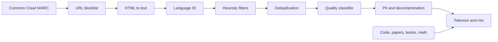

# Pretraining Data: Collection, Filtering and Deduplication

## Introduction

A base model is a compressed picture of its training data. The architecture decides how well it can compress, but the data decides what there is to compress. Most of the gains between Llama 2 and Llama 3 came from data, not from new layers: Meta's Llama 3 paper says so directly, and the token count grew from about 1.8 trillion to about 15 trillion.

This page follows a web page from the moment a crawler downloads it to the moment its tokens enter a training batch. You will see the stages every modern pipeline shares (extraction, language identification, heuristic filters, model-based quality filters, deduplication, decontamination and mixing), the actual thresholds published by FineWeb, Gopher, DCLM and Llama 3, and small Python implementations of the key pieces: a rule-based filter, a fastText-style quality classifier and MinHash with locality-sensitive hashing.

After reading it you should be able to read the data section of a model report, reason about why a filter exists and what it costs, and build a small but realistic cleaning pipeline yourself.

## Where the Tokens Come From

The largest single source for almost every open model is **Common Crawl**, a non-profit that has crawled the public web since 2008 and publishes a new snapshot roughly every month. The October 2026 snapshot (`CC-MAIN-2026-43`) contains 2.16 billion pages and 371 TiB of uncompressed data. Each snapshot ships in three formats:

| Format | Contents | Used for |
| --- | --- | --- |
| WARC | raw HTTP responses, full HTML | best-quality text extraction |
| WAT | metadata and links as JSON | link graphs, URL filtering |
| WET | plain text that Common Crawl extracted | quick experiments; noisy |

Web text is cheap and broad but noisy. Pipelines therefore blend it with smaller curated sources: code (GitHub, deduplicated and license-filtered, for example The Stack), scientific papers (arXiv), books, Wikipedia, math pages, and more and more often synthetic data written by other models. The report for Llama 3 gives the final mix as roughly 50% general knowledge, 25% math and reasoning, 17% code and 8% multilingual tokens.

How much text is that? FineWeb, the open English web dataset from Hugging Face (Penedo et al., 2024), has 15 trillion GPT-2 tokens from 96 Common Crawl snapshots. Qwen2.5 was pretrained on 18 trillion tokens and Qwen3 on about 36 trillion; DeepSeek-V3 on 14.8 trillion. One trillion tokens of English is about 4 TB of plain text.



The order matters for cost. Cheap filters run first so that expensive ones (a neural classifier over billions of documents) see less data. FineWeb-Edu's classifier alone took about 6,000 H100 GPU hours to run over FineWeb.

## Extraction and Language Identification

**Text extraction** turns HTML into clean prose. The WET files keep navigation menus, cookie banners and footer links, so serious pipelines start from WARC and run an extractor such as trafilatura (used by RefinedWeb and FineWeb) or a custom parser (Llama 3). The FineWeb authors trained small models on the same snapshot extracted both ways and found the trafilatura version clearly better, because the WET text kept too much boilerplate and menu text. Llama 3 reports two more details worth copying: keep the `alt` text of images because math is often stored there, and strip Markdown markers, which hurt a model trained mainly on web text.

**Language identification** is usually the fastText `lid.176` model, a linear classifier over character n-grams that labels 176 languages and runs at thousands of documents per second per core. FineWeb keeps a document when its English score is at least 0.65. Multilingual pipelines (FineWeb-2, Llama 3) keep every language and filter each one with its own thresholds, because a rule tuned for English, such as a mean word length, is wrong for Chinese or Finnish.

## Heuristic Quality Filters

After extraction most documents are still junk: spam, boilerplate, auto-generated lists, error logs. Rules catch the bulk of it cheaply. Two families of rules are reused everywhere.

The **Gopher rules** come from DeepMind's MassiveText corpus (Rae et al., 2021). A document is removed if it has fewer than 50 or more than 100,000 words, if its mean word length is outside 3 to 10 characters, if the ratio of `#` symbols or ellipses to words exceeds 0.1, if more than 90% of its lines start with a bullet, if more than 30% end with an ellipsis, if fewer than 80% of its words contain a letter, or if it lacks at least two common English stop words such as "the" and "of". The same paper adds repetition filters that remove documents with many duplicated lines or n-grams.

The **C4 rules** (Raffel et al., 2020) drop lines without terminal punctuation, lines mentioning JavaScript, pages with "lorem ipsum" or curly braces, and short pages. FineWeb found that the terminal-punctuation rule alone removed about 30% of tokens, so it kept the other C4 rules and added three of its own, each chosen by comparing the statistics of documents that a filter keeps against those it removes:

- remove when at most 12% of lines end in punctuation;
- remove when at least 10% of characters sit in duplicated lines;
- remove when at least 67% of lines are shorter than 30 characters.

Here is a compact implementation of both families. Thresholds match the papers; real pipelines (datatrove, NeMo Curator, Dolma) add language-specific tokenization and many more rules.

```python
import re

STOP_WORDS = {"the", "be", "to", "of", "and", "that", "have", "with"}

def gopher_quality(text):
    """Return a list of reasons the document fails (empty list = keep)."""
    words = text.split()
    lines = [l for l in text.split("\n") if l.strip()]
    reasons = []
    n = len(words)
    if not 50 <= n <= 100_000:
        reasons.append(f"word count {n}")
    if n:
        mean_len = sum(len(w) for w in words) / n
        if not 3 <= mean_len <= 10:
            reasons.append(f"mean word length {mean_len:.1f}")
        symbols = text.count("#") + text.count("...")
        if symbols / n > 0.1:
            reasons.append("symbol-to-word ratio")
        alpha = sum(1 for w in words if re.search(r"[a-zA-Z]", w)) / n
        if alpha < 0.8:
            reasons.append(f"alphabetic words {alpha:.2f}")
        if sum(1 for w in words if w.lower() in STOP_WORDS) < 2:
            reasons.append("fewer than 2 stop words")
    if lines:
        bullets = sum(1 for l in lines if l.lstrip().startswith(("-", "*", "•")))
        if bullets / len(lines) > 0.9:
            reasons.append("mostly bullet lines")
        ellipsis = sum(1 for l in lines if l.rstrip().endswith(("...", "…")))
        if ellipsis / len(lines) > 0.3:
            reasons.append("many lines end with ellipsis")
    return reasons

def fineweb_custom(text):
    lines = [l for l in text.split("\n") if l.strip()]
    reasons = []
    punct = sum(1 for l in lines if l.rstrip()[-1] in ".!?\"'") / len(lines)
    if punct <= 0.12:
        reasons.append(f"lines ending in punctuation {punct:.2f}")
    seen, dup_chars = set(), 0
    for l in lines:
        if l in seen:
            dup_chars += len(l)
        seen.add(l)
    if dup_chars / sum(len(l) for l in lines) >= 0.1:
        reasons.append("duplicated lines")
    short = sum(1 for l in lines if len(l) < 30) / len(lines)
    if short >= 0.67:
        reasons.append(f"short lines {short:.2f}")
    return reasons

article = ("The heat equation describes how temperature changes over time in a solid. "
           "If one end of a metal rod is held in a flame, heat flows toward the cold end, and the "
           "rate of flow depends on the material. Engineers use the equation to size cooling fins, "
           "and physicists use the same mathematics to model diffusion of particles in a gas. "
           "In this article we derive the equation from conservation of energy and solve it for a "
           "rod of length one with both ends kept at zero degrees.\n") * 1
menu = "\n".join(["Home", "About us", "Products", "Contact", "Login", "Cart (0)"] * 12)
spam = "\n".join(["- BUY CHEAP WATCHES NOW!!! best price #deal #sale #watch"] * 20)

for name, doc in [("article", article), ("menu", menu), ("spam", spam)]:
    print(f"{name:8s} gopher={gopher_quality(doc)}")
    print(f"{'':8s} fineweb={fineweb_custom(doc)}")
```

```text
article  gopher=[]
         fineweb=[]
menu     gopher=['fewer than 2 stop words']
         fineweb=['lines ending in punctuation 0.00', 'duplicated lines', 'short lines 1.00']
spam     gopher=['symbol-to-word ratio', 'fewer than 2 stop words', 'mostly bullet lines']
         fineweb=['lines ending in punctuation 0.00', 'duplicated lines']
```

The article passes everything. The navigation menu has almost no stop words and nothing but short, unpunctuated, repeated lines. The spam fails on hashtags and bullet lines. Notice that each rule catches a different kind of junk: that is why pipelines stack many weak rules instead of trusting one.

:::note
Every filter is a hypothesis about data quality, and hypotheses can be wrong. The only reliable test is an ablation: train two small models (FineWeb used 1.71B-parameter Llama-style models on 28B tokens) on data with and without the filter and compare benchmark scores. Rules that look sensible sometimes make the model worse.
:::

## Model-Based Quality Filtering

Rules remove obvious junk. They cannot tell a clear explanation of photosynthesis from a grammatical but empty product page. For that, modern pipelines train a classifier to score each document and keep the top fraction.

The idea is old. GPT-3 (Brown et al., 2020) trained a classifier with WebText, Wikipedia and books as positives and raw Common Crawl as negatives. CCNet (Wenzek et al., 2019) ranked documents by the perplexity of a small n-gram model trained on Wikipedia. What changed in 2024 is the choice of positives:

| Dataset or model | Positive examples | Classifier | Kept |
| --- | --- | --- | --- |
| GPT-3 (2020) | WebText, Wikipedia, books | logistic regression on hashed features | sampled by score |
| Llama 3 (2024) | documents Llama 2 judged high quality; pages referenced by Wikipedia | fastText and DistilRoberta | tuned by ablation |
| DCLM-Baseline (Li et al., 2024) | OpenHermes 2.5 instructions and top r/ExplainLikeImFive posts | fastText | top 10% of documents |
| FineWeb-Edu (Penedo et al., 2024) | Llama-3-70B-Instruct scores of educational value, 0 to 5 | linear head on Snowflake-arctic-embed-m | score of 3 or more |

FineWeb-Edu shows the recipe in detail. An LLM annotated 460,000 pages from one snapshot with an additive 0 to 5 score for educational value. A small regression head on a frozen embedding model learned to predict that score (F1 of 82% for the "3 or more" decision on held-out pages), and it was run over all 15 trillion tokens. Only 1.3 trillion survived, yet models trained on it beat models trained on the full FineWeb on knowledge and reasoning benchmarks such as MMLU and ARC. DCLM made the same point: a strict filter that keeps the top 10% of documents gave a 7B model a 64% 5-shot MMLU score after 2.6 trillion tokens.

The fastText-style classifier is just averaged n-gram embeddings followed by a linear layer. Here is the idea in PyTorch with the hashing trick and toy data:

```python
import zlib
import torch
import torch.nn as nn
import torch.nn.functional as F

torch.manual_seed(0)
BUCKETS = 2**16  # hashing trick: every word and word bigram maps to one of 65,536 rows

def features(text):
    w = text.lower().split()
    grams = w + [a + " " + b for a, b in zip(w, w[1:])]
    return torch.tensor([zlib.crc32(g.encode()) % BUCKETS for g in grams])

class FastTextLike(nn.Module):
    def __init__(self, dim=16):
        super().__init__()
        self.emb = nn.EmbeddingBag(BUCKETS, dim, mode="mean")  # average of n-gram vectors
        self.out = nn.Linear(dim, 1)
    def forward(self, ids, offsets):
        return self.out(self.emb(ids, offsets)).squeeze(-1)    # (batch,) logit

good = ["the derivative measures how fast a function changes at a point",
        "photosynthesis converts light energy into chemical energy stored in glucose",
        "a hash table stores keys in buckets so lookups take constant time on average",
        "the french revolution began in 1789 and reshaped politics across europe",
        "to solve the equation subtract three from both sides and divide by two",
        "mitochondria produce most of the energy a cell needs through respiration"]
bad = ["click here to win a free iphone now limited offer",
       "best cheap watches buy now free shipping hot deal",
       "login register cart checkout home about contact",
       "omg lol this is sooo random follow me for more",
       "casino bonus spins sign up today win big money",
       "cookie policy accept all cookies privacy terms of use"]
texts, labels = good + bad, torch.tensor([1.0] * 6 + [0.0] * 6)

def batch(ts):
    feats = [features(t) for t in ts]
    offsets = torch.tensor([0] + [len(f) for f in feats[:-1]]).cumsum(0)
    return torch.cat(feats), offsets

model = FastTextLike()
opt = torch.optim.Adam(model.parameters(), lr=0.05)
ids, offs = batch(texts)
for step in range(100):
    loss = F.binary_cross_entropy_with_logits(model(ids, offs), labels)
    opt.zero_grad(); loss.backward(); opt.step()
print(f"final train loss {loss.item():.4f}")

tests = ["the heart pumps blood through arteries and veins to every organ",
         "free bonus click now win money today",
         "sorting algorithms like merge sort divide the list and merge sorted halves"]
with torch.no_grad():
    scores = torch.sigmoid(model(*batch(tests)))
for t, s in zip(tests, scores):
    print(f"{s.item():.3f}  {t}")
```

```text
final train loss 0.0000
0.803  the heart pumps blood through arteries and veins to every organ
0.003  free bonus click now win money today
0.715  sorting algorithms like merge sort divide the list and merge sorted halves
```

Twelve examples are of course far too few for a real classifier; production classifiers train on hundreds of thousands of labels. The point is the shape of the computation: no attention and no deep network, just a bag of hashed n-grams, so it scores millions of documents per hour on a CPU.

Aggressive quality filtering has a price. It narrows the distribution: an educational-value classifier removes fiction, forum chat and humor along with spam, and a model trained only on that subset can be worse at conversational or creative tasks. It also shrinks the pool, which matters when you need many trillions of tokens. Teams therefore keep several quality buckets and decide in the mix how often to sample each one.

## Deduplication with MinHash

The web repeats itself: mirrors, scraped copies, templates, license texts, the same news story on fifty sites. Duplicates waste compute and, worse, make the model memorize. Lee et al. (2022, "Deduplicating Training Data Makes Language Models Better") showed that deduplicated training data reduced memorized output by about ten times and improved efficiency.

**Exact deduplication** hashes each document (or each line, or each span of 50 or more tokens using a suffix array) and drops repeats. It is cheap but misses copies that differ by a date or an ad.

**Near-duplicate detection** uses MinHash (Broder, 1997). Represent each document as the set $S$ of its word 5-grams ("shingles"). The similarity of two documents is their Jaccard index:

$$
J(A, B) = \frac{\lvert S_A \cap S_B \rvert}{\lvert S_A \cup S_B \rvert}
$$

Comparing every pair of a billion documents is impossible, so MinHash compresses each set into a short signature. Take a random hash function $h$ and keep only the smallest hash value in the set, $m(S) = \min_{s \in S} h(s)$. The key fact: for a random hash, the element of $S_A \cup S_B$ with the smallest hash is equally likely to be any element of the union, and the two minimums agree exactly when that element is in the intersection. So

$$
P\big(m(S_A) = m(S_B)\big) = J(A, B)
$$

With $k$ independent hash functions, the fraction of matching minimums is an unbiased estimate of $J$ with standard deviation $\sqrt{J(1-J)/k}$. FineWeb uses $k = 112$.

Signatures are still compared pairwise, which is too slow. **Locality-sensitive hashing (LSH)** fixes that. Split the $k$ values into $b$ bands of $r$ rows ($k = br$; FineWeb uses $b = 14$, $r = 8$). Two documents become a candidate pair if all $r$ values match in at least one band, which a hash table finds in linear time. For a pair with similarity $s$:

$$
P(\mathrm{candidate}) = 1 - \left(1 - s^r\right)^b
$$

Numeric check for $s = 0.75$: $0.75^8 = 0.1001$, so one band matches with probability 0.1001; no band matches with probability $(1 - 0.1001)^{14} = 0.228$; the pair is caught with probability 0.772. The curve is an S-shape centered near $(1/b)^{1/r} = 0.72$, so pairs above about 75% similarity are almost always caught and pairs below 50% almost never.

```python
import hashlib
import numpy as np

rng = np.random.default_rng(0)
NUM_HASHES, BANDS, ROWS = 112, 14, 8          # FineWeb setting: 14 bands x 8 rows
PRIME = (1 << 61) - 1                          # a Mersenne prime for universal hashing
A = rng.integers(1, PRIME, size=NUM_HASHES, dtype=np.uint64)
B = rng.integers(0, PRIME, size=NUM_HASHES, dtype=np.uint64)

def shingles(text, n=5):
    words = text.lower().split()
    return {" ".join(words[i:i + n]) for i in range(len(words) - n + 1)}

def base_hash(s):
    return int.from_bytes(hashlib.sha1(s.encode()).digest()[:8], "little") % PRIME

def minhash(text):
    h = np.array([base_hash(s) for s in shingles(text)], dtype=object)   # (num_shingles,)
    # (NUM_HASHES, num_shingles): permuted hash a*h+b mod p, then the minimum per row
    perm = (A.astype(object)[:, None] * h[None, :] + B.astype(object)[:, None]) % PRIME
    return perm.min(axis=1)                                              # (NUM_HASHES,)

def jaccard(a, b):
    sa, sb = shingles(a), shingles(b)
    return len(sa & sb) / len(sa | sb)

def band_keys(sig):
    return [hash(tuple(sig[i * ROWS:(i + 1) * ROWS])) for i in range(BANDS)]

base = ("the quick brown fox jumps over the lazy dog while the farmer watches from the porch "
        "and the cat sleeps in the warm afternoon sun near the old red barn by the river ") * 3
near = base.replace("farmer watches", "farmer quietly watches")
other = ("gradient descent updates every weight in the direction that lowers the loss and the "
         "learning rate controls how far each step moves the parameters of the network ") * 3

sig = {k: minhash(v) for k, v in [("base", base), ("near", near), ("other", other)]}
for x, y in [("base", "near"), ("base", "other")]:
    est = np.mean(sig[x] == sig[y])
    shared_bands = sum(a == b for a, b in zip(band_keys(sig[x]), band_keys(sig[y])))
    print(f"{x}-{y}: true Jaccard={jaccard(eval(x), eval(y)):.3f} "
          f"MinHash estimate={est:.3f} bands matched={shared_bands}/{BANDS}")

# probability that a pair with Jaccard s collides in at least one band
for s in [0.5, 0.6, 0.7, 0.75, 0.8, 0.9]:
    print(f"s={s:.2f}  P(candidate)={1 - (1 - s**ROWS)**BANDS:.3f}")
```

```text
base-near: true Jaccard=0.763 MinHash estimate=0.812 bands matched=1/14
base-other: true Jaccard=0.000 MinHash estimate=0.000 bands matched=0/14
s=0.50  P(candidate)=0.053
s=0.60  P(candidate)=0.211
s=0.70  P(candidate)=0.565
s=0.75  P(candidate)=0.772
s=0.80  P(candidate)=0.924
s=0.90  P(candidate)=1.000
```

With 112 hashes the estimate (0.81) is within one standard deviation (about 0.04) of the true Jaccard index (0.76). The near duplicate matched in one of the 14 bands, which is enough to flag it; then the documents are grouped into clusters (connected components) and one document per cluster is kept.

FineWeb found a surprising subtlety. Deduplicating globally across all 96 snapshots removed up to 90% of the oldest crawls and did not improve the models. The documents that survived were, on average, worse than the ones removed, because good pages tend to be copied and survive crawl after crawl while junk appears once. FineWeb therefore deduplicates within each snapshot and keeps the cross-snapshot repeats. Llama 3 made a different choice: global URL-level and MinHash deduplication plus aggressive line-level deduplication (remove lines that appear more than six times in each bucket of 30 million documents). There is no single right answer; each team picks by ablation.

## Safety, Decontamination and the Final Mix

Three more steps happen before training.

**PII and safety.** Pipelines block domains with adult or harmful content, replace email addresses and IP addresses with placeholders (FineWeb does this), and filter toxic text with word lists or classifiers. Over-filtering toxicity has a known side effect: the model sees less text from some dialects and communities, and it learns less about the very content a safety classifier later has to recognize.

**Decontamination.** If benchmark questions are in the training data, benchmark scores measure memory, not ability. Teams search the corpus for long n-gram overlaps (for example 13-grams, as GPT-3 did) with test sets and remove matching documents. The [benchmark contamination page](../12-llm-evaluation/5-llm-contamination.mdx) covers how to test for leaks after the fact.

**Mixing.** The final dataset is a weighted mixture of sources, and the weights are hyperparameters. Llama 3 used a knowledge classifier to downsample over-represented categories such as arts and entertainment, then ran scaling-law experiments on small models to choose the mix. A common late-stage trick is **annealing**: in the last few percent of training, while the learning rate decays to zero, upsample the highest-quality data (math, code, curated text). Llama 3 annealed on its final 40 million tokens, and the [optimizers page](./3-llm-optimizers-and-schedules.mdx) explains why the decay phase is the right moment.

**Repetition.** When unique data runs out, you can repeat it. Muennighoff et al. (2023, "Scaling Data-Constrained Language Models") found that up to about four epochs over the same data gave almost the same loss as fresh data, and that the value of more repetitions fell toward zero after that. The [scaling laws page](./2-llm-scaling-laws.mdx) shows how this changes compute-optimal choices.

## Worked Scenario: Budgeting a One-Trillion-Token Corpus

Suppose you want 1 trillion clean English tokens for a 1B-parameter model and you start from Common Crawl. A rough budget using the published FineWeb numbers:

| Stage | What it removes | Tokens left (rough) |
| --- | --- | --- |
| 96 snapshots after URL filter, trafilatura and English ID | non-English, adult domains, boilerplate | far more than needed |
| Gopher and C4 rules | spam, lists, very short pages | |
| Per-snapshot MinHash | near duplicates inside each crawl | about 20T before custom filters |
| FineWeb custom rules | about 22% of the remaining tokens | 15T (FineWeb) |
| Educational classifier, score of 3 or more | everything not clearly educational | 1.3T (FineWeb-Edu) |

So 1 trillion high-quality tokens is roughly what the strictest public English filter leaves from the entire public history of Common Crawl. That is why frontier teams train on 15 to 36 trillion tokens with a mix of quality levels, invest in multilingual data, code and math, repeat their best data for a few epochs, and increasingly generate synthetic data. It is also why the FineWeb-Edu authors released a looser version that keeps scores of 2 and above.

The second practical lesson is about tooling. At this scale you never write the loop yourself; you use a framework that shards the work over thousands of CPU jobs, such as Hugging Face `datatrove` (which produced FineWeb), NVIDIA NeMo Curator, or AI2's Dolma toolkit. The algorithms are exactly the ones on this page.

## Common Mistakes

- Filtering with English rules on non-English text. Word length, stop words and punctuation rules all depend on the language; apply them per language with their own thresholds.
- Trusting a filter because it looks sensible. Measure each change with a small-model ablation on a fixed token budget, and evaluate on several benchmark types so a filter that helps MMLU but hurts generation is noticed.
- Using Python's built-in `hash()` for MinHash or feature hashing across processes. String hashing is randomized per process; use a stable hash such as SHA-1, xxHash or CRC32.
- Deduplicating too aggressively. Removing every cross-crawl repeat can leave lower-quality text, as FineWeb showed; and removing all common lines also deletes useful frequent text.
- Forgetting decontamination. A benchmark leak makes every later evaluation meaningless.
- Training only on the highest classifier bucket. Diversity matters; keep lower buckets in the mix at a lower sampling rate.

## Summary

- Common Crawl provides most of the raw text; curated code, papers, books, math and synthetic data complete the mix.
- Pipelines run cheap stages first: URL blocklist, HTML extraction from WARC, fastText language ID, then rule filters such as Gopher, C4 and FineWeb's custom rules.
- Model-based classifiers (DCLM's fastText, FineWeb-Edu's LLM-annotated regressor) select the documents that help models most, at the cost of diversity and volume.
- MinHash estimates Jaccard similarity of 5-gram sets with $P(m_A = m_B) = J$; LSH banding with $1 - (1 - s^r)^b$ finds near duplicates in linear time.
- Deduplication, PII removal, decontamination and data mixing finish the pipeline; every choice is validated by small-model ablations.

## Further Reading

- [The FineWeb Datasets (Penedo et al., 2024)](https://arxiv.org/abs/2406.17557) - the most detailed open description of a web pipeline, with ablations for every step.
- [FineWeb-Edu dataset card](https://huggingface.co/datasets/HuggingFaceFW/fineweb-edu) - the educational subset and its classifier.
- [DataComp-LM (Li et al., 2024)](https://arxiv.org/abs/2406.11794) - a benchmark for data curation and the DCLM-Baseline fastText filter.
- [Scaling Language Models: Methods, Analysis and Insights from Training Gopher (Rae et al., 2021)](https://arxiv.org/abs/2112.11446) - source of the Gopher quality and repetition rules.
- [Deduplicating Training Data Makes Language Models Better (Lee et al., 2022)](https://arxiv.org/abs/2107.06499) - exact and near-duplicate removal and its effect on memorization.
- [The Llama 3 Herd of Models (Grattafiori et al., 2024)](https://arxiv.org/abs/2407.21783) - section 3.1 describes Meta's data pipeline and mix.
- [Scaling Data-Constrained Language Models (Muennighoff et al., 2023)](https://arxiv.org/abs/2305.16264) - how much repeated data is worth.
- [datatrove on GitHub](https://github.com/huggingface/datatrove) - the library that built FineWeb.
- [Common Crawl](https://commoncrawl.org/) - the raw crawl archives and their formats.
