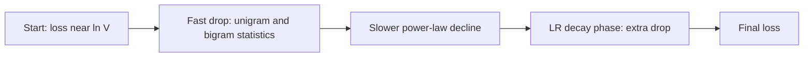

# The Training Objective, Loss Curves and Data Loading

## Introduction

Pretraining has one objective: predict the next token. The [language modeling page](../0-llm-fundamentals/1-llm-language-modeling.mdx) derived it from the chain rule of probability. This page is about the engineering that turns that one line of math into a training run that uses every GPU cycle: how labels are shifted, which tokens count in the loss, how documents of wildly different lengths are packed into fixed-size rows, how to stop packed documents from seeing each other, and how to read the loss curve that comes out.

These details look minor, and each of them has caused real bugs in real codebases: a label shifted twice, padding counted in the loss, gradient accumulation that weights short sequences too heavily, or a loader that repeats data after a restart. By the end you will be able to write a packed, resumable data loader, build a document mask with SDPA or FlexAttention, and tell a healthy loss curve from a broken one.

## The Objective in One Line of PyTorch

For a training sequence $x_1, \dots, x_T$ and model parameters $\theta$, the loss is the average negative log-likelihood of each token given the tokens before it:

$$
\mathcal{L}(\theta) = -\frac{1}{T} \sum_{t=1}^{T} \log p_\theta(x_t \mid x_1, \dots, x_{t-1})
$$

A decoder-only Transformer computes all $T$ predictions in one forward pass thanks to the causal mask: the output at position $t$ only depends on inputs $1$ to $t$. So the output at position $t$ is the prediction for token $t+1$. In code this means: read $T+1$ tokens, use the first $T$ as inputs and the last $T$ as targets.

Three facts are worth checking by hand in the snippet below:

1. At initialization the model knows nothing, so its predicted distribution is close to uniform over the $V$ vocabulary entries, and the loss is $-\log(1/V) = \ln V$. For GPT-2's 50,257 tokens that is 10.82. If your first logged loss is far above $\ln V$, the initialization is too large; if it is far below, something leaks the answer.
2. Targets equal to `-100` (PyTorch's default `ignore_index`) are skipped, and the mean is taken over the remaining tokens only. This is how padding and, during fine-tuning, prompt tokens are excluded.
3. Loss is in nats per token. Perplexity is $e^{\mathcal{L}}$. Dividing by $\ln 2$ gives bits per token, and dividing again by the average number of bytes per token gives **bits per byte**, the only one of these numbers you can compare across models with different tokenizers.

```python
import math
import torch
import torch.nn.functional as F

torch.manual_seed(0)
V, B, T = 50_257, 2, 6                      # GPT-2 vocabulary, tiny batch
tokens = torch.randint(0, V, (B, T + 1))    # (B, T+1): one extra token for the last target
inputs, targets = tokens[:, :-1], tokens[:, 1:]   # both (B, T); targets are inputs shifted left by one

# An untrained model outputs nearly uniform predictions: small random logits.
logits = 0.01 * torch.randn(B, T, V)        # (B, T, V)
loss = F.cross_entropy(logits.reshape(-1, V), targets.reshape(-1))
print(f"initial loss {loss.item():.4f}   ln(V) = {math.log(V):.4f}")

# Masking: positions whose label is -100 are ignored (padding, prompt tokens, etc.).
masked = targets.clone()
masked[1, 3:] = -100
loss_masked = F.cross_entropy(logits.reshape(-1, V), masked.reshape(-1), ignore_index=-100)
print(f"tokens counted {int((masked != -100).sum())} of {B * T}, loss {loss_masked.item():.4f}")

# Converting a loss (nats per token) to perplexity and bits per byte.
loss_nats, bytes_per_token = 2.0, 4.2
print(f"perplexity {math.exp(loss_nats):.2f}  bits/token {loss_nats / math.log(2):.3f}  "
      f"bits/byte {loss_nats / math.log(2) / bytes_per_token:.3f}")
```

```text
initial loss 10.8261   ln(V) = 10.8249
tokens counted 9 of 12, loss 10.8251
perplexity 7.39  bits/token 2.885  bits/byte 0.687
```

:::warning
Hugging Face causal LM models shift for you. When you call `model(input_ids, labels=labels)` in `transformers`, the loss function pads the labels and drops the first one (`labels[..., 1:]`), so you pass `labels = input_ids` (with `-100` where you want no loss). If you shift them yourself as well, every token is trained to predict the token two positions ahead. In `transformers` 5.x you can instead pass an already shifted `shift_labels` tensor to skip the internal shift.
:::

## Reading a Loss Curve

A pretraining loss curve has a predictable shape, and departures from that shape are the main diagnostic you have.



**The first few hundred steps** take the loss from $\ln V$ to roughly the entropy of a unigram model (5.8 nats on TinyStories with the GPT-2 tokenizer, as measured on 1.27 million tokens; more for diverse web text) and then toward that of a bigram model. The model is learning token frequencies and common pairs. A plateau here, followed by a sudden drop, often marks the moment attention heads learn to copy earlier tokens; Olsson et al. (2022) tied a visible bump in the loss curve to the formation of induction heads.

**The long middle** is a slow decline that looks close to a straight line when both axes are logarithmic: loss behaves like a power law in the number of tokens seen, which is what the [scaling laws page](./2-llm-scaling-laws.mdx) builds on. For scale: the GPT-2 124M reproduction in Karpathy's llm.c reaches 3.28 nats of validation loss on FineWeb, the target used by the modded-nanogpt speedrun.

**The end of training** depends on the learning rate schedule. With cosine decay the curve flattens smoothly; with a warmup-stable-decay schedule the loss drops sharply during the short final decay. That drop is not overfitting being fixed or a data change; it is the optimizer noise shrinking as the step size shrinks (see the [optimizers page](./3-llm-optimizers-and-schedules.mdx)).

Patterns that signal trouble:

| What you see | Likely cause |
| --- | --- |
| First loss far above $\ln V$ | initialization too large, or logits not scaled |
| Loss stuck at $\ln V$ | gradients not flowing: frozen parameters, wrong optimizer parameters, learning rate 0 |
| Loss drops far below expectation in minutes | label leak: no causal mask, labels equal inputs without shift |
| Sudden spikes that recover | instability: learning rate too high, missing QK-norm or z-loss, a bad batch |
| Validation loss rising while training loss falls | repeated data (too many epochs), or the validation set differs in distribution |
| Saw-tooth pattern repeating each epoch | data not shuffled; the model memorizes the order |

In pretraining, the training loss on fresh tokens is itself an unbiased estimate of generalization, because every batch is new data. A separate validation set still matters: it is fixed, so it removes batch-to-batch noise, and it catches leaks between training and evaluation.

## Packing Sequences into Fixed-Size Rows

GPUs want rectangular batches of shape `(B, T)`. Documents come in every length: a tweet is 30 tokens, a paper is 20,000. There are three ways to fit them into rows of $T$ tokens.

**Pad each document** to $T$. Simple, and very wasteful when most documents are short: the padded positions cost full compute and contribute nothing.

**Concatenate and chunk.** Join all documents into one stream with an end-of-sequence token between them, then cut the stream into rows of exactly $T$ tokens. Nothing is wasted. This is what GPT-2, GPT-3, PaLM and most pretraining codebases did. The cost is that many documents start in the middle of a row, and a row can begin halfway through a sentence with no context.

**Bin packing.** Place whole documents into rows like items into boxes, so that only documents longer than $T$ are split. Ding et al. (2024, "Fewer Truncations Improve Language Modeling") showed that best-fit packing keeps the utilization of concatenation while reducing truncation, and it improved reading comprehension and reduced hallucination in their experiments.

The snippet measures all three on 10,000 documents with a realistic heavy-tailed length distribution:

```python
import numpy as np

rng = np.random.default_rng(0)
# Document lengths in tokens: web text is heavy-tailed, so a log-normal is a fair stand-in.
lengths = np.clip(rng.lognormal(mean=6.0, sigma=1.0, size=10_000).astype(int), 16, 20_000)
SEQ = 2048
print(f"documents {len(lengths)}, median {int(np.median(lengths))} tokens, "
      f"mean {lengths.mean():.0f}, longest {lengths.max()}")

# 1) One document per row, truncated to SEQ and padded up to SEQ.
used = np.minimum(lengths, SEQ).sum()
rows = len(lengths)
print(f"pad-per-document: {rows} rows, {used / (rows * SEQ):.1%} real tokens, "
      f"{(lengths - SEQ).clip(0).sum() / lengths.sum():.1%} of tokens truncated away")

# 2) Concatenate everything (with an EOS between documents) and cut into SEQ-token rows.
total = lengths.sum() + len(lengths)                 # +1 EOS per document
rows_packed = total // SEQ
starts = np.concatenate([[0], np.cumsum(lengths + 1)[:-1]])
crossing = ((starts % SEQ) + lengths + 1 > SEQ).sum()
print(f"concat-and-chunk: {rows_packed} rows, 100.0% real tokens, "
      f"{crossing / len(lengths):.1%} of documents split across rows")

# 3) Best-fit decreasing packing of whole documents (long ones are first cut into SEQ chunks).
chunks = []
for n in lengths + 1:
    chunks += [SEQ] * (n // SEQ) + ([n % SEQ] if n % SEQ else [])
bins = []                                            # remaining free space per row
for c in sorted(chunks, reverse=True):
    free = [i for i, f in enumerate(bins) if f >= c]
    if free:
        best = min(free, key=lambda i: bins[i])      # the tightest row that still fits
        bins[best] -= c
    else:
        bins.append(SEQ - c)
print(f"best-fit packing: {len(bins)} rows, {sum(chunks) / (len(bins) * SEQ):.2%} real tokens, "
      f"only documents longer than {SEQ} are split")
```

```text
documents 10000, median 399 tokens, mean 662, longest 13119
pad-per-document: 10000 rows, 29.2% real tokens, 9.7% of tokens truncated away
concat-and-chunk: 3238 rows, 100.0% real tokens, 29.3% of documents split across rows
best-fit packing: 3239 rows, 99.98% real tokens, only documents longer than 2048 are split
```

Padding wastes about 70% of compute and still truncates 10% of the text. Concatenation and best-fit packing both reach full utilization, but concatenation splits about 29% of all documents at a row boundary, while best-fit packing splits only the documents that are longer than a row.

## Document Masking

Packing creates a new problem. With a plain causal mask, the first tokens of document 2 can attend to the end of document 1, an unrelated web page. The end-of-sequence token tells the model that a boundary happened, and in practice models learn to mostly ignore what came before it. But the attention computation still spends work on those pairs, and the model can pick up false correlations between neighboring documents.

The fix is a **block-diagonal causal mask**: token $i$ may attend to token $j$ only if $j \le i$ and both belong to the same document. Position ids restart at 0 at each document so that RoPE sees the same positions it would see if the document were alone.

The Llama 3 paper reports that this mask had limited impact in standard pretraining but was important during continued pretraining on very long sequences, which is exactly when packed rows contain many unrelated documents. Zhao et al. (2024, "Analysing the Impact of Sequence Composition on Language Model Pre-Training") found that intra-document masking improved results over plain causal masking of packed data.

The snippet builds the mask two ways, once as a dense boolean matrix for `F.scaled_dot_product_attention` and once as a FlexAttention `mask_mod`, and checks that both give exactly the same output as running each document separately:

```python
import torch
import torch.nn.functional as F
from torch.nn.attention.flex_attention import flex_attention, create_block_mask

torch.manual_seed(0)
H, D = 2, 8
doc_lens = [3, 5, 4]                                  # three documents packed into one row
T = sum(doc_lens)
doc_id = torch.repeat_interleave(torch.arange(len(doc_lens)), torch.tensor(doc_lens))  # (T,)
pos_id = torch.cat([torch.arange(n) for n in doc_lens])                               # (T,)
print("doc_id     ", doc_id.tolist())
print("position_id", pos_id.tolist())

q, k, v = (torch.randn(1, H, T, D) for _ in range(3))  # (batch, heads, T, head_dim)

# Block-diagonal causal mask: query i may see key j only if j <= i and both are in the same document.
causal = torch.tril(torch.ones(T, T, dtype=torch.bool))
same_doc = doc_id[:, None] == doc_id[None, :]
mask = causal & same_doc                               # (T, T), True = may attend
print(mask.int())

out_mask = F.scaled_dot_product_attention(q, k, v, attn_mask=mask)

# Reference: run each document on its own with a plain causal mask, then concatenate.
pieces, start = [], 0
for n in doc_lens:
    sl = slice(start, start + n)
    pieces.append(F.scaled_dot_product_attention(q[:, :, sl], k[:, :, sl], v[:, :, sl], is_causal=True))
    start += n
out_ref = torch.cat(pieces, dim=2)

# Same mask with FlexAttention: a mask_mod function instead of a dense (T, T) tensor.
def document_causal(b, h, q_idx, kv_idx):
    return (q_idx >= kv_idx) & (doc_id[q_idx] == doc_id[kv_idx])
block_mask = create_block_mask(document_causal, B=None, H=None, Q_LEN=T, KV_LEN=T, device="cpu")
out_flex = flex_attention(q, k, v, block_mask=block_mask)

out_leaky = F.scaled_dot_product_attention(q, k, v, is_causal=True)  # plain causal over the whole row
print("SDPA mask vs separate docs:", torch.allclose(out_mask, out_ref, atol=1e-6))
print("flex vs separate docs:     ", torch.allclose(out_flex, out_ref, atol=1e-6))
print("plain causal vs separate:  ", torch.allclose(out_leaky, out_ref, atol=1e-6))
```

```text
doc_id      [0, 0, 0, 1, 1, 1, 1, 1, 2, 2, 2, 2]
position_id [0, 1, 2, 0, 1, 2, 3, 4, 0, 1, 2, 3]
tensor([[1, 0, 0, 0, 0, 0, 0, 0, 0, 0, 0, 0],
        [1, 1, 0, 0, 0, 0, 0, 0, 0, 0, 0, 0],
        [1, 1, 1, 0, 0, 0, 0, 0, 0, 0, 0, 0],
        [0, 0, 0, 1, 0, 0, 0, 0, 0, 0, 0, 0],
        [0, 0, 0, 1, 1, 0, 0, 0, 0, 0, 0, 0],
        [0, 0, 0, 1, 1, 1, 0, 0, 0, 0, 0, 0],
        [0, 0, 0, 1, 1, 1, 1, 0, 0, 0, 0, 0],
        [0, 0, 0, 1, 1, 1, 1, 1, 0, 0, 0, 0],
        [0, 0, 0, 0, 0, 0, 0, 0, 1, 0, 0, 0],
        [0, 0, 0, 0, 0, 0, 0, 0, 1, 1, 0, 0],
        [0, 0, 0, 0, 0, 0, 0, 0, 1, 1, 1, 0],
        [0, 0, 0, 0, 0, 0, 0, 0, 1, 1, 1, 1]], dtype=torch.int32)
SDPA mask vs separate docs: True
flex vs separate docs:      True
plain causal vs separate:   False
```

The plain causal version differs because tokens of documents 2 and 3 attended across the boundary. On CPU, FlexAttention runs an unfused reference implementation and prints a warning; on a GPU you wrap it in `torch.compile` and it generates a fused kernel that skips fully masked blocks, so the mask costs nothing and even saves compute.

A dense `(T, T)` mask is fine for a demo but not for $T = 8192$ with a batch of many rows. Production code uses one of three methods:

- **FlexAttention** in PyTorch 2.5 and later, with a `mask_mod` like `document_causal` above.
- **Variable-length FlashAttention**: drop the batch dimension, concatenate all documents and pass cumulative sequence lengths (`cu_seqlens`) to `flash_attn_varlen_func`. Each document is attended separately, with no padding and no mask tensor.
- In Hugging Face, `DataCollatorWithFlattening` packs examples and returns `position_ids` that restart at 0 per example; the FlashAttention integration detects the restarts and uses the variable-length kernel.

## A Resumable Data Loader

Large runs tokenize the corpus once, offline, and store the token ids in flat binary files. With a vocabulary under 65,536 entries (GPT-2, many small models) `uint16` halves the disk and memory cost; Llama 3's 128,256-entry vocabulary needs `uint32`. During training the loader memory-maps the file, so the operating system pages in only what is read.

The loader must also meet three requirements of distributed training:

- each data-parallel rank reads different tokens;
- the loader state is tiny (a position or a sample index) so it can be saved with each checkpoint, and a restart continues with the next unseen batch instead of replaying or skipping data;
- shuffling happens at the level of documents or shards before tokenizing, and is deterministic given a seed.

```python
import os
import tempfile
import numpy as np
import torch

rng = np.random.default_rng(0)
EOS = 0
# Pretend tokenizer output: 1,000 documents of random token ids, each followed by EOS.
docs = [rng.integers(1, 50_000, size=rng.integers(20, 400)) for _ in range(1_000)]
stream = np.concatenate([np.append(d, EOS) for d in docs]).astype(np.uint16)  # vocab < 65,536
path = os.path.join(tempfile.mkdtemp(), "train.bin")
stream.tofile(path)                       # done once, offline; training only reads this file
print(f"{len(stream):,} tokens, {os.path.getsize(path):,} bytes on disk")

class PackedLoader:
    """Walks a token file in order, yielding (B, T) inputs and (B, T) shifted targets.
    Each rank of a data-parallel job reads a disjoint strided slice of the stream."""
    def __init__(self, path, B, T, rank=0, world=1):
        self.data = np.memmap(path, dtype=np.uint16, mode="r")
        self.B, self.T, self.rank, self.world = B, T, rank, world
        self.pos = rank * B * T                # the only state needed to resume exactly
    def next_batch(self):
        n = self.B * self.T + 1                # one extra token for the final target
        if self.pos + n > len(self.data):
            self.pos = self.rank * self.B * self.T          # wrap around: next epoch
        chunk = torch.from_numpy(self.data[self.pos:self.pos + n].astype(np.int64))
        x = chunk[:-1].view(self.B, self.T)    # (B, T)
        y = chunk[1:].view(self.B, self.T)     # (B, T), y[b, t] == x[b, t + 1]
        self.pos += self.B * self.T * self.world
        return x, y

loaders = [PackedLoader(path, B=4, T=128, rank=r, world=2) for r in range(2)]
x0, y0 = loaders[0].next_batch()
x1, _ = loaders[1].next_batch()
print("shapes", tuple(x0.shape), tuple(y0.shape))
print("targets are shifted inputs:", torch.equal(x0[0, 1:], y0[0, :-1]))
print("ranks see different tokens:", not torch.equal(x0, x1))
print("EOS tokens in rank-0 batch:", int((x0 == EOS).sum()))
```

```text
208,784 tokens, 417,568 bytes on disk
shapes (4, 128) (4, 128)
targets are shifted inputs: True
ranks see different tokens: True
EOS tokens in rank-0 batch: 1
```

The token-level layout makes the shift trivial: read $BT + 1$ contiguous tokens, `x` is the first $BT$ and `y` is the same window moved by one. Rank $r$ of $W$ reads every $W$-th window, so together the ranks read the stream once with no overlap.

## Worked Scenario: Gradient Accumulation That Counts Tokens Correctly

When a batch does not fit in memory you split it into micro-batches and accumulate gradients. The usual code divides each micro-batch loss by the number of micro-batches. That is only correct when every micro-batch has the same number of target tokens, which is true for packed rows with no masking but false as soon as you use `ignore_index` (padding, prompt masking, packed examples of unequal length).

Taking the mean per micro-batch and then the mean of the means gives every micro-batch equal weight, so tokens in sparse micro-batches count more than tokens in full ones. The correct loss sums the per-token losses $\ell_{m,t}$ over all $M$ micro-batches (micro-batch $m$ has $T_m$ real targets) and divides by $N$, the number of target tokens in the whole optimizer step:

$$
\mathcal{L}_\mathrm{step} = \frac{1}{N} \sum_{m=1}^{M} \sum_{t=1}^{T_m} \ell_{m,t}
$$

```python
import torch
import torch.nn.functional as F

torch.manual_seed(0)
V = 10
# Two micro-batches with very different numbers of real (non-masked) target tokens.
logits = [torch.randn(1, 8, V), torch.randn(1, 8, V)]
labels = [torch.randint(0, V, (1, 8)), torch.randint(0, V, (1, 8))]
labels[0][0, 2:] = -100                     # micro-batch 0 has only 2 real targets, batch 1 has 8

# What we want: the mean over all 10 real tokens, as if it were one big batch.
full = F.cross_entropy(torch.cat(logits).view(-1, V), torch.cat(labels).view(-1), ignore_index=-100)

# Naive accumulation: average each micro-batch, then average the averages.
naive = sum(F.cross_entropy(l.view(-1, V), y.view(-1), ignore_index=-100) for l, y in zip(logits, labels)) / 2

# Correct accumulation: sum per micro-batch, divide by the token count of the whole step.
n_tokens = sum(int((y != -100).sum()) for y in labels)
correct = sum(F.cross_entropy(l.view(-1, V), y.view(-1), ignore_index=-100, reduction="sum")
              for l, y in zip(logits, labels)) / n_tokens
print(f"one big batch {full.item():.4f}  naive {naive.item():.4f}  sum/num_tokens {correct.item():.4f}")
```

```text
one big batch 2.9940  naive 3.2613  sum/num_tokens 2.9940
```

The naive average differs from the true loss by almost 9% in this tiny example. In 2024 this exact problem was found in several popular fine-tuning stacks; `transformers` fixed it by passing a `num_items_in_batch` count to the loss function so that the sum is divided by the token count of the whole accumulated batch. For distributed data parallelism the same logic applies across ranks: all-reduce the token count, not just the averaged losses.

## Common Mistakes

- Shifting labels twice: shifting in your data loader and then calling a Hugging Face model with `labels`, which shifts again.
- Counting padding in the loss. Use `-100` for every position that should not be trained, including padding and, for fine-tuning, the prompt.
- Comparing losses across tokenizers. A loss of 2.0 with a 32k vocabulary and 2.0 with a 200k vocabulary mean different things; compare bits per byte instead.
- Forgetting to reset position ids at document boundaries when using a document mask, so the second document starts at position 1,500 instead of 0.
- Storing token ids as `uint16` with a vocabulary of 65,536 or more. Ids silently wrap around.
- Averaging micro-batch means in gradient accumulation when micro-batches have different token counts.
- Saving the model and optimizer but not the data loader position, so a resumed run trains on the same data twice.

## Summary

- The pretraining loss is the mean cross-entropy of each token given the previous ones; targets are the inputs shifted by one position.
- A healthy run starts at $\ln V$, drops quickly, then declines like a power law; spikes, plateaus at $\ln V$ and suspiciously fast drops each point to specific bugs.
- Concatenate-and-chunk and best-fit packing both avoid padding waste; best-fit packing also avoids splitting most documents.
- A block-diagonal causal mask with per-document position ids stops packed documents from attending to each other; use FlexAttention or variable-length FlashAttention at scale.
- Tokenize once into flat binary files, memory-map them, shard by rank, and checkpoint the loader position.
- In gradient accumulation, divide the summed loss by the token count of the whole step.

## Further Reading

- [Language Models are Unsupervised Multitask Learners (Radford et al., 2019)](https://cdn.openai.com/better-language-models/language_models_are_unsupervised_multitask_learners.pdf) - GPT-2, the model whose training setup most small-model codebases copy.
- [Fewer Truncations Improve Language Modeling (Ding et al., 2024)](https://arxiv.org/abs/2404.10830) - best-fit packing versus concatenation.
- [Analysing the Impact of Sequence Composition on Language Model Pre-Training (Zhao et al., 2024)](https://arxiv.org/abs/2402.13991) - causal versus intra-document masking of packed data.
- [The Llama 3 Herd of Models (Grattafiori et al., 2024)](https://arxiv.org/abs/2407.21783) - document masking and the full pretraining recipe.
- [In-context Learning and Induction Heads (Olsson et al., 2022)](https://arxiv.org/abs/2209.11895) - the loss-curve bump caused by induction heads.
- [FlexAttention in PyTorch](https://pytorch.org/blog/flexattention/) - mask_mod, block masks and document masking examples.
- [torch.nn.functional.scaled_dot_product_attention](https://docs.pytorch.org/docs/stable/generated/torch.nn.functional.scaled_dot_product_attention.html) - the attention function and its mask arguments.
- [Packing with FlashAttention-2 in Hugging Face](https://huggingface.co/blog/packing-with-FA2) - DataCollatorWithFlattening and position-id based packing.
- [nanoGPT](https://github.com/karpathy/nanoGPT) and [llm.c](https://github.com/karpathy/llm.c) - compact reference training loops with binary token files.
