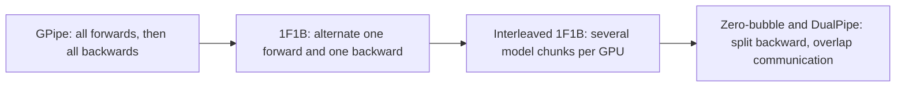

# Distributed Training: Data, Tensor, Pipeline Parallelism and FSDP

## Introduction

A 70B-parameter model needs over a terabyte of memory for its weights, gradients and optimizer states, and training it on 15 trillion tokens takes around $6 \times 10^{24}$ FLOPs. No single GPU has the memory, and no single GPU would finish in your lifetime. Pretraining is therefore always distributed, and the way the work is split decides how much of the hardware you actually use.

This page starts from the memory budget, because memory, not compute, is what forces most parallelism choices. It then covers each form of parallelism: data parallelism and its sharded versions (ZeRO and FSDP), tensor parallelism, pipeline parallelism, and the recompute trick called activation checkpointing. Each comes with the formula for what it saves and what it costs in communication, and with code you can run on a CPU. The page ends with how real runs such as Llama 3 and DeepSeek-V3 combine them.

## Where the Memory Goes

Training memory has two parts.

**Model states** scale with the parameter count $\Psi$. With BF16 mixed precision and AdamW (see the [mixed precision page](./4-llm-mixed-precision.mdx)), each parameter needs 2 bytes of BF16 weights, 2 bytes of BF16 gradients and 12 bytes of FP32 optimizer state (master weights, first and second moments): $16\Psi$ bytes. A 7.5B model needs 120 GB; a 70B model needs 1.12 TB.

**Activations** are the intermediate tensors saved during the forward pass for use in the backward pass. They scale with the batch and sequence length. Korthikanti et al. (2022, "Reducing Activation Recomputation in Large Transformer Models") counted them for a GPT layer with 16-bit activations, sequence length $s$, micro-batch size $b$, hidden size $h$ and $a$ attention heads:

$$
\text{activation bytes per layer} = s\,b\,h \left(34 + \frac{5\,a\,s}{h}\right)
$$

The $34\,sbh$ part covers the inputs of the linear layers, the MLP's GELU input, the layer norms and dropout masks. The $5as^2b$ part is the attention score matrix, its softmax and its dropout mask, which grows with the square of the sequence length. FlashAttention never stores the score matrix (it recomputes it in the backward pass), which removes the second term.

The script below computes both parts for typical sizes, plus the ZeRO and pipeline numbers used later on this page:

```python
GB = 1e9

def zero_memory(psi, nd, k=12):
    """Bytes per GPU for model states (ZeRO paper): 2 psi weights + 2 psi grads + k psi optimizer."""
    return {
        "DDP":    (2 + 2 + k) * psi,
        "ZeRO-1": (2 + 2) * psi + k * psi / nd,          # shard optimizer states
        "ZeRO-2": 2 * psi + (2 + k) * psi / nd,          # + shard gradients
        "ZeRO-3": (2 + 2 + k) * psi / nd,                # + shard parameters (FSDP full shard)
    }

print("7.5B parameters, 64 data-parallel GPUs:")
for name, b in zero_memory(7.5e9, 64).items():
    print(f"  {name:7s} {b / GB:6.1f} GB per GPU")

def activation_bytes(s, b, h, a, L, flash=False, recompute=False):
    """Korthikanti et al. 2022, 16-bit activations of a GPT layer with dropout: s*b*h*(34 + 5*a*s/h)."""
    if recompute:
        return 2 * s * b * h * L                          # only each layer's input is kept
    per_layer = s * b * h * (34 + (0 if flash else 5 * a * s / h))
    return per_layer * L

cfg = dict(s=4096, b=1, h=4096, a=32, L=32)               # a GPT-style 7B model, one sequence of 4,096
print("\nactivations for one 4,096-token sequence, 7B GPT-style model (h=4096, 32 layers, 32 heads):")
print(f"  store everything, materialized attention: {activation_bytes(**cfg) / GB:6.1f} GB")
print(f"  FlashAttention (no s x s matrices saved): {activation_bytes(**cfg, flash=True) / GB:6.1f} GB")
print(f"  full activation checkpointing:            {activation_bytes(**cfg, recompute=True) / GB:6.1f} GB")

def bubble(p, m):
    """Idle fraction of a GPipe / 1F1B schedule with p stages and m micro-batches."""
    return (p - 1) / (m + p - 1)

print("\npipeline bubble with 16 stages:")
for m in [16, 64, 256]:
    print(f"  {m:3d} micro-batches: {bubble(16, m):.1%} idle")
```

```text
7.5B parameters, 64 data-parallel GPUs:
  DDP      120.0 GB per GPU
  ZeRO-1    31.4 GB per GPU
  ZeRO-2    16.6 GB per GPU
  ZeRO-3     1.9 GB per GPU

activations for one 4,096-token sequence, 7B GPT-style model (h=4096, 32 layers, 32 heads):
  store everything, materialized attention:  104.2 GB
  FlashAttention (no s x s matrices saved):   18.3 GB
  full activation checkpointing:               1.1 GB

pipeline bubble with 16 stages:
   16 micro-batches: 48.4% idle
   64 micro-batches: 19.0% idle
  256 micro-batches: 5.5% idle
```

The activation numbers explain the design of every modern training stack. Storing everything for a single 4,096-token sequence of a 7B model takes 104 GB, more than an 80 GB GPU. FlashAttention alone brings it down to 18 GB, and full activation checkpointing to about 1 GB.

## Data Parallelism and All-Reduce

**Data parallelism (DP)** copies the full model to each of $N_d$ GPUs, gives each one a different slice of the batch, and averages the gradients before every optimizer step. PyTorch's `DistributedDataParallel` (DDP) does this with an **all-reduce**: every GPU ends up with the sum of all gradients. The standard ring all-reduce sends and receives $2(N_d - 1)/N_d$ times the gradient size per GPU, close to twice the gradient size whatever the number of GPUs, and DDP overlaps it with the backward pass by reducing buckets of gradients as soon as they are ready.

Data parallelism scales throughput almost linearly, but it does nothing for memory: every GPU still holds all $16\Psi$ bytes of model states. That limits plain DDP to models of about 1B to 3B parameters on 80 GB GPUs.

## ZeRO and FSDP: Sharding the Model States

The key observation of ZeRO (Rajbhandari et al., 2019, "ZeRO: Memory Optimizations Toward Training Trillion Parameter Models") is that DDP stores $N_d$ identical copies of everything. Instead, each GPU can own $1/N_d$ of the states and fetch the rest when needed. ZeRO has three stages:

| Stage | What is sharded | Memory per GPU | Communication vs DDP |
| --- | --- | --- | --- |
| DDP | nothing | $16\Psi$ | 1x (all-reduce) |
| ZeRO-1 | optimizer states | $4\Psi + 12\Psi / N_d$ | 1x |
| ZeRO-2 | + gradients | $2\Psi + 14\Psi / N_d$ | 1x (reduce-scatter instead of all-reduce) |
| ZeRO-3 | + parameters | $16\Psi / N_d$ | 1.5x (extra all-gathers of parameters) |

With $\Psi = 7.5$B and $N_d = 64$ the script above reproduces the paper's numbers: 120 GB with DDP, 31.4 GB with ZeRO-1, 16.6 GB with ZeRO-2 and 1.9 GB with ZeRO-3.

ZeRO-1 and ZeRO-2 are nearly free. An all-reduce is mathematically a reduce-scatter followed by an all-gather, so you can reduce-scatter the gradients (each GPU gets the summed gradients for its own shard), run the optimizer on that shard, and all-gather the updated parameters. The communication volume is the same as DDP.

ZeRO-3 shards the parameters themselves. Before each layer runs, the GPUs all-gather its full weights, compute, and free them again; the backward pass gathers them once more and reduce-scatters the gradients. The extra gather costs about 50% more communication, which is hidden by prefetching the next layer's weights while the current one computes.

PyTorch's implementation of ZeRO-3 is **Fully Sharded Data Parallel (FSDP)** (Zhao et al., 2023). The current API, often called FSDP2, is `torch.distributed.fsdp.fully_shard`: you call it on each Transformer block and then on the root model, and parameters become `DTensor` objects sharded along their first dimension. Each `fully_shard` call is a unit that is gathered and freed together, so per-block wrapping keeps only one or two blocks unsharded at any moment. This example runs on a CPU with two processes and the `gloo` backend:

```python
# Run: python p5_fsdp.py   (spawns 2 CPU processes that talk over the gloo backend)
import os
import torch
import torch.distributed as dist
import torch.multiprocessing as mp
import torch.nn as nn
from torch.distributed.fsdp import fully_shard

def build():
    torch.manual_seed(0)
    return nn.Sequential(*[nn.Sequential(nn.Linear(256, 1024), nn.GELU(), nn.Linear(1024, 256))
                           for _ in range(4)])

def worker(rank, world):
    os.environ.update(MASTER_ADDR="127.0.0.1", MASTER_PORT="29531")
    dist.init_process_group("gloo", rank=rank, world_size=world)
    torch.set_num_threads(2)
    model = build()
    full = sum(p.numel() for p in model.parameters())
    for block in model:                     # shard each block separately: gathered one at a time
        fully_shard(block)
    fully_shard(model)                      # root wrapper for whatever is left
    local = sum(p.to_local().numel() for p in model.parameters())   # parameters are now DTensors
    opt = torch.optim.AdamW(model.parameters(), lr=1e-3)

    torch.manual_seed(100 + rank)           # each rank gets different data, as in data parallelism
    x, y = torch.randn(8, 256), torch.randn(8, 256)
    for step in range(3):
        loss = (model(x) - y).pow(2).mean()
        loss.backward()                     # gradients are reduce-scattered: each rank keeps its shard
        opt.step(); opt.zero_grad()
        avg = loss.detach().clone(); dist.all_reduce(avg); avg /= world
        if rank == 0:
            print(f"step {step}: mean loss over ranks {avg.item():.5f}")
    if rank == 0:
        print(f"parameters: {full:,} in the model, {local:,} stored on rank 0 ({local / full:.0%})")
    dist.destroy_process_group()

if __name__ == "__main__":
    mp.spawn(worker, args=(2,), nprocs=2)
```

```text
step 0: mean loss over ranks 0.99962
step 1: mean loss over ranks 0.98779
step 2: mean loss over ranks 0.96967
parameters: 2,102,272 in the model, 1,051,136 stored on rank 0 (50%)
```

On GPUs you would launch it with `torchrun --nproc_per_node=8 train.py`, use the `nccl` backend, and pass `mp_policy=MixedPrecisionPolicy(param_dtype=torch.bfloat16, reduce_dtype=torch.float32)` to `fully_shard` for BF16 compute with FP32 gradient reduction. Microsoft's DeepSpeed provides the same three ZeRO stages through a JSON config.

When thousands of GPUs share one sharding group, every all-gather spans the whole cluster. **Hybrid sharding** (HSDP) shards within a group, typically a node or a few nodes, and replicates across groups, so the frequent gathers stay on fast links and only gradient all-reduces cross the slower network.

## Tensor Parallelism

ZeRO-3 shards storage but still computes every layer in full on each GPU, so the activations of a layer must fit. **Tensor parallelism (TP)** splits the computation of each layer itself. Megatron-LM (Shoeybi et al., 2019) showed how to do it for a Transformer with very little communication.

Take the MLP $Y = \mathrm{GELU}(X W_1) W_2$. Split $W_1$ by columns across $t$ GPUs: GPU $i$ computes $\mathrm{GELU}(X W_1^{(i)})$, a slice of the hidden layer, with no communication because GELU is elementwise. Split $W_2$ by rows to match: GPU $i$ computes $\mathrm{GELU}(X W_1^{(i)})\, W_2^{(i)}$, a partial sum of the output. One all-reduce adds the partial sums:

$$
Y = \sum_{i=1}^{t} \mathrm{GELU}\big(X W_1^{(i)}\big)\, W_2^{(i)}
$$

Attention splits the same way along heads: each GPU computes $n_\mathrm{heads}/t$ heads (column-parallel $W_Q$, $W_K$, $W_V$) and a row-parallel output projection, followed by one all-reduce. So a Transformer block needs two all-reduces in the forward pass and two in the backward pass.

```python
import torch
import torch.nn.functional as F

torch.manual_seed(0)
B, T, d, d_ff, tp = 2, 4, 8, 32, 2           # tensor-parallel degree 2
x = torch.randn(B, T, d)
W1 = torch.randn(d, d_ff) / d ** 0.5         # up projection
W2 = torch.randn(d_ff, d) / d_ff ** 0.5      # down projection

reference = F.gelu(x @ W1) @ W2               # (B, T, d) on a single device

# Megatron-style split: W1 by columns, W2 by rows. Each "GPU" holds 1/tp of both matrices.
W1_shards = W1.chunk(tp, dim=1)               # tp x (d, d_ff / tp)
W2_shards = W2.chunk(tp, dim=0)               # tp x (d_ff / tp, d)
partials = []
for rank in range(tp):
    h = F.gelu(x @ W1_shards[rank])          # (B, T, d_ff / tp): GELU is elementwise, no communication
    partials.append(h @ W2_shards[rank])      # (B, T, d): a partial sum
out = torch.stack(partials).sum(0)            # the one all-reduce of the forward pass
print("tensor-parallel MLP equals reference:", torch.allclose(out, reference, atol=1e-6))
print("per-rank weight elements:", W1_shards[0].numel() + W2_shards[0].numel(),
      "of", W1.numel() + W2.numel())

# Why not split W1 by rows instead? Then x @ W1 is a partial sum, and GELU of a partial sum
# is not the partial of GELU: you would need an all-reduce before the nonlinearity.
wrong = sum(F.gelu(x[..., r * d // tp:(r + 1) * d // tp] @ W1.chunk(tp, dim=0)[r]) for r in range(tp)) @ W2
print("row-split W1 without communication equals reference:", torch.allclose(wrong, reference, atol=1e-6))
```

```text
tensor-parallel MLP equals reference: True
per-rank weight elements: 256 of 512
row-split W1 without communication equals reference: False
```

The column-then-row order matters: splitting $W_1$ by rows would produce partial sums before the GELU, and the nonlinearity of a partial sum is not the partial of the nonlinearity.

Those all-reduces happen inside every layer, on the critical path, with activations of size $s \times b \times h$. That is why TP is almost always confined to the GPUs of one node, connected by NVLink at several hundred GB/s, and typical TP degrees are 2, 4 or 8. **Sequence parallelism** (Korthikanti et al., 2022) extends TP to the parts that TP leaves replicated, such as layer norms and dropout, by splitting them along the sequence dimension, which divides that part of the activation memory by $t$ as well. In PyTorch, `torch.distributed.tensor.parallel` provides `ColwiseParallel`, `RowwiseParallel` and `SequenceParallel` styles that you apply with `parallelize_module`.

## Pipeline Parallelism

**Pipeline parallelism (PP)** splits the model by depth: GPU 1 runs layers 1 to 8, GPU 2 runs layers 9 to 16, and so on. Only the activations at stage boundaries cross GPUs, a small amount of point-to-point traffic, so PP works across nodes on slower networks.

The problem is idle time. If one batch flows through $p$ stages, only one stage works at a time. GPipe (Huang et al., 2018) splits the batch into $m$ micro-batches and streams them through, so stages overlap. The fill and drain at the start and end still leave a **bubble**, an idle fraction of

$$
\text{bubble fraction} = \frac{p - 1}{m + p - 1}
$$

With 16 stages and 16 micro-batches, 48% of the time is idle; with 256 micro-batches, 5.5%. More micro-batches mean a larger global batch, so the bubble couples PP to the batch size.



Later schedules attack memory and the bubble. **1F1B** (from PipeDream, Narayanan et al., 2019) starts the backward of each micro-batch as soon as possible, so at most $p$ micro-batches have stored activations at once instead of all $m$. **Interleaved 1F1B** (Narayanan et al., 2021) gives each GPU several non-adjacent chunks of layers, which shrinks the bubble by the number of chunks at the cost of more communication. **Zero-bubble** schedules (Qi et al., 2024) split the backward pass into the activation-gradient and weight-gradient parts and use the weight-gradient work to fill the bubble. DeepSeek-V3's **DualPipe** feeds micro-batches from both ends of the pipeline and overlaps computation with the communication of its mixture-of-experts layers. PyTorch offers these schedules in `torch.distributed.pipelining` (`ScheduleGPipe`, `Schedule1F1B`, `ScheduleInterleaved1F1B` and others).

## Activation Checkpointing

The cheapest way to save activation memory costs compute instead of communication. **Activation checkpointing** (also called gradient checkpointing; Chen et al., 2016, "Training Deep Nets with Sublinear Memory Cost") keeps only the input of each checkpointed block during the forward pass and recomputes the inside of the block during the backward pass.

```python
import torch
import torch.nn as nn
from torch.utils.checkpoint import checkpoint

torch.manual_seed(0)
blocks = nn.ModuleList(nn.Sequential(nn.LayerNorm(512), nn.Linear(512, 2048), nn.GELU(), nn.Linear(2048, 512))
                       for _ in range(8))
x = torch.randn(16, 128, 512, requires_grad=True)        # (batch, seq, d_model)

def forward(x, use_ckpt):
    for blk in blocks:
        if use_ckpt:
            # keep only the block input; recompute the inside of the block during backward
            x = x + checkpoint(blk, x, use_reentrant=False)
        else:
            x = x + blk(x)
    return x.pow(2).mean()

def saved_bytes(use_ckpt):
    total = 0
    def pack(t):
        nonlocal total
        total += t.numel() * t.element_size()             # every tensor autograd keeps for backward
        return t
    with torch.autograd.graph.saved_tensors_hooks(pack, lambda t: t):
        loss = forward(x, use_ckpt)
    return total, loss

for use_ckpt in (False, True):
    nbytes, loss = saved_bytes(use_ckpt)
    loss.backward()                                       # gradients are identical either way
    grad = blocks[0][1].weight.grad.clone(); blocks.zero_grad()
    print(f"checkpointing={use_ckpt!s:5s}  saved for backward {nbytes / 2**20:6.1f} MiB  "
          f"loss {loss.item():.6f}  grad norm {grad.norm().item():.6f}")
```

```text
checkpointing=False  saved for backward  388.2 MiB  loss 1.311661  grad norm 0.037345
checkpointing=True   saved for backward   36.0 MiB  loss 1.311661  grad norm 0.037345
```

The saved memory drops by more than 10 times while the loss and gradients are bit-identical. The price is one extra forward pass for every checkpointed block: the backward pass costs about twice the forward, so total compute goes from three forward-equivalents to four, about 33% more. Always pass `use_reentrant=False`; it is the implementation PyTorch recommends, and it works with keyword arguments and with tensors that do not require gradients.

Full checkpointing of every block is rarely optimal. **Selective checkpointing** recomputes only operations that are cheap in FLOPs but large in memory. Korthikanti et al. recomputed only the attention scores and softmax part and kept the rest, which removed most of the $5as^2b$ term for a few percent of extra compute. With FlashAttention that part is already recomputed by the kernel, so modern stacks checkpoint every other block, or just the MLP, tuned until the run just fits.

## Worked Scenario: Combining Parallelism Like Llama 3

Large runs combine all of the above. Llama 3 405B used **4D parallelism** on up to 16,384 H100 GPUs: tensor parallelism inside each 8-GPU node, pipeline parallelism across nodes, context parallelism for long sequences, and FSDP as the data-parallel dimension.

| GPUs | TP | CP | PP | DP | Sequence length | BF16 MFU |
| --- | --- | --- | --- | --- | --- | --- |
| 8,192 | 8 | 1 | 16 | 64 | 8,192 | 43% |
| 16,384 | 8 | 1 | 16 | 128 | 8,192 | 41% |
| 16,384 | 8 | 16 | 16 | 8 | 131,072 | 38% |

The product of the degrees is the GPU count: $8 \times 1 \times 16 \times 64 = 8{,}192$. The order reflects bandwidth: TP needs the most communication and stays on NVLink; CP and PP exchange less; DP, with one gradient reduction per step, sits on the outermost and slowest level. For the 128K-token stage, context parallelism (16-way) splits each sequence across GPUs, as described in [Ring Attention and Context Parallelism](../5-llm-flash-attention/6-llm-ring-attention.mdx), and the DP degree shrinks to keep the batch at 16 million tokens.

DeepSeek-V3 made a different choice: 16-way pipeline parallelism, 64-way expert parallelism across 8 nodes for its mixture-of-experts layers and ZeRO-1 data parallelism, with no tensor parallelism at all, made possible by careful memory savings and the DualPipe schedule. Expert parallelism is covered in [Training and Serving MoE Models](../7-llm-mixture-of-experts/4-llm-moe-training-and-serving.mdx).

A rule-of-thumb procedure for a new run:

1. Start with FSDP (ZeRO-3) and activation checkpointing; for models up to roughly 10B to 30B on 80 GB GPUs this is often enough.
2. If a single layer's activations or the per-GPU batch become a problem, add TP within the node (2, 4 or 8).
3. If the cluster is large enough that FSDP all-gathers dominate, or memory is still short, add PP across nodes and use HSDP for the data dimension.
4. For sequences longer than about 32K tokens, add context parallelism.
5. Measure model FLOPs utilization (achieved model FLOPs divided by peak); 35% to 45% in BF16 is good at scale.

## Common Mistakes

- Forgetting that the global batch size is the micro-batch times gradient accumulation steps times the DP degree, and changing the GPU count without adjusting the learning rate or accumulation.
- Wrapping only the root model with `fully_shard`, which gathers the whole model at once and saves no memory during compute. Shard each Transformer block.
- Running tensor parallelism across nodes over InfiniBand or Ethernet; its per-layer all-reduces need NVLink-class bandwidth.
- Using too few micro-batches with many pipeline stages and losing half the cluster to the bubble.
- Checkpointing every block when the run already fits, paying 33% more compute for nothing.
- Measuring speed in tokens per second without computing MFU, which hides how far you are from the hardware limit.
- Giving every data-parallel rank the same data shard, or the same random seed for dropout and data order.

## Summary

- Model states cost about 16 bytes per parameter with BF16 AdamW; activations scale with $sbh$ per layer, plus an $s^2$ term that FlashAttention removes.
- Data parallelism replicates the model and all-reduces gradients; ZeRO-1, ZeRO-2 and ZeRO-3 (FSDP) shard optimizer states, gradients and parameters, down to $16\Psi / N_d$ bytes per GPU.
- Tensor parallelism splits each matmul (column-parallel then row-parallel) with two all-reduces per block per pass; keep it inside a node.
- Pipeline parallelism splits layers into stages; the bubble is $(p-1)/(m+p-1)$, reduced by 1F1B, interleaving, zero-bubble schedules and DualPipe.
- Activation checkpointing trades about 33% more compute for a large drop in activation memory; selective checkpointing is usually the better trade.
- Real runs combine TP, CP, PP and DP in a bandwidth-aware order, as in Llama 3's 4D layout.

## Further Reading

- [ZeRO: Memory Optimizations Toward Training Trillion Parameter Models (Rajbhandari et al., 2019)](https://arxiv.org/abs/1910.02054) - the ZeRO stages and their memory math.
- [PyTorch FSDP: Experiences on Scaling Fully Sharded Data Parallel (Zhao et al., 2023)](https://arxiv.org/abs/2304.11277) - the design of FSDP.
- [Megatron-LM (Shoeybi et al., 2019)](https://arxiv.org/abs/1909.08053) - tensor parallelism for Transformers.
- [Efficient Large-Scale Language Model Training on GPU Clusters Using Megatron-LM (Narayanan et al., 2021)](https://arxiv.org/abs/2104.04473) - combining TP, PP and DP; interleaved 1F1B.
- [Reducing Activation Recomputation in Large Transformer Models (Korthikanti et al., 2022)](https://arxiv.org/abs/2205.05198) - the activation memory formula, sequence parallelism and selective recomputation.
- [GPipe (Huang et al., 2018)](https://arxiv.org/abs/1811.06965) - micro-batched pipeline parallelism.
- [Zero Bubble Pipeline Parallelism (Qi et al., 2024)](https://arxiv.org/abs/2401.10241) - splitting the backward pass to fill the bubble.
- [Training Deep Nets with Sublinear Memory Cost (Chen et al., 2016)](https://arxiv.org/abs/1604.06174) - activation checkpointing.
- [PyTorch fully_shard documentation](https://docs.pytorch.org/docs/stable/distributed.fsdp.fully_shard.html) - the FSDP2 API.
- [torchtitan](https://github.com/pytorch/torchtitan) - a reference PyTorch codebase that combines FSDP2, TP, PP, CP and FP8.
