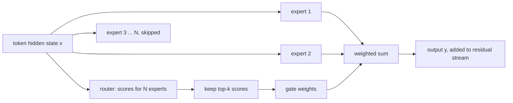
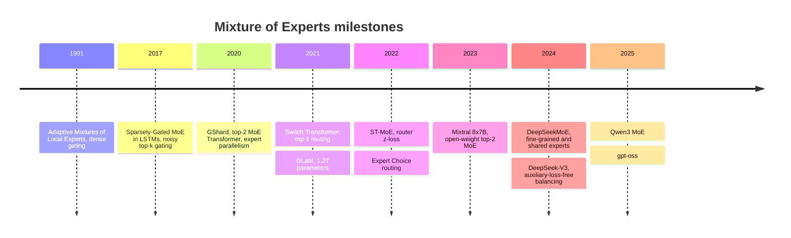

# Mixture of Experts Introduction

## Introduction

Open the config.json of Mixtral 8x7B, DeepSeek-V3, Qwen3-235B-A22B or gpt-oss-120b and you will find fields that a dense model like Llama 3 does not have: `num_local_experts`, `n_routed_experts`, `num_experts_per_tok`, `moe_intermediate_size`. These models are **Mixture-of-Experts (MoE)** Transformers. Each of their feed-forward layers is not one MLP but a collection of many MLPs, called experts, plus a small router that sends every token to only a few of them.

The consequence is the most important number pair in modern LLM engineering: **total parameters** versus **active parameters**. DeepSeek-V3 stores 671B parameters but uses about 37B of them for each token. gpt-oss-120b stores 116.8B and uses 5.1B. The model has the knowledge capacity of a very large network and the per-token compute of a small one.

That trade is not free. You still have to hold every expert in memory, the router has to be trained so that it does not send everything to the same few experts, and when experts live on different GPUs every MoE layer becomes a network shuffle. This section covers all of that. This first page builds the core idea:

- why the feed-forward block is the natural place to add sparsity,
- the MoE equation and what each symbol means,
- how to count total and active parameters from a config.json, with code you can run,
- what sparsity buys (compute) and what it costs (memory, communication, training complexity),
- where the idea came from, and what experts really learn.

You should be comfortable with the decoder block from [Inside a Decoder Block](../3-llm-transformer/2-llm-transformer-block.mdx) and the SwiGLU MLP from [Feed-Forward Networks, GELU and SwiGLU](../3-llm-transformer/4-llm-feed-forward-and-swiglu.mdx). Parameter counting follows the method of [Counting Parameters, FLOPs and Memory](../3-llm-transformer/6-llm-parameter-and-flop-counting.mdx).

## Where the Parameters of a Dense Transformer Live

A decoder block has two sublayers: attention, which mixes information across positions, and the feed-forward network (FFN, also called the MLP), which transforms each position independently. In a modern model the FFN is a SwiGLU block with three weight matrices:

$$
\mathrm{FFN}(x) = W_{\mathrm{down}}\left(\mathrm{SiLU}(W_{\mathrm{gate}}\,x) \odot W_{\mathrm{up}}\,x\right)
$$

Here $x \in \mathbb{R}^{d}$ is one token's hidden vector, $W_{\mathrm{gate}}, W_{\mathrm{up}} \in \mathbb{R}^{d_{ff} \times d}$, $W_{\mathrm{down}} \in \mathbb{R}^{d \times d_{ff}}$ and $\odot$ is elementwise multiplication. The block has $3\,d\,d_{ff}$ parameters.

For Mixtral's dimensions ($d = 4096$, $d_{ff} = 14336$) one SwiGLU MLP has $3 \times 4096 \times 14336 \approx 176$M parameters, while the attention projections of the same layer (32 query heads, 8 key/value heads of size 128) have about 42M. The MLP is roughly 80 percent of the layer. In dense models the ratio is similar: the FFN holds most of the weights and does most of the matrix-multiply FLOPs at normal context lengths.

Two properties make the FFN the right place to add capacity:

1. **It works per token.** The MLP output for token $t$ depends only on $x_t$. Nothing stops us from sending different tokens through different MLPs.
2. **It seems to store knowledge.** Interpretability work has repeatedly found factual associations stored in MLP weights. More MLP parameters means more room for facts, languages, coding idioms and so on.

Attention is harder to sparsify this way because every position needs to see the others. So nearly every MoE LLM keeps attention dense and replaces the MLP with experts.

## The Mixture-of-Experts Layer

An MoE layer replaces the single FFN with $N$ expert networks $E_1, \dots, E_N$ (each usually a SwiGLU MLP of the same shape) and a router, also called a gate. The output for one token is a weighted sum of expert outputs:

$$
y = \sum_{i=1}^{N} g_i(x)\, E_i(x)
$$

The gate vector $g(x) \in \mathbb{R}^{N}$ comes from a linear map followed by a sparse selection:

$$
s = \mathrm{softmax}(W_r\, x), \qquad
g_i(x) =
\begin{cases}
\dfrac{s_i}{\sum_{j \in \mathcal{T}} s_j} & i \in \mathcal{T} = \mathrm{TopK}(s, k) \\[4pt]
0 & \text{otherwise}
\end{cases}
$$

- $W_r \in \mathbb{R}^{N \times d}$ is the router weight matrix, one row per expert. It is tiny: $N \times d$ numbers.
- $s_i$ is the router's score for expert $i$.
- $\mathcal{T}$ is the set of the $k$ highest-scoring experts; $k$ is `num_experts_per_tok` in a config.
- The selected scores are renormalized so the weights sum to 1 (Mixtral does this; the routing page covers the variants).

The key word is **sparse**. When $g_i(x) = 0$ we never compute $E_i(x)$ at all. With $N = 8$ and $k = 2$, each token runs through 2 of the 8 MLPs. The other 6 sit idle for that token, but other tokens in the batch may use them.



An analogy: a hospital with many specialist doctors. A triage nurse (the router) looks at each patient (token) and sends them to two specialists. The hospital employs many doctors (total parameters), but each patient only takes up the time of two (active parameters). The hospital has to pay rent for all the offices (memory), and if the nurse sends everyone to the same cardiologist, the queue explodes while the others sit idle (load imbalance, the subject of the [routing page](./1-llm-moe-routing.mdx)).

Here is the idea in a few lines of PyTorch, written as a slow, readable loop. The [implementation page](./3-llm-moe-implementation.mdx) builds the fast, batched version.

```python
import torch
import torch.nn as nn
import torch.nn.functional as F

torch.manual_seed(0)
d_model, d_ff, n_experts, top_k, n_tokens = 8, 16, 4, 2, 6

# Four independent two-layer MLPs ("experts") and one linear router.
experts = nn.ModuleList(
    nn.Sequential(nn.Linear(d_model, d_ff), nn.GELU(), nn.Linear(d_ff, d_model))
    for _ in range(n_experts)
)
router = nn.Linear(d_model, n_experts, bias=False)

x = torch.randn(n_tokens, d_model)                  # (n_tokens, d_model)
logits = router(x)                                  # (n_tokens, n_experts)
weights, idx = torch.topk(F.softmax(logits, dim=-1), top_k, dim=-1)  # (n_tokens, top_k)
weights = weights / weights.sum(dim=-1, keepdim=True)  # renormalize the two picks

y = torch.zeros_like(x)
expert_calls = 0
for t in range(n_tokens):                           # clear, slow loop: one token at a time
    for slot in range(top_k):
        e = idx[t, slot].item()
        y[t] += weights[t, slot] * experts[e](x[t])
        expert_calls += 1

for t in range(n_tokens):
    picks = ", ".join(f"E{idx[t, s].item()}:{weights[t, s].item():.2f}" for s in range(top_k))
    print(f"token {t}: {picks}")

per_expert = sum(p.numel() for p in experts[0].parameters())
print("expert calls:", expert_calls, "of", n_tokens * n_experts, "possible")
print("params stored :", n_experts * per_expert + router.weight.numel())
print("params used per token:", top_k * per_expert + router.weight.numel())
```

```text
token 0: E1:0.59, E0:0.41
token 1: E2:0.79, E1:0.21
token 2: E0:0.51, E1:0.49
token 3: E1:0.61, E0:0.39
token 4: E1:0.61, E3:0.39
token 5: E0:0.64, E1:0.36
expert calls: 12 of 24 possible
params stored : 1152
params used per token: 592
```

Two things are already visible. Only half of the possible expert evaluations happen. And the untrained router is lopsided: expert 1 got 5 of the 12 slots and expert 3 only one. If that persisted during training, expert 1 would get most of the gradient updates, become better, attract even more tokens, and the others would starve. Balancing that is the central training problem of MoE.

## Total Parameters vs Active Parameters

Let $L$ be the number of layers, $P_{\mathrm{attn}}$ the attention parameters per layer, $P_{\mathrm{exp}}$ the parameters of one expert, $N$ the number of routed experts, $k$ the number active per token, and $P_{\mathrm{emb}}$ the embedding plus output head. Ignoring tiny terms (norms, router):

$$
P_{\mathrm{total}} \approx L\,(P_{\mathrm{attn}} + N\,P_{\mathrm{exp}}) + P_{\mathrm{emb}}
$$

$$
P_{\mathrm{active}} \approx L\,(P_{\mathrm{attn}} + k\,P_{\mathrm{exp}}) + P_{\mathrm{emb}}
$$

Model names now often carry both numbers: Qwen3-235B-**A22B** means 235B total, 22B **a**ctive. "8x7B" in Mixtral 8x7B is misleading if read literally: only the MLPs are replicated, attention and embeddings are shared, so the total is about 47B, not 56B.

Let us verify that from Mixtral's config.json:

```json
{
  "hidden_size": 4096,
  "intermediate_size": 14336,
  "num_hidden_layers": 32,
  "num_attention_heads": 32,
  "num_key_value_heads": 8,
  "num_local_experts": 8,
  "num_experts_per_tok": 2,
  "vocab_size": 32000,
  "tie_word_embeddings": false
}
```

```python
# Count total vs active parameters of Mixtral 8x7B from its config.json values.
cfg = {
    "hidden_size": 4096, "intermediate_size": 14336, "num_hidden_layers": 32,
    "num_attention_heads": 32, "num_key_value_heads": 8, "vocab_size": 32000,
    "num_local_experts": 8, "num_experts_per_tok": 2, "tie_word_embeddings": False,
}

d, f, L = cfg["hidden_size"], cfg["intermediate_size"], cfg["num_hidden_layers"]
head_dim = d // cfg["num_attention_heads"]                      # 128
kv_dim = cfg["num_key_value_heads"] * head_dim                  # 1024
E, k, V = cfg["num_local_experts"], cfg["num_experts_per_tok"], cfg["vocab_size"]

attn = d * d + 2 * d * kv_dim + d * d      # W_Q, W_K, W_V, W_O (no biases)
expert = 3 * d * f                          # SwiGLU: gate, up, down
router = d * E                              # one logit per expert
norms = 2 * d                               # two RMSNorm weight vectors per layer
embed = V * d * (1 if cfg["tie_word_embeddings"] else 2)  # input embedding + lm_head

total = L * (attn + E * expert + router + norms) + embed + d   # + final norm
active = L * (attn + k * expert + router + norms) + embed + d

print(f"one expert          : {expert/1e6:8.1f} M")
print(f"attention per layer : {attn/1e6:8.1f} M")
print(f"experts per layer   : {E*expert/1e9:8.3f} B")
print(f"total parameters    : {total/1e9:8.2f} B")
print(f"active per token    : {active/1e9:8.2f} B")
print(f"active fraction     : {active/total:8.1%}")
print(f"bf16 weights        : {total*2/1e9:8.1f} GB")
print(f"forward GFLOPs/token: {2*active/1e9:8.1f}  (2 x active, ignoring attention scores)")
```

```text
one expert          :    176.2 M
attention per layer :     41.9 M
experts per layer   :    1.409 B
total parameters    :    46.70 B
active per token    :    12.88 B
active fraction     :    27.6%
bf16 weights        :     93.4 GB
forward GFLOPs/token:     25.8  (2 x active, ignoring attention scores)
```

The results match Mistral's published 46.7B total and 12.9B active. (Counting the input embedding as "active" is a convention; it is a lookup, not a matmul. The gpt-oss model card, for instance, counts the unembedding but not the embedding.)

The two numbers govern different resources:

| Resource | Scales with | Why |
|---|---|---|
| Weight memory (GPU or CPU RAM) | total parameters | every expert must be resident, any token may need it |
| Training and prefill FLOPs per token | active parameters | only $k$ experts run; forward costs about $2 P_{\mathrm{active}}$ FLOPs |
| Decode bandwidth at batch size 1 | active parameters | each step reads only the selected experts' weights |
| Decode bandwidth at large batch | approaches total | different tokens pick different experts, so most experts are read every step |
| Knowledge capacity | closer to total | more distinct weights to store patterns in |

Here are the published numbers for models covered in this section, all checked against model cards or config.json files:

| Model | Total params | Active params | Routed experts | Active experts per token | Shared experts |
|---|---|---|---|---|---|
| Mixtral 8x7B | 46.7B | 12.9B | 8 | 2 | 0 |
| Mixtral 8x22B | 141B | 39B | 8 | 2 | 0 |
| DeepSeek-V3 | 671B | 37B | 256 | 8 | 1 |
| Qwen3-30B-A3B | 30.5B | 3.3B | 128 | 8 | 0 |
| Qwen3-235B-A22B | 235B | 22B | 128 | 8 | 0 |
| gpt-oss-20b | 20.9B | 3.6B | 32 | 4 | 0 |
| gpt-oss-120b | 116.8B | 5.1B | 128 | 4 | 0 |

The active fraction has fallen steadily: about 28 percent for Mixtral, about 5.5 percent for DeepSeek-V3, about 4.4 percent for gpt-oss-120b. The [architectures page](./2-llm-moe-architectures.mdx) explains the design choices behind each row.

## What Sparsity Buys and What It Costs

### The Benefit: Quality per FLOP

Scaling laws (see [Scaling Laws](../6-llm-pretraining/2-llm-scaling-laws.mdx)) say loss falls as you add parameters and data. A dense model pays for every added parameter with added FLOPs on every token. An MoE model decouples the two: adding experts raises total parameters while the per-token compute stays fixed by $k$.

The empirical result, repeated from GShard (2020) through Switch Transformer (2021), GLaM (2021) and every recent open MoE, is that at a **fixed training compute budget** a well-tuned MoE reaches a lower loss than a dense model. Switch Transformer reported a 7x pretraining speedup over a FLOP-matched T5 baseline. GLaM (1.2T total, 96.6B active) reported better zero-shot and few-shot results than GPT-3 while using about one third of GPT-3's training energy. DeepSeek-V3 trained a 671B model on 14.8T tokens with 2.788M H800 GPU hours, a budget that would buy a much smaller dense model.

### The Costs

1. **Memory.** Your hardware must hold the total, not the active, parameter count. Mixtral 8x7B needs about 93 GB in BF16 even though each token touches only 26 GB of weights. This is why MoE models are often served quantized (gpt-oss ships its experts in MXFP4) or with experts offloaded to CPU RAM.
2. **Communication.** In multi-GPU setups experts are spread over devices. Every MoE layer must send each token to the GPUs that hold its experts and bring the results back: two all-to-all exchanges per layer. The [training and serving page](./4-llm-moe-training-and-serving.mdx) covers this.
3. **Load balance.** Experts that receive more tokens become stragglers; in fixed-capacity systems overflowing tokens are dropped. Routers must be trained to balance load without hurting quality.
4. **Training stability.** Router logits can grow, routing decisions flip, and loss spikes are more common than in dense models. Techniques such as the router z-loss exist for this reason.
5. **Small-batch inefficiency.** A dense matmul on a batch of tokens is one big efficient GEMM. An MoE layer splits the batch into many small per-expert groups, which are less efficient on GPUs unless you use grouped GEMM kernels.
6. **Fine-tuning quirks.** Parameter-efficient fine-tuning still works, but you must decide whether to adapt experts, the router or neither, and keep the balance loss on.

:::note
"Active parameters" is a measure of compute, not of quality. A 3B-active MoE is usually much stronger than a 3B dense model, and usually weaker than a dense model of its total size trained on the same data. A common rough heuristic is that an MoE behaves somewhere between its active and total size; treat this as a rule of thumb, not a law.
:::

### Why a Larger Batch Erases the Bandwidth Savings

At decode time, LLM inference is memory-bandwidth bound: generating a token means reading the weights from memory (see [Prefill and Decode](../10-llm-inference/0-llm-inference-overview.mdx)). For a single sequence an MoE reads only the $k$ chosen experts per layer. But a serving engine batches many sequences, and different tokens choose different experts. If each of $B$ tokens picks $k$ of $N$ experts roughly uniformly and independently, the expected number of distinct experts touched in a layer is

$$
\mathbb{E}[\text{experts touched}] = N\left(1 - \left(1 - \tfrac{k}{N}\right)^{B}\right)
$$

For Mixtral ($N = 8$, $k = 2$) and $B = 8$ tokens: $8\,(1 - 0.75^{8}) = 8\,(1 - 0.100) \approx 7.2$. Almost every expert is read anyway. For DeepSeek-V3 ($N = 256$, $k = 8$), $B = 8$ touches about $256\,(1 - (248/256)^{8}) \approx 57$ experts, and $B = 128$ touches about 252. This is why the bandwidth advantage of MoE is largest for single-user local inference and why large-scale serving instead spreads experts across many GPUs so each GPU reads only its own experts.

## A Short History of the Idea

The idea is older than Transformers.



- **Jacobs, Jordan, Nowlan and Hinton (1991)**, "Adaptive Mixtures of Local Experts", trained several small networks plus a gating network that softly weighted them. Every expert ran on every input, so there was no compute saving; the goal was specialization.
- **Shazeer et al. (2017)**, "Outrageously Large Neural Networks: The Sparsely-Gated Mixture-of-Experts Layer", made the gate sparse (noisy top-k), inserted MoE layers between LSTM layers and trained models with up to 137B parameters. This paper introduced the compute-saving form used today, along with an auxiliary loss to balance experts.
- **Lepikhin et al. (2020)**, GShard, put top-2 MoE layers into Transformers in place of every other FFN, introduced expert capacity and spread experts across TPU devices, scaling to 600B parameters for translation.
- **Fedus, Zoph and Shazeer (2021)**, Switch Transformer, simplified routing to top-1, introduced the now-standard load-balancing loss and scaled to 1.6T parameters.
- **Du et al. (2021)**, GLaM, a 1.2T-parameter decoder-only MoE language model with 64 experts and top-2 routing.
- **Zoph et al. (2022)**, ST-MoE, studied training instability and introduced the router z-loss.
- **Jiang et al. (2024)**, Mixtral of Experts (released December 2023), made a strong open-weight MoE widely available.
- **Dai et al. (2024)**, DeepSeekMoE, introduced fine-grained expert segmentation and shared experts, which became the template for DeepSeek-V2, DeepSeek-V3 and many later models.

## Worked Scenario: Mixtral 8x7B Against Dense Models

Suppose you are choosing between Llama 2 13B, Llama 2 70B and Mixtral 8x7B for a self-hosted service. The Mixtral paper reports that it matches or beats Llama 2 70B on most of its benchmarks. Use the numbers from the counting script above:

| Quantity | Llama 2 13B (dense) | Mixtral 8x7B (MoE) | Llama 2 70B (dense) |
|---|---|---|---|
| Parameters in memory | about 13B | 46.7B | about 69B |
| BF16 weight memory | about 26 GB | about 93 GB | about 138 GB |
| Forward FLOPs per token | about 26 GFLOP | about 26 GFLOP | about 138 GFLOP |
| Weights read per decode step, batch 1 | about 26 GB | about 26 GB | about 138 GB |
| Weights read per decode step, batch 32 | about 26 GB | close to 93 GB | about 138 GB |

Reading the table:

- **Prefill and training throughput** of Mixtral are close to a 13B dense model, because FLOPs per token match. This is where MoE shines: about 5x less compute than the 70B model for similar quality.
- **Memory** is closer to the 70B side. Mixtral does not fit on a single 80 GB GPU in BF16, while the 13B model does. With 8-bit or 4-bit quantization it fits comfortably.
- **Single-user decode speed** is close to the 13B model, since only two experts' weights are read per layer per token.
- **High-batch decode** reads nearly all experts each step (we computed 7.2 of 8 at batch 8), so per-step weight traffic approaches 93 GB. It is still less than 70B dense, and FLOPs per token stay at the 13B level, so throughput per GPU stays good once you have enough memory.

The pattern generalizes: MoE trades memory for compute. If memory is cheap relative to compute (large clusters, CPU RAM offloading, quantized weights), MoE wins. If you are limited to a small GPU and must serve many users, a dense model of the same memory footprint may be simpler.

## What Do Experts Actually Learn?

The word "expert" suggests one expert for biology, one for French, one for Python. That is mostly not what happens.

The Mixtral paper analyzed which experts were chosen for documents from different domains of The Pile (arXiv papers, biology, philosophy, math, code) and found no obvious topic-based assignment, with the exception of slightly different distributions for some domains such as math. What it did find was structure tied to **syntax and position**: tokens like `self` in Python or indentation tokens tended to go to the same experts, and consecutive tokens often shared experts. Studies of other models (for example OLMoE) find more specialization when experts are many and small, which is one motivation for fine-grained experts: it gives the router more combinations to express finer distinctions.

So think of experts as a learned partition of the MLP's input space into regions, where the regions are whatever the loss found useful, not human-readable topics. The router is a learned hash from hidden state to region.

## Common Mistakes

- **Reading "8x7B" as 56B parameters.** Only the MLPs are replicated. Count from config.json; Mixtral 8x7B has 46.7B total.
- **Sizing hardware by active parameters.** Memory must hold all experts. A 3B-active model with 30B total needs 30B parameters' worth of memory.
- **Assuming active parameters set decode speed at high batch.** With many concurrent tokens, nearly all experts are read every step.
- **Expecting human-interpretable topic experts.** Analyses of Mixtral show mostly syntactic and positional patterns.
- **Forgetting that attention is still dense.** KV cache size, attention FLOPs and long-context costs are unchanged by MoE; DeepSeek-V3 pairs MoE with MLA precisely because MoE does nothing for the KV cache.
- **Comparing an MoE to a dense model of its active size.** Compare at equal training compute, equal memory or equal serving cost, depending on what you are deciding.

## Summary

- An MoE layer replaces one FFN with $N$ expert MLPs and a router; each token is processed by only $k$ of them, weighted by gate values.
- The FFN is sparsified because it is per-token and holds most parameters; attention stays dense.
- Total parameters set memory; active parameters set per-token FLOPs. Mixtral 8x7B: 46.7B total, 12.9B active, which you can reproduce from config.json.
- At equal training compute, MoE models reach lower loss than dense ones; this has held from GShard to DeepSeek-V3.
- Costs: memory for all experts, all-to-all communication, load balancing, training instability and small, irregular matmuls.
- The batch effect: with $B$ tokens, about $N(1 - (1 - k/N)^B)$ distinct experts are touched per layer, so the bandwidth advantage shrinks at high batch.
- Experts mostly learn regions of hidden-state space, not human topics.

## Further Reading

- [Adaptive Mixtures of Local Experts (Jacobs et al., 1991)](https://www.cs.toronto.edu/~hinton/absps/jjnh91.pdf): the original mixture-of-experts paper with a learned gating network.
- [Outrageously Large Neural Networks: The Sparsely-Gated Mixture-of-Experts Layer (Shazeer et al., 2017)](https://arxiv.org/abs/1701.06538): noisy top-k gating and the first very large sparse models.
- [GShard (Lepikhin et al., 2020)](https://arxiv.org/abs/2006.16668): top-2 MoE Transformers, expert capacity and automatic sharding.
- [Switch Transformers (Fedus et al., 2021)](https://arxiv.org/abs/2101.03961): top-1 routing, the standard load-balancing loss and trillion-parameter scaling.
- [GLaM (Du et al., 2021)](https://arxiv.org/abs/2112.06905): a 1.2T-parameter MoE language model compared with GPT-3.
- [Mixtral of Experts (Jiang et al., 2024)](https://arxiv.org/abs/2401.04088): architecture, results and the routing analysis discussed above.
- [DeepSeek-V3 Technical Report (DeepSeek-AI, 2024)](https://arxiv.org/abs/2412.19437): the modern large-scale MoE recipe.
- [Mixtral 8x7B config.json on Hugging Face](https://huggingface.co/mistralai/Mixtral-8x7B-v0.1/blob/main/config.json): the fields used in the counting script.
