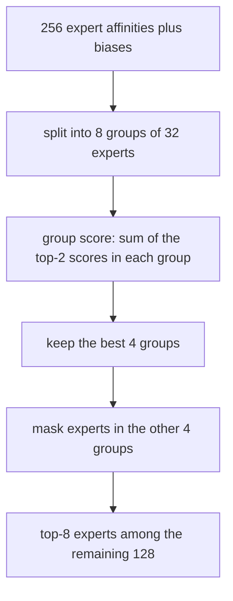

# Routing: Top-k Gating, Load Balancing and Auxiliary-Loss-Free Balancing

## Introduction

The router is the smallest part of a Mixture-of-Experts layer: one matrix of shape `(n_experts, d_model)`. It is also the part that decides whether the whole model works. A good router spreads tokens so every expert gets enough data to learn something useful and no GPU becomes a straggler. A bad router sends most tokens to a handful of experts, wastes the rest of the parameters, and in capacity-limited systems silently drops tokens.

This page derives the routing math used by real models and implements each piece on small tensors:

- how top-k gating turns router logits into sparse weights, and the four variants you will meet in configs (Mixtral, gpt-oss, Switch, DeepSeek-V3),
- how gradients reach the router, and a pitfall where they do not,
- why routing collapses, and the Switch Transformer load-balancing loss that prevents it, with its gradient worked out,
- the router z-loss for stability,
- expert capacity, token dropping and expert-choice routing,
- DeepSeek's auxiliary-loss-free balancing with per-expert biases, simulated in code,
- group-limited routing, which keeps communication bounded.

By the end you will be able to read fields such as `scoring_func`, `topk_method`, `norm_topk_prob`, `router_aux_loss_coef`, `n_group` and `routed_scaling_factor` and know exactly what the model computes. The [introduction](./0-llm-moe-introduction.mdx) explains the MoE layer itself.

## The Router as a Tiny Classifier

For a token with hidden state $x \in \mathbb{R}^{d}$ the router computes one logit per expert:

$$
u = W_r\, x, \qquad W_r \in \mathbb{R}^{N \times d}, \quad u \in \mathbb{R}^{N}
$$

Row $i$ of $W_r$ acts like a centroid $e_i$ for expert $i$, and $u_i = e_i^\top x$ measures how well the token matches it. The DeepSeek-V3 paper describes it in exactly these terms. The router then turns logits into **gate values** $g_i$ that are zero for all but $k$ experts. Four variants cover almost every open model:

1. **Softmax, top-k, renormalize** (Mixtral, Qwen3 with `norm_topk_prob: true`):
   $s = \mathrm{softmax}(u)$, keep the $k$ largest, divide by their sum.
2. **Top-k logits, then softmax** (gpt-oss): pick the $k$ largest logits, apply softmax to just those.
3. **Softmax, top-k, no renormalization** (Switch Transformer, Qwen1.5-MoE and OLMoE with `norm_topk_prob: false`, DeepSeek-V2): gates are the raw probabilities and sum to less than 1.
4. **Sigmoid, top-k, normalize, scale** (DeepSeek-V3 with `scoring_func: sigmoid`): $s_i = \sigma(u_i)$ independently per expert, normalize the selected ones to sum to 1, then multiply by `routed_scaling_factor` (2.5 in DeepSeek-V3).

Variants 1 and 2 are mathematically identical. With $\mathcal{T}$ the selected set and $Z = \sum_{j=1}^{N} e^{u_j}$:

$$
\frac{s_i}{\sum_{j \in \mathcal{T}} s_j} = \frac{e^{u_i}/Z}{\sum_{j \in \mathcal{T}} e^{u_j}/Z} = \frac{e^{u_i}}{\sum_{j \in \mathcal{T}} e^{u_j}}
$$

The $Z$ cancels, and softmax is monotonic, so the top-k of $s$ and the top-k of $u$ are the same experts. gpt-oss's order is just cheaper: it never exponentiates the logits of unselected experts. Let us check all four on a 4-expert example:

```python
import torch
import torch.nn.functional as F

logits = torch.tensor([2.0, 1.0, 0.5, -1.0])   # router logits u = W_r x for 4 experts
k = 2

# 1) Mixtral / Qwen3: softmax over all experts, take top-k, renormalize.
p = F.softmax(logits, dim=-1)
v, i = p.topk(k)
print("softmax probs        :", p.numpy().round(3))
print("Mixtral  top-k + norm:", i.tolist(), (v / v.sum()).numpy().round(3))

# 2) gpt-oss: take top-k logits first, softmax over only those.
lv, li = logits.topk(k)
print("gpt-oss  softmax(topk):", li.tolist(), F.softmax(lv, dim=-1).numpy().round(3))

# 3) Switch / DeepSeek-V2 style: keep the raw softmax probabilities (no renormalization).
print("no renorm            :", i.tolist(), v.numpy().round(3), "sum =", round(v.sum().item(), 3))

# 4) DeepSeek-V3: sigmoid affinities, top-k, normalize, then multiply by routed_scaling_factor.
s = torch.sigmoid(logits)
sv, si = s.topk(k)
g = sv / sv.sum()
print("sigmoid affinities   :", s.numpy().round(3))
print("DeepSeek-V3 gates    :", si.tolist(), g.numpy().round(3), "x 2.5 =", (2.5 * g).numpy().round(3))
```

```text
softmax probs        : [0.609 0.224 0.136 0.03 ]
Mixtral  top-k + norm: [0, 1] [0.731 0.269]
gpt-oss  softmax(topk): [0, 1] [0.731 0.269]
no renorm            : [0, 1] [0.609 0.224] sum = 0.834
sigmoid affinities   : [0.881 0.731 0.622 0.269]
DeepSeek-V3 gates    : [0, 1] [0.546 0.454] x 2.5 = [1.366 1.134]
```

Check variant 1 by hand: $e^{2} = 7.389$, $e^{1} = 2.718$, so the weights are $7.389 / 10.107 = 0.731$ and $0.269$.

Notice how much flatter the sigmoid gates are (0.546 against 0.731). With sigmoid each expert's affinity is computed independently, so experts do not compete inside a softmax. DeepSeek reported sigmoid gating working better than softmax in their auxiliary-loss-free experiments. Because many small gates would shrink the MoE output, DeepSeek-V3 rescales by 2.5 so the routed experts' contribution keeps a useful magnitude next to the shared expert.

### How the Router Learns

The top-k selection is a discrete choice and has no gradient. The router learns only through the gate values: the layer output is $y = \sum_{i \in \mathcal{T}} g_i E_i(x)$, so

$$
\frac{\partial \mathcal{L}}{\partial g_i} = \left(\frac{\partial \mathcal{L}}{\partial y}\right)^{\!\top} E_i(x)
$$

If expert $i$'s output points in a direction that lowers the loss, $g_i$ is pushed up, which pushes $u_i$ up, which makes expert $i$ more likely to be selected next time for similar tokens. The router learns which experts help with which tokens from this signal alone. Experts that were not selected receive no signal for that token.

:::warning
With top-1 routing and renormalization, the single gate is always $s_i / s_i = 1$, a constant. The router then receives no gradient from the language-modeling loss at all. Switch Transformer avoids this by not renormalizing: its gate is the raw probability $p_i$, which multiplies the expert output and stays differentiable. If you write a top-1 router, do not normalize the weights.
:::

### Noisy Top-k Gating

Shazeer et al. (2017) added trainable noise before the top-k selection:

$$
H(x)_i = (W_g x)_i + \epsilon_i \cdot \mathrm{softplus}\big((W_{\mathrm{noise}} x)_i\big), \qquad \epsilon_i \sim \mathcal{N}(0, 1)
$$

followed by softmax over the top-k of $H$. The noise lets experts near the decision boundary occasionally win, so they get some gradient and a chance to become useful. Most current LLMs do not use noise; Mixtral's Hugging Face implementation has an optional multiplicative `router_jitter_noise` on the input that defaults to 0. Balancing losses and biases do the job more directly.

## Why Routing Collapses

The router and the experts train together, and they create a feedback loop:


Left alone, this rich-get-richer loop can end with a few experts doing all the work, a failure called **routing collapse**. The model then has the cost of an MoE and the capacity of a small dense model. Even mild imbalance hurts systems performance: if experts live on different GPUs, the GPU with the most popular expert sets the pace of the whole step.

To measure balance we will use **MaxVio** from the auxiliary-loss-free paper (Wang et al., 2024):

$$
\mathrm{MaxVio} = \frac{\max_i \mathrm{Load}_i - \overline{\mathrm{Load}}}{\overline{\mathrm{Load}}}
$$

where $\mathrm{Load}_i$ is the number of tokens assigned to expert $i$ and $\overline{\mathrm{Load}}$ is the mean. Perfect balance gives 0; a value of 1 means the busiest expert has twice the average load.

## The Auxiliary Load-Balancing Loss

The standard fix, introduced in this form by Switch Transformer (Fedus et al., 2021) and inherited from GShard, is to add a small loss that is minimized by a uniform assignment. For a batch of $T$ tokens and $N$ experts define:

$$
f_i = \frac{1}{kT} \sum_{t=1}^{T} \mathbb{1}\left[i \in \mathcal{T}_t\right], \qquad
P_i = \frac{1}{T} \sum_{t=1}^{T} p_{t,i}
$$

- $f_i$ is the **fraction of assignments** that went to expert $i$ (with top-1 this is the fraction of tokens). It sums to 1 over experts.
- $P_i$ is the **mean router probability** for expert $i$, where $p_{t,i}$ is the full softmax output for token $t$. It also sums to 1.

The loss is

$$
\mathcal{L}_{\mathrm{bal}} = \alpha \, N \sum_{i=1}^{N} f_i \, P_i
$$

Why this form? We want $f$ uniform, but $f_i$ is a count of argmax decisions and has no gradient. $P_i$ is differentiable. The product $f_i P_i$ uses the counts as constant weights: an expert that is overloaded (large $f_i$) has its probability pushed down harder. When both are uniform, $f_i = P_i = 1/N$ and $N \sum_i (1/N)(1/N) = 1$, so the unscaled loss is 1 at perfect balance, independent of $N$. That is what the factor $N$ is for: the same $\alpha$ works for any number of experts. Switch used $\alpha = 0.01$.

### The Gradient, Worked Out

Treat $f$ as a constant and differentiate through the softmax. With $\partial p_{t,i} / \partial u_{t,j} = p_{t,i}(\delta_{ij} - p_{t,j})$:

$$
\frac{\partial}{\partial u_{t,j}} \left( N \sum_i f_i P_i \right)
= \frac{N}{T} \sum_i f_i \, p_{t,i}(\delta_{ij} - p_{t,j})
= \frac{N}{T}\, p_{t,j} \left( f_j - \sum_i f_i\, p_{t,i} \right)
$$

The bracket compares expert $j$'s load $f_j$ with the load-weighted average under this token's distribution. If $f_j$ is above average the gradient is positive, so gradient descent lowers $u_{t,j}$: overloaded experts become less attractive, underloaded ones more. Here is the loss and gradient for a balanced router and for one that has collapsed onto expert 0 (top-1, 4 experts):

```python
import torch
import torch.nn.functional as F

def switch_aux_loss(logits, k):
    """Switch/GShard-style balance loss: N * sum_i f_i * P_i  (multiply by alpha outside)."""
    T, N = logits.shape                               # (tokens, experts)
    probs = F.softmax(logits, dim=-1)                 # (T, N)
    top = probs.topk(k, dim=-1).indices               # (T, k)
    f = torch.bincount(top.flatten(), minlength=N).float() / (T * k)  # fraction of assignments
    P = probs.mean(dim=0)                             # mean router probability
    return N * (f * P).sum(), f, P

torch.manual_seed(0)
T, N, k = 1000, 4, 1

balanced = torch.randn(T, N) * 0.1                    # near-uniform router
collapsed = balanced.clone()
collapsed[:, 0] += 3.0                                # expert 0 wins almost every token

for name, lg in [("balanced", balanced), ("collapsed", collapsed)]:
    lg = lg.clone().requires_grad_(True)
    loss, f, P = switch_aux_loss(lg, k)
    loss.backward()
    grad_sum = lg.grad.sum(dim=0)                    # total gradient on each expert's logit
    print(f"{name:9s} loss={loss.item():.3f}  f={f.numpy().round(2)}  P={P.detach().numpy().round(2)}")
    print(f"{'':9s} sum of dL/dlogit = {grad_sum.numpy().round(3)}")
```

```text
balanced  loss=1.000  f=[0.23 0.27 0.24 0.27]  P=[0.25 0.25 0.25 0.25]
          sum of dL/dlogit = [-0.023  0.021 -0.015  0.017]
collapsed loss=3.476  f=[1. 0. 0. 0.]  P=[0.87 0.04 0.04 0.04]
          sum of dL/dlogit = [ 0.455 -0.152 -0.151 -0.152]
```

Check the collapsed case against the formula: for expert 0, $p \approx 0.87$ and $f_0 = 1$, so each token contributes $\frac{4}{T} \cdot 0.87 \cdot (1 - 0.87)$, and summing over $T$ tokens gives $4 \times 0.87 \times 0.13 \approx 0.45$. For expert 1, $4 \times 0.04 \times (0 - 0.87) \approx -0.14$. The loss pushes expert 0 down and the others up, as intended. The maximum possible value is $N$ (all tokens and all probability on one expert); our collapsed router scores 3.48.

### The Cost of the Auxiliary Loss

The balance gradient is added to the language-modeling gradient on the same router weights, so the two objectives fight. If $\alpha$ is too small, imbalance persists; if it is too large, the router is forced to send tokens to experts that are worse for them, and quality drops. Typical coefficients from the configs:

| Model | Field | Value |
|---|---|---|
| Mixtral 8x7B | `router_aux_loss_coef` | 0.02 |
| Mixtral 8x22B | `router_aux_loss_coef` | 0.001 |
| Qwen3-30B-A3B, Qwen3-235B-A22B | `router_aux_loss_coef` | 0.001 |
| OLMoE-1B-7B | `router_aux_loss_coef` | 0.01 |
| DeepSeek-V2 | `aux_loss_alpha` | 0.001 (plus device- and communication-balance losses in the paper) |

In Hugging Face `transformers` these coefficients are only used if you ask the model for router logits: pass `output_router_logits=True` and the model adds `router_aux_loss_coef * load_balancing_loss_func(...)` to the returned loss. Forgetting this is a common reason MoE fine-tunes drift out of balance.

### Over What Batch Is Balance Measured?

$f_i$ and $P_i$ are statistics over "the batch", and the choice matters:

- **Sequence-wise:** balance inside every sequence. Very strict: a Python file and a French poem must each use all experts evenly, which works against specialization.
- **Micro-batch:** what most implementations compute by default, on the few sequences one GPU sees in one forward pass. Qiu et al. (2025) showed this is close to sequence-level when micro-batches are small.
- **Global batch:** gather the counts $f_i$ across all data-parallel ranks (an all-reduce of an $N$-element vector) before computing the loss. Balance is required only across the whole batch, so experts are free to specialize by domain. Qiu et al. reported better perplexity and more domain-specialized experts, and the Qwen3 report states that Qwen3's MoE models use this global-batch loss.

## Router Z-Loss

Large router logits are a stability hazard. In BF16 the softmax of large values loses precision, and small changes in the router can flip top-k choices across many tokens at once. ST-MoE (Zoph et al., 2022) added a penalty on the log-partition function of the router:

$$
\mathcal{L}_z = \frac{1}{T} \sum_{t=1}^{T} \left( \log \sum_{j=1}^{N} e^{u_{t,j}} \right)^{2}
$$

It is zero only when the log-sum-exp is zero, so it keeps logits near a modest scale without forcing any particular routing. ST-MoE used a coefficient of 0.001 and found that it improved stability without hurting quality. The same idea appears as the output z-loss on the LM head in some dense-model recipes (see [Optimizers and Training Stability](../6-llm-pretraining/3-llm-optimizers-and-schedules.mdx)). A second widely used precaution, also from Switch Transformer, is to compute the router in FP32 even when the rest of the model is in BF16; the Hugging Face Mixtral code casts router logits to float before the softmax for this reason.

## Capacity, Token Dropping and Expert Choice

GShard and Switch were built for TPUs, where tensor shapes must be static. Each expert therefore received a fixed-size buffer:

$$
C = \left\lceil \mathrm{CF} \cdot \frac{kT}{N} \right\rceil
$$

where $C$ is the **expert capacity** in tokens and $\mathrm{CF}$ is the **capacity factor**. With $\mathrm{CF} = 1$ each expert can take exactly its fair share. Tokens that arrive after an expert's buffer is full are **dropped**: they skip the MoE layer and pass through only the residual connection. ST-MoE trained with a capacity factor of 1.25 and evaluated with 2.0.

```python
import math
import torch

torch.manual_seed(0)
T, N, k = 16, 4, 1
logits = torch.randn(T, N)
logits[:, 2] += 1.0                                  # expert 2 is popular
probs = logits.softmax(-1)

# Token choice with a capacity limit (Switch / GShard style).
for cf in (1.0, 1.25, 2.0):
    capacity = math.ceil(cf * T * k / N)
    choice = probs.argmax(-1)                        # top-1 expert per token
    kept = torch.zeros(T, dtype=torch.bool)
    used = [0] * N
    for t in range(T):                               # earlier tokens get priority
        e = choice[t].item()
        if used[e] < capacity:
            used[e] += 1
            kept[t] = True
    print(f"capacity factor {cf:4}: capacity={capacity} per expert, load={used}, "
          f"dropped={int((~kept).sum())} of {T} tokens")

# Expert choice (Zhou et al., 2022): each expert picks its own top-C tokens.
C = T * k // N
picked = probs.topk(C, dim=0).indices                # (C, N): token ids chosen by each expert
per_token = torch.bincount(picked.flatten(), minlength=T)
print("expert choice: every expert gets", C, "tokens")
print("experts per token:", per_token.tolist())
```

```text
capacity factor  1.0: capacity=4 per expert, load=[1, 2, 4, 2], dropped=7 of 16 tokens
capacity factor 1.25: capacity=5 per expert, load=[1, 2, 5, 2], dropped=6 of 16 tokens
capacity factor  2.0: capacity=8 per expert, load=[1, 2, 8, 2], dropped=3 of 16 tokens
expert choice: every expert gets 4 tokens
experts per token: [0, 2, 1, 0, 2, 1, 1, 2, 1, 0, 1, 1, 1, 1, 1, 1]
```

With one popular expert, even a capacity factor of 2.0 drops 3 of 16 tokens, and the buffers of the other experts are half empty: memory and compute are spent on padding. This is the trade-off: a larger capacity factor wastes compute, a smaller one drops tokens, and dropping depends on what else is in the batch, which also makes inference results batch-dependent.

**Expert choice routing** (Zhou et al., 2022) flips the direction: each expert selects its top-$C$ tokens from the batch. Load is perfectly balanced by construction, but some tokens get several experts and some get none (three tokens above received zero). It also looks at the whole batch, including future tokens, which breaks causality for autoregressive decoding. It is rarely used in decoder LLMs for this reason.

Modern GPU implementations avoid the problem differently: **dropless MoE**. MegaBlocks (Gale et al., 2022) uses block-sparse and grouped matrix multiplies that handle a variable number of tokens per expert, so no capacity limit is needed. Mixtral, the DeepSeek models and Qwen3 are trained and served without dropping; DeepSeek-V3's report states that it drops no tokens in training or inference. Balance still matters, because a dropless system's step time is set by the busiest expert.

## Auxiliary-Loss-Free Load Balancing

DeepSeek's answer to the auxiliary-loss trade-off (Wang et al., 2024, then DeepSeek-V3) is to balance with a controller instead of a loss. Each expert $i$ gets a bias $b_i$ that is added to its affinity **only for the top-k selection**:

$$
g'_{t,i} =
\begin{cases}
s_{t,i} & s_{t,i} + b_i \in \mathrm{TopK}\left(\{ s_{t,j} + b_j \}_{j=1}^{N},\, k\right) \\
0 & \text{otherwise}
\end{cases}
$$

The gate value that multiplies the expert's output is still the unbiased $s_{t,i}$ (then normalized). After each training step the bias moves by a fixed amount $\gamma$ against the load error:

$$
b_i \leftarrow b_i + \gamma \cdot \mathrm{sign}\left(\overline{\mathrm{Load}} - \mathrm{Load}_i\right)
$$

An overloaded expert's bias drops, so it wins fewer close contests; an underloaded expert's bias rises. Three properties make this attractive:

1. **No interfering gradient.** The bias is not a trained parameter; it is updated outside backpropagation. The language-modeling gradient on the router is untouched.
2. **It acts at the margin.** The bias only changes decisions where scores are close. A token that clearly belongs to an expert still goes there.
3. **The gates stay honest.** Because the output uses $s_{t,i}$, not $s_{t,i} + b_i$, the bias changes which experts run but not how much each contributes.

DeepSeek-V3 used $\gamma = 0.001$ for the first 14.3T training tokens and $\gamma = 0$ for the last 500B. It kept a **complementary sequence-wise balance loss** of the same $f_i P_i$ form with a tiny coefficient, $\alpha = 0.0001$, only to prevent extreme imbalance inside single sequences. In the DeepSeek-V3 config this mode is `topk_method: noaux_tc`, and the checkpoint stores the biases as `e_score_correction_bias` tensors.

Here is the controller on a router that is deliberately skewed: a fixed weight matrix plus a per-expert offset that favors later experts, 16 experts, top-2, 4096 tokens per step.

```python
import torch

torch.manual_seed(0)
T, d, N, k = 4096, 32, 16, 2          # tokens per batch, hidden size, experts, top-k
W = torch.randn(N, d) / d**0.5         # a fixed router (think: frozen mid-training)
skew = torch.linspace(-1.0, 1.0, N)    # systematic preference: later experts score higher
gamma = 0.001                          # bias update speed (DeepSeek-V3 used 0.001)
b = torch.zeros(N)                     # per-expert bias, used ONLY for selection

def route(x, b):
    s = torch.sigmoid(x @ W.T + skew)              # (T, N) affinities, DeepSeek-V3 style
    idx = (s + b).topk(k, dim=-1).indices          # bias shifts which experts win
    gate = s.gather(-1, idx)
    gate = gate / gate.sum(-1, keepdim=True)       # gate values come from s, not s + b
    return idx, gate

def max_vio(idx):
    load = torch.bincount(idx.flatten(), minlength=N).float()
    return ((load.max() - load.mean()) / load.mean()).item(), load

for step in range(3001):
    x = torch.randn(T, d)                          # a fresh batch each step
    idx, gate = route(x, b)
    vio, load = max_vio(idx)
    if step in (0, 100, 300, 1000, 3000):
        print(f"step {step:4d}  MaxVio={vio:5.2f}  min/max load={int(load.min()):4d}/{int(load.max()):4d}"
              f"  bias range=[{b.min():+.3f}, {b.max():+.3f}]")
    b += gamma * torch.sign(load.mean() - load)    # raise underloaded, lower overloaded
```

```text
step    0  MaxVio= 2.05  min/max load=  51/1563  bias range=[+0.000, +0.000]
step  100  MaxVio= 0.66  min/max load= 183/ 851  bias range=[-0.100, +0.100]
step  300  MaxVio= 0.07  min/max load= 472/ 546  bias range=[-0.161, +0.196]
step 1000  MaxVio= 0.06  min/max load= 468/ 543  bias range=[-0.165, +0.197]
step 3000  MaxVio= 0.07  min/max load= 466/ 546  bias range=[-0.164, +0.195]
```

The fair share is $4096 \times 2 / 16 = 512$ assignments per expert. At step 0 the most popular expert gets 1563 and the least gets 51; after 300 steps every expert is within about 7 percent of 512, and the biases settle into a range of about $\pm 0.2$. Because the update has a fixed step size, the biases keep jittering by $\gamma$ around their equilibrium; that is why DeepSeek-V3 set $\gamma = 0$ at the end of training.

In this simulation the router weights are frozen to isolate the controller. In real training the router and biases adapt together, and the paper's claim, from experiments with models up to 3B parameters and then at DeepSeek-V3 scale, is that this reaches better balance and better perplexity than auxiliary-loss balancing. That is a research result from one lab, widely adopted since (Kimi K2 and the DeepSeek-V4 configs use the same `noaux_tc` method), but auxiliary losses remain common and work well when tuned.

## Group-Limited and Node-Limited Routing

When experts are spread over many machines, top-k routing can send one token's 8 experts to 8 different nodes, and inter-node bandwidth is far lower than intra-node NVLink. DeepSeek therefore restricts the choice in two stages:



In DeepSeek-V3's config this is `n_group: 8` and `topk_group: 4`. During training each group corresponds to one node of 8 GPUs, so every token touches at most 4 nodes, which the paper calls node-limited routing ($M = 4$). This caps the cross-node traffic per token no matter how the router behaves. DeepSeek-V2 used an earlier version (`topk_method: group_limited_greedy`, `topk_group: 3`) that scored each group by its single best expert. Models trained without this constraint use `n_group: 1` (Kimi K2's config, for example). The [training and serving page](./4-llm-moe-training-and-serving.mdx) shows why bounding node fan-out matters for all-to-all cost.

## Worked Scenario: Reading Routing Fields in a Config

Suppose you open three config.json files and want to write down, for each, exactly what the router computes. Here is the result, from the actual files:

| Field | Mixtral 8x7B | Qwen3-235B-A22B | DeepSeek-V3 |
|---|---|---|---|
| experts, active | `num_local_experts` 8, `num_experts_per_tok` 2 | `num_experts` 128, `num_experts_per_tok` 8 | `n_routed_experts` 256, `num_experts_per_tok` 8, `n_shared_experts` 1 |
| score function | softmax (implicit) | softmax (implicit) | `scoring_func: sigmoid` |
| renormalize top-k | yes (implicit) | `norm_topk_prob: true` | `norm_topk_prob: true` |
| output scale | none | none | `routed_scaling_factor: 2.5` |
| balancing | aux loss, `router_aux_loss_coef` 0.02 | global-batch aux loss, coefficient 0.001 | biases (`topk_method: noaux_tc`) plus tiny sequence loss |
| group limit | none | none | `n_group: 8`, `topk_group: 4` |

So for a DeepSeek-V3 token the full routing procedure is: compute 256 sigmoid affinities; add the per-expert biases; score the 8 groups by the sum of their two best biased affinities and keep 4 groups; pick the top 8 experts by biased affinity among those 128; take their unbiased affinities, normalize them to sum to 1, multiply by 2.5; add the always-on shared expert's output. The [implementation page](./3-llm-moe-implementation.mdx) codes all of this.

## Common Mistakes

- **Normalizing a top-1 gate.** The weight becomes the constant 1 and the router stops learning. Keep the raw probability for $k = 1$.
- **Forgetting `output_router_logits=True` when fine-tuning a Hugging Face MoE.** Without it, no balance loss is added, whatever `router_aux_loss_coef` says.
- **Computing $f_i$ with gradients.** The assignment fraction is a count; only $P_i$ should carry gradient. Using a differentiable surrogate for both changes the loss.
- **Adding the bias to the gate value.** In auxiliary-loss-free balancing the bias affects selection only; multiplying expert outputs by $s + b$ distorts the model.
- **Measuring balance on one micro-batch and calling it global.** Balance statistics depend on what you average over; all-reduce the counts if you mean global-batch balance.
- **Keeping the router in BF16.** Small logit differences decide top-k; compute router logits and softmax in FP32.
- **Ignoring dropped tokens.** In capacity-limited systems, report the drop rate; a model with 5 percent dropped tokens is not running the computation you think it is.

## Summary

- The router is a linear map to $N$ logits followed by top-k; real models differ in softmax vs sigmoid scoring, renormalization and scaling, all visible in config.json.
- Softmax-then-top-k-then-renormalize equals softmax over the top-k logits; gpt-oss uses the latter.
- The router learns only through gate values, so selection decisions themselves carry no gradient.
- Without balancing, routing tends to collapse onto a few experts.
- The Switch loss $\alpha N \sum_i f_i P_i$ equals $\alpha$ at perfect balance; its gradient pushes overloaded experts' logits down in proportion to their excess load.
- Router z-loss and FP32 routers keep logits stable.
- Capacity factors trade dropped tokens for padding; dropless kernels removed the need for them on GPUs.
- DeepSeek's auxiliary-loss-free method adds per-expert biases to selection scores only and updates them by sign of the load error, avoiding a competing gradient.
- Group-limited routing (`n_group`, `topk_group`) bounds how many nodes a token's experts can live on.

## Further Reading

- [Outrageously Large Neural Networks (Shazeer et al., 2017)](https://arxiv.org/abs/1701.06538): noisy top-k gating and the first balance losses.
- [Switch Transformers (Fedus et al., 2021)](https://arxiv.org/abs/2101.03961): top-1 routing, the $f_i P_i$ balance loss, capacity factor and selective FP32 routing.
- [ST-MoE: Designing Stable and Transferable Sparse Expert Models (Zoph et al., 2022)](https://arxiv.org/abs/2202.08906): the router z-loss and a study of MoE instabilities.
- [Mixture-of-Experts with Expert Choice Routing (Zhou et al., 2022)](https://arxiv.org/abs/2202.09368): experts pick tokens instead of tokens picking experts.
- [MegaBlocks: Efficient Sparse Training with Mixture-of-Experts (Gale et al., 2022)](https://arxiv.org/abs/2211.15841): dropless MoE with block-sparse kernels.
- [Auxiliary-Loss-Free Load Balancing Strategy for Mixture-of-Experts (Wang et al., 2024)](https://arxiv.org/abs/2408.15664): the bias-based balancing method and the MaxVio metric.
- [Demons in the Detail: On Implementing Load Balancing Loss (Qiu et al., 2025)](https://arxiv.org/abs/2501.11873): micro-batch vs global-batch balance.
- [DeepSeek-V3 Technical Report (DeepSeek-AI, 2024)](https://arxiv.org/abs/2412.19437): sigmoid gating, auxiliary-loss-free balancing at scale and node-limited routing.
- [DeepSeek-V3 reference inference code](https://github.com/deepseek-ai/DeepSeek-V3/blob/main/inference/model.py): the `Gate` class implements the routing described above.
