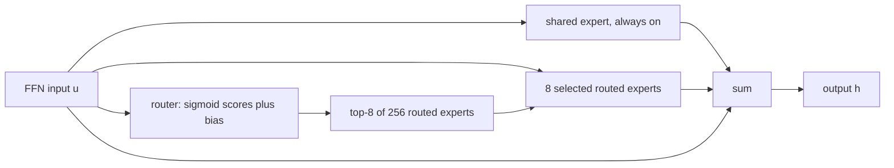

# MoE Architectures: Mixtral, DeepSeek-V3, Qwen3 and gpt-oss

## Introduction

All MoE LLMs share the same skeleton: dense attention, a router, and a set of expert MLPs in place of the dense FFN. Within that skeleton, the open models of 2023 to 2026 made strikingly different choices. Mixtral uses 8 large experts and picks 2. DeepSeek-V3 uses 256 small experts, picks 8 and adds one expert that every token always uses. Qwen3 uses 128 small experts and dropped the always-on expert. gpt-oss uses 128 medium experts, picks 4, and stores them in 4-bit floating point.

This page walks through those four designs using their actual config.json files and papers, so that you can:

- name the design knobs of an MoE layer and see each one in a config,
- understand fine-grained experts and shared experts, the two ideas from DeepSeekMoE that most later models adopted in some form,
- reproduce each model's total and active parameter count with one script,
- read a new MoE config, including newer models such as Kimi K2, Qwen3-Next and DeepSeek-V4, and predict its compute and memory.

Routing details (softmax vs sigmoid, balance losses, biases) are covered in [Routing](./1-llm-moe-routing.mdx). Attention details such as GQA and MLA are in [Multi-Query and Grouped-Query Attention](../2-llm-attention/5-llm-mqa-gqa.mdx) and [Multi-Head Latent Attention](../2-llm-attention/6-llm-mla.mdx).

## The Design Knobs

Every MoE layer is described by a handful of numbers:

| Knob | Symbol | Typical config field |
|---|---|---|
| Routed experts per layer | $N$ | `num_local_experts`, `num_experts`, `n_routed_experts` |
| Experts selected per token | $k$ | `num_experts_per_tok`, `experts_per_token` |
| Hidden size of one expert MLP | $d_e$ | `moe_intermediate_size` (or `intermediate_size` when there is no separate field) |
| Shared, always-on experts | $N_s$ | `n_shared_experts`, `shared_expert_intermediate_size` |
| Leading dense layers | | `first_k_dense_replace` (DeepSeek), `mlp_only_layers` (Qwen) |
| MoE in every layer or every $n$-th | | `moe_layer_freq`, `decoder_sparse_step` |

Two derived quantities help compare designs:

- **Activated MLP width per token:** $k \cdot d_e$ (plus $N_s \cdot d_e$ for shared experts). This sets FFN compute per token. Compare it to the `intermediate_size` a dense model of the same $d$ would use.
- **Granularity:** how small experts are relative to a dense FFN, roughly $d_{ff}^{\mathrm{dense}} / d_e$. Mixtral has granularity 1 (each expert is a full Mistral 7B FFN). DeepSeek-V3's experts are about 9 times narrower than its own dense layers.

## Mixtral: Eight Full-Size Experts, Top-2

Mixtral 8x7B (Jiang et al., 2024) is the simplest modern design. Start from the Mistral 7B architecture ($d = 4096$, 32 layers, GQA with 8 KV heads), and in every layer replace the SwiGLU FFN with 8 copies of it, each with $d_{ff} = 14336$, routed top-2 with softmax and renormalization:

```json
{
  "hidden_size": 4096,
  "intermediate_size": 14336,
  "num_hidden_layers": 32,
  "num_local_experts": 8,
  "num_experts_per_tok": 2,
  "router_aux_loss_coef": 0.02,
  "max_position_embeddings": 32768,
  "rope_theta": 1000000.0
}
```

Per token, the activated MLP width is $2 \times 14336 = 28672$, twice Mistral 7B's FFN. Mixtral 8x22B scales the same recipe: $d = 6144$, 56 layers, 48 query heads, experts with $d_{ff} = 16384$, still 8 experts and top-2, 141B total and 39B active, 64K context.

The appeal is simplicity: experts look exactly like dense FFNs, so dense kernels, tensor parallelism and quantization tools work unchanged. The drawback is coarse routing. With 8 experts and $k = 2$ there are only $\binom{8}{2} = 28$ possible expert combinations per token per layer, so each expert must cover a broad slice of the input space.

## DeepSeekMoE: Fine-Grained and Shared Experts

DeepSeekMoE (Dai et al., 2024) argued that coarse experts suffer from two problems: **knowledge hybridity** (each expert must learn many unrelated things because there are few experts) and **knowledge redundancy** (common knowledge, such as basic grammar, is learned again by many experts because every token needs it). It proposed two fixes.

### Fine-Grained Expert Segmentation

Split each expert into $m$ narrower experts with hidden size $d_e / m$, and select $m k$ of them instead of $k$. Total parameters and FLOPs per token stay the same, but the number of combinations explodes:

| Configuration | Experts | Active | Activated width | Combinations |
|---|---|---|---|---|
| Coarse, like Mixtral | 8 | 2 | $2 d_e$ | 28 |
| DeepSeekMoE paper example, coarse | 16 | 2 | $2 d_e$ | 120 |
| Same, split $m = 4$ | 64 | 8 | $8 \cdot d_e/4 = 2 d_e$ | 4,426,165,368 |
| DeepSeek-V3 | 256 | 8 | $8 \times 2048$ | about $4.1 \times 10^{14}$ |

With more, smaller experts the router can compose a specialized MLP for each token out of many reusable pieces. The cost is more, smaller matrix multiplies (worse GPU efficiency without grouped GEMM kernels) and a larger router ($N \times d$), which is still tiny.

### Shared Expert Isolation

Reserve $N_s$ experts that process every token, bypassing the router. With $N_r$ routed experts the layer output for token $t$ is:

$$
h'_t = u_t + \sum_{i=1}^{N_s} \mathrm{FFN}^{(s)}_i(u_t) + \sum_{i=1}^{N_r} g_{i,t}\, \mathrm{FFN}^{(r)}_i(u_t)
$$

where $u_t$ is the input to the FFN sublayer (the residual stream after attention; written with the residual added, as in the DeepSeek-V3 paper) and $g_{i,t}$ are the sparse gates. The shared experts absorb knowledge every token needs, so the routed experts are free to specialize. Implementations simply merge the $N_s$ shared experts into one MLP of width $N_s \cdot d_e$.



### DeepSeek-V2 and DeepSeek-V3

DeepSeek-V2 (236B total, 21B active) used 2 shared and 160 routed experts with 6 active. DeepSeek-V3 (671B total, 37B active, trained on 14.8T tokens) has this MoE configuration, from its config.json:

```json
{
  "hidden_size": 7168,
  "num_hidden_layers": 61,
  "first_k_dense_replace": 3,
  "intermediate_size": 18432,
  "moe_intermediate_size": 2048,
  "n_routed_experts": 256,
  "n_shared_experts": 1,
  "num_experts_per_tok": 8,
  "scoring_func": "sigmoid",
  "topk_method": "noaux_tc",
  "n_group": 8,
  "topk_group": 4,
  "norm_topk_prob": true,
  "routed_scaling_factor": 2.5,
  "num_nextn_predict_layers": 1
}
```

Reading it line by line:

- **The first 3 layers are dense** (`first_k_dense_replace: 3`), with an FFN of width 18432. The other 58 layers are MoE. Keeping the first layer dense goes back to DeepSeekMoE 16B, whose authors observed that load balance converged especially slowly in the first layer; DeepSeek-V2 also kept one dense layer, and V3 keeps three.
- **Each expert is narrow:** 2048 wide versus 18432 for the dense FFN, about one ninth.
- **Per token:** 1 shared + 8 routed experts, an activated width of $9 \times 2048 = 18432$, exactly the dense layer width. The MoE layers cost the same FLOPs as the dense layers while holding $257 / 9 \approx 28.6$ times more FFN parameters.
- **Routing** uses sigmoid scores, bias-based balancing, group-limited selection (8 groups, keep 4) and a 2.5 output scale, as explained on the routing page.
- **Attention** is Multi-Head Latent Attention (`kv_lora_rank: 512`, `q_lora_rank: 1536`, `qk_rope_head_dim: 64`), which shrinks the KV cache; MoE does nothing for the KV cache, so the two ideas complement each other.
- **The multi-token prediction module** (`num_nextn_predict_layers: 1`) adds 14B parameters; the Hugging Face checkpoint is 685B total, of which 671B is the main model. See [Multi-Token Prediction](../13-llm-advanced-architectures/5-llm-multi-token-prediction.mdx).

## Qwen: From Shared Experts to None

Qwen's MoE line shows that shared experts are a choice, not a requirement.

**Qwen1.5-MoE-A2.7B** (2024) was upcycled from the dense Qwen-1.8B: the dense FFN was cut into segments that became fine-grained experts. Its config has 60 routed experts with 4 active (`moe_intermediate_size: 1408`) plus a shared expert of width 5632, which is 4 shared experts of width 1408 merged into one. The shared expert's output is multiplied by a learned sigmoid gate, $\sigma(w^\top x)$, so the model can turn it up or down per token. `norm_topk_prob` is false: routed gates are raw softmax probabilities.

**Qwen3** (2025) MoE models drop shared experts entirely. The Qwen3 technical report states this explicitly, keeps fine-grained experts, and trains with the global-batch load-balancing loss:

| Field | Qwen3-30B-A3B | Qwen3-235B-A22B |
|---|---|---|
| `hidden_size` | 2048 | 4096 |
| `num_hidden_layers` | 48 | 94 |
| `num_attention_heads` / `num_key_value_heads` | 32 / 4 | 64 / 4 |
| `num_experts` / `num_experts_per_tok` | 128 / 8 | 128 / 8 |
| `moe_intermediate_size` | 768 | 1536 |
| `norm_topk_prob` | true | true |
| `router_aux_loss_coef` | 0.001 | 0.001 |
| total / active (model card) | 30.5B / 3.3B | 235B / 22B |

Every layer is MoE (`decoder_sparse_step: 1`, `mlp_only_layers: []`). Per token, the activated width is $8 \times 1536 = 12288$ for the 235B model, which is exactly its `intermediate_size` field (12288), the width a dense layer of the same compute would have. The same holds for the 30B model: $8 \times 768 = 6144$.

Why drop the shared expert? The Qwen3 report does not give a detailed ablation. One plausible reading, consistent with Qiu et al.'s global-batch work, is that once balancing is relaxed from per-sequence to per-global-batch, routed experts can specialize on their own and a dedicated shared expert matters less. Treat this as interpretation, not a published finding. Qwen3-Next-80B-A3B (2025) brought a shared expert back, with 512 routed experts, 10 active and 1 shared, all of width 512.

## gpt-oss: Fewer, Wider Experts in 4-Bit

OpenAI's gpt-oss models (model card, 2025) are text-only MoE Transformers with a residual width of 2880:

| Field | gpt-oss-20b | gpt-oss-120b |
|---|---|---|
| `num_hidden_layers` | 24 | 36 |
| `num_local_experts` | 32 | 128 |
| `num_experts_per_tok` | 4 | 4 |
| `intermediate_size` (per expert) | 2880 | 2880 |
| attention | 64 query heads of size 64, 8 KV heads, alternating 128-token sliding window and full layers | same |
| total / active (model card) | 20.91B / 3.61B | 116.83B / 5.13B |

Design points worth noticing:

- **Top-4 with softmax after selection.** The router takes the 4 largest logits and applies softmax to those 4 only, which is equivalent to Mixtral's renormalized top-k.
- **Medium granularity.** Each expert's hidden size equals $d$ (2880), so the activated width is $4 \times 2880 = 11520$, four times $d$. The 120b model has more experts, not bigger ones: both models use the same expert shape.
- **Biases and a modified SwiGLU.** Unlike most recent models, gpt-oss keeps bias terms in attention, router and expert projections. The reference implementation's SwiGLU clamps its inputs at 7.0 (`swiglu_limit` in the config), uses $x \cdot \sigma(1.702\,x)$ for the gate and multiplies by $(x_{\mathrm{linear}} + 1)$, an extra residual-like term.
- **Experts dominate.** The model card reports 114.71B of 116.83B parameters in the MLP blocks for the 120b model, over 90 percent. The experts are post-trained to MXFP4 (about 4.25 bits per parameter), while attention, router, embeddings and LM head stay in BF16 (the config's `modules_to_not_convert`). This is what lets the 120b model fit on one 80 GB GPU and the 20b model run in 16 GB. See [FP8, MXFP4 and NVFP4](../11-llm-quantization/3-llm-fp8-and-fp4.mdx).

gpt-oss also illustrates that "active parameters" is dominated by attention and the LM head when experts are small and few are chosen: of 5.13B active parameters in the 120b model, 4 experts across 36 layers contribute only about 3.6B.

## Counting Every Model With One Script

The formulas from the [introduction](./0-llm-moe-introduction.mdx) extend to all four families once we model their attention correctly: GQA for Mixtral, Qwen3 (plus per-head QK-norm) and gpt-oss (plus biases and sink logits), MLA for DeepSeek-V3.

```python
# Total and active parameter counts for four MoE families, from config.json values.

def gqa_attn(d, n_heads, n_kv, head_dim, bias=False):
    q, kv, o = d * n_heads * head_dim, 2 * d * n_kv * head_dim, n_heads * head_dim * d
    b = (n_heads + 2 * n_kv) * head_dim + d if bias else 0
    return q + kv + o + b

def mla_attn(d, n_heads, q_rank, kv_rank, nope, rope, v_dim):
    q = d * q_rank + q_rank + q_rank * n_heads * (nope + rope)      # down, norm, up
    kv = d * (kv_rank + rope) + kv_rank + kv_rank * n_heads * (nope + v_dim)
    o = n_heads * v_dim * d
    return q + kv + o

def swiglu(d, f, bias=False):
    return 3 * d * f + ((2 * f + d) if bias else 0)

def count(name, L, d, vocab, attn, expert, n_routed, k, shared=0, dense_layers=0,
          dense_ffn=0, router_bias=False):
    moe_layers = L - dense_layers
    router = n_routed * d + (n_routed if router_bias else 0)
    norms = 2 * d
    per_moe_total = attn + n_routed * expert + shared * expert + router + norms
    per_moe_active = attn + k * expert + shared * expert + router + norms
    per_dense = attn + dense_ffn + norms
    emb = 2 * vocab * d + d                                    # untied in all four
    total = moe_layers * per_moe_total + dense_layers * per_dense + emb
    active = moe_layers * per_moe_active + dense_layers * per_dense + emb
    active_no_in = active - vocab * d                         # input embedding is a lookup
    print(f"{name:16s} total={total/1e9:6.1f}B  active={active/1e9:5.1f}B  "
          f"active w/o input emb={active_no_in/1e9:5.1f}B  expert={expert/1e6:6.1f}M")

count("Mixtral-8x7B", 32, 4096, 32000, gqa_attn(4096, 32, 8, 128), swiglu(4096, 14336), 8, 2)
count("Mixtral-8x22B", 56, 6144, 32000, gqa_attn(6144, 48, 8, 128), swiglu(6144, 16384), 8, 2)
# Qwen3 adds per-head RMSNorm on q and k (q_norm, k_norm): 2 * head_dim weights.
count("Qwen3-30B-A3B", 48, 2048, 151936, gqa_attn(2048, 32, 4, 128) + 256, swiglu(2048, 768), 128, 8)
count("Qwen3-235B-A22B", 94, 4096, 151936, gqa_attn(4096, 64, 4, 128) + 256, swiglu(4096, 1536), 128, 8)
# gpt-oss: biases everywhere, one learned attention-sink logit per head.
count("gpt-oss-20b", 24, 2880, 201088, gqa_attn(2880, 64, 8, 64, bias=True) + 64,
      swiglu(2880, 2880, bias=True), 32, 4, router_bias=True)
count("gpt-oss-120b", 36, 2880, 201088, gqa_attn(2880, 64, 8, 64, bias=True) + 64,
      swiglu(2880, 2880, bias=True), 128, 4, router_bias=True)
# DeepSeek-V3: MLA attention, 3 dense layers, 1 shared + 256 routed experts (MTP module excluded).
count("DeepSeek-V3", 61, 7168, 129280, mla_attn(7168, 128, 1536, 512, 128, 64, 128),
      swiglu(7168, 2048), 256, 8, shared=1, dense_layers=3, dense_ffn=swiglu(7168, 18432),
      router_bias=True)
```

```text
Mixtral-8x7B     total=  46.7B  active= 12.9B  active w/o input emb= 12.7B  expert= 176.2M
Mixtral-8x22B    total= 140.6B  active= 39.2B  active w/o input emb= 39.0B  expert= 302.0M
Qwen3-30B-A3B    total=  30.5B  active=  3.4B  active w/o input emb=  3.0B  expert=   4.7M
Qwen3-235B-A22B  total= 235.1B  active= 22.2B  active w/o input emb= 21.6B  expert=  18.9M
gpt-oss-20b      total=  20.9B  active=  4.2B  active w/o input emb=  3.6B  expert=  24.9M
gpt-oss-120b     total= 116.8B  active=  5.7B  active w/o input emb=  5.1B  expert=  24.9M
DeepSeek-V3      total= 671.0B  active= 37.6B  active w/o input emb= 36.6B  expert=  44.0M
```

Every total matches the published figure (46.7B, 141B, 30.5B, 235B, 20.9B, 116.8B, 671B). The active numbers match within the spread caused by counting conventions: gpt-oss's card excludes the input embedding (5.1B and 3.6B, exactly our third column), Mixtral's 12.9B and Qwen3-30B-A3B's 3.3B are close to the column that includes it, and DeepSeek-V3's 37B sits between the two. When a model card and your count disagree by a few hundred million parameters, check the embedding convention before suspecting your formula.

Look at the expert sizes in the last column: from 302M parameters per expert (Mixtral 8x22B) down to 4.7M (Qwen3-30B-A3B). That 64x range is the granularity axis in one number.

## Side-by-Side Comparison

| | Mixtral 8x7B | DeepSeek-V3 | Qwen3-235B-A22B | gpt-oss-120b |
|---|---|---|---|---|
| Released | Dec 2023 | Dec 2024 | Apr 2025 | Aug 2025 |
| Total / active | 46.7B / 12.9B | 671B / 37B | 235B / 22B | 116.8B / 5.1B |
| $d$ / layers | 4096 / 32 | 7168 / 61 | 4096 / 94 | 2880 / 36 |
| Dense layers | 0 | first 3 | 0 | 0 |
| Routed experts, active | 8, 2 | 256, 8 | 128, 8 | 128, 4 |
| Shared experts | 0 | 1 | 0 | 0 |
| Expert width $d_e$ | 14336 | 2048 | 1536 | 2880 |
| Activated FFN width | 28672 | 18432 incl. shared | 12288 | 11520 |
| Scoring | softmax | sigmoid, scaled 2.5 | softmax | softmax over top-4 |
| Balancing | aux loss | bias + tiny sequence loss | global-batch aux loss | not detailed in the model card |
| Attention | GQA, 8 KV heads | MLA | GQA, 4 KV heads | GQA, 8 KV heads, alternating sliding window |

The trend is clear: more experts, smaller experts, lower active fraction. Where the models differ is whether to keep a shared expert and how much to rely on auxiliary losses.

## Newer Designs on the Same Axes

The same knobs describe the models released since. All values below come from the Hugging Face configs and model cards:

| Model | Total / active | Routed experts, active | Shared | Expert width | Notes |
|---|---|---|---|---|---|
| Kimi K2 (Moonshot, 2025) | 1T / 32B | 384, 8 | 1 | 2048 | DeepSeek-V3 architecture, 1 dense layer, 64 heads, `n_group: 1` |
| Qwen3-Next-80B-A3B (2025) | 80B / 3B | 512, 10 | 1 | 512 | hybrid linear attention, shared expert returns |
| DeepSeek-V4-Flash (2026) | 284B / 13B | 256, 6 | 1 | 2048 | 1M context, `scoring_func: sqrtsoftplus`, `noaux_tc` |
| DeepSeek-V4-Pro (2026) | 1.6T / 49B | 384, 6 | 1 | 3072 | FP4 experts, FP8 elsewhere |

Kimi K2 is a useful lesson in reading configs: its `architectures` field is `DeepseekV3ForCausalLM`. It reuses the DeepSeek-V3 design with more experts (384), fewer attention heads (64 instead of 128) and only one leading dense layer. Once you know the knobs, a new model is mostly a new point in a familiar space.

## Worked Scenario: Making Mixtral Fine-Grained

Suppose you want to redesign one Mixtral layer in the DeepSeekMoE style without changing its compute or parameter budget. Mixtral's layer has 8 experts of width 14336, top-2.

1. **Split each expert into $m = 4$.** You get 32 experts of width 3584. To keep the activated width at $2 \times 14336 = 28672$, select $8 \times 3584 = 28672$, that is $k = 8$. Parameters and FLOPs per token are unchanged.
2. **Combinations** go from $\binom{8}{2} = 28$ to $\binom{32}{8} = 10{,}518{,}300$.
3. **Isolate one shared expert.** Take one of the 32 experts out of the routing pool and make it always on. Now 31 routed experts, 7 routed active plus 1 shared, the same activated width.
4. **Router size** grows from $8 \times 4096$ to $31 \times 4096$ parameters, still negligible.
5. **Costs:** each GEMM now has a hidden size of 3584 instead of 14336, and each expert sees on average $7/31$ of the tokens instead of $2/8$, so per-expert matmuls are smaller. On a GPU you need a grouped GEMM to keep utilization high; across GPUs each token now visits up to 7 routed experts that may live on different devices, which increases all-to-all traffic unless you limit node fan-out as DeepSeek does.

DeepSeekMoE's experiments found that, at equal total and active parameters, this style of design reached better quality than the GShard-style coarse layout. That result is why fine-grained experts are now the default. The [implementation page](./3-llm-moe-implementation.mdx) builds exactly this layer, and the [serving page](./4-llm-moe-training-and-serving.mdx) quantifies the communication cost.

## Common Mistakes

- **Using `intermediate_size` as the expert width in DeepSeek or Qwen configs.** There it is the dense layer (or nominal dense) width; the expert width is `moe_intermediate_size`. Mixtral and gpt-oss have only `intermediate_size`, which is the per-expert width.
- **Forgetting dense layers in DeepSeek-style models.** `first_k_dense_replace: 3` means 3 of the 61 layers have no experts.
- **Counting each shared expert separately when it is stored merged.** Qwen1.5-MoE's `shared_expert_intermediate_size: 5632` is 4 experts of 1408 in one MLP.
- **Assuming all models in a family keep the same design.** Qwen1.5-MoE had shared experts, Qwen3 MoE dropped them, Qwen3-Next brought one back.
- **Comparing active parameters across conventions.** Check whether the card counts input embeddings; gpt-oss does not.
- **Assuming more experts is free.** Finer experts mean smaller matmuls and more communication; they pay off only with grouped kernels and balance-aware placement.

## Summary

- MoE designs are points in a small space: number of experts, expert width, top-k, shared experts and dense layers.
- Mixtral: 8 full-size experts, top-2, every layer MoE, softmax with renormalization.
- DeepSeekMoE introduced fine-grained experts (many narrow experts, more selected) and shared experts (always-on experts for common knowledge); DeepSeek-V3 uses 256 routed + 1 shared, 8 active, width 2048, 3 dense layers.
- Qwen3 keeps fine-grained experts (128, top-8) but drops shared experts and uses global-batch balancing; its activated width equals its nominal dense width.
- gpt-oss uses 128 (or 32) experts of width 2880, top-4, biases, a clamped SwiGLU and MXFP4 expert weights.
- One counting script reproduces every published total; active counts differ mainly by the embedding convention.
- Newer models (Kimi K2, Qwen3-Next, DeepSeek-V4) continue the trend toward more experts and lower active fractions.

## Further Reading

- [Mixtral of Experts (Jiang et al., 2024)](https://arxiv.org/abs/2401.04088): the Mixtral 8x7B paper.
- [DeepSeekMoE (Dai et al., 2024)](https://arxiv.org/abs/2401.06066): fine-grained expert segmentation and shared expert isolation.
- [DeepSeek-V2 (DeepSeek-AI, 2024)](https://arxiv.org/abs/2405.04434): MLA plus DeepSeekMoE at 236B parameters.
- [DeepSeek-V3 Technical Report (DeepSeek-AI, 2024)](https://arxiv.org/abs/2412.19437): the 671B model, its MoE and its training system.
- [Qwen3 Technical Report (Qwen Team, 2025)](https://arxiv.org/abs/2505.09388): Qwen3 dense and MoE models.
- [Qwen1.5-MoE blog post](https://qwenlm.github.io/blog/qwen-moe/): upcycling Qwen-1.8B into a fine-grained MoE with shared experts.
- [gpt-oss-120b and gpt-oss-20b Model Card (OpenAI, 2025)](https://arxiv.org/abs/2508.10925): architecture, parameter breakdown and MXFP4.
- [gpt-oss reference implementation](https://github.com/openai/gpt-oss): the PyTorch `MLPBlock` and `swiglu` code described above.
- [OLMoE (Muennighoff et al., 2024)](https://arxiv.org/abs/2409.02060): a fully open MoE with detailed ablations of design choices.
- [Kimi K2 model card](https://huggingface.co/moonshotai/Kimi-K2-Instruct): a 1T-parameter model built on the DeepSeek-V3 architecture.
