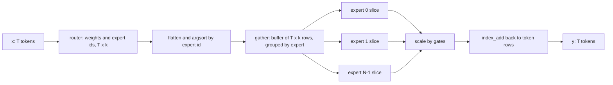

# Implementing a Mixture-of-Experts Layer in PyTorch

## Introduction

The previous pages described MoE layers in equations and config fields. This page turns them into code that runs on a laptop CPU. You will build one `MoELayer` module that can behave like Mixtral (softmax, top-2), Qwen3 (softmax, top-8, renormalized), or DeepSeek-V3 (sigmoid scores, selection biases, group-limited routing, scaling, a shared expert), and then:

- check the fast, batched dispatch against a slow per-token loop,
- check it against the Mixtral block in Hugging Face `transformers`, weight for weight,
- replace the Python loop over experts with `torch.nn.functional.grouped_mm`,
- train a tiny character-level language model with a dense FFN and with MoE layers under three balancing schemes, and look at what the experts learned.

The math comes from [Routing](./1-llm-moe-routing.mdx) and the architectural choices from [MoE Architectures](./2-llm-moe-architectures.mdx). The decoder block around the FFN is the one from [Building a GPT from Scratch](../3-llm-transformer/5-llm-build-gpt-from-scratch.mdx).

## The Data Layout Problem

A dense FFN is one matmul over the whole batch: `(T, d) @ (d, d_ff)`. An MoE layer has to do $N$ matmuls, each on a different, data-dependent subset of the $T$ tokens. There are three ways to organize that:

1. **Loop over tokens.** Clear, as in the [introduction](./0-llm-moe-introduction.mdx), but $T \cdot k$ tiny matrix-vector products. Useless for real sizes.
2. **Loop over experts with masks.** For each expert, find the tokens that chose it, gather them, run the expert, scatter the results back. This is what the Hugging Face "eager" implementation does.
3. **Sort and slice.** Flatten the $T \cdot k$ (token, slot) assignments, sort them by expert id, gather the token vectors once into a contiguous buffer, and process each expert's contiguous slice. The slice boundaries are the cumulative counts per expert. This layout is exactly what grouped GEMM kernels and expert-parallel all-to-alls consume, so it is the one to learn.

Here is the sort-and-slice idea on a tiny example with $T = 3$ tokens and $k = 2$:

```text
idx (token -> experts)      flattened slots         sorted by expert
token 0: [2, 0]             slot 0 -> expert 2      expert 0: slot 1 (token 0)
token 1: [1, 2]             slot 1 -> expert 0      expert 1: slot 2 (token 1), slot 5 (token 2)
token 2: [2, 1]             slot 2 -> expert 1      expert 2: slot 0 (token 0), slot 3 (token 1), slot 4 (token 2)
                            slot 3 -> expert 2
                            slot 4 -> expert 2      counts = [1, 2, 3]
                            slot 5 -> expert 1      token of sorted slot = slot // k
```

Each sorted slot remembers its source token (`slot // k`) so the combine step can add the expert output, scaled by the gate weight, back to the right row with `index_add_`.



## The Complete Layer

Save the following as `moe_layer.py`. Every later snippet on this page, and the expert-parallel demo on the [training and serving page](./4-llm-moe-training-and-serving.mdx), imports from it.

Design notes before the code:

- **Experts are stored as stacked 3D parameters**, `gate_up` of shape `(N, 2 * d_expert, d_model)` and `down` of shape `(N, d_model, d_expert)`, not as a `ModuleList` of `nn.Linear`. This is the layout `transformers` v5 uses for Mixtral, Qwen3-MoE and DeepSeek-V3 (`gate_up_proj`, `down_proj`), and what fused kernels expect. Gate and up projections are fused into one matrix and split with `chunk`.
- **The router runs in FP32** and returns the unbiased scores as gate weights even when a selection bias is active.
- **Group-limited routing** scores each group by the sum of its two best (biased) scores, as in the DeepSeek-V3 reference code.
- **A shared expert** of width `n_shared * d_expert` is stored as a one-expert `Experts` module.
- The layer **caches routing statistics** from the last forward for the balance loss, the z-loss and the bias update.

```python
# moe_layer.py: a complete Mixture-of-Experts FFN layer (DeepSeek/Qwen/Mixtral style).
import torch
import torch.nn as nn
import torch.nn.functional as F


class Experts(nn.Module):
    """N SwiGLU experts stored as stacked 3D weights, like transformers v5 and vLLM."""

    def __init__(self, n_experts, d_model, d_expert):
        super().__init__()
        self.gate_up = nn.Parameter(torch.randn(n_experts, 2 * d_expert, d_model) * d_model**-0.5)
        self.down = nn.Parameter(torch.randn(n_experts, d_model, d_expert) * d_expert**-0.5)

    def expert_forward(self, e, x):                      # x: (n_e, d_model) tokens for expert e
        gate, up = F.linear(x, self.gate_up[e]).chunk(2, dim=-1)  # (n_e, d_expert) each
        return F.linear(F.silu(gate) * up, self.down[e])          # (n_e, d_model)


class Router(nn.Module):
    def __init__(self, d_model, n_experts, top_k, score="softmax", norm_topk=True,
                 scale=1.0, n_group=1, topk_group=1, bias_balancing=False):
        super().__init__()
        self.weight = nn.Parameter(torch.randn(n_experts, d_model) * d_model**-0.5)
        self.top_k, self.score, self.norm_topk, self.scale = top_k, score, norm_topk, scale
        self.n_group, self.topk_group = n_group, topk_group
        self.bias_balancing = bias_balancing
        self.register_buffer("bias", torch.zeros(n_experts))   # used for selection only

    def forward(self, x):                                # x: (T, d_model)
        logits = F.linear(x.float(), self.weight.float())  # (T, N), router in FP32
        scores = logits.softmax(-1) if self.score == "softmax" else logits.sigmoid()
        choice = scores + self.bias if self.bias_balancing else scores
        if self.n_group > 1:                             # group-limited routing
            T, N = choice.shape
            grouped = choice.view(T, self.n_group, N // self.n_group)
            group_score = grouped.topk(2, dim=-1).values.sum(-1)        # (T, n_group)
            keep = group_score.topk(self.topk_group, dim=-1).indices    # (T, topk_group)
            mask = torch.ones_like(group_score, dtype=torch.bool).scatter_(1, keep, False)
            choice = grouped.masked_fill(mask.unsqueeze(-1), float("-inf")).view(T, N)
        idx = choice.topk(self.top_k, dim=-1).indices    # (T, k)
        weights = scores.gather(-1, idx)                 # unbiased scores as gates
        if self.norm_topk:
            weights = weights / weights.sum(-1, keepdim=True)
        return weights * self.scale, idx, logits, scores


class MoELayer(nn.Module):
    def __init__(self, d_model=64, n_experts=8, top_k=2, d_expert=128, n_shared=0, **router_kw):
        super().__init__()
        self.n_experts, self.top_k = n_experts, top_k
        self.router = Router(d_model, n_experts, top_k, **router_kw)
        self.experts = Experts(n_experts, d_model, d_expert)
        self.shared = Experts(1, d_model, n_shared * d_expert) if n_shared else None

    def forward(self, x):                                # x: (batch, seq, d_model)
        B, S, D = x.shape
        x = x.reshape(-1, D)                             # (T, D), T = B * S
        weights, idx, logits, scores = self.router(x)    # (T, k), (T, k), (T, N), (T, N)

        # 1) Flatten the (token, slot) pairs and sort them by expert id.
        flat_expert = idx.reshape(-1)                    # (T*k,)
        order = flat_expert.argsort(stable=True)         # positions grouped by expert
        token_of = order // self.top_k                   # source token of each sorted slot
        counts = torch.bincount(flat_expert, minlength=self.n_experts)  # (N,) tokens per expert

        # 2) Dispatch: gather tokens into one contiguous buffer, run each expert on its slice.
        buf = x[token_of]                                # (T*k, D), permuted copy of tokens
        out = torch.empty_like(buf)
        start = 0
        for e, n in enumerate(counts.tolist()):          # empty experts are skipped
            if n:
                out[start:start + n] = self.experts.expert_forward(e, buf[start:start + n])
            start += n

        # 3) Combine: scale by gate weights and scatter-add back to token positions.
        out = out * weights.reshape(-1)[order].unsqueeze(-1).to(out.dtype)
        y = torch.zeros_like(x).index_add_(0, token_of, out)        # (T, D)
        if self.shared is not None:
            y = y + self.shared.expert_forward(0, x)     # always-on shared expert

        self.last = dict(idx=idx, logits=logits, scores=scores, counts=counts)
        return y.reshape(B, S, D)

    def aux_losses(self):
        """Switch-style balance loss N * sum f_i P_i and router z-loss, from the last forward."""
        idx, logits, counts = self.last["idx"], self.last["logits"], self.last["counts"]
        probs = logits.softmax(-1)
        f = counts.float() / idx.numel()                 # fraction of assignments (no grad)
        P = probs.mean(0)                                # mean router probability (grad)
        balance = self.n_experts * (f * P).sum()
        z = torch.logsumexp(logits, dim=-1).pow(2).mean()
        return balance, z

    @torch.no_grad()
    def update_bias(self, gamma=1e-3):
        """Auxiliary-loss-free balancing: nudge biases against the load error."""
        c = self.last["counts"].float()
        self.router.bias += gamma * torch.sign(c.mean() - c)
```

The forward pass is three steps, matching the comments: **dispatch** (sort the assignments by expert and gather the token vectors), **compute** (each expert on its contiguous slice) and **combine** (scale by gate weights, `index_add_` back). The Python loop over experts is the only loop, and it has $N$ iterations regardless of batch size; experts that received no tokens are skipped.

Two details are easy to get wrong:

- `argsort(stable=True)` keeps the original token order inside each expert's slice. It does not change the math, but it makes results deterministic and matches how kernels lay out tokens.
- The gate weights are reordered with the same `order` as the token vectors (`weights.reshape(-1)[order]`). Multiplying in the original order would pair each output with the wrong weight.

## Checking Against a Slow Loop

The first test of any MoE implementation: compare it with the obvious per-token loop.

```python

import torch
from moe_layer import MoELayer

torch.manual_seed(0)
layer = MoELayer(d_model=16, n_experts=8, top_k=2, d_expert=32, n_shared=1)
x = torch.randn(2, 5, 16)                               # (batch, seq, d_model)
y = layer(x)

# Reference: a slow loop over tokens and their k chosen experts.
x2 = x.reshape(-1, 16)
w, idx, _, _ = layer.router(x2)
ref = torch.zeros_like(x2)
for t in range(x2.shape[0]):
    for s in range(layer.top_k):
        e = idx[t, s].item()
        ref[t] += w[t, s] * layer.experts.expert_forward(e, x2[t:t + 1])[0]
ref += layer.shared.expert_forward(0, x2)

print("output shape:", tuple(y.shape))
print("tokens per expert:", layer.last["counts"].tolist())
print("max |fast - loop|:", (y.reshape(-1, 16) - ref).abs().max().item())
balance, z = layer.aux_losses()
print(f"balance loss: {balance.item():.3f}   z-loss: {z.item():.3f}")
n_total = sum(p.numel() for p in layer.parameters())
print("parameters:", n_total)
```

```text
output shape: (2, 5, 16)
tokens per expert: [2, 3, 3, 4, 2, 0, 3, 3]
max |fast - loop|: 2.980232238769531e-07
balance loss: 1.036   z-loss: 7.106
parameters: 13952
```

The batched layer matches the loop to float32 rounding (about $3 \times 10^{-7}$). With 10 tokens and $k = 2$ there are 20 assignments over 8 experts; expert 5 received none and was skipped.

The two losses are worth sanity-checking by hand. The balance loss is 1.036, close to its perfect-balance value of 1, as expected for a random router. The z-loss is the mean of $(\log \sum_j e^{u_j})^2$; if all 8 logits were zero it would be $(\log 8)^2 = 2.08^2 \approx 4.3$, and random logits with unit-scale spread push the log-sum-exp a bit higher, giving 7.1. Note that the z-loss does not reach zero at a uniform router: it penalizes the scale of the logits, and because softmax ignores a constant shift, the router can lower it by shifting all logits down without changing any routing decision.

The parameter count also checks out: 8 experts of $3 \times 16 \times 32 = 1536$, one shared expert of the same size, a router of $8 \times 16 = 128$: $9 \times 1536 + 128 = 13{,}952$.

## Checking Against Hugging Face Transformers

In `transformers` v5 the Mixtral MoE block is `MixtralSparseMoeBlock`, with a `MixtralTopKRouter` (softmax in FP32, top-k, renormalize) and a `MixtralExperts` module that stores `gate_up_proj` and `down_proj` as 3D parameters, the same layout as ours. That means we can copy our weights straight in and compare outputs:

```python
import torch
from transformers import MixtralConfig
from transformers.models.mixtral.modeling_mixtral import MixtralSparseMoeBlock
from moe_layer import MoELayer

torch.manual_seed(0)
cfg = MixtralConfig(hidden_size=16, intermediate_size=32, num_local_experts=8, num_experts_per_tok=2)
cfg._experts_implementation = "eager"                # standalone block: pick the plain loop
hf = MixtralSparseMoeBlock(cfg).eval()
ours = MoELayer(d_model=16, n_experts=8, top_k=2, d_expert=32)   # softmax, top-2, renormalize

with torch.no_grad():                                  # copy our weights into the HF block
    hf.gate.weight.copy_(ours.router.weight)
    hf.experts.gate_up_proj.copy_(ours.experts.gate_up)   # (8, 2*32, 16): gate rows, then up rows
    hf.experts.down_proj.copy_(ours.experts.down)         # (8, 16, 32)

x = torch.randn(3, 7, 16)
with torch.no_grad():
    print("HF experts implementation:", cfg._experts_implementation)
    print("max |ours - transformers|:", (ours(x) - hf(x)).abs().max().item())
```

```text
HF experts implementation: eager
max |ours - transformers|: 0.0
```

An exact match: our layer computes the same function as the reference implementation. Setting `_experts_implementation` is only needed because we build the block on its own; when you load a full model, `from_pretrained` sets it, and you can request a faster kernel with the `experts_implementation` argument (besides the plain `"eager"` loop, `transformers` 5.21 registers `"batched_mm"`, `"grouped_mm"`, `"deepgemm"` and `"sonicmoe"`; the last two need their GPU kernel packages). Be aware that layouts differ between models: gpt-oss stores `gate_up_proj` as `(experts, hidden, 2 * intermediate)` with gate and up columns interleaved, so weight-copying code must be written per model.

## Replacing the Loop With grouped_mm

The loop over experts launches $N$ separate small matmuls. On a GPU with 128 or 256 experts that is hundreds of tiny kernel launches per layer. A **grouped GEMM** computes all of them in one call: the left operand is the sorted token buffer, the right operand is the stack of expert weights, and an offsets vector says where each expert's rows end. Recent PyTorch releases expose this as `torch.nn.functional.grouped_mm`. Its documentation targets BF16 on CUDA GPUs with compute capability 8.0 or newer; in the PyTorch 2.14 CPU build used here it also accepts float32 on CPU, which is enough to check correctness:

```python
import torch
import torch.nn.functional as F
from moe_layer import MoELayer

def experts_grouped(experts, buf, counts):
    """Run all experts with two grouped GEMMs instead of a Python loop."""
    offs = counts.cumsum(0).to(torch.int32)              # end offset of each expert's rows
    h = F.grouped_mm(buf, experts.gate_up.transpose(1, 2), offs=offs)   # (T*k, 2*d_expert)
    gate, up = h.chunk(2, dim=-1)
    return F.grouped_mm(F.silu(gate) * up, experts.down.transpose(1, 2), offs=offs)  # (T*k, D)

torch.manual_seed(0)
layer = MoELayer(d_model=16, n_experts=8, top_k=2, d_expert=32)
x = torch.randn(4, 6, 16).reshape(-1, 16)                # (T, D)

w, idx, _, _ = layer.router(x)
flat = idx.reshape(-1)
order = flat.argsort(stable=True)
token_of = order // layer.top_k
counts = torch.bincount(flat, minlength=8)
buf = x[token_of]                                        # tokens sorted by expert

out = experts_grouped(layer.experts, buf, counts) * w.reshape(-1)[order].unsqueeze(-1)
y = torch.zeros_like(x).index_add_(0, token_of, out)
print("counts:", counts.tolist())
print("max |grouped_mm - loop|:", (y - layer(x.view(4, 6, 16)).reshape(-1, 16)).abs().max().item())
```

```text
counts: [5, 5, 2, 9, 10, 8, 8, 1]
max |grouped_mm - loop|: 0.0
```

The shapes are the whole trick. `buf` is `(T*k, d_model)`, `gate_up.transpose(1, 2)` is `(N, d_model, 2*d_expert)`, and `offs[i]` marks the end of expert $i$'s rows in `buf`. The kernel multiplies rows `offs[i-1]:offs[i]` by weight matrix `i`. Empty experts simply have two equal offsets. This is the same computation that MegaBlocks, vLLM's fused MoE kernels and DeepSeek's DeepGEMM perform, with heavy optimization for memory layout and low precision.

## Configuring It Like Real Models

The same class covers the three routing families from the [architectures page](./2-llm-moe-architectures.mdx), at toy sizes:

```python
import torch
from moe_layer import MoELayer

torch.manual_seed(0)
d = 64
variants = {
    # Mixtral: 8 experts, top-2, softmax + renormalize.
    "mixtral-like": MoELayer(d, n_experts=8, top_k=2, d_expert=224),
    # Qwen3: 128 fine-grained experts, top-8, softmax + renormalize, no shared expert.
    "qwen3-like": MoELayer(d, n_experts=128, top_k=8, d_expert=24),
    # DeepSeek-V3: 256 experts in 8 groups (keep 4), top-8, sigmoid, bias, x2.5, 1 shared.
    "deepseek-v3-like": MoELayer(d, n_experts=256, top_k=8, d_expert=24, n_shared=1,
                                 score="sigmoid", scale=2.5, n_group=8, topk_group=4,
                                 bias_balancing=True),
}
x = torch.randn(4, 32, d)                                # (batch, seq, d_model)
for name, layer in variants.items():
    y = layer(x)
    idx = layer.last["idx"]                              # (T, k)
    n_params = sum(p.numel() for p in layer.parameters())
    # Experts 0-31 form group 0, 32-63 group 1, ...: count distinct groups per token.
    max_groups = max(len(set((row // 32).tolist())) for row in idx) if layer.router.n_group > 1 else "-"
    print(f"{name:17s} params={n_params:7d}  y={tuple(y.shape)}  experts used={int((layer.last['counts'] > 0).sum()):3d}"
          f"  max groups per token={max_groups}")
```

```text
mixtral-like      params= 344576  y=(4, 32, 64)  experts used=  8  max groups per token=-
qwen3-like        params= 598016  y=(4, 32, 64)  experts used=128  max groups per token=-
deepseek-v3-like  params=1200640  y=(4, 32, 64)  experts used=235  max groups per token=4
```

The expert widths were chosen so that the activated width is roughly comparable (224 x 2, 24 x 8, 24 x 9 with the shared expert). The DeepSeek-style layer stores the most parameters, and its group constraint holds: no token's 8 experts span more than 4 of the 8 groups. With 128 tokens the Qwen-style layer touched all 128 experts and the DeepSeek-style layer 235 of 256, the batch effect from the [introduction](./0-llm-moe-introduction.mdx) at small scale.

## A Tiny Training Experiment

Now train something. The model is a 2-layer character-level Transformer ($d = 64$, 4 heads, context 64) trained on PyTorch's own `torch/nn/modules/module.py` source file, which every PyTorch install includes. We compare four FFN choices with **equal active FFN width** (128):

- a dense SwiGLU FFN of width 128,
- an MoE layer with 8 experts of width 64, top-2, and no balancing,
- the same with the Switch balance loss (coefficient 0.01) and z-loss (0.001),
- the same with sigmoid scores and auxiliary-loss-free bias balancing ($\gamma = 0.001$).

```python
import torch
import torch.nn as nn
import torch.nn.functional as F
import torch.nn.modules.module as source_file
from moe_layer import MoELayer, Experts

torch.manual_seed(0)
text = open(source_file.__file__).read()                 # PyTorch's own module.py as data
chars = sorted(set(text))
stoi = {c: i for i, c in enumerate(chars)}
data = torch.tensor([stoi[c] for c in text])
split = int(0.9 * len(data))
train, val = data[:split], data[split:]
V, D, S, BATCH, STEPS = len(chars), 64, 64, 32, 1500

def batch(src):
    i = torch.randint(0, len(src) - S - 1, (BATCH,))
    x = torch.stack([src[j:j + S] for j in i])
    y = torch.stack([src[j + 1:j + S + 1] for j in i])
    return x, y

class DenseFFN(nn.Module):
    def __init__(self, d, f):
        super().__init__()
        self.e = Experts(1, d, f)
    def forward(self, x):
        return self.e.expert_forward(0, x.reshape(-1, x.shape[-1])).view_as(x)

class Block(nn.Module):
    def __init__(self, ffn):
        super().__init__()
        self.n1, self.n2 = nn.RMSNorm(D), nn.RMSNorm(D)
        self.qkv, self.o = nn.Linear(D, 3 * D, bias=False), nn.Linear(D, D, bias=False)
        self.ffn = ffn
    def forward(self, x):                                # x: (B, S, D)
        q, k, v = self.qkv(self.n1(x)).view(x.shape[0], S, 3, 4, D // 4).unbind(2)
        a = F.scaled_dot_product_attention(q.transpose(1, 2), k.transpose(1, 2),
                                           v.transpose(1, 2), is_causal=True)  # (B, 4, S, 16)
        x = x + self.o(a.transpose(1, 2).reshape(x.shape))
        return x + self.ffn(self.n2(x))

class TinyLM(nn.Module):
    def __init__(self, make_ffn):
        super().__init__()
        self.emb = nn.Embedding(V, D)
        self.blocks = nn.ModuleList(Block(make_ffn()) for _ in range(2))
        self.norm, self.head = nn.RMSNorm(D), nn.Linear(D, V, bias=False)
    def forward(self, idx):
        x = self.emb(idx)
        for b in self.blocks:
            x = b(x)
        return self.head(self.norm(x))

def run(name, make_ffn, mode):
    torch.manual_seed(1)
    model = TinyLM(make_ffn)
    opt = torch.optim.AdamW(model.parameters(), lr=3e-3)
    moes = [b.ffn for b in model.blocks if isinstance(b.ffn, MoELayer)]
    for step in range(STEPS):
        x, y = batch(train)
        loss = F.cross_entropy(model(x).view(-1, V), y.view(-1))
        if mode == "aux":
            for m in moes:
                bal, z = m.aux_losses()
                loss = loss + 0.01 * bal + 0.001 * z
        opt.zero_grad(); loss.backward(); opt.step()
        if mode == "bias":
            for m in moes:
                m.update_bias(gamma=1e-3)
    model.eval()
    with torch.no_grad():
        torch.manual_seed(123)
        losses, vios = [], []
        for _ in range(20):
            x, y = batch(val)
            losses.append(F.cross_entropy(model(x).view(-1, V), y.view(-1)).item())
            for m in moes:
                c = m.last["counts"].float()
                vios.append(((c.max() - c.mean()) / c.mean()).item())
    n = sum(p.numel() for p in model.parameters())
    vio = f"{sum(vios)/len(vios):.2f}" if vios else "  - "
    print(f"{name:22s} params={n:6d}  val loss={sum(losses)/len(losses):.3f}  MaxVio={vio}")
    return model

dense = lambda: DenseFFN(D, 128)                                   # active width 128
moe = lambda **kw: (lambda: MoELayer(D, n_experts=8, top_k=2, d_expert=64, **kw))  # 2 x 64 = 128
run("dense FFN (width 128)", dense, "none")
run("MoE 8x64 top-2, none", moe(), "none")
run("MoE 8x64 top-2, aux", moe(), "aux")
m = run("MoE 8x64 top-2, bias", moe(score="sigmoid", bias_balancing=True), "bias")

# Which characters does each expert of the first MoE layer receive?
with torch.no_grad():
    x, _ = batch(val)
    m(x)
    idx = m.blocks[0].ffn.last["idx"]                    # (B*S, k)
    flat_chars = x.reshape(-1)
    for e in range(8):
        hits = flat_chars[(idx == e).any(-1)]
        top = torch.bincount(hits, minlength=V).topk(5).indices.tolist()
        print(f"expert {e}: {len(hits):4d} tokens, most common:", [repr(chars[c])[1:-1] for c in top])
```

```text
dense FFN (width 128)  params= 93888  val loss=1.818  MaxVio=  - 
MoE 8x64 top-2, none   params=242368  val loss=1.830  MaxVio=0.98
MoE 8x64 top-2, aux    params=242368  val loss=1.785  MaxVio=0.20
MoE 8x64 top-2, bias   params=242368  val loss=1.780  MaxVio=0.16
expert 0:  446 tokens, most common: ['t', 'i', ' ', 'o', ':']
expert 1:  508 tokens, most common: ['e', 't', 'a', 'l', ')']
expert 2:  532 tokens, most common: ['r', 'a', 'o', '\\n', 'm']
expert 3:  456 tokens, most common: ['n', 'u', 'd', 'f', '_']
expert 4:  517 tokens, most common: [' ', 'b', ']', 'a', '`']
expert 5:  609 tokens, most common: [' ', 'f', '\\n', 'y', 'a']
expert 6:  569 tokens, most common: ['e', 'i', 'n', 's', 'l']
expert 7:  459 tokens, most common: [' ', 'r', 'u', '\\n', 'd']
```

This took a few minutes on a CPU. Reading the results:

- **Same compute, more parameters.** All four models do the same FFN work per token; the MoE models store 2.6 times as many parameters in total.
- **Unbalanced MoE did not beat dense.** Without balancing, MaxVio is about 1, meaning the busiest expert gets about twice its fair share, and validation loss (1.830) is slightly worse than the dense baseline (1.818). The extra parameters were not used well.
- **Balanced MoE did.** Both the auxiliary loss (1.785, MaxVio 0.20) and the bias method (1.780, MaxVio 0.16) improved on dense. In this run the two balancing methods are within noise of each other; one seed and 1500 steps cannot rank them, and the published comparison (Wang et al., 2024) was made at much larger scale.
- **Expert specialization is weak and character-level.** The per-expert character lists overlap heavily (space and newline appear everywhere, because they are the most frequent characters), with some tilt: expert 6 leans toward common lowercase letters, expert 3 receives underscores often. That matches what the Mixtral analysis found at scale: experts partition token and context patterns, not human topics.

Treat the absolute numbers as specific to this run; the pattern (balancing is what lets the extra parameters pay off) is the point. To extend the experiment, try more experts with smaller width at the same active width (the fine-grained recipe), a shared expert, or a top-1 router, and watch MaxVio and the loss.

## Common Mistakes

- **Reordering tokens but not gate weights.** Sort the weights with the same permutation as the token buffer.
- **Using `scatter` instead of `index_add_` for the combine.** Each token receives $k$ contributions; they must be summed, not overwritten.
- **Computing the router in BF16.** Cast to FP32 before the softmax or sigmoid; small differences decide the top-k.
- **Applying the selection bias to the gate value.** Select with `scores + bias`, weight with `scores`.
- **Forgetting that `torch.bincount` needs `minlength`.** Without it, trailing experts with zero tokens disappear and offsets are wrong.
- **Comparing MoE and dense at equal total parameters.** Compare at equal active compute (as here) or equal training FLOPs; at equal total parameters the dense model does several times more work per token.
- **Copying weights between frameworks without checking layouts.** Fused `gate_up` order, transposes and interleaving differ between models; always verify against a reference output as we did.

## Summary

- An efficient MoE layer flattens the $T \cdot k$ assignments, sorts them by expert, gathers tokens into one buffer, runs each expert on its contiguous slice and scatter-adds the gated results back.
- Stacked 3D expert weights (`gate_up`, `down`) match `transformers` v5 and kernel layouts.
- Always test against a per-token loop; our layer matches it to float32 rounding and matches `MixtralSparseMoeBlock` exactly.
- `torch.nn.functional.grouped_mm` with cumulative offsets replaces the loop over experts with one grouped GEMM.
- One router class covers Mixtral, Qwen3 and DeepSeek-V3 routing via score function, renormalization, scaling, groups and selection biases.
- In a tiny equal-compute experiment, MoE beat the dense FFN only when its load was balanced.

## Further Reading

- [Hugging Face transformers Mixtral documentation](https://huggingface.co/docs/transformers/model_doc/mixtral): the model classes and the `output_router_logits` option.
- [transformers Mixtral modeling code](https://github.com/huggingface/transformers/blob/main/src/transformers/models/mixtral/modeling_mixtral.py): `MixtralTopKRouter`, `MixtralExperts` and `load_balancing_loss_func`.
- [PyTorch torch.nn.functional documentation](https://docs.pytorch.org/docs/stable/nn.functional.html): reference for `grouped_mm`, `scaled_dot_product_attention` and the other functions used here.
- [MegaBlocks (Gale et al., 2022)](https://arxiv.org/abs/2211.15841): block-sparse and grouped kernels for dropless MoE.
- [DeepSeek-V3 reference inference code](https://github.com/deepseek-ai/DeepSeek-V3/blob/main/inference/model.py): `Gate`, `Expert` and `MoE` classes for a production design.
- [gpt-oss reference implementation](https://github.com/openai/gpt-oss): a different expert layout with biases and a clamped SwiGLU.
- [Switch Transformers (Fedus et al., 2021)](https://arxiv.org/abs/2101.03961): the balance loss implemented in `aux_losses`.
