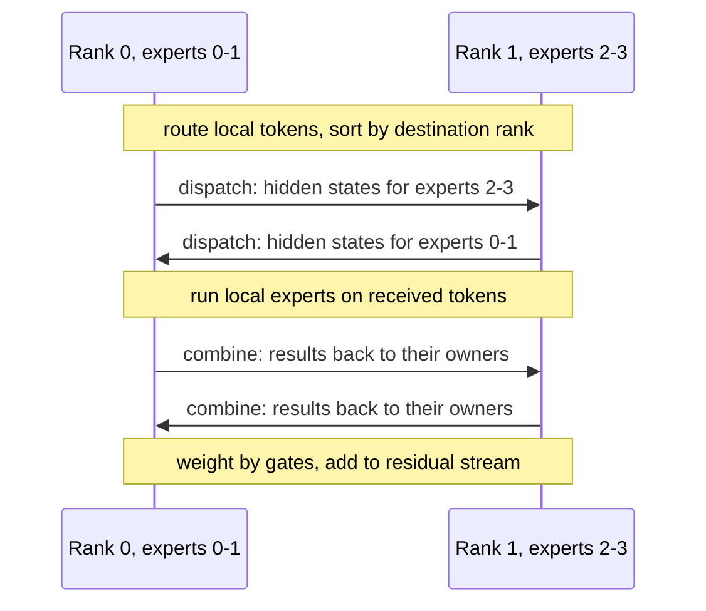

# Training and Serving MoE Models: Expert Parallelism and All-to-All

## Introduction

On one device an MoE layer is a router plus a loop over experts, as in [Implementing a Mixture-of-Experts Layer](./3-llm-moe-implementation.mdx). Real MoE models do not fit on one device. DeepSeek-V3's routed experts alone are 654B parameters; even in FP8 that is 654 GB. So the experts are spread over many GPUs, and every MoE layer turns into a network operation: each token must travel to the GPUs holding its experts and the results must travel back.

This page covers the systems side:

- why MoE uses **expert parallelism** (EP) instead of only data or tensor parallelism,
- the two **all-to-all** exchanges per layer (dispatch and combine), implemented with `torch.distributed` on CPU so you can run them,
- how much data moves, worked out for DeepSeek-V3,
- how EP combines with data, tensor and pipeline parallelism, and how DeepSeek-V3 and Megatron-Core configure it,
- techniques that hide communication: overlap, node-limited routing, FP8 dispatch, dedicated kernels,
- serving: memory planning, why decode needs large batches, redundant experts, and launch commands for vLLM, SGLang and llama.cpp.

It assumes the parallelism vocabulary from [Distributed Training](../6-llm-pretraining/5-llm-distributed-training.mdx) and the prefill/decode distinction from [How LLM Inference Works](../10-llm-inference/0-llm-inference-overview.mdx).

## Why MoE Needs Its Own Kind of Parallelism

Consider the options for a layer with 256 experts on 64 GPUs.

- **Pure data parallelism** replicates the whole model on every GPU. With MoE the replicated part is mostly experts, so this wastes memory on a huge scale, and each replica's experts see only $1/64$ of the tokens, giving tiny, inefficient matmuls.
- **Tensor parallelism** splits every expert's matrices across GPUs. DeepSeek-V3's experts are only 2048 wide; splitting them 8 ways leaves 256-wide shards, too thin for efficient GEMMs, and adds an all-reduce per expert layer.
- **Expert parallelism** places whole experts on different GPUs: with EP64 each GPU holds 4 of the 256 experts per layer. Tokens move to the experts instead of weights moving to the tokens.

EP is natural because the router already partitions the work. Its price is that the partition changes every step and is decided by the data. The all-to-all exchange that implements it is the defining cost of MoE systems.

## Dispatch, Compute, Combine

Each EP rank holds its own tokens (attention runs data-parallel) and a slice of the experts. One MoE layer does:



"All-to-all" means every rank sends a different, variable-sized chunk to every other rank. The receiving sizes are not known in advance, so implementations first exchange the counts. Here is the full pattern with 4 CPU processes, 8 experts and 2 experts per process, checked against the single-device layer. It uses `moe_layer.py` from the [implementation page](./3-llm-moe-implementation.mdx) and the `gloo` backend, which supports `all_to_all_single` with uneven splits on CPU.

```python
# Expert parallelism on CPU: 4 processes, 8 experts, 2 experts per process, gloo all-to-all.
import os
import torch
import torch.distributed as dist
import torch.multiprocessing as mp
from moe_layer import MoELayer

WORLD, N_EXPERTS, TOP_K, D = 4, 8, 2, 16
PER_RANK = N_EXPERTS // WORLD

def worker(rank):
    os.environ.update(MASTER_ADDR="127.0.0.1", MASTER_PORT="29531")
    dist.init_process_group("gloo", rank=rank, world_size=WORLD)
    torch.manual_seed(0)                                 # same full layer on every rank,
    full = MoELayer(D, N_EXPERTS, TOP_K, d_expert=32)    # but each rank uses only its experts
    torch.manual_seed(100 + rank)
    x = torch.randn(6, D)                                # this rank's own tokens (T_local, D)

    # 1) Route locally, then sort (token, slot) pairs by destination rank.
    w, idx, _, _ = full.router(x)                        # (T, k)
    flat_e = idx.reshape(-1)
    order = flat_e.argsort(stable=True)                  # expert order implies rank order
    dest = flat_e[order] // PER_RANK
    send_counts = torch.bincount(dest, minlength=WORLD)  # rows to send to each rank
    recv_counts = torch.empty_like(send_counts)
    dist.all_to_all_single(recv_counts, send_counts)     # exchange the sizes first

    # 2) Dispatch: all-to-all of hidden vectors and their expert ids.
    send_x = x[order // TOP_K]                           # (T*k, D)
    recv_x = torch.empty(int(recv_counts.sum()), D)
    dist.all_to_all_single(recv_x, send_x, recv_counts.tolist(), send_counts.tolist())
    recv_e = torch.empty(int(recv_counts.sum()), dtype=torch.long)
    dist.all_to_all_single(recv_e, flat_e[order], recv_counts.tolist(), send_counts.tolist())

    # 3) Local expert compute on the received tokens.
    out = torch.empty_like(recv_x)
    for e in range(rank * PER_RANK, (rank + 1) * PER_RANK):
        m = recv_e == e
        if m.any():
            out[m] = full.experts.expert_forward(e, recv_x[m])

    # 4) Combine: reverse all-to-all, then weight and scatter-add to the original tokens.
    back = torch.empty_like(send_x)
    dist.all_to_all_single(back, out, send_counts.tolist(), recv_counts.tolist())
    back = back * w.reshape(-1)[order].unsqueeze(-1)
    y = torch.zeros_like(x).index_add_(0, order // TOP_K, back)

    with torch.no_grad():
        err = (y - full(x.unsqueeze(0))[0]).abs().max().item()   # single-device reference
    print(f"rank {rank}: sent {send_counts.tolist()} received {recv_counts.tolist()} "
          f"max err {err:.1e}", flush=True)
    dist.destroy_process_group()

if __name__ == "__main__":
    mp.spawn(worker, nprocs=WORLD)
```

```text
rank 1: sent [2, 3, 4, 3] received [4, 3, 3, 2] max err 6.0e-07
rank 3: sent [2, 2, 3, 5] received [1, 3, 5, 5] max err 3.6e-07
rank 0: sent [3, 4, 4, 1] received [3, 2, 1, 2] max err 9.5e-07
rank 2: sent [1, 3, 3, 5] received [4, 4, 3, 3] max err 2.1e-07
```

(The print order varies between runs because the processes run concurrently.) The distributed result matches the single-device layer to float32 rounding. Look at the received totals: rank 0 processes 8 token-slots, ranks 2 and 3 process 14 each. With an untrained router the load is uneven, and in a real step ranks 2 and 3 would finish last while rank 0 waits. That waiting is what load balancing buys back.

Production implementations follow the same four steps but fuse them into GPU kernels: the permutation and the communication happen in one pass, counts are exchanged on the device, and the receive buffer is laid out per expert so a grouped GEMM can consume it directly.

### How Much Data Moves

For each token and each MoE layer, dispatch sends $k$ copies of the hidden state (one per selected expert, minus any that live locally) and combine returns $k$ results:

$$
\mathrm{bytes\ per\ token\ per\ layer} \approx k \cdot d \cdot (b_{\mathrm{dispatch}} + b_{\mathrm{combine}})
$$

where $b$ is bytes per element. DeepSeek-V3 quantizes activations to FP8 before dispatch ($b = 1$) and keeps the combine in BF16 ($b = 2$), according to its report:

```python
# Back-of-envelope all-to-all traffic and expert memory for DeepSeek-V3.
d, k, moe_layers = 7168, 8, 58
n_routed, d_expert = 256, 2048
fp8, bf16 = 1, 2

dispatch = k * d * fp8                  # one FP8 copy of the hidden state per selected expert
combine = k * d * bf16                  # one BF16 result back from each expert
print(f"per token per MoE layer : dispatch {dispatch/1e3:.0f} KB + combine {combine/1e3:.0f} KB")
print(f"per token, all layers   : {(dispatch + combine) * moe_layers / 1e6:.1f} MB (forward only)")

# Node-limited routing: a token reaches at most M=4 nodes; send once per node over
# InfiniBand, then fan out to the right GPUs inside the node over NVLink.
M = 4
print(f"cross-node dispatch copies per token: at most {M} instead of {k}")

tokens = 32768                          # e.g. a 32K-token prefill batch
print(f"32K tokens, one layer, dispatch+combine: {tokens * (dispatch + combine) / 1e9:.2f} GB")

expert_params = 3 * d * d_expert
print(f"one expert: {expert_params/1e6:.1f} M params = {expert_params*fp8/1e6:.0f} MB in FP8")
for ep in (8, 32, 64, 256):
    per_gpu = n_routed // ep * expert_params * moe_layers * fp8
    print(f"EP{ep:<3d}: {n_routed // ep:3d} experts per layer per GPU -> {per_gpu/1e9:6.1f} GB of routed weights")

total = 671e9
routed = n_routed * expert_params * moe_layers
print(f"routed experts: {routed/1e9:.0f}B params; everything else: {(total - routed)/1e9:.1f}B")
```

```text
per token per MoE layer : dispatch 57 KB + combine 115 KB
per token, all layers   : 10.0 MB (forward only)
cross-node dispatch copies per token: at most 4 instead of 8
32K tokens, one layer, dispatch+combine: 5.64 GB
one expert: 44.0 M params = 44 MB in FP8
EP8  :  32 experts per layer per GPU ->   81.7 GB of routed weights
EP32 :   8 experts per layer per GPU ->   20.4 GB of routed weights
EP64 :   4 experts per layer per GPU ->   10.2 GB of routed weights
EP256:   1 experts per layer per GPU ->    2.6 GB of routed weights
routed experts: 654B params; everything else: 17.1B
```

About 10 MB of network traffic per token per forward pass, and several gigabytes per layer for a large batch. Compare that to the compute: the routed experts of one layer do about $2 \times 8 \times 44\mathrm{M} \approx 0.7$ GFLOP per token. Moving 172 KB for 0.7 GFLOP is an arithmetic intensity of roughly 4,000 FLOP per byte of network traffic. An H800 delivers several hundred dense BF16 TFLOP/s but only tens of GB/s per GPU over InfiniBand, a ratio well above 4,000 FLOP per byte, so without care the network, not the GPU, sets the speed. The DeepSeek-V3 paper says its training ran at a computation-to-communication ratio of roughly 1:1, which is why it invested so heavily in overlap.

## Combining EP With Other Parallelism

EP is applied only to the expert weights. Everything else needs its own strategy:

| Part of the model | Typical strategy | Why |
|---|---|---|
| Routed experts | EP (whole experts per GPU), sometimes plus expert-TP for very wide experts | experts are independent; routing already partitions the tokens |
| Attention, norms, router, shared expert | data parallel (replicated) or tensor parallel | small next to the experts; must see every token |
| Layers | pipeline parallel across node groups | very deep models do not fit one stage |
| Optimizer state | ZeRO / FSDP sharding | Adam states are twice the weights in FP32 |

**DeepSeek-V3 training** used 2048 H800 GPUs (nodes of 8 GPUs linked by NVLink, nodes linked by InfiniBand) with 16-way pipeline parallelism, 64-way expert parallelism spanning 8 nodes and ZeRO-1 data parallelism, and no tensor parallelism at all. Each layer's 256 routed experts were spread over 64 GPUs in 8 nodes, 4 experts per GPU. The 8 nodes match the 8 routing groups, so node-limited routing (`n_group: 8`, `topk_group: 4`) guarantees each token crosses InfiniBand to at most 4 nodes.

**Megatron-Core**, NVIDIA's training library, exposes the same choices as flags. A DeepSeek-style setup uses options such as:

```bash
--num-experts 256 \
--moe-router-topk 8 \
--expert-model-parallel-size 64 \
--expert-tensor-parallel-size 1 \
--moe-grouped-gemm \
--moe-token-dispatcher-type alltoall \
--moe-router-score-function sigmoid \
--moe-router-enable-expert-bias \
--moe-router-load-balancing-type seq_aux_loss \
--moe-aux-loss-coeff 1e-4 \
--moe-shared-expert-intermediate-size 2048
```

This is a sketch of the MoE-specific flags, not a complete launch line; check the Megatron-Core MoE README for the release you use. The README recommends an expert tensor-parallel size of 1 for fine-grained MoE, for the reason given above: thin experts split badly.

## Hiding the Communication

DeepSeek-V3's training system is the most detailed public account of making EP fast. Its main techniques generalize:

1. **Overlap computation with communication.** DeepSeek's DualPipe schedule pairs a forward chunk with a backward chunk and interleaves them so that one's all-to-all runs while the other computes. The report states that both all-to-all and pipeline communication can be fully hidden this way. At inference time the same idea appears as processing two micro-batches at once: while one is in its all-to-all, the other runs attention or experts.
2. **Limit fan-out.** Node-limited routing sends each token across InfiniBand once per destination node (at most 4), then forwards it over the much faster NVLink inside the node. The report gives NVLink about 160 GB/s and InfiniBand about 50 GB/s per GPU.
3. **Send fewer bytes.** FP8 dispatch halves the dispatch volume relative to BF16.
4. **Dedicate a few SMs to communication.** DeepSeek used custom all-to-all kernels with warp specialization and found that 20 of the H800's 132 SMs were enough to saturate both InfiniBand and NVLink. DeepSeek later open-sourced its EP communication library as **DeepEP**, which provides high-throughput kernels (training, prefill) and low-latency kernels (decode).
5. **Use grouped GEMMs.** After dispatch, each GPU holds a variable number of tokens for each of its experts. A grouped GEMM processes all of them in one kernel; in PyTorch this is `torch.nn.functional.grouped_mm`, which the implementation page uses.

## Training Pitfalls Specific to MoE

- **Load imbalance is a speed problem as well as a quality problem.** In a dropless system the step time is set by the busiest GPU. Monitor tokens per expert per layer (MaxVio) as closely as the loss.
- **Instability.** Keep the router in FP32, consider the router z-loss, and watch for loss spikes that coincide with sudden routing shifts. ST-MoE documented these failure modes in detail.
- **Balance statistics need communication too.** Global-batch balancing requires an all-reduce of the per-expert counts across data-parallel ranks every step; bias-based balancing needs the same counts to update biases consistently on every rank.
- **Upcycling.** You can initialize an MoE from a dense checkpoint by copying its FFN into every expert and adding a fresh router ("Sparse Upcycling", Komatsuzaki et al., 2022). Mixtral's paper does not say how it was initialized, but Qwen1.5-MoE was upcycled from Qwen-1.8B by splitting the FFN into fine-grained experts. Copies start identical, so noise or splitting is needed to break the symmetry.
- **Fine-tuning.** Keep a balance loss on (in Hugging Face, `output_router_logits=True`), and decide deliberately whether the router is trainable. LoRA on every expert multiplies adapter count by the number of experts; adapting only attention, or attention plus shared experts, is a common cheaper choice. See [LoRA Explained](../9-llm-fine-tuning/1-llm-lora.mdx).

## Serving MoE Models

### Memory First

The deployment must hold all experts. DeepSeek-V3 in FP8 is about 671 GB of weights (654 GB routed experts plus about 17 GB of attention, shared experts, dense layers and embeddings), before any KV cache. Qwen3-30B-A3B in BF16 is about 61 GB; at about 4.5 bits per weight it is about 17 GB. Total parameters decide which hardware you can use at all; active parameters then decide how fast it runs.

### Decode Needs Many Tokens Per Expert

During decode each step processes one token per sequence. With $B$ sequences in the batch, each expert receives on average $B k / N$ tokens. For DeepSeek-V3 ($k/N = 8/256$), a batch of 256 sequences gives each expert only 8 tokens, an arithmetic intensity that leaves the GPU memory-bandwidth bound. The DeepSeek-V3 report says the batch size per expert during decoding is usually within 256 tokens and that decode is memory-access bound.

The fix is to make the batch per GPU large and the experts per GPU few. DeepSeek-V3's published deployment does exactly that:

| Stage | Minimum unit | Attention | MoE | Redundant experts |
|---|---|---|---|---|
| Prefill | 4 nodes, 32 GPUs | TP4 with sequence parallelism, DP8 | EP32 | 32 redundant experts, each GPU hosts 8 + 1 |
| Decode | 40 nodes, 320 GPUs | TP4 with sequence parallelism, DP80 | EP320, one expert per GPU | 64 GPUs host redundant and shared experts |

With one expert per GPU, every GPU reads only 2.6 GB of routed weights per step (the EP256 line above), and the whole cluster's batch is concentrated onto it.

### Redundant Experts and Load Balancing at Inference

Router balance is trained on training data; production traffic is different, and some experts become hot. Serving systems therefore replicate popular experts on extra GPUs and split their tokens. DeepSeek-V3 re-selects redundant experts from load statistics periodically (the report gives every 10 minutes as an example). vLLM calls this EPLB (expert-parallel load balancer) and SGLang supports it as well.

### Launching an MoE Server

**vLLM.** Expert parallelism is switched on with `--enable-expert-parallel`; the EP size is the tensor-parallel size times the data-parallel size, and attention is replicated across DP ranks when TP is 1. From the vLLM expert-parallel deployment guide:

```bash
# One node, 8 GPUs: attention data-parallel over 8 ranks, experts spread EP8.
vllm serve deepseek-ai/DeepSeek-V3-0324 \
    --tensor-parallel-size 1 \
    --data-parallel-size 8 \
    --enable-expert-parallel

# Same, with the expert-parallel load balancer and 2 redundant experts.
vllm serve deepseek-ai/DeepSeek-V3-0324 \
    --tensor-parallel-size 1 \
    --data-parallel-size 8 \
    --enable-expert-parallel \
    --enable-eplb \
    --eplb-config '{"window_size":1000,"step_interval":3000,"num_redundant_experts":2,"log_balancedness":true}'
```

Multi-node deployments choose the all-to-all implementation with `--all2all-backend`, for example `deepep_high_throughput` for prefill-heavy nodes and `deepep_low_latency` for decode.

**SGLang.** The equivalent launch uses `--ep` for the EP size and `--moe-a2a-backend deepep` to select DeepEP:

```bash
python -m sglang.launch_server --model-path deepseek-ai/DeepSeek-V3 \
    --tp 8 --ep 8 \
    --moe-a2a-backend deepep --moe-runner-backend deep_gemm
```

**llama.cpp.** On a single machine the bottleneck is GPU memory, and MoE has a useful property: the always-active parts (attention, shared experts, embeddings) are small, while the routed experts are large but each token reads only a few. `llama-server` and `llama-cli` can keep all expert weights in CPU RAM with `--cpu-moe`, or only those of the first N layers with `--n-cpu-moe N`, while `-ngl` puts the rest on the GPU:

```bash
llama-server -m Qwen3-30B-A3B-Q4_K_M.gguf -ngl 99 --n-cpu-moe 20 -c 32768
```

Check flag names against `llama-server --help` for your build; llama.cpp evolves quickly.

## Worked Scenario: Planning Two Deployments

**Scenario A: DeepSeek-V3 on one node of 8 GPUs with 141 GB each (1128 GB total).** Use DP8 attention plus EP8 experts, as in the vLLM command above.

- Routed experts per GPU: 32 per layer, 81.7 GB in FP8 (from the script).
- Everything else is replicated on each GPU because attention is data-parallel: about 17 GB (a little more where tensors are kept in BF16).
- That leaves roughly 40 GB per GPU for the MLA KV cache, activations and runtime buffers. MLA's small cache (576 values per token per layer, see [Multi-Head Latent Attention](../2-llm-attention/6-llm-mla.mdx)) is what makes this workable.
- On 80 GB GPUs the routed experts alone would exceed memory at EP8, so you would need two nodes (EP16) or tensor parallelism inside the node.

**Scenario B: Qwen3-30B-A3B on a desktop with a 16 GB GPU and 64 GB of RAM.** At about 4.5 bits per weight the model is about 17 GB, slightly too big for the GPU.

- Non-expert parameters are about 1.5B (attention 0.9B plus embeddings 0.6B, from the counting script on the [architectures page](./2-llm-moe-architectures.mdx)), under 1 GB at 4.5 bits. They and the KV cache go on the GPU.
- Experts are about 29B parameters; move enough layers' experts to CPU RAM with `--n-cpu-moe` that the GPU part fits.
- Each token reads 8 of 128 experts per layer: $8 \times 4.7\mathrm{M} \times 48 \approx 1.8$B expert parameters, about 1 GB at 4.5 bits. If half of the layers live in CPU RAM with, say, 60 GB/s of bandwidth, the CPU must stream about 0.5 GB per token, a bandwidth ceiling of roughly 120 tokens per second before any other overhead. A dense 30B model under the same split would have to stream about 8 GB per token from RAM, a ceiling around 7 tokens per second.

The same model is fast or slow depending on where the experts live, and the arithmetic needs only the config.json and your hardware's bandwidth.

## Common Mistakes

- **Tensor-parallelizing small experts.** Fine-grained experts split into thin shards waste GPU efficiency; prefer EP with expert TP of 1.
- **Ignoring imbalance at serving time.** Training-time balance does not guarantee production balance; monitor per-expert load and use redundant experts.
- **Running decode with small batches on many GPUs.** Each expert then sees a handful of tokens and the deployment is bandwidth bound; concentrate the batch.
- **Forgetting the count exchange.** All-to-all with variable sizes needs the receive counts first; hard-coding equal splits silently corrupts results.
- **Sizing memory from active parameters.** Plan memory from total parameters plus KV cache; plan speed from active parameters and batch size.
- **Leaving the balance loss off during fine-tuning,** which can unbalance experts and slow expert-parallel training.

## Summary

- MoE models use expert parallelism: whole experts live on different GPUs and tokens move to them.
- Each MoE layer costs two all-to-alls, dispatch and combine, preceded by an exchange of counts; the CPU demo shows the full pattern and its imbalance.
- DeepSeek-V3 moves about 172 KB per token per MoE layer (FP8 dispatch, BF16 combine), about 10 MB per token per forward pass.
- Training combines EP with pipeline and ZeRO data parallelism (DeepSeek-V3: PP16, EP64, ZeRO-1, no TP); Megatron-Core exposes the same knobs as flags.
- Overlap, node-limited routing, FP8 dispatch, dedicated communication kernels (DeepEP) and grouped GEMMs make the communication affordable.
- Serving needs memory for all experts, large batches per expert during decode, and redundant experts for hot spots; vLLM (`--enable-expert-parallel`, EPLB), SGLang (`--ep`, DeepEP) and llama.cpp (`--n-cpu-moe`) implement these ideas.

## Further Reading

- [GShard (Lepikhin et al., 2020)](https://arxiv.org/abs/2006.16668): the first large-scale expert-parallel Transformer and its all-to-all design.
- [DeepSeek-V3 Technical Report (DeepSeek-AI, 2024)](https://arxiv.org/abs/2412.19437): DualPipe, node-limited routing, communication kernels and the prefill/decode deployment.
- [DeepEP](https://github.com/deepseek-ai/DeepEP): DeepSeek's open-source expert-parallel communication library.
- [MegaBlocks (Gale et al., 2022)](https://arxiv.org/abs/2211.15841): dropless MoE training with block-sparse kernels.
- [Sparse Upcycling (Komatsuzaki et al., 2022)](https://arxiv.org/abs/2212.05055): initializing MoE models from dense checkpoints.
- [Megatron-Core MoE README](https://github.com/NVIDIA/Megatron-LM/tree/main/megatron/core/transformer/moe): flags and recommendations for MoE training.
- [vLLM expert parallel deployment](https://docs.vllm.ai/en/latest/serving/expert_parallel_deployment.html): EP, data-parallel attention, all-to-all backends and EPLB.
- [SGLang expert parallelism](https://docs.sglang.io/advanced_features/expert_parallelism.html): EP flags and DeepEP integration.
- [PyTorch distributed documentation](https://docs.pytorch.org/docs/stable/distributed.html): `all_to_all_single` and process groups used in the demo.
