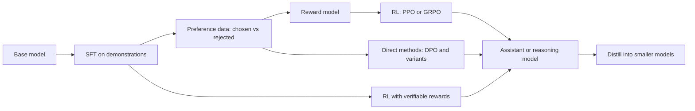

# Post-Training Overview: From Base Model to Assistant

## Introduction

A model that has just finished pretraining is a superb autocomplete engine and a poor assistant. It has read trillions of tokens and absorbed grammar, facts, code and a surprising amount of reasoning, but it was only ever asked one question: "what token comes next in a document from the internet?" Ask it a question and it may answer, or it may continue with three more questions, as if it were completing a quiz page.

Post-training is everything that happens after pretraining to turn that document completer into something you can talk to: a model that follows instructions, stops when it has answered, uses a fixed conversation format, refuses clearly harmful requests, calls tools, and, for reasoning models, thinks for thousands of tokens before it answers.

By the end of this page you will be able to:

- Name the stages of a modern post-training pipeline and say what each one changes.
- Explain why post-training needs much less data and compute than pretraining, yet changes behavior so much.
- See every post-training method as "push up the log-probability of some sequences, push down others", and know which signal each method uses to decide.
- Read the post-training section of a technical report (InstructGPT, Llama 3, Tulu 3, DeepSeek-R1, Qwen3) and map it onto that picture.

The later pages derive each stage in detail. This one is the map.

## What a Base Model Is and Is Not

During pretraining the model minimizes the cross-entropy of the next token over a huge corpus (see [The Training Objective, Loss Curves and Data Loading](../6-llm-pretraining/1-llm-training-objective.mdx)). The result is a conditional distribution $p_\theta(x_t \mid x_{\lt t})$ that imitates the average author of the web. That average author writes forum posts, documentation, novels, spam and quiz sheets. Nothing in the objective says "be helpful to the person typing".

You can see the difference directly. The script below loads SmolLM2-135M (a small base model from Hugging Face) and its instruction-tuned sibling, and asks both the same question with greedy decoding:

```python
import torch
from transformers import AutoModelForCausalLM, AutoTokenizer

torch.manual_seed(0)
question = "What is the capital of France?"

for name in ["HuggingFaceTB/SmolLM2-135M", "HuggingFaceTB/SmolLM2-135M-Instruct"]:
    tok = AutoTokenizer.from_pretrained(name)
    model = AutoModelForCausalLM.from_pretrained(name, dtype=torch.float32)
    if "Instruct" in name:
        # the instruct model expects its chat template
        text = tok.apply_chat_template(
            [{"role": "user", "content": question}],
            tokenize=False, add_generation_prompt=True)
    else:
        text = question  # a base model only sees raw text
    ids = tok(text, return_tensors="pt")
    out = model.generate(**ids, max_new_tokens=30, do_sample=False)
    reply = tok.decode(out[0, ids["input_ids"].shape[1]:], skip_special_tokens=True)
    print(f"--- {name}\n{reply!r}\n")
```

```text
--- HuggingFaceTB/SmolLM2-135M
'\n\nThe capital of France is Paris.\n\nWhat is the capital of France?\n\nThe capital of France is Paris.\n\nWhat'

--- HuggingFaceTB/SmolLM2-135M-Instruct
'The capital of France is Paris.'
```

The base model knows the answer. What it lacks is the *format*: it treats the text as a FAQ page and keeps generating question-answer pairs until the token budget runs out. The instruct model answers once and then emits its end-of-turn token, which `generate` treats as end of sequence. Same knowledge, different behavior.

That observation is the core of what Zhou et al. called the "superficial alignment hypothesis" in the LIMA paper (2023): almost all knowledge comes from pretraining, and alignment mostly teaches the model which sub-distribution of its existing abilities to use when it talks to a user. LIMA fine-tuned a 65B Llama on only 1,000 carefully chosen examples and got a competitive assistant. The hypothesis is a useful first approximation, not a law. Reasoning RL (page 4) clearly adds capabilities that a few demonstrations cannot, and safety behavior needs far more than 1,000 examples to be robust.

## The Stages of a Post-Training Pipeline

Most published pipelines are built from the same five blocks. Not every model uses all of them, and modern pipelines repeat some blocks in several rounds.



**1. Supervised fine-tuning (SFT).** Train with the ordinary next-token loss on example conversations, but only count the loss on the assistant's tokens. This teaches the chat template, the turn-taking, when to stop, and a default style. Page 1 covers it.

**2. Preference data and reward models.** Humans (or a strong model) compare two answers to the same prompt and pick the better one. A reward model is a copy of the LLM with a scalar head, trained so that the chosen answer scores higher than the rejected one. Page 2 derives the Bradley-Terry loss behind it.

**3. Reinforcement learning from human feedback (RLHF).** Generate answers with the current model, score them with the reward model, and update the model to increase the expected reward while staying close to the SFT model through a KL penalty. PPO is the classic algorithm. Page 2.

**4. Direct preference optimization (DPO) and its relatives.** A clever change of variables shows you can optimize the same KL-regularized objective with a simple classification loss on preference pairs, with no reward model and no sampling. Page 3.

**5. Reinforcement learning with verifiable rewards (RLVR).** For math, code and other checkable tasks, replace the learned reward model with a program that checks the answer. Algorithms like GRPO then train long chains of thought. This is how DeepSeek-R1 and most 2025-2026 reasoning models were built. Page 4.

Two cross-cutting tools complete the picture: **distillation** (train a small model on a big model's outputs or probabilities, page 5) and **safety training** (refusals, constitutions, red teaming, page 6).

## One Idea Behind All of Them: Weighted Log-Likelihood

Every method above changes the same thing: the log-probability the model assigns to whole responses. Write a response as tokens $y = (y_1, \dots, y_T)$ given prompt $x$. Its log-probability is a sum over tokens:

$$
\log \pi_\theta(y \mid x) = \sum_{t=1}^{T} \log \pi_\theta(y_t \mid x, y_{\lt t})
$$

Here $\pi_\theta$ is the model viewed as a *policy* (the reinforcement-learning name for "a distribution over actions"), $\theta$ its weights, and $y_{\lt t}$ the tokens before position $t$. Almost every post-training loss can be written as

$$
\mathcal{L}(\theta) = -\,\mathbb{E}\left[\, w(x, y)\, \log \pi_\theta(y \mid x) \,\right]
$$

for some weight $w$. The methods differ in where the responses $y$ come from and how $w$ is chosen:

| Method | Where responses come from | Weight $w$ |
|---|---|---|
| SFT | Human or model-written demonstrations | 1 for every demonstration |
| Rejection sampling (best-of-n) | The model itself, filtered | 1 for the best sample, 0 for the rest |
| REINFORCE / PPO / GRPO | The model itself (on-policy) | Advantage: reward minus a baseline, can be negative |
| DPO | Fixed preference pairs (off-policy) | Positive on chosen, negative on rejected, scaled by how wrong the model currently is |
| Distillation | Teacher outputs or student samples | Teacher probabilities as soft targets |

The gradient makes the point concrete. With one prompt and four possible responses, the next script computes $-\nabla$ of the weighted loss with respect to the logits of a uniform policy:

```python
import torch

torch.manual_seed(0)
# A toy "policy": one prompt, four possible complete responses.
responses = ["Paris.", "Paris, of course!", "I think Lyon.", "France is a country."]
logits = torch.zeros(4, requires_grad=True)          # (num_responses,)
log_probs = torch.log_softmax(logits, dim=0)          # start uniform: 0.25 each

# 1) SFT: weight 1 on a human-written demonstration, 0 elsewhere
w_sft = torch.tensor([1.0, 0.0, 0.0, 0.0])
# 2) Rejection sampling / best-of-n: weight 1 on the response a reward model liked best
reward = torch.tensor([0.9, 0.7, -0.8, -0.2])
w_rs = (reward == reward.max()).float()
# 3) Policy gradient (REINFORCE with a baseline): weight = reward - mean reward
w_pg = reward - reward.mean()

for name, w in [("SFT", w_sft), ("rejection sampling", w_rs), ("policy gradient", w_pg)]:
    loss = -(w * log_probs).sum()                     # every method: -sum w * log pi
    grad, = torch.autograd.grad(loss, logits, retain_graph=True)
    print(f"{name:>18}: weights={w.numpy().round(2)}  -grad={(-grad).numpy().round(3)}")
```

```text
               SFT: weights=[1. 0. 0. 0.]  -grad=[ 0.75 -0.25 -0.25 -0.25]
rejection sampling: weights=[1. 0. 0. 0.]  -grad=[ 0.75 -0.25 -0.25 -0.25]
   policy gradient: weights=[ 0.75  0.55 -0.95 -0.35]  -grad=[ 0.75  0.55 -0.95 -0.35]
```

Check the first line by hand. For a softmax, $\partial \log p_i / \partial z_j = \mathbb{1}[i=j] - p_j$. With weight 1 on response 0 and $p_j = 0.25$, the descent direction is $0.75$ for the target and $-0.25$ for each other response: SFT only ever pushes *up* the demonstration, and everything else goes down only because probabilities must sum to one. The policy-gradient weights have mean zero, so the update pushes "Paris, of course!" up too and actively pushes "I think Lyon." down. That ability to use *negative* signal, on the model's *own* samples, is the main reason RL and preference methods improve models beyond what SFT on the same data can.

## Why Post-Training Is Cheap and Powerful

Pretraining a frontier model costs millions of GPU hours. Post-training has historically cost a small fraction of that. The InstructGPT paper (Ouyang et al., 2022) reports about 60 petaflop/s-days for its 175B PPO model versus about 3,640 for pretraining GPT-3, under 2 percent. Yet in their human evaluation, outputs from the 1.3B InstructGPT model were preferred to outputs from the 175B GPT-3, a model 100 times larger.

Three reasons explain the leverage:

- **It selects rather than teaches.** The base model already represents many personas and skills. A few thousand to a few million examples are enough to pick the right one, which is far less information than learning the skills in the first place.
- **It moves probability mass, not knowledge.** A KL penalty or a small learning rate keeps the model close to its starting point. Most weights barely change, which is also why low-rank adapters like LoRA work so well for fine-tuning (see [LoRA Explained](../9-llm-fine-tuning/1-llm-lora.mdx)).
- **On-policy feedback is very informative.** When the model is corrected on its own mistakes, each example targets exactly the behavior that needs to change.

The balance is shifting. Reasoning RL runs for thousands of steps with long rollouts, and labs have described RL compute growing toward a meaningful share of the total budget. Post-training is no longer a small finishing step for reasoning models.

## How Real Models Combine the Stages

The building blocks are standard; the recipes differ. This table summarizes what each technical report describes.

| Model (year) | Recipe as described in the report |
|---|---|
| InstructGPT (2022) | SFT on about 13k prompts with labeler demonstrations, a 6B reward model from rankings of 4 to 9 samples per prompt, PPO with a KL penalty of 0.02 plus a pretraining-mix term (PPO-ptx) |
| Llama 2-Chat (2023) | SFT on 27,540 curated annotations, separate helpfulness and safety reward models trained on over a million comparisons, five RLHF versions (V1 to V5): rejection sampling fine-tuning only until V4, then PPO on top of it |
| Llama 3 (2024) | Six rounds of: reward model, rejection sampling from the latest model, SFT, then DPO (chosen over PPO for lower compute and better instruction following) |
| Tulu 3 (2024) | SFT, then DPO on on-policy preference data, then RL with verifiable rewards on math and instruction-following constraints, with all data and code released |
| DeepSeek-R1 (2025) | A few thousand cold-start long chain-of-thought examples, GRPO with rule-based rewards, rejection sampling into about 800k SFT samples, then a final RL stage for reasoning plus helpfulness and harmlessness |
| Qwen3 (2025) | Long chain-of-thought cold start, reasoning RL with GRPO, "thinking mode fusion" SFT, general RL; small models trained by strong-to-weak distillation instead of the full pipeline |

Three trends are visible. First, every recipe still starts with SFT, because RL needs a model that already produces the right format. Second, the pipelines are *iterative*: generate data with the current best model, filter it with a reward signal, train, repeat. Third, the expensive full pipeline is run once on a large model, and smaller siblings are distilled from it.

## Worked Scenario: Planning a Post-Training Run

Suppose you have an open 8B base model and want a customer-support assistant that also handles simple arithmetic on order totals. Here is how the stages map to decisions you would make:

1. **SFT data.** Collect 5k to 50k conversations in your domain, formatted with the model's chat template, with loss masked to assistant turns. Mix in a general instruction dataset so the model does not forget how to chat about other topics. Train one to three epochs at a learning rate around 1e-5 for full fine-tuning (higher for LoRA). Page 1 shows the masking code.
2. **Preference data.** Sample two answers per prompt from the SFT model and have reviewers (or a strong judge model with a rubric) pick the better one. Collecting comparisons on *your model's own outputs* matters more than collecting more pairs from elsewhere.
3. **Preference optimization.** Start with DPO at $\beta = 0.1$, the default in TRL and the value Llama 3 reports, because it needs only the policy and a frozen reference model. Move to PPO or online DPO only if offline DPO plateaus. Pages 2 and 3.
4. **Verifiable skills.** For arithmetic on order totals, write a checker that parses the final number and compares it with the ground truth, then run GRPO with that reward. Page 4.
5. **Safety.** Add refusal and policy-following examples to SFT and preference data, then red-team the result. Page 6.
6. **Evaluation at every stage.** Track a held-out preference win rate, task accuracy, and general benchmarks to catch forgetting (see [Evaluating LLMs: Benchmarks and Their Limits](../12-llm-evaluation/0-llm-evaluation-overview.mdx)).

If you only need the model to use your documents, not to change its behavior, you may not need post-training at all: retrieval and prompting are cheaper (see [When to Fine-Tune, and When to Use Prompting or RAG](../9-llm-fine-tuning/0-llm-when-to-fine-tune.mdx) and the [AI Agents tutorial](/docs/ai/agents)).

:::note
"Alignment" means two different things in practice. Narrowly, it is the engineering of making a model follow instructions and a behavior policy. Broadly, it is the research problem of making sure increasingly capable systems pursue the goals their developers and users intend. This section teaches the first and points at the open problems of the second on page 6.
:::

## Common Mistakes

- Prompting a base model as if it were a chat model and concluding it "cannot answer". Use raw text completion, few-shot examples, or the instruct variant.
- Skipping SFT and jumping straight to DPO or RL. Without the format learned in SFT, preference and RL signals are mostly spent teaching the model to stop and to use turn markers.
- Using preference pairs generated by a different model family. Off-policy pairs work, but on-policy pairs from your own SFT model usually give larger gains.
- Treating a learned reward model as ground truth. It is a proxy, and optimizing it too hard produces reward hacking (pages 2 and 6).
- Forgetting the reference model. Almost every method regularizes toward the SFT model; removing that anchor lets the model drift into degenerate text.
- Evaluating only on the training reward. A rising reward with falling held-out quality is the classic sign of overoptimization.

## Summary

- Pretraining produces a document completer; post-training turns it into an assistant or a reasoning model by selecting and reshaping behavior the base model already has.
- The standard blocks are SFT, preference data with reward models, RL (PPO, GRPO), direct preference methods (DPO and variants), RL with verifiable rewards, distillation and safety training.
- All of them adjust $\log \pi_\theta(y \mid x)$ with some weight $w$; they differ in where responses come from and how the weight is set. Negative weights on the model's own samples are what RL adds over SFT.
- Post-training has historically used a few percent of pretraining compute but changes behavior dramatically; reasoning RL is making it a larger share.
- Real recipes (Llama 3, Tulu 3, DeepSeek-R1, Qwen3) run these blocks iteratively and distill the result into smaller models.

## Further Reading

- [Training language models to follow instructions with human feedback (Ouyang et al., 2022)](https://arxiv.org/abs/2203.02155): the InstructGPT paper that defined the SFT, reward model, PPO recipe.
- [LIMA: Less Is More for Alignment (Zhou et al., 2023)](https://arxiv.org/abs/2305.11206): the superficial alignment hypothesis and 1,000-example SFT.
- [Llama 2: Open Foundation and Fine-Tuned Chat Models (Touvron et al., 2023)](https://arxiv.org/abs/2307.09288): a detailed open description of iterative RLHF.
- [The Llama 3 Herd of Models (Grattafiori et al., 2024)](https://arxiv.org/abs/2407.21783): rejection sampling plus DPO at scale.
- [Tulu 3: Pushing Frontiers in Open Language Model Post-Training (Lambert et al., 2024)](https://arxiv.org/abs/2411.15124): a fully open pipeline with SFT, DPO and RLVR.
- [DeepSeek-R1 (DeepSeek-AI, 2025)](https://arxiv.org/abs/2501.12948): reasoning through large-scale RL.
- [Qwen3 Technical Report (Yang et al., 2025)](https://arxiv.org/abs/2505.09388): four-stage post-training and strong-to-weak distillation.
- [TRL documentation](https://huggingface.co/docs/trl/index): the Hugging Face library used for SFT, DPO and GRPO in this section.
