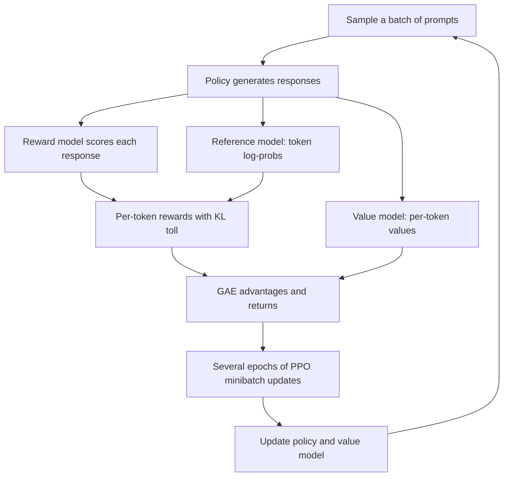

# RLHF: Reward Models and PPO

## Introduction

Supervised fine-tuning teaches a model to imitate demonstrations. That has a ceiling: the model can only be as good as the demonstrations, and writing a perfect answer is much harder for a person than recognizing which of two answers is better. Reinforcement learning from human feedback (RLHF) exploits that asymmetry. People compare answers, a *reward model* learns to predict their judgments, and reinforcement learning pushes the language model toward answers the reward model scores highly.

The idea goes back to Christiano et al. (2017), who trained Atari and robotics agents from human comparisons of short video clips. Ziegler et al. (2019) applied it to language models, Stiennon et al. (2020) used it to train summarizers that beat much larger supervised models, and Ouyang et al. (2022) scaled it into InstructGPT, the recipe behind the first ChatGPT. Llama 2-Chat (Touvron et al., 2023) published the most detailed open description of the method at scale.

By the end of this page you will be able to:

- Derive the Bradley-Terry reward model loss and implement a reward model training step.
- Write down the KL-regularized RLHF objective, derive its optimal policy in closed form, and check it numerically.
- Turn a single sequence-level reward into per-token rewards, compute advantages with GAE, and implement the PPO clipped loss.
- Estimate the memory cost of PPO for a 7B model and explain why simpler methods (DPO on page 3, GRPO on page 4) became popular.

## Collecting Preference Data

The raw material is a set of comparisons. For a prompt $x$, sample two or more responses from the current model, show them to a labeler, and record which one is better. The result is a dataset of triples $(x, y_w, y_l)$ where $y_w$ is the preferred ("winning", "chosen") response and $y_l$ the dispreferred ("losing", "rejected") one.

Real pipelines add detail on top of that basic form:

- **Rankings instead of pairs.** InstructGPT showed labelers between 4 and 9 responses per prompt and asked for a full ranking. A ranking of $K$ responses yields $\binom{K}{2}$ pairs; for $K = 9$ that is 36 pairs from one labeling task.
- **Graded preferences.** Llama 2 asked annotators how much better one response was, on a four-level scale from "significantly better" to "negligibly better", and used the grade as a margin in the loss (below).
- **Separate criteria.** Llama 2 trained two reward models, one for helpfulness and one for safety, because the two goals conflict: the most helpful answer to a dangerous request is the most harmful one.
- **AI feedback.** Labels from a strong model guided by written principles (RLAIF, Constitutional AI) replace or supplement human labels. Page 6 covers this.

The comparisons should be made on outputs of *the model you are training*. The Llama 2 authors stress that the reward model must learn preferences over Llama 2-Chat's own outputs, so they collected new batches each round as the model improved.

## The Bradley-Terry Model and the Reward Model Loss

We want a function $r_\phi(x, y)$, a scalar score, such that better responses get higher scores. The Bradley-Terry model (Bradley and Terry, 1952, originally for ranking sports teams from match results) links scores to the probability of a preference:

$$
P(y_w \succ y_l \mid x) = \frac{\exp r_\phi(x, y_w)}{\exp r_\phi(x, y_w) + \exp r_\phi(x, y_l)} = \sigma\big(r_\phi(x, y_w) - r_\phi(x, y_l)\big)
$$

where $\sigma(z) = 1/(1 + e^{-z})$ is the logistic sigmoid. The second form follows by dividing numerator and denominator by $\exp r_\phi(x, y_w)$. Only the *difference* of scores matters, so adding a constant to every reward changes nothing. That is why reward model scores have no absolute meaning and why the bias of a reward head never learns anything.

Fitting $\phi$ by maximum likelihood on the dataset $\mathcal{D}$ gives the reward model loss:

$$
\mathcal{L}_{\mathrm{RM}}(\phi) = -\,\mathbb{E}_{(x, y_w, y_l) \sim \mathcal{D}}\Big[\log \sigma\big(r_\phi(x, y_w) - r_\phi(x, y_l)\big)\Big]
$$

This is logistic regression on the score difference. Its gradient with respect to the margin $m = r_w - r_l$ is $-(1 - \sigma(m))$: pairs the model already ranks confidently ($\sigma(m) \approx 1$) contribute almost nothing, and wrongly ranked pairs contribute the most.

**Numeric example.** Suppose $r_\phi(x, y_w) = 1.5$ and $r_\phi(x, y_l) = 0.5$. Then $m = 1$, $P = \sigma(1) = 0.731$, the loss is $-\log 0.731 = 0.313$, and $\partial \mathcal{L} / \partial m = -(1 - 0.731) = -0.269$. If the scores were swapped, $P = 0.269$, the loss would be $1.313$ and the gradient $-0.731$, almost three times stronger.

Llama 2 added a margin $m(r)$ that depends on the preference grade, so that "significantly better" pairs must be separated by more than "slightly better" ones:

$$
\mathcal{L}_{\mathrm{RM}} = -\log \sigma\big(r_\phi(x, y_w) - r_\phi(x, y_l) - m(r)\big)
$$

**Architecture.** A reward model is usually the SFT model (or a smaller sibling) with the language-modeling head replaced by a linear layer that maps the final hidden state to one number. The score is read at the last token of the response, which in a causal model has attended to the whole prompt and answer. InstructGPT used a 6B reward model for its 175B policy because 175B reward models were unstable to train. In Hugging Face this is `AutoModelForSequenceClassification` with `num_labels=1`, and TRL ships a `RewardTrainer` that implements exactly this loss.

The script below trains a linear "reward model" on synthetic comparisons. Each response is a feature vector, the true quality is a hidden linear function, and labels are sampled from Bradley-Terry so they are noisy, as human labels are:

```python
import torch
import torch.nn as nn
import torch.nn.functional as F

torch.manual_seed(0)
# Hidden "true" quality of a response is a linear function of 8 features
# (think: correctness, politeness, length, ...). Humans compare pairs noisily.
d, n_pairs = 8, 2000
w_true = torch.randn(d)
feat_a, feat_b = torch.randn(n_pairs, d), torch.randn(n_pairs, d)     # (N, d) each
p_a_wins = torch.sigmoid(feat_a @ w_true - feat_b @ w_true)           # Bradley-Terry
a_wins = torch.bernoulli(p_a_wins).bool()                              # noisy labels
chosen = torch.where(a_wins[:, None], feat_a, feat_b)                 # (N, d)
rejected = torch.where(a_wins[:, None], feat_b, feat_a)               # (N, d)

reward_model = nn.Linear(d, 1)                 # stands in for "LLM + scalar head"
opt = torch.optim.Adam(reward_model.parameters(), lr=0.05)
train, test = slice(0, 1600), slice(1600, None)
for step in range(300):
    margin = reward_model(chosen[train]) - reward_model(rejected[train])   # (N, 1)
    loss = -F.logsigmoid(margin).mean()                                   # BT loss
    opt.zero_grad(); loss.backward(); opt.step()

with torch.no_grad():
    acc = (reward_model(chosen[test]) > reward_model(rejected[test])).float().mean()
    oracle = ((chosen[test] @ w_true) > (rejected[test] @ w_true)).float().mean()
    cos = F.cosine_similarity(reward_model.weight[0], w_true, dim=0)
print(f"final train loss {loss.item():.3f}")
print(f"held-out pair accuracy {acc.item():.3f}  (true reward agrees with labels {oracle.item():.3f})")
print(f"cosine(learned w, true w) = {cos.item():.3f}")
print(f"bias term = {reward_model.bias.item():.3f}  (never receives a gradient: it cancels in r_c - r_r)")
```

```text
final train loss 0.246
held-out pair accuracy 0.870  (true reward agrees with labels 0.882)
cosine(learned w, true w) = 0.998
bias term = -0.178  (never receives a gradient: it cancels in r_c - r_r)
```

Two lessons carry over to real reward models. First, accuracy is capped by label noise: even the true reward agrees with only 88 percent of the noisy labels, and real human agreement on chat preferences is in the 60 to 75 percent range, so a reward model with 70 percent held-out accuracy may be close to the ceiling. Second, the reward model recovers the *direction* of quality almost perfectly but not its offset, which is why Llama 2 whitened reward scores before using them in RL.

## The KL-Regularized Objective

With a reward model in hand, the goal is a policy $\pi_\theta$ that produces high-reward responses. Maximizing reward alone is dangerous: the reward model was trained on responses that look like the SFT model's, and far from that distribution its scores are unreliable. A policy optimized without limits finds strings the reward model loves and humans hate (reward hacking). So RLHF adds a penalty for moving away from a reference policy $\pi_{\mathrm{ref}}$, usually the SFT model:

$$
\max_{\pi_\theta}\; \mathbb{E}_{x \sim \mathcal{D},\, y \sim \pi_\theta(\cdot \mid x)}\big[r_\phi(x, y)\big] \;-\; \beta\, \mathbb{D}_{\mathrm{KL}}\big[\pi_\theta(\cdot \mid x)\,\big\Vert\, \pi_{\mathrm{ref}}(\cdot \mid x)\big]
$$

The coefficient $\beta$ sets the exchange rate between reward and staying close. InstructGPT used $\beta = 0.02$; Llama 2 used 0.01 for its 7B and 13B models and 0.005 for 34B and 70B.

This objective has a closed-form optimum. Fix one prompt $x$ and treat $\pi(y)$ as a free distribution over complete responses. Expanding the KL term, we maximize

$$
J(\pi) = \sum_y \pi(y)\, r(y) - \beta \sum_y \pi(y) \log \frac{\pi(y)}{\pi_{\mathrm{ref}}(y)} \quad \text{subject to} \quad \sum_y \pi(y) = 1
$$

Add a Lagrange multiplier $\lambda$ for the constraint and set the derivative with respect to $\pi(y)$ to zero:

$$
r(y) - \beta\left(\log \frac{\pi(y)}{\pi_{\mathrm{ref}}(y)} + 1\right) - \lambda = 0
\quad\Longrightarrow\quad
\pi^*(y) = \frac{1}{Z(x)}\, \pi_{\mathrm{ref}}(y)\, \exp\!\left(\frac{r(y)}{\beta}\right)
$$

with $Z(x) = \sum_y \pi_{\mathrm{ref}}(y) \exp(r(y)/\beta)$, the partition function. The optimal policy reweights the reference by the exponentiated reward. Large $\beta$ keeps it at $\pi_{\mathrm{ref}}$; small $\beta$ collapses it onto the single highest-reward response. Remember this formula: DPO on the next page is built by solving it for $r$.

The script checks the formula by running gradient ascent on $J$ for a five-response toy and comparing with the closed form:

```python
import torch

torch.manual_seed(0)
# Five candidate responses to one prompt.
pi_ref = torch.tensor([0.40, 0.30, 0.15, 0.10, 0.05])   # SFT model probabilities
reward = torch.tensor([0.0, 1.0, 2.0, 0.5, 3.0])          # reward model scores

def closed_form(beta):
    w = pi_ref * torch.exp(reward / beta)
    return w / w.sum()

for beta in [10.0, 1.0, 0.1]:
    logits = torch.log(pi_ref).clone().requires_grad_(True)   # start at pi_ref
    opt = torch.optim.Adam([logits], lr=0.05)
    for _ in range(3000):
        pi = torch.softmax(logits, 0)
        kl = (pi * (torch.log(pi) - torch.log(pi_ref))).sum()
        objective = (pi * reward).sum() - beta * kl           # E[r] - beta KL
        opt.zero_grad(); (-objective).backward(); opt.step()
    pi = torch.softmax(logits, 0).detach()
    kl = (pi * (pi.log() - pi_ref.log())).sum()
    print(f"beta={beta:<5} learned {pi.numpy().round(3)}  closed form {closed_form(beta).numpy().round(3)}"
          f"  E[r]={(pi * reward).sum():.2f}  KL={kl:.2f}")
```

```text
beta=10.0  learned [0.368 0.305 0.168 0.097 0.062]  closed form [0.368 0.305 0.168 0.097 0.062]  E[r]=0.88  KL=0.00
beta=1.0   learned [0.115 0.233 0.317 0.047 0.288]  closed form [0.115 0.233 0.317 0.047 0.288]  E[r]=1.75  KL=0.50
beta=0.1   learned [0. 0. 0. 0. 1.]  closed form [0. 0. 0. 0. 1.]  E[r]=3.00  KL=2.99
```

Verify the $\beta = 1$ row by hand: the unnormalized weights are $0.4 e^0 = 0.400$, $0.3 e^1 = 0.815$, $0.15 e^2 = 1.108$, $0.1 e^{0.5} = 0.165$ and $0.05 e^3 = 1.004$. They sum to $3.493$, and dividing gives $0.115, 0.233, 0.317, 0.047, 0.288$. Notice that at $\beta = 1$ the policy does not put most mass on the best response (index 4), because the reference considered it unlikely. At $\beta = 0.1$ the KL is $2.99 = \log 20$, exactly the cost of moving all mass onto a response the reference gave probability $0.05$.

## From a Sequence Reward to Token-Level RL

The closed form is useless for a real LLM: it needs $Z(x)$, a sum over every possible response. So we optimize the objective with reinforcement learning, treating generation as a sequential decision process:

- **State** $s_t$: the prompt plus the tokens generated so far, $(x, y_{\lt t})$.
- **Action** $a_t$: the next token $y_t$, chosen from the vocabulary.
- **Policy**: the LLM's next-token distribution $\pi_\theta(y_t \mid x, y_{\lt t})$.
- **Episode**: ends when the model emits its end-of-turn token or hits the length limit.

The reward model gives one score for the complete response. The KL term, however, decomposes over tokens, because the log-probability of a sequence is a sum of token log-probabilities. InstructGPT-style implementations therefore build a per-token reward:

$$
r_t = -\beta \left(\log \pi_\theta(y_t \mid s_t) - \log \pi_{\mathrm{ref}}(y_t \mid s_t)\right) + \mathbb{1}[t = T]\; r_\phi(x, y)
$$

Each token pays a small KL toll, and the last token also receives the reward model's score. The sum of $r_t$ over a sampled response is an unbiased single-sample estimate of the objective. The per-token term $\log(\pi_\theta / \pi_{\mathrm{ref}})$ is the simplest KL estimator, called $k_1$ in John Schulman's note on KL approximation. It is unbiased but can be negative on individual tokens. GRPO (page 4) uses the $k_3$ estimator $\rho - 1 - \log \rho$ with $\rho = \pi_{\mathrm{ref}} / \pi_\theta$, which is also unbiased and never negative.

## PPO for Language Models

**Policy gradient.** The gradient of expected return is

$$
\nabla_\theta J = \mathbb{E}\left[\sum_{t} \nabla_\theta \log \pi_\theta(a_t \mid s_t)\; A_t\right]
$$

where the *advantage* $A_t$ says how much better the action was than the policy's average behavior from that state. This is the weighted log-likelihood from the overview page with $w = A_t$.

**Value function and GAE.** PPO estimates advantages with a learned value function $V_\psi(s_t)$, the expected future reward from state $s_t$. For LLMs it is another copy of the model with a scalar head (often initialized from the reward model). Generalized Advantage Estimation (Schulman et al., 2015) blends one-step and multi-step estimates:

$$
\delta_t = r_t + \gamma V_\psi(s_{t+1}) - V_\psi(s_t), \qquad A_t = \sum_{l \ge 0} (\gamma \lambda)^l\, \delta_{t+l}
$$

Here $\delta_t$ is the temporal-difference error, $\gamma$ the discount (1.0 for LLMs, since episodes are short and only the final answer matters), and $\lambda \in [0, 1]$ trades bias ($\lambda = 0$, trust the value function) against variance ($\lambda = 1$, use the full Monte Carlo return). The value head is trained to regress the returns $A_t + V_\psi(s_t)$.

**The clipped objective.** Generating responses is expensive, so PPO (Schulman et al., 2017) reuses each batch of rollouts for several gradient steps. After the first step the policy differs from the one that generated the data, so the gradient is corrected with the probability ratio $\rho_t(\theta) = \pi_\theta(a_t \mid s_t) / \pi_{\theta_{\mathrm{old}}}(a_t \mid s_t)$. To stop the policy from moving too far on stale data, PPO clips the ratio:

$$
\mathcal{L}^{\mathrm{CLIP}}(\theta) = -\,\mathbb{E}_t\Big[\min\big(\rho_t(\theta) A_t,\; \mathrm{clip}(\rho_t(\theta), 1 - \epsilon, 1 + \epsilon)\, A_t\big)\Big]
$$

With $\epsilon = 0.2$, once a token with positive advantage has become 20 percent more likely than under the old policy, its gradient switches off. The `min` makes the bound pessimistic: clipping can only remove improvement, never add it.

The code implements all three pieces on a four-token response:

```python
import torch

torch.manual_seed(0)

def per_token_rewards(rm_score, logp, logp_ref, beta):
    """InstructGPT-style shaping: -beta * KL estimate at every token,
    plus the reward-model score on the last token. Shapes: (T,)."""
    r = -beta * (logp - logp_ref)
    r[-1] += rm_score
    return r

def gae(rewards, values, gamma=1.0, lam=0.95):
    """Generalized Advantage Estimation for one response. rewards, values: (T,)."""
    T = rewards.shape[0]
    adv = torch.zeros(T)
    last = 0.0
    for t in reversed(range(T)):
        next_v = values[t + 1] if t + 1 < T else 0.0        # episode ends after the last token
        delta = rewards[t] + gamma * next_v - values[t]       # TD error
        last = delta + gamma * lam * last
        adv[t] = last
    returns = adv + values                                     # targets for the value head
    return adv, returns

def ppo_policy_loss(logp_new, logp_old, adv, clip_eps=0.2):
    ratio = torch.exp(logp_new - logp_old)                     # (T,)
    unclipped = ratio * adv
    clipped = torch.clamp(ratio, 1 - clip_eps, 1 + clip_eps) * adv
    return -torch.min(unclipped, clipped).mean()

# A 4-token response.
logp_old = torch.tensor([-1.2, -0.7, -2.0, -0.3])   # policy that generated it
logp_ref = torch.tensor([-1.0, -0.9, -2.5, -0.3])   # frozen SFT reference
values   = torch.tensor([0.5, 0.6, 0.4, 0.8])       # value-head predictions
rm_score = 1.0

r = per_token_rewards(rm_score, logp_old, logp_ref, beta=0.1)
adv, ret = gae(r, values)
print("per-token rewards:", r.numpy().round(3))
print("advantages:       ", adv.numpy().round(3))
print("value targets:    ", ret.numpy().round(3))

# After one gradient step the new policy has moved a little:
logp_new = logp_old + torch.tensor([0.30, -0.05, 0.10, 0.02])
print("ratios:           ", torch.exp(logp_new - logp_old).numpy().round(3))
print(f"PPO policy loss:   {ppo_policy_loss(logp_new, logp_old, adv).item():.4f}")
```

```text
per-token rewards: [ 0.02 -0.02 -0.05  1.  ]
advantages:        [0.398 0.293 0.54  0.2  ]
value targets:     [0.898 0.893 0.94  1.   ]
ratios:            [1.35  0.951 1.105 1.02 ]
PPO policy loss:   -0.3894
```

Trace it by hand. Token 0 has $\log \pi_\theta - \log \pi_{\mathrm{ref}} = -0.2$, so $r_0 = -0.1 \times (-0.2) = 0.02$. At the last token, $\delta_3 = 1.0 + 0 - 0.8 = 0.2$, so $A_3 = 0.2$. One step back, $\delta_2 = -0.05 + 0.8 - 0.4 = 0.35$ and $A_2 = 0.35 + 0.95 \times 0.2 = 0.54$. For the loss, token 0's ratio $1.35$ exceeds $1.2$ with a positive advantage, so it is clipped and contributes $1.2 \times 0.398 = 0.478$ instead of $0.537$. The others are inside the clip range: $0.951 \times 0.293 + 1.105 \times 0.54 + 1.02 \times 0.2 = 1.079$. The mean of the four terms is $(0.478 + 1.079)/4 = 0.389$, negated to $-0.389$.

InstructGPT also mixed in the pretraining loss on a sample of pretraining data (the "ptx" in PPO-ptx, coefficient $\gamma = 27.8$) to reduce the "alignment tax", the drop on standard NLP benchmarks after RLHF.

## Worked Scenario: One PPO Iteration on a 7B Model

Here is what a real RLHF step does, and what it costs.



Four models are involved: the policy (trained), the value model (trained), the reference (frozen) and the reward model (frozen). For a 7B policy and same-size value and reward models, with BF16 weights and an Adam optimizer in mixed precision (BF16 weights and gradients plus FP32 master weights and two FP32 moments, about 16 bytes per trained parameter), the memory before activations is roughly:

| Model | Trained? | Memory |
|---|---|---|
| Policy | Yes | 7B x 16 bytes = 112 GB |
| Value model | Yes | 7B x 16 bytes = 112 GB |
| Reference | No | 7B x 2 bytes = 14 GB |
| Reward model | No | 7B x 2 bytes = 14 GB |
| Total | | about 252 GB, plus KV cache for generation and activations |

That is at least four 80 GB GPUs for a 7B model, and generation (autoregressive, memory-bound) usually dominates wall-clock time, which is why modern RL frameworks such as OpenRLHF, veRL and TRL run generation in a dedicated inference engine like vLLM. The cost and the many interacting hyperparameters (clip range, KL coefficient, value loss weight, GAE $\lambda$, reward whitening, number of PPO epochs) are the reasons the field looked for simpler methods. Huang et al. (2024) list dozens of implementation details needed to reproduce RLHF with PPO faithfully.

Two simplifications are worth knowing before the next pages:

- **Drop the value model.** REINFORCE Leave-One-Out (RLOO, Ahmadian et al., 2024) samples several responses per prompt and uses the mean reward of the *other* samples as the baseline. GRPO (page 4) does the same with a normalized group baseline. Both remove 112 GB from the table above.
- **Drop RL altogether.** DPO (page 3) shows that, for the KL-regularized objective, you can skip the reward model and sampling and train directly on preference pairs.

:::warning
A reward that keeps climbing is not evidence of success. Gao, Schulman and Hilton (2022) showed that as the policy moves away from the reference (measured by KL), the learned reward keeps rising while the true ("gold") reward rises, peaks and then falls. Always track a held-out human or strong-judge evaluation and the KL, not just the reward.
:::

## Common Mistakes

- Reading reward model scores as absolute. Only differences are identified; normalize or whiten scores before using them as RL rewards.
- Training the reward model for many epochs. Reward models overfit preference data quickly; InstructGPT and most later work train for about one epoch.
- Putting the reward on every token. The reward model scores complete responses; give it to the final token and let GAE propagate it backward.
- Forgetting to mask padding and prompt tokens in the PPO loss, KL and advantage normalization. Only generated tokens are actions.
- Setting the KL coefficient to zero "to let the model learn". With a learned reward model, that is the fastest route to reward hacking and degenerate text.
- Comparing two runs at the same step instead of at the same KL. Reward versus KL is the meaningful curve.

## Summary

- RLHF learns a reward model from comparisons with the Bradley-Terry loss $-\log \sigma(r_w - r_l)$, then optimizes the policy against it.
- The objective is expected reward minus $\beta$ times the KL to the reference policy; its optimum is $\pi^* \propto \pi_{\mathrm{ref}} \exp(r / \beta)$.
- For LLMs, generation is a token-level decision process: each token pays a KL toll and the last token receives the reward.
- PPO uses a value model with GAE for advantages and a clipped probability ratio to reuse rollouts safely.
- PPO needs four models in memory and many hyperparameters; RLOO and GRPO remove the value model, DPO removes RL entirely.

## Further Reading

- [Deep reinforcement learning from human preferences (Christiano et al., 2017)](https://arxiv.org/abs/1706.03741): the origin of learning rewards from comparisons.
- [Fine-Tuning Language Models from Human Preferences (Ziegler et al., 2019)](https://arxiv.org/abs/1909.08593): the first RLHF on GPT-2, with the KL-shaped reward.
- [Learning to summarize from human feedback (Stiennon et al., 2020)](https://arxiv.org/abs/2009.01325): RLHF that beats supervised baselines on summarization.
- [Training language models to follow instructions with human feedback (Ouyang et al., 2022)](https://arxiv.org/abs/2203.02155): InstructGPT, the canonical three-step recipe.
- [Proximal Policy Optimization Algorithms (Schulman et al., 2017)](https://arxiv.org/abs/1707.06347): the PPO paper.
- [High-Dimensional Continuous Control Using Generalized Advantage Estimation (Schulman et al., 2015)](https://arxiv.org/abs/1506.02438): GAE.
- [Approximating KL Divergence (John Schulman)](http://joschu.net/blog/kl-approx.html): the k1, k2 and k3 estimators.
- [Scaling Laws for Reward Model Overoptimization (Gao et al., 2022)](https://arxiv.org/abs/2210.10760): how proxy and gold rewards diverge.
- [The N+ Implementation Details of RLHF with PPO (Huang et al., 2024)](https://arxiv.org/abs/2403.17031): a reproduction guide for PPO-based RLHF.
- [Back to Basics: Revisiting REINFORCE Style Optimization for RLHF (Ahmadian et al., 2024)](https://arxiv.org/abs/2402.14740): RLOO.
- [TRL Reward Modeling documentation](https://huggingface.co/docs/trl/main/en/reward_trainer): `RewardTrainer` and its dataset format.
