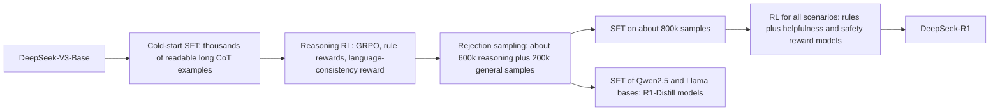

# Reinforcement Learning for Reasoning: GRPO and Verifiable Rewards

## Introduction

In September 2024 OpenAI released o1, a model that "thinks" for a long time before answering and is much stronger at math and code than earlier chat models. In January 2025 DeepSeek published DeepSeek-R1 together with its weights and a description of the method, and the core recipe turned out to be surprisingly simple: take a strong base model, give it math and coding problems whose answers a program can check, and run reinforcement learning with a critic-free algorithm called GRPO. Long chains of thought, self-verification and backtracking emerged from the reward alone.

This page explains that recipe. It differs from the RLHF of page 2 in two ways. The reward is not a learned model of human taste but a *verifier*: a function that checks whether the final answer is correct or whether the code passes its tests. And the algorithm drops PPO's value model, estimating advantages by comparing several answers to the same prompt.

By the end you will be able to:

- Write the GRPO objective, explain each term, and compute group-normalized advantages by hand.
- Implement GRPO in PyTorch and watch it learn from a sparse 0/1 reward.
- Explain the length and difficulty biases in the original GRPO loss and the fixes proposed by DAPO and Dr. GRPO.
- Describe the DeepSeek-R1 pipeline and what reasoning RL can and cannot add to a base model.
- Configure TRL's `GRPOTrainer` with your own reward functions.

## Verifiable Rewards

Reinforcement learning with verifiable rewards (RLVR; the name comes from the Tulu 3 report by Lambert et al., 2024) replaces the reward model with a program:

- **Math:** extract the final answer (for example the content of `\boxed{}`) and compare it with the reference, symbolically if possible. Hugging Face's `math-verify` package does this parsing and equivalence checking.
- **Code:** run the generated program against unit tests in a sandbox; reward 1 if all pass.
- **Instruction constraints:** check "answer in exactly three bullet points" or "do not use the letter e" with a script, as Tulu 3 did with IFEval-style constraints.
- **Format:** reward the presence of a required structure, such as reasoning inside `<think>` and `</think>` tags.

The appeal is that a verifier is much harder to hack than a neural reward model. DeepSeek-R1's authors state that they did not use neural reward models for reasoning tasks precisely because they observed reward hacking with them during large-scale RL. The limitation is equally clear: verifiers exist only for tasks with checkable answers. Open-ended writing still needs reward models or judges.

Verifiers can still be gamed. A math checker that accepts any string containing the right number rewards answers that list many numbers; a code reward based on tests that the model can read invites special-casing the tests. Treat the verifier as part of the attack surface and inspect samples during training.

## The GRPO Objective

Group Relative Policy Optimization was introduced by Shao et al. (2024) in the DeepSeekMath paper. For each prompt $q$, sample a *group* of $G$ outputs $o_1, \dots, o_G$ from the current policy $\pi_{\theta_{\mathrm{old}}}$, score each with the reward function to get $r_1, \dots, r_G$, and set every token of output $i$ to the same advantage:

$$
\hat{A}_{i,t} = \frac{r_i - \mathrm{mean}(r_1, \dots, r_G)}{\mathrm{std}(r_1, \dots, r_G)}
$$

The group mean plays the role of PPO's value function: it estimates how well the policy does on this prompt, so an answer is rewarded only for being better than its siblings. The objective then reuses PPO's clipped ratio and adds a KL penalty directly to the loss rather than to the reward:

$$
\mathcal{J}_{\mathrm{GRPO}}(\theta) = \mathbb{E}\left[\frac{1}{G}\sum_{i=1}^{G}\frac{1}{\lvert o_i \rvert}\sum_{t=1}^{\lvert o_i \rvert}\Big(\min\big(\rho_{i,t}\hat{A}_{i,t},\ \mathrm{clip}(\rho_{i,t}, 1-\epsilon, 1+\epsilon)\hat{A}_{i,t}\big) - \beta\, \mathbb{D}_{\mathrm{KL}}\big[\pi_\theta \Vert \pi_{\mathrm{ref}}\big]\Big)\right]
$$

with the token-level ratio $\rho_{i,t} = \pi_\theta(o_{i,t} \mid q, o_{i,\lt t}) / \pi_{\theta_{\mathrm{old}}}(o_{i,t} \mid q, o_{i,\lt t})$ and the per-token KL estimated with the non-negative $k_3$ estimator

$$
\mathbb{D}_{\mathrm{KL}} \approx \frac{\pi_{\mathrm{ref}}(o_{i,t} \mid \cdot)}{\pi_\theta(o_{i,t} \mid \cdot)} - \log \frac{\pi_{\mathrm{ref}}(o_{i,t} \mid \cdot)}{\pi_\theta(o_{i,t} \mid \cdot)} - 1
$$

Compared with PPO for RLHF (page 2), GRPO removes the value model and its optimizer state, roughly halving the trained parameters, and removes GAE and its hyperparameters. The price is sampling $G$ outputs per prompt, which reasoning RL wants anyway.

**Numeric example.** Eight answers to one problem, two correct:

```python
import torch

rewards = torch.tensor([1., 0., 0., 1., 0., 0., 0., 0.])     # G = 8 answers to one prompt
adv = (rewards - rewards.mean()) / (rewards.std() + 1e-4)    # torch.std is the sample std
print("mean", rewards.mean().item(), " std", round(rewards.std().item(), 4))
print("advantages", adv.numpy().round(3))
```

```text
mean 0.25  std 0.4629
advantages [ 1.62 -0.54 -0.54  1.62 -0.54 -0.54 -0.54 -0.54]
```

By hand: the mean is $2/8 = 0.25$. The sample standard deviation is $\sqrt{(2 \times 0.75^2 + 6 \times 0.25^2)/7} = \sqrt{1.5/7} = 0.463$. Correct answers get $0.75 / 0.463 = 1.62$ and wrong ones $-0.25 / 0.463 = -0.54$. The advantages sum to zero, so the group as a whole neither gains nor loses probability; mass moves from the wrong answers to the right ones. If all eight answers had been right, or all wrong, every advantage would be zero and the prompt would contribute no gradient at all. Keep that in mind; it matters below.

## Implementing GRPO on a Toy Task

The following script trains a tiny policy with GRPO. The "prompt" is a pair of digits $(a, b)$, the "response" is one of 19 possible answers, and the verifier returns 1 if the answer equals $a + b$. The response is a single token, so per-token and per-sequence quantities coincide, but every other ingredient is real: group sampling, normalized advantages, a reused batch with clipped ratios ($\mu = 2$ updates per batch), and the $k_3$ KL penalty to a frozen reference.

```python
import torch
import torch.nn as nn

torch.manual_seed(0)
torch.set_num_threads(2)
# Task with a verifiable reward: given digits a, b output a + b (19 possible answers).
class Policy(nn.Module):
    def __init__(self, d=64):
        super().__init__()
        self.emb = nn.Embedding(10, d)
        self.mlp = nn.Sequential(nn.Linear(2 * d, 128), nn.ReLU(), nn.Linear(128, 19))
    def forward(self, a, b):                       # a, b: (B,)
        return self.mlp(torch.cat([self.emb(a), self.emb(b)], -1))   # (B, 19) logits

policy = Policy()
ref = Policy(); ref.load_state_dict(policy.state_dict())             # frozen reference
opt = torch.optim.Adam(policy.parameters(), lr=3e-3)
G, n_prompts, eps, beta, mu = 8, 32, 0.2, 0.01, 2

def reward_fn(a, b, answer):                      # the "verifier"
    return (answer == a + b).float()

for step in range(301):
    a, b = torch.randint(0, 10, (n_prompts,)), torch.randint(0, 10, (n_prompts,))
    a, b = a.repeat_interleave(G), b.repeat_interleave(G)          # (n_prompts*G,)
    with torch.no_grad():
        old_logp_all = torch.log_softmax(policy(a, b), -1)
        answer = torch.multinomial(old_logp_all.exp(), 1).squeeze(1)   # sample G answers per prompt
        old_logp = old_logp_all.gather(1, answer[:, None]).squeeze(1)
        ref_logp = torch.log_softmax(ref(a, b), -1).gather(1, answer[:, None]).squeeze(1)
        r = reward_fn(a, b, answer).view(n_prompts, G)               # (n_prompts, G)
        adv = ((r - r.mean(1, keepdim=True)) / (r.std(1, keepdim=True) + 1e-4)).view(-1)
        zero_var = (r.std(1) == 0).float().mean()                    # groups with no signal
    for _ in range(mu):                                              # reuse the rollouts mu times
        logp = torch.log_softmax(policy(a, b), -1).gather(1, answer[:, None]).squeeze(1)
        ratio = torch.exp(logp - old_logp)
        surr = torch.min(ratio * adv, torch.clamp(ratio, 1 - eps, 1 + eps) * adv)
        rho = torch.exp(ref_logp - logp)
        kl = rho - 1 - torch.log(rho)                                # k3 estimator, >= 0
        loss = -(surr - beta * kl).mean()
        opt.zero_grad(); loss.backward(); opt.step()
    if step % 50 == 0:
        with torch.no_grad():
            ga, gb = torch.meshgrid(torch.arange(10), torch.arange(10), indexing="ij")
            greedy = policy(ga.flatten(), gb.flatten()).argmax(-1)
            acc = (greedy == ga.flatten() + gb.flatten()).float().mean()
        print(f"step {step:3d}  mean reward {r.mean():.3f}  zero-variance groups {zero_var:.2f}"
              f"  greedy accuracy on all 100 sums {acc:.2f}")
```

```text
step   0  mean reward 0.051  zero-variance groups 0.66  greedy accuracy on all 100 sums 0.10
step  50  mean reward 0.508  zero-variance groups 0.84  greedy accuracy on all 100 sums 0.50
step 100  mean reward 0.637  zero-variance groups 0.91  greedy accuracy on all 100 sums 0.60
step 150  mean reward 0.715  zero-variance groups 0.97  greedy accuracy on all 100 sums 0.65
step 200  mean reward 0.715  zero-variance groups 0.97  greedy accuracy on all 100 sums 0.65
step 250  mean reward 0.684  zero-variance groups 0.91  greedy accuracy on all 100 sums 0.65
step 300  mean reward 0.594  zero-variance groups 1.00  greedy accuracy on all 100 sums 0.67
```

The policy learns from nothing but a 0/1 signal: from 5 percent reward (chance is $1/19$) to around 70 percent. Then it stalls, and the third column says why. At step 0, two thirds of the groups are all-wrong and give no gradient. By the end, *every* group has zero variance: on each problem the policy either always answers correctly or always gives the same wrong answer. It has collapsed to near-deterministic behavior, and on the problems it gets wrong it never samples the right answer, so the reward cannot teach it anything more. This *entropy collapse* is exactly the failure that DAPO set out to fix at scale.

## Fixing GRPO: DAPO and Dr. GRPO

Two 2025 papers dissected GRPO on long chain-of-thought training.

**DAPO** (Yu et al., 2025, ByteDance Seed and Tsinghua AIR) introduced four changes and reached 50 points on AIME 2024 with Qwen2.5-32B, compared with 47 for DeepSeek's R1-Zero-style run on the same base, in half the training steps; their naive GRPO baseline reached 30.

1. **Clip-Higher.** Decouple the clip range into $\epsilon_{\mathrm{low}} = 0.2$ and $\epsilon_{\mathrm{high}} = 0.28$. With a symmetric clip, a token with probability 0.01 can only grow to 0.012 per update, so rare but good tokens (the exploratory ones) are held back while common tokens are not. Raising the upper bound keeps entropy from collapsing.
2. **Dynamic Sampling.** Over-sample prompts and drop groups whose answers are all correct or all wrong, so every batch is full of prompts that actually produce gradient. This is the zero-variance problem from the toy above.
3. **Token-Level Policy Gradient Loss.** Normalize by the total number of tokens in the batch instead of averaging per sequence first (see below).
4. **Overlong Reward Shaping.** Responses truncated at the length limit get a soft penalty that ramps from 0 to $-1$ over the last 4,096 tokens before a 20,480-token limit, rather than an abrupt zero reward that punishes good but long reasoning.

DAPO also removed the KL term entirely, arguing that for long reasoning the policy is *supposed* to move far from the initial model, and a verifier, unlike a learned reward model, does not need the KL to prevent hacking. Its reward is +1 for a correct answer and $-1$ otherwise.

**Dr. GRPO** (Liu et al., 2025, "Understanding R1-Zero-Like Training: A Critical Perspective") identified two biases in the original objective:

- **Length bias.** Dividing by $\lvert o_i \rvert$ means each token of a long response gets a smaller gradient. For a wrong answer (negative advantage), length dilutes the penalty, so the model learns that being wrong at length is cheaper than being wrong briefly. This partly explains the ever-growing response lengths reported in R1-Zero-style runs.
- **Difficulty bias.** Dividing advantages by the group's standard deviation up-weights prompts where almost all answers agree (very easy or very hard ones), because their std is small.

Dr. GRPO removes both: no per-response length normalization (divide by a constant such as the maximum length instead) and no std division. The script shows how the three normalizations distribute gradient between a 100-token correct answer and a 400-token wrong one:

```python
import torch

lengths = torch.tensor([100, 400])        # a short correct answer and a long wrong one
A = torch.tensor([1.0, -1.0])
G, L_max = 2, 1000
per_token = {
    "grpo   (mean over own tokens, then over group)": A / lengths / G,
    "dapo   (sum over all tokens / total tokens)   ": A / lengths.sum(),
    "dr_grpo(sum over all tokens / (G * L_max))   ": A / (G * L_max),
}
for k, w in per_token.items():
    total = w * lengths
    print(f"{k}: per-token weight {w.numpy()}  total per answer {total.numpy().round(3)}")
```

```text
grpo   (mean over own tokens, then over group): per-token weight [ 0.005   -0.00125]  total per answer [ 0.5 -0.5]
dapo   (sum over all tokens / total tokens)   : per-token weight [ 0.002 -0.002]  total per answer [ 0.2 -0.8]
dr_grpo(sum over all tokens / (G * L_max))   : per-token weight [ 0.0005 -0.0005]  total per answer [ 0.05 -0.2 ]
```

Under the original normalization each token of the long wrong answer is pushed down four times less than each token of the short right answer is pushed up. Under the DAPO and Dr. GRPO normalizations every token is treated equally, so the long wrong answer receives proportionally more total penalty. TRL exposes these choices as `loss_type="grpo"`, `"dapo"` (the current default) and `"dr_grpo"`, and the std scaling as `scale_rewards`.

A third refinement, **GSPO** (Zheng et al., 2025, from the Qwen team), replaces the per-token importance ratio with a single sequence-level ratio and clips whole responses. The authors report that it stabilizes RL for mixture-of-experts models, where token-level ratios fluctuate when routing changes between the old and new policy, and that it was used for later Qwen3 models.

## The DeepSeek-R1 Pipeline

DeepSeek-R1 (DeepSeek-AI, 2025) has two parts: a pure-RL experiment and a production pipeline.

**DeepSeek-R1-Zero** starts from DeepSeek-V3-Base with no SFT at all. A simple template asks the model to put its reasoning between `<think>` tags and then give the answer. The reward is rule-based: an accuracy reward (answer checked against the reference, or code run against tests) plus a format reward for using the tags. With GRPO, pass@1 on AIME 2024 rose from 15.6 percent to 71.0 percent in the January 2025 report (the later, extended version of the paper reports 77.9 percent), and to 86.7 percent with majority voting. Response length grew steadily during training without being rewarded directly, and the authors describe an "aha moment" where the model began to stop, re-evaluate and correct itself mid-solution, visible as a sharp rise in words like "wait". The paper's reported settings include a learning rate of 3e-6, a KL coefficient of 0.001, 16 samples per question and a maximum length of 32,768 tokens.

R1-Zero's reasoning was strong but hard to read: it mixed languages and lacked formatting. **DeepSeek-R1** fixed that with four stages:



The language-consistency reward is the fraction of chain-of-thought words in the target language; it slightly lowered benchmark scores but made the reasoning readable. The same 800k samples were used to fine-tune six smaller open models (Qwen2.5-Math-1.5B and 7B, Llama-3.1-8B, Qwen2.5-14B and 32B, Llama-3.3-70B-Instruct) with SFT only, no RL. DeepSeek-R1-Distill-Qwen-32B scored 72.6 on AIME 2024 according to the model card, and the authors found that distilling from R1 beat running RL directly on the smaller models. Page 5 explains why distillation is so effective.

The paper also reports what did *not* work for them: process reward models (scoring each reasoning step), which were hard to define and prone to reward hacking, and Monte Carlo Tree Search, whose search space over tokens was too large.

## Worked Scenario: Cold Start and the Limits of RL

Two questions come up whenever someone plans a reasoning RL run: should I do SFT first, and can RL teach the model things it cannot already do? The toy task gives a small, honest answer to both. The script below compares RL from scratch with RL after a "cold start" SFT on 30 of the 100 sums, and reports greedy accuracy and pass@8 (the chance that at least one of 8 samples is correct) before and after 300 GRPO steps, over three seeds.

```python
import torch
import torch.nn as nn
import torch.nn.functional as F

torch.set_num_threads(2)

class Policy(nn.Module):
    def __init__(self, d=64):
        super().__init__()
        self.emb = nn.Embedding(10, d)
        self.mlp = nn.Sequential(nn.Linear(2 * d, 128), nn.ReLU(), nn.Linear(128, 19))
    def forward(self, a, b):                       # a, b: (B,)
        return self.mlp(torch.cat([self.emb(a), self.emb(b)], -1))   # (B, 19) logits

ga, gb = [t.flatten() for t in torch.meshgrid(torch.arange(10), torch.arange(10), indexing="ij")]

def evaluate(policy):
    with torch.no_grad():
        p = torch.softmax(policy(ga, gb), -1)
        greedy = (p.argmax(-1) == ga + gb).float().mean().item()
        p_correct = p[torch.arange(100), ga + gb]
        pass8 = (1 - (1 - p_correct) ** 8).mean().item()     # chance one of 8 samples is right
    return greedy, pass8

def grpo(policy, steps=300, G=8, n_prompts=32, mu=2, eps=0.2, beta=0.01):
    ref = Policy(); ref.load_state_dict(policy.state_dict())
    opt = torch.optim.Adam(policy.parameters(), lr=3e-3)
    for _ in range(steps):
        a, b = torch.randint(0, 10, (n_prompts,)), torch.randint(0, 10, (n_prompts,))
        a, b = a.repeat_interleave(G), b.repeat_interleave(G)
        with torch.no_grad():
            old_all = torch.log_softmax(policy(a, b), -1)
            ans = torch.multinomial(old_all.exp(), 1).squeeze(1)
            old = old_all.gather(1, ans[:, None]).squeeze(1)
            refl = torch.log_softmax(ref(a, b), -1).gather(1, ans[:, None]).squeeze(1)
            r = (ans == a + b).float().view(n_prompts, G)
            adv = ((r - r.mean(1, keepdim=True)) / (r.std(1, keepdim=True) + 1e-4)).view(-1)
        for _ in range(mu):
            logp = torch.log_softmax(policy(a, b), -1).gather(1, ans[:, None]).squeeze(1)
            ratio = torch.exp(logp - old)
            surr = torch.min(ratio * adv, torch.clamp(ratio, 1 - eps, 1 + eps) * adv)
            rho = torch.exp(refl - logp)
            loss = -(surr - beta * (rho - 1 - torch.log(rho))).mean()
            opt.zero_grad(); loss.backward(); opt.step()

def cold_start_sft(policy, n_examples=30, steps=100):
    idx = torch.randperm(100)[:n_examples]                     # a few labeled sums
    opt = torch.optim.Adam(policy.parameters(), lr=3e-3)
    for _ in range(steps):
        loss = F.cross_entropy(policy(ga[idx], gb[idx]), (ga + gb)[idx])
        opt.zero_grad(); loss.backward(); opt.step()

for label, warm in [("RL from scratch", False), ("30-example SFT, then RL", True)]:
    rows = []
    for seed in range(3):
        torch.manual_seed(seed)
        pol = Policy()
        if warm:
            cold_start_sft(pol)
        before = evaluate(pol)
        grpo(pol)
        rows.append((before, evaluate(pol)))
    print(label)
    for (g0, p0), (g1, p1) in rows:
        print(f"   before RL: greedy {g0:.2f} pass@8 {p0:.2f}   after RL: greedy {g1:.2f} pass@8 {p1:.2f}")
```

```text
RL from scratch
   before RL: greedy 0.05 pass@8 0.34   after RL: greedy 0.67 pass@8 0.67
   before RL: greedy 0.03 pass@8 0.35   after RL: greedy 0.69 pass@8 0.70
   before RL: greedy 0.04 pass@8 0.35   after RL: greedy 0.71 pass@8 0.71
30-example SFT, then RL
   before RL: greedy 0.30 pass@8 0.30   after RL: greedy 0.37 pass@8 0.37
   before RL: greedy 0.30 pass@8 0.30   after RL: greedy 0.35 pass@8 0.35
   before RL: greedy 0.30 pass@8 0.30   after RL: greedy 0.37 pass@8 0.37
```

The result is the opposite of what many people expect, and it is instructive. The SFT model memorized its 30 sums perfectly and became confidently wrong on the other 70: its pass@8 equals its greedy accuracy, meaning it has no diversity left to explore. RL then has almost nothing to work with and ends at 35 to 37 percent, far below the 70 percent reached from an uncertain random start.

Two lessons transfer to real models, with the caveat that a 19-way classifier is not an LLM:

- **A cold start must not destroy exploration.** The Qwen3 report says exactly this about its long chain-of-thought cold start: it deliberately used few samples and training steps so as not to limit what later RL could achieve. DeepSeek-R1 used only thousands of cold-start examples. Over-trained SFT before RL is a real failure mode.
- **RL mostly converts pass@k into pass@1.** In both runs, after RL pass@8 and greedy accuracy coincide: RL sharpened the policy onto answers it could already sample. Yue et al. (2025) found the same at scale: RLVR models beat their base models at pass@1, but at large $k$ (hundreds of samples) the base models solve as many or more problems. Others argue that long RL runs do expand the frontier. The safe planning assumption is that RL amplifies abilities the base model shows at least occasionally, which is why the quality of the base model matters so much.

## Using TRL's GRPOTrainer

TRL implements all of the above. A reward function receives the completions plus any extra dataset columns and returns one float per completion. This script needs a GPU and the `trl` package (tested API: TRL 1.16); it is not meant to run on CPU.

```python
import re
from datasets import load_dataset
from trl import GRPOConfig, GRPOTrainer
from trl.rewards import accuracy_reward      # math-verify based answer checking

def format_reward(completions, **kwargs):
    """1.0 if the reasoning is wrapped in think tags, else 0.0."""
    texts = [c[0]["content"] for c in completions]   # conversational format
    return [1.0 if re.match(r"(?s)^<think>.+</think>.+", t) else 0.0 for t in texts]

dataset = load_dataset("trl-lib/DeepMath-103K", split="train")

args = GRPOConfig(
    output_dir="qwen-grpo",
    num_generations=8,          # G, completions per prompt
    max_completion_length=1024,
    learning_rate=1e-6,
    beta=0.0,                   # KL coefficient; TRL's default is 0.0 (no reference model)
    epsilon=0.2,                # lower clip
    epsilon_high=0.28,          # DAPO clip-higher
    loss_type="dapo",           # token-level normalization (default); "grpo" or "dr_grpo" also exist
    scale_rewards="group",      # divide by the group std; False gives Dr. GRPO-style advantages
)
trainer = GRPOTrainer(
    model="Qwen/Qwen2.5-0.5B-Instruct",
    reward_funcs=[accuracy_reward, format_reward],   # rewards are summed
    args=args,
    train_dataset=dataset,
)
trainer.train()
```

Watch these logged metrics: the mean reward, the fraction of groups with zero reward std (if it approaches 1, add harder prompts or dynamic sampling), the mean completion length, the fraction of clipped completions (truncated at `max_completion_length`), and the entropy. Generation dominates wall-clock time, so for anything beyond a toy, enable TRL's vLLM integration.

## Common Mistakes

- Running RL on prompts that are too easy or too hard for the model. Groups that are all correct or all wrong produce zero advantage; filter the dataset to problems the model solves sometimes.
- Over-training SFT before RL. A confident, low-entropy policy cannot explore; keep the cold start short.
- Using a sloppy verifier. If the checker accepts malformed or multi-answer outputs, the model will find that; test the reward function on adversarial strings before training.
- Ignoring truncation. Answers cut off at the length limit usually score zero; without overlong shaping the model learns to be short rather than right, or rewards are noisy.
- Comparing runs with different loss normalizations as if they were the same algorithm. Check `loss_type` and reward scaling when reproducing a paper.
- Concluding that RL taught a new skill from pass@1 alone. Compare pass@k at large $k$ with the base model before claiming new capabilities.

## Summary

- RLVR replaces a learned reward model with a program that checks answers, making large-scale RL on math and code feasible and harder to hack.
- GRPO samples $G$ answers per prompt and uses the group-normalized reward as every token's advantage, removing PPO's value model.
- Groups with identical rewards give no gradient; entropy collapse makes this worse over training. DAPO's clip-higher and dynamic sampling target exactly that.
- The original per-response length normalization and std scaling bias training toward long wrong answers and extreme-difficulty prompts; DAPO and Dr. GRPO normalize per token and can drop the std.
- DeepSeek-R1 showed that long reasoning emerges from GRPO with rule-based rewards, then made it readable with a short cold start, rejection sampling and a final general RL stage, and distilled it into smaller models with SFT.
- RL mainly sharpens what a model can already sample; a short cold start and a strong base model set its ceiling.

## Further Reading

- [DeepSeekMath: Pushing the Limits of Mathematical Reasoning in Open Language Models (Shao et al., 2024)](https://arxiv.org/abs/2402.03300): introduces GRPO.
- [DeepSeek-R1: Incentivizing Reasoning Capability in LLMs via Reinforcement Learning (DeepSeek-AI, 2025)](https://arxiv.org/abs/2501.12948): R1-Zero, the R1 pipeline and the distilled models.
- [DAPO: An Open-Source LLM Reinforcement Learning System at Scale (Yu et al., 2025)](https://arxiv.org/abs/2503.14476): clip-higher, dynamic sampling, token-level loss, overlong shaping.
- [Understanding R1-Zero-Like Training: A Critical Perspective (Liu et al., 2025)](https://arxiv.org/abs/2503.20783): Dr. GRPO and the length and difficulty biases.
- [Group Sequence Policy Optimization (Zheng et al., 2025)](https://arxiv.org/abs/2507.18071): sequence-level ratios for stable MoE RL.
- [Tulu 3: Pushing Frontiers in Open Language Model Post-Training (Lambert et al., 2024)](https://arxiv.org/abs/2411.15124): coins RLVR and applies it to math and instruction constraints.
- [Does Reinforcement Learning Really Incentivize Reasoning Capacity in LLMs Beyond the Base Model? (Yue et al., 2025)](https://arxiv.org/abs/2504.13837): the pass@k analysis.
- [Qwen3 Technical Report (Yang et al., 2025)](https://arxiv.org/abs/2505.09388): cold start, reasoning RL and thinking-mode fusion.
- [TRL GRPOTrainer documentation](https://huggingface.co/docs/trl/main/en/grpo_trainer): loss types, reward functions and vLLM generation.
- [Reasoning Models and Test-Time Compute](../13-llm-advanced-architectures/3-llm-reasoning-models.mdx): how reasoning models spend compute at inference time.
